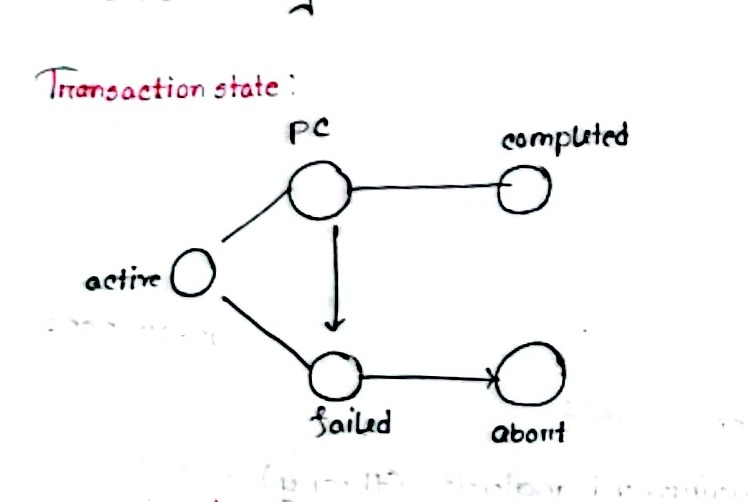
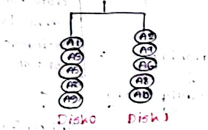
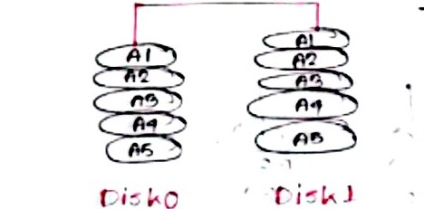
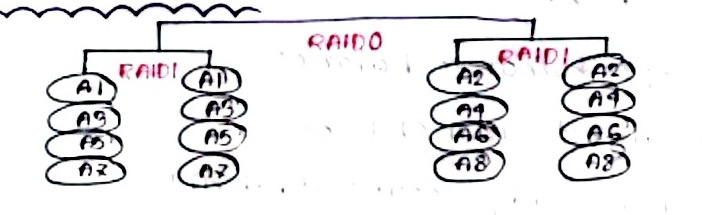
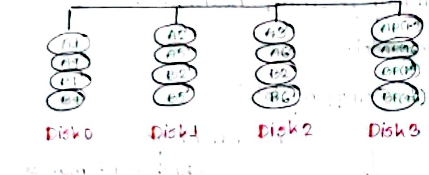
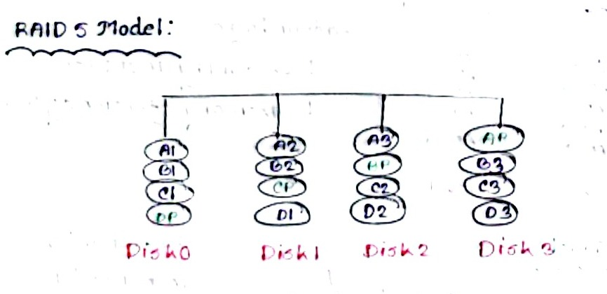
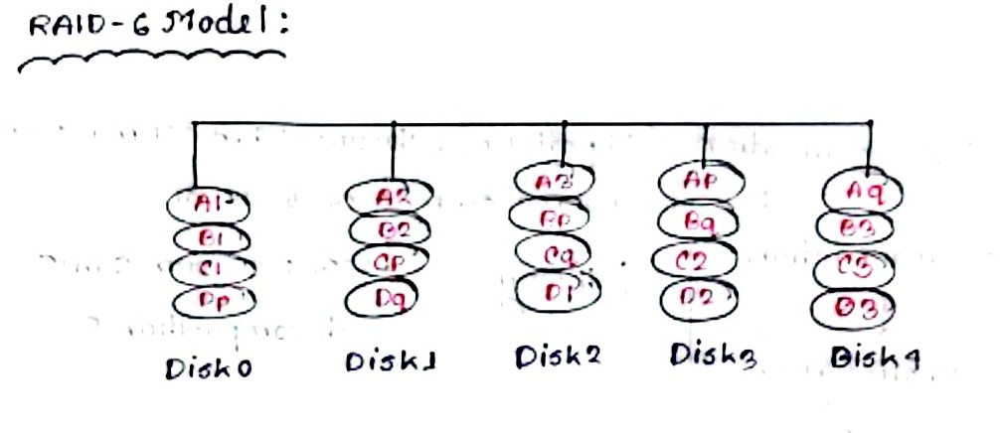

# Database Systems (ECE 2215) — Class Notes

**Course:** ECE 2215: Database Systems (3.00 Credits)  
**Institution:** Rajshahi University of Engineering & Technology (RUET)  
**Department:** Department of Electronics and Telecommunication Engineering (ECE)  
**Instructors:** Mst. Nafia Islam Shishir (NIS MAM) & Md. Rakibul Islam (RI SIR)  
**Student Note-taker:** Raidah (Roll: 2310035)  
**Textbook Reference:** Silberschatz, Korth & Sudarshan, *Database System Concepts* (7th Edition)

---

## CLASS-01 | 29.06.2024 | HAFSA MAM

<!-- Page 1 -->

📖 **Database System Concepts** $\longleftarrow$ Book name  
* Seventh Edition

⊕ **DBMS $\rightarrow$ Database Management System**
* $\llcorner$ collection of interrelated data.
* $\llcorner$ a set of programs to access those data.

📖 It is needed to manage large bodies of information.

* **Importance?**

* **Applications?** Accounting, Banking, Airlines etc.
  * $\llcorner$ data highly available
  * $\llcorner$ are relatively large
  * $\llcorner$ accessed by multiple users

* **Data Model:**
  * Relational Model

* **Programming language:** MySQL

---

<!-- Page 2 (Left) -->

### Code 1:

```sql
SELECT * FROM Customers;
```
* `SELECT` $\rightarrow$ keyword
* `*` $\rightarrow$ All data of database
* `Customers` $\rightarrow$ variable / table name
* `FROM` $\rightarrow$ Query execution begins here (specifies source relation)

```sql
SELECT Customername FROM Customers;
```

**RDBMS $\rightarrow$ Relational Database Management System.**
* Connecting multiple related database tables with relationships constitutes an RDBMS.
* SQL Keywords are not case sensitive.

**Keywords:**
* `SELECT`
* `UPDATE`
* `DELETE`

---

<!-- Page 2 (Right) -->

* `INSERT INTO`
* `CREATE DATABASE`

#### Example:
```sql
SELECT Customername, city FROM Customers;
```
*(Here `Customername`, `city` are columns)*

* `SELECT DISTINCT` $\rightarrow$ Extracts unique data
  * $\downarrow$
  * Extracts data while eliminating duplicate rows

#### Example:
```sql
SELECT DISTINCT Country FROM Customers;
```

* `SELECT COUNT DISTINCT`

#### Example:
```sql
SELECT COUNT(DISTINCT Country) FROM Customers;
```

#### Example:
```sql
SELECT COUNT(DISTINCT District) FROM Customers;
```

---

<!-- Page 3 (Left) -->

### MySQL WHERE Clause
* $\rightarrow$ To specify search conditions
* $\rightarrow$ For row filtering

#### Example:
```sql
SELECT * FROM Customers
WHERE Country = 'MEXICO';
```

Another:
```sql
SELECT COUNT(DISTINCT District)
FROM Customers
WHERE District = 'DHAKA';
```

* **Supported comparison operations:**
  * `>`, `<`, `>=`, `<=`, `<>`, `BETWEEN`, `LIKE`, `IN`

#### Example: BETWEEN
```sql
SELECT * FROM Products
WHERE Price BETWEEN 50 AND 60;
```

```sql
SELECT Name FROM Students
WHERE CTmarks BETWEEN 10 AND 15;
```

---

<!-- Page 3 (Right) -->

* **Entity Relationship Model**
* **Semi-structured Data Model**
* **View level (custom user views)**

**Data Abstraction $\rightarrow$**
1. View level
2. Logical level
3. Physical level

### Sorting:
```sql
SELECT * FROM Customers
ORDER BY Price;
```
> [!NOTE]
> By default lowest to highest (ascending order).

```sql
SELECT Name FROM Students
WHERE CTmarks BETWEEN 10 AND 15
ORDER BY Roll;
```

```sql
SELECT * FROM Customers
ORDER BY Price DESC;
```

---

<!-- Page 4 (Left) -->

```sql
SELECT Name FROM Students;
```

```sql
SELECT * FROM Customers
WHERE Country = 'GERMAN' AND (City = 'BERLIN' OR City = 'Stuttgart');
```

---

## CLASS-02 | 27.06.2024

<!-- Page 4 (Right) -->

### Database System
* Importance, advantage & definition

* **How to make table?**
  * $\llcorner$ Dataset
  * **Step 01:** Database create.
  * **Step 02:** Table create (e.g., Students).
  * **Step 03:** Insert record.

> [!WARNING]
> `DROP` permanently deletes the entire database and its contents!

#### Drawbacks of storing data in a file system:
* Data Redundancy & inconsistency
* Difficulty in accessing data
* Data isolation — multiple files & formats
* Integrity problem
* Atomicity of updates
* Concurrent access by multiple users
* Security problems $\rightarrow$ hard to provide access to some users.

---

<!-- Page 5 (Left) -->

### Data Models

**INSERT INTO:**
```sql
INSERT INTO table_name (column1, column2, ...)
VALUES (value1, value2, ...);
```
* To insert all values, no need to mention the column names.
* `INSERT INTO` used to add record.

```sql
CREATE DATABASE school;
```

**Task:** Create a table `students` and insert marks for CT1 and CT2.

**Ans:**
```sql
CREATE TABLE students (
    student_id INT PRIMARY KEY,
    name VARCHAR(50),
    CT1 FLOAT,
    CT2 FLOAT
);

-- Alternative schema:
-- CREATE TABLE students (
--     name VARCHAR(50),
--     age INT,
--     grade CHAR(2)
-- );
```

```sql
INSERT INTO students (student_id, name, CT1, CT2)
VALUES ('035', 'Raidah', 15, 16),
       ('036', 'Oishe', 15, 16);
```

---

<!-- Page 5 (Right) -->

**Primary key:** Uniquely identifies each record in a database table.
* Once established, it remains immutable for a record, while subsequent records can be automatically sequenced/incremented (e.g., auto-incrementing from 32 to 33).

#### Add a new column to the table:
```sql
ALTER TABLE students
ADD COLUMN email VARCHAR(100);
```

#### Modify an existing column's datatype:
```sql
ALTER TABLE students
MODIFY COLUMN age INT NOT NULL;
-- or:
ALTER TABLE students
MODIFY COLUMN age FLOAT NOT NULL;
```

#### Rename a column:
```sql
ALTER TABLE students
CHANGE COLUMN grade student_grade CHAR(2);
```

* `DROP` a column from a table:
```sql
ALTER TABLE students
DROP COLUMN email;
```

* `DROP` a table:
```sql
DROP TABLE students;
```

* `DROP` a database:
```sql
DROP DATABASE school;
```

---

<!-- Page 6 (Left) -->

### SQL NULL Values
* `IS NULL` & `IS NOT NULL` syntax

**Syntax:**
```sql
SELECT column_name
FROM table_name
WHERE column_name IS NULL;
```
* Always use `IS NULL` to look for NULL values.

#### SQL UPDATE STATEMENT:
To modify one or more records in a table.

**Syntax:**
```sql
UPDATE table_name
SET column1 = value1, column2 = value2, ...
WHERE condition;
```

**Example:**
```sql
UPDATE Customers
SET customer_name = 'Raidah', city = 'Mym'
WHERE customerID = 1;
```
* UPDATE multiple records.

---

<!-- Page 6 (Right) -->

### SQL DELETE
```sql
DELETE FROM table_name
WHERE condition;
```

### SQL SELECT TOP CLAUSE
Used to limit the number of records to return:
```sql
SELECT TOP 3 * FROM Customer;
-- In MySQL:
-- SELECT * FROM Customer LIMIT 3;
```

---

## CLASS-03 | 29.06.2024

<!-- Page 7 (Left) -->

* **(PK) Primary key $\rightarrow$** Unique, never null.
* **(FK) Foreign key $\rightarrow$** Points to another table, can be multiple.
* **Schema $\rightarrow$** Variable declaration (structure).
* **Instance $\rightarrow$** Value of the variable (data at a particular moment).
* **Bad Schema Design $\rightarrow$** Unnecessary duplication.
* **DDL $\rightarrow$** Define & manage database (`CREATE`, `ALTER`, `DROP`).
* **DML $\rightarrow$** Deals with data manipulation (`SELECT`, `INSERT`, `UPDATE`, `DELETE`).

When establishing a relationship / connection between two tables, they are connected through a foreign key.

* **Schema:** Structural skeleton of tables.
* **Instance:** Values are variable and dynamically changing (actual data content).

#### Bad Schema Design Example:
| instructor | dept | budget |
| :--- | :--- | :--- |
| A | ECE | 50k |
| B | EEE | 40k |
| C | ECE | 50k |
| D | CSE | 28k |
| E | EEE | 40k |
| F | ECE | 50k |

> [!NOTE]
> Updating the value in one row without updating it in all other matching rows causes data inconsistency $\rightarrow$ Bad schema design.

---

<!-- Page 7 (Right) -->

* **DDL:** `CREATE`, `ALTER`, `DROP`
* **DML:** `SELECT`, `INSERT`, `UPDATE`, `DELETE`

### Question:
Given `Employee` table:

| emp_id (PK) | name | department | salary | city |
| :--- | :--- | :--- | :--- | :--- |
| 1 | Alice | IT | 5000 | Dhaka |
| 2 | Bob | HR | 4000 | Chittagong |
| 3 | Carol | IT | 6000 | Dhaka |
| 4 | David | FINANCE | 7000 | Sylhet |
| 5 | Eva | HR | 4500 | Dhaka |

**Q1 $\rightarrow$ SELECT:** Show the name and salary of all employees.  
**Ans:**
```sql
SELECT name, salary FROM Employee;
```

**Q2 $\rightarrow$ SELECT + WHERE:** Show all employees who work in the IT Dept.  
**Ans:**
```sql
SELECT * FROM Employee
WHERE department = 'IT';
```

---

<!-- Page 8 (Left) -->

**Q3 $\rightarrow$ SELECT + WHERE:** Show employees whose salary is greater than 4500.  
**Ans:**
```sql
SELECT * FROM Employee
WHERE salary > 4500;
```

**Q4 $\rightarrow$ SELECT + ORDER BY:** List all employees ordered by salary from highest to lowest.  
**Ans:**
```sql
SELECT * FROM Employee
ORDER BY salary DESC;
```

**Q5 $\rightarrow$ UPDATE:** Update Bob's salary to 4800.  
**Ans:**
```sql
UPDATE Employee
SET salary = 4800
WHERE name = 'Bob';
```

**Q6 $\rightarrow$ UPDATE:** Give all IT department employees a 10% raise.  
**Ans:**
```sql
UPDATE Employee
SET salary = salary * 1.10
WHERE department = 'IT';
```

---

<!-- Page 8 (Right) -->

**Q7 $\rightarrow$ DELETE:** Delete the employee with `emp_id = 1`.  
**Ans:**
```sql
DELETE FROM Employee
WHERE emp_id = 1;
```
*(Since it is the primary key, `emp_id` uniquely identifies the target tuple)*

**Q8 $\rightarrow$ INSERT:** Add a new employee — Farhan, Finance dept, salary 5500, city Dhaka.  
**Ans:**
```sql
-- If emp_id is auto-incrementing:
INSERT INTO Employee (name, department, salary, city)
VALUES ('Farhan', 'Finance', 5500, 'Dhaka');
-- If emp_id requires manual PK specification:
-- INSERT INTO Employee (emp_id, name, department, salary, city)
-- VALUES (6, 'Farhan', 'Finance', 5500, 'Dhaka');
```

---

<!-- Page 9 (Left) -->

**Q1: SELECT + WHERE + AND:** Show all employees who are in IT dept AND have salary greater than 5000.  
**Ans:**
```sql
SELECT * FROM Employee
WHERE department = 'IT' AND salary > 5000;
```

**Q2: SELECT + WHERE + OR:** Show employees who live in Dhaka OR work in Finance.  
**Ans:**
```sql
SELECT * FROM Employee
WHERE city = 'Dhaka' OR department = 'Finance';
```

**Q3: SELECT + WHERE + BETWEEN:** Show employees whose salary is between 4000 and 6000.  
**Ans:**
```sql
SELECT * FROM Employee
WHERE salary BETWEEN 4000 AND 6000;
```

---

<!-- Page 9 (Right) -->

**Q4: SELECT + WHERE + LIKE:** Show employees whose name starts with letter 'A' or 'C'.  
**Ans:**
```sql
SELECT * FROM Employee
WHERE name LIKE 'A%' OR name LIKE 'C%';
```

**Q5: SELECT + COUNT:** How many employees are in HR dept?  
**Ans:**
```sql
SELECT COUNT(emp_id) FROM Employee
WHERE department = 'HR';
```

**Q6: SELECT + AVG:** Find average salary.  
**Ans:**
```sql
SELECT AVG(salary) AS avg_salary FROM Employee;
```

**Q7: SELECT + MAX:** Find maximum salary.  
**Ans:**
```sql
SELECT MAX(salary) FROM Employee;
```

**Q8: SELECT + MIN:** Find minimum salary.  
**Ans:**
```sql
SELECT MIN(salary) FROM Employee;
```

**Q9: UPDATE:** Give 500 salary raise to HR employees earning less than 4500.  
**Ans:**
```sql
UPDATE Employee
SET salary = salary + 500
WHERE salary < 4500 AND department = 'HR';
```

---

<!-- Page 10 (Left) -->

**Q10: DELETE + WHERE + AND:** Delete employees who are in Finance dept and live in Sylhet.  
**Ans:**
```sql
DELETE FROM Employee
WHERE department = 'Finance' AND city = 'Sylhet';
```

**Q11: SELECT + GROUP BY:** Show the total salary paid to each department.  
**Ans:**
```sql
SELECT department, SUM(salary)
FROM Employee
GROUP BY department;
```

---

## CLASS-01 | 01.07.2024 | NIS MAM

<!-- Page 10 (Right) -->

### Introduction to Database & DBMS

* **Database:** Organized collection of data stored and accessed electronically.
* **Two types:**
  * $\rightarrow$ **Structured:** In table format.
  * $\rightarrow$ **Unstructured:** Document or key-value based.

#### Differences between Data & Information:

| Data | Information |
| :--- | :--- |
| Unorganised | Organised |
| Undefined | Defined |
| Smallest unit | Processed meaningful form |

* **Database Management System (DBMS):** Software system to access and manage the collection of interrelated data.
  * $\llcorner$ Characteristics
  * $\llcorner$ Application examples
  * $\llcorner$ Purposes of database systems

---

## CLASS-02 | 06.07.2024

<!-- Page 11 (Left) -->

### Components of Database:
* User data
* Metadata (data about data)

* $\rightarrow$ **Software:**
  * Actual DBMS software like MySQL, Oracle, PostgreSQL.
* $\rightarrow$ **Hardware:**
  * Physical devices like servers, disks, input-output devices (keyboard, monitor, printer).
* $\rightarrow$ **Procedure:**
  * Instructions and rules for using DBMS.
* $\rightarrow$ **Database Access Language:**
  * Used to interact with the database (create, read, update, delete data).
* $\rightarrow$ **Examples / Users of Relational Database System:**
  * Naive users
  * Application programmers

---

<!-- Page 11 (Right) -->

### Database Administrator (DBA):
* Schema definition
* Storage structure and access-method definition
* Schema and physical-organization modification
* Granting user authorization for data access
* Routine maintenance

### Data Model:
* Relational model
* Entity Relationship model
* Object-based data model
* Semi-structured data model (XML / JSON)
* *Other older models:*
  * Network model
  * Hierarchical model

### Levels of Abstraction:
Data abstraction (hiding internal storage and implementation details) $\rightarrow$ 3 levels of data abstraction:
1. $\Rightarrow$ **Physical level:** Describes *how* data are actually stored.
2. $\Rightarrow$ **Logical level:** Describes *what* data are stored and what relationships exist.
3. $\rightarrow$ **View level:** Describes only part of the database for specific users.

* **Instances & Schema:**
  * **Instance:** The collection of information stored in the database at a particular point in time (the actual content at a specific moment).
  * **Schema:** Logical design / structure of the database.
* **DDL:** Database Definition Language
* **DML:** Database Manipulation Language

---

<!-- Page 12 (Left) -->

* **DML Types:**
  * $\rightarrow$ **Procedural:** User specifies what data are required and how to get those data.
  * $\rightarrow$ **Declarative (Nonprocedural / SQL):** User specifies what data are required without specifying how to get them.
* **DQL $\rightarrow$** Data Query Language
* **Database access from Application Program:** (C, C++, Java, Python via ODBC/JDBC).

---

## CLASS-03 | 08.07.2024 | NIS MAM

### Database Design:
General structure of the database:
* $\rightarrow$ Logical design
* $\rightarrow$ Physical design

### Database Engine:
* $\rightarrow$ **Storage Manager:** Storage allocation, buffer manager, file manager.
* $\rightarrow$ **Query Processor:** DML compiler, DDL interpreter, query execution engine.
* $\rightarrow$ **Transaction Management:** Ensures atomicity, consistency, isolation, durability (ACID) and concurrency control.

---

<!-- Page 12 (Right) -->

### Database Architecture:
* Centralized database
* Client-server database
* Parallel databases
* Distributed database

### Database Application Architecture:
* $\llcorner$ Two-tier architecture (Client $\leftrightarrow$ Application/Database server)
* $\llcorner$ Three-tier architecture (Client $\leftrightarrow$ Web/App Server $\leftrightarrow$ Database Server)

### Intro to Relational Model
* In the Relational Model, data are stored in tabular format (tables / relations).
* Column $\rightarrow$ Attribute
* Row $\rightarrow$ Tuple $\rightarrow$ Information of an entity / person.
* **Attribute:** Required to be atomic (indivisible).
* Order of tuples in a relation is irrelevant.

---

<!-- Page 13 (Left) -->

### Keys:
* **Superkey:** Sufficient to identify a unique tuple of each possible relation $r(R)$.
  * $\llcorner$ A combination / set of multiple attributes that uniquely identifies a tuple.
* **Candidate key:** Minimal superkey (no proper subset is a superkey).
* **Primary key:** Chosen candidate key to identify tuples (unique, not null).
* **Foreign key:** Attribute in a relation that references the primary key of another table to connect relations.

---

## CLASS-04 | 11.07.2024 | NIS MAM

<!-- Page 13 (Right) -->

### Relational Algebra
Builds up logical relations and expressions.

**Basic operations:**
1. **Select ($\sigma$):** Selects tuples satisfying a given predicate.
2. **Project ($\Pi$):** Selects specified columns/attributes.
3. **Union ($\cup$):** Combines tuples from two union-compatible relations.
4. **Set difference ($- $):** Finds tuples in one relation but not another.
5. **Cartesian product ($\times$):** Combines each tuple of first relation with each tuple of second relation.
6. **Rename ($\rho$):** Renames a relation or attributes.
7. **Intersection ($\cap$):** Can be expressed via set difference: $r \cap s = r - (r - s)$, or applied using inner join.

#### Select Operation Examples:
$$\sigma_{\text{dept\_name} = \text{"ECE"}}(\text{student\_info})$$

$$\sigma_{\text{dept\_name} = \text{"ECE"} \wedge \text{Instructor} = X}(\text{student\_info})$$

#### Project Operation Examples:
$$\Pi_{\text{ID}, \text{Name}, \text{dept\_name}}(\text{student\_info})$$

#### Composition of Relational Operations:
$$\Pi_{\text{ID}, \text{Name}}(\sigma_{\text{dept\_name} = \text{"PHYSICS"}}(\text{student\_info}))$$

---

<!-- Page 14 (Left) -->

### Cartesian Product Operation:

Given `Instructor`:
| Instructor_ID | Instructor_Name |
| :--- | :--- |
| 1001 | X |
| 1002 | Y |

$$\text{student\_info} \times \text{Instructor}$$

### Join Operation:
Condition-based selection on cartesian product:
$$\sigma_{\text{instructor.ID} = \text{teaches.ID}}(\text{instructor} \times \text{teaches})$$

Natural join:
$$\text{student\_info} \bowtie \text{takes}$$

### Rename Operation:
$$\rho_{x}(E)$$
$$\rho_{x(A_1, A_2, \dots, A_n)}(E)$$
Example:
$$\rho_{X}(\Pi_{\text{ID}, \text{name}, \text{address}}(\text{Instructor}))$$

---

## CLASS-05 | 13.07.2024 | NIS MAM

<!-- Page 14 (Right) -->

### Aggregate Functions ($\gamma$ / $g$ / handwritten $8$):
* Average salary:
$$\gamma_{\text{avg}(\text{salary})}(\text{instructor})$$

* Count of courses in section:
$$\gamma_{\text{count}(\text{course\_id})}(\sigma_{\text{year} = 2018}(\text{section}))$$

* Grouping by department name:
$$_{\text{dept\_name}}\gamma_{\text{avg}(\text{salary})}(\text{instructor})$$
*(First column shows `dept_name`, second shows computed `avg(salary)`)*

### Equivalent Queries:
$$\sigma_{\text{dept\_name} = \text{"Physics"} \wedge \text{salary} > 90000}(\text{instructor})$$
is equivalent to:
$$\sigma_{\text{dept\_name} = \text{"Physics"}}(\sigma_{\text{salary} > 90000}(\text{instructor}))$$

### Pitfalls in Relational Database Design:
* Data redundancy $\rightarrow$ Inconsistent & repetitive data
* Poor normalization choice (reduces capability to represent facts cleanly)
* Indexing overhead
* Referential integrity violations
* Improper primary key selection
* Lacking data constraints
* Designing only for the present, not for future scalability.

---

## CLASS-06 | 15.07.2024 | NIS MAM

<!-- Page 15 (Left) -->

### Introduction to SQL

* **Integrity Constraints:**
  * Match, comparison, and domain constraints.
* **Domain Types:**
  * `numeric(p, d)`: $p$ is total precision, $d$ is scale.
  * E.g., `numeric(5, 2)` can store `700.50` (3 digits before decimal, 2 after).

---

## CLASS-07 | 19.07.2024

* **BETWEEN:** Range comparison.
* **IN:** Set membership:
```sql
SELECT * FROM Student
WHERE Division IN ('Dhaka', 'Mymensingh');
```
* **ORDER BY:** Sorting results.
* **GROUP BY:** Aggregating groups.
* **Aliasing:** `AS` keyword for columns and relations.

---

## CLASS-08 | 25.07.2024 | NIS MAM

<!-- Page 15 (Right) -->

* **RENAME:** Table / column renaming.
* **STRING OPERATION:**
  * `LIKE` pattern matching:
    * `%` matches any substring.
    * `_` matches any single character.
    * Match literal `'100%'`:
      ```sql
      SELECT * FROM table_name
      WHERE column_name LIKE '100\%' ESCAPE '\';
      ```
      *(Escape character `\` designates literal `%`)*

* **SET OPERATIONS:**
  * `UNION ALL` $\rightarrow$ Retains duplicates (includes all records including duplicate rows).
  * `INTERSECT ALL`
  * `EXCEPT ALL`

* **NULL values:** Arithmetic with NULL results in NULL; comparisons evaluate to unknown.
* **HAVING clause:** Condition on aggregate groups (evaluated after `GROUP BY`).
* **Nested subqueries:**
  * `SOME` / `ANY`: Condition satisfied for 1 or more values.
  * `ALL`: Condition satisfied for all values.

| ID | dept | salary |
| :--- | :--- | :--- |
| 1 | Bio | 10000 |
| 2 | Phy | 20000 |
| 3 | Bio | 15000 |
| 4 | Chem | 12000 |

---

## CLASS-09 | Correlated Subqueries

<!-- Page 16 (Left) -->

### Correlated Subqueries & EXISTS

Given `section` relation:
| course_id | sec_id | semester | year |
| :--- | :--- | :--- | :--- |
| 101 | 1 | Fall | 2017 |
| 102 | 1 | Fall | 2017 |
| 103 | 1 | Fall | 2017 |
| 104 | 1 | Spring | 2017 |
| 101 | 1 | Spring | 2018 |
| 105 | 1 | Spring | 2018 |
| 103 | 1 | Spring | 2018 |

Find courses taught in both Fall 2017 and Spring 2018:
```sql
SELECT course_id FROM section AS S
WHERE semester = 'Fall' AND year = 2017 AND
EXISTS (
    SELECT * FROM section AS T
    WHERE semester = 'Spring' AND year = 2018 AND S.course_id = T.course_id
);
```
* **Evaluation logic:**
  * Outer query: iterates through `section AS S` for `semester = 'Fall' AND year = 2017` (courses `101`, `102`, `103`).
  * Inner correlated query: searches `section AS T` for `semester = 'Spring' AND year = 2018 AND S.course_id = T.course_id`.
  * `EXISTS`: Returns `TRUE` if inner query result is non-empty:
    - For `course_id = 101`: Match exists in Spring 2018 $\implies$ `TRUE` (Selected).
    - For `course_id = 102`: No match in Spring 2018 (course 102 was not offered in Spring 2018) $\implies$ `FALSE` (Discarded).
    - For `course_id = 103`: Match exists in Spring 2018 $\implies$ `TRUE` (Selected).
* **Final Output:** `(101, 103)`

---

<!-- Page 16 (Right) -->

### Subqueries with NOT EXISTS (Universal Quantification)

Tables: `student(ID, name)`, `course(course_id, title, dept_name)`, `takes(ID, course_id)`.

Find all students who have taken all courses offered in the Biology department:
```sql
SELECT S.ID, S.name
FROM student AS S
WHERE NOT EXISTS (
    (SELECT course_id FROM course WHERE dept_name = 'Biology')
    EXCEPT
    (SELECT T.course_id FROM takes AS T WHERE T.ID = S.ID)
);
```

**Evaluation logic:**
* First, find all Biology courses.
* Then, find all courses taken by the current student.
* For student Rahim:
  * $( \text{Biology courses} ) - ( \text{Rahim's taken courses} ) = \emptyset$ (empty set).
  * `NOT EXISTS` receives an empty set and evaluates to `TRUE` $\rightarrow$ **Rahim is selected!**
* For student Karim:
  * The set difference $(\text{Biology courses}) - (\text{Karim's taken courses}) \neq \emptyset$ (some Biology courses remain untaken).
  * Passing a non-empty set into `NOT EXISTS` causes it to evaluate to `FALSE` $\rightarrow$ **Karim is NOT selected.**
* **Rule:** `NOT EXISTS` selects a tuple only when the inner subquery evaluates to an empty set ($\emptyset$).

---

<!-- Page 17 (Left) -->

* **Set Containment via Set Difference:**
  $$X - Y = \emptyset \iff X \subseteq Y$$

* **UNIQUE Constraint:** Evaluates to true if no duplicate tuples exist.

### Practice Schema:
Given relations:

**Student:**
| student_ID | name | dept | semester |
| :--- | :--- | :--- | :--- |
| 101 | Rahim | CSE | 3 |
| 102 | Karim | EEE | 4 |
| 103 | Nabila | CSE | 5 |
| 104 | Sumaiya | ECE | 3 |
| 105 | Hasan | EEE | 5 |
| 106 | Rafi | CSE | 4 |

**Enrollment:**
| student_ID | course_ID | course_name | Marks |
| :--- | :--- | :--- | :--- |
| 101 | C101 | DS | 82 |
| 102 | E101 | CT | 75 |
| 103 | C101 | DS | 81 |
| 104 | E102 | DE | 78 |
| 105 | E101 | CT | 88 |
| 106 | C102 | OS | 85 |

---

<!-- Page 17 (Right) -->

#### Questions & SQL Solutions:

**1) Find the name and student ID of the student who obtained the highest marks:**
```sql
-- (a) Using JOIN:
SELECT S.name, S.student_ID
FROM Student AS S
JOIN Enrollment AS E ON S.student_ID = E.student_ID
WHERE E.Marks = (SELECT MAX(Marks) FROM Enrollment);

-- (b) Alternative using Nested Subquery:
-- SELECT name, student_ID FROM Student
-- WHERE student_ID IN (
--     SELECT student_ID FROM Enrollment
--     WHERE Marks = (SELECT MAX(Marks) FROM Enrollment)
-- );
```

**2) Find the ID and name of the students whose marks are greater than average of all:**
```sql
-- Note: DISTINCT avoids duplicate student rows if a student scored above average in multiple courses.
SELECT DISTINCT S.student_ID, S.name
FROM Student AS S
JOIN Enrollment AS E ON S.student_ID = E.student_ID
WHERE E.Marks > (SELECT AVG(Marks) FROM Enrollment);

-- Alternative using Subquery:
-- SELECT student_ID, name FROM Student
-- WHERE student_ID IN (
--     SELECT student_ID FROM Enrollment
--     WHERE Marks > (SELECT AVG(Marks) FROM Enrollment)
-- );
```

**3) Find the name and dept of students who have enrolled in the course 'DS':**
```sql
SELECT DISTINCT S.name, S.dept
FROM Student AS S
JOIN Enrollment AS E ON S.student_ID = E.student_ID
WHERE E.course_name = 'DS';

-- Alternative using Subquery:
-- SELECT name, dept FROM Student
-- WHERE student_ID IN (
--     SELECT student_ID FROM Enrollment
--     WHERE course_name = 'DS'
-- );
```

**4) Find ID, course name and marks of the students whose marks are greater than marks of ID 102:**
```sql
SELECT student_ID, course_name, Marks
FROM Enrollment
WHERE Marks > (SELECT Marks FROM Enrollment WHERE student_ID = 102);

-- Robust General Form:
-- If student 102 is enrolled in multiple courses, a single scalar comparison would cause
-- a runtime error. Use '> ALL' or '> (SELECT MAX(...))':
-- WHERE Marks > ALL (SELECT Marks FROM Enrollment WHERE student_ID = 102);
-- or:
-- WHERE Marks > (SELECT MAX(Marks) FROM Enrollment WHERE student_ID = 102);
```

---

## JOINS, VIEWS & ER MODELING | 28.07.2024, 01.08.2024 & 02.08.2024 | NIS MAM

<!-- Page 18 (Left) -->

### Join Relationships (28.07.2024)
```sql
SELECT * FROM table1
INNER JOIN table2
ON table1.matching_col = table2.matching_col;
```

Equivalent Cartesian product query:
```sql
SELECT * FROM table1, table2
WHERE table1.matching_col = table2.matching_col;
```
* In an Inner Join, the matching condition must be explicitly specified (e.g., using ON or USING).
* In a Natural Join, no explicit matching condition is needed (it automatically matches all attributes with identical names).

### Views & ER Modeling (01.08.2024 | NIS MAM)
* **Entity-Relationship model:** Structural model.
* **Relational diagram:** Logical model.

---

<!-- Page 18 (Right) -->

### ER Model Constructs (02.08.2024 | NIS MAM)


*Figure 18.1 — Degree of relationship in ER modeling (Page 18)*

* **Degree of relationship:**
  * Binary (degree 2)
  * Non-binary / Ternary (degree 3+)

* **Attribute Classification:**
  * **Simple attribute:** Indivisible, atomic value $\rightarrow$ represented with simple oval / attribute text.
  * **Composite attribute:** Can be divided into smaller sub-parts (e.g., Name $\rightarrow$ First_Name, Last_Name; Address $\rightarrow$ Street, City, State).
  * **Multivalued attribute:** Can have multiple values for a single entity (e.g., `{Phone_number}`) $\rightarrow$ enclosed inside double oval or curly braces `{ }`.
  * **Derived attribute:** Derived from other attributes (e.g., `Age` derived from `Date_of_birth`) $\rightarrow$ dashed oval or round brackets `( )`.
  * **Domain:** Permitted set of values for an attribute.


*Figure 18.2 — Entity attributes and mapping cardinalities (Page 18)*

* **Mapping Cardinality Constraints:**
  * $1 \text{ to } 1$ (One-to-One)
  * $1 \text{ to } \text{many}$ (One-to-Many)
  * $\text{many to } 1$ (Many-to-One)
  * $\text{many to many}$ (Many-to-Many)

---

<!-- Page 19 (Left) -->

### Participation Constraints
* **Total Participation:** Every entity in the entity set participates in at least one relationship in the relationship set $\rightarrow$ represented by a **double line**.
  * *(If all entities participate, it is total participation, represented by a double line)*
* **Partial Participation:** Some entities may not participate in any relationship.

* **Primary Key in ER:** Underlined attribute (`<u>ID</u>`).
* **Weak Entity Set:** An entity set that does not have a primary key; depends on an identifying / owner entity set via an identifying relationship $\rightarrow$ represented by a **double rectangle** and **double diamond**.

---

## NORMALIZATION | 16.08.2024 | RAKIBUL SIR

<!-- Page 19 (Right) -->

### Normalization Overview

Given relation:
| Student_ID | Student_Name | Course | Instructor | Mobile |
| :--- | :--- | :--- | :--- | :--- |
| 01 | A | DBMS | I1 | 013... |
| 02 | B | AI | I2 | 0137... |
| 01 | A | AI | I2 | 0137... |

* **Why is Normalization needed?**
  * To eliminate database design anomalies and reduce data redundancy.
* **Anomalies:**
  * **Insert anomaly:** Adding new data requires unnecessary null values or undesirable tuple duplication.
  * **Update anomaly:** Modifying data in one row leaves conflicting/inconsistent data in other un-updated rows.
  * **Delete anomaly:** Deleting one piece of data unintentionally removes other necessary information.

* **Functional Dependency:** The mathematical foundation upon which normalization is performed.
* **Row-Level Duplication:** $\rightarrow$ Eliminated via Primary Key selection.
* **Column-Level Duplication:** $\rightarrow$ Eliminated via Normalization through functional dependencies.

### Key Hierarchy:
* **Superkey:** An attribute or set of attributes that uniquely identifies tuples in a relation.
* **Candidate key:** Minimal superkey $\rightarrow$ a superkey such that no proper subset is a candidate key.
* **Primary key:** The principal candidate key chosen by the database designer to uniquely identify tuples.
* **Alternate key:** All candidate keys that were not chosen as the primary key.
* **Foreign key:** References the primary key of another table to maintain referential integrity.
* **Composite key:** A key composed of multiple attributes (used when no single attribute uniquely identifies tuples).

---

<!-- Page 20 (Left) -->

### Functional Dependency (FD)
An FD describes a relationship between attributes.
$$X \rightarrow Y \quad (X \text{ determines } Y)$$

1. **Trivial Functional Dependency:**
   * The right-hand side is a subset of the left-hand side: $Y \subseteq X$.
   * Example: $\{\text{Name}, \text{Roll}\} \rightarrow \{\text{Name}\}$
2. **Non-trivial Functional Dependency:**
   * No attribute on the right-hand side appears on the left-hand side: $Y \nsubseteq X$ (i.e., $X \cap Y = \emptyset$).
   * Example: $\{\text{Student\_ID}\} \rightarrow \{\text{Name}\}$
3. **Full Functional Dependency:**
   * $Y$ is functionally dependent on $X$, and not on any proper subset of $X$ (depends on the full composite key).
   * Example: $\{\text{St\_ID}, \text{Course\_ID}\} \rightarrow \{\text{Grade}\}$
4. **Partial Functional Dependency:**
   * $Y$ depends on a part (proper subset) of a composite candidate key.
   * Example: $\{\text{ID}, \text{Course\_ID}\} \rightarrow \text{Name}$ (since $\text{ID} \rightarrow \text{Name}$).

* **Prime Attribute:** An attribute that belongs to at least one candidate key.
* **Non-prime Attribute:** An attribute that does not belong to any candidate key.
* **Transitive Dependency:** A non-key attribute determining another non-key attribute:
  $$\text{Roll} \longrightarrow \text{Division} \longrightarrow \text{District} \longrightarrow \text{Thana}$$
  $$\text{Candidate Key} \longrightarrow \text{Non-key} \longrightarrow \text{Non-key}$$

---

<!-- Page 20 (Right) -->

### Armstrong's Axioms (Properties of FDs)
1. **Reflexivity Rule:**
   $$\text{If } B \subseteq A, \text{ then } A \rightarrow B$$
   * Example: $\{\text{St\_ID}, \text{Name}\} \rightarrow \{\text{Name}\}$
2. **Augmentation Rule:**
   $$\text{If } A \rightarrow B, \text{ then } AC \rightarrow BC$$
   * Example: $\{\text{ID}\} \rightarrow \{\text{Name}\} \implies \{\text{ID}, \text{C\_ID}\} \rightarrow \{\text{Name}, \text{C\_ID}\}$
3. **Transitivity Rule:**
   $$\text{If } A \rightarrow B \text{ and } B \rightarrow C, \text{ then } A \rightarrow C$$
4. **Union / Additivity Rule:**
   $$\text{If } A \rightarrow B \text{ and } A \rightarrow C, \text{ then } A \rightarrow BC$$
5. **Decomposition Rule:**
   $$\text{If } A \rightarrow BC, \text{ then } A \rightarrow B \text{ and } A \rightarrow C$$
6. **Pseudotransitivity Rule:**
   $$\text{If } A \rightarrow B \text{ and } CB \rightarrow D, \text{ then } CA \rightarrow D$$

---

<!-- Page 21 (Left) -->

### Finding Attribute Closure ($X^+$)

Given relation:
$$R(A, B, C, D, E)$$
$$FD = \{A \rightarrow B, B \rightarrow C, C \rightarrow D, D \rightarrow E\}$$

Calculating closures:
* $A^+ = \{A, B, C, D, E\} \longrightarrow \text{contains all attributes} \implies A \text{ is Candidate Key}$
* $B^+ = \{B, C, D, E\}$
* $C^+ = \{C, D, E\}$
* $D^+ = \{D, E\}$
* $E^+ = \{E\}$

Here, $A$ is candidate key.  
Any superset like $AB, AC, \dots$ is a **Superkey**.

---

<!-- Page 21 (Right) -->

#### Example 2: Cyclic Dependencies
Given relation:
$$R(A, B, C, D)$$
$$FD = \{A \rightarrow B, B \rightarrow C, C \rightarrow D, D \rightarrow A\}$$

* $A^+ = \{A, B, C, D\} \longrightarrow \text{Candidate Key}$
* $B^+ = \{B, C, D, A\} \longrightarrow \text{Candidate Key}$
* $C^+ = \{C, D, A, B\} \longrightarrow \text{Candidate Key}$
* $D^+ = \{D, A, B, C\} \longrightarrow \text{Candidate Key}$

* **Prime attributes:** $\{A, B, C, D\}$
* **Non-prime attributes:** $\emptyset$ (empty set)

#### Example 3: Missing Right-Side Attributes
Given relation:
$$R(A, B, C, D, E)$$
$$FD = \{A \rightarrow B, B \rightarrow C, CD \rightarrow E\}$$

> [!TIP]
> Attributes that never appear on the right-hand side of any functional dependency MUST be part of every candidate key!  
> Here, $D$ is never on the right side $\implies D$ must be part of every candidate key.

* $A^+ = \{A, B, C\}$
* $B^+ = \{B, C\}$
* $C^+ = \{C\}$
* $D^+ = \{D\}$
* Composite key testing:
  $$(AD)^+ = \{A, B, C, D, E\} \longrightarrow \text{Candidate Key}$$
* **Candidate key:** $AD$
* **Prime attributes:** $\{A, D\}$

---

<!-- Page 22 (Left) -->

### Candidate Key & Normal Forms (23.08.2024 / 25.08.2024)

Given relation:
$$FD = \{A \rightarrow B, BC \rightarrow D, E \rightarrow C, D \rightarrow A\}$$

* $A^+ = \{A, B\}$
* $BC^+ = \{B, C, D, A\}$
* $E^+ = \{E, C\}$
* $(BE)^+ = \{B, E, C, D, A\} = \{A, B, C, D, E\} \longrightarrow \text{Candidate Key}$
* $(AE)^+ = \{A, E, B, C, D\} \longrightarrow \text{Candidate Key}$
* $(DE)^+ = \{D, E, A, B, C\} \longrightarrow \text{Candidate Key}$

* **Candidate Keys:** $\{BE, AE, DE\}$
* **Prime attributes:** $\{A, B, D, E\}$
* **Non-prime attributes:** $\{C\}$

### Normal Form Definitions:

#### 1st Normal Form (1NF):
* No attribute can hold multiple or repeating values $\rightarrow$ Each attribute must contain only atomic (indivisible) values.

#### 2nd Normal Form (2NF):
* Must be in 1NF.
* **No partial dependency:** No non-prime attribute should be functionally dependent on a proper subset of any candidate key.

---

<!-- Page 22 (Right) -->

#### Example: Check 2NF / 3NF
$$R(A, B, C, D, E, F)$$
$$FD = \{A \rightarrow B, C \rightarrow F, CE \rightarrow D, E \rightarrow A\}$$
$$(CE)^+ = \{C, E, F, D, A, B\} \longrightarrow \text{Candidate Key}$$
* Prime: $\{C, E\}$
* Non-prime: $\{A, B, D, F\}$

#### 3rd Normal Form (3NF):
* Must be in 2NF.
* **No transitive dependency:** Non-prime attribute cannot determine another non-prime attribute.
* Formal condition for every $X \rightarrow Y$:
  * Either $X$ is a superkey, OR
  * $Y$ is a prime attribute.

#### Example:
$$AB \rightarrow \text{Candidate Key}$$
* Prime: $\{A, B\}$
* Non-prime: $\{C, D\}$
* $AB \rightarrow C \implies$ Valid (LHS is superkey)
* $C \rightarrow D \implies$ Transitive dependency! (C is non-prime, D is non-prime)
* Therefore, relation is not in 3NF.
* Decomposed relations:
  $$R_1(A, B, C), \quad R_2(C, D)$$

---

<!-- Page 23 (Left) -->

### BCNF (Boyce-Codd Normal Form)

Given relation:
$$FD = \{AB \rightarrow CD, D \rightarrow A\}$$
* $AB^+ = \{A, B, C, D\}$
* $BD^+ = \{B, D, A, C\}$
* $BC^+ = \{B, C\}$
* Prime attributes: $\{A, B, D\}$
* Non-prime attribute: $\{C\}$
* No partial dependency, no transitive dependency
* Candidate keys: $CK = \{AB, BD\}$

**BCNF Condition:**
* BCNF is a stronger version of 3NF.
* For every functional dependency $X \rightarrow Y$:
  * **$X$ must always be a superkey.**
  * The left-hand side must always be a superkey; a proper subset (partial key) cannot appear as the determinant.

#### Checking BCNF on previous example:
* $D \rightarrow A$: Here $D$ is NOT a superkey (only part of candidate key $BD$) $\implies$ **Violates BCNF!**

#### Example 2:
$$A \rightarrow B, \quad B \rightarrow C, \quad AC \rightarrow D, \quad D \rightarrow E$$
* $A^+ = \{A, B, C, D, E\} \implies CK = A$
* $AC \rightarrow D$ ✓ (LHS is superkey)
* $B \rightarrow C$ $\times$ (LHS is not superkey)
* $D \rightarrow E$ $\times$ (LHS is not superkey)
* Not in BCNF!

---

## DENORMALIZATION & DECOMPOSITION | 08.09.2024 | RI SIR

<!-- Page 23 (Right) -->

### Denormalization
* **Advantages of Normalization:** Minimizes redundancy, eliminates anomalies, saves space, maintains consistency.
* **Disadvantages of Normalization:** More tables, requires expensive joins, degrades query performance.
* **Definition of Denormalization:** Deliberately introducing redundancy into a normalized database to speed up read queries.
* **When to use Denormalization?**
  * When system is complex, read queries become very slow, faster response is needed, and join operations create bottlenecks.

### Decomposition
Breaking down a relation $R$ into smaller relations $R_1, R_2, \dots, R_n$.

* **Two types of decomposition:**
  1. **Lossless decomposition (Lossless-join):** Guaranteed that natural join returns exactly the original relation without spurious or lost tuples.
  2. **Lossy decomposition:** Natural join generates spurious / extraneous tuples or loses information.

$$\Pi_{R_1}(R) \bowtie \Pi_{R_2}(R) = R$$

---

<!-- Page 24 (Left) -->

### Important Properties for Decomposition:
1. **Decomposition must be lossless** (Mandatory).
2. **Dependency preservation** (Desirable).

#### Condition for Lossless-Join Decomposition:
Decomposition of $R$ into $R_1$ and $R_2$ is lossless if and only if at least one of the following FDs holds in $(F^+)$:
$$(R_1 \cap R_2) \rightarrow R_1 \quad \text{OR} \quad (R_1 \cap R_2) \rightarrow R_2$$
*(Common attribute must form a superkey of at least one of the sub-relations)*

#### Proof Example:
$$R(A, B, C), \quad FD = \{A \rightarrow B\}$$
Decomposed into:
$$R_1(A, B) \quad \text{and} \quad R_2(A, C)$$
* Common attributes: $R_1 \cap R_2 = \{A\}$
* Closure of common attribute: $A^+ = \{A, B\} = R_1$
* Since $(R_1 \cap R_2) \rightarrow R_1$, the decomposition is **Lossless**!

---

<!-- Page 24 (Right) -->

* If the common attribute set forms a superkey of either decomposed relation, the decomposition is guaranteed to be lossless.
* **Dependency Preservation:**
  * Dependency preservation means that each functional dependency in $F$ can be enforced locally on the decomposed relations without needing costly join operations (all FDs are preserved within the split relations).

---

<!-- Page 25 (Left) -->

### Step-by-Step Decomposition (10.09.2024)

Given relation:
$$R(A, B, C, D, E, F)$$
$$FD = \{AB \rightarrow C, \quad C \rightarrow DE, \quad E \rightarrow F, \quad F \rightarrow A\}$$

1. **Calculate closures:**
   * $AB^+ = \{A, B, C, D, E, F\} \longrightarrow \text{Candidate Key}$
   * $BC^+ = \{B, C, D, E, F, A\} \longrightarrow \text{Candidate Key}$
   * $BE^+ = \{B, E, F, A, C, D\} \longrightarrow \text{Candidate Key}$
   * $BF^+ = \{B, F, A, C, D, E\} \longrightarrow \text{Candidate Key}$
2. **Keys & Attributes:**
   * $\text{Candidate Keys} = \{AB, BC, BE, BF\}$
   * $\text{Prime attributes} = \{A, B, C, E, F\}$
   * $\text{Non-prime attribute} = \{D\}$
3. **Decomposition check:**
   * In $C \rightarrow DE$: $C \rightarrow D$ is $\text{prime} \rightarrow \text{non-prime}$ with $C$ not a superkey $\implies$ violates 2NF/3NF/BCNF!
   * Decompose:
     $$R_1(A, B, C, E, F) \quad \text{and} \quad R_2(C, D)$$
   * In $R_2(C, D)$: $C \rightarrow D$ holds, $C$ is key of $R_2$ ✓
   * In $R_1(A, B, C, E, F)$: All attributes are prime, FDs preserved.

---

## TRANSACTIONS & CONCURRENCY | 13.09.2024

<!-- Page 25 (Right) -->

### Transaction Concept
A **transaction** is a unit of program execution that accesses and possibly updates various data items.

#### Classical Bank Transfer Example ($A \rightarrow B$, transfer \$50):
1. `read(A)`
2. `A := A - 50`
3. `write(A)`
4. `read(B)`
5. `B := B + 50`
6. `write(B)`

---

<!-- Page 26 (Left) -->

### ACID Properties
* **A $\rightarrow$ Atomicity:** Either all operations of the transaction are reflected properly in the database, or none are (All or nothing).
* **C $\rightarrow$ Consistency:** Execution of a transaction in isolation preserves database consistency.
* **I $\rightarrow$ Isolation:** Each transaction is unaware of other concurrently executing transactions.
* **D $\rightarrow$ Durability:** After a transaction completes successfully, changes persist even in system failure.

### Transaction State Lifecycle


*Figure 26.1 — Transaction state transition lifecycle (Page 26)*

* **Active:** Initial state; transaction stays here while executing.
* **Partially Committed (PC):** After the final statement has been executed.
* **Committed:** After successful completion (changes permanent).
* **Failed:** After discovery that normal execution cannot proceed.
* **Aborted:** After transaction rolled back and database restored to prior state.

---

<!-- Page 26 (Right) -->

### Serializability & Precedence Graph

Given concurrent schedule for $T_1, T_2, T_3$:

| $T_1$ | $T_2$ | $T_3$ |
| :--- | :--- | :--- |
| $R(x)$ | | |
| | | $R(y)$ |
| | | $R(z)$ |
| | $R(y)$ | |
| | $R(z)$ | |
| | $W(z)$ | |
| | | $W(y)$ |
| $R(z)$ | | |
| $W(x)$ | | |
| $W(z)$ | | |


*Figure 26.2 — Precedence graph for conflict serializability (Page 26)*

**Graph Evaluation Rules:**
* Conflicting operations: $R(Q)-W(Q)$, $W(Q)-R(Q)$, $W(Q)-W(Q)$ on same data item $Q$.
* Directed edges: $T_2 \rightarrow T_3$ (due to $W(z)$ before $W(z)$/conflicts), $T_2 \rightarrow T_1$, $T_3 \rightarrow T_1$.
* **In-degree concept:**
  * In-degree 0 means no directed edge enters that transaction node (0 incoming edges).
  * A node with in-degree 0 has no preceding dependencies, so it executes first in topological sorting.
* **Conflict Serializability Test:**
  * If precedence graph contains **no cycle**, the schedule is **conflict serializable**.
  * If a cycle exists, the schedule is not conflict serializable.
* **Equivalent Serial Schedule:**
  $$T_2 \longrightarrow T_3 \longrightarrow T_1$$

---

<!-- Page 27 (Left) -->

### Blind Write & View Serializability (16.09.2024)

#### Blind Write:
Writing a data item without reading it first:
$$T_3: \text{read}(Q), \quad T_4: \text{write}(Q) \quad (\text{writing without prior reading is a blind write})$$

#### View Serializability Conditions:
Schedule $S$ and $S'$ are view equivalent if:
1. **Initial Read:** For each data item $Q$, if transaction $T_i$ reads the initial value of $Q$ in $S$, it must also read the initial value of $Q$ in $S'$.
2. **Final Write:** For each data item $Q$, if $T_i$ executes the final write on $Q$ in $S$, it must execute the final write on $Q$ in $S'$.
3. **Intermediate Read (Update-Read):** If $T_i$ reads a value of $Q$ produced by $T_j$ in $S$, it must also read the value produced by $T_j$ in $S'$.

---

<!-- Page 27 (Right) -->

### Conflict vs View Serializability Relationship

* **Every conflict serializable schedule is view serializable, but not every view serializable schedule is conflict serializable.**
$$\text{Conflict Serializability} \subset \text{View Serializability}$$
* Schedules containing **blind writes** can be view serializable without being conflict serializable.

---

<!-- Page 28 (Left) -->

### Problems Caused by Uncontrolled Concurrency:
1. **Lost Update Problem:** Two transactions overwrite without seeing intermediate updates.
2. **Temporary Update / Dirty Read Problem:** Reading uncommitted data that is later rolled back.
3. **Incorrect Summary / Inconsistent Analysis Problem:** Aggregating while concurrent updates are in progress.

---

## CONCURRENCY CONTROL MECHANISMS | 22.09.2024

<!-- Page 28 (Right) -->

### Deadlock
When two or more transactions are waiting indefinitely for locks held by each other:
* $T_1$ holds exclusive lock on $A$, waits for shared lock on $B$.
* $T_2$ holds exclusive lock on $B$, waits for exclusive lock on $A$.
* Result: $T_1$ waits for $T_2$, and $T_2$ waits for $T_1$ $\implies$ **Deadlock!**

#### 4 Necessary Conditions for Deadlock (Coffman Conditions):
1. **Mutual Exclusion:** At least one resource is held in non-shareable mode (only one transaction can hold the lock at a time).
2. **Hold and Wait:** A transaction holds a resource while waiting to acquire additional resources held by others.
3. **No Preemption:** Resources cannot be forcibly preempted from a transaction (locks are released only voluntarily after transaction completion).
4. **Circular Wait:** Closed chain of transactions where each holds a resource requested by the next ($T_1 \rightarrow T_2 \rightarrow \dots \rightarrow T_1$).

### Deadlock Prevention:
* **Conservative 2PL (Pre-declaration):** Transaction must lock all needed items before execution begins.
  * *Problem:* Resource waste (holding locks before needed, hard to know all data items in advance).

---

<!-- Page 29 -->

### Timestamp-Based Deadlock Prevention Schemes

Transactions assigned timestamp $TS(T)$ when they start ($TS(T_i) < TS(T_j)$ means $T_i$ is older than $T_j$).

#### 1. Wait-Die Scheme (Non-preemptive):
* If older requests item held by younger ($TS(T_i) < TS(T_j)$): **Older is allowed to WAIT**.
* If younger requests item held by older ($TS(T_i) > TS(T_j)$): **Younger DIES (rolls back)**.
* *(Older transaction is allowed to wait; younger transaction dies and rolls back to its initial state)*.

#### 2. Wound-Wait Scheme (Preemptive):
* If older requests item held by younger ($TS(T_i) < TS(T_j)$): **Older WOUNDS younger (preempts/rolls back younger)**.
* If younger requests item held by older ($TS(T_i) > TS(T_j)$): **Younger is allowed to WAIT**.

---

## TWO-PHASE LOCKING (2PL) | 20.09.2024

<!-- Page 30 (Left) -->

* **Transaction vs Schedule:**
  * Transaction: Execution unit of a program.
  * Schedule: Execution sequence of operations from multiple transactions.

* **Lock Types:**
  * **Shared Lock ($S$):** Allows read-only access (concurrent shared locks are compatible).
  * **Exclusive Lock ($X$):** Allows both read and write access (exclusive access, incompatible with all other locks).

* **Starvation:** Transaction waits indefinitely while others get access (finite waiting needed).
* **Deadlock:** Mutual lock dependence.

* **Two-Phase Locking (2PL) Theorem:**
  * 2PL **always guarantees conflict serializability**.
  * Serial schedule order is determined by the **lock points** (transaction reaching lock point first executes earlier in equivalent serial order).

---

<!-- Page 30 (Right) -->

### 2PL Phases & Graph


*Figure 30.1 — Two-Phase Locking protocol (2PL) graph (Page 30)*

* **Growing Phase:** Transaction may acquire locks, but cannot release any lock.
* **Lock Point:** The point where the transaction acquires its final lock (maximum lock state).
* **Shrinking Phase:** Transaction may release locks, but cannot acquire any new lock.

---

## TIMESTAMP ORDERING (TSO) PROTOCOL | 28.09.2024

<!-- Page 31 (Left) -->

### Timestamp Ordering (TSO) Protocol
Every data item $Q$ maintains two timestamps:
* **$WTS(Q)$:** Largest timestamp of any transaction that executed $\text{write}(Q)$ successfully.
* **$RTS(Q)$:** Largest timestamp of any transaction that executed $\text{read}(Q)$ successfully.

#### Read Rule: Transaction $T_i$ issues $\text{read}(Q)$:
1. If $TS(T_i) < WTS(Q)$:
   * $T_i$ needs to read a value of $Q$ that was already overwritten by a younger transaction $\implies$ **$T_i$ is rejected and rolled back**.
2. If $TS(T_i) \ge WTS(Q)$:
   * $\text{read}(Q)$ is executed successfully.
   * Update $RTS(Q) := \max(RTS(Q), TS(T_i))$.

---

<!-- Page 31 (Right) -->

#### Write Rule: Transaction $T_i$ issues $\text{write}(Q)$:
1. If $TS(T_i) < RTS(Q)$:
   * The value produced by $T_i$ was needed previously, and a younger transaction already read a newer value $\implies$ **$T_i$ is rejected and rolled back**.
2. If $TS(T_i) < WTS(Q)$:
   * $T_i$ is attempting to write an obsolete value of $Q \implies$ **$T_i$ is rejected and rolled back** *(Standard TSO; Thomas' Write Rule ignores this write)*.
3. Otherwise:
   * $\text{write}(Q)$ is executed.
   * Update $WTS(Q) := TS(T_i)$.

* TSO ensures conflict serializability with equivalent serial order matching transaction timestamp order.

---

<!-- Page 32 (Left) -->

### TSO Worked Example:
* Transaction $T_{25}$ with timestamp 10 enters.
* If item $B$ has $WTS(B) = 20$ (updated by younger $T_{26}$ with timestamp 20):
  * Operation from $T_{25}$ is rejected and rolled back.
  * Order: Whichever transaction enters first must execute first based on timestamp ordering ($T_{25} \rightarrow T_{26}$).

---

## RAID (Redundant Array of Independent Disks)

<!-- Page 32 (Right) -->

### RAID Architectures

Redundant Array of Independent Disks $\rightarrow$ Technique using multiple physical disks configured as a single logical drive.

#### RAID 0 (Data Striping)
Data stripped across disks at block level without redundancy.


*Figure 32.1 — RAID 0: Block-level data striping (Page 32)*

* **Advantage:** High I/O performance and throughput (no single disk becomes a bottleneck; load is distributed).
* **Disadvantage:** Zero fault tolerance; failure of 1 disk results in complete data loss.

#### RAID 1 (Disk Mirroring)
Data duplicated across two disks.


*Figure 32.2 — RAID 1: Disk mirroring (Page 32)*

* **Advantage:** High security, complete fault tolerance (survives 1 disk failure).
* **Disadvantage:** Low storage efficiency (50% storage overhead for mirroring).

#### RAID 1+0 / RAID 10 (Striped Mirrors)
Mirrored pairs stripped using RAID 0.


*Figure 32.3 — RAID 1+0 (RAID 10): Striped mirrored sets (Page 32)*

* **Advantages:** High performance + High fault tolerance.

---

<!-- Page 33 (Left) -->

#### RAID 3 (Bit-Interleaved Parity with Dedicated Parity Disk)


*Figure 33.1 — RAID 3: Bit-interleaved parity disk (Page 33)*

* Data split at byte/bit level across Disks 0–2.
* Disk 3 stores parity bits.
* **Advantage:** If any single disk fails, missing data can be reconstructed using the parity bit and surviving data disks.

#### RAID 5 (Block-Interleaved Distributed Parity)


*Figure 33.2 — RAID 5: Block-interleaved distributed parity (Page 33)*

* Data blocks and parity blocks are distributed circularly across all disks (Disks 0–3).
* **Advantage:** Data balance and performance balance (distributing parity prevents a single dedicated parity disk from becoming an I/O bottleneck).

---

<!-- Page 33 (Right) -->

#### RAID 6 ($P + Q$ Dual Distributed Parity)


*Figure 33.3 — RAID 6: Dual distributed parity (Page 33)*

* Uses two independent parity schemes ($P$ and $Q$ parity blocks: $A_p, A_q, B_p, B_q, \dots$).
* **Advantage:** No data is lost even if two disks fail simultaneously (survives 2 concurrent disk failures).

---

<!-- Page 34 -->

## Exam Preparation Suggestion & Topic Summary

1. **Normalization (High Priority / CT Pattern):**
   * Closure calculation ($X^+$)
   * Candidate key identification
   * Identify normal forms (1NF, 2NF, 3NF, BCNF)
   * Lossless-join and dependency-preserving decomposition into 3NF / BCNF.

2. **Transaction & Serializability:**
   * Conflict serializability (precedence graph / cycle detection)
   * View serializability (3 equivalence rules)
   * Blind write rule: schedules with blind writes can be view serializable without being conflict serializable.

3. **Concurrency Control:**
   * Two-Phase Locking (2PL: growing phase, lock point, shrinking phase)
   * Timestamp Ordering (TSO) protocol rules
   * Deadlock handling: Coffman conditions, Wait-Die vs Wound-Wait.

4. **RAID Architectures:**
   * RAID 0, RAID 1, RAID 1+0, RAID 3, RAID 5, RAID 6
   * Block striping vs Bit striping, dedicated vs distributed parity.

5. **SQL Queries & Relational Algebra:**
   * 1 or more full question sets in semester final
   * Complex nested subqueries (`EXISTS`, `NOT EXISTS`, `IN`, `SOME`, `ALL`)
   * Aggregations, joins, group by, order by.

6. **ER Modeling:**
   * 1 full question set
   * Entity sets, attributes (simple, composite, multivalued, derived), weak entities, relationship cardinalities (1:1, 1:N, N:1, M:N), participation constraints.

