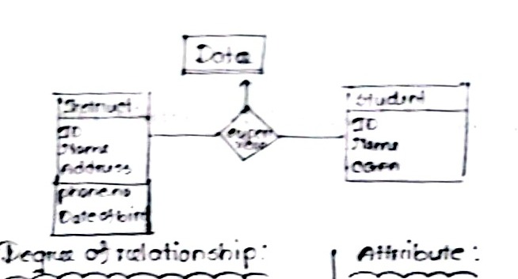
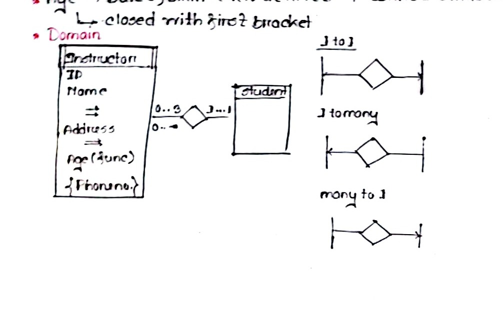

# T02: E-R / EER Modeling — Class Notes (Raidah)

**Course:** ECE 2215: Database Systems  
**Student:** Raidah (Roll: 2310035)  
**Instructors:** Mst. Nafia Islam Shishir (NIS MAM) & Md. Rakibul Islam (RI SIR)  
**Topic Reference:** Syllabus Unit 2 | `subtopicwise_list.md` T02 (67 marks · 10.5% · 7/7)  
**Source Pages:** Page 18 (Left, Right), Page 19 (Left)

---

## 1. Structural vs. Logical Modeling

<!-- Page 18 (Left) -->
<!-- Date: 01.08.2024 | Teacher: NIS MAM -->

* **Entity-Relationship (E-R) Model:** Structural / conceptual model describing enterprise data semantics and high-level relationships.
* **Relational Diagram / Schema:** Logical implementation model represented as tables, foreign keys, and column attributes.

---

## 2. Degree of Relationship

<!-- Page 18 (Right) -->
<!-- Date: 02.08.2024 | Teacher: NIS MAM -->

* **Degree of a relationship set:** The number of participating entity sets.
  * **Binary relationship:** Involves two entity sets (most common).
  * **Non-binary / Ternary relationship:** Involves three or more entity sets.

*Figure 18.1 — Degree of relationship in ER modeling connecting Date, Instructor, and Student (Page 18)*

---

## 3. Attribute Classification in E-R Diagrams

<!-- Page 18 (Right) -->

* **Simple Attribute:** Atomic and indivisible value (e.g., `ID`).
  * $\rightarrow$ Represented with standard oval / text (underlined if primary key).
* **Composite Attribute:** Can be divided into smaller sub-components (e.g., `Name` $\rightarrow$ `First_Name`, `Last_Name`; `Address` $\rightarrow$ `Street`, `City`, `State`).
* **Multivalued Attribute:** An entity can have multiple values for this attribute (e.g., `{Phone_number}`).
  * $\rightarrow$ Represented inside double ovals or enclosed in curly braces `{ }`.
* **Derived Attribute:** Attribute whose value is computed/derived from another attribute (e.g., `Age` derived from `Date_of_birth`).
  * $\rightarrow$ Represented inside dashed oval or enclosed in round parentheses `( )`.
* **Domain:** Permitted set of values for each attribute.

---

## 4. Entity Attributes & Mapping Cardinalities

<!-- Page 18 (Right) -->

*Figure 18.2 — Entity attributes, participation limits (0..3, 1..1), and mapping cardinalities (Page 18)*

### Mapping Cardinality Constraints:
Express the number of entities to which another entity can be associated via a relationship set:
* **One-to-One ($1 : 1$):** An entity in $A$ is associated with at most one entity in $B$, and vice versa.
* **One-to-Many ($1 : N$):** An entity in $A$ is associated with any number ($0$ or more) of entities in $B$.
* **Many-to-One ($N : 1$):** Entities in $A$ can be associated with at most one entity in $B$.
* **Many-to-Many ($M : N$):** Entities in $A$ and $B$ can be associated with any number of entities from the other set.

---

## 5. Participation Constraints & Weak Entities

<!-- Page 19 (Left) -->

### Participation Constraints:
* **Total Participation (Existence Dependency):**
  * Every entity in the entity set must participate in at least one relationship in the relationship set.
  * *If all entities participate, it is total participation, which is represented by a double line in the E-R diagram.*
  * Represented by a **double line** connecting the entity set to the relationship diamond.
* **Partial Participation:**
  * Only some entities in the entity set participate in relationships in the relationship set (represented by a single line).

### Primary Keys & Discriminators:
* In E-R diagrams, the primary key of an entity set is indicated by underlining the attribute (`<u>ID</u>`).

### Weak Entity Sets:
* **Definition:** An entity set that does not have sufficient attributes to form a primary key on its own.
* **Identifying / Owner Entity Set:** The strong entity set upon which the weak entity set depends.
* **Identifying Relationship:** The relationship set associating the weak entity set with the owner (represented by a **double diamond**).
* **Discriminator (Partial Key):** Attribute set that distinguishes among all entities of the weak entity set dependent on a particular strong entity (represented by a dashed underline).
* **Representation:** A weak entity set is represented by a **double rectangle**, with total participation (double line) in its identifying relationship.

