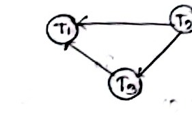

# T10: Serializability — Class Notes (Raidah)

**Course:** ECE 2215: Database Systems  
**Student:** Raidah (Roll: 2310035)  
**Instructors:** Mst. Nafia Islam Shishir (NIS MAM) & Md. Rakibul Islam (RI SIR)  
**Topic Reference:** Syllabus Unit 6 | `subtopicwise_list.md` T10 (51 marks · 8.0% · 7/7 · 🔴)  
**Source Pages:** Page 26 (Right), Page 27 (Left, Right), Page 28 (Left)

---

## 1. Conflict Serializability & Precedence Graphs

<!-- Page 26 (Right) -->
<!-- Date: 13.09.2024 -->

Two operations in a concurrent schedule conflict if they belong to different transactions, access the exact same data item $Q$, and at least one of them is a `write(Q)`:
* $\text{read}(Q) - \text{write}(Q)$ $\implies$ Conflict
* $\text{write}(Q) - \text{read}(Q)$ $\implies$ Conflict
* $\text{write}(Q) - \text{write}(Q)$ $\implies$ Conflict
* $\text{read}(Q) - \text{read}(Q)$ $\implies$ Non-conflicting (can be reordered freely)

### Interleaved Concurrent Schedule:

| $T_1$ | $T_2$ | $T_3$ |
| :--- | :--- | :--- |
| $R(x)$ | | |
| | | $R(y)$ |
| | | $R(z)$ |
| | $R(y)$ | |
| | $R(z)$ | |
| | $W(z)$ | |
| | | $W(y)$ |
| $R(z)$ | | |
| $W(x)$ | | |
| $W(z)$ | | |

*Figure 26.2 — Precedence graph for conflict serializability (Page 26)*

### Precedence Graph Testing Rules:
* A directed edge $T_i \rightarrow T_j$ is drawn if an operation of $T_i$ conflicts with and executes before an operation of $T_j$.
  * Here: $T_2 \rightarrow T_3$ (due to $W(z)$ in $T_2$ conflicting with subsequent operations), $T_2 \rightarrow T_1$, and $T_3 \rightarrow T_1$.
* **In-degree concept:**
  * In-degree 0 means no directed arrow enters that transaction node (0 incoming edges).
  * A transaction with in-degree 0 has no preceding dependencies, so it executes first in topological sorting.
* **Conflict Serializability Test:**
  * If the precedence graph contains **no cycle**, the schedule is **conflict serializable**.
  * If a cycle exists, the schedule is not conflict serializable.
* **Equivalent Serial Order:**
  $$T_2 \longrightarrow T_3 \longrightarrow T_1$$

---

## 2. Blind Writes & View Serializability

<!-- Page 27 (Left) -->
<!-- Date: 16.09.2024 -->

### Blind Write:
Executing a write on data item $Q$ without reading it first:
$$T_3: \text{read}(Q), \quad T_4: \text{write}(Q) \quad (\text{writing without prior reading is a blind write})$$

### View Serializability Conditions:
Schedule $S$ and serial schedule $S'$ are view equivalent if they satisfy three strict conditions:
1. **Initial Read:** For each data item $Q$, if transaction $T_i$ reads the initial value of $Q$ in schedule $S$, it must also read the initial value of $Q$ in schedule $S'$.
2. **Final Write:** For each data item $Q$, if transaction $T_i$ executes the final write on $Q$ in schedule $S$, it must execute the final write on $Q$ in schedule $S'$.
3. **Intermediate Read (Update-Read):** If transaction $T_i$ reads a value of $Q$ that was written by transaction $T_j$ in schedule $S$, it must also read the value written by $T_j$ in schedule $S'$.

---

<!-- Page 27 (Right) -->

### Comparing Schedule Equivalence:

$$
\begin{array}{ccc}
& S & \\
T_1 & T_2 & T_3 \\
\hline
\text{read} & & \\
& \text{write} & \\
& & \text{read} \\
\text{write} & & \\
& \text{write} &
\end{array}
\qquad
\begin{array}{ccc}
& S' & \\
T_1 & T_2 & T_3 \\
\hline
\text{read} & & \\
\text{write} & & \\
& \text{write} & \\
& & \text{read} \\
& & \text{write}
\end{array}
$$

* Sequence must always be maintained between initial read and final write operations.

---

## 3. Conflict Serializability vs. View Serializability

<!-- Page 27 (Right) & Page 28 (Left) -->

* **Relationship:**
  $$\text{Conflict Serializability} \subset \text{View Serializability}$$
  * Every conflict serializable schedule is view serializable, but not every view serializable schedule is conflict serializable.
* **Role of Blind Writes:**
  * Schedules with **blind writes** can be view serializable without being conflict serializable (blind writes allow schedule equivalence without satisfying standard conflict swap conditions).
  * Schedules containing blind writes may be view serializable even if they fail conflict serializability.

### Serial Execution Comparison:
A serializable concurrent schedule is equivalent to executing the transactions sequentially in serial order ($T_2 \rightarrow T_3 \rightarrow T_1$), guaranteeing total isolation and consistency.

