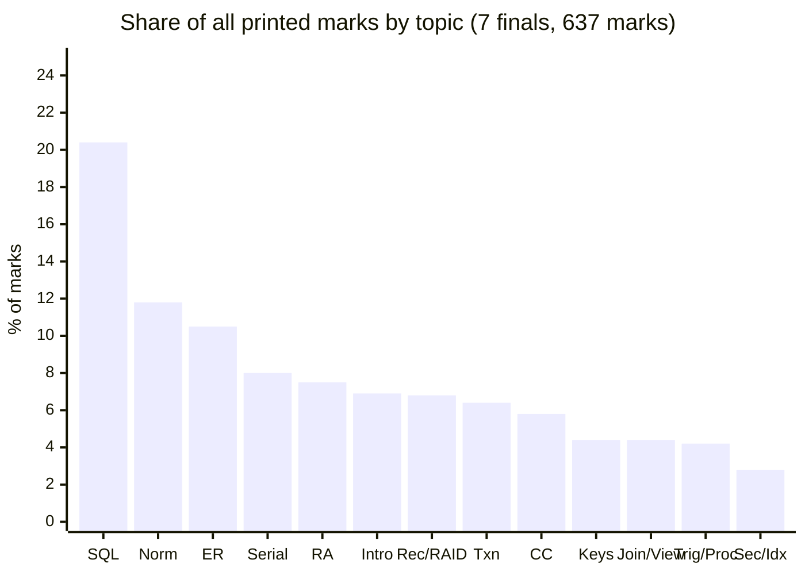

# ECE 2215: Database Systems: Previous-Year Question Analysis Report

> **Scope:** 7 semester-final papers (2017–2021, 2023–2024; 56 main questions, 148 sub-questions, 637 printed marks) + 4 class tests (CT-01 to CT-04, 26 parts). The final section, **Part C**, maps every exam topic to the slides the two lecturers taught: **Mst. Nafia Islam Shishir** and **Md. Rakibul Islam**.
>
> **Method:** I tagged every sub-question by hand with (a) one primary topic, (b) its printed marks, and (c) a coverage grade: **S** = can be answered from the lecture slides alone, **P** = partly in the slides, **T** = textbook-only. The tagging script is `pyq_stats.py` (kept in the agent's scratch folder, outside the vault). Every percentage below comes from it.

> [!NOTE]
> "Printed marks" means every mark on the paper. Students answer only 6 of 8 questions, so a 72-mark paper prints 96 marks and a 60-mark paper prints 80. (2017 prints 93 because its Q.4 carries only 9 marks.) Weighting by printed marks shows how much attention the examiners give each topic.

---

## Executive Summary: 13 Findings

1. **Six topics appeared in all 7 finals:** SQL query writing, normalization/FDs, E-R modeling, transactions/ACID, serializability testing, and DB concepts (file vs DBMS / DBA / abstraction). These six carry **64.1%** of all printed marks (408 of 637).
2. **SQL is the largest single topic: 20.4% of all marks.** In 2019 it reached 38% of the paper, and in 2024 it was 31%. Only 2017 fell below 10% (9 of 93 marks = 9.7%).
3. **Questions are recycled heavily.** In **2024, 17 of 22 sub-questions (60 of 80 printed marks, 75%) repeat earlier papers**, either verbatim or with only the data changed. Most came from 2017–2020. 2023 was the "fresh" paper; 2024 went back to the question bank.
4. **Many questions come straight from Silberschatz exercises.** 14 textbook exercise sources, appearing in 16 exam questions, are copied nearly word for word (Ex. 17.15, 18.2, 18.20, 18.26, 17.1, 17.14, 6.14, 6.2, 6.17, 3.4/3.14, 7.6, 7.7, 9.16, and the Fig. 2.17 database).
5. **The Modern-OBE papers (2023–24) moved weight toward joins/views (11.2%), recovery/RAID (13.1%), and triggers/procedures (8.1%).** In the same papers E-R modeling dropped from 13.1% to 4.4%.
6. **Relational algebra is in 6/7 papers, not 7/7.** 2023 has no RA question (the original vault README said 7/7, now corrected in `PreviousYearQuestion/README.md`).
7. **The slides alone cover 78.0% of all marks.** Another 7.4% is partly covered and **14.6% is textbook-only.** In 2023 the textbook-only share reached 30%.
8. **The textbook-only material (14.6%) is always the same cluster:** triggers/procedures, failure classification, log-based recovery, RAID, SQL injection/security, and indexing/hashing. A second group is only *partly* covered by the slides (7.4%): canonical cover, `ON DELETE CASCADE`, `TRUNCATE`, the TSO restart rule, RA updates, and deadlock-cost reasoning.
9. **Some exam questions use the slides' own examples.** The 2021 Q.7(b) schedule is Deck 07 Slide 20. The 2018/2024 schedule has the same structure as Deck 07 Slide 15. CT-03 Q.1 reuses the relation and FD set of Deck 06 Slide 46 (with different sub-questions), and CT-01 Q.5(iv) is Deck 02 Slide 24.
10. **The two sections split by topic.** Concurrency control has never appeared in Section A, and DB concepts have never appeared in Section B. SQL shows up in both.
11. **Some content the lecturers taught has never appeared in a final** (BCNF, lossless decomposition, denormalization, recoverable/cascadeless schedules, wait-die/wound-wait, strict/rigorous 2PL). The current lecturers *have* tested some of it in class tests, which makes these the most likely new questions.
12. **Watch the "rolled-back timestamp" trap.** Deck 08 Slide 23 says a transaction restarted after wait-die/wound-wait keeps its *original* timestamp. Under the timestamp-ordering protocol, the textbook gives it a **new** timestamp. This exact question has been asked twice (2018, 2024). Raidah's class notes confirm the textbook rule for TSO (§C10).
13. **The teacher's own exam blueprint (Raidah's class notes) points at several never-asked items.** It names FD-set normalization **with lossless + dependency-preserving decomposition**, **conflict *and* view** serializability, **wait-die/wound-wait, the 4 Coffman conditions and TSO**, and **RAID 0/1/1+0/3/5/6**, and it calls RA/SQL "1 or more full question sets" and E-R "1 full question set". Details and caveats are in §C10.

---

# Part A: The Exam as a Dataset

## A1. Exam format across the three eras

| Era | Papers | Full marks | Per question | Margin columns | Character |
| :-- | :-- | :--: | :--: | :-- | :-- |
| **Pre-OBE** | 2017, 2018, 2019, 2020 | 72 (3 h) | 12 | Marks | Long multi-part RA/SQL problems (8–12 marks), many "define/discuss" parts |
| **Transitional OBE** | 2021 | 72 (3 h) | 12 | Marks + CLO | Heaviest normalization paper (21%); only paper with an embedded diagram (wait-for graph) |
| **Modern OBE** | 2023, 2024 | 60 (3 h) | 10 | CLO (2023) / CO (2024) | Shorter parts (2–6 marks), scenario framing ("courier company", "multimedia archive"), more implementation (procedure, trigger, view) |

All papers use the same rule: **answer 6 of 8, taking 3 from each section, with separate scripts for Section A (Q1–4) and Section B (Q5–8).**

## A2. Topic weight per year (printed marks)

Topic codes: **Intro** = DB concepts/architecture · **ER** = E-R/EER · **Keys** = keys & integrity · **RA** = relational algebra/calculus · **SQL** = SQL DDL/DML/aggregates/subqueries · **Join/View** = join theory & views · **Trig/Proc** = triggers & stored procedures · **Norm** = normalization & FDs · **Txn** = ACID, states, concurrency anomalies · **Serial.** = serializability tests · **CC** = 2PL/TSO/deadlock · **Rec/RAID** = failures, recovery, RAID · **Sec/Idx** = security, indexing, hashing.

| Topic | 2017 | 2018 | 2019 | 2020 | 2021 | 2023 | 2024 | Papers | Total | Share |
| :-- | :-: | :-: | :-: | :-: | :-: | :-: | :-: | :-: | :-: | :-: |
| **SQL** | 9 | 12 | **36** | 18 | 20 | 10 | **25** | 7/7 | **130** | **20.4%** |
| **Norm** | 15 | 8 | 10 | 8 | **20** | 10 | 4 | 7/7 | 75 | 11.8% |
| **ER** | 8 | **21** | 9 | 12 | 10 | 5 | 2 | 7/7 | 67 | 10.5% |
| **Serial.** | 8 | 4 | 7 | **16** | 8 | 4 | 4 | 7/7 | 51 | 8.0% |
| **RA** | 8 | 6 | 8 | 9 | 9 | — | 8 | 6/7 | 48 | 7.5% |
| **Intro** | 10 | 3 | 7 | 8 | 7 | 5 | 4 | 7/7 | 44 | 6.9% |
| **Rec/RAID** | 6 | 11 | 5 | — | — | **14** | 7 | 5/7 | 43 | 6.8% |
| **Txn** | 4 | 12 | 3 | 4 | 4 | 6 | 8 | 7/7 | 41 | 6.4% |
| **CC** | **13** | 8 | — | 4 | 5 | 4 | 3 | 6/7 | 37 | 5.8% |
| **Keys** | — | 6 | 6 | 4 | 8 | 4 | — | 5/7 | 28 | 4.4% |
| **Join/View** | — | — | 5 | 5 | — | **10** | 8 | 4/7 | 28 | 4.4% |
| **Trig/Proc** | 5 | 5 | — | 4 | — | 6 | 7 | 5/7 | 27 | 4.2% |
| **Sec/Idx** | 7 | — | — | 4 | 5 | 2 | — | 4/7 | 18 | 2.8% |
| **Total** | 93 | 96 | 96 | 96 | 96 | 80 | 80 | | **637** | 100% |

### Grouped by syllabus block

| Block | Topics | Marks | Share |
| :-- | :-- | :-: | :-: |
| **Querying** | RA + SQL + Join/View + Trig/Proc | 233 | **36.6%** |
| **Design** | ER + Keys + Norm | 170 | **26.7%** |
| **Transactions** | Txn + Serial. + CC | 129 | **20.3%** |
| **Systems** | Rec/RAID + Sec/Idx | 61 | 9.6% |
| **Foundations** | Intro | 44 | 6.9% |

## A3. Era shift: what changed under OBE

| Topic | Pre-OBE (2017–20) | 2021 | Modern OBE (2023–24) | Trend |
| :-- | :-: | :-: | :-: | :-- |
| SQL | 19.7% | 20.8% | 21.9% | Stable, always the top topic |
| Join/View | 2.6% | 0% | **11.2%** | ▲▲ Outer-join outcome tables and `CREATE VIEW` are now standard |
| Rec/RAID | 5.8% | 0% | **13.1%** | ▲▲ No lecture slides (RAID levels were taught in class, §C10; the rest is textbook-only), yet a full question in both OBE papers |
| Trig/Proc | 3.7% | 0% | **8.1%** | ▲ Moved from "syntax" questions to "implement a trigger/procedure" |
| Txn (ACID/states) | 6.0% | 4.2% | 8.8% | ▲ |
| Norm | 10.8% | **20.8%** | 8.8% | Peaked in 2021 |
| ER | 13.1% | 10.4% | **4.4%** | ▼▼ Now one diagram (2–5 marks) |
| Serial. | 9.2% | 8.3% | 5.0% | ▼ Now one 4-mark schedule |
| RA | 8.1% | 9.4% | 5.0% | ▼ (absent in 2023) |

> [!IMPORTANT]
> Under OBE the paper became **broader and shallower**. Parts are worth 2–6 marks, so most of the syllabus appears every year and fewer topics can be skipped. But each question is shorter, so short notes (`ON DELETE CASCADE`, `GROUP BY`, `TRUNCATE` vs `DELETE`, RAID, dense/sparse index) carry real weight.

## A4. Section A vs Section B

| Topic | Section A marks | Section B marks | Where it lives |
| :-- | :-: | :-: | :-- |
| Intro | 44 | **0** | Always Section A, usually Q.1 |
| ER | 55 | 12 | Mostly A (Q.1(b/c) is the "draw an E-R diagram" slot) |
| RA | 44 | 4 | Mostly A (Q.2 is the RA slot) |
| Keys | 22 | 6 | Mostly A |
| SQL | 53 | **77** | **Both.** In 2018–2020 and 2024 the big SQL problem was in Section B |
| Norm | 38 | 37 | **Both** (A in 2017/18/19/23/24; B in 2017/19/20/21) |
| Txn | 16 | 25 | Both |
| Serial. | 7 | **44** | Mostly B |
| CC | **0** | 37 | Always Section B |
| Rec/RAID | 13 | 30 | Mostly B |
| Trig/Proc | 3 | 24 | Mostly B |
| Join/View | 18 | 10 | Both (A in 2019/20/24; B in 2023) |
| Sec/Idx | 4 | 14 | Mostly B |
| **Total** | **317** | **320** | 637 |

**Takeaway:** You can't skip a whole syllabus block by planning to pick questions from the other section. SQL and normalization appear in either section, and the "3 from each section" rule forces you to answer from both.

---

# Part B: Topic-by-Topic Deep Dive

Each block lists the question archetypes, every occurrence, and what a full-mark answer needs.

## B1. SQL (130 marks · 7/7 · 20.4%)

| Archetype | Occurrences | Notes |
| :-- | :-- | :-- |
| **DDL + DML warm-up** (create, insert, alter add column, filter) | 2017 Q4a(i), 2018 Q7a, 2019 Q5c, 2023 Q3a(i–ii), **2024 Q4b (near-repeat of 2018 Q7a)** | `ALTER TABLE student ADD session ...`; composite PK `(roll, Dept)` in 2018; 2024 keys only `roll` |
| **CGPA = Σ(gpa·credit)/Σcredit** | 2017 Q4a(iii), 2019 Q7a(iii) | Join GPA ⋈ Credit, `SUM(gpa*credit)/SUM(credit) ... GROUP BY roll` |
| **Extremes without LIMIT** (lowest/highest gpa, second-highest CGPA, max sales) | 2019 Q7a(i,iv), 2018 Q7b(iii), CT-02 Q1(d) | `= (SELECT MIN(...))`, `>= ALL`, `MAX(x) < (SELECT MAX(x))` |
| **GROUP BY + HAVING** | 2018 Q7b(i,ii), 2020 Q3b(i), 2024 Q1c, 2024 Q7a | `COUNT(DISTINCT p_id) > 5`; `HAVING AVG(salary) > 30000` |
| **Correlated / scalar subqueries** | 2023 Q3a(iii) (salary > dept average), CT-02 Q1(c), 2019 Q8b, 2024 Q6a | "two examples of sub-queries" asked twice |
| **Multi-table business schemas** | Covid-patient (2019 Q5b), Company (2020 Q3b), Insurance (2020 Q7b = 2024 Q5b), E-commerce (2021 Q3a 8 marks + Q4a 12 marks) | `NOT IN` / `NOT EXISTS` for "products not sold"; `UPDATE ... WHERE` via join |
| **Universal quantification** ("students who took *all* Biology courses": `NOT EXISTS (… EXCEPT …)`) | *never asked* | Taught in D03 S46 and in class (Raidah T05 §8: `X − Y = ∅ ⇔ X ⊆ Y`). `= ALL` can't express it. MySQL supports `EXCEPT` only from 8.0.31; otherwise use `NOT EXISTS` / `NOT IN` |
| **Short notes** | 2019 Q5a (SQL), 2019 Q8a/2024 Q7a (aggregate functions), 2019 Q8c/2023 Q6c/2024 Q7b (`ON CASCADE DELETE`, `GROUP BY`, `ORDER BY`, `AS`), 2023 Q6a (`TRUNCATE` vs `DELETE`) | Related: 2023 Q1c (DDL vs DML) is counted under Intro, §B6 |

> [!TIP]
> Several questions say **"MySQL"** (2020 Q3b, Q7b; 2021 Q1c, Q3a; 2024 Q5b). Use MySQL syntax: `ALTER TABLE client ADD Telephone NUMERIC(11)`, `ON DELETE CASCADE`. MySQL has no `FULL OUTER JOIN`, so write `LEFT JOIN ... UNION ... RIGHT JOIN`.

## B2. Normalization & Functional Dependencies (75 marks · 7/7 · 11.8%)

| Archetype | Occurrences |
| :-- | :-- |
| **Normalize an unnormalized table to 3NF** (multi-valued cells → 1NF → 2NF → 3NF) | 2017 Q3b (com_employee, 9 marks), 2020 Q8b (Proj/Emp billing, 8), 2023 Q2a (Courses/Instructors/Grades, 6), 2024 Q3a (make your own library table, 4) |
| **Anomalies** (insert/update/delete, redundancy) | 2018 Q4a, 2019 Q6a (space/update/delete on a table), 2020 Q8b(i), 2021 Q6c, 2023 Q2b, CT-03 Q2 |
| **Define normalization / 1NF–3NF** | 2017 Q3a, Q8c; 2018 Q4c; 2019 Q3a; CT-03 Q3 |
| **Closure + candidate keys** | 2021 Q5b (= Silberschatz Ex. 7.6), CT-03 Q1(a–b) |
| **2NF test from FDs** | 2021 Q5c (AB→CD, B→C) |
| **Canonical cover** | 2021 Q6a (vs normalization), 2021 Q6b (= Ex. 7.7) |
| **Highest normal form / BCNF vs 3NF** | CT-03 Q1(d), CT-03 Q4 |

Full-mark pattern for table problems: (1) state the FDs you infer, (2) identify the key, (3) show each NF as separate tables with keys underlined, (4) name the dependency each step removes (partial → 2NF, transitive → 3NF).

## B3. E-R / EER Modeling (67 marks · 7/7 · 10.5%)

| Archetype | Occurrences |
| :-- | :-- |
| **Design an E-R diagram for a RUET-flavored scenario** | 2017 Q1b & **2024 Q1b (verbatim): RUET student DB**; 2018 Q1c (teacher/student/course with participation constraints); 2019 Q1c (Rajshahi train e-ticketing); 2023 Q1a (RUET Central Library); CT-02 Q2 |
| **Ternary relationship + reduction to tables** | 2018 Q2c (= Practice Ex. 6.2) |
| **Weak vs strong entity** | 2018 Q1b, 2019 Q1b, 2020 Q2c, 2021 Q8c (= Ex. 6.17) |
| **Attribute types** (composite, multivalued, derived, single-valued) | 2020 Q5a, 2021 Q3b |
| **Mapping cardinality / M:N → table** | 2018 Q3c, 2020 Q1c |
| **Aggregation** | 2018 Q2b, 2020 Q3a |
| **Specialization / generalization** | 2017 Q6a |
| **Types of relationships in ER** | 2021 Q5a |

## B4. Serializability (51 marks · 7/7 · 8.0%) + Transactions (41 · 7/7 · 6.4%)

| Archetype | Occurrences |
| :-- | :-- |
| **ACID** (often "with example/diagram") | 2017 Q5a, 2018 Q4b, 2021 Q7a, 2023 Q4b, 2024 Q6c, CT-04 Q1; consistency alone: 2019 Q3b = 2024 Q2c |
| **Transaction states diagram** | 2020 Q5b, 2023 Q4c |
| **Serial vs serializable** | 2018 Q6a (= Ex. 17.14); related: CT-04 Q2 (serial vs *concurrent* + advantages of concurrency) |
| **Concurrency problems if CC fails** | 2018 Q5a = 2024 Q8a, CT-04 Q3 |
| **Define conflict serializability** | 2017 Q5b, 2021 Q7b (first part) |
| **Conflict-serializability test (precedence graph)** | 2018 Q6c = 2024 Q8c; 2020 Q6a ($r_1(X); r_3(X); \dots$); 2021 Q7b, Q7c; 2023 Q8b (4 transactions, "all possible serial orders"); CT-04 Q4 |
| **Non-serializable/serializable execution of $T_1,T_2$ with `if A = 0 then B := B+1`** | 2017 Q5c, 2019 Q4a (= Ex. 17.15) |
| **Swap-based proof of equivalence** | 2020 Q5c |
| **View serializability** | 2020 Q6b |

> [!NOTE]
> **2019 Q4a contains a misprint.** It sets $P = Q = 5$ but tests `if P = 10` / `if Q = 10`, so neither update ever fires, and parts (i) and (ii) are printed identically. Answer it as Ex. 17.15 (2017 Q5c): show one non-serializable and one serializable interleaving, and state your reading of the question.

> [!WARNING]
> **2018 Q6c / 2024 Q8c is not conflict serializable.** $T_1$ reads $A$ before $T_2$ writes it ($T_1 \to T_2$). $T_2$ writes $A$ before $T_1$ writes it ($T_2 \to T_1$). The precedence graph has a cycle. The schedule has the same structure as Deck 07 Slide 15 ("Schedule 4"), with different arithmetic.

## B5. Relational Algebra (48 marks · 6/7 · 7.5%)

| Archetype | Occurrences |
| :-- | :-- |
| **Queries on a given schema** | employee/works/company/manages (2017 Q2a, Fig. 2.17 family), insurance (2018 Q3a), Covid patient (2019 Q2b → 2024 Q5a), vaccine (2020 Q2a), customer/order (2021 Q2a), multiple projects (2024 Q2b), CT-01 Q4 |
| **Explain an expression in words** | 2021 Q2c, CT-01 Q5 |
| **Aggregation $\gamma$ (count / max)** | 2017 Q2a(iv) "company with most employees", 2018 Q3a(i–ii), 2019 Q2b(ii), 2024 Q2b, CT-01 Q4(viii) |
| **Database modification in RA** (update via generalized projection/assignment) | 2017 Q2a(ii–iii), 2018 Q3a(iii) |
| **Domain relational calculus** | 2020 Q4b ($\Pi_A(r_1)$, $r_1 \cup r_2$, $r_1 \cap r_2$) |
| **"Only" queries → set difference** | 2020 Q2a(ii) "1st dose only" |

## B6. DB Concepts / Intro (44 marks · 7/7 · 6.9%)

File system vs DBMS: 2017 Q1a = 2021 Q1a; 2018 Q1a; 2019 Q1a; 2023 Q1b; 2024 Q1a (courier scenario). DBA functions: 2017 Q1c, 2020 Q1a, 2021 Q1b. Data abstraction: 2017 Q2b, 2019 Q2a, CT-01 Q1. 2-tier vs 3-tier: 2020 Q1b, CT-01 Q3. Relation schema: 2020 Q1a. DDL vs DML: 2023 Q1c.

## B7. Recovery & RAID (43 marks · 5/7 · 6.8%)

| Archetype | Occurrences |
| :-- | :-- |
| **Classify failures** | 2017 Q6c, 2018 Q5c, 2019 Q4b = 2024 Q3b, 2023 Q7a |
| **Log-based recovery** | 2017 Q6d, 2023 Q7b ("illustrate with a crash example") |
| **RAID levels / role in recovery** | 2018 Q5c, Q8c; 2023 Q4a, Q7c; 2024 Q7c (multimedia archive, compare levels) |
| **Recovery manager in a never-failing DB?** | 2018 Q8b (= Ex. 17.1) |

> [!NOTE]
> **Class-note cross-check:** Raidah's notes teach only **RAID 0, 1, 1+0, 3, 5, 6** (striping vs mirroring vs bit/block parity; dedicated parity vs distributed parity; RAID 6 = dual $P+Q$, survives 2 disk failures). They contain **no failure classification, log-based recovery or checkpoints**, although those were asked in 2017, 2018, 2019, 2023 and 2024. Use the textbook for those (§C5). For the RAID "describe/compare levels" questions, the class list is the safe core; RAID 2 and 4 are textbook-only.

## B8. Concurrency Control Protocols (37 marks · 6/7 · 5.8%)

2PL with example: 2017 Q6b. 2PL lock/unlock insertion + deadlock: 2017 Q7a (= Practice Ex. 18.2). Deadlock definition/prevention: 2017 Q7b, 2018 Q5b (= Ex. 18.20), 2020 Q7a, 2021 Q8a (wait-for graph, cycle $T_2 \to T_4 \to T_5 \to T_2$). Starvation: 2017 Q7a. TSO: 2018 Q6b = 2024 Q8b (= Ex. 18.26), 2023 Q8c (trace a 3-transaction schedule).

> [!NOTE]
> 2020 Q7a asks for the "time-shared locking protocol". No such protocol exists in either the slides or the textbook. It is most likely a misprint for **two-phase** locking (or timestamp ordering). Answer with 2PL and a one-line note about your interpretation.

## B9. Keys & Integrity (28) · Joins/Views (28) · Triggers/Procedures (27) · Security/Indexing (18)

- **Keys:** distinctions among super/candidate/primary keys (2018 Q2a = Ex. 6.14, 2021 Q2b, 2023 Q3b adds *composite*); all keys + foreign key (2019 Q6b, 2020 Q2b); referential integrity in MySQL (2021 Q1c); domain vs data type (2018 Q3b).
- **Joins:** join types (2019 Q3c, 2023 Q5c, 2024 Q3c inner vs outer); **outcome tables for Courses ⋈ Teacher** (2020 Q4c, 2024 Q4a: natural, left, right, full); **views** (2023 Q5a benefits, Q5b `CREATE VIEW` over 3 tables).
- **Triggers/procedures:** "What is triggering? purposes, syntax" (2018 Q8a = 2020 Q8a); trigger for security before/after a breach (2017 Q8b = 2024 Q2a); stored procedure for placing an order + audit-log trigger (2023 Q6b); order-insert trigger updating stock (2024 Q6b).
- **Security/indexing:** SQL injection (2020 Q4a = Ex. 9.16 verbatim, 2021 Q8b); database security threats (2017 Q8a); static vs dynamic hashing (2017 Q7c); dense vs sparse index (2023 Q8a).

## B10. Recycling analysis

| # | Recurring question | Appearances |
| :-: | :-- | :-- |
| 1 | E-R for RUET student DB (basic info, advisor, registration, result) | 2017 Q1b → **2024 Q1b** (verbatim) |
| 2 | Trigger & security before/after breach | 2017 Q8b → **2024 Q2a** |
| 3 | "What is triggering? Purposes? Syntax?" | 2018 Q8a → 2020 Q8a (verbatim) |
| 4 | Student table: create / insert / alter / ECE filter | 2018 Q7a → **2024 Q4b** (near-verbatim; 2018 uses composite PK `(roll, Dept)`, 2024 keys only `roll`) |
| 5 | What goes wrong if concurrency control is improper | 2018 Q5a → **2024 Q8a** (verbatim) |
| 6 | TSO: why a new timestamp after rollback | 2018 Q6b → **2024 Q8b** (verbatim, Ex. 18.26) |
| 7 | $T_1$ A+10 / $T_2$ A−100 schedule: conflict serializable? | 2018 Q6c → **2024 Q8c** (verbatim) |
| 8 | Insurance DB (John Smith accidents, Mazda, damage \$3000) | 2018 Q3a (RA) → 2020 Q7b (MySQL) → **2024 Q5b** (verbatim of 2020) |
| 9 | Covid patient DB (fever, center, positive/negative) | 2019 Q2b (RA) + Q5b (SQL) + Q5c (DDL) → **2024 Q5a** (RA subset, Rajshahi → Rangpur) |
| 10 | Consistency property with example | 2019 Q3b → **2024 Q2c** (verbatim) |
| 10b | ACID properties (briefly discuss / explain) | 2017 Q5a → 2018 Q4b → 2021 Q7a → 2023 Q4b → **2024 Q6c** (= 2017 wording) |
| 10c | Same 8-step $T_1/T_2$ schedule (D07 S20) | 2020 Q6b (view s., X/Y) → 2021 Q7b (conflict s., A/B) |
| 11 | Ways a DBMS fails, precautions, recovery methods | 2019 Q4b → **2024 Q3b**; failure classification also 2017 Q6c, 2018 Q5c, 2023 Q7a |
| 12 | Short note: `ON CASCADE DELETE` (+ `GROUP BY`) | 2019 Q8c → 2023 Q6c → **2024 Q7b** (+ `ORDER BY`, `AS`) |
| 13 | Courses/Teacher natural & outer join outcomes | 2020 Q4c → **2024 Q4a** (new data) |
| 14 | SQL injection: how it works + prevention | 2020 Q4a → 2021 Q8b |
| 15 | File system vs DBMS | 2017 Q1a = 2021 Q1a; variants 2018, 2019, 2023, 2024 |
| 16 | Five functions of a DBA | 2017 Q1c, 2020 Q1a, 2021 Q1b |
| 17 | Data abstraction levels | 2017 Q2b, 2019 Q2a, CT-01 Q1 |
| 18 | $T_1/T_2$ "if A = 0 then B := B+1" | 2017 Q5c, 2019 Q4a (values changed); locking version 2017 Q7a |
| 19 | CGPA formula in SQL | 2017 Q4a(iii), 2019 Q7a(iii) |
| 20 | Sub-queries with two examples / aggregate functions | 2019 Q8b → 2024 Q6a; 2019 Q8a → 2024 Q7a |
| 21 | Join types | 2019 Q3c → 2023 Q5c → 2024 Q3c |
| 22 | Key distinctions | 2018 Q2a, 2019 Q6b, 2020 Q2b, 2021 Q2b, 2023 Q3b |
| 23 | Weak vs strong entity | 2018 Q1b, 2019 Q1b, 2020 Q2c, 2021 Q8c |
| 24 | RAID levels | 2018 (×2), 2023 (×2), 2024 |

**Recycling rate:** 2024 repeats 17/22 sub-questions (75% of printed marks). 2023 reused about 7 of the 24 recurring archetypes in §B10 (keys, ACID, join types, `ON CASCADE DELETE`, failures, RAID, DBMS advantages); counting loosely related parts, roughly 14 of its 22 sub-questions echo earlier papers, so it was *less* recycled rather than fresh. Expect the next paper to sit somewhere between the two. **Studying the 24 items above is the highest-yield thing you can do.**

## B11. Textbook exercises lifted into finals

| Silberschatz 7e exercise | Exam question(s) |
| :-- | :-- |
| [Ex. 17.15](file:///home/azaz/AntigravityxStudy/SemesterFinal_2_2/ECE_2215/Textbook/Chapter_17_Transactions/Chapter%2017%20-%20Transactions.md#L667) ($T_{13}, T_{14}$, A = 0 ∨ B = 0) | 2017 Q5c, 2019 Q4a |
| [Practice Ex. 18.2](file:///home/azaz/AntigravityxStudy/SemesterFinal_2_2/ECE_2215/Textbook/Chapter_18_Concurrency_Control/Chapter%2018%20-%20Concurrency%20Control.md#L1353) (add 2PL locks; deadlock?) | 2017 Q7a |
| [Ex. 17.14](file:///home/azaz/AntigravityxStudy/SemesterFinal_2_2/ECE_2215/Textbook/Chapter_17_Transactions/Chapter%2017%20-%20Transactions.md#L665) (serial vs serializable) | 2018 Q6a |
| [Ex. 18.20](file:///home/azaz/AntigravityxStudy/SemesterFinal_2_2/ECE_2215/Textbook/Chapter_18_Concurrency_Control/Chapter%2018%20-%20Concurrency%20Control.md#L1449) (avoid vs detect deadlock) | 2018 Q5b |
| [Ex. 18.26](file:///home/azaz/AntigravityxStudy/SemesterFinal_2_2/ECE_2215/Textbook/Chapter_18_Concurrency_Control/Chapter%2018%20-%20Concurrency%20Control.md#L1469) (new timestamp on rollback) | 2018 Q6b, 2024 Q8b |
| [Practice Ex. 17.1](file:///home/azaz/AntigravityxStudy/SemesterFinal_2_2/ECE_2215/Textbook/Chapter_17_Transactions/Chapter%2017%20-%20Transactions.md#L625) (never-failing DB) | 2018 Q8b |
| [Ex. 6.14](file:///home/azaz/AntigravityxStudy/SemesterFinal_2_2/ECE_2215/Textbook/Chapter_06_ER_Model/Chapter%2006%20-%20Database%20Design%20Using%20the%20E-R%20Model.md#L1226) (primary/candidate/superkey) | 2018 Q2a (2021 Q2b, 2023 Q3b) |
| [Practice Ex. 6.2](file:///home/azaz/AntigravityxStudy/SemesterFinal_2_2/ECE_2215/Textbook/Chapter_06_ER_Model/Chapter%2006%20-%20Database%20Design%20Using%20the%20E-R%20Model.md#L1133) (exams as entities, ternary) | 2018 Q2c |
| [Ex. 6.17](file:///home/azaz/AntigravityxStudy/SemesterFinal_2_2/ECE_2215/Textbook/Chapter_06_ER_Model/Chapter%2006%20-%20Database%20Design%20Using%20the%20E-R%20Model.md#L1240) (weak vs strong entity) | 2020 Q2c, 2021 Q8c |
| [Ex. 3.4](file:///home/azaz/AntigravityxStudy/SemesterFinal_2_2/ECE_2215/Textbook/Chapter_03_Intro_SQL/Chapter%2003%20-%20Introduction%20to%20SQL.md#L1695) / [3.14](file:///home/azaz/AntigravityxStudy/SemesterFinal_2_2/ECE_2215/Textbook/Chapter_03_Intro_SQL/Chapter%2003%20-%20Introduction%20to%20SQL.md#L1777) (insurance DB) | 2018 Q3a, 2020 Q7b, 2024 Q5b |
| [Ex. 2.6](file:///home/azaz/AntigravityxStudy/SemesterFinal_2_2/ECE_2215/Textbook/Chapter_02_Relational_Model/Chapter%2002%20-%20Introduction%20to%20the%20Relational%20Model.md#L547) family (employee DB, Fig. 2.17) | 2017 Q2a |
| [Practice Ex. 7.6](file:///home/azaz/AntigravityxStudy/SemesterFinal_2_2/ECE_2215/Textbook/Chapter_07_Normalization/Chapter%2007%20-%20Relational%20Database%20Design.md#L1280) / [7.7](file:///home/azaz/AntigravityxStudy/SemesterFinal_2_2/ECE_2215/Textbook/Chapter_07_Normalization/Chapter%2007%20-%20Relational%20Database%20Design.md#L1289) (closure, keys, $F_c$) | 2021 Q5b, 2021 Q6b |
| [Ex. 9.16](file:///home/azaz/AntigravityxStudy/SemesterFinal_2_2/ECE_2215/Textbook/Chapter_09_App_Development/Chapter%2009%20-%20Application%20Development.md#L1105) (SQL injection) | 2020 Q4a (verbatim), 2021 Q8b |
| 6th-edition-only material (DRC, RA modification) | 2020 Q4b, 2017 Q2a(ii–iii), 2018 Q3a(iii) |

> [!TIP]
> The end-of-chapter problems of **Ch. 6, 7, 17, 18** (11 exercises in 10 table rows) account for 16 final-question occurrences. Six of them (17.14, 17.15, 18.20, 18.26, 6.14, 6.17) are in the regular **Exercises** section, not Practice Exercises, so read both sections.

## B12. Question archetypes by cognitive type

| Type | Example verbs | ≈ share of sub-questions | Strategy |
| :-- | :-- | :-: | :-- |
| Define / discuss / short note | "What is…", "Briefly discuss…" | ~45% | One-line definition + diagram/table + concrete example |
| Differentiate | "Differentiate between…", "distinctions among…" | ~12% | Always use a 4–5 row comparison table |
| Write queries (RA / SQL) | "Write the relational algebra (Not SQL)…" | ~20% | Note the "Not SQL" / "Not Algebra" constraint, and state any assumed keys |
| Design (E-R, normalize, view, trigger, procedure) | "Draw…", "Normalize…", "Create…" | ~15% | Show intermediate steps; underline keys; mark cardinality/participation |
| Analyze/test (schedule, wait-for graph, TSO, closure) | "Determine whether…", "Check…" | ~8% | Conflict-pair list → graph → cycle verdict → serial order(s) |

---

# Part C: Connecting the Exams to What the Lecturers Taught

## C1. Who taught what

| Deck | Title (slides) | Credited instructor | Character of the slides |
| :-- | :-- | :-- | :-- |
| [01](file:///home/azaz/AntigravityxStudy/SemesterFinal_2_2/ECE_2215/LectureSlides/01_Intro_to_Database_and_DBMS.md) | Intro to DB & DBMS (33) | **Mst. Nafia Islam Shishir** | Custom intro (data vs information, DBMS components, DBA list, 2/3-tier) |
| [02](file:///home/azaz/AntigravityxStudy/SemesterFinal_2_2/ECE_2215/LectureSlides/02_Relational_Model.md) | Relational Model (34) | *uncredited* | Silberschatz-based + custom "Pitfalls" (S32–33) |
| [03](file:///home/azaz/AntigravityxStudy/SemesterFinal_2_2/ECE_2215/LectureSlides/03_Introduction_to_SQL.md) | Intro to SQL (62) | *uncredited* | Silberschatz Ch. 3 slides |
| [04](file:///home/azaz/AntigravityxStudy/SemesterFinal_2_2/ECE_2215/LectureSlides/04_Joining_and_Views.md) | Joining & Views (35) | *uncredited* | Custom MySQL join examples (Student/Department, S5–13) + Silberschatz views |
| [05](file:///home/azaz/AntigravityxStudy/SemesterFinal_2_2/ECE_2215/LectureSlides/05_ER_Model.md) | E-R Model (80) | *uncredited* | Silberschatz Ch. 6 slides |
| [06](file:///home/azaz/AntigravityxStudy/SemesterFinal_2_2/ECE_2215/LectureSlides/06_DBMS_Normalization.md) | Normalization (63) | **Md. Rakibul Islam** | **Fully custom**, many worked CK/prime/2NF/3NF/BCNF drills |
| [07](file:///home/azaz/AntigravityxStudy/SemesterFinal_2_2/ECE_2215/LectureSlides/07_Transactions.md) | Transactions (33) | **Md. Rakibul Islam** | Silberschatz Ch. 17 + custom anomaly slides (S28–33) |
| [08](file:///home/azaz/AntigravityxStudy/SemesterFinal_2_2/ECE_2215/LectureSlides/08_Concurrency_Control_Mechanisms.md) | Concurrency Control (31) | **Md. Rakibul Islam** | Custom: recoverability, 2PL lock points, deadlock, TSO rules |

> [!NOTE]
> Decks 02–05 carry no name. The exam's Section A topics (intro, ER, relational model, SQL) align with Deck 01's author, so Decks 01–05 were most likely Ms. Shishir's half and Decks 06–08 Mr. Rakibul's. **This is an inference.** The two sections may not map one-to-one onto the two lecturers, because both SQL and normalization have appeared in either section (§A4).
>
> **Class notes support the split.** In Raidah's notebook (dated 29.06–28.09.2024) the intro/RA/SQL/join/E-R sessions are labelled **NIS MAM** (11.07 RA, 13.07 aggregation, 28.07 joins, 01–02.08 E-R), and the normalization sessions (16.08–10.09) are labelled **RI SIR**. Transactions, serializability and concurrency (13.09–28.09) carry no label in the notes; Decks 07–08 credit Mr. Rakibul. The first session (29.06.2024: `SELECT`/`DISTINCT`/`BETWEEN`, basic DDL, `LIMIT`/`TOP`) was taken by a third teacher, **Hafsa Mam**, who is not on the syllabus.

## C2. Slide coverage of the exams

| Paper | Answerable from slides (S) | Partly (P) | Textbook-only (T) |
| :-- | :-: | :-: | :-: |
| 2017 | 72% | 9% | 19% |
| 2018 | 69% | 15% | 17% |
| 2019 | **91%** | 4% | 5% |
| 2020 | 84% | 4% | 11% |
| 2021 | 86% | 8% | 5% |
| 2023 | 68% | 2% | **30%** |
| 2024 | 74% | 9% | 18% |
| **All** | **78.0%** (112 items) | 7.4% (11) | **14.6%** (25) |
| **Class tests** | **100%** | 0% | 0% |

**Takeaway:** The class tests, set by the current lecturers, come entirely from the slides. The finals draw about 4/5 of their marks from slide content, and the rest from a stable list of textbook-only topics (§C5).

## C3. Topic → slide → exam map (Shishir's half: Decks 01–05)

| Topic | Slides taught | Past questions that use it | What the slides give you |
| :-- | :-- | :-- | :-- |
| File system vs DBMS | D01 S6–7 | 2017 Q1a, 2018 Q1a, 2019 Q1a, 2021 Q1a, 2023 Q1b, 2024 Q1a | Exactly 8 disadvantages: redundancy, inconsistency, access difficulty, isolation, integrity, atomicity, concurrent access, security |
| DBA functions | D01 S10 | 2017 Q1c, 2020 Q1a, 2021 Q1b | An 8-item list; the exams ask for "five" |
| Data abstraction / schemas | D01 S13–15 | 2017 Q2b, 2019 Q2a, CT-01 Q1 | Physical/logical/view + diagram (S14) |
| DDL vs DML | D01 S16–19 | 2023 Q1c | Procedural vs declarative DML |
| 2-tier vs 3-tier | D01 S29–30 | 2020 Q1b, CT-01 Q3 | Diagram (Fig. 1.7) |
| Keys & referential integrity | D02 S6–8; D03 S8 | 2018 Q2a, 2019 Q6b, 2020 Q2b, 2021 Q1c, Q2b | FK syntax in `create table` (D03 S8–10) |
| Schema diagram | D02 S8 | CT-01 Q2 | University schema diagram as a template |
| Relational algebra | D02 S9–31 | All RA questions | $\sigma, \Pi, \times, \bowtie, \cup, \cap, -, \leftarrow, \rho, \gamma$; **CT-01 Q5(iv) = D02 S24 verbatim** |
| Pitfalls / anomalies | D02 S32–33 | 2018 Q4a, 2019 Q6a | A list only; worked examples are in D06 |
| SQL DDL/DML | D03 S5–11, S53–61 | 2018 Q7a = 2024 Q4b, 2019 Q5c, 2021 Q3a, 2023 Q3a | `alter table r add A D` (S11) |
| Aggregates, `GROUP BY`, `HAVING` | D03 S30–34 | 2017/2019 CGPA, 2018 Q7b, 2019 Q8a, 2020 Q3b, 2024 Q1c, Q7a | `having` vs `where` (S34) |
| Subqueries (`in`, `some`, `all`, `exists`, scalar, `with`) | D03 S35–52 | 2019 Q8b, 2023 Q3a(iii), 2024 Q6a, CT-02 Q1(c–d) | `> all` / `with max_budget` (S42–43, S51) for no-`LIMIT` max |
| `ORDER BY`, `AS`, `LIKE` | D03 S20–24 | 2019 Q7a(ii) name starts with "A", 2024 Q7b(iii–iv), CT-02 Q1(b) | |
| Join types & outer joins | D04 S3–23 | 2019 Q3c, 2020 Q4c, 2023 Q5c, 2024 Q3c, Q4a | MySQL `LEFT/RIGHT/FULL JOIN ... ON` with result tables (S6–11), same format as the exam's "outcome" questions |
| Views | D04 S24–34 | 2023 Q5a, Q5b | `create view v as ...`, view expansion, updatable views |
| E-R basics, attributes, cardinality | D05 S7–29 | 2018 Q1b–c, Q3c; 2020 Q1c, Q5a; 2021 Q3b, Q5a; CT-02 Q2 | Composite/multivalued/derived (S17–19); participation (S27) |
| Weak entity sets | D05 S34–37 | 2018 Q1b, 2019 Q1b, 2020 Q2c, 2021 Q8c | Discriminator, identifying relationship |
| Full E-R design | D05 S39 (university E-R) | 2017/2024 Q1b, 2019 Q1c, 2023 Q1a | Notation template; reuse its style for RUET scenarios |
| Reduction to tables | D05 S40–48 | 2018 Q2c(ii), Q3c | M:N → separate relation with both keys |
| Specialization/generalization | D05 S49–56 | 2017 Q6a | |
| Aggregation | D05 S57–60 | 2018 Q2b, 2020 Q3a | Uses the proj_guide ternary example |

## C4. Topic → slide → exam map (Rakibul's half: Decks 06–08)

| Topic | Slides taught | Past questions that use it | What the slides give you |
| :-- | :-- | :-- | :-- |
| Why normalize / anomalies | D06 S3–10 | 2017 Q3a, 2018 Q4a, 2019 Q6a, 2020 Q8b(i), 2021 Q6c, **2023 Q2b**, CT-03 Q2–3 | One Student/Course/Instructor table showing each anomaly, a ready-made exam answer |
| Keys (incl. alternate, **composite**) | D06 S11–13 | **2023 Q3b(iv) "Composite key"** | Six key types with examples |
| FD types, partial/transitive, prime attributes | D06 S14–17 | CT-03 Q1(b–c) | |
| Armstrong's axioms | D06 S18–24 | (not yet asked directly) | All six rules in one table (S24) |
| Closure & candidate keys | D06 S25–29 | 2021 Q5b, CT-03 Q1(a) | Four worked CK drills, the same procedure as Ex. 7.6 |
| 1NF / 2NF / 3NF | D06 S30–40 | 2017 Q3b, Q8c; 2018 Q4c; 2019 Q3a; 2020 Q8b; 2021 Q5c; 2023 Q2a; 2024 Q3a | Multi-valued phone → 1NF (S30); FD-based 2NF test (S35–36) = 2021 Q5c method |
| BCNF | D06 S41–45 | CT-03 Q1(d), **CT-03 Q4** | 3NF-vs-BCNF table (S41) answers CT-03 Q4 directly |
| Practice problem | **D06 S46** | **CT-03 Q1 (adapted)** | Same relation and FD set; the CT asks for CKs, prime attributes and highest NF instead of the slide's 1NF/2NF/3NF/PK-FK questions |
| Denormalization | D06 S49–51 (S47–48: pros/cons of normalization) | — (syllabus item, never asked) | |
| Lossless decomposition / dependency preservation | D06 S52–62 | — (never asked) | $R_1 \cap R_2 \to R_1$ test; worked lossy example (S61–62) |
| ACID + fund transfer | D07 S3–7 | 2017 Q5a, 2018 Q4b, 2019 Q3b = 2024 Q2c, 2021 Q7a, 2023 Q4b, 2024 Q6c, CT-04 Q1 | Per-property example from the \$50 transfer (S5–7) |
| Transaction states | D07 S8–9 | 2020 Q5b, **2023 Q4c** | State diagram (Fig. 7.1) |
| Concurrent execution / schedules | D07 S10–15 | 2018 Q6a, 2020 Q5c, CT-04 Q2 | Advantages of concurrency (S10) |
| Conflict serializability | D07 S18–21, S25–26 | 2018 Q6c = 2024 Q8c (**structure of S15**), 2020 Q6a, **2021 Q7b (= S20 schedule)**, 2021 Q7c, 2023 Q8b, CT-04 Q4 | Swap method (S19–20) and precedence graph + topological sort (S25–26) |
| View serializability | D07 S22–23, S27 | **2020 Q6b (same schedule as S20)** | Three view-equivalence conditions; blind-write example |
| Concurrency problems | D07 S28–33 | 2018 Q5a = 2024 Q8a, CT-04 Q3 | Dirty read, unrepeatable read, lost update, phantom, incorrect summary |
| Recoverable / cascadeless / strict schedules | D08 S3–8 | — (never asked) | |
| Shared/exclusive locks, starvation | D08 S10–12 | 2017 Q7a (starvation) | Compatibility matrix; starvation trace (S12) |
| 2PL + lock point | D08 S13–18 | 2017 Q6b, 2017 Q7a | Lock-point serial order (S15); 2PL drawbacks (S16–18) |
| Strict / rigorous 2PL | D08 S19 | — (never asked) | |
| Deadlock: conditions, prevention, detection | D08 S20–25 | 2017 Q7b, 2018 Q5b, 2020 Q7a, **2021 Q8a** | Wait-die/wound-wait (S23); wait-for graph with/without cycle (S24) |
| Timestamp ordering | D08 S26–30 | 2018 Q6b = 2024 Q8b, **2023 Q8c** | R-TS/W-TS rules (S28–29); practice schedules (S30) |

## C5. Exam topics with no lecture slides

This table lists topics that are **weak or absent in the slides**. It includes the 25 strictly textbook-only (T) sub-questions (93 marks, 14.6%) plus 9 partly covered (P) items (canonical cover, `ON DELETE CASCADE`, `TRUNCATE`, TSO restart, DRC/RA updates), so its rows total about 120 marks. **Both OBE papers had at least 14 strictly textbook-only marks.**

| Topic | Times asked | Marks | Read this instead |
| :-- | :-: | :-: | :-- |
| **Recovery: failure classification, log-based recovery, checkpoints** | 2017 ×2, 2018 ×2, 2019, 2023 ×2, 2024 | ~28 | [Ch. 19 §19.1](file:///home/azaz/AntigravityxStudy/SemesterFinal_2_2/ECE_2215/Textbook/Chapter_19_Recovery_System/Chapter%2019%20-%20Recovery%20System.md#L9), [§19.3](file:///home/azaz/AntigravityxStudy/SemesterFinal_2_2/ECE_2215/Textbook/Chapter_19_Recovery_System/Chapter%2019%20-%20Recovery%20System.md#L112) (log records, redo/undo, checkpoints at L299), shadow paging Note 19.1 (L153) |
| **RAID** | 2018 ×2, 2023 ×2, 2024 | ~15 (Rec + RAID = 43; 2018 Q5c's 4 marks split 2 + 2) | [Ch. 12 §12.5](file:///home/azaz/AntigravityxStudy/SemesterFinal_2_2/ECE_2215/Textbook/Chapter_12_Physical_Storage/Chapter%2012%20-%20Physical%20Storage%20Systems.md#L185) (levels at L228, choice of level at L296); **class notes: [Raidah T12](file:///home/azaz/AntigravityxStudy/SemesterFinal_2_2/ECE_2215/Classnote_by_Raidah/T12_Recovery_and_RAID.md)** (RAID 0/1/1+0/3/5/6 with diagrams) |
| **Triggers & stored procedures** | 2017, 2018, 2020, 2023, 2024 ×2 | 27 | [Ch. 5 §5.2](file:///home/azaz/AntigravityxStudy/SemesterFinal_2_2/ECE_2215/Textbook/Chapter_05_Advanced_SQL/Chapter%2005%20-%20Advanced%20SQL.md#L313), [§5.3](file:///home/azaz/AntigravityxStudy/SemesterFinal_2_2/ECE_2215/Textbook/Chapter_05_Advanced_SQL/Chapter%2005%20-%20Advanced%20SQL.md#L525). Learn MySQL `DELIMITER // CREATE TRIGGER … BEFORE/AFTER INSERT ON … FOR EACH ROW` |
| **SQL injection / security threats** | 2017, 2020, 2021 | 13 | [Ch. 9 §9.8.1](file:///home/azaz/AntigravityxStudy/SemesterFinal_2_2/ECE_2215/Textbook/Chapter_09_App_Development/Chapter%2009%20-%20Application%20Development.md#L682); authorization [Ch. 4 §4.7](file:///home/azaz/AntigravityxStudy/SemesterFinal_2_2/ECE_2215/Textbook/Chapter_04_Intermediate_SQL/Chapter%2004%20-%20Intermediate%20SQL.md#L1136) |
| **Indexing / hashing** | 2017 (static vs dynamic hashing), 2023 (dense vs sparse) | 5 | [Ch. 14 §14.2](file:///home/azaz/AntigravityxStudy/SemesterFinal_2_2/ECE_2215/Textbook/Chapter_14_Indexing/Chapter%2014%20-%20Indexing.md#L43), [§14.5](file:///home/azaz/AntigravityxStudy/SemesterFinal_2_2/ECE_2215/Textbook/Chapter_14_Indexing/Chapter%2014%20-%20Indexing.md#L586); static vs dynamic hashing: [Ch. 24 §24.5](file:///home/azaz/AntigravityxStudy/SemesterFinal_2_2/ECE_2215/Textbook/Chapter_24_Advanced_Indexing/Chapter%2024%20-%20Advanced%20Indexing%20Techniques.md#L293) |
| **`ON DELETE CASCADE`** | 2019, 2023, 2024 | ~6 | [Ch. 4 §4.4.5](file:///home/azaz/AntigravityxStudy/SemesterFinal_2_2/ECE_2215/Textbook/Chapter_04_Intermediate_SQL/Chapter%2004%20-%20Intermediate%20SQL.md#L642) |
| **`TRUNCATE` vs `DELETE`** | 2023 | 2 | Not in Silberschatz. Answer from MySQL knowledge (DDL vs DML, no `WHERE`, cannot roll back, resets auto-increment) |
| **Canonical cover** | 2021 ×2 | 8 | [Ch. 7 §7.4.3](file:///home/azaz/AntigravityxStudy/SemesterFinal_2_2/ECE_2215/Textbook/Chapter_07_Normalization/Chapter%2007%20-%20Relational%20Database%20Design.md#L528) |
| **Domain relational calculus; RA updates** | 2020; 2017, 2018 | ~7 | Not in 7e (Ch. 27 is online-only). Use $\{\langle a,b,c\rangle \mid \langle a,b,c\rangle \in r_1 \lor \langle a,b,c\rangle \in r_2\}$, and $r \leftarrow \Pi_{\dots, salary*1.1}(\sigma_{\dots}(r)) \cup (r - \sigma_{\dots}(r))$ |
| **TSO restart rule** (partly) | 2018, 2024 | 7 | [Ch. 18 §18.5](file:///home/azaz/AntigravityxStudy/SemesterFinal_2_2/ECE_2215/Textbook/Chapter_18_Concurrency_Control/Chapter%2018%20-%20Concurrency%20Control.md#L533) |

> [!NOTE]
> **What Raidah's class notes add to this table:** RAID is taught in class (levels 0/1/1+0/3/5/6), so it is "no slides" but not "no teaching". Everything else here (failure classification, log-based recovery, triggers/procedures, SQL injection, indexing/hashing, `ON DELETE CASCADE`, `TRUNCATE`, canonical cover, DRC) is **absent from her notebook**, so it still has to come from the textbook. Triggers have separate coverage in Fahim's handnotes (`T07`).

## C6. Where the slides can mislead you

| # | Slide | Issue | Exam-safe answer |
| :-: | :-- | :-- | :-- |
| 1 | D08 S23 | Says rolled-back transactions keep their **original** timestamp. That is true for **wait-die/wound-wait** (the timestamp is a priority that prevents starvation). | Under **TSO**, a rolled-back transaction gets a **new** timestamp. If it kept the old one, it would be "too old" again and be rejected again by the same R-TS/W-TS values ([Ch. 18](file:///home/azaz/AntigravityxStudy/SemesterFinal_2_2/ECE_2215/Textbook/Chapter_18_Concurrency_Control/Chapter%2018%20-%20Concurrency%20Control.md#L533), restart rule ~L567). Asked in 2018 Q6b and 2024 Q8b. |
| 2 | D04 S12 | Titled "Cross **Outer** Join". | A cross join is a Cartesian product ($\times$), **not** an outer join. Don't list it under outer joins in a "types of joining" answer. |
| 3 | D04 S10–11 | `FULL OUTER JOIN` syntax. | MySQL doesn't support it. For "MySQL" questions, use `LEFT JOIN … UNION … RIGHT JOIN`. |
| 4 | D07 S32 | Defines phantom read as reading an item that was later **deleted**. | Textbook meaning: re-running a *predicate* query returns **new** tuples inserted by another transaction. Give both if asked. |
| 5 | D06 S25 | Writes "$F^+$ or $X^+$" as if they were the same thing. | $F^+$ = closure of an FD set; $X^+$ = closure of an attribute set. Exam 2021 Q5b ("closure of F") wants $F^+$-style reasoning **and** candidate keys via $X^+$. |
| 6 | D06 S37 | 3NF defined as "2NF + no transitive dependency". | Fine for table problems. For definitions, add the formal rule: for every $X \to A$, $X$ is a superkey **or** $A$ is prime. This is exactly why D06 S40's relation is in 3NF but S43's identical relation fails BCNF. |
| 7 | `LectureSlides/00_Index.md` §3 *(historical)* | Originally mapped the 2023 rows to the wrong questions, listed canonical cover at D06 S28–29 (those slides are closure drills), and claimed Deck 08 had Thomas' write rule. *(Now corrected in `LectureSlides/00_Index.md`.)* | Use the maps in §C3–C4 of this report and the updated `LectureSlides/00_Index.md`. |
| 8 | `PreviousYearQuestion/README.md` *(historical)* | Originally listed RA as 7/7 (it's **6/7**, none in 2023); normalization and E-R as 6/7 (both are **7/7**); RAID/recovery in 2020 (2020 has none; 2017 has failures + log-based recovery); triggers as 4/7 (it's **5/7**, adding 2020 Q8a). *(Now corrected in `PreviousYearQuestion/README.md`.)* | Use the counts in §A2 and the updated `PreviousYearQuestion/README.md`. |
| 9 | Teacher's blueprint, `Classnote_by_Raidah/suggestions.md` (p. 34) | Shortcut: "If a schedule has no blind writes, proving conflict serializability proves view serializability." | Literally true but **trivial**: every conflict-serializable schedule is view serializable, blind writes or not. The useful direction is the converse: with **no blind writes**, view ⇔ conflict serializability, so a cycle in the precedence graph means *not* view serializable either. Only a schedule **with** blind writes can be view serializable despite a cycle, and then you must test the three view conditions (initial read, update-read, final write) against each serial order. |
| 10 | Raidah's p. 26 worked schedule (`T10` §1) | As transcribed, $R_3(z)$ precedes $W_2(z)$ (edge $T_3 \to T_2$) and $R_2(y)$ precedes $W_3(y)$ (edge $T_2 \to T_3$), so the schedule has a **cycle**. The notebook's graph shows only $T_2 \to T_1$, $T_2 \to T_3$, $T_3 \to T_1$ and the order $T_2 \to T_3 \to T_1$. | Either the transcription or the handwritten graph is off (the source scan is not in the vault). Learn the method (conflict pairs → edges → cycle → in-degree-0 topological order), not this example's verdict. |

## C7. What the lecturers stress, read from their own slides and class tests

1. **Mr. Rakibul's normalization deck is a drill book.** It has 10+ worked candidate-key/prime/2NF/3NF/BCNF problems (D06 S26–44), and his CT-03 Q1 reused the S46 relation and FD set. In the final, expect an **FD-set problem** (find CK → prime/non-prime → partial/transitive → highest NF → decompose), not just a table to normalize. Recent papers have only used the table version (2023, 2024), so the FD version is the likely next move.
2. **He builds transaction topics around worked schedules.** The two most recycled serializability questions (2021 Q7b, 2018/2024 schedule) use the same layouts as D07 S15 and S20. Practise conflict pairs → precedence graph → cycle → topological orders, including "all possible serial schedules" (2023 Q8b).
3. **Several custom Deck 08 topics have never been examined in a final:** recoverability hierarchy (S3–8), 2PL drawbacks (S16–18), strict/rigorous 2PL (S19), wait-die vs wound-wait (S23), deadlock conditions (S21), victim selection/starvation (S25). A lecturer who wrote these slides is likely to set at least one of them. **Raidah's notes confirm that wait-die vs wound-wait, the 4 Coffman conditions and conservative 2PL were taught in class, and the teacher's blueprint lists them (§C10).**
4. **Ms. Shishir's half favors definition + comparison questions and schema-driven query writing.** CT-01 tested abstraction, schema diagram, app structure, and RA with $\rho$, $\cup$, $\gamma$. CT-02 tested SQL with average-CGPA and second-highest-without-`LIMIT`, plus a full E-R diagram. These match the finals' Q.1–Q.2 slots (§A4).
5. **Deck 04's custom MySQL join pages (S5–13) follow the exam's "outcome of joins" format.** They show the query and the result table with `NULL`s. That format scored 5–6 marks in 2020 and 2024.
6. **Syllabus items the lecturers taught but finals haven't asked yet:** denormalization (D06 S49–51), lossless join / dependency preservation (D06 S52–62), Armstrong's axioms (D06 S18–24), view updates/materialized views (D04 S30–34), DBMS engine components (D01 S22–25). They're cheap to learn and likely 2–4-mark parts.

## C8. Predicted likelihood for the next final

| Tier | Topic | Evidence | Prepare from |
| :-- | :-- | :-- | :-- |
| 🔴 **Near-certain** | Multi-part SQL on a given schema (8–12 marks total) | 7/7, 20% of marks | D03 S30–52, D04; insurance/Covid/E-commerce schemas |
| 🔴 | Normalize to 3NF (table or FD set) + anomalies | 7/7 | D06 S3–46 |
| 🔴 | ACID / consistency / transaction states | 7/7 | D07 S3–9 |
| 🔴 | Conflict-serializability test (precedence graph) | 7/7 | D07 S18–26 |
| 🔴 | E-R diagram for a RUET-style system | 7/7 | D05 S7–39 |
| 🔴 | File vs DBMS / DBA / abstraction | 7/7 | D01 S6–15 |
| 🟠 **Very likely** | RA queries incl. $\gamma$ | 6/7 | D02 S9–31 |
| 🟠 | RAID + failure classification + log-based recovery | Both OBE papers (13.1%) | **No slides.** RAID: Raidah T12 + Ch. 12 §12.5. Failures/logs (textbook only): Ch. 19 §19.1–19.3 |
| 🟠 | Trigger (and/or stored procedure) implementation | 5/7, both OBE papers | **Textbook only:** Ch. 5 §5.2–5.3 |
| 🟠 | Join types + natural/outer join outcome table | 2019, 2020, 2023, 2024 | D04 S3–23 |
| 🟠 | TSO (trace a schedule or explain the rollback rule) | 2018, 2023, 2024 | D08 S26–30 + Ch. 18 §18.5 |
| 🟡 **Likely** | Keys (super/candidate/primary/composite/foreign) | 5/7 | D06 S11–13, D02 S7 |
| 🟡 | Short notes: `ON DELETE CASCADE`, `GROUP BY`, `ORDER BY`, `AS`, `TRUNCATE` | 3 papers | D03 + Ch. 4 §4.4.5 |
| 🟡 | Deadlock / wait-for graph / 2PL | 4/7 (2017, 2018, 2020, 2021); CC broadly 6/7 | D08 S13–25 |
| 🟡 | Views (benefits + `CREATE VIEW`) | 2023 | D04 S24–34 |
| 🟢 **Wildcards** | BCNF, recoverable/cascadeless schedules, strict 2PL, canonical cover, SQL injection, dense/sparse index, hashing, universal-quantification SQL | Taught or examined once | D06 S41–45, D08 S3–19, D03 S46, textbook |
| 🟠⬆ **Upgraded by the teacher's blueprint (§C10)** | Lossless + dependency-preserving decomposition from an FD set; view-serializability test; wait-die/wound-wait + 4 Coffman conditions; RAID level comparison | Named in the exam blueprint in Raidah's notes; never or rarely asked in a final | D06 S52–62, D07 S22–23, D08 S20–25, Raidah T10–T12 |

## C9. Study order

1. **Slides first (covers about 78% of marks):** Deck 03 → 04 → 06 → 07 → 02 → 05 → 08 → 01. This order is a judgment call: it weighs the §A2 marks against each deck's length and how directly its content maps to past questions. It is not a strict ranking by marks.
2. **Then the textbook-only list in §C5 (covers about 15% of marks):** Ch. 19 §19.1–19.3 → Ch. 12 §12.5 (with Raidah T12) → Ch. 5 §5.2–5.3 → Ch. 9 §9.8.1 → Ch. 4 §4.4.5 → Ch. 7 §7.4.3 → Ch. 14 §14.2.
3. **Then the 24 recurring questions in §B10, answered in full.** In 2024 these alone were worth 75% of the paper.
4. **Then the Silberschatz exercises in §B11** (Ch. 6, 7, 17, 18 Practice Exercises).
5. **Finally, rehearse the traps in §C6**, especially the TSO restart rule and `FULL OUTER JOIN` in MySQL.

---

## C10. The teacher's exam blueprint (from Raidah's class notes)

Source: [`suggestions.md`](file:///home/azaz/AntigravityxStudy/SemesterFinal_2_2/ECE_2215/Classnote_by_Raidah/suggestions.md) (notebook p. 34) plus the topic files `T01`–`T12` of [`Classnote_by_Raidah/`](file:///home/azaz/AntigravityxStudy/SemesterFinal_2_2/ECE_2215/Classnote_by_Raidah/README.md).

> [!WARNING]
> This is **one student's record of what the teacher said**, not an official paper. The notebook is dated 29.06–28.09.2024 and does not say which final it prepares for, so treat it as **soft evidence**: it can move a topic up a tier (§C8) but does not override the frequencies in Part A. The blueprint names only six topic groups. Intro/DBA, keys, joins/views, triggers, and security/indexing are absent from it, yet most of them appear almost every year.

| Blueprint item (teacher's wording) | What the 7 finals + CTs show | Reading |
| :-- | :-- | :-- |
| **Normalization, "CT pattern":** $X^+$, candidate keys, prime/non-prime, current normal form, then decompose to 3NF/BCNF with **lossless-join and dependency preservation** | FD-set questions: 2021 Q5b/Q5c/Q6 and CT-03 Q1/Q4. Table-normalization: 2017 Q3b, 2020 Q8b, 2023 Q2a, 2024 Q3a. **Decomposition has never been asked in a final** (§C4). | Strengthens §C7 item 1: expect an FD-set problem that ends in a decomposition. Lossless/dependency preservation moves from wildcard to likely. |
| **Transactions:** ACID with the \$50 transfer, state lifecycle. **Serializability:** decide **conflict *or* view** serializability | ACID in 5 finals (2017, 2018, 2021, 2023, 2024; consistency alone in 2019) + CT-04; states in 2020, 2023. A *view* test was asked once (2020 Q6b). | ACID/states stay near-certain. A view-serializability test is more likely than the history suggests; mind the shortcut caveat in §C6 #9. |
| **Concurrency control (theory):** TSO read/write rules, 2PL growing/lock point/shrinking, **4 Coffman conditions**, **wait-die vs wound-wait** | TSO: 2018, 2023, 2024. 2PL: 2017. Deadlock prevention asked in 2017, 2018, 2020, 2021, but wait-die/wound-wait and the Coffman conditions were never named. | Matches the "never examined" list in §C7 item 3. Learn wait-die/wound-wait with a 20/30/40 timestamp example (as taught in class and in D08 S23). |
| **RAID:** levels 0, 1, 1+0, 3, 5, 6; block vs bit striping; dedicated vs distributed ($P+Q$) parity | RAID in 2018 ×2, 2023 ×2, 2024 ("describe the different levels", "compare for a multimedia archive"). | The blueprint matches what the finals ask. Prepare a one-table comparison of these six levels (§B7 note). |
| **Queries & RA:** "1 or more full question sets": nested `EXISTS`/`NOT EXISTS`/`IN`/`SOME`/`ALL`, aggregation, grouping, ordering; equivalent RA with $\sigma,\Pi,\bowtie,\times,-,\rho,\gamma$ | SQL 20.4% (7/7), RA 6/7. | Consistent with the data. The `NOT EXISTS … EXCEPT` and set-containment drills done in class have never appeared (§B1). |
| **E-R:** "**1 full question set**": a complete diagram from a scenario (composite/multivalued/derived attributes, weak entities, cardinality, total/partial participation) | A "draw an E-R diagram" part appears in 5 of 7 finals (2017, 2018, 2019, 2023, 2024), but under OBE it shrank to 5 marks (2023) and 2 marks (2024) (§A3). | If it is a full question again (10 marks), that would reverse the OBE trend. It is cheap to prepare and the blueprint says it is expected. |
| **Class test scope:** up to **BCNF** (notebook p. 23) | CT-03 Q1/Q4 do cover BCNF. | Confirms CT-03 followed the stated scope. |
| **Assignment / term project:** hand-drawn E-R, normalize a table to 3NF/BCNF, MySQL DDL + query suite (notebook p. 25) | The finals ask exactly these three skills. | Doing the assignment is also exam practice. Use MySQL syntax (§B1 tip). |

**Extra content in the class notes that the slides lack or only imply (exam-useful):**

- **CK shortcut:** an attribute that never appears on any FD's right-hand side belongs to **every** candidate key (T08 §3; e.g. $D$ in $\{A \to B, B \to C, CD \to E\}$ gives key $AD$).
- **Worked decomposition (T08 §6):** $R(A,B,C,D,E,F)$ with $\{AB \to C, C \to DE, E \to F, F \to A\}$ has keys $\{AB, BC, BE, BF\}$, and $C \to D$ is a partial dependency (prime → non-prime). It is split into $R_1(A,B,C,E,F)$ and $R_2(C,D)$ (lossless, since $R_1 \cap R_2 = C \to R_2$). I rechecked the keys and the split. Note that $R_1$ is in **3NF but not BCNF** ($E \to F$ with $E$ not a superkey). The notes stop at 3NF, so add that BCNF caveat if the question asks for BCNF.
- **3NF vs BCNF test case (T08 §4):** $\{AB \to CD, D \to A\}$ is in 3NF ($A$ is prime) but violates BCNF ($D$ is not a superkey). It is the same kind of argument that CT-03 Q4 ("every BCNF relation is in 3NF…") needs.
- **Join types:** the notes distinguish `INNER JOIN` (explicit `ON`/`USING`) from `NATURAL JOIN` (auto-matches same-named columns, merging them), plus the equivalent Cartesian-product-with-`WHERE` form (T06). This helps the recurring "types of join" question (2019 Q3c, 2023 Q5c, 2024 Q3c).
- **Views:** a view is a virtual relation and provides the **view level** of data abstraction. It hides sensitive data and simplifies multi-table queries (T06), which fits a 2023 Q5a-style "benefits of views" part.
- **E-R notation drill (T02):** total participation = double line, weak entity = double rectangle, identifying relationship = double diamond, discriminator = dashed underline, derived attribute = dashed oval, multivalued = double oval, participation limits like `0..3`, `1..1`.
- **TSO (T11):** the notes state that a rejected transaction restarts with a **new** timestamp, matching the textbook rule in §C6 #1. They also mention in passing that Thomas' write rule ignores an obsolete write instead of aborting it; the formal treatment is Ch. 18 §18.5.2.

---

## Appendix: Every Sub-Question, Tagged

Coverage: **S** slides · **P** partial · **T** textbook-only. D = deck, S = slide.

<b>2017 (93 printed marks)</b>

| Q | M | Topic | Cov. | Source |
| :-- | :-: | :-- | :-: | :-- |
| 1a | 4 | Intro (file vs DBMS) | S | D01 S6–7 |
| 1b | 6 | ER (RUET student DB) | S | D05 S7–39 |
| 1c | 2 | Intro (DBA) | S | D01 S10 |
| 2a | 8 | RA (employee DB, raise, update, most employees) | P | D02 S9–29; RA updates 6e-only |
| 2b | 4 | Intro (abstraction) | S | D01 S13–14 |
| 3a | 3 | Norm | S | D06 S3–4 |
| 3b | 9 | Norm (com_employee → 3NF) | S | D06 S30–40 |
| 4a | 9 | SQL (create MARKS, filter, CGPA) | S | D03 S7–11, S30–33 |
| 5a | 4 | Txn (ACID) | S | D07 S4–7 |
| 5b | 2 | Serial. (define conflict s.) | S | D07 S19 |
| 5c | 6 | Serial. (Ex. 17.15) | S | D07 S14–21 |
| 6a | 2 | ER (specialization/generalization) | S | D05 S50–54 |
| 6b | 4 | CC (2PL) | S | D08 S13–15 |
| 6c | 3 | Rec (failures) | T | Ch. 19 §19.1 |
| 6d | 3 | Rec (log-based) | T | Ch. 19 §19.3 |
| 7a | 5 | CC (starvation + 2PL locks, Ex. 18.2) | S | D08 S12–17 |
| 7b | 4 | CC (deadlock prevention) | S | D08 S20–23 |
| 7c | 3 | Sec/Idx (hashing) | T | Ch. 14 §14.5, Ch. 24 §24.5 |
| 8a | 4 | Sec/Idx (threats) | T | Ch. 9 §9.8, Ch. 4 §4.7 |
| 8b | 5 | Trig (security) | T | Ch. 5 §5.3 |
| 8c | 3 | Norm (1NF–3NF) | S | D06 S30–40 |

<b>2018 (96)</b>

| Q | M | Topic | Cov. | Source |
| :-- | :-: | :-- | :-: | :-- |
| 1a | 3 | Intro | S | D01 S2–7 |
| 1b | 4 | ER (strong/weak) | S | D05 S7, S34–37 |
| 1c | 5 | ER (participation constraints) | S | D05 S20–27 |
| 2a | 4 | Keys (Ex. 6.14) | S | D02 S7, D06 S11–12 |
| 2b | 3 | ER (aggregation) | S | D05 S57–59 |
| 2c | 5 | ER (ternary + tables, Practice Ex. 6.2) | S | D05 S16, S29, S40–48 |
| 3a | 6 | RA (insurance; count; update) | P | D02 S27–29; RA updates 6e-only |
| 3b | 2 | Keys (domain vs data type) | S | D02 S4, D03 S6 |
| 3c | 4 | ER (cardinality, M:N → table) | S | D05 S20–26, S45 |
| 4a | 4 | Norm (problems without it) | S | D06 S7–10 |
| 4b | 4 | Txn (ACID + diagram) | S | D07 S4–8 |
| 4c | 4 | Norm (1NF, 2NF) | S | D06 S30–36 |
| 5a | 4 | Txn (CC problems) | S | D07 S28–33 |
| 5b | 4 | CC (Ex. 18.20) | P | D08 S20–24 |
| 5c | 4 | Rec (failures + RAID) | T | Ch. 19 §19.1, Ch. 12 §12.5 |
| 6a | 4 | Txn (serial vs serializable, Ex. 17.14) | S | D07 S11–16 |
| 6b | 4 | CC (TSO new timestamp, Ex. 18.26) | P | D08 S26–29 + Ch. 18 §18.5 |
| 6c | 4 | Serial. | S | D07 S15, S25–26 |
| 7a | 4 | SQL (DDL/DML) | S | D03 S7–11 |
| 7b | 8 | SQL (group/having/max) | S | D03 S30–52 |
| 8a | 5 | Trig (syntax) | T | Ch. 5 §5.3 |
| 8b | 4 | Rec (Ex. 17.1) | T | Ch. 17 §17.1, Ch. 19 |
| 8c | 3 | RAID | T | Ch. 12 §12.5.3 |

<b>2019 (96)</b>

| Q | M | Topic | Cov. | Source |
| :-- | :-: | :-- | :-: | :-- |
| 1a | 3 | Intro | S | D01 S6–7 |
| 1b | 3 | ER (weak entity) | S | D05 S34–37 |
| 1c | 6 | ER (train e-ticketing) | S | D05 S7–39 |
| 2a | 4 | Intro (abstraction) | S | D01 S13–14 |
| 2b | 8 | RA (Covid DB) | S | D02 S11–29 |
| 3a | 4 | Norm (1NF, 2NF) | S | D06 S30–36 |
| 3b | 3 | Txn (consistency) | S | D07 S6 |
| 3c | 5 | Join (types) | S | D04 S3–23 |
| 4a | 7 | Serial. (Ex. 17.15 variant) | S | D07 S10–21 |
| 4b | 5 | Rec (failures, recovery) | T | Ch. 19 §19.1–19.4 |
| 5a | 2 | SQL (short note) | S | D03 S3–4 |
| 5b | 8 | SQL (Covid DB) | S | D03 S12–52 |
| 5c | 2 | SQL (DDL) | S | D03 S7–10 |
| 6a | 6 | Norm (anomalies on a table) | S | D06 S3–10 |
| 6b | 6 | Keys (all keys, FK) | S | D02 S7, D06 S11, D03 S8 |
| 7a | 12 | SQL (lowest gpa, LIKE, CGPA, max per subject) | S | D03 S22, S30–43 |
| 8a | 4 | SQL (aggregates) | S | D03 S30–31 |
| 8b | 4 | SQL (subqueries) | S | D03 S35–52 |
| 8c | 4 | SQL (`ON CASCADE DELETE`, `GROUP BY`) | P | D03 S32 + Ch. 4 §4.4.5 |

<b>2020 (96)</b>

| Q | M | Topic | Cov. | Source |
| :-- | :-: | :-- | :-: | :-- |
| 1a | 5 | Intro (DBA + relation schema) | S | D01 S10, D02 S6 |
| 1b | 3 | Intro (2- vs 3-tier) | S | D01 S29–30 |
| 1c | 4 | ER (cardinalities) | S | D05 S20–26 |
| 2a | 6 | RA (vaccine) | S | D02 S11–24 |
| 2b | 4 | Keys | S | D06 S11, D02 S7 |
| 2c | 2 | ER (weak/strong, Ex. 6.17) | S | D05 S34–37 |
| 3a | 2 | ER (aggregation) | S | D05 S57–59 |
| 3b | 10 | SQL (company DB) | S | D03 S30–52 |
| 4a | 4 | Sec (SQL injection, Ex. 9.16) | T | Ch. 9 §9.8.1 |
| 4b | 3 | RA (DRC) | T | 6e / online Ch. 27 |
| 4c | 5 | Join (outcomes) | S | D04 S5–11, S14–19 |
| 5a | 4 | ER (attributes) | S | D05 S17–19 |
| 5b | 4 | Txn (life cycle) | S | D07 S8–9 |
| 5c | 4 | Serial. (swapping proof) | S | D07 S14, S19–20 |
| 6a | 6 | Serial. (two schedules) | S | D07 S18–26 |
| 6b | 6 | Serial. (view) | S | D07 S22–23, S27 |
| 7a | 4 | CC (deadlock + "time-shared" locking) | P | D08 S13–25 |
| 7b | 8 | SQL (insurance) | S | D03 S53–61 |
| 8a | 4 | Trig | T | Ch. 5 §5.3 |
| 8b | 8 | Norm (anomalies + 3NF) | S | D06 S7–40 |

<b>2021 (96)</b>

| Q | M | Topic | Cov. | Source |
| :-- | :-: | :-- | :-: | :-- |
| 1a | 4 | Intro | S | D01 S6–7 |
| 1b | 3 | Intro (DBA) | S | D01 S10 |
| 1c | 5 | Keys (referential integrity, MySQL) | S | D02 S7, D03 S8–10 |
| 2a | 5 | RA | S | D02 S11–19 |
| 2b | 3 | Keys | S | D06 S11–12 |
| 2c | 4 | RA (explain) | S | D02 S15–19 |
| 3a | 8 | SQL (update/delete/alter/rename) | S | D03 S11, S20, S54–59 |
| 3b | 4 | ER (attributes) | S | D05 S17–19 |
| 4a | 12 | SQL (E-commerce) | S | D03 S30–52, D04 |
| 5a | 4 | ER (relationship types) | S | D05 S9–26 |
| 5b | 4 | Norm (closure, CK, Ex. 7.6) | S | D06 S25–29 |
| 5c | 4 | Norm (2NF) | S | D06 S31–36 |
| 6a | 3 | Norm (vs canonical cover) | P | D06 + Ch. 7 §7.4.3 |
| 6b | 5 | Norm (canonical cover, Ex. 7.7) | P | Ch. 7 §7.4.3 |
| 6c | 4 | Norm (redundancy/anomalies) | S | D06 S3–10 |
| 7a | 4 | Txn (ACID) | S | D07 S4–7 |
| 7b | 4 | Serial. (= D07 S20) | S | D07 S19–20 |
| 7c | 4 | Serial. (precedence graph) | S | D07 S25–26 |
| 8a | 5 | CC (wait-for graph) | S | D08 S20, S24 |
| 8b | 5 | Sec (SQL injection) | T | Ch. 9 §9.8.1 |
| 8c | 2 | ER (weak/strong) | S | D05 S34–37 |

<b>2023 (80)</b>

| Q | M | Topic | Cov. | Source |
| :-- | :-: | :-- | :-: | :-- |
| 1a | 5 | ER (RUET Library) | S | D05 S7–39 |
| 1b | 3 | Intro | S | D01 S6–7 |
| 1c | 2 | Intro (DDL/DML) | S | D01 S16–18 |
| 2a | 6 | Norm (→ 3NF) | S | D06 S30–40 |
| 2b | 4 | Norm (anomalies) | S | D06 S7–10 |
| 3a | 6 | SQL (create, insert, correlated subquery) | S | D03 S7–11, S48–52 |
| 3b | 4 | Keys (incl. composite) | S | D06 S11–13 |
| 4a | 4 | RAID | T | Ch. 12 §12.5 |
| 4b | 4 | Txn (ACID) | S | D07 S4–7 |
| 4c | 2 | Txn (state diagram) | S | D07 S8 |
| 5a | 3 | View (benefits) | S | D04 S24–26 |
| 5b | 3 | View (create) | S | D04 S25–28 |
| 5c | 4 | Join (types) | S | D04 S3–23 |
| 6a | 2 | SQL (`TRUNCATE` vs `DELETE`) | P | D03 S11, S54; `TRUNCATE` not covered |
| 6b | 6 | Proc + Trig | T | Ch. 5 §5.2–5.3 |
| 6c | 2 | SQL (`ON CASCADE DELETE`) | T | Ch. 4 §4.4.5 |
| 7a | 3 | Rec (failures) | T | Ch. 19 §19.1 |
| 7b | 4 | Rec (log-based + crash) | T | Ch. 19 §19.3–19.4 |
| 7c | 3 | RAID & recovery | T | Ch. 12 §12.5 |
| 8a | 2 | Idx (dense/sparse) | T | Ch. 14 §14.2 |
| 8b | 4 | Serial. (4 transactions) | S | D07 S25–26 |
| 8c | 4 | CC (TSO trace) | S | D08 S27–30 |

<b>2024 (80)</b>

| Q | M | Topic | Cov. | Source |
| :-- | :-: | :-- | :-: | :-- |
| 1a | 4 | Intro (courier scenario) | S | D01 S6–7 |
| 1b | 2 | ER (= 2017 Q1b) | S | D05 |
| 1c | 4 | SQL (avg per course) | S | D03 S32 |
| 2a | 3 | Trig (= 2017 Q8b) | T | Ch. 5 §5.3 |
| 2b | 4 | RA (multiple projects) | S | D02 S26–29 |
| 2c | 3 | Txn (= 2019 Q3b) | S | D07 S6 |
| 3a | 4 | Norm (library) | S | D06 S30–40 |
| 3b | 4 | Rec (= 2019 Q4b) | T | Ch. 19 §19.1–19.4 |
| 3c | 2 | Join (inner vs outer) | S | D04 S3–5 |
| 4a | 6 | Join (outcomes, ≈ 2020 Q4c) | S | D04 S5–19 |
| 4b | 4 | SQL (= 2018 Q7a) | S | D03 S7–11 |
| 5a | 4 | RA (≈ 2019 Q2b) | S | D02 S11–19 |
| 5b | 6 | SQL (= 2020 Q7b) | S | D03 S53–61 |
| 6a | 4 | SQL (subqueries ≈ 2019 Q8b) | S | D03 S35–52 |
| 6b | 4 | Trig (order workflow) | T | Ch. 5 §5.3 |
| 6c | 2 | Txn (ACID) | S | D07 S4 |
| 7a | 3 | SQL (aggregates) | S | D03 S30–32 |
| 7b | 4 | SQL (`ON CASCADE DELETE`, `GROUP BY`, `ORDER BY`, `AS`) | P | D03 S20, S24, S32 + Ch. 4 §4.4.5 |
| 7c | 3 | RAID (compare) | T | Ch. 12 §12.5.5 |
| 8a | 3 | Txn (= 2018 Q5a) | S | D07 S28–33 |
| 8b | 3 | CC (= 2018 Q6b) | P | D08 S26–29 + Ch. 18 §18.5 |
| 8c | 4 | Serial. (= 2018 Q6c) | S | D07 S15, S25–26 |

<b>Class tests (all slide-covered)</b>

| CT · Q | Topic | Slide source |
| :-- | :-- | :-- |
| CT-01 Q1 | Data abstraction | D01 S13–14 |
| CT-01 Q2 | Schema diagram (5 ECE tables) | D02 S8 |
| CT-01 Q3 | DB application structure | D01 S29–31 |
| CT-01 Q4 | RA: $\rho$, $\sigma/\Pi/\bowtie$, $\cup$, $\gamma$ count | D02 S11–29 |
| CT-01 Q5 | Explain RA; (iv) = D02 S24 verbatim | D02 S18–24 |
| CT-02 Q1 | SQL: filter, order, above-avg, 2nd-highest w/o `LIMIT` | D03 S17, S24, S42–52 |
| CT-02 Q2 | ER entities/keys/cardinality + diagram | D05 S7–39 |
| CT-03 Q1 | CK, prime, partial/transitive, highest NF (FD set adapted from D06 S46) | D06 S14–46 |
| CT-03 Q2–3 | Unnormalized problems; normalization objective | D06 S3–10 |
| CT-03 Q4 | BCNF ⊂ 3NF justification | D06 S41–44 |
| CT-04 Q1 | Transaction + ACID | D07 S3–7 |
| CT-04 Q2 | Serial vs concurrent + advantages | D07 S10–15 |
| CT-04 Q3 | Concurrency problems | D07 S28–33 |
| CT-04 Q4 | Conflict serializability (3 transactions) | D07 S18–26 |

