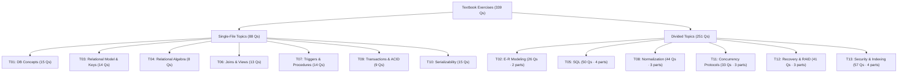

# Silberschatz 7e Textbook Exercises Bank

> **Course:** ECE 2215: Database Systems (RUET)  
> **Textbook Reference:** Silberschatz, Korth & Sudarshan, *Database System Concepts* (7th Edition, 2019)  
> **Analytics Reference:** [Silberschatz Exercises Analysis & Exam-Mapping Report](/home/azaz/.gemini/antigravity/brain/7f91d4e0-84e2-4e48-b4ae-5dee4b54721d/silberschatz_exercises_analysis.md)  
> **Total Exercises Solved:** **339 exercises** (137 Practice Exercises + 202 Regular Exercises) across **26 topic-wise files** ($\le 15$ problems per file).

---

## 1. Structure & Organization

In accordance with course exam-preparation guidelines, topics containing $\le 17$ questions are preserved in single files, while larger topics ($\ge 18$ questions) are divided into focused parts of $\le 15$ questions each.

---

## 2. Master Topic & File Directory

| Topic ID | Topic Name | Unit | File Name | Questions | Direct RUET Exam Hits |
| :--- | :--- | :---: | :--- | :---: | :--- |
| **`T01`** | DB Concepts & Architecture | Unit 1 | [[T01_DB_Concepts_and_Architecture]] | 15 | Core definitions & DBA roles |
| **`T02`** | E-R & EER Modeling (Part 1) | Unit 2 | [[T02_Part1_ER_Modeling_Basics]] | 13 | **PE 6.2** (2018 Q.2c), **EX 6.17** (2020 Q.2c, 2021 Q.8c) |
| **`T02`** | E-R & EER Modeling (Part 2) | Unit 2 | [[T02_Part2_ER_Scenarios_Reduction_EER]] | 13 | Full scenario E-R design & table reductions |
| **`T03`** | Relational Model, Keys & Integrity | Unit 3 | [[T03_Relational_Model_Keys_and_Integrity]] | 14 | **EX 6.14** (2018 Q.2a, 2021 Q.2b, 2023 Q.3b) |
| **`T04`** | Relational Algebra & Calculus | Unit 3 | [[T04_Relational_Algebra_and_Calculus]] | 8 | **PE 2.6** (2017 Q.2a) |
| **`T05`** | SQL: DDL Constraints & DML Updates (Part 1) | Unit 4 | [[T05_Part1_SQL_DDL_DML_Basics]] | 13 | DDL schema creation & data modification |
| **`T05`** | SQL: Clauses & Aggregations (Part 2) | Unit 4 | [[T05_Part2_SQL_Clauses_and_Aggregations]] | 12 | `ORDER BY`, `LIKE`, `GROUP BY`, `HAVING`, CGPA formula |
| **`T05`** | SQL: Subqueries & Extremes (Part 3) | Unit 4 | [[T05_Part3_SQL_Aggregations_and_Subqueries]] | 10 | Extremes without `LIMIT`, nested subqueries |
| **`T05`** | SQL: Multi-Table Enterprise Queries (Part 4) | Unit 4 | [[T05_Part4_SQL_MultiTable_Business_Queries]] | 15 | **PE 3.4 / EX 3.14** (2018 Q.3a, 2020 Q.7b, 2024 Q.5b) |
| **`T06`** | Joins and Views | Unit 4 | [[T06_Joins_and_Views]] | 13 | Outer join semantics, updatable views |
| **`T07`** | Triggers and Stored Procedures | Unit 4 | [[T07_Triggers_and_Stored_Procedures]] | 14 | ECA rules, audit logs, cascading triggers |
| **`T08`** | Normalization: FDs & Axioms (Part 1) | Unit 5 | [[T08_Part1_FDs_and_Armstrong_Axioms]] | 15 | **PE 7.6** (2021 Q.5b, CT-03 Q.1), Armstrong proofs |
| **`T08`** | Normalization: Canonical Cover & 3NF (Part 2) | Unit 5 | [[T08_Part2_Canonical_Cover_and_3NF]] | 15 | **PE 7.7** (2021 Q.6b), 3NF synthesis algorithm |
| **`T08`** | Normalization: BCNF Decompositions (Part 3) | Unit 5 | [[T08_Part3_BCNF_and_Advanced_Normalization]] | 14 | BCNF decomposition trees & dependency tests |
| **`T09`** | Transactions, ACID & Anomalies | Unit 6 | [[T09_Transactions_ACID_and_Anomalies]] | 9 | ACID guarantees, transaction states, anomalies |
| **`T10`** | Serializability & Precedence Graphs | Unit 6 | [[T10_Serializability]] | 15 | **EX 17.14** (2018 Q.6a), **EX 17.15** (2017 Q.5c, 2019 Q.4a) |
| **`T11`** | Concurrency Protocols: Locking Modes (Part 1) | Unit 6 | [[T11_Part1_Locking_Protocols]] | 11 | Lock compatibility, queue starvation handling |
| **`T11`** | Concurrency Protocols: 2PL Mechanics (Part 2) | Unit 6 | [[T11_Part2_2PL_and_Lock_Conversions]] | 11 | **PE 18.2** (2017 Q.7a), 2PL lock point theorem |
| **`T11`** | Concurrency Protocols: Deadlock & TSO (Part 3) | Unit 6 | [[T11_Part3_Deadlock_and_Timestamp_Ordering]] | 11 | **EX 18.20** (2018 Q.5b), **EX 18.26** (2018 Q.6b, 2024 Q.8b) |
| **`T12`** | Recovery: Failure Classification & RAID (Part 1) | Unit 7 | [[T12_Part1_Failure_Types_and_RAID_Intro]] | 14 | Failure taxonomy & stable storage implementation |
| **`T12`** | Recovery: Log Tracing & Manager (Part 2) | Unit 7 | [[T12_Part2_Recovery_Manager_and_Log_Recovery]] | 14 | **PE 17.1** (2018 Q.8b), WAL undo/redo pass tracing |
| **`T12`** | Recovery: Checkpoints, ARIES & RAID 0–6 (Part 3) | Unit 7 | [[T12_Part3_Checkpoints_and_RAID_Levels]] | 13 | Checkpoint mechanics & RAID parity calculations |
| **`T13`** | Security: Threats & Privileges (Part 1) | Unit 8 | [[T13_Part1_Security_and_Authorization_A]] | 15 | `GRANT` / `REVOKE` authorization graphs & RBAC |
| **`T13`** | Security: Access Control & Governance (Part 2) | Unit 8 | [[T13_Part2_Security_and_Authorization_B]] | 14 | Fine-grained access, encryption & audit logging |
| **`T13`** | Security & Indexing: SQLi & B+-Trees (Part 3) | Unit 8 | [[T13_Part3_SQL_Injection_and_BTree_Indexing]] | 15 | **EX 9.16** (2020 Q.4a, 2021 Q.8b), B+-tree split/delete |
| **`T13`** | Indexing & Dynamic Hashing (Part 4) | Unit 8 | [[T13_Part4_Indexing_and_Hashing]] | 13 | Extendible dynamic hashing & index cost evaluation |

---

## 3. Formatting & Pedagogical Standard

Every solution file follows the three-tiered solution layout:
1. **Core Principles & Concept Overview**: Grounded explanation of underlying database theory.
2. **Detailed Step-by-Step Solution**: Rigorous mathematical derivations, relational algebra expressions, and standard SQL implementations with strict BossNotes/KaTeX compatibility (`$$` alone on its own line).
3. **RUET Exam Insights & Examiner Notes**: Practical exam tips, recycled PYQ notes, common student misconceptions, and Silberschatz 6e vs 7e differences.

