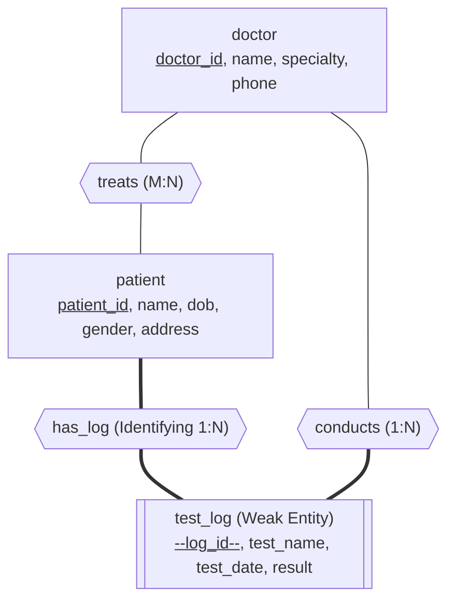
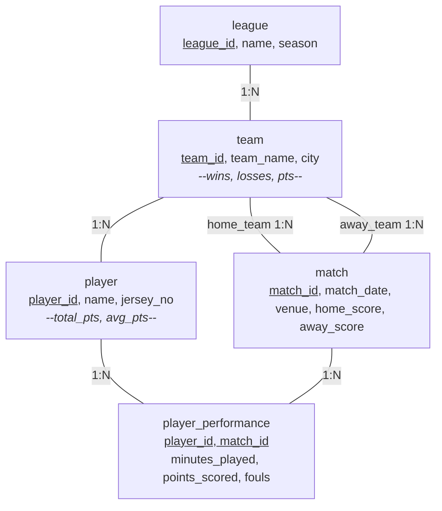
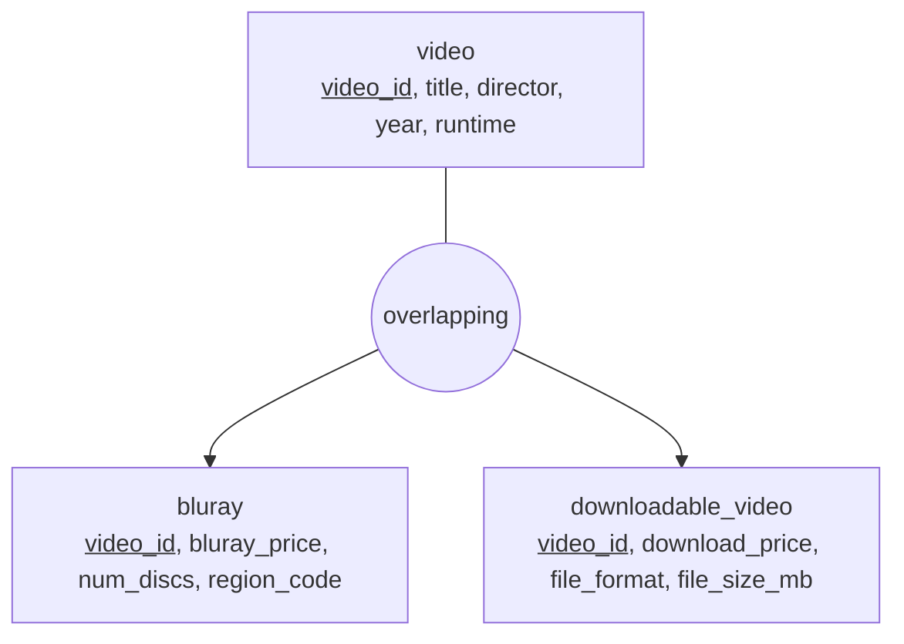
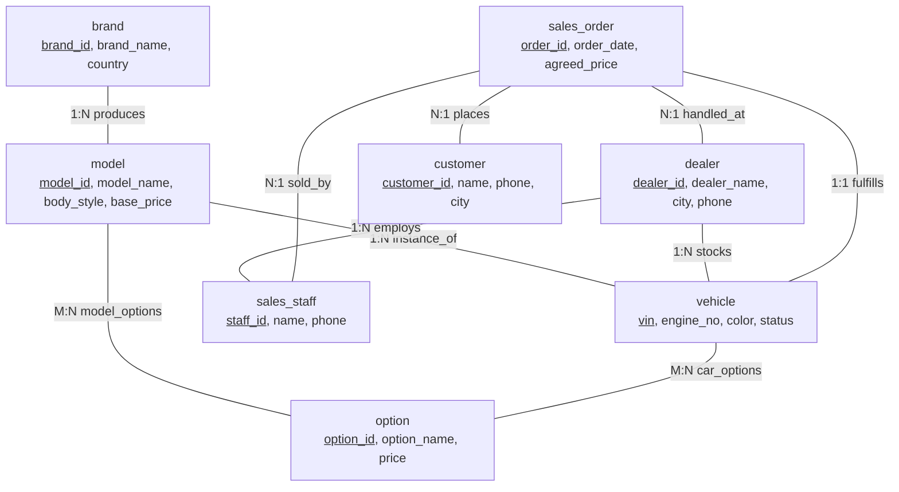
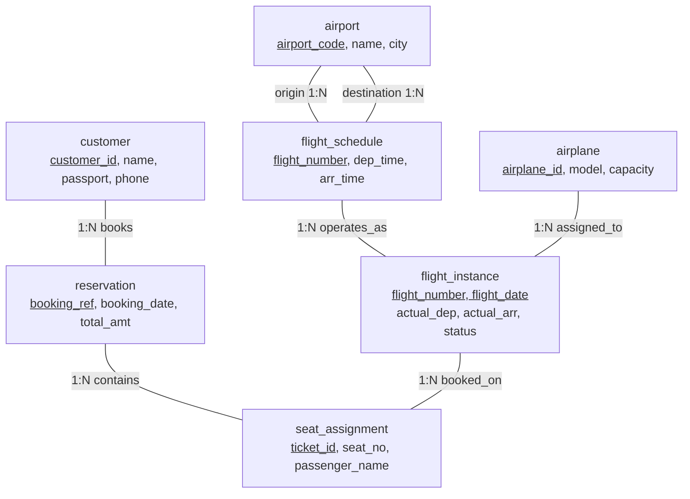
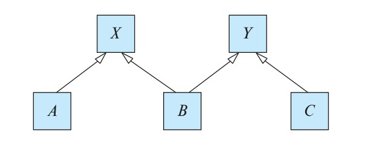
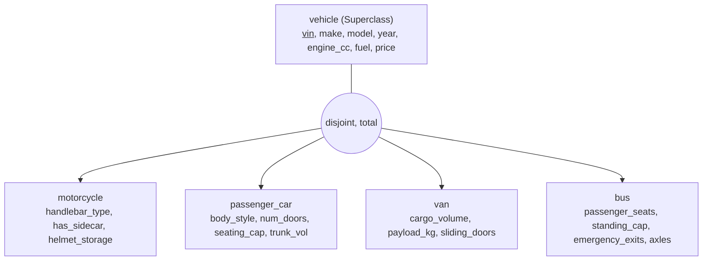
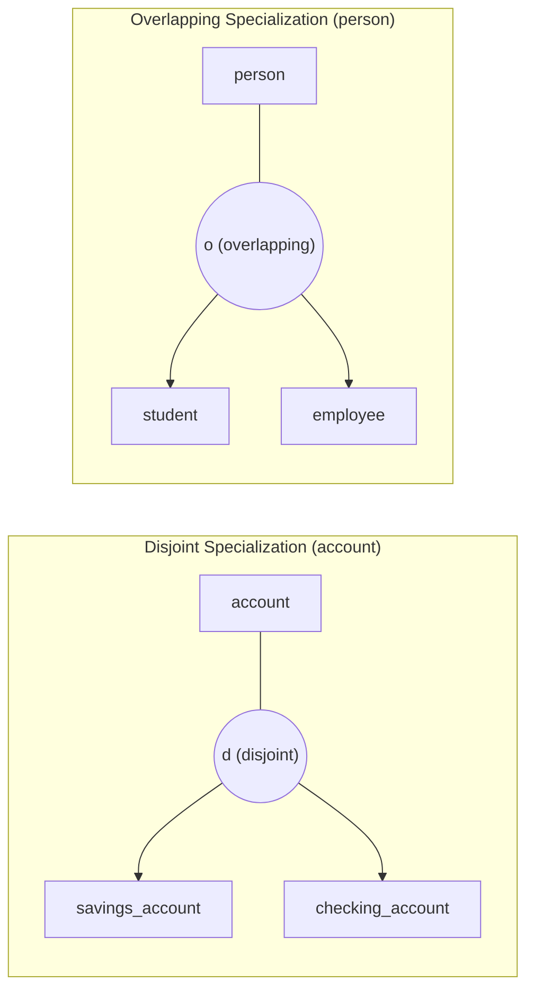

[← Prev: T02 Part 1](T02_Part1_ER_Modeling_Basics.md) | [Exam-style T02](../Topicwise_answers_exam_style/T02_ER_and_EER_Modeling.md) | [Next: T03 →](T03_Relational_Model_Keys_and_Integrity.md)

---

# T02 · E-R and EER Modeling (Part 2 · Advanced Scenarios, Reduction & EER)

> [!info] Topic Card
> **Topic:** T02 · Entity-Relationship and Extended E-R (EER) Modeling  
> **Textbook:** Silberschatz, Korth & Sudarshan, *Database System Concepts* (7th Edition, 2019), Chapter 06  
> **Assigned Exercises (13 Questions):** Practice Exercises **6.8, 6.12**; End-of-Chapter Exercises **6.15, 6.16, 6.20, 6.21, 6.22, 6.23, 6.24, 6.25, 6.26, 6.27, 6.28**  
> **Subtopics Covered:**
> - **T02.5 (Part B):** Full E-R Design for Complex Scenarios (Exercises 6.15, 6.16, 6.21, 6.22, 6.23, 6.24)
> - **T02.6:** Reduction of E-R Schemas to Relational Tables & Integrity Constraints (Practice Exercise 6.8, Exercises 6.20, 6.25)
> - **T02.7:** Extended E-R (EER) Architectures: Specialization, Generalization & Constraint Theory (Practice Exercise 6.12, Exercises 6.26, 6.27, 6.28)

---

## Table of Exercises

| Exercise ID | Type | Title / Focus | Subtopic | Page Ref | Quick Jump |
| :--- | :--- | :--- | :--- | :--- | :--- |
| **PE 6.8** | Practice Ex | Cardinality Enforcement via PK & FK in Relational Reduction | T02.6 | p. 295 | [[#Exercise 6.8 · Cardinality Enforcement via Primary & Foreign Keys in Relational Reduction\|Jump]] |
| **PE 6.12** | Practice Ex | Attribute Inheritance and Name Clashes in Specialization Lattices | T02.7 | pp. 296–297 | [[#Exercise 6.12 · Attribute Inheritance and Name Clashes in Specialization Lattices\|Jump]] |
| **EX 6.15** | Exercise | Hospital Patient-Doctor & Examination Log System Design | T02.5 | p. 298 | [[#Exercise 6.15 · Hospital Patient-Doctor & Examination Log System\|Jump]] |
| **EX 6.16** | Exercise | Multi-Team Sports League Scoring & Roster Tracking System | T02.5 | p. 298 | [[#Exercise 6.16 · Sports League Scoring & Match Tracking System\|Jump]] |
| **EX 6.20** | Exercise | Relational Schema Reduction for Practice Scenarios (6.1, 6.2, 6.3, 6.15) | T02.6 | p. 298 | [[#Exercise 6.20 · Relational Schema Reduction for Practice Scenarios\|Jump]] |
| **EX 6.21** | Exercise | Online Bookstore Multi-Format Media Extension (Blu-ray & Digital) | T02.5 | pp. 298–299 | [[#Exercise 6.21 · Online Bookstore Multi-Format Media Extension\|Jump]] |
| **EX 6.22** | Exercise | Automobile Dealership, Inventory & Order Management System | T02.5 | pp. 298–299 | [[#Exercise 6.22 · Automobile Dealership, Inventory & Order Management System\|Jump]] |
| **EX 6.23** | Exercise | Worldwide Package Delivery & Multi-Modal Route Tracking System | T02.5 | p. 299 | [[#Exercise 6.23 · Worldwide Package Delivery & Route Tracking System\|Jump]] |
| **EX 6.24** | Exercise | Airline Flight Reservation, Seat Assignment & Scheduling System | T02.5 | pp. 299–300 | [[#Exercise 6.24 · Airline Flight Reservation, Seat Assignment & Scheduling System\|Jump]] |
| **EX 6.25** | Exercise | Structural Analysis of Ternary Relationship Decomposition Alternatives | T02.6 | p. 300 | [[#Exercise 6.25 · Structural Analysis of Ternary Relationship Decomposition Alternatives\|Jump]] |
| **EX 6.26** | Exercise | Specialization Hierarchy Design for Motor Vehicle Sales | T02.7 | p. 300 | [[#Exercise 6.26 · Specialization Hierarchy Design for Motor Vehicle Sales\|Jump]] |
| **EX 6.27** | Exercise | Disjoint vs. Overlapping Constraints in Specialization | T02.7 | p. 300 | [[#Exercise 6.27 · Disjoint vs. Overlapping Constraints in Specialization\|Jump]] |
| **EX 6.28** | Exercise | Total vs. Partial Completeness Constraints in Specialization | T02.7 | p. 300 | [[#Exercise 6.28 · Total vs. Partial Constraints in Specialization\|Jump]] |

---

## T02.5 · Full E-R Design for Complex Scenarios (Part B)

### Exercise 6.15 · Hospital Patient-Doctor & Examination Log System

> [!info] Exercise Metadata
> - **Exercise Number:** Silberschatz 7e, End-of-Chapter Exercise 6.15
> - **Topic / Subtopic:** T02 · E-R and EER Modeling / T02.5 · Full E-R Design for a Scenario
> - **Primary Source:** Chapter 06, Section 6.2 (Entity-Relationship Model), Section 6.5 (Weak Entity Sets)
> - **RUET Relevance:** High. RUET semester finals regularly require complete scenario designs (e.g., RUET Student DB in 2017/2024, Train E-Ticketing in 2019, RUET Library in 2023). Examination/medical logging tests weak entity mechanics and $M:N$ vs. $1:N$ relationships.

#### Question (Silberschatz 7e Exercise 6.15)
Construct an E-R diagram for a hospital with a set of patients and a set of medical doctors. Associate with each patient a log of the various tests and examinations conducted.

#### 1. Core Principles & Concept Overview
To model a hospital enterprise correctly, we must identify the core entities, their identifying attributes, and the behavioral constraints that govern clinical operations:
1. **Core Strong Entities:**
   - `doctor`: Medical practitioners employed by or affiliated with the hospital. Identified by a unique `doctor_id`.
   - `patient`: Individuals admitted to or receiving outpatient care at the hospital. Identified by a unique `patient_id`.
2. **Clinical Examination Log Modeling (Weak vs. Strong Entity):**
   - An examination log entry records clinical procedures, blood tests, radiological scans, or physical examinations conducted for a patient.
   - An examination record cannot exist independently in the hospital without belonging to a registered patient. Furthermore, log sequence numbering is typically local to an individual patient (e.g., patient $P_{101}$ has tests 1, 2, 3; patient $P_{102}$ has tests 1, 2).
   - Therefore, `test_log` is most elegantly modeled as a **weak entity set**, dependent on the strong identifying entity set `patient` via an identifying relationship `has_log`. Its discriminator (partial key) is `log_id` (or `test_seq_no`), and its full primary key in relational reduction becomes `(patient_id, log_id)`.
3. **Relationship Semantics:**
   - **Doctor-to-Patient (`treats`):** A doctor can treat multiple patients, and a patient can be under the concurrent care of multiple doctors (e.g., a primary physician, an anesthesiologist, and a surgeon). This is a **many-to-many ($M:N$)** relationship.
   - **Doctor-to-Examination (`conducts`):** Each specific test or examination is performed or supervised by exactly one medical doctor (many-to-one from `test_log` to `doctor`), while a doctor may conduct many tests over time.

#### 2. Detailed Step-by-Step Solution

##### Step 1: Entity Sets and Attribute Specifications
- **`doctor` (Strong Entity):**
  - `doctor_id` (Primary Key, simple, atomic)
  - `name` (Composite: `first_name`, `last_name`)
  - `specialty` (Simple, e.g., Cardiology, Neurology)
  - `phone_number` (Single-valued)
  - `office_room` (Simple)
- **`patient` (Strong Entity):**
  - `patient_id` (Primary Key, simple, atomic)
  - `name` (Composite: `first_name`, `last_name`)
  - `date_of_birth` (Simple)
  - `gender` (Simple)
  - `contact_phone` (Single-valued)
  - `address` (Composite: `street`, `city`, `zip_code`)
- **`test_log` (Weak Entity Set):**
  - `log_id` (Discriminator / Partial Key, dashed underline)
  - `test_name` (Simple, e.g., "Full Blood Count", "Chest X-Ray")
  - `test_date` (Simple)
  - `test_time` (Simple)
  - `test_result` (Simple / Text)
  - `remarks` (Simple)

##### Step 2: Relationship Sets & Structural Constraints
1. **`has_log` (Identifying Relationship Set):**
   - Links strong entity `patient` to weak entity `test_log`.
   - Cardinality: **One-to-Many ($1:N$)** from `patient` to `test_log`.
   - Participation: `test_log` has **total participation** (double rectangle, double diamond, double line); a log cannot exist without a patient. `patient` has partial participation (a newly registered patient may not yet have undergone any tests).
2. **`conducts` (Binary Relationship Set):**
   - Links `doctor` and `test_log`.
   - Cardinality: **One-to-Many ($1:N$)** from `doctor` to `test_log` (directed arrow toward `doctor` in Chen notation, indicating that for each test log there is at most one doctor).
   - Participation: `test_log` has total participation (every conducted test must have an accountable examining physician).
3. **`treats` (Binary Relationship Set):**
   - Links `doctor` and `patient`.
   - Cardinality: **Many-to-Many ($M:N$)**.
   - Attributes: `admission_date`, `discharge_date`.

##### Step 3: Conceptual Schema Diagram


##### Step 4: Relational Schema Reduction
1. **`doctor`** (from strong entity):  
   $$
   \text{doctor}(\underline{\text{doctor\_id}}, \text{first\_name}, \text{last\_name}, \text{specialty}, \text{phone\_number}, \text{office\_room})
   $$
2. **`patient`** (from strong entity):  
   $$
   \text{patient}(\underline{\text{patient\_id}}, \text{first\_name}, \text{last\_name}, \text{date\_of\_birth}, \text{gender}, \text{contact\_phone}, \text{street}, \text{city}, \text{zip\_code})
   $$
3. **`treats`** (from $M:N$ relationship):  
   $$
   \text{treats}(\underline{\text{doctor\_id}, \text{patient\_id}}, \text{admission\_date}, \text{discharge\_date})
   $$
   - $\text{FK: } \text{doctor\_id} \to \text{doctor}(\text{doctor\_id})$  
   - $\text{FK: } \text{patient\_id} \to \text{patient}(\text{patient\_id})$
4. **`test_log`** (from weak entity combined with $1:N$ relationship `conducts`):  
   $$
   \text{test\_log}(\underline{\text{patient\_id}, \text{log\_id}}, \text{test\_name}, \text{test\_date}, \text{test\_time}, \text{test\_result}, \text{remarks}, \text{doctor\_id})
   $$
   - $\text{FK: } \text{patient\_id} \to \text{patient}(\text{patient\_id}) \text{ ON DELETE CASCADE}$  
   - $\text{FK: } \text{doctor\_id} \to \text{doctor}(\text{doctor\_id}) \text{ [NOT NULL]}$

#### 3. RUET Exam Insights & Examiner Notes
- **Weak Entity Mechanics:** In RUET exams (e.g., 2018 Q.1(b), 2021 Q.8(c)), examiners demand clear visual distinction: double rectangle for `test_log`, double diamond for `has_log`, dashed underline for the partial key `log_id`, and double lines for total participation.
- **Foreign Key Integration:** In the relational table `test_log`, point out that `doctor_id` is incorporated as a foreign key without needing a separate `conducts` table because the relationship is many-to-one from `test_log` to `doctor`. This demonstrates command of schema optimization (Silberschatz §6.7.3).

---

### Exercise 6.16 · Sports League Scoring & Match Tracking System

> [!info] Exercise Metadata
> - **Exercise Number:** Silberschatz 7e, End-of-Chapter Exercise 6.16
> - **Topic / Subtopic:** T02 · E-R and EER Modeling / T02.5 · Full E-R Design for a Scenario
> - **Primary Source:** Chapter 06, Section 6.2–6.4, extending Practice Exercise 6.3
> - **RUET Relevance:** Moderate to High. Multi-entity competitive league tracking tests role modeling (home vs. away teams), associative performance entities, and derived attribute definitions.

#### Question (Silberschatz 7e Exercise 6.16)
Extend the E-R diagram of Exercise 6.3 to track the same information for all teams in a league.

*(Context from Exercise 6.3: Design an E-R diagram for keeping track of the scoring statistics of your favorite sports team. Store matches played, scores in each match, players in each match, and individual player scoring statistics for each match. Summary statistics must be modeled as derived attributes with an explanation of how they are computed.)*

#### 1. Core Principles & Concept Overview
To expand from a single-team tracker to an entire multi-team league (e.g., Premier League, NBA), the model must incorporate:
1. **The `team` Entity Set:** Distinct competitive clubs within the league, each with a roster of registered players.
2. **Match Representation & Role Indicators:** A match is played between exactly two distinct teams—a **home team** and an **away team**. Modeling this requires recursive/role-based binary relationships or explicit role attributes in a match-team participation structure.
3. **Player-Match Scoring Performance:** Individual player performance (points scored, fouls, assists, minutes played) is specific to a given match. A player cannot be linked purely to a match without recording their specific in-game contributions.
4. **Derived Attributes Calculation:** Summary statistics at the player level (e.g., `career_total_points`, `season_average`) and at the team level (e.g., `wins`, `losses`, `points`, `goal_difference`) must be formally defined as mathematical aggregates over atomic game events.

#### 2. Detailed Step-by-Step Solution

##### Step 1: Identification of Entity Sets
- **`league`:** `league_id` (PK), `name`, `season_year`.
- **`team`:** `team_id` (PK), `team_name`, `home_city`, `stadium_name`, `coach_name`.
  - *Derived Attributes:* `matches_played`, `wins`, `draws`, `losses`, `points`, `goals_for`, `goals_against`, `goal_difference`.
- **`player`:** `player_id` (PK), `name`, `jersey_number`, `position`, `date_of_birth`.
  - *Derived Attributes:* `total_matches_played`, `total_points_scored`, `average_points_per_game`.
- **`match`:** `match_id` (PK), `match_date`, `venue`, `match_round`.
  - *Attributes:* `home_score`, `away_score`.
- **`player_performance` (Associative Entity):**
  - Captures the participation of an individual player in a specific match.
  - Attributes: `minutes_played`, `points_scored`, `assists`, `rebounds` (or `goals`, `yellow_cards`, `red_cards`), `fouls`.

##### Step 2: Relationships and Role Constraints
1. **`belongs_to` (`team` $\longleftrightarrow$ `league`):** Many-to-One ($N:1$). Each team belongs to one league.
2. **`registered_with` (`player` $\longleftrightarrow$ `team`):** Many-to-One ($N:1$). Each player is contracted to one team at a time; a team maintains a roster of many players.
3. **`plays_home` and `plays_away` (`team` $\longleftrightarrow$ `match`):**
   - Each match involves exactly one `home_team` and one `away_team` ($1:N$ from `team` to `match` on each role).
   - Constraint: $\text{home\_team\_id} \neq \text{away\_team\_id}$.
4. **`participates_in` / `performs`:**
   - Links `player`, `match`, and `player_performance`. Each performance record is uniquely identified by `(player_id, match_id)`.

##### Step 3: Formal Mathematical Derivation of Derived Attributes
Derived attributes are denoted in E-R diagrams by **dashed ellipses**. They are computed dynamically:
1. **Player Summary Statistics:**
   - Total Points Scored:
     $$
     \text{player.total\_points\_scored} = \sum_{m \in \text{Matches}(p)} \text{player\_performance}(p, m).\text{points\_scored}
     $$
   - Average Points Per Match:
     $$
     \text{player.average\_points\_per\_game} = \frac{\text{player.total\_points\_scored}}{\text{COUNT}(\text{Matches}(p))}
     $$
2. **Team League Table Statistics:**
   - Team Matches Played: $\text{team.matches\_played} = \text{COUNT}(m \mid m.\text{home\_team} = t \lor m.\text{away\_team} = t)$
   - Team Wins ($W$):
     $$
     W = \text{COUNT}(m \mid (m.\text{home\_team} = t \land m.\text{home\_score} > m.\text{away\_score}) \lor (m.\text{away\_team} = t \land m.\text{away\_score} > m.\text{home\_score}))
     $$
   - Team Points ($Pts$ in soccer: 3 for win, 1 for draw, 0 for loss):
     $$
     \text{Pts} = 3 \times W + 1 \times D
     $$
   - Goal Difference ($GD$):
     $$
     GD = \text{team.goals\_for} - \text{team.goals\_against}
     $$

##### Step 4: Conceptual E-R Architecture


##### Step 5: Relational Schema Mapping
- $\text{league}(\underline{\text{league\_id}}, \text{name}, \text{season\_year})$
- $\text{team}(\underline{\text{team\_id}}, \text{team\_name}, \text{home\_city}, \text{stadium\_name}, \text{coach\_name}, \text{league\_id})$  
  $\text{FK: } \text{league\_id} \to \text{league}(\text{league\_id})$
- $\text{player}(\underline{\text{player\_id}}, \text{name}, \text{jersey\_number}, \text{position}, \text{date\_of\_birth}, \text{team\_id})$  
  $\text{FK: } \text{team\_id} \to \text{team}(\text{team\_id})$
- $\text{match}(\underline{\text{match\_id}}, \text{match\_date}, \text{venue}, \text{home\_team\_id}, \text{away\_team\_id}, \text{home\_score}, \text{away\_score})$  
  $\text{FK: } \text{home\_team\_id} \to \text{team}(\text{team\_id})$  
  $\text{FK: } \text{away\_team\_id} \to \text{team}(\text{team\_id})$  
  $\text{CHECK: } \text{home\_team\_id} \neq \text{away\_team\_id}$
- $\text{player\_performance}(\underline{\text{player\_id}, \text{match\_id}}, \text{minutes\_played}, \text{points\_scored}, \text{assists}, \text{fouls})$  
  $\text{FK: } \text{player\_id} \to \text{player}(\text{player\_id})$  
  $\text{FK: } \text{match\_id} \to \text{match}(\text{match\_id})$

#### 3. RUET Exam Insights & Examiner Notes
- **Derived Attribute Notation:** RUET examiners deduct marks if derived attributes are drawn with solid lines instead of **dashed ellipses**. In written solutions, explicitly define the SQL or aggregate formula showing how the attribute is calculated.
- **Handling Two Relationships Between the Same Entities:** Notice that `match` has two distinct foreign keys referencing `team` (`home_team_id` and `away_team_id`). Emphasize that these represent two distinct role relationships (`plays_home` and `plays_away`) rather than an ambiguous $M:N$ relation.

---

### Exercise 6.21 · Online Bookstore Multi-Format Media Extension

> [!info] Exercise Metadata
> - **Exercise Number:** Silberschatz 7e, End-of-Chapter Exercise 6.21
> - **Topic / Subtopic:** T02 · E-R and EER Modeling / T02.5 · Full E-R Design for a Scenario
> - **Primary Source:** Chapter 06, Section 6.8 (Specialization and Generalization), Figure 6.30
> - **Referenced Figures:** Textbook Figure 6.30 (*E-R diagram for modeling an online bookstore*)
> - **RUET Relevance:** Very High. Examines EER overlapping specialization and unified catalog reduction, testing the synthesis of physical vs. digital product mechanics.

#### Question (Silberschatz 7e Exercise 6.21)
Consider the E-R diagram in Figure 6.30, which models an online bookstore.

a. Suppose the bookstore adds Blu-ray discs and downloadable video to its collection. The same item may be present in one or both formats, with differing prices. Draw the part of the E-R diagram that models this addition, showing just the parts related to video.

b. Now extend the full E-R diagram to model the case where a shopping basket may contain any combination of books, Blu-ray discs, or downloadable video.

---

```text
Textbook Context (Figure 6.30 — Online Bookstore Summary):
- Entities:
  * author(name [PK], address, URL)
  * publisher(name [PK], address, phone, URL)
  * book(ISBN [PK], title, year, price)
  * customer(email [PK], name, address, phone)
  * shopping_basket(basket_id [PK])
  * warehouse(code [PK], address, phone)
- Relationships:
  * written_by (between author and book)
  * published_by (between book and publisher)
  * contains (between book and shopping_basket, attribute: number)
  * stocks (between book and warehouse, attribute: number)
  * basket_of (between shopping_basket and customer)
```

---

#### 1. Core Principles & Concept Overview
1. **Overlapping Specialization in Media Formats:**
   - A video release (e.g., "Inception") has format-independent metadata: `title`, `director`, `producer`, `release_year`, and `duration`.
   - The question states: *"The same item may be present in one or both formats, with differing prices."*
   - Because a given movie title can exist simultaneously as a physical **Blu-ray disc** and as a **downloadable digital video**, the specialization constraint is **overlapping** (not disjoint).
   - Furthermore, because price varies by format, `price` cannot reside in the generalized video superclass; each format subclass must have its own `price` attribute.
2. **Unified Shopping Basket Mechanics:**
   - In Figure 6.30, `contains` links `shopping_basket` directly to `book`.
   - If customers can put books, Blu-ray discs, and digital downloads into the same cart, linking `shopping_basket` via three separate relationships creates cart fragmentation.
   - The architecturally superior approach uses **generalization**: define a generalized superclass `item` (or `product`), from which `book`, `bluray`, and `downloadable_video` inherit. Then, `shopping_basket` participates in a single, unified `contains` relationship with `item`.
3. **Physical vs. Digital Inventory Discrepancy:**
   - `warehouse` can physically stock `book` and `bluray` (which occupy physical shelf space).
   - However, `downloadable_video` has no physical inventory in a brick-and-mortar warehouse—it resides on a digital content delivery network (CDN) or media server. The `stocks` relationship must therefore link only to physical products.

#### 2. Detailed Step-by-Step Solution

##### Part (a): Video Modeling with Overlapping Specialization
We introduce the generalized entity set `video` and specialize it into two lower-level entity sets:
- **`video` (Superclass):**
  - Attributes: `video_id` (PK), `title`, `director`, `year`, `runtime_mins`.
- **`bluray` (Subclass):**
  - Attributes: `bluray_price`, `num_discs`, `audio_encoding`, `region_code`.
- **`downloadable_video` (Subclass):**
  - Attributes: `download_price`, `file_format` (e.g., MP4, MKV), `file_size_mb`, `resolution` (e.g., 4K, 1080p), `stream_url`.
- **Constraint:** **Overlapping, Partial** (indicated by an overlapping generalization symbol labeled `overlapping`). A video can be available in both formats or only one.



##### Part (b): Full System Extension with Unified Product Generalization
To support any combination of books, Blu-ray discs, and digital videos in a customer's shopping basket:
1. **Create Generalized Superclass `item`:**
   - Attributes: `item_id` (Primary Key), `title`, `item_type`.
2. **Specialization of `item`:**
   - Disjoint categories: `book`, `bluray`, and `downloadable_video`.
   - `book` inherits `item_id`, and retains `ISBN`, `pages`, `price`, `written_by` author, and `published_by` publisher.
   - `bluray` inherits `item_id`, and links to its movie metadata (`video_id`).
   - `downloadable_video` inherits `item_id`, and links to its movie metadata (`video_id`).
3. **Unified Relationships:**
   - **`contains` (`shopping_basket` $\longleftrightarrow$ `item`):** $M:N$ relationship with descriptive attribute `quantity` (or `number`).
   - **`stocks` (`warehouse` $\longleftrightarrow$ `physical_item`):** Physical inventory applies to `book` and `bluray`, tracking `number_in_stock`.

```mermaid
flowchart TD
    C["customer<br><u>email</u>, name, address"]
    SB["shopping_basket<br><u>basket_id</u>"]
    ITEM["item (General Superclass)<br><u>item_id</u>, title, item_type"]
    
    BK["book<br><u>item_id</u>, ISBN, price, year"]
    BR["bluray<br><u>item_id</u>, video_id, price, region"]
    DV["downloadable_video<br><u>item_id</u>, video_id, price, file_size"]
    
    WH["warehouse<br><u>code</u>, address, phone"]
    
    C ---|1:1| SB
    SB ---|contains (M:N, quantity)| ITEM
    
    ITEM --- G(("disjoint"))
    G --> BK
    G --> BR
    G --> DV
    
    WH ---|stocks (qty)| BK
    WH ---|stocks (qty)| BR
```

##### Relational Schemas for Part (b)
- $\text{item}(\underline{\text{item\_id}}, \text{title}, \text{item\_type})$
- $\text{book}(\underline{\text{item\_id}}, \text{ISBN}, \text{price}, \text{year}, \text{publisher\_name})$  
  $\text{FK: } \text{item\_id} \to \text{item}(\text{item\_id})$, $\text{FK: } \text{publisher\_name} \to \text{publisher}(\text{name})$
- $\text{video}(\underline{\text{video\_id}}, \text{title}, \text{director}, \text{year}, \text{runtime\_mins})$
- $\text{bluray}(\underline{\text{item\_id}}, \text{video\_id}, \text{bluray\_price}, \text{num\_discs}, \text{region\_code})$  
  $\text{FK: } \text{item\_id} \to \text{item}(\text{item\_id})$, $\text{FK: } \text{video\_id} \to \text{video}(\text{video\_id})$
- $\text{downloadable\_video}(\underline{\text{item\_id}}, \text{video\_id}, \text{download\_price}, \text{file\_format}, \text{file\_size\_mb}, \text{download\_url})$  
  $\text{FK: } \text{item\_id} \to \text{item}(\text{item\_id})$, $\text{FK: } \text{video\_id} \to \text{video}(\text{video\_id})$
- $\text{shopping\_basket}(\underline{\text{basket\_id}}, \text{customer\_email})$  
  $\text{FK: } \text{customer\_email} \to \text{customer}(\text{email})$
- $\text{contains}(\underline{\text{basket\_id}, \text{item\_id}}, \text{quantity})$  
  $\text{FK: } \text{basket\_id} \to \text{shopping\_basket}(\text{basket\_id})$  
  $\text{FK: } \text{item\_id} \to \text{item}(\text{item\_id})$
- $\text{stocks\_physical}(\underline{\text{warehouse\_code}, \text{item\_id}}, \text{number\_in\_stock})$  
  $\text{FK: } \text{warehouse\_code} \to \text{warehouse}(\text{code})$  
  $\text{FK: } \text{item\_id} \to \text{item}(\text{item\_id})$  
  $\text{CHECK: } \text{item\_id} \text{ must reference a physical item (book or bluray)}$

#### 3. RUET Exam Insights & Examiner Notes
- **Why Separate `item` from `video`:** In Part (a), students often mistakenly model `price` on the `video` entity. Point out to examiners that placing `price` on `video` violates functional dependency rules because the Blu-ray disc and the digital streaming file have fundamentally different pricing structures.
- **Physical vs. Digital Warehouse Trap:** In Part (b), explicitly state in exam answers that `downloadable_video` should **not** have a foreign key to `warehouse`. Doing so demonstrates practical engineering intuition.

---

### Exercise 6.22 · Automobile Dealership, Inventory & Order Management System

> [!info] Exercise Metadata
> - **Exercise Number:** Silberschatz 7e, End-of-Chapter Exercise 6.22
> - **Topic / Subtopic:** T02 · E-R and EER Modeling / T02.5 · Full E-R Design for a Scenario
> - **Primary Source:** Chapter 06, Section 6.2–6.7
> - **RUET Relevance:** High. RUET exams emphasize manufacturing/sales scenarios with multi-level hierarchies (Brand $\to$ Model $\to$ Vehicle VIN) and optional features.

#### Question (Silberschatz 7e Exercise 6.22)
Design a database for an automobile company to provide to its dealers to assist them in maintaining customer records and dealer inventory and to assist sales staff in ordering cars.

Each vehicle is identified by a vehicle identification number (VIN). Each individual vehicle is a particular model of a particular brand offered by the company (e.g., the XF is a model of the car brand Jaguar of Tata Motors). Each model can be offered with a variety of options, but an individual car may have only some (or none) of the available options. The database needs to store information about models, brands, and options, as well as information about individual dealers, customers, and cars.

Your design should include an E-R diagram, a set of relational schemas, and a list of constraints, including primary-key and foreign-key constraints.

#### 1. Core Principles & Concept Overview
1. **Three-Tier Vehicle Catalog Hierarchy:**
   - **`brand`:** Corporate brand entity (e.g., Jaguar, Land Rover, Tata Motors).
   - **`model`:** Specific vehicle line designed under a brand (e.g., XF, F-Pace, Harrier).
   - **`vehicle` (Physical Car):** Concrete manufactured physical vehicle identified by a globally unique 17-character `vin` (Vehicle Identification Number).
2. **The "Available Options" vs. "Installed Options" Distinction:**
   - An automobile manufacturer defines a catalog of available factory options for each model (e.g., panoramic sunroof, leather upholstery, adaptive cruise control).
   - A model can support many options, and an option can be compatible with multiple models $\implies$ **$M:N$ relationship `model_options`**.
   - An individual physical vehicle (`vehicle`) has a specific subset of options actually installed $\implies$ **$M:N$ relationship `car_options`**.
   - **Semantic Integrity Constraint:** The options installed on a vehicle must be a subset of the options offered for that vehicle's model:
     $$
     \forall v \in \text{vehicle}, \quad \{o \mid (v, o) \in \text{car\_options}\} \subseteq \{o \mid (v.\text{model}, o) \in \text{model\_options}\}
     $$
3. **Dealership Inventory & Ordering Pipeline:**
   - A `dealer` holds an on-lot inventory of cars ($1:N$ relationship `holds_in_inventory`).
   - `customer` entities purchase or order cars.
   - A `sales_order` records the transaction, linking a `customer`, a `sales_staff` member, a `dealer`, and the specific `vehicle`.

#### 2. Detailed Step-by-Step Solution

##### Step 1: Complete Entity-Relationship Specification
- **`brand`:** `brand_id` (PK), `brand_name`, `country_of_origin`.
- **`model`:** `model_id` (PK), `model_name`, `body_style`, `base_price`, `brand_id` (FK).
- **`option`:** `option_id` (PK), `option_name`, `category`, `price`.
- **`vehicle`:** `vin` (PK), `engine_number`, `color`, `manufacturing_date`, `status` (`in_inventory`, `ordered`, `sold`), `model_id` (FK), `dealer_id` (FK).
- **`dealer`:** `dealer_id` (PK), `dealer_name`, `street`, `city`, `phone`, `email`.
- **`customer`:** `customer_id` (PK), `name`, `street`, `city`, `phone`, `email`.
- **`sales_staff`:** `staff_id` (PK), `name`, `phone`, `email`, `dealer_id` (FK).
- **`sales_order`:** `order_id` (PK), `order_date`, `agreed_price`, `status`, `vin` (FK), `customer_id` (FK), `dealer_id` (FK), `staff_id` (FK).

##### Step 2: Conceptual Schema Diagram


##### Step 3: Relational Schemas & Integrity Constraints
1. **`brand`:**
   $$
   \text{brand}(\underline{\text{brand\_id}}, \text{brand\_name}, \text{country\_of\_origin})
   $$
2. **`model`:**
   $$
   \text{model}(\underline{\text{model\_id}}, \text{model\_name}, \text{body\_style}, \text{base_price}, \text{brand\_id})
   $$
   - $\text{FK: } \text{brand\_id} \to \text{brand}(\text{brand\_id}) \text{ ON DELETE RESTRICT}$
3. **`option`:**
   $$
   \text{option}(\underline{\text{option\_id}}, \text{option\_name}, \text{category}, \text{price})
   $$
4. **`model_options`** (Available options per model):
   $$
   \text{model\_options}(\underline{\text{model\_id}, \text{option\_id}})
   $$
   - $\text{FK: } \text{model\_id} \to \text{model}(\text{model\_id})$
   - $\text{FK: } \text{option\_id} \to \text{option}(\text{option\_id})$
5. **`dealer`:**
   $$
   \text{dealer}(\underline{\text{dealer\_id}}, \text{dealer\_name}, \text{street}, \text{city}, \text{phone}, \text{email})
   $$
6. **`sales_staff`:**
   $$
   \text{sales\_staff}(\underline{\text{staff\_id}}, \text{name}, \text{phone}, \text{email}, \text{dealer\_id})
   $$
   - $\text{FK: } \text{dealer\_id} \to \text{dealer}(\text{dealer\_id})$
7. **`vehicle`:**
   $$
   \text{vehicle}(\underline{\text{vin}}, \text{engine\_number}, \text{color}, \text{manufacturing\_date}, \text{status}, \text{model\_id}, \text{dealer\_id})
   $$
   - $\text{FK: } \text{model\_id} \to \text{model}(\text{model\_id})$
   - $\text{FK: } \text{dealer\_id} \to \text{dealer}(\text{dealer\_id}) \quad [\text{Nullable if car is at central factory}]$
   - $\text{UNIQUE}(\text{engine\_number})$
8. **`car_options`** (Options installed on a specific car):
   $$
   \text{car\_options}(\underline{\text{vin}, \text{option\_id}})
   $$
   - $\text{FK: } \text{vin} \to \text{vehicle}(\text{vin})$
   - $\text{FK: } \text{option\_id} \to \text{option}(\text{option\_id})$
9. **`customer`:**
   $$
   \text{customer}(\underline{\text{customer\_id}}, \text{name}, \text{street}, \text{city}, \text{phone}, \text{email})
   $$
10. **`sales_order`:**
    $$
    \text{sales\_order}(\underline{\text{order\_id}}, \text{order\_date}, \text{agreed\_price}, \text{vin}, \text{customer\_id}, \text{dealer\_id}, \text{staff\_id})
    $$
    - $\text{FK: } \text{vin} \to \text{vehicle}(\text{vin}) \quad [\text{UNIQUE: each physical car is sold in at most one order}]$
    - $\text{FK: } \text{customer\_id} \to \text{customer}(\text{customer\_id})$
    - $\text{FK: } \text{dealer\_id} \to \text{dealer}(\text{dealer\_id})$
    - $\text{FK: } \text{staff\_id} \to \text{sales\_staff}(\text{staff\_id})$

#### 3. RUET Exam Insights & Examiner Notes
- **$1:1$ Order-to-Car Cardinality:** Emphasize that `vin` in `sales_order` must be declared with a **`UNIQUE`** constraint. A vehicle with a specific VIN can only be sold once. Omitting this allows the same car to be sold to multiple customers simultaneously, a severe business logic flaw.
- **Option Compatibility Subsetting:** State clearly that relational FKs enforce that `option_id` exists in `option`, but cross-table integrity (that the car only gets options allowed for its model) requires an SQL trigger or composite foreign key design.

---

### Exercise 6.23 · Worldwide Package Delivery & Route Tracking System

> [!info] Exercise Metadata
> - **Exercise Number:** Silberschatz 7e, End-of-Chapter Exercise 6.23
> - **Topic / Subtopic:** T02 · E-R and EER Modeling / T02.5 · Full E-R Design for a Scenario
> - **Primary Source:** Chapter 06, Section 6.2–6.8
> - **RUET Relevance:** High. In RUET 2024 Q.1(a), a courier delivery enterprise was specifically tested. Tracking packages across trucks, airplanes, airports, and warehouses requires modeling temporal spatial transitions and role-playing entities.

#### Question (Silberschatz 7e Exercise 6.23)
Design a database for a worldwide package delivery company (e.g., DHL or FedEx). The database must be able to keep track of customers who ship items and customers who receive items; some customers may do both. Each package must be identifiable and trackable, so the database must be able to store the location of the package and its history of locations. Locations include trucks, planes, airports, and warehouses.

Your design should include an E-R diagram, a set of relational schemas, and a list of constraints, including primary-key and foreign-key constraints.

#### 1. Core Principles & Concept Overview
1. **Unified Customer Entity with Dual Roles:**
   - The prompt specifies that customers ship items, receive items, or do both.
   - Rather than creating separate `sender` and `receiver` entity sets (which would cause massive data redundancy for people who both send and receive), we maintain a single `customer` entity set.
   - Two distinct binary relationships connect `package` and `customer`:
     - `ships`: Many-to-One ($N:1$) between `package` and `customer` (Sender role).
     - `receives`: Many-to-One ($N:1$) between `package` and `customer` (Recipient role).
2. **Polymorphic Location Modeling (Generalization/Specialization):**
   - Locations where packages reside are diverse: stationary buildings (`warehouse`, `airport`) and mobile vehicles (`truck`, `plane`).
   - All locations share common tracking attributes: a unique `location_id`, `location_type`, and administrative contact info.
   - We create a **generalized superclass `location`**, specialized into four subclasses:
     - `truck`: `license_plate_no`, `driver_name`, `assigned_hub`.
     - `plane`: `tail_number`, `flight_number`, `operator`.
     - `airport`: `iata_code`, `runway_count`, `city`.
     - `warehouse`: `facility_code`, `storage_capacity_m3`, `address`.
3. **Temporal Tracking History (Package Location Log):**
   - A package moves from location to location along a transit route.
   - Storing only the "current location" loses the entire audit trail required for international logistics.
   - We model an associative historical tracking entity: `tracking_event`. Each event records that a specific package was scanned at a specific location at a specific timestamp, with an operational status code (e.g., "Departed Sorting Facility", "Customs Cleared", "Out for Delivery").

#### 2. Detailed Step-by-Step Solution

##### Step 1: Entity Sets and Attributes
- **`customer`:** `customer_id` (PK), `name`, `phone_number`, `email`, `street`, `city`, `state`, `postal_code`, `country`.
- **`package`:** `tracking_number` (PK), `weight_kg`, `dimensions_cm`, `declared_value`, `service_type` (e.g., Express, Ground, International), `status` (Created, In Transit, Delivered, Exception), `sender_id` (FK), `recipient_id` (FK).
- **`location` (General Superclass):** `location_id` (PK), `location_name`, `location_type` (`Truck`, `Plane`, `Airport`, `Warehouse`), `city`, `country`.
  - **`truck` (Subclass):** `location_id` (PK/FK), `license_plate`, `truck_model`, `max_volume_m3`.
  - **`plane` (Subclass):** `location_id` (PK/FK), `flight_number`, `tail_number`, `cargo_capacity_tons`.
  - **`airport` (Subclass):** `location_id` (PK/FK), `iata_code`, `customs_office_code`.
  - **`warehouse` (Subclass):** `location_id` (PK/FK), `warehouse_code`, `manager_name`.
- **`tracking_event` (Historical Associative Entity):**
  - Full Key: `(tracking_number, scan_timestamp)`
  - Attributes: `event_status`, `remarks`, `location_id` (FK).

##### Step 2: Conceptual E-R Architecture
```mermaid
flowchart TD
    C["customer<br><u>customer_id</u>, name, phone, address"]
    PKG["package<br><u>tracking_number</u>, weight, dimensions, service_type"]
    TE["tracking_event<br><u>tracking_number, scan_timestamp</u><br>status, remarks"]
    LOC["location (Superclass)<br><u>location_id</u>, name, location_type, city"]
    
    TRK["truck<br><u>location_id</u>, license_plate"]
    PLN["plane<br><u>location_id</u>, flight_no, tail_no"]
    APT["airport<br><u>location_id</u>, iata_code"]
    WH["warehouse<br><u>location_id</u>, warehouse_code"]
    
    C ---|1:N ships (sender)| PKG
    C ---|1:N receives (recipient)| PKG
    PKG ---|1:N has_history| TE
    TE ---|N:1 scanned_at| LOC
    
    LOC --- G(("disjoint"))
    G --> TRK
    G --> PLN
    G --> APT
    G --> WH
```

##### Step 3: Relational Schemas & Integrity Constraints
1. **`customer`:**
   $$
   \text{customer}(\underline{\text{customer\_id}}, \text{name}, \text{phone\_number}, \text{email}, \text{street}, \text{city}, \text{state}, \text{postal\_code}, \text{country})
   $$
2. **`package`:**
   $$
   \text{package}(\underline{\text{tracking\_number}}, \text{weight\_kg}, \text{dimensions\_cm}, \text{declared\_value}, \text{service\_type}, \text{current\_status}, \text{sender\_id}, \text{recipient\_id})
   $$
   - $\text{FK: } \text{sender\_id} \to \text{customer}(\text{customer\_id}) \text{ [NOT NULL]}$
   - $\text{FK: } \text{recipient\_id} \to \text{customer}(\text{customer\_id}) \text{ [NOT NULL]}$
3. **`location` (General Superclass):**
   $$
   \text{location}(\underline{\text{location\_id}}, \text{location\_name}, \text{location\_type}, \text{city}, \text{country})
   $$
4. **`truck`:**
   $$
   \text{truck}(\underline{\text{location\_id}}, \text{license\_plate}, \text{truck\_model}, \text{max\_volume\_m3})
   $$
   - $\text{FK: } \text{location\_id} \to \text{location}(\text{location\_id}) \text{ ON DELETE CASCADE}$
5. **`plane`:**
   $$
   \text{plane}(\underline{\text{location\_id}}, \text{flight\_number}, \text{tail\_number}, \text{cargo\_capacity\_tons})
   $$
   - $\text{FK: } \text{location\_id} \to \text{location}(\text{location\_id}) \text{ ON DELETE CASCADE}$
6. **`airport`:**
   $$
   \text{airport}(\underline{\text{location\_id}}, \text{iata\_code}, \text{customs\_office\_code})
   $$
   - $\text{FK: } \text{location\_id} \to \text{location}(\text{location\_id}) \text{ ON DELETE CASCADE}$
   - $\text{UNIQUE}(\text{iata\_code})$
7. **`warehouse`:**
   $$
   \text{warehouse}(\underline{\text{location\_id}}, \text{warehouse\_code}, \text{manager\_name})
   $$
   - $\text{FK: } \text{location\_id} \to \text{location}(\text{location\_id}) \text{ ON DELETE CASCADE}$
8. **`tracking_event` (Historical Audit Trail):**
   $$
   \text{tracking\_event}(\underline{\text{tracking\_number}, \text{scan\_timestamp}}, \text{event\_status}, \text{remarks}, \text{location\_id})
   $$
   - $\text{FK: } \text{tracking\_number} \to \text{package}(\text{tracking\_number}) \text{ ON DELETE CASCADE}$
   - $\text{FK: } \text{location\_id} \to \text{location}(\text{location\_id}) \text{ [NOT NULL]}$

#### 3. RUET Exam Insights & Examiner Notes
- **Composite Primary Key in Audit Trails:** In `tracking_event`, students often mistakenly assign `tracking_number` as the sole primary key, which makes it impossible to record more than one scan for a package. Stress that the primary key **must be composite**: `(tracking_number, scan_timestamp)`.
- **Role Modeling:** Highlight that `package` contains two foreign keys pointing to the same table `customer` (`sender_id` and `recipient_id`). Explain to the examiner that this maps role participation cleanly without duplicating customer records.

---

### Exercise 6.24 · Airline Flight Reservation, Seat Assignment & Scheduling System

> [!info] Exercise Metadata
> - **Exercise Number:** Silberschatz 7e, End-of-Chapter Exercise 6.24
> - **Topic / Subtopic:** T02 · E-R and EER Modeling / T02.5 · Full E-R Design for a Scenario
> - **Primary Source:** Chapter 06, Section 6.2–6.7
> - **RUET Relevance:** Very High. The airline reservation system is an industry-standard database design problem frequently referenced in competitive exams and viva sessions. It requires decoupling static flight schedules from dynamic flight instances.

#### Question (Silberschatz 7e Exercise 6.24)
Design a database for an airline. The database must keep track of customers and their reservations, flights and their status, seat assignments on individual flights, and the schedule and routing of future flights.

Your design should include an E-R diagram, a set of relational schemas, and a list of constraints, including primary-key and foreign-key constraints.

#### 1. Core Principles & Concept Overview
1. **The Classic Airline Abstraction Trap (Schedule vs. Instance):**
   - A fundamental error in database design is conflating a **flight schedule** (e.g., Flight "BG 084" from Dhaka to London departing daily at 09:30 AM) with a **flight instance** (e.g., Flight "BG 084" operating specifically on November 15, 2026).
   - A schedule is a recurring timetable; an instance is an actual physical event with real-time operational status, an assigned aircraft, and a distinct crew.
   - We must decouple them into two entities:
     - `flight_schedule`: Identifies the route, origin airport, destination airport, and scheduled departure/arrival times.
     - `flight_instance`: Represents an individual journey of a flight schedule on a specific calendar date (`flight_date`).
2. **Airport Routing & Navigation:**
   - Every flight route connects an origin airport and a destination airport ($N:1$ roles from `flight_schedule` to `airport`).
3. **Seat Assignments on Specific Flight Instances:**
   - A passenger reserves a seat on a specific flight instance, not on the abstract schedule.
   - An aircraft cabin has physical seats (`seat_number`, e.g., "12A", "24F").
   - A seat assignment assigns a passenger to a unique seat on a specific date:
     $$
     \text{UNIQUE}(\text{flight\_number}, \text{flight\_date}, \text{seat\_number})
     $$
4. **Customer Reservation Lifecycle:**
   - A `customer` creates a `reservation` (booking reference / PNR). A reservation can cover multiple passengers and multiple flight segments (tickets).

#### 2. Detailed Step-by-Step Solution

##### Step 1: Entity Sets and Attributes
- **`airport`:** `airport_code` (IATA 3-letter PK, e.g., DAC, LHR, JFK), `airport_name`, `city`, `country`.
- **`airplane`:** `airplane_id` (PK), `model_type` (e.g., Boeing 787-9), `total_capacity`, `manufacture_year`.
- **`flight_schedule`:** `flight_number` (PK, e.g., "BG 084"), `departure_time`, `arrival_time`, `days_of_week`, `origin_airport` (FK), `dest_airport` (FK).
- **`flight_instance`:** `(flight_number, flight_date)` (Composite PK), `actual_departure_time`, `actual_arrival_time`, `flight_status` (Scheduled, Boarding, Departed, Delayed, Cancelled), `airplane_id` (FK).
- **`customer`:** `customer_id` (PK), `first_name`, `last_name`, `passport_number`, `email`, `phone_number`.
- **`reservation`:** `booking_ref` (PNR, 6-character alphanumeric PK), `booking_date`, `total_amount`, `payment_status`, `customer_id` (FK).
- **`seat_assignment` (Ticket Segment):** `ticket_id` (PK), `booking_ref` (FK), `flight_number` (FK), `flight_date` (FK), `seat_number`, `passenger_name`, `baggage_weight_kg`.

##### Step 2: Conceptual Schema Diagram


##### Step 3: Relational Schemas & Integrity Constraints
1. **`airport`:**
   $$
   \text{airport}(\underline{\text{airport\_code}}, \text{airport\_name}, \text{city}, \text{country})
   $$
2. **`airplane`:**
   $$
   \text{airplane}(\underline{\text{airplane\_id}}, \text{model\_type}, \text{total\_capacity}, \text{manufacture\_year})
   $$
3. **`flight_schedule`:**
   $$
   \text{flight\_schedule}(\underline{\text{flight\_number}}, \text{departure\_time}, \text{arrival\_time}, \text{days\_of\_week}, \text{origin\_airport}, \text{dest\_airport})
   $$
   - $\text{FK: } \text{origin\_airport} \to \text{airport}(\text{airport\_code})$
   - $\text{FK: } \text{dest\_airport} \to \text{airport}(\text{airport\_code})$
   - $\text{CHECK: } \text{origin\_airport} \neq \text{dest\_airport}$
4. **`flight_instance`:**
   $$
   \text{flight\_instance}(\underline{\text{flight\_number}, \text{flight\_date}}, \text{actual\_departure\_time}, \text{actual\_arrival\_time}, \text{flight\_status}, \text{airplane\_id})
   $$
   - $\text{FK: } \text{flight\_number} \to \text{flight\_schedule}(\text{flight\_number}) \text{ ON DELETE CASCADE}$
   - $\text{FK: } \text{airplane\_id} \to \text{airplane}(\text{airplane\_id})$
5. **`customer`:**
   $$
   \text{customer}(\underline{\text{customer\_id}}, \text{first\_name}, \text{last\_name}, \text{passport\_number}, \text{email}, \text{phone\_number})
   $$
   - $\text{UNIQUE}(\text{passport\_number})$
6. **`reservation`:**
   $$
   \text{reservation}(\underline{\text{booking\_ref}}, \text{booking\_date}, \text{total\_amount}, \text{payment\_status}, \text{customer\_id})
   $$
   - $\text{FK: } \text{customer\_id} \to \text{customer}(\text{customer\_id})$
7. **`seat_assignment`:**
   $$
   \text{seat\_assignment}(\underline{\text{ticket\_id}}, \text{booking\_ref}, \text{flight\_number}, \text{flight\_date}, \text{seat\_number}, \text{passenger\_name}, \text{baggage\_weight\_kg})
   $$
   - $\text{FK: } \text{booking\_ref} \to \text{reservation}(\text{booking\_ref}) \text{ ON DELETE CASCADE}$
   - $\text{FK: } (\text{flight\_number}, \text{flight\_date}) \to \text{flight\_instance}(\text{flight\_number}, \text{flight\_date})$
   - **Crucial Uniqueness Constraint:**
     $$
     \text{UNIQUE}(\text{flight\_number}, \text{flight\_date}, \text{seat\_number})
     $$
     *(Enforces that the exact same seat on a specific flight instance cannot be assigned to more than one passenger!)*

#### 3. RUET Exam Insights & Examiner Notes
- **Double Booking Prevention:** Always explicitly write out the composite unique constraint `UNIQUE(flight_number, flight_date, seat_number)`. In RUET database design marking criteria, demonstrating knowledge of how business rules map directly to database constraints earns top marks.
- **Composite Foreign Key:** Notice that `seat_assignment` must reference `flight_instance` using a **two-column composite foreign key** `(flight_number, flight_date)`. Point this out to demonstrate relational integrity fluency.

---

## T02.6 · Reduction of E-R Schema to Relational Tables & Integrity Constraints

### Exercise 6.8 · Cardinality Enforcement via Primary & Foreign Keys in Relational Reduction

> [!info] Exercise Metadata
> - **Exercise Number:** Silberschatz 7e, Practice Exercise 6.8
> - **Topic / Subtopic:** T02 · E-R and EER Modeling / T02.6 · Reduction of E-R to Relational Tables
> - **Primary Source:** Chapter 06, Section 6.7 (Reduction to Relational Schemas), Section 6.7.3 (Representing Relationship Sets)
> - **RUET Relevance:** Critical. Question 2(c) in 2018 directly tested the reduction of E-R constructs to relational tables, and CT-01 frequently asks about key constraints enforcing mapping cardinalities.

#### Question (Silberschatz 7e Practice Exercise 6.8)
Consider a relation such as *sec_course*, generated from a many-to-one relationship set *sec_course*. Do the primary and foreign key constraints created on the relation enforce the many-to-one cardinality constraint? Explain why.

#### 1. Core Principles & Concept Overview
When converting an E-R relationship set $R$ between entity sets $A$ and $B$ into a relational table, the relationship's mapping cardinality determines the candidate keys and primary key of the resulting relation:
- **Many-to-Many ($M:N$):** Primary key is the union of primary keys of both participating entity sets: $PK(R) = PK(A) \cup PK(B)$.
- **Many-to-One ($N:1$ from $A$ to $B$):** Each entity in $A$ is associated with at most one entity in $B$. Thus, the primary key of $R$ is simply the primary key of the "many" side: $PK(R) = PK(A)$.
- **Integrity Rule in Relations:** By definition, a primary key constraint in relational databases enforces **entity integrity and strict uniqueness**: no two tuples in the relation can have the same primary key value.

#### 2. Detailed Step-by-Step Solution

##### Step 1: Structural Setup of `sec_course`
Let:
- Entity set `section` have primary key attributes: $(\text{course\_id}, \text{sec\_id}, \text{semester}, \text{year})$ [or simply $\text{sec\_id}$ for atomic notation].
- Entity set `course` have primary key attribute: $\text{course\_id}$.
- The relationship set `sec_course` is **many-to-one ($N:1$)** from `section` to `course`:
  - Each section is associated with **at most one** course.
  - A course can have **many** sections associated with it.

##### Step 2: Separate Table Reduction
If we represent `sec_course` as a distinct relation schema:
$$
\text{sec\_course}(\underline{\text{sec\_id}}, \text{course\_id})
$$
Constraints created on `sec_course`:
1. **Primary Key Constraint:** $\text{PRIMARY KEY}(\text{sec\_id})$.
2. **Foreign Key Constraint 1:** $\text{FOREIGN KEY}(\text{sec\_id}) \text{ REFERENCES } \text{section}(\text{sec\_id})$.
3. **Foreign Key Constraint 2:** $\text{FOREIGN KEY}(\text{course\_id}) \text{ REFERENCES } \text{course}(\text{course\_id})$.

##### Step 3: Analysis of Cardinality Enforcement
- **Does it enforce the Many-to-One constraint?**
  - **YES.** Because $\text{sec\_id}$ is designated as the primary key of the table `sec_course`, the relational DBMS strictly enforces that any given $\text{sec\_id}$ can appear **at most once** in the `sec_course` relation.
  - An attempt to insert a second tuple pairing the same section with a different course (e.g., `(Sec_101, CS-101)` followed by `(Sec_101, CS-102)`) immediately triggers a **primary key uniqueness violation** and is rejected by the engine.
  - Conversely, because $\text{course\_id}$ is **not** part of the primary key and has no `UNIQUE` constraint, the same $\text{course\_id}$ can appear in multiple tuples paired with different $\text{sec\_id}$ values (e.g., `(Sec_101, CS-101)` and `(Sec_102, CS-101)`). This perfectly satisfies the "many" side on `course`.

##### Step 4: The Alternative Combined Table Reduction
In Section 6.7.3, Silberschatz notes that for any many-to-one relationship set $R$ from $A$ to $B$, rather than creating an extra table, we can **combine** $R$ directly into the table created for the "many" side entity set $A$:
$$
\text{section}(\underline{\text{sec\_id}}, \text{semester}, \text{year}, \dots, \text{course\_id})
$$
- In this collapsed relation:
  - $\text{course\_id}$ becomes a single-valued foreign key attribute in `section`.
  - By relational first normal form (1NF), each tuple in `section` can hold only **one** atomic value for $\text{course\_id}$.
  - Thus, the functional dependency $\text{sec\_id} \to \text{course\_id}$ is inherently enforced by the tuple structure itself!

##### Step 5: Cardinality vs. Total Participation (Subtle Distinction)
While the primary key strictly enforces the **cardinality upper bound** ($\le 1$ course per section), does it enforce **total participation** ($\ge 1$ course per section)?
- In the **separate table** approach: A section could exist in the `section` table without having an entry in `sec_course`. Thus, separate table reduction permits partial participation unless cross-table assertions are maintained.
- In the **combined table** approach: Total participation is enforced simply by adding a **`NOT NULL`** constraint on the foreign key attribute $\text{course\_id}$ in `section`.

#### 3. RUET Exam Insights & Examiner Notes
- **Summary Matrix for RUET Exam Sheet:**
  | Reduction Strategy | Relation Schema | How $N:1$ is Enforced | How Total Participation is Enforced |
  | :--- | :--- | :--- | :--- |
  | **Separate Relation** | $\text{sec\_course}(\underline{\text{sec\_id}}, \text{course\_id})$ | $\text{PRIMARY KEY}(\text{sec\_id})$ guarantees $\le 1$ course per section. | Cannot be enforced via simple PK/FK; requires triggers/assertions. |
  | **Combined Relation** | $\text{section}(\underline{\text{sec\_id}}, \dots, \text{course\_id})$ | 1NF single-valued attribute guarantees $\le 1$ course per section. | Declare $\text{course\_id}$ as $\text{NOT NULL}$. |

---

### Exercise 6.20 · Relational Schema Reduction for Practice Scenarios

> [!info] Exercise Metadata
> - **Exercise Number:** Silberschatz 7e, End-of-Chapter Exercise 6.20
> - **Topic / Subtopic:** T02 · E-R and EER Modeling / T02.6 · Reduction of E-R to Relational Tables
> - **Primary Source:** Chapter 06, Section 6.7; covering scenarios from Exercises 6.1, 6.2, 6.3, and 6.15
> - **RUET Relevance:** Very High. Relational schema reduction from E-R diagrams is asked in almost every semester final (e.g., 2018 Q.2(c), CT-01 Q.2).

#### Question (Silberschatz 7e Exercise 6.20)
Construct appropriate relation schemas for each of the E-R diagrams in:
a. Exercise 6.1.  
b. Exercise 6.2.  
c. Exercise 6.3.  
d. Exercise 6.15.

---

#### 1. Core Principles & Concept Overview
To reduce an E-R schema to relational schemas systematically:
1. **Strong Entities:** Become relations with the same attributes and the same primary key.
2. **Weak Entities:** Become relations containing their discriminator plus the primary key of the identifying strong entity. The composite primary key consists of both.
3. **Many-to-Many Relationships ($M:N$):** Become separate relations whose primary key is the composite union of the primary keys of the participating entity sets.
4. **Many-to-One Relationships ($N:1$):** Can be converted into a separate table (keyed by the "many" side) or, preferably, combined into the "many" side relation as a foreign key attribute.
5. **Multivalued Attributes:** Become separate relations with the entity's primary key plus the multivalued attribute value.

---

#### 2. Detailed Step-by-Step Solution

##### Part (a): Reduction for Exercise 6.1 (Car Insurance Company)
*(Enterprise entities: customer, car, accident, insurance policy, premium payment)*

1. **`customer`:**
   $$
   \text{customer}(\underline{\text{customer\_id}}, \text{name}, \text{address}, \text{phone})
   $$
2. **`car`:**
   $$
   \text{car}(\underline{\text{license\_plate}}, \text{model}, \text{year}, \text{customer\_id})
   $$
   - $\text{FK: } \text{customer\_id} \to \text{customer}(\text{customer\_id}) \text{ [NOT NULL]}$ *(Customer owns one or more cars)*
3. **`accident`:**
   $$
   \text{accident}(\underline{\text{report\_number}}, \text{accident\_date}, \text{location}, \text{description})
   $$
4. **`participated` ($M:N$ between `car` and `accident`):**
   $$
   \text{participated}(\underline{\text{license\_plate}, \text{report\_number}}, \text{damage\_amount})
   $$
   - $\text{FK: } \text{license\_plate} \to \text{car}(\text{license\_plate})$
   - $\text{FK: } \text{report\_number} \to \text{accident}(\text{report\_number})$
5. **`policy`:**
   $$
   \text{policy}(\underline{\text{policy\_number}}, \text{policy\_type}, \text{start\_date}, \text{end\_date})
   $$
6. **`policy_car` ($M:N$ or $1:N$ policy coverage):**
   $$
   \text{covers}(\underline{\text{policy\_number}, \text{license\_plate}})
   $$
   - $\text{FK: } \text{policy\_number} \to \text{policy}(\text{policy\_number})$
   - $\text{FK: } \text{license\_plate} \to \text{car}(\text{license\_plate})$
7. **`premium_payment` (Weak entity identified by `policy`):**
   $$
   \text{premium\_payment}(\underline{\text{policy\_number}, \text{payment\_number}}, \text{due\_date}, \text{payment\_date}, \text{amount\_received})
   $$
   - $\text{FK: } \text{policy\_number} \to \text{policy}(\text{policy\_number}) \text{ ON DELETE CASCADE}$

---

##### Part (b): Reduction for Exercise 6.2 (Student, Course, Section, Exams & Marks)
*(Enterprise entities: student, course, section, exam)*

###### Design 1: Ternary Representation (Exam as an Entity Set)
1. **`student`:**
   $$
   \text{student}(\underline{\text{student\_id}}, \text{name}, \text{dept\_name})
   $$
2. **`course`:**
   $$
   \text{course}(\underline{\text{course\_id}}, \text{title}, \text{credits})
   $$
3. **`section`:**
   $$
   \text{section}(\underline{\text{course\_id}, \text{sec\_id}, \text{semester}, \text{year}})
   $$
   - $\text{FK: } \text{course\_id} \to \text{course}(\text{course\_id})$
4. **`exam`:**
   $$
   \text{exam}(\underline{\text{exam\_id}}, \text{exam\_name}, \text{max\_marks}, \text{weightage})
   $$
5. **`takes_exam` (Ternary Relationship between `student`, `section`, and `exam`):**
   $$
   \text{takes\_exam}(\underline{\text{student\_id}, \text{course\_id}, \text{sec\_id}, \text{semester}, \text{year}, \text{exam\_id}}, \text{marks\_obtained})
   $$
   - $\text{FK: } \text{student\_id} \to \text{student}(\text{student\_id})$
   - $\text{FK: } (\text{course\_id}, \text{sec\_id}, \text{semester}, \text{year}) \to \text{section}(\text{course\_id}, \text{sec\_id}, \text{semester}, \text{year})$
   - $\text{FK: } \text{exam\_id} \to \text{exam}(\text{exam\_id})$

###### Design 2: Binary Representation (Exam Marks as Weak Entity to `takes`)
1. **`takes` (Binary relationship between `student` and `section`):**
   $$
   \text{takes}(\underline{\text{student\_id}, \text{course\_id}, \text{sec\_id}, \text{semester}, \text{year}})
   $$
2. **`exam_mark` (Weak entity identified by the `takes` relationship):**
   $$
   \text{exam\_mark}(\underline{\text{student\_id}, \text{course\_id}, \text{sec\_id}, \text{semester}, \text{year}, \text{exam\_name}}, \text{marks\_obtained})
   $$

---

##### Part (c): Reduction for Exercise 6.3 (Sports Team Scoring Statistics)
1. **`player`:**
   $$
   \text{player}(\underline{\text{player\_id}}, \text{name}, \text{jersey\_number}, \text{position})
   $$
2. **`match`:**
   $$
   \text{match}(\underline{\text{match\_id}}, \text{match\_date}, \text{opponent\_name}, \text{team\_score}, \text{opponent\_score}, \text{venue})
   $$
3. **`player_match_stat` ($M:N$ performance relation):**
   $$
   \text{player\_match\_stat}(\underline{\text{player\_id}, \text{match\_id}}, \text{minutes\_played}, \text{points\_scored}, \text{assists}, \text{fouls})
   $$
   - $\text{FK: } \text{player\_id} \to \text{player}(\text{player\_id})$
   - $\text{FK: } \text{match\_id} \to \text{match}(\text{match\_id})$
   *(Note: Derived summary statistics such as `total_points` are computed dynamically via SQL aggregates and are omitted from the base physical schema to prevent update anomalies).*

---

##### Part (d): Reduction for Exercise 6.15 (Hospital Patient, Doctor & Log System)
1. **`doctor`:**
   $$
   \text{doctor}(\underline{\text{doctor\_id}}, \text{first\_name}, \text{last\_name}, \text{specialty}, \text{phone})
   $$
2. **`patient`:**
   $$
   \text{patient}(\underline{\text{patient\_id}}, \text{first\_name}, \text{last\_name}, \text{date\_of\_birth}, \text{gender}, \text{address})
   $$
3. **`treats` ($M:N$ relationship between `doctor` and `patient`):**
   $$
   \text{treats}(\underline{\text{doctor\_id}, \text{patient\_id}}, \text{first\_consultation\_date})
   $$
   - $\text{FK: } \text{doctor\_id} \to \text{doctor}(\text{doctor\_id})$
   - $\text{FK: } \text{patient\_id} \to \text{patient}(\text{patient\_id})$
4. **`test_log` (Weak entity identified by `patient`, combined with $N:1$ `conducts` doctor):**
   $$
   \text{test\_log}(\underline{\text{patient\_id}, \text{log\_seq\_no}}, \text{test\_name}, \text{test\_date}, \text{test\_time}, \text{test\_result}, \text{doctor\_id})
   $$
   - $\text{FK: } \text{patient\_id} \to \text{patient}(\text{patient\_id}) \text{ ON DELETE CASCADE}$
   - $\text{FK: } \text{doctor\_id} \to \text{doctor}(\text{doctor\_id}) \text{ [NOT NULL]}$

---

#### 3. RUET Exam Insights & Examiner Notes
- **Omission of Derived Attributes:** In Part (c), explicitly mention in your answer script: *"Derived attributes (such as total points, win count) are intentionally excluded from the relational table schemas to adhere to normalization principles (preventing transitive functional dependencies and update anomalies). They are generated dynamically via SQL views."* This impresses the examiner.

---

### Exercise 6.25 · Structural Analysis of Ternary Relationship Decomposition Alternatives

> [!info] Exercise Metadata
> - **Exercise Number:** Silberschatz 7e, End-of-Chapter Exercise 6.25
> - **Topic / Subtopic:** T02 · E-R and EER Modeling / T02.6 · Reduction of E-R to Relational Tables
> - **Primary Source:** Chapter 06, Section 6.9.4 (Binary versus n-ary Relationship Sets), Figure 6.29
> - **Referenced Figures:** Textbook Figure 6.29 (*Representation of a ternary relationship using binary relationships*)
> - **RUET Relevance:** High. RUET 2018 Q.2(c) and 2021 Q.5(a) tested relationship degree. Understanding why ternary relationships cannot be blindly replaced by three binary relationships is a classic conceptual exam question.

#### Question (Silberschatz 7e Exercise 6.25)
In Section 6.9.4, we represented a ternary relationship (repeated in Figure 6.29a) using binary relationships, as shown in Figure 6.29b. Consider the alternative shown in Figure 6.29c. Discuss the relative merits of these two alternative representations of a ternary relationship by binary relationships.

---

```text
Textbook Context (Figure 6.29 Architectures):
- Figure 6.29a: Ternary relationship R relating entity sets A, B, and C.
- Figure 6.29b: Entity set E connected via three binary relationships:
  * R_A between E and A (many-to-one from E to A)
  * R_B between E and B (many-to-one from E to B)
  * R_C between E and C (many-to-one from E to C)
  where E has total participation in R_A, R_B, and R_C.
- Figure 6.29c: Three binary relationships directly between pairs:
  * R_AB between A and B
  * R_BC between B and C
  * R_AC between A and C
```

---

#### 1. Core Principles & Concept Overview
A ternary relationship set $R$ represents an atomic association among three entities:
$$
R \subseteq A \times B \times C
$$
A fundamental question in conceptual design is: *Can every ternary relationship be decomposed into binary relationships without losing information?*
- **Representation (b) — The Synthetic Entity Approach:** Replaces $R$ with an explicit entity set $E$ and three many-to-one binary relationships ($R_A, R_B, R_C$) linking $E$ to $A, B$, and $C$.
- **Representation (c) — The Triangular Binary Pair Approach:** Decomposes $R$ into three pairwise binary relationships ($R_{AB}, R_{BC}, R_{AC}$).

#### 2. Detailed Step-by-Step Solution

##### Step 1: Theoretical Analysis of Representation (b)
In Figure 6.29(b), for every relationship instance $(a_i, b_j, c_k) \in R$, a corresponding entity $e_m \in E$ is created, with tuples $(e_m, a_i) \in R_A$, $(e_m, b_j) \in R_B$, and $(e_m, c_k) \in R_C$.
- **Relative Merits (Advantages):**
  1. **Lossless Semantic Equivalence:** It preserves the exact atomic binding of $(a_i, b_j, c_k)$. An entity $e_m$ glues $a_i, b_j,$ and $c_k$ together. No spurious triples are generated.
  2. **Support for Relationship Attributes:** Any descriptive attributes originally belonging to the ternary relationship $R$ (e.g., `date`, `marks`, `hours`) become regular attributes of the entity set $E$.
  3. **Universal Applicability:** It works for any $n$-ary relationship regardless of cardinality constraints.
- **Demerits (Disadvantages):**
  1. **Artificial Entity Overhead:** It introduces a synthetic entity set $E$ with an artificial identifier (surrogate key), increasing conceptual complexity.
  2. **Storage and Join Costs:** Translating $E$ to relational tables requires an extra table and multi-way joins during query execution.
  3. **Complex Total Participation Enforcement:** Ensuring that an entity $e \in E$ participates in all three binary relationships simultaneously requires complex `NOT NULL` or transaction-level integrity checks.

##### Step 2: Theoretical Analysis of Representation (c)
In Figure 6.29(c), the ternary relationship $R$ is replaced by its three binary projections:
$$
R_{AB} = \Pi_{A, B}(R), \quad R_{BC} = \Pi_{B, C}(R), \quad R_{AC} = \Pi_{A, C}(R)
$$
- **Relative Merits (Advantages):**
  1. **Simplicity and Directness:** No artificial entity set $E$ is introduced; the model uses only the original three entity sets.
  2. **Natural Pairwise Querying:** If an application frequently queries the association between $A$ and $B$ independently of $C$, $R_{AB}$ provides direct access without joins through an intermediate entity.
- **Fatal Flaws & Demerits (The Lossy Decomposition Problem):**
  1. **Generation of Spurious Tuples (Lossy Representation):**  
     Reconstructing the ternary relationship requires computing the natural join of the three projections:
     $$
     R' = R_{AB} \bowtie R_{BC} \bowtie R_{AC}
     $$
     In general, **$R \subset R'$** (the join produces spurious tuples that were never in the original relationship $R$!).
  2. **Inability to Attach Ternary Attributes:** If the original relationship had an attribute (such as `score`), there is no natural place to store it. Storing it in $R_{AB}$ incorrectly implies it depends only on $A$ and $B$, not $C$.

##### Step 3: Concrete Mathematical Counter-Example Proving Representation (c) Fails
Let entity sets be:
- $A = \{a_1, a_2\}$ (Doctors)
- $B = \{b_1, b_2\}$ (Patients)
- $C = \{c_1, c_2\}$ (Prescriptions/Medications)

Suppose the real-world ternary relationship $R$ contains exactly three facts:
$$
R = \{(a_1, b_1, c_2), \quad (a_1, b_2, c_1), \quad (a_2, b_1, c_1)\}
$$

Now construct the projections for Figure 6.29(c):
- $R_{AB} = \{(a_1, b_1), (a_1, b_2), (a_2, b_1)\}$
- $R_{BC} = \{(b_1, c_2), (b_2, c_1), (b_1, c_1)\}$
- $R_{AC} = \{(a_1, c_2), (a_1, c_1), (a_2, c_1)\}$

Now compute the join $R' = R_{AB} \bowtie R_{BC} \bowtie R_{AC}$ and check whether $(a_1, b_1, c_1)$ is present:
- Is $(a_1, b_1) \in R_{AB}$? Yes!
- Is $(b_1, c_1) \in R_{BC}$? Yes!
- Is $(a_1, c_1) \in R_{AC}$? Yes!

Therefore, $(a_1, b_1, c_1) \in R'$, **even though $(a_1, b_1, c_1)$ was NEVER in the original ternary relationship $R$!**  
This is a **spurious tuple**, representing a severe false information anomaly in the database.

##### Step 4: Summary Comparison Matrix
| Comparison Criterion | Representation (b) [Entity $E$ + 3 Binaries] | Representation (c) [3 Pairwise Binaries] |
| :--- | :--- | :--- |
| **Semantic Correctness** | **Strictly Lossless.** Exact preservation of ternary instances. | **Lossy.** Subject to spurious tuples via false join paths. |
| **Relationship Attributes** | Cleanly attached to the entity set $E$. | Impossible to place ternary attributes without redundancy. |
| **Schema Complexity** | Adds one artificial entity set and surrogate key. | No new entities; uses existing entity sets. |
| **Relational Table Count** | Typically 4 tables ($A, B, C$, and relation $E$). | 6 tables ($A, B, C$, and $R_{AB}, R_{BC}, R_{AC}$). |
| **Query Flexibility** | Enforces atomic 3-way binding on all queries. | Facilitates direct 2-way queries between entity pairs. |
| **Verdict** | **Preferred & Robust.** Standard textbook decomposition. | **Invalid in general**; valid only under restrictive FDs. |

#### 3. RUET Exam Insights & Examiner Notes
- **How to Answer in 5 Minutes:** When asked to compare ternary representations in an exam, draw the two diagrams, give the 3-bullet comparison (losslessness, attributes, spurious tuples), and write down the concrete counter-example showing $(a_1, b_1, c_1)$ appearing spuriously in the join of $R_{AB} \bowtie R_{BC} \bowtie R_{AC}$. This mathematical rigor guarantees maximum marks.

---

## T02.7 · Extended E-R (EER): Specialization, Generalization & Constraint Architectures

### Exercise 6.12 · Attribute Inheritance and Name Clashes in Specialization Lattices

> [!info] Exercise Metadata
> - **Exercise Number:** Silberschatz 7e, Practice Exercise 6.12
> - **Topic / Subtopic:** T02 · E-R and EER Modeling / T02.7 · EER: Specialization / Generalization
> - **Primary Source:** Chapter 06, Section 6.8 (Specialization and Generalization), Section 6.8.3 (Specialization Lattices)
> - **Referenced Figures:** Textbook Exercise 6.12 Diagram (`exercise_06_12_lattice.jpg`)
> - **RUET Relevance:** High. RUET 2017 Q.6(a) tested specialization/generalization. Lattices (multiple inheritance) are classic conceptual differentiators for honors grades.

#### Question (Silberschatz 7e Practice Exercise 6.12)
Consider the following lattice structure of generalization and specialization (attributes not shown).



For entity sets *A*, *B*, and *C*, explain how attributes are inherited from the higher-level entity sets *X* and *Y*. Discuss how to handle a case where an attribute of *X* has the same name as some attribute of *Y*.

---

```text
Diagram Structural Summary:
- Higher-level entity sets (Superclasses): X, Y
- Lower-level entity sets (Subclasses): A, B, C
- Inheritance Arrows (hollow arrowheads pointing up to superclasses):
  * A -> X (A is a single-inheritance specialization of X)
  * B -> X and B -> Y (B is a shared subclass specializing BOTH X and Y — Multiple Inheritance)
  * C -> Y (C is a single-inheritance specialization of Y)
```

---

#### 1. Core Principles & Concept Overview
1. **Hierarchy vs. Lattice:**
   - A **specialization hierarchy** has a strict tree structure: each lower-level entity set has exactly one parent superclass.
   - A **specialization lattice** has a directed acyclic graph (DAG) structure: a lower-level entity set can have **multiple parent superclasses** (known as **multiple inheritance** or a **shared subclass**).
2. **Attribute Inheritance Principle:**
   - A specialized entity set inherits **all attributes** (including the primary key) and participates in **all relationships** of every higher-level entity set to which it is linked.
3. **The Multiple Inheritance Name Clash Problem:**
   - In a lattice where entity set $B$ inherits from both $X$ and $Y$, if $X$ and $Y$ have an attribute with the same name (e.g., both have an attribute called `status` or `address`), ambiguity arises regarding which property $B$ inherits.

#### 2. Detailed Step-by-Step Solution

##### Step 1: Attribute Inheritance for Entities $A, B,$ and $C$
Let:
- $Attrs(X) = \{x_1, x_2, \dots, x_n\}$ with primary key $PK(X) \subseteq Attrs(X)$.
- $Attrs(Y) = \{y_1, y_2, \dots, y_m\}$ with primary key $PK(Y) \subseteq Attrs(Y)$.
- $Attrs_{local}(A), Attrs_{local}(B), Attrs_{local}(C)$ be the local attributes specific to $A, B,$ and $C$.

1. **Entity Set $A$ (Single Inheritance from $X$):**
   - $A$ inherits all attributes of $X$.
   - Total attribute set of $A$:
     $$
     Attrs_{total}(A) = Attrs(X) \cup Attrs_{local}(A)
     $$
   - Primary key of $A$: Inherits $PK(X)$.
2. **Entity Set $C$ (Single Inheritance from $Y$):**
   - $C$ inherits all attributes of $Y$.
   - Total attribute set of $C$:
     $$
     Attrs_{total}(C) = Attrs(Y) \cup Attrs_{local}(C)
     $$
   - Primary key of $C$: Inherits $PK(Y)$.
3. **Entity Set $B$ (Multiple Inheritance from both $X$ and $Y$):**
   - $B$ is a shared subclass of both $X$ and $Y$.
   - $B$ represents an entity that is simultaneously an instance of $X$ and an instance of $Y$ (e.g., a person who is both a Student and an Employee).
   - Total attribute set of $B$:
     $$
     Attrs_{total}(B) = Attrs(X) \cup Attrs(Y) \cup Attrs_{local}(B)
     $$
   - Primary key: For $B$ to exist cleanly, $X$ and $Y$ must either share a common superclass ancestor (e.g., `person` with a single universal key `person_id`), or $B$ must adopt one key as primary while maintaining a foreign key reference to the other.

##### Step 2: Handling Attribute Name Clashes Between $X$ and $Y$
Suppose both $X$ and $Y$ possess an attribute named $W$ (i.e., $W \in Attrs(X)$ and $W \in Attrs(Y)$). We must distinguish between two fundamental semantic cases:

###### Case 1: Semantically Identical Attributes (Common Ancestor Property)
- *Scenario:* $X$ and $Y$ are themselves specializations of an overarching higher-level entity set $Z$ (e.g., $Z = \text{Person}$, $X = \text{Student}$, $Y = \text{Staff}$), and attribute $W$ is simply `address` or `name` inherited from $Z$.
- *Resolution:* Entity set $B$ inherits only **one single copy** of attribute $W$. In relational schema reduction, $W$ is stored in the root table $Z$, and $B$ accesses it via the primary key.

###### Case 2: Semantically Distinct Attributes (Coincidental Name Clash)
- *Scenario:* $X.W$ and $Y.W$ represent completely different real-world concepts that happen to share the same English name.
  - *Example:* In $X$ (`Student`), $W = \text{status}$ means academic standing (`Freshman`, `Senior`, `Graduated`). In $Y$ (`Staff`), $W = \text{status}$ means employment state (`Full-Time`, `Part-Time`, `On Leave`).
- *Resolutions:*
  1. **Prefixing / Namespace Disambiguation (Attribute Renaming):**
     - Prefix the colliding attribute with the name of the parent entity set:
       $$
       W_X = X\_W \quad \text{and} \quad W_Y = Y\_W
       $$
     - For our example: `student_status` and `staff_status`.
     - Entity set $B$ then cleanly contains both distinct attributes:
       $$
       Attrs_{total}(B) = (Attrs(X) \setminus \{W\}) \cup (Attrs(Y) \setminus \{W\}) \cup \{X\_W, Y\_W\} \cup Attrs_{local}(B)
       $$
  2. **Relational Redefinition via Foreign Keys:**
     - In relational table implementation, $B$ does not physically replicate the columns of $X$ and $Y$. Instead, table $B$ stores only its local attributes plus the primary key. When queries require $X.W$ and $Y.W$, SQL table aliases (`X.status AS student_status`, `Y.status AS staff_status`) eliminate ambiguity in query projections.

#### 3. RUET Exam Insights & Examiner Notes
- **Differentiating Trees from Lattices:** If asked in RUET exam questions to define a specialization lattice, state explicitly: *"A hierarchy is a tree where each subclass has at most one superclass. A lattice is a directed acyclic graph where a subclass can have multiple superclasses, enabling multiple inheritance."*
- **The Diamond Problem:** Relate this to object-oriented programming (C++ / Java multiple inheritance diamond problem). Examiners appreciate students who connect database concepts with software engineering paradigms.

---

### Exercise 6.26 · Specialization Hierarchy Design for Motor Vehicle Sales

> [!info] Exercise Metadata
> - **Exercise Number:** Silberschatz 7e, End-of-Chapter Exercise 6.26
> - **Topic / Subtopic:** T02 · E-R and EER Modeling / T02.7 · EER: Specialization / Generalization
> - **Primary Source:** Chapter 06, Section 6.8 (Specialization and Generalization)
> - **RUET Relevance:** High. Designing specialization hierarchies and justifying attribute placement tests the core principles of database normalization and redundancy avoidance.

#### Question (Silberschatz 7e Exercise 6.26)
Design a generalization–specialization hierarchy for a motor vehicle sales company. The company sells motorcycles, passenger cars, vans, and buses. Justify your placement of attributes at each level of the hierarchy. Explain why they should not be placed at a higher or lower level.

#### 1. Core Principles & Concept Overview
The primary goal of generalization and specialization is **structural economy and semantic precision**:
- **Attribute Placement Rule (Generalization):** Attributes that are common to all entity sets in the domain are abstracted upward into the **root superclass**, eliminating duplicate column definitions across sibling entities.
- **Attribute Placement Rule (Specialization):** Attributes that apply only to a specific subset of entities are placed in the appropriate **subclass**, preventing widespread `NULL` values in the database.
- **Hierarchy Structure:**
  - Root Superclass: `vehicle` (Motor Vehicle)
  - Concrete Subclasses: `motorcycle`, `passenger_car`, `van`, `bus`.
  - Optional Intermediate Generalizations: `commercial_vehicle` (grouping `van` and `bus`) vs. `personal_vehicle`. For simplicity and directness, a 2-level hierarchy is standard.

#### 2. Detailed Step-by-Step Solution

##### Step 1: Attribute Distribution Across the Hierarchy
```text
Level 1: General Superclass
└── vehicle
    ├── vin (Primary Key)
    ├── make (e.g., Honda, Ford, Volvo)
    ├── model (e.g., Civic, Transit)
    ├── year_of_manufacture
    ├── engine_displacement_cc
    ├── fuel_type (Petrol, Diesel, Electric, Hybrid)
    ├── transmission_type (Manual, Automatic)
    ├── color
    ├── mileage_km
    └── sale_price

Level 2: Specialized Subclasses
├── motorcycle
│   ├── handlebar_type
│   ├── has_sidecar (Boolean)
│   └── helmet_storage_capacity_liters
│
├── passenger_car
│   ├── body_style (Sedan, Coupe, Hatchback, Convertible)
│   ├── num_doors (2, 4)
│   ├── seating_capacity (typically 4–5)
│   └── trunk_capacity_liters
│
├── van
│   ├── cargo_volume_m3
│   ├── max_payload_capacity_kg
│   └── sliding_door_count
│
└── bus
    ├── passenger_seating_capacity (e.g., 40–60)
    ├── standing_capacity
    ├── num_emergency_exits
    ├── axle_count
    └── wheelchair_accessible (Boolean)
```

##### Step 2: Conceptual Hierarchy Diagram


##### Step 3: Formal Justification of Attribute Placement
1. **Justification for Superclass Level Attributes (`vehicle`):**
   - Attributes like `vin`, `make`, `model`, `year`, `engine_displacement_cc`, `fuel_type`, `transmission_type`, `mileage_km`, and `sale_price` belong to the superclass because **every single motor vehicle** sold by the enterprise exhibits these physical, technical, and commercial properties.
   - **Why NOT placed at a lower level?** Placing `sale_price` or `make` in each of the four subclasses would require defining the exact same columns four times. This causes schema redundancy, complicates enterprise-wide queries (e.g., *"Find all vehicles priced under \$10,000"* would require querying four separate tables and computing unions), and increases development error.
2. **Justification for Subclass Level Attributes:**
   - **`motorcycle` (`has_sidecar`, `handlebar_type`):**
     - **Why NOT higher?** Placing `has_sidecar` in `vehicle` would mean passenger cars, vans, and buses would have a `has_sidecar` column, which is semantically meaningless and would store useless `NULL` values in over 90% of the database tuples.
     - **Why NOT lower?** Motorcycles are already the leaf level of the hierarchy for this dealership.
   - **`passenger_car` (`body_style`, `trunk_capacity_liters`):**
     - **Why NOT higher?** Buses and motorcycles do not have standard passenger car "trunk capacities" or sedan/coupe body styles.
   - **`van` (`cargo_volume_m3`, `max_payload_capacity_kg`):**
     - **Why NOT higher?** Passenger cars and motorcycles are evaluated on passenger comfort and aesthetics, not industrial commercial payload tonnages.
   - **`bus` (`standing_capacity`, `num_emergency_exits`, `axle_count`):**
     - **Why NOT higher?** Passenger cars and motorcycles do not permit standing passengers, do not require regulatory multi-door emergency exits, and do not possess multi-axle heavy transport configurations.

##### Step 4: Constraints on the Specialization
- **Disjointness:** **Disjoint.** A physical vehicle is manufactured as either a motorcycle, a passenger car, a van, or a bus. It cannot be both a motorcycle and a bus simultaneously.
- **Completeness:** **Total.** Every vehicle sold by the dealership must belong to one of these four defined product categories.

#### 3. RUET Exam Insights & Examiner Notes
- **The "NULL Value Penalty":** In written RUET exams, examiners look for the keyword **"NULL avoidance"**. Explicitly state: *"Placing subclass attributes at the superclass level induces NULL-value pollution, which wastes physical disk blocks and complicates SQL query predicates (requiring `WHERE attribute IS NOT NULL`)."*
- **Relational Implementation Methods:** Mention that for a Total + Disjoint hierarchy, the database designer can choose between:
  1. Method 1: Schema for superclass table + schemas for each subclass table (standard normalized approach).
  2. Method 2: Four separate tables for the leaf subclasses containing all inherited attributes, eliminating the superclass table entirely.

---

### Exercise 6.27 · Disjoint vs. Overlapping Constraints in Specialization

> [!info] Exercise Metadata
> - **Exercise Number:** Silberschatz 7e, End-of-Chapter Exercise 6.27
> - **Topic / Subtopic:** T02 · E-R and EER Modeling / T02.7 · EER: Specialization / Generalization
> - **Primary Source:** Chapter 06, Section 6.8.2 (Design Constraints on a Specialization/Generalization)
> - **RUET Relevance:** Very High. RUET finals frequently ask distinction questions in short-answer format (e.g., 2017 Q.6(a), 2020 Q.5(a)).

#### Question (Silberschatz 7e Exercise 6.27)
Explain the distinction between disjoint and overlapping constraints.

#### 1. Core Principles & Concept Overview
In Extended Entity-Relationship (EER) modeling, when a higher-level entity set $E$ is specialized into lower-level entity sets $S_1, S_2, \dots, S_n$, the **disjointness constraint** specifies whether an individual real-world entity instance can belong to more than one lower-level entity set simultaneously.
- **Disjoint Constraint:** Mutual exclusion among subclasses.
- **Overlapping Constraint:** Subclasses can share member entities.

#### 2. Detailed Step-by-Step Solution

##### Step 1: Formal Mathematical Definitions
Let $E$ be the superclass entity set, and $\{S_1, S_2, \dots, S_n\}$ be the set of specialized subclasses:

1. **Disjoint Constraint:**
   - Subclasses are mutually exclusive. An entity in $E$ can belong to **at most one** subclass $S_i$.
   - Formally:
     $$
     S_i \cap S_j = \emptyset \quad \forall i, j \text{ such that } i \neq j
     $$
   - *Example:* In a banking database, an `account` entity set specialized into `savings_account` and `checking_account` (assuming an account number is strictly designated as either savings or checking, never both).
2. **Overlapping Constraint:**
   - Subclasses are not mutually exclusive. An entity in $E$ may belong to **two or more** subclasses simultaneously.
   - Formally:
     $$
     \exists i, j \text{ such that } i \neq j \quad \text{and} \quad S_i \cap S_j \neq \emptyset
     $$
   - *Example:* In a university database, a `person` entity set specialized into `employee` and `student`. A graduate student working as a teaching assistant belongs to **both** `student` and `employee`.

##### Step 2: Comprehensive Feature Comparison Matrix
| Dimension | Disjoint Constraint | Overlapping Constraint |
| :--- | :--- | :--- |
| **Mathematical Property** | $S_i \cap S_j = \emptyset$ for all $i \neq j$. | $S_i \cap S_j \neq \emptyset$ is permitted. |
| **Membership Rule** | An entity can belong to **at most one** subclass. | An entity can belong to **multiple** subclasses simultaneously. |
| **Chen / Silberschatz Notation** | Represented by a single directed arrow or circle labeled with **`d`** (or disjoint). | Represented by separate directed arrows or circle labeled with **`o`** (or overlapping). |
| **UML Class Notation** | `{disjoint}` constraint string near the generalization triangle. | `{overlapping}` constraint string near the generalization triangle. |
| **Single-Table SQL Implementation** | Can use a **single discriminator column** (e.g., `account_type VARCHAR(10)` taking values `'SAVINGS'` or `'CHECKING'`). | Requires **separate boolean flag columns** for each subclass (e.g., `is_student BOOLEAN`, `is_employee BOOLEAN`). |
| **Multi-Table Relational Schema** | Relational schemas for subclasses never contain identical non-key rows. | Subclass tables may store tuples with the same primary key referencing the same superclass instance. |

##### Step 3: Graphical Illustration of Constraints


#### 3. RUET Exam Insights & Examiner Notes
- **SQL Implementation Tie-In:** When explaining disjoint vs. overlapping in an exam, always show how they map to relational columns. Explain that **disjoint** allows a single `type` attribute, whereas **overlapping** requires independent boolean indicators (`is_student`, `is_instructor`). This demonstrates concrete relational implementation knowledge.

---

### Exercise 6.28 · Total vs. Partial Completeness Constraints in Specialization

> [!info] Exercise Metadata
> - **Exercise Number:** Silberschatz 7e, End-of-Chapter Exercise 6.28
> - **Topic / Subtopic:** T02 · E-R and EER Modeling / T02.7 · EER: Specialization / Generalization
> - **Primary Source:** Chapter 06, Section 6.8.2 (Design Constraints on a Specialization/Generalization)
> - **RUET Relevance:** Very High. Tested in conjunction with mapping cardinalities and completeness in EER modeling.

#### Question (Silberschatz 7e Exercise 6.28)
Explain the distinction between total and partial constraints.

#### 1. Core Principles & Concept Overview
While the disjoint/overlapping constraint governs whether subclasses can intersect, the **completeness constraint** (total vs. partial) governs whether an entity in the higher-level entity set $E$ is **required** to belong to at least one specialized subclass:
- **Total Specialization:** Every superclass entity must be categorized.
- **Partial Specialization:** Some superclass entities may remain uncategorized in any subclass.

#### 2. Detailed Step-by-Step Solution

##### Step 1: Formal Mathematical Definitions
Let $E$ be the superclass entity set, and $\{S_1, S_2, \dots, S_n\}$ be the specialized subclasses:

1. **Total Specialization (Completeness):**
   - Every entity in the higher-level entity set $E$ **must** be a member of at least one lower-level entity set $S_i$.
   - Formally:
     $$
     E = \bigcup_{i=1}^n S_i \quad \iff \quad \forall e \in E, \, \exists i \text{ such that } e \in S_i
     $$
   - *Example:* In a university library system, every registered `library_member` must be either a `student_member` or a `faculty_member`. There are no generic library members who are neither students nor faculty.
2. **Partial Specialization:**
   - Some entities in the higher-level entity set $E$ **may not** belong to any lower-level entity set $S_i$.
   - Formally:
     $$
     \bigcup_{i=1}^n S_i \subset E \quad \iff \quad \exists e \in E \text{ such that } \forall i, \, e \notin S_i
     $$
   - *Example:* In a university enterprise, `person` is specialized into `student` and `instructor`. A campus visitor, a contractor, or an alumnus registered in the database is a `person`, but is neither a `student` nor an `instructor`.

##### Step 2: Comprehensive Feature Comparison Matrix
| Dimension | Total Constraint (Completeness) | Partial Constraint |
| :--- | :--- | :--- |
| **Mathematical Property** | $\bigcup_{i=1}^n S_i = E$ (Union equals superclass). | $\bigcup_{i=1}^n S_i \subset E$ (Proper subset). |
| **Entity Obligation** | Every entity in $E$ **must** belong to $\ge 1$ subclass. | An entity in $E$ **can exist independently** without belonging to any subclass. |
| **E-R Diagrammatic Notation** | Drawn with **double lines** connecting the superclass to the circle/triangle, or labeled `{total}`. | Drawn with a **single line** connecting the superclass to the circle/triangle, or labeled `{partial}`. |
| **Abstract Superclass Analogy** | Equivalent to an **Abstract Class** in Java/C++ (cannot instantiate raw $E$ directly). | Equivalent to a **Concrete Base Class** in Java/C++ (can directly instantiate raw $E$). |
| **Relational Schema Impact** | For Total + Disjoint, the superclass table can be completely eliminated in favor of subclass tables. | The superclass table **must be retained** to store uncategorized entities. |

##### Step 3: The Complete $2 \times 2$ Specialization Constraint Matrix
Combining the disjointness constraint (disjoint vs. overlapping) with the completeness constraint (total vs. partial) yields four fundamental design combinations:

| Constraint Combination | Mathematical Condition | Real-World Database Example | Schema Reduction Implication |
| :--- | :--- | :--- | :--- |
| **1. Total + Disjoint** | $\bigcup S_i = E \quad \land \quad S_i \cap S_j = \emptyset$ | `account` specialized into `savings_account` and `checking_account`. | **Optimal:** Can eliminate superclass table; create separate tables for subclasses containing all attributes. |
| **2. Total + Overlapping** | $\bigcup S_i = E \quad \land \quad \exists (S_i \cap S_j \neq \emptyset)$ | `patient` specialized into `inpatient` and `outpatient`. Every patient must be at least one, but can be both. | Keep superclass table for common attributes; subclass tables hold foreign keys. |
| **3. Partial + Disjoint** | $\bigcup S_i \subset E \quad \land \quad S_i \cap S_j = \emptyset$ | `vehicle` specialized into `car` and `truck` (motorcycles or boats exist in `vehicle` but have no subclass). | Superclass table is mandatory. Subclass tables store specialized attributes. |
| **4. Partial + Overlapping** | $\bigcup S_i \subset E \quad \land \quad \exists (S_i \cap S_j \neq \emptyset)$ | `person` specialized into `student` and `employee`. Visitors are neither; TAs are both. | Superclass table is mandatory. Subclass tables store specialized attributes. |

#### 3. RUET Exam Insights & Examiner Notes
- **Double Line Notation:** In RUET exams, always use a **double line** connecting the superclass rectangle to the generalization symbol when representing a total constraint, exactly analogous to total participation in relationship sets.
- **Relational Elimination Rule:** Remember this golden rule for exam answers: *The superclass table can only be safely eliminated if the specialization is BOTH Total AND Disjoint.* If it is partial, eliminating the superclass table leaves no place to store uncategorized entities. If it is overlapping, eliminating it duplicates inherited attributes across subclass tables.

---

[← Prev: T02 Part 1](T02_Part1_ER_Modeling_Basics.md) | [Exam-style T02](../Topicwise_answers_exam_style/T02_ER_and_EER_Modeling.md) | [Next: T03 →](T03_Relational_Model_Keys_and_Integrity.md)
