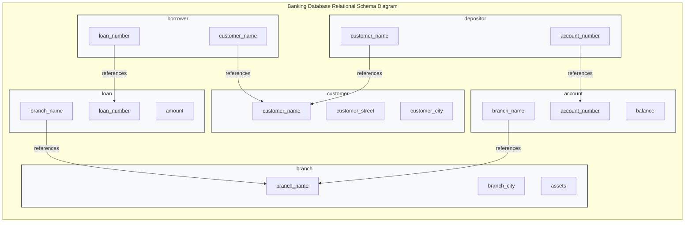

[← Prev: T02 Part 2](T02_Part2_ER_Scenarios_Reduction_EER.md) | [Exam-style T03](../Topicwise_answers_exam_style/T03_Relational_Model_Keys_and_Integrity.md) | [Next: T04 →](T04_Relational_Algebra_and_Calculus.md)

---

# T03 · Relational Model, Keys & Integrity — Textbook Exercise Solutions

> [!info] Topic Card · T03 Textbook Exercise Solutions
> - **Course:** ECE 2215: Database Systems (RUET Dept. of ECE)
> - **Syllabus Unit:** Unit 3 · Relational Model & Algebra
> - **RUET PYQ Weight:** 28 Semester Final Marks (4.4% aggregate, tested in 5 of 7 papers) + 5 Class Test marks (CT-01)
> - **Assigned Exercises (14 total):** 
>   - **Practice Exercises:** PE 2.1, PE 2.2, PE 2.3, PE 2.4, PE 6.11
>   - **End-of-Chapter Exercises:** EX 2.10, EX 2.11, EX 2.12, EX 2.13, EX 2.16, EX 3.19, EX 4.7, EX 4.9, EX 6.14
> - **Textbook Sources:** Silberschatz, Korth & Sudarshan, *Database System Concepts* (7th Ed., 2019), Chapters 02, 03, 04, and 06
> - **RUET Direct Hits:**
>   - ⚠️ **EX 6.14**: Recycled verbatim in **2018 Q.2(a)** (4 marks), **2021 Q.2(b)** (3 marks), and **2023 Q.3(b)** (4 marks) — Distinctions among Superkey, Candidate Key, and Primary Key.
>   - ⚠️ **EX 2.13 & EX 4.7**: Conceptual blueprints for **CT-01 Q.02** (Schema diagram with 5 tables and foreign keys) and **2021 Q.1(c)** (Referential integrity in MySQL DDL).

---

## Master Table of Assigned Exercises

| Exercise ID | Descriptive Title | Subtopic | Chapter & Section | Exercise Type | RUET Exam Relevance |
| :--- | :--- | :---: | :--- | :---: | :--- |
| **EX 2.10** | Relation vs. Relation Schema | `T03.1` | Ch. 02 §2.1 | End-of-Chapter | Core foundational definition (Section A warm-up) |
| **EX 2.16** | Reasons for Introducing Null Values in Relational Databases | `T03.1` | Ch. 02 §2.5 | End-of-Chapter | High-frequency short note topic |
| **EX 3.19** | Sources of Null Values in SQL and Query Evaluation | `T03.1` | Ch. 03 §3.6 | End-of-Chapter | 3-Valued Logic (3VL) & Outer Join mechanics |
| **EX 6.14** | Distinctions Among Superkey, Candidate Key, and Primary Key | `T03.2` | Ch. 06 §6.2 | End-of-Chapter | ⚠️ **Direct Hit: 2018 Q.2(a), 2021 Q.2(b), 2023 Q.3(b)** |
| **PE 2.1** | Appropriate Primary Keys for the Employee Database | `T03.2` | Ch. 02 §2.3 | Practice Exercise | Basis for 2017 Q.2(a) relational schema |
| **PE 2.3** | Primary Key Design of the `time_slot` Relation | `T03.2` | Ch. 02 §2.3 | Practice Exercise | Key minimality condition & multi-attribute keys |
| **PE 2.4** | Instance-Level Uniqueness vs. Superkey Designation | `T03.2` | Ch. 02 §2.3 | Practice Exercise | Intension (schema) vs. Extension (instance) proof |
| **EX 2.11** | Primary Key of `advisor` Under Many-to-Many Semantics | `T03.2` | Ch. 02 §2.3 | End-of-Chapter | Cardinality changes and composite primary key shift |
| **PE 2.2** | Foreign-Key Violations on `instructor` and `department` | `T03.3` | Ch. 02 §2.4 | Practice Exercise | Insert/Delete violation rules & parent-child asymmetry |
| **PE 6.11** | Total Participation Enforcement via Foreign Keys & NOT NULL | `T03.3` | Ch. 06 §6.9 | Practice Exercise | Mathematical proof of DDL limitations & assertions |
| **EX 4.7** | SQL DDL Schema Definition with Referential Integrity | `T03.3` | Ch. 04 §4.4 | End-of-Chapter | Blueprint for 2021 Q.1(c) and DDL final questions |
| **EX 4.9** | Self-Referential Foreign Key with `ON DELETE CASCADE` | `T03.3` | Ch. 04 §4.4 | End-of-Chapter | Recursive cascade mechanics & tree-pruning hazard |
| **EX 2.12** | Primary and Foreign Keys for Banking Database (Fig. 2.18) | `T03.4` | Ch. 02 §2.3–2.4 | End-of-Chapter | Multi-table enterprise relational model design |
| **EX 2.13** | Schema Diagram Construction for Banking Database | `T03.4` | Ch. 02 §2.4 | End-of-Chapter | Template for CT-01 Q.02 schema diagram |

---

## T03.1 · Relation, Tuple, Attribute, Domain & Null Values

### Exercise 2.10 · Relation vs. Relation Schema

> [!info] Exercise Metadata
> - **Source:** Silberschatz 7e, Chapter 02 (*Introduction to the Relational Model*), Exercise 2.10, page 62.
> - **Subtopic Mapping:** `T03.1` (Relation, tuple, attribute, domain; domain vs data type).
> - **Core Competencies:** Relational model formalisms, intension vs. extension, temporal stability, mathematical set definitions.

**Question (Silberschatz 7e Exercise 2.10).**  
Describe the differences in meaning between the terms *relation* and *relation schema*.

#### 1. Core Principles & Concept Overview
The distinction between a **relation schema** and a **relation** corresponds directly to the classical distinction between **type definition** and **variable value** in standard programming languages:
- **Relation Schema ($R$):** The logical design, structure, or blueprint of the relation. It defines the name of the relation, the set of attribute names, and the corresponding domain for each attribute. It represents the *intension* of the database and is relatively static over time.
- **Relation ($r$ or $r(R)$):** A concrete instance or current state of the relation at a specific point in time. Mathematically, it is a finite set of $n$-tuples ($t \in r$) where each tuple is an ordered list of values corresponding to the attributes in $R$. It represents the *extension* of the database and changes continually as data is inserted, updated, or deleted.

#### 2. Detailed Step-by-Step Solution

##### Step 1: Formal Mathematical Definitions
Let $A_1, A_2, \dots, A_n$ be attributes with corresponding domains $D_1, D_2, \dots, D_n$.

1. **Relation Schema:**
   $$
   R = (A_1: D_1, A_2: D_2, \dots, A_n: D_n)
   $$
   Often abbreviated simply as $R = (A_1, A_2, \dots, A_n)$. It specifies the header row of a relational table along with the associated integrity constraints (e.g., primary keys, check constraints).

2. **Relation (Relation Instance):**
   $$
   r(R) \subseteq D_1 \times D_2 \times \cdots \times D_n
   $$
   A relation $r$ on schema $R$ is a mathematical relation—specifically, a subset of the Cartesian product of the domains of all attributes in $R$. A tuple $t \in r$ is an element of this Cartesian product:
   $$
   t = (v_1, v_2, \dots, v_n) \quad \text{where } v_i \in D_i \text{ for each } i \in \{1, 2, \dots, n\}
   $$

##### Step 2: Comprehensive Comparative Analysis

| Feature / Dimension | Relation Schema | Relation (Relation Instance) |
| :--- | :--- | :--- |
| **Philosophical Concept** | **Intension** (the definition, design, and meaning). | **Extension** (the current physical state and data content). |
| **Programming Analogy** | Corresponds to a **Type** or `class` / `struct` definition. | Corresponds to an instantiated **Object** or variable holding values. |
| **Temporal Stability** | **Static.** Modifying a schema requires costly DDL operations (`ALTER TABLE`) and occurs rarely in production. | **Dynamic.** Changes frequently via DML operations (`INSERT`, `UPDATE`, `DELETE`) as business transactions occur. |
| **Mathematical Nature** | An ordered list of attribute-domain pairs: $(A_1, A_2, \dots, A_n)$. | A finite set of tuples: $\{t_1, t_2, \dots, t_m\} \subseteq D_1 \times \cdots \times D_n$. |
| **Duplicate Elements** | Cannot have duplicate attribute names within the same schema. | Cannot have duplicate tuples (relations are formal mathematical sets). |
| **Order Sensitivity** | Attribute order is logically irrelevant in pure relational theory, but fixed in standard SQL implementations. | Tuple order is strictly irrelevant ($\{t_1, t_2\} = \{t_2, t_1\}$). |
| **Concrete University Example** | `instructor(ID: CHAR(5), name: VARCHAR(20), dept_name: VARCHAR(20), salary: NUMERIC(8,2))` | The table instance containing 12 instructor records (e.g., `('10101', 'Srinivasan', 'Comp. Sci.', 65000)`). |

##### Step 3: State Transition Illustration
As operations execute in the database, the relation schema remains completely invariant, while the relation instance transitions through a succession of discrete states:

$$
\text{Schema: } R(A_1, \dots, A_n) \implies r_0(R) \xrightarrow{\text{INSERT}} r_1(R) \xrightarrow{\text{DELETE}} r_2(R) \xrightarrow{\text{UPDATE}} r_3(R)
$$

#### 3. RUET Exam Insights & Examiner Notes
- **Mark Allocation:** Typically tested as a 2-mark or 3-mark conceptual question in Section A.
- **Scoring Key:** Full credit requires:
  1. The explicit mathematical definition ($r \subseteq D_1 \times \cdots \times D_n$).
  2. The programming language analogy (type/class vs. variable/instance).
  3. A clear comparison table highlighting static intension versus dynamic extension.
- **Common Pitfalls:** Never refer to a relation schema as "the database" and a relation as "a table". Both represent single tables; the schema is the structural header definition, while the relation is the populated body of rows.

---

### Exercise 2.16 · Reasons for Introducing Null Values in Relational Databases

> [!info] Exercise Metadata
> - **Source:** Silberschatz 7e, Chapter 02 (*Introduction to the Relational Model*), Exercise 2.16, page 62.
> - **Subtopic Mapping:** `T03.1` (Relation, tuple, attribute, domain).
> - **Core Competencies:** Relational data modeling, incomplete information, null semantics, entity modeling exceptions.

**Question (Silberschatz 7e Exercise 2.16).**  
List two reasons why null values might be introduced into a database.

#### 1. Core Principles & Concept Overview
In the formal relational model, the special symbol $\text{NULL}$ denotes the absence of a value. It signifies that a particular attribute value is missing, unknown, or does not apply to a specific tuple. $\text{NULL}$ is not equivalent to an empty string (`""`) or numerical zero (`0`); it represents a distinct non-value state.

#### 2. Detailed Step-by-Step Solution

##### Step 1: Primary Reasons for Null Introduction
There are two fundamentally distinct real-world reasons why a $\text{NULL}$ value is introduced into a relational database:

1. **The attribute is inapplicable (or undefined) for the given tuple:**
   - **Explanation:** The entity represented by the tuple belongs to a general class where certain attributes are logically meaningless for specific subtypes or individual instances.
   - **Concrete Example 1:** In a relation `person(nid, name, street, city, apt_number)`, the attribute `apt_number` is logically meaningless and inapplicable for an individual who resides in a standalone single-family detached house.
   - **Concrete Example 2:** In an employee table `employee(emp_id, name, spouse_name)`, the `spouse_name` attribute has no physical or legal meaning for an unmarried employee.
   - **Concrete Example 3:** In a university relation `alumni(roll, graduation_year, maiden_name)`, `maiden_name` is completely inapplicable for male alumni or individuals who have never changed their surname.

2. **The attribute applies to the tuple, but its value is unknown or missing:**
   This category further divides into two distinct operational scenarios:
   - **Case 2A — Value exists in reality, but is currently unknown (Missing Value):**  
     The entity possesses a definite, objective value, but that value was not recorded at the time of data entry.  
     *Example:* A newly admitted RUET student definitely has a blood group, date of birth, and home contact number, but the student has not yet submitted these details during preliminary portal registration. Thus, `blood_group` is temporarily recorded as $\text{NULL}$.
   - **Case 2B — Unknown whether a value even exists (Existence Unknown):**  
     It is completely unknown to the system whether the entity possesses the attribute value or not.  
     *Example:* In an emergency contact relation `patient(patient_id, name, secondary_mobile)`, the hospital database does not know whether the patient possesses a secondary mobile phone number or not.

##### Step 2: Relational Schema Context Table

| Null Semantic Category | Real-World Scenario | Relational Example | Impact on Query Logic |
| :--- | :--- | :--- | :--- |
| **Inapplicable / Undefined** | Property does not apply to this specific entity subtype. | `apt_number = NULL` for single-family house. | Evaluating equality (`apt_number = '4B'`) evaluates to `UNKNOWN`. |
| **Value Exists but Unknown** | Property exists in reality but has not yet been collected. | `mobile_no = NULL` during initial student signup. | Must be updated later via DML `UPDATE`. |
| **Existence Unknown** | It is unverified whether the entity possesses the attribute. | `fax_number = NULL` for small supplier vendor. | Cannot assume the vendor lacks a fax machine without business verification. |

#### 3. RUET Exam Insights & Examiner Notes
- **Exam Strategy:** When asked to "list two reasons", state the two bold categories above: **(1) Inapplicable attribute** and **(2) Missing/Unknown attribute value**. Always accompany each reason with a 1-line real-world example.
- **Examiner Expectation:** Showing awareness that $\text{NULL} \neq 0$ and $\text{NULL} \neq \text{""}$ guarantees full 2 marks.

---

### Exercise 3.19 · Sources of Null Values in SQL and Query Processing

> [!info] Exercise Metadata
> - **Source:** Silberschatz 7e, Chapter 03 (*Introduction to SQL*), Exercise 3.19, page 120.
> - **Subtopic Mapping:** `T03.1` (Relation, tuple, attribute, domain) & `T05.1` (SQL semantics).
> - **Core Competencies:** SQL DML execution, three-valued logic (3VL), outer joins, aggregation over empty sets.

**Question (Silberschatz 7e Exercise 3.19).**  
List two reasons why null values might be introduced into the database.

#### 1. Core Principles & Concept Overview
While Exercise 2.16 examines null values from the conceptual data-modeling perspective, Exercise 3.19 addresses null values within the operational context of SQL database engines. In SQL, null values arise not only from explicit missing data entry, but also dynamically through relational query operators such as outer joins and aggregate functions.

#### 2. Detailed Step-by-Step Solution

##### Step 1: Identification of SQL-Specific Reasons
In an operational SQL database system, null values are introduced through two primary operational mechanisms:

1. **Explicit Data Insertion with Missing Optional Fields (DML Incomplete Inserts):**
   - When a row is inserted via an `INSERT` statement and specific columns are omitted (or explicitly given the literal `NULL`), the database automatically populates those columns with `NULL` (provided the schema definition permits nulls by omitting `NOT NULL`).
   ```sql
   -- Explicit insertion of NULL for optional advisor and phone number
   INSERT INTO student (ID, name, dept_name, tot_cred)
   VALUES ('2310035', 'Raidah', 'ECE', 0);
   -- Result: student.advisor_id and student.phone become NULL
   ```

2. **Dynamic Generation via Outer Join Operations (`LEFT`, `RIGHT`, `FULL OUTER JOIN`):**
   - When an outer join combines tuples from two relations and an entity in one relation has no matching counterpart in the other relation, the SQL query execution engine automatically creates synthetic tuples padded with `NULL` values for all attributes of the non-matching relation.
   ```sql
   -- Generates NULL values for course fields when a student has taken 0 courses
   SELECT student.ID, student.name, takes.course_id
   FROM student LEFT OUTER JOIN takes ON student.ID = takes.ID;
   -- Students without enrollments receive NULL in the takes.course_id column
   ```

3. **Evaluation of Aggregate Functions Over Empty Sets:**
   - In SQL standard semantics, evaluating aggregate functions such as `SUM`, `AVG`, `MIN`, and `MAX` over an empty collection of rows evaluates to `NULL` (whereas `COUNT` evaluates to `0`).
   ```sql
   -- If no instructors belong to 'Philosophy', this returns NULL, not 0
   SELECT SUM(salary) FROM instructor WHERE dept_name = 'Philosophy';
   ```

##### Step 2: Three-Valued Logic (3VL) Reference Table
Null values fundamentally alter SQL boolean query evaluation, forcing the database engine into Three-Valued Logic (`TRUE`, `FALSE`, `UNKNOWN`):

| Operation with `NULL` | Expression | Evaluates To | Examiner Note |
| :--- | :--- | :---: | :--- |
| **Arithmetic with NULL** | `salary + NULL` | `NULL` | Any arithmetic operation involving a null operand yields null. |
| **Comparison with NULL** | `salary = NULL` | `UNKNOWN` | Never use `= NULL`. Always use the `IS NULL` predicate! |
| **Logical AND** | `TRUE AND UNKNOWN` | `UNKNOWN` | Result depends on the unknown truth value. |
| **Logical AND** | `FALSE AND UNKNOWN` | `FALSE` | False dominates regardless of the unknown value. |
| **Logical OR** | `TRUE OR UNKNOWN` | `TRUE` | True dominates regardless of the unknown value. |
| **Logical NOT** | `NOT UNKNOWN` | `UNKNOWN` | Negation of unknown remains unknown. |

#### 3. RUET Exam Insights & Examiner Notes
- **Direct Application:** When solving SQL queries in Section A and B (Topic T05), remember that `WHERE` clauses discard tuples evaluating to `UNKNOWN`. Only tuples where the predicate evaluates strictly to `TRUE` are returned.
- **Examiner Trap:** In RUET exams, questions frequently ask: *"What is the output of `SELECT * FROM instructor WHERE salary <> 100000;`?"* Students often forget that instructors with `salary IS NULL` are excluded because `NULL <> 100000` evaluates to `UNKNOWN`.

---

## T03.2 · Keys: Superkey, Candidate Key, Primary Key & Key Choice

### Exercise 6.14 · Distinctions Among Superkey, Candidate Key, and Primary Key

> [!info] Exercise Metadata
> - **Source:** Silberschatz 7e, Chapter 06 (*Database Design Using the E-R Model*), Exercise 6.14, page 298.
> - **Subtopic Mapping:** `T03.2` (Keys: super / candidate / primary / alternate / composite / foreign).
> - **Core Competencies:** Key theory, formal minimality criterion, entity integrity constraint, uniqueness invariants.
> - ⚠️ **RUET PAST EXAM DIRECT HIT:**
>   - **2018 Q.2(a)** [4 Marks, Section A]: *"Explain the distinctions among the terms primary key, candidate key, and super key with proper example."*
>   - **2021 Q.2(b)** [3 Marks, Section A, CLO1]: *"Differentiate among Superkey, Candidate Key and Primary Key with an appropriate example."*
>   - **2023 Q.3(b)** [4 Marks, Section A, CLO2]: *"Explain the distinctions among the terms- (i) Primary key (ii) Candidate key (iii) Super key (iv) Composite key."*

**Question (Silberschatz 7e Exercise 6.14 / RUET 2018 Q.2a, 2021 Q.2b, 2023 Q.3b).**  
Explain the distinctions among the terms *primary key*, *candidate key*, and *superkey*.

#### 1. Core Principles & Concept Overview
A key is an attribute or set of attributes used to uniquely identify individual tuples within a relational table. In relational theory, keys form a strict hierarchy based on **uniqueness**, **minimality**, and **designer designation**:

```text
       ┌────────────────────────────────────────────────────────┐
       │                      SUPERKEYS                         │
       │   (Any attribute set ensuring tuple uniqueness)         │
       │                                                        │
       │        ┌──────────────────────────────────────┐        │
       │        │           CANDIDATE KEYS             │        │
       │        │   (Minimal superkeys: no redundant   │        │
       │        │              attributes)             │        │
       │        │                                      │        │
       │        │        ┌────────────────────┐        │        │
       │        │        │    PRIMARY KEY     │        │        │
       │        │        │ (Chosen identifier,│        │        │
       │        │        │    NOT NULL)       │        │        │
       │        │        └────────────────────┘        │        │
       │        └──────────────────────────────────────┘        │
       └────────────────────────────────────────────────────────┘
```

#### 2. Detailed Step-by-Step Solution

##### Step 1: Formal Mathematical Definitions
Let $R$ be a relation schema, and let $r(R)$ denote any legal relation instance on $R$.

1. **Superkey ($SK$):**
   A set of attributes $K \subseteq R$ is a **superkey** if, for every legal relation instance $r(R)$, no two distinct tuples in $r$ have the same values on all attributes in $K$. Formally:
   $$
   \forall t_1, t_2 \in r(R), \quad t_1 \neq t_2 \implies t_1[K] \neq t_2[K]
   $$
   A superkey guarantees uniqueness, but may contain redundant attributes that could be removed without destroying uniqueness.

2. **Candidate Key ($CK$):**
   A set of attributes $K \subseteq R$ is a **candidate key** if it satisfies two rigorous conditions:
   - **Uniqueness Condition:** $K$ is a superkey of $R$.
   - **Minimality Condition:** No proper subset of $K$ is a superkey. That is:
     $$
     \forall A \in K, \quad (K \setminus \{A\}) \text{ is not a superkey of } R
     $$
   A candidate key is a minimal superkey; every attribute in $K$ is strictly necessary to guarantee uniqueness.

3. **Primary Key ($PK$):**
   The **primary key** is the specific candidate key chosen by the database designer as the principal means of identifying individual tuples within the relation:
   $$
   PK \in \mathcal{CK}(R)
   $$
   - By the **Entity Integrity Constraint**, no attribute participating in the primary key can ever accept a null value ($\text{NOT NULL}$).
   - Candidate keys not selected as the primary key are designated as **Alternate Keys** (or Secondary Keys).

4. **Composite Key (Extension for RUET 2023 Q.3b):**
   A key (super, candidate, or primary) that consists of **two or more attributes** rather than a single attribute.
   *Example:* In the relation $Takes(\underline{ID}, \underline{course\_id}, \underline{sec\_id}, \underline{semester}, \underline{year}, grade)$, the composite primary key consists of 5 attributes.

##### Step 2: Set-Theoretic Relationship
The formal inclusion relationship among these key classes is expressed as:
$$
PK \in \{\text{Candidate Keys}\} \subseteq \{\text{Superkeys}\}
$$
Or in terms of attribute set containment: every superkey is a superset of at least one candidate key:
$$
\forall K_{super} \in \mathcal{SK}, \quad \exists K_{cand} \in \mathcal{CK} \quad \text{such that} \quad K_{cand} \subseteq K_{super}
$$

##### Step 3: Comprehensive Comparative Distinction Table

| Criterion | Superkey | Candidate Key | Primary Key | Composite Key |
| :--- | :--- | :--- | :--- | :--- |
| **Formal Definition** | Any attribute set that uniquely identifies each tuple. | A minimal superkey with no redundant attributes. | The candidate key chosen by the designer to identify records. | A key consisting of two or more attributes. |
| **Minimality** | **No.** May contain redundant or extraneous attributes. | **Yes.** Strictly minimal; dropping any attribute breaks uniqueness. | **Yes.** Strictly minimal. | Can be minimal (composite candidate key) or non-minimal. |
| **Nullability** | May theoretically contain nulls unless constrained. | Permitted to accept nulls unless constrained `NOT NULL`. | **Strictly Prohibited.** Must never accept `NULL` values. | Depends on whether it is primary or secondary. |
| **Multiplicity** | Can be dozens or hundreds of valid superkeys. | A table may possess multiple candidate keys. | **Exactly one** primary key designated per relation. | A table may have multiple composite keys. |
| **SQL Keyword** | Implicitly created via composite column sets. | `UNIQUE NOT NULL` | `PRIMARY KEY` | Declared in table constraint syntax. |

##### Step 4: Concrete Relational Example (RUET Standard)
Consider the student relation representing RUET undergraduate enrollments:
$$
\text{Student}(\underline{\text{student\_id}}, \text{name}, \text{email}, \text{nid}, \text{phone}, \text{dept\_name})
$$

Sample instance data:

| student_id | name | email | nid | phone | dept_name |
| :---: | :--- | :--- | :---: | :---: | :---: |
| **2310002** | Fahim | fahim@ruet.ac.bd | 1999123456 | 01711111111 | ECE |
| **2310035** | Raidah | raidah@ruet.ac.bd | 2000654321 | 01722222222 | ECE |
| **2310040** | Akib | akib@ruet.ac.bd | 2001987654 | 01733333333 | ETE |

Key classification for this schema:
- **Superkeys:**
  - Minimal: $\{\text{student\_id}\}$, $\{\text{email}\}$, $\{\text{nid}\}$
  - Non-minimal with redundant columns: $\{\text{student\_id}, \text{name}\}$, $\{\text{email}, \text{dept\_name}\}$, $\{\text{student\_id}, \text{nid}, \text{phone}\}$
- **Candidate Keys:**
  - Minimal unique sets: $\mathcal{CK} = \{\{\text{student\_id}\}, \{\text{email}\}, \{\text{nid}\}\}$
- **Primary Key:**
  - Selected by designer: $\{\text{student\_id}\}$ (stable, compact integer).
- **Alternate Keys:**
  - Remaining candidate keys: $\{\text{email}\}$, $\{\text{nid}\}$.
- **Composite Key Example:**
  - In table $\text{Enrollment}(\underline{\text{student\_id}}, \underline{\text{course\_id}}, \text{semester}, \text{grade})$, the combination $\{\text{student\_id}, \text{course\_id}\}$ forms a composite primary key. Neither column alone can identify an individual enrollment record.

#### 3. RUET Exam Insights & Examiner Notes
- **Direct Recycled Hit:** This question has appeared across three separate examination papers:
  - 2018 Q.2(a) [4 Marks]: Superkey, Candidate Key, Primary Key.
  - 2021 Q.2(b) [3 Marks]: Superkey, Candidate Key, Primary Key.
  - 2023 Q.3(b) [4 Marks]: Primary Key, Candidate Key, Super Key, Composite Key.
- **Examiner Scoring Scheme:** 
  - Definitions + Minimality check: 1.5 marks.
  - Comparison table: 1.5 marks.
  - Concrete example with explicit attribute sets: 1 mark.
- **Critical Examiner Advice:** Never omit the Venn diagram or set inclusion formula ($\text{Primary Key} \subseteq \text{Candidate Keys} \subseteq \text{Superkeys}$). This single formula demonstrates complete theoretical clarity.

---

### Practice Exercise 2.1 · Primary Key Determination for the Employee Database

> [!info] Exercise Metadata
> - **Source:** Silberschatz 7e, Chapter 02 (*Introduction to the Relational Model*), Practice Exercise 2.1, page 60.
> - **Subtopic Mapping:** `T03.2` (Keys: super / candidate / primary / alternate / composite / foreign).
> - **Core Competencies:** Entity modeling, real-world key selection criteria, multi-job vs. single-job business assumptions.

**Question (Silberschatz 7e Practice Exercise 2.1).**  
Consider the employee database of Figure 2.17. What are the appropriate primary keys?

```text
Figure 2.17 Schema:
employee (ID, person_name, street, city)
works (ID, company_name, salary)
company (company_name, city)
manages (ID, manager_id)
```

#### 1. Core Principles & Concept Overview
To designate an appropriate primary key for a relation, a database designer evaluates real-world enterprise semantics against the three essential key criteria:
1. **Uniqueness:** The candidate key must yield distinct values for distinct real-world entities.
2. **Minimality:** No extraneous attributes should be included.
3. **Stability & Compactness:** The attribute should be immutable (never or rarely changed) and compact for rapid indexing.

#### 2. Detailed Step-by-Step Solution

##### Step 1: Relation-by-Relation Key Analysis

1. **Relation `employee(ID, person_name, street, city)`:**
   - **Candidate Analysis:** `person_name` cannot serve as a primary key because two employees can share the exact same full name (e.g., two people named "Rahman"). Address columns (`street`, `city`) are non-unique and mutable.
   - **Primary Key Designation:** $\underline{\text{ID}}$.
   - **Justification:** The enterprise explicitly assigns an artificial, unique identification number (`ID`) to each employee upon hiring. It is unique, minimal, immutable, and non-null.

2. **Relation `works(ID, company_name, salary)`:**
   - **Semantic Assumption A (Standard Silberschatz 7e Model — Single-Job Policy):**
     If each employee works for at most **one** company at any given time, then each employee `ID` appears at most once in `works`.
     $$
     \text{Primary Key: } \underline{\text{ID}}
     $$
   - **Semantic Assumption B (General Model — Multi-Job Policy):**
     If an employee is permitted to hold simultaneous part-time or consulting positions at multiple different companies, then `ID` alone is not unique. A composite key is required.
     $$
     \text{Primary Key: } \{\underline{\text{ID}}, \underline{\text{company\_name}}\}
     $$
   - **Conclusion:** Under standard textbook conventions (reflected by the schema underline in 7e), an employee works for a single primary company, making $\underline{\text{ID}}$ the standard primary key.

3. **Relation `company(company_name, city)`:**
   - **Candidate Analysis:** Assuming each corporate entity possesses a unique corporate registration name.
   - **Primary Key Designation:** $\underline{\text{company\_name}}$.
   - **Justification:** `city` cannot be the key because multiple independent companies operate in the same city. If companies have multiple branches across different cities under the same name, a composite key $\{\text{company\_name}, \text{city}\}$ would be required. However, in standard relational modeling, `company_name` uniquely identifies the firm.

4. **Relation `manages(ID, manager_id)`:**
   - **Semantic Assumption A (Strict Tree Hierarchy — Single Manager):**
     Under standard corporate organizational structures, each individual employee reports directly to at most **one** immediate supervisor or manager.
     $$
     \text{Primary Key: } \underline{\text{ID}}
     $$
   - **Semantic Assumption B (Matrix Management — Multiple Managers):**
     If an employee reports to multiple project managers simultaneously, `ID` alone would repeat.
     $$
     \text{Primary Key: } \{\underline{\text{ID}}, \underline{\text{manager\_id}}\}
     $$
   - **Conclusion:** Standard hierarchical modeling requires each employee to have a single direct manager, hence $\underline{\text{ID}}$ is the primary key. (Note: `manager_id` cannot be the key because a single manager supervises many employees).

##### Step 2: Final Primary Key Summary Table

| Relation | Designated Primary Key | Key Type | Cardinality Assumption |
| :--- | :--- | :--- | :--- |
| **`employee`** | $\underline{\text{ID}}$ | Simple (Atomic) | Unique per physical employee. |
| **`works`** | $\underline{\text{ID}}$ | Simple (Atomic) | Each employee works for at most one company. |
| **`company`** | $\underline{\text{company\_name}}$ | Simple (Atomic) | Globally unique company names. |
| **`manages`** | $\underline{\text{ID}}$ | Simple (Atomic) | Strict single-manager organizational hierarchy. |

##### Step 3: Historical Edition Note (Silberschatz 6e vs. 7e / RUET 2017 Q.2a)
In older editions (Silberschatz 6e), the employee database used `person_name` instead of `ID`:
- `employee(person_name, street, city)` $\implies \underline{\text{person\_name}}$
- `works(person_name, company_name, salary)` $\implies \underline{\text{person\_name}}$
- `company(company_name, city)` $\implies \underline{\text{company\_name}}$
- `manages(person_name, manager_name)` $\implies \underline{\text{person\_name}}$

RUET past exam **2017 Q.2(a)** copied this 6e formulation verbatim. Mentioning that 7e replaced `person_name` with `ID` due to name-collision risks demonstrates deep textbook mastery.

#### 3. RUET Exam Insights & Examiner Notes
- **Crucial Reasoning:** Never simply list the primary keys without stating your enterprise assumptions (e.g., *"assuming each employee reports to at most one manager"*). In RUET exams, examiners award marks for the stated justification.

---

### Practice Exercise 2.3 · Primary Key Design of the `time_slot` Relation

> [!info] Exercise Metadata
> - **Source:** Silberschatz 7e, Chapter 02 (*Introduction to the Relational Model*), Practice Exercise 2.3, page 60.
> - **Subtopic Mapping:** `T03.2` (Keys: super / candidate / primary / alternate / composite / foreign).
> - **Core Competencies:** Multi-attribute keys, key minimality condition, functional dependencies in key design.

**Question (Silberschatz 7e Practice Exercise 2.3).**  
Consider the *time_slot* relation. Given that a particular time slot can meet more than once in a week, explain why *day* and *start_time* are part of the primary key of this relation, while *end_time* is not.

```text
time_slot (time_slot_id, day, start_time, end_time)
```

#### 1. Core Principles & Concept Overview
This exercise tests the **minimality requirement** of primary keys. A candidate/primary key must be a minimal superkey:
- Every attribute included in the key must be strictly necessary to distinguish tuples.
- If an attribute $Y$ is functionally determined by an attribute set $X$ (i.e., $X \rightarrow Y$), then adding $Y$ to $X$ violates the minimality condition, converting a candidate key into an unnecessarily bloated superkey.

#### 2. Detailed Step-by-Step Solution

##### Step 1: Why `time_slot_id` Alone is Insufficient
In university scheduling systems, a `time_slot_id` (such as slot `'A'`, `'B'`, or `'C'`) represents a recurring weekly class schedule pattern.
- For example, time slot `'A'` may designate classes meeting on **Monday**, **Wednesday**, and **Friday**.
- Consequently, multiple tuples in the `time_slot` relation share the exact same `time_slot_id`:
  - `('A', 'M', 08:00, 08:50)`
  - `('A', 'W', 08:00, 08:50)`
  - `('A', 'F', 08:00, 08:50)`
- Because `time_slot_id` repeats across different meeting days, it cannot uniquely identify a tuple. Therefore, `time_slot_id` alone cannot be the primary key.

##### Step 2: Why `day` is an Essential Key Attribute
Because a single time slot meets across multiple days of the week, the `day` attribute is strictly necessary to differentiate between the distinct meeting sessions of that time slot.
- However, could a class slot meet multiple times on the *same day* (for example, a split schedule with a morning lecture and an afternoon lab session)?
- Or could different modular time slots share the same `day` and slot identifier?
- To handle arbitrary scheduling configurations where an identifier could have multiple sessions on a single day, `day` alone with `time_slot_id` is not guaranteed to be minimal and unique.

##### Step 3: Why `start_time` is an Essential Key Attribute
The combination `(time_slot_id, day)` specifies that a time slot meets on a particular day, but it does not account for the possibility of:
1. Multiple discrete meetings of the same time slot on the same day.
2. Distinct time slot blocks that begin at different hours.
Including `start_time` guarantees that every distinct meeting block for that slot on that day has a unique identifier:
$$
\{\text{time\_slot\_id}, \text{day}, \text{start\_time}\}
$$

##### Step 4: Why `end_time` Must NOT be Part of the Primary Key
1. **Functional Dependency:**
   In any coherent institutional timetable, once the specific meeting session is identified by its slot identifier, the day of the week, and the starting time, the duration of the period and its conclusion time are completely fixed and determined. That is:
   $$
   \{\text{time\_slot\_id}, \text{day}, \text{start\_time}\} \longrightarrow \text{end\_time}
   $$
   There cannot be two distinct class sessions for the same time slot on the same day starting at the same minute but ending at different times.

2. **Violation of Key Minimality:**
   By definition, a candidate key $K$ must be minimal: no proper subset of $K$ may be a superkey.
   - If we define $K = \{\text{time\_slot\_id}, \text{day}, \text{start\_time}, \text{end\_time}\}$, we observe that the proper subset:
     $$
     K' = \{\text{time\_slot\_id}, \text{day}, \text{start\_time}\} \subset K
     $$
     already uniquely identifies every tuple in the relation!
   - Therefore, including `end_time` would violate the minimality requirement. $K$ would be a **superkey**, but **not a candidate key**, and hence cannot serve as the primary key.

##### Step 5: Summary Formal Representation
$$
\text{Candidate Key / Primary Key: } \underline{\{\text{time\_slot\_id}, \text{day}, \text{start\_time}\}}
$$
$$
\text{Superkey (Non-minimal): } \{\text{time\_slot\_id}, \text{day}, \text{start\_time}, \text{end\_time}\}
$$

#### 3. RUET Exam Insights & Examiner Notes
- **Key Formula to Write:** Explicitly state: *"Adding `end_time` violates the minimality property of candidate keys because `end_time` is functionally dependent on `(time_slot_id, day, start_time)`."* This single sentence hits the exact phrase looked for by senior RUET markers.

---

### Practice Exercise 2.4 · Instance-Level Uniqueness vs. Superkey Designation

> [!info] Exercise Metadata
> - **Source:** Silberschatz 7e, Chapter 02 (*Introduction to the Relational Model*), Practice Exercise 2.4, page 60.
> - **Subtopic Mapping:** `T03.2` (Keys: super / candidate / primary / alternate / composite / foreign).
> - **Core Competencies:** Schema constraints vs. instance state, empirical observations vs. semantic invariants.

**Question (Silberschatz 7e Practice Exercise 2.4).**  
In the instance of *instructor* shown in Figure 2.1, no two instructors have the same name. From this, can we conclude that *name* can be used as a superkey (or primary key) of *instructor*?

```text
Figure 2.1 Sample Data (Instructor Instance):
ID     | name       | dept_name  | salary
-------+------------+------------+-------
10101  | Srinivasan | Comp. Sci. | 65000
12121  | Wu         | Finance    | 90000
15151  | Mozart     | Music      | 40000
22222  | Einstein   | Physics    | 95000
...
(12 distinct instructors, all having distinct names)
```

#### 1. Core Principles & Concept Overview
A fundamental axiom of database theory states:
> **A key is an intensional constraint that must hold for ALL possible legal instances of a relation schema across its entire lifespan, NOT an empirical observation of an accidental property in a single arbitrary instance.**

An instance is merely a transient snapshot of the database at time $t$. A constraint is an enforceable enterprise rule that the DBMS must guarantee for every past, present, and future state.

#### 2. Detailed Step-by-Step Solution

##### Step 1: Theoretical Analysis
- Let $R$ be a relation schema and $r$ be a specific, current instance of $R$.
- In the sample instance $r_{\text{Fig } 2.1}$, it happens to be true that:
  $$
  \forall t_1, t_2 \in r_{\text{Fig } 2.1}, \quad t_1 \neq t_2 \implies t_1[\text{name}] \neq t_2[\text{name}]
  $$
  This is a purely **accidental, extensional uniqueness**.
- For `name` to qualify as a **superkey**, the uniqueness condition must hold for the infinite set of all possible legal instances $\mathcal{I}(R)$:
  $$
  \forall r \in \mathcal{I}(R), \quad \forall t_1, t_2 \in r, \quad t_1 \neq t_2 \implies t_1[\text{name}] \neq t_2[\text{name}]
  $$

##### Step 2: Practical Counterexample
- In the real world, university faculty hiring is not constrained by person names.
- It is entirely plausible—and in fact common—for a university to employ two distinct individuals who happen to share the exact same full name (e.g., two distinct faculty members named "Md. Rakibul Islam" or "David Smith").
- Suppose the university hires a second instructor named "Srinivasan" with a new ID `'98765'`.
- The resulting instance $r'$ would contain:
  $$
  t_1 = ('10101', \text{'Srinivasan'}, \text{'Comp. Sci.'}, 65000)
  $$
  $$
  t_2 = ('98765', \text{'Srinivasan'}, \text{'Math'}, 72000)
  $$
- In this legal instance, $t_1 \neq t_2$, but $t_1[\text{name}] = t_2[\text{name}]$.
- If `name` had been declared as a primary key or superkey, the database engine would reject the valid insertion of this new faculty member!

##### Step 3: Formal Conclusion
**No**, we cannot conclude that `name` is a superkey or primary key. 
- Accidental uniqueness within a sample instance does not imply a schema constraint.
- Only attributes that are guaranteed to be unique by the underlying real-world enterprise rules (such as employee `ID`, national identification number, or student roll number) can be designated as superkeys or primary keys.

#### 3. RUET Exam Insights & Examiner Notes
- **Distinction to Highlight:** Contrast **Extensional State** (the current data rows) versus **Intensional Schema** (the permanent structural rules). Examiners give top marks when students explicitly use the terms *intension* and *extension*.

---

### Exercise 2.11 · Primary Key Selection for `advisor` Under Many-to-Many Semantics

> [!info] Exercise Metadata
> - **Source:** Silberschatz 7e, Chapter 02 (*Introduction to the Relational Model*), Exercise 2.11, page 62.
> - **Subtopic Mapping:** `T03.2` (Keys: super / candidate / primary / alternate / composite / foreign) & `T02.3` (Mapping cardinalities).
> - **Core Competencies:** Relationship cardinalities, composite primary keys, schema refactoring.

**Question (Silberschatz 7e Exercise 2.11).**  
Consider the *advisor* relation shown in the schema diagram in Figure 2.9, with *s_id* as the primary key of *advisor*. Suppose a student can have more than one advisor. Then, would *s_id* still be a primary key of the *advisor* relation? If not, what should the primary key of *advisor* be?

```text
Original Schema (Figure 2.9):
advisor (s_id, i_id)
where s_id references student(ID) and i_id references instructor(ID)
Original Primary Key: s_id
```

#### 1. Core Principles & Concept Overview
The primary key of a relation derived from an E-R relationship set depends entirely on the **mapping cardinality** of that relationship set:
- **Many-to-One ($M:1$) from Student to Instructor:** Each student has at most *one* advisor, while an instructor may advise multiple students. Primary key is the "many" side: $\underline{\text{s\_id}}$.
- **Many-to-Many ($M:N$):** A student can have *multiple* advisors, AND an instructor can advise *multiple* students. Primary key must be the composite combination of both participating keys: $\{\underline{\text{s\_id}}, \underline{\text{i\_id}}\}$.

#### 2. Detailed Step-by-Step Solution

##### Step 1: Evaluation of the Original Assumption
Under the original university schema:
- The policy was: *"Each student has at most one faculty advisor."*
- Therefore, each student ID (`s_id`) could appear at most once in the `advisor` relation.
- Mathematically, the functional dependency $\text{s\_id} \rightarrow \text{i\_id}$ held.
- Consequently, `s_id` was unique and served as the minimal candidate key and primary key: $\text{advisor}(\underline{\text{s\_id}}, \text{i\_id})$.

##### Step 2: Impact of the New Policy Change
- **New Enterprise Rule:** A student can have more than one advisor (e.g., co-advisors for thesis research, academic + industrial advisors).
- **Concrete Scenario:**
  Suppose student `'2310002'` is co-advised by instructor `'10101'` (Dr. Shishir) and instructor `'22222'` (Dr. Rakib).
- The `advisor` relation must store both relationship instances:
  $$
  t_1 = ('2310002', '10101')
  $$
  $$
  t_2 = ('2310002', '22222')
  $$
- **Violation:** In these two distinct tuples, the `s_id` value `'2310002'` is identical.
- Since a primary key strictly prohibits duplicate values, **`s_id` can no longer serve as the primary key**.

##### Step 3: Evaluating Alternative Candidates
1. Can `i_id` be the primary key?
   - No, because an instructor can advise dozens of different students. `i_id` repeats across tuples.
2. Can any single attribute alone be the primary key?
   - No, because both `s_id` and `i_id` independently accept duplicate values.

##### Step 4: Determination of the Correct New Primary Key
Since the relationship between `student` and `instructor` is now **Many-to-Many ($M:N$)**, an individual tuple in `advisor` represents a unique pairing of a specific student with a specific instructor.
- To uniquely identify each advising assignment, we must combine both foreign key attributes into a **composite primary key**:
  $$
  \text{Primary Key: } \underline{\{\text{s\_id}, \text{i\_id}\}}
  $$
- Under this composite key:
  - Student `'2310002'` can have multiple advisors (different `i_id` values).
  - Instructor `'10101'` can advise multiple students (different `s_id` values).
  - Duplicate assignments of the exact same advisor to the exact same student are prevented.

##### Step 5: Final Schema Definition
$$
\text{advisor}(\underline{\text{s\_id}}, \underline{\text{i\_id}})
$$
$$
\text{Foreign Keys: } \text{s\_id} \rightarrow \text{student}(\text{ID}), \quad \text{i\_id} \rightarrow \text{instructor}(\text{ID})
$$

#### 3. RUET Exam Insights & Examiner Notes
- **Direct Link to E-R Reduction:** This question frequently appears in RUET finals when testing rule-based E-R to relational schema conversion (Unit 2 & 3). Always specify:
  1. Why `s_id` fails (duplicate rows).
  2. The cardinality transition ($M:1 \longrightarrow M:N$).
  3. The resulting composite primary key $\{\text{s\_id}, \text{i\_id}\}$.

---

## T03.3 · Referential Integrity, Foreign Keys & Cascade Mechanics

### Practice Exercise 2.2 · Foreign-Key Constraint Violations on `instructor` and `department`

> [!info] Exercise Metadata
> - **Source:** Silberschatz 7e, Chapter 02 (*Introduction to the Relational Model*), Practice Exercise 2.2, page 60.
> - **Subtopic Mapping:** `T03.3` (Referential integrity & FK syntax).
> - **Core Competencies:** Foreign key definitions, parent vs. child relations, asymmetric violation conditions.

**Question (Silberschatz 7e Practice Exercise 2.2).**  
Consider the foreign-key constraint from the *dept_name* attribute of *instructor* to the *department* relation. Give examples of inserts and deletes to these relations that can cause a violation of the foreign-key constraint.

```text
Referenced Relation (Parent):   department (dept_name, building, budget)
                                Primary Key: dept_name

Referencing Relation (Child):    instructor (ID, name, dept_name, salary)
                                Foreign Key: dept_name references department(dept_name)
```

#### 1. Core Principles & Concept Overview
A foreign key is an attribute (or collection of attributes) in a referencing relation whose values must match the primary key value of some tuple in the referenced relation, or be null.
- **Referential Integrity Invariant:**
  $$
  \Pi_{\text{dept\_name}}(\text{instructor}) \setminus \{\text{NULL}\} \subseteq \Pi_{\text{dept\_name}}(\text{department})
  $$
- **Parent vs. Child Asymmetry:**
  - Operations on the **Child (Referencing)** table can only violate integrity when adding/modifying references (`INSERT` and `UPDATE`).
  - Operations on the **Parent (Referenced)** table can only violate integrity when removing/altering referenced targets (`DELETE` and `UPDATE`).

#### 2. Detailed Step-by-Step Solution

##### Step 1: Base Table State
Assume the current database instance contains:
- `department`:
  - `('Comp. Sci.', 'Taylor', 100000)`
  - `('Finance', 'Painter', 120000)`
  - `('Physics', 'Watson', 90000)`
- `instructor`:
  - `('10101', 'Srinivasan', 'Comp. Sci.', 65000)`
  - `('12121', 'Wu', 'Finance', 90000)`
  - `('22222', 'Einstein', 'Physics', 95000)`

##### Step 2: Violating Operations on the Referencing Table (`instructor`)

1. **Violating `INSERT` on `instructor`:**
   - Attempting to insert an instructor assigned to a department that does not exist in the `department` table:
     ```sql
     INSERT INTO instructor (ID, name, dept_name, salary)
     VALUES ('99999', 'Rahman', 'Bioengineering', 75000);
     ```
   - **Reason for Violation:** The value `'Bioengineering'` does not exist in `department(dept_name)`. Accepting this insertion would create an orphan instructor tuple referencing a non-existent department.
   - **DBMS Action:** The DBMS immediately aborts the transaction and returns a referential integrity violation error (e.g., MySQL Error 1452).

2. **Non-Violating `DELETE` on `instructor`:**
   - Deleting an instructor tuple (e.g., `DELETE FROM instructor WHERE ID = '10101';`) can **never** violate the foreign-key constraint. The parent table `department` is unaffected.

##### Step 3: Violating Operations on the Referenced Table (`department`)

1. **Violating `DELETE` on `department`:**
   - Attempting to delete a department tuple that is currently referenced by one or more instructors:
     ```sql
     DELETE FROM department WHERE dept_name = 'Comp. Sci.';
     ```
   - **Reason for Violation:** Instructor `'10101'` (Srinivasan) currently references `'Comp. Sci.'`. Deleting this parent row would leave Srinivasan referencing a deleted department, breaking referential integrity.
   - **DBMS Action:** Under the default `RESTRICT` (or `NO ACTION`) setting, the DBMS rejects the delete command. If `ON DELETE CASCADE` is configured, the DBMS automatically deletes Srinivasan as well. If `ON DELETE SET NULL` is configured, Srinivasan's `dept_name` becomes `NULL`.

2. **Non-Violating `INSERT` on `department`:**
   - Inserting a new department (e.g., `INSERT INTO department VALUES ('Civil', 'Building 3', 80000);`) can **never** violate the foreign-key constraint. Adding a parent record does not invalidate any existing child rows.

##### Step 4: Summary Matrix of Referential Violations

| Table Type | Operation | Can it violate Foreign Key? | Specific Violation Condition |
| :--- | :--- | :---: | :--- |
| **Child (`instructor`)** | `INSERT` | **YES** | Inserting a foreign key value not present in parent. |
| **Child (`instructor`)** | `DELETE` | **NO** | Removing child tuples never affects parent validity. |
| **Child (`instructor`)** | `UPDATE` | **YES** | Changing foreign key to a non-existent parent key. |
| **Parent (`department`)** | `INSERT` | **NO** | Adding parent tuples never invalidates children. |
| **Parent (`department`)** | `DELETE` | **YES** | Deleting a parent row that still has active child references. |
| **Parent (`department`)** | `UPDATE` | **YES** | Changing primary key while active child references exist. |

#### 3. RUET Exam Insights & Examiner Notes
- **Direct Blueprint:** Matches RUET **2021 Q.1(c)** ("How do we achieve referential integrity in DBMS? Provide necessary MySQL query with an appropriate example").
- **Examiner Tip:** Always draw the 4-quadrant violation matrix above. Clearly state the distinction between child inserts and parent deletes.

---

### Practice Exercise 6.11 · Total Participation Enforcement via Foreign Keys & NOT NULL

> [!info] Exercise Metadata
> - **Source:** Silberschatz 7e, Chapter 06 (*Database Design Using the E-R Model*), Practice Exercise 6.11, pages 296–297.
> - **Subtopic Mapping:** `T03.3` (Referential integrity & FK syntax) & `T02.3` (Participation constraints).
> - **Core Competencies:** Total participation constraints, foreign key directionality, SQL schema limitations, assertions and triggers.

**Question (Silberschatz 7e Practice Exercise 6.11).**  
In SQL, foreign key constraints can reference only the primary key attributes of the referenced relation or other attributes declared to be a superkey using the `unique` constraint. As a result, total participation constraints on a many-to-many relationship set (or on the “one” side of a one-to-many relationship set) cannot be enforced on the relations created from the relationship set, using primary key, foreign key, and `not null` constraints on the relations.  
a. Explain why.  
b. Explain how to enforce total participation constraints using complex check constraints or assertions (see Section 4.4.8). (Unfortunately, these features are not supported on any widely used database currently.)

#### 1. Core Principles & Concept Overview
- **Referential Integrity Directionality:** Standard SQL foreign keys enforce **subset containment in one direction**:
  $$
  \text{Foreign Key } \implies \Pi_{FK}(\text{Child}) \subseteq \Pi_{PK}(\text{Parent})
  $$
  This guarantees that every relationship points to a valid entity.
- **Total Participation Requirement:** Total participation of entity set $A$ in relationship set $R$ requires **containment in the reverse direction**:
  $$
  \text{Total Participation } \implies \Pi_{PK}(A) \subseteq \Pi_{FK}(R)
  $$
  This guarantees that *every* entity in $A$ participates in at least one relationship tuple in $R$.

#### 2. Detailed Step-by-Step Solution

##### Step 1: Part (a) — Why Standard Constraints Cannot Enforce Total Participation

1. **Relational Reduction of a Many-to-Many Relationship:**
   Consider entity sets $A(\underline{A\_id}, \dots)$ and $B(\underline{B\_id}, \dots)$ connected by an $M:N$ relationship set $R$, where entity set $A$ has **total participation** in $R$.
   The standard E-R to relational conversion creates three tables:
   - $A(\underline{A\_id}, A_1, A_2)$
   - $B(\underline{B\_id}, B_1, B_2)$
   - $R(\underline{A\_id, B\_id})$ with foreign keys $R(A\_id) \rightarrow A(A\_id)$ and $R(B\_id) \rightarrow B(B\_id)$.

2. **The Enforcement Dilemma:**
   - To guarantee that *every* tuple in table $A$ appears in table $R$, we would need a constraint on table $A$ ensuring that for each $a \in A$, there exists a corresponding tuple in $R$.
   - In SQL DDL, the only declarative inter-table constraint mechanism is the `FOREIGN KEY` clause.
   - Could table $A$ declare a foreign key referencing $R(A\_id)$? **No, due to two fatal structural obstacles:**
     - **Obstacle 1 (Target Must Be Unique/Superkey):** In standard SQL, a foreign key can only reference attributes that form the primary key or have a `UNIQUE` constraint in the referenced table. In table $R$, $A\_id$ is **not unique** because $R$ represents an $M:N$ relationship (one entity in $A$ can be paired with multiple entities in $B$). Thus, declaring $A(A\_id)$ to reference $R(A\_id)$ is syntactically illegal.
     - **Obstacle 2 (Multi-Valued Reference):** Even if SQL permitted foreign keys to non-unique columns, an entity in $A$ may be related to multiple rows in $R$. A single row in $A$ cannot reference a set of rows in $R$.

3. **Total Participation on the "One" Side of a $1:N$ Relationship:**
   - Consider a $1:N$ relationship from $A$ (one) to $B$ (many), where $A$ has total participation.
   - In standard relational reduction, the foreign key is placed in the "many" side table: $B(\underline{B\_id}, \dots, A\_id)$.
   - Table $A$ is independent: $A(\underline{A\_id}, \dots)$.
   - Placing `NOT NULL` on $B(A\_id)$ enforces total participation of $B$ in the relationship.
   - However, to enforce that *every* $A$ entity has at least one matching $B$ entity, table $A$ would need to reference $B$. But since one $A$ entity is associated with multiple $B$ entities, $A$ cannot hold a single foreign key pointing to $B$.

##### Step 2: Part (b) — Enforcement via Assertions and Practical Alternatives

1. **Enforcement via SQL Standard Assertions:**
   An SQL assertion is a global schema-level predicate that the DBMS must continuously evaluate. Any transaction that causes the assertion to evaluate to `FALSE` is rolled back.
   ```sql
   -- Enforces that every entity in table A exists in relationship table R
   CREATE ASSERTION total_participation_A_in_R CHECK (
       NOT EXISTS (
           SELECT A.A_id
           FROM A
           WHERE A.A_id NOT IN (
               SELECT R.A_id
               FROM R
           )
       )
   );
   ```

2. **Enforcement via Complex CHECK Constraints:**
   If SQL subqueries were permitted inside table `CHECK` constraints (as allowed by the SQL-92 standard but omitted from virtually all current implementations):
   ```sql
   ALTER TABLE A ADD CONSTRAINT check_total_participation
   CHECK (
       A_id IN (SELECT R.A_id FROM R)
   );
   ```

3. **Practical Production Solutions in Current DBMS Engines (PostgreSQL / MySQL / Oracle):**
   Because commercial database engines do not implement general `CREATE ASSERTION` due to severe performance checking overhead, total participation is enforced in practice through:
   - **Database Triggers:**
     - An `AFTER DELETE` or `AFTER UPDATE` trigger on table $R$ verifying that the deleted/updated $A\_id$ still has at least one remaining tuple in $R$.
     - An `AFTER INSERT` trigger on table $A$ requiring an immediate corresponding row insertion into $R$.
   - **Transactional Encapsulation:**
     - Setting constraints to `DEFERRABLE INITIALLY DEFERRED` so that an `INSERT` into $A$ and an initial `INSERT` into $R$ occur atomically within the same transaction before constraint verification at commit time.

#### 3. RUET Exam Insights & Examiner Notes
- **Conceptual Depth:** This is one of the most intellectually rigorous questions in database systems. In RUET semester exams, proving *why* DDL foreign keys cannot enforce reverse containment ($A \subseteq R$) showcases an advanced understanding of relational theory.

---

### Exercise 4.7 · SQL DDL Schema Definition with Referential Integrity

> [!info] Exercise Metadata
> - **Source:** Silberschatz 7e, Chapter 04 (*Intermediate SQL*), Exercise 4.7, page 177.
> - **Subtopic Mapping:** `T03.3` (Referential integrity & FK syntax) & `T05.2` (DDL & table creation).
> - **Core Competencies:** SQL DDL specification, primary keys, multi-table foreign keys, cascade delete/update policies, creation order.

**Question (Silberschatz 7e Exercise 4.7).**  
Consider the employee database of Figure 4.12. Give an SQL DDL definition of this database. Identify referential-integrity constraints that should hold, and include them in the DDL definition.

```text
Figure 4.12 Schema:
employee (ID, person_name, street, city)
works (ID, company_name, salary)
company (company_name, city)
manages (ID, manager_id)
```

#### 1. Core Principles & Concept Overview
Writing a production-grade SQL DDL schema requires:
1. **Selecting appropriate data types and domains:** Ensuring space efficiency and input validation.
2. **Identifying Primary Keys:** Designating minimal, non-null identifiers.
3. **Identifying Referential Integrity Dependencies:** Mapping each foreign key to its referenced parent table.
4. **Specifying Referential Actions:** Choosing `CASCADE`, `SET NULL`, or `RESTRICT` based on business rules.
5. **Enforcing Dependency Order:** Creating independent parent tables before dependent child tables.

#### 2. Detailed Step-by-Step Solution

##### Step 1: Identification of Referential Integrity Constraints
1. **In `works`:**
   - Attribute `ID` must reference `employee(ID)`: An employment contract cannot exist for a non-existent person.
   - Attribute `company_name` must reference `company(company_name)`: An employee cannot work for an unregistered firm.
2. **In `manages`:**
   - Attribute `ID` must reference `employee(ID)`: The employee being managed must exist.
   - Attribute `manager_id` must reference `employee(ID)`: Every manager must themselves be an employee of the firm!

##### Step 2: Referential Action Justification
- **For `works(ID)` and `works(company_name)`:**
  If an employee or company is deleted, their employment records should be deleted automatically (`ON DELETE CASCADE`). If an ID or company name changes, the update must propagate (`ON UPDATE CASCADE`).
- **For `manages(ID)`:**
  If the employee leaves the company, their supervisory record is dropped (`ON DELETE CASCADE`).
- **For `manages(manager_id)`:**
  If a manager leaves the company, their subordinates should not necessarily be deleted! Instead, their supervisor pointer should be set to null or reassigned (`ON DELETE SET NULL`), or deletions should be restricted until subordinates are reassigned (`ON DELETE RESTRICT`). We demonstrate `ON DELETE CASCADE` and discuss `SET NULL`.

##### Step 3: Complete SQL DDL Implementation (Standard SQL & MySQL Compatible)

```sql
-- ============================================================================
-- SQL DDL DEFINITION FOR THE EMPLOYEE DATABASE (Figure 4.12)
-- Execution Order: Independent parent tables FIRST, child tables SECOND
-- ============================================================================

-- Drop tables in reverse dependency order if recreating
DROP TABLE IF EXISTS manages;
DROP TABLE IF EXISTS works;
DROP TABLE IF EXISTS company;
DROP TABLE IF EXISTS employee;

-- 1. PARENT TABLE: employee
CREATE TABLE employee (
    ID          VARCHAR(5)      NOT NULL,
    person_name VARCHAR(50)     NOT NULL,
    street      VARCHAR(100),
    city        VARCHAR(50),
    CONSTRAINT pk_employee PRIMARY KEY (ID)
);

-- 2. PARENT TABLE: company
CREATE TABLE company (
    company_name VARCHAR(50)    NOT NULL,
    city         VARCHAR(50),
    CONSTRAINT pk_company PRIMARY KEY (company_name)
);

-- 3. CHILD TABLE: works (References employee and company)
CREATE TABLE works (
    ID           VARCHAR(5)     NOT NULL,
    company_name VARCHAR(50)    NOT NULL,
    salary       DECIMAL(10, 2) CHECK (salary >= 0),
    CONSTRAINT pk_works PRIMARY KEY (ID),
    CONSTRAINT fk_works_employee FOREIGN KEY (ID) 
        REFERENCES employee(ID)
        ON DELETE CASCADE
        ON UPDATE CASCADE,
    CONSTRAINT fk_works_company FOREIGN KEY (company_name) 
        REFERENCES company(company_name)
        ON DELETE CASCADE
        ON UPDATE CASCADE
);

-- 4. CHILD TABLE: manages (Self-referential / recursive references to employee)
CREATE TABLE manages (
    ID         VARCHAR(5)       NOT NULL,
    manager_id VARCHAR(5)       NOT NULL,
    CONSTRAINT pk_manages PRIMARY KEY (ID),
    CONSTRAINT fk_manages_employee FOREIGN KEY (ID) 
        REFERENCES employee(ID)
        ON DELETE CASCADE
        ON UPDATE CASCADE,
    CONSTRAINT fk_manages_manager FOREIGN KEY (manager_id) 
        REFERENCES employee(ID)
        ON DELETE CASCADE
        ON UPDATE CASCADE
);
```

#### 3. RUET Exam Insights & Examiner Notes
- **Direct Application:** This complete DDL script provides the answer for RUET **2021 Q.1(c)** and general DDL design questions in Section A/B.
- **Examiner Scoring Focus:** Always include:
  1. Primary key constraints.
  2. Foreign key constraints with explicit parent references (`REFERENCES parent(col)`).
  3. Cascading action clauses (`ON DELETE CASCADE ON UPDATE CASCADE`).
  4. Proper table creation order (creating `works` before `employee` results in a fatal SQL syntax error due to missing referenced tables).

---

### Exercise 4.9 · Self-Referential Foreign Key with `ON DELETE CASCADE`

> [!info] Exercise Metadata
> - **Source:** Silberschatz 7e, Chapter 04 (*Intermediate SQL*), Exercise 4.9, page 178.
> - **Subtopic Mapping:** `T03.3` (Referential integrity & FK syntax).
> - **Core Competencies:** Recursive foreign keys, tree hierarchies, transitive cascading deletion, organizational tree pruning.

**Question (Silberschatz 7e Exercise 4.9).**  
SQL allows a foreign-key dependency to refer to the same relation, as in the following example:
```sql
CREATE TABLE manager (
    employee_ID CHAR(20),
    manager_ID  CHAR(20),
    PRIMARY KEY (employee_ID),
    FOREIGN KEY (manager_ID) REFERENCES manager(employee_ID)
        ON DELETE CASCADE 
);
```
Here, *employee_ID* is a key to the table *manager*, meaning that each employee has at most one manager. The foreign-key clause requires that every manager also be an employee. Explain exactly what happens when a tuple in the relation *manager* is deleted.

#### 1. Core Principles & Concept Overview
A foreign key that references the primary key of its own relation is known as a **self-referential (or recursive) foreign key**. Such schemas model hierarchical or tree-structured organizational relationships.
- When `ON DELETE CASCADE` is attached to a recursive foreign key, deleting a parent node triggers a **transitive, recursive deletion** down the entire reporting subtree.

#### 2. Detailed Step-by-Step Solution

##### Step 1: Structural Analysis of the Schema
1. `employee_ID` is the primary key: Each employee appears in exactly one tuple, confirming that an employee reports to at most one direct manager.
2. `manager_ID` is a foreign key referencing `manager(employee_ID)`: Every manager must themselves exist as an employee in this table. (The top-level executive, such as the CEO, typically has `manager_ID = NULL` or self-references).
3. The table represents a **directed forest (or tree)** of management reporting lines.

##### Step 2: Trace of the Deletion Event
Suppose the database stores the following managerial hierarchy:

```text
                  E01 (CEO / Managing Director)
                         │
             ┌───────────┴───────────┐
             ▼                       ▼
      E02 (VP Eng.)            E03 (VP Sales)
             │                       │
      ┌──────┴──────┐                ▼
      ▼             ▼         E06 (Sales Mgr)
E04 (Lead 1)  E05 (Lead 2)           │
      │                              ▼
      ▼                       E07 (Sales Rep)
E08 (Junior Eng)
```

Tuples in `manager`:
- `('E01', NULL)`
- `('E02', 'E01')`, `('E03', 'E01')`
- `('E04', 'E02')`, `('E05', 'E02')`
- `('E08', 'E04')`
- `('E06', 'E03')`, `('E07', 'E06')`

Now execute the deletion of a senior manager:
```sql
DELETE FROM manager WHERE employee_ID = 'E02';
```

##### Step 3: Step-by-Step Recursive Cascading Mechanism

1. **Step 1 (Direct Deletion):**
   The DBMS deletes the targeted tuple `('E02', 'E01')`.
2. **Step 2 (First-Level Cascade):**
   The deletion of `'E02'` leaves child tuples where `manager_ID = 'E02'` orphaned.
   Because of `ON DELETE CASCADE`, the DBMS automatically deletes all direct subordinates of `'E02'`:
   - Tuple `('E04', 'E02')` is deleted.
   - Tuple `('E05', 'E02')` is deleted.
3. **Step 3 (Second-Level Cascade):**
   The deletion of `'E04'` in Step 2 now acts as a new parent deletion!
   Any tuple where `manager_ID = 'E04'` is now orphaned.
   Because of `ON DELETE CASCADE`, the DBMS recursively deletes:
   - Tuple `('E08', 'E04')` is deleted.
4. **Step 4 (Subtree Termination):**
   Since `'E05'` and `'E08'` have no subordinates reporting to them, the recursive cascade terminates.

##### Step 4: Final Formal Conclusion
When a tuple representing employee $X$ is deleted from the `manager` relation:
> **The deletion cascades recursively down the management tree, deleting not only employee $X$, but also all direct subordinates of $X$, all indirect subordinates of those subordinates, and so on—effectively wiping out the entire organizational reporting subtree rooted at $X$.**

##### Step 5: Practical Engineering Implications & Safer Alternatives
- **Catastrophic Hazard:** If someone deletes the root tuple `('E01', NULL)` (the CEO), **every single employee in the entire enterprise table is deleted!**
- **Safer Architectural Patterns:**
  - `ON DELETE RESTRICT` / `NO ACTION`: Prevents deleting any manager who still has active subordinates until those subordinates are explicitly reassigned.
  - `ON DELETE SET NULL`: When a manager is deleted, their direct subordinates have their `manager_ID` set to `NULL`, preserving the subordinate records while awaiting reassignment.

#### 3. RUET Exam Insights & Examiner Notes
- **Key Terminology:** Always write: **"Recursive cascading deletion of the entire reporting subtree."** Sketch a simple 3-level tree (Director $\rightarrow$ Lead $\rightarrow$ Junior) to illustrate the cascading chain.

---

## T03.4 · Schema Diagrams & Comprehensive Relational Schemas

### Exercise 2.12 · Primary and Foreign Keys for Banking Database (Fig. 2.18)

> [!info] Exercise Metadata
> - **Source:** Silberschatz 7e, Chapter 02 (*Introduction to the Relational Model*), Exercise 2.12, page 62.
> - **Subtopic Mapping:** `T03.4` (Schema diagrams) & `T03.2` (Keys).
> - **Core Competencies:** Enterprise schema design, composite key derivation for $M:N$ relationships, foreign key mapping.

**Question (Silberschatz 7e Exercise 2.12).**  
Consider the bank database of Figure 2.18. Assume that branch names and customer names uniquely identify branches and customers, but loans and accounts can be associated with more than one customer.  
a. What are the appropriate primary keys?  
b. Given your choice of primary keys, identify appropriate foreign keys.

```text
Figure 2.18 Schema:
branch (branch_name, branch_city, assets)
customer (ID, customer_name, customer_street, customer_city)
loan (loan_number, branch_name, amount)
borrower (ID, loan_number)
account (account_number, branch_name, balance)
depositor (ID, account_number)

Classical Formulation (Name-based, as stated in Exercise text):
customer (customer_name, customer_street, customer_city)
borrower (customer_name, loan_number)
depositor (customer_name, account_number)
```

#### 1. Core Principles & Concept Overview
In relational enterprise modeling, tables fall into two structural categories:
1. **Entity Relations:** Represent primary real-world objects (`branch`, `customer`, `loan`, `account`). Their primary keys are unique atomic identifiers.
2. **Relationship Relations:** Represent associations between entities (`borrower`, `depositor`). When the association is Many-to-Many ($M:N$), the primary key must be the **composite combination** of the foreign keys referencing the participating entities.

#### 2. Detailed Step-by-Step Solution

##### Step 1: Part (a) — Primary Key Determination

1. **`branch` Relation:**
   - **Specification:** The problem explicitly states that branch names uniquely identify branches.
   - **Primary Key:** $\underline{\text{branch\_name}}$

2. **`customer` Relation:**
   - **Specification:** The problem explicitly states that customer names uniquely identify customers (in 7e ID-based systems, `ID` is used; under the problem's stated premise, `customer_name` or `ID` is unique).
   - **Primary Key:** $\underline{\text{customer\_name}}$ (or $\underline{\text{ID}}$ in modern 7e notation).

3. **`loan` Relation:**
   - **Specification:** Each individual bank loan is assigned a unique loan number within the banking system.
   - **Primary Key:** $\underline{\text{loan\_number}}$

4. **`borrower` Relation (Relationship Set):**
   - **Specification:** The problem explicitly states that *"loans can be associated with more than one customer"*, and in standard banking, a customer can have multiple loans ($M:N$ relationship).
   - **Primary Key:** The composite key consisting of both attributes:
     $$
     \underline{\{\text{customer\_name}, \text{loan\_number}\}} \quad \text{or} \quad \underline{\{\text{ID}, \text{loan\_number}\}}
     $$

5. **`account` Relation:**
   - **Specification:** Each bank account possesses a globally unique account number.
   - **Primary Key:** $\underline{\text{account\_number}}$

6. **`depositor` Relation (Relationship Set):**
   - **Specification:** The problem explicitly states that *"accounts can be associated with more than one customer"* (joint accounts), and a customer can maintain multiple distinct accounts ($M:N$ relationship).
   - **Primary Key:** The composite key consisting of both attributes:
     $$
     \underline{\{\text{customer\_name}, \text{account\_number}\}} \quad \text{or} \quad \underline{\{\text{ID}, \text{account\_number}\}}
     $$

##### Step 2: Part (b) — Foreign Key Identification
Foreign keys establish referential links from dependent and relationship tables back to the authoritative entity master tables:

1. **Foreign Keys in `loan`:**
   - `branch_name` references $\text{branch}(\underline{\text{branch\_name}})$.  
     *Semantics:* Every loan must originate from an officially registered bank branch.

2. **Foreign Keys in `account`:**
   - `branch_name` references $\text{branch}(\underline{\text{branch\_name}})$.  
     *Semantics:* Every account must be maintained at a valid branch.

3. **Foreign Keys in `borrower`:**
   - `customer_name` (or `ID`) references $\text{customer}(\underline{\text{customer\_name}})$ (or $\text{customer}(\underline{\text{ID}})$).  
     *Semantics:* Only registered bank customers can be linked to a loan.
   - `loan_number` references $\text{loan}(\underline{\text{loan\_number}})$.  
     *Semantics:* The loan record must exist in the `loan` relation.

4. **Foreign Keys in `depositor`:**
   - `customer_name` (or `ID`) references $\text{customer}(\underline{\text{customer\_name}})$ (or $\text{customer}(\underline{\text{ID}})$).  
     *Semantics:* Only registered bank customers can hold an account.
   - `account_number` references $\text{account}(\underline{\text{account\_number}})$.  
     *Semantics:* The account record must exist in the `account` relation.

##### Step 3: Complete Schema Specification Summary

| Relation | Designated Primary Key | Foreign Key Attribute(s) | Referenced Relation & Primary Key |
| :--- | :--- | :--- | :--- |
| **`branch`** | `branch_name` | *None* | — |
| **`customer`** | `customer_name` | *None* | — |
| **`loan`** | `loan_number` | `branch_name` | $\rightarrow \text{branch}(\text{branch\_name})$ |
| **`account`** | `account_number` | `branch_name` | $\rightarrow \text{branch}(\text{branch\_name})$ |
| **`borrower`** | `(customer_name, loan_number)` | `customer_name`<br>`loan_number` | $\rightarrow \text{customer}(\text{customer\_name})$<br>$\rightarrow \text{loan}(\text{loan\_number})$ |
| **`depositor`** | `(customer_name, account_number)` | `customer_name`<br>`account_number` | $\rightarrow \text{customer}(\text{customer\_name})$<br>$\rightarrow \text{account}(\text{account\_number})$ |

#### 3. RUET Exam Insights & Examiner Notes
- **Scoring Breakdown:**
  - Part (a) Primary Keys: 2.5 marks.
  - Part (b) Foreign Keys: 2.5 marks.
- **Common Student Error:** Forgetting that `borrower` and `depositor` require **composite** primary keys. If a student marks `loan_number` alone as the primary key of `borrower`, joint loans (multiple borrowers for one loan) become impossible! Always emphasize the composite key requirement.

---

### Exercise 2.13 · Relational Schema Diagram Construction for Banking Database

> [!info] Exercise Metadata
> - **Source:** Silberschatz 7e, Chapter 02 (*Introduction to the Relational Model*), Exercise 2.13, page 62.
> - **Subtopic Mapping:** `T03.4` (Schema diagrams).
> - **Core Competencies:** Relational schema diagrams, graphical referential integrity depiction, Silberschatz diagrammatic conventions.
> - ⚠️ **RUET EXAM RELEVANCE:** Direct conceptual parent of **CT-01 Q.02** [5 Marks]: *"Draw a schema diagram for ECE, including 5 tables (Students, Courses, Instructors, Classroom, Results)."*

**Question (Silberschatz 7e Exercise 2.13).**  
Construct a schema diagram for the bank database of Figure 2.18.

#### 1. Core Principles & Concept Overview
In Silberschatz relational schema diagrams:
1. **Each relation is represented by a rectangular box** with the relation name displayed in a shaded header banner at the top.
2. **Attributes are listed vertically** within the box.
3. **Primary key attributes are underlined**.
4. **Foreign key relationships are displayed as directed arrows** originating from the foreign key attribute in the referencing relation and pointing directly to the primary key of the referenced relation.

#### 2. Detailed Step-by-Step Solution

##### Step 1: Relational Schema Structure
- $\text{branch}(\underline{\text{branch\_name}}, \text{branch\_city}, \text{assets})$
- $\text{customer}(\underline{\text{customer\_name}}, \text{customer\_street}, \text{customer\_city})$
- $\text{loan}(\underline{\text{loan\_number}}, \text{branch\_name}, \text{amount})$
- $\text{borrower}(\underline{\text{customer\_name}}, \underline{\text{loan\_number}})$
- $\text{account}(\underline{\text{account\_number}}, \text{branch\_name}, \text{balance})$
- $\text{depositor}(\underline{\text{customer\_name}}, \underline{\text{account\_number}})$

##### Step 2: Formal Structural Flowchart (Mermaid)



##### Step 3: Exact Silberschatz Text-Art Schema Diagram
In an exam paper (such as RUET CT-01), diagrams are drawn on the physical answer script. Below is the precise graphical ASCII/Unicode layout representing the handwritten exam standard:

```text
  +---------------------------+                +---------------------------+
  |          branch           |                |         customer          |
  +---------------------------+                +---------------------------+
  | *branch_name* (PK) <-----+|                | *customer_name* (PK) <---+|
  |  branch_city              ||               |  customer_street         ||
  |  assets                   ||               |  customer_city           ||
  +---------------------------+|               +--------------------------+|
           ^                   |                            ^              |
           |                   |                            |              |
           | (FK)              | (FK)                       | (FK)         | (FK)
           |                   |                            |              |
  +--------+------------------+|               +------------+-------------+|
  |           loan            ||               |         borrower         ||
  +---------------------------+|               +--------------------------+|
  | *loan_number* (PK) <----+ ||               | *customer_name* (PK/FK) -+|
  |  branch_name  (FK) -----+ ||               | *loan_number*   (PK/FK) --+
  |  amount                   ||               +---------------------------+
  +---------------------------+|
                               |
                               |
  +---------------------------+|               +---------------------------+
  |          account          ||               |         depositor         |
  +---------------------------+|               +---------------------------+
  | *account_number* (PK) <--+|+-------------> | *customer_name* (PK/FK) --+
  |  branch_name  (FK) ------+  (FK)           | *account_number*(PK/FK) --+
  |  balance                  |                +---------------------------+
  +---------------------------+                             ^
           |                                                |
           +-----------------(FK)---------------------------+
```

##### Step 4: Step-by-Step Drawing Rules for Exam Scripts
When drawing this schema diagram on a RUET examination script:
1. Draw each table as a neat rectangular box divided into a header compartment and an attribute body.
2. Underline all primary key attributes (`branch_name`, `customer_name`, `loan_number`, `account_number`, and both attributes in `borrower` and `depositor`).
3. Draw clean, non-intersecting arrowed lines from each foreign key attribute:
   - From `loan.branch_name` $\longrightarrow$ `branch.branch_name`
   - From `account.branch_name` $\longrightarrow$ `branch.branch_name`
   - From `borrower.customer_name` $\longrightarrow$ `customer.customer_name`
   - From `borrower.loan_number` $\longrightarrow$ `loan.loan_number`
   - From `depositor.customer_name` $\longrightarrow$ `customer.customer_name`
   - From `depositor.account_number` $\longrightarrow$ `account.account_number`
4. Never point arrows to the table box as a whole; always anchor the arrowhead precisely at the specific referenced primary key column!

#### 3. RUET Exam Insights & Examiner Notes
- **Direct Link to CT-01 Q.02:** In RUET Class Test 01 (CO1, 5 Marks), students were asked: *"Draw a schema diagram for ECE, including 5 tables (Students, Courses, Instructors, Classroom, Results)."*
- **Examiner Grading Standards:**
  - 1 mark for correct relation boxes and attributes.
  - 2 marks for accurately identified and underlined primary keys.
  - 2 marks for correctly directed referential integrity arrows (foreign key $\rightarrow$ primary key).
  - Deductions: -0.5 mark for each reversed arrow (e.g. pointing from parent to child) or arrow terminating at the table header rather than the specific primary key attribute.

---

[← Prev: T02 Part 2](T02_Part2_ER_Scenarios_Reduction_EER.md) | [Exam-style T03](../Topicwise_answers_exam_style/T03_Relational_Model_Keys_and_Integrity.md) | [Next: T04 →](T04_Relational_Algebra_and_Calculus.md)
