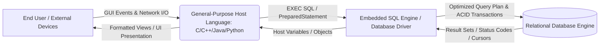
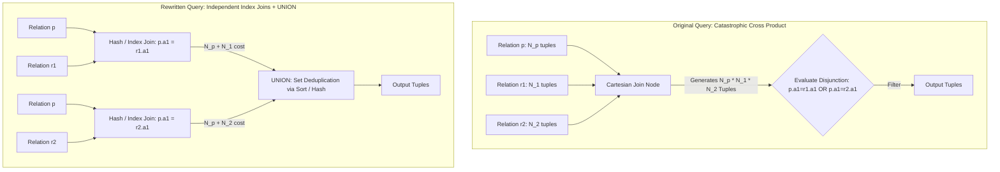
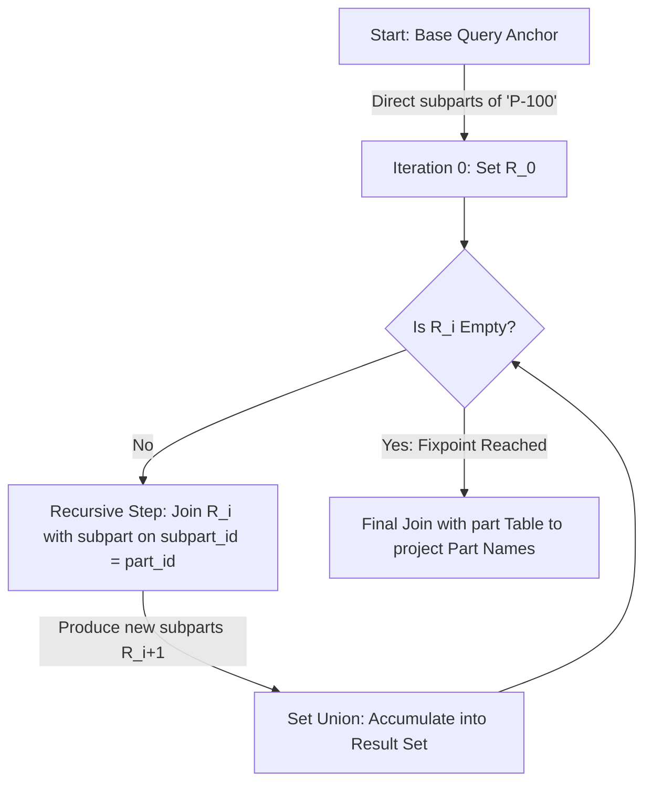
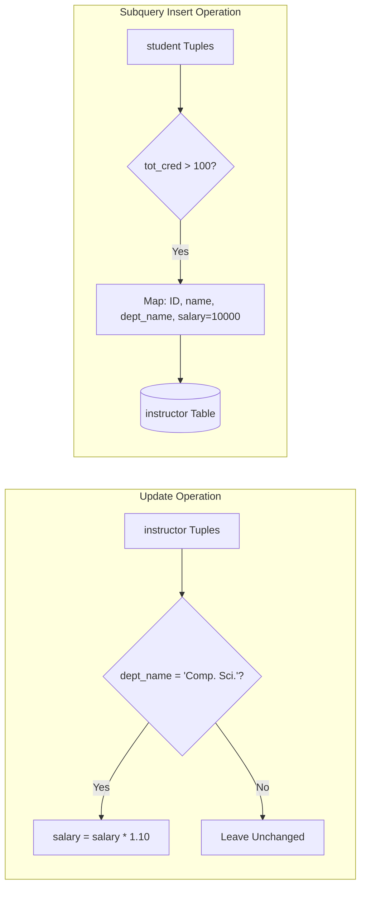
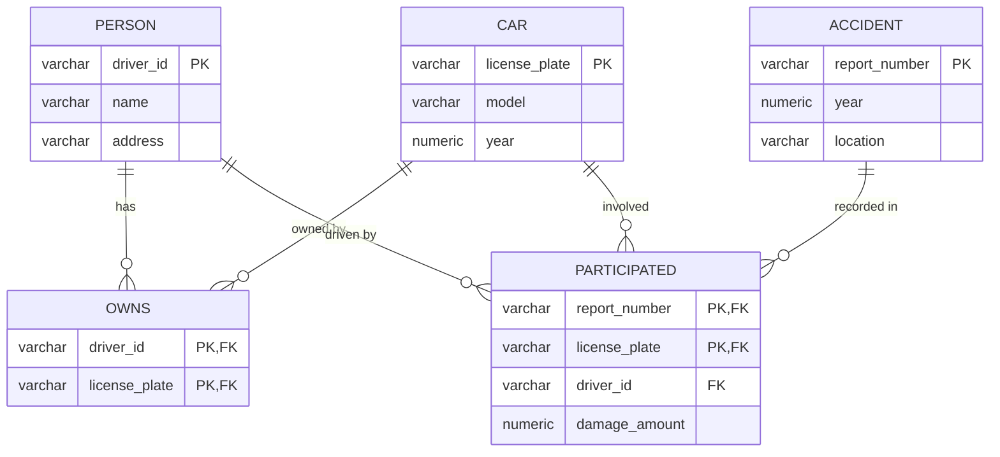
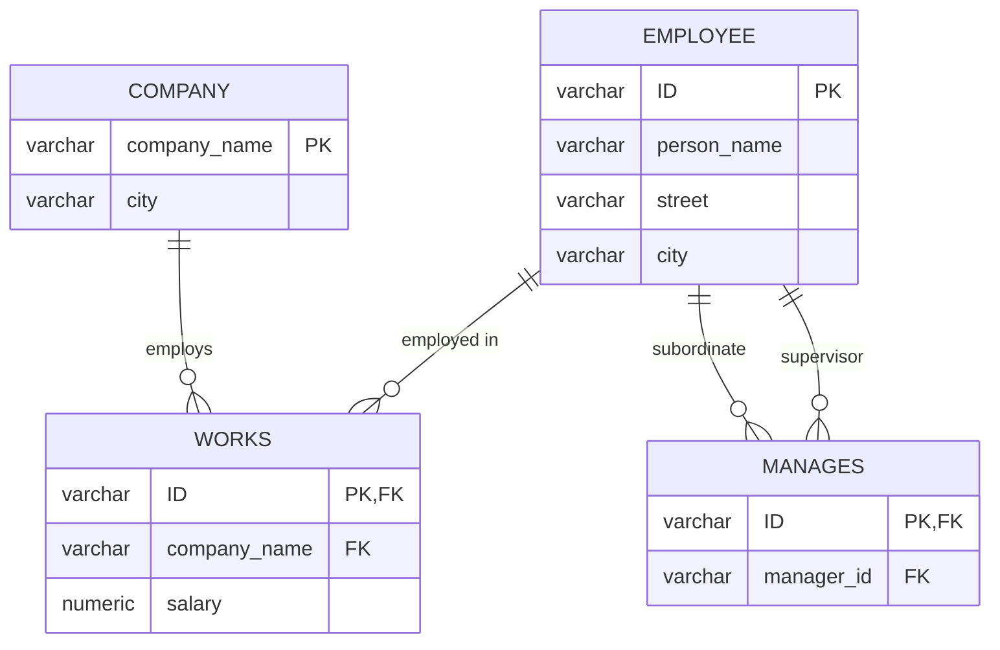
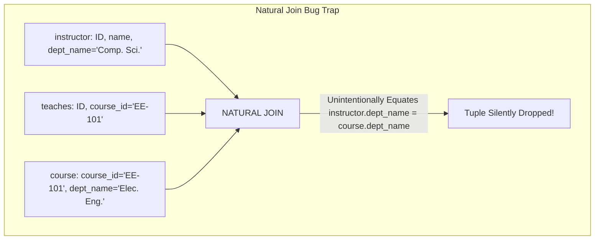

[← Prev: T04](T04_Relational_Algebra_and_Calculus.md) | [Index](00_Index.md) | [Next: T05 Part 2 →](T05_Part2_SQL_Clauses_and_Aggregations.md)

---

# T05 (Part 1) · SQL DDL Constraints & DML Modification Basics

> [!info] Topic Card · SQL Part 1: Schema Definition, Integrity, and Tuple Modifications
> - **Syllabus Alignment:** Unit 4 — SQL (DDL, DML, Integrity Constraints, Foreign Keys, Schema Engineering)
> - **RUET Exam Weight:** Topic T05 commands **130 final marks (20.4%)** across all 7 semester finals + CTs (consistently the highest-weighted topic on the syllabus).
> - **Textbook Sources:** Silberschatz, Korth, & Sudarshan, *Database System Concepts* (7th Ed., 2019):
>   - Chapter 03: *Introduction to SQL* (§3.1–§3.3, §3.7, §3.9)
>   - Chapter 04: *Intermediate SQL* (§4.1, §4.4)
>   - Chapter 05: *Advanced SQL* (§5.1, §5.4)
> - **Pedagogical Objective:** Master the foundational declarative structure of SQL, bridging relational calculus/algebra to physical table creation (`CREATE TABLE`), domain integrity, referential action cascading (`ON DELETE CASCADE`), tuple insertion/deletion/updating, query optimization via rewrite, and testing strategies.

---

## Master Table of Assigned Exercises

| Exercise ID | Source Chapter | Subtopic | Type | Focus Description | RUET Exam Link |
| :--- | :--- | :---: | :---: | :--- | :--- |
| **PE 5.4** | Chapter 05 | T05.1 | Theory / Arch | Embedded SQL vs. Standalone SQL vs. General-Purpose Languages | 2019 Q.5(a) |
| **PE 3.7** | Chapter 03 | T05.1 | Optimization | Disjunctive (`OR`) Query Optimization & `UNION` Rewrite | Query Optimization / Performance |
| **EX 3.23** | Chapter 03 | T05.1 | Query Design | Eliminating Common Table Expressions (`WITH` Clause) | 2019 Q.8(b), 2024 Q.6(a) |
| **EX 5.16** | Chapter 05 | T05.1 | Expressiveness | Transitive Closure & Recursive Queries (`WITH RECURSIVE`) | Advanced SQL / Hierarchy Queries |
| **PE 3.1** | Chapter 03 | T05.2 | DML / Queries | University Schema Foundational Queries & Aggregations | 2017 Q.4(a), 2019 Q.7(a) |
| **PE 3.3** | Chapter 03 | T05.2 | DML Updates | Bulk Updates, Subquery Deletions, and Table-to-Table Inserts | 2018 Q.7(a) = 2024 Q.4(b) |
| **PE 3.10** | Chapter 03 | T05.2 | DML Updates | Employee Database Attribute Modification & Tiered Wage Bumps | 2020 Q.3(b), 2021 Q.3(a) |
| **EX 3.12** | Chapter 03 | T05.2 | DDL / DML | Complete Schema Lifecycle: Insertion, Enrollment, Cascading Deletions | 2019 Q.5(c), 2023 Q.3(a) |
| **EX 3.13** | Chapter 03 | T05.2 | DDL Creation | Enterprise DDL Specification: Insurance Schema Constraints | 2020 Q.7(b) = 2024 Q.5(b) |
| **EX 3.17** | Chapter 03 | T05.2 | DML Updates | Employee Schema Selective Salary Raises & Tuple Deletion | 2020 Q.3(b) |
| **EX 3.18** | Chapter 03 | T05.2 | DDL Creation | Enterprise DDL Specification: Employee-Company-Manager Schema | 2018 Q.7(a), 2024 Q.4(b) |
| **EX 3.26** | Chapter 03 | T05.2 | Query Design | Multi-Instance Repetition Analysis via `GROUP BY` and `HAVING` | 2018 Q.7(b), CT-02 Q.1(d) |
| **EX 4.5** | Chapter 04 | T05.2 | QA / Testing | Test Database Design: Foreign Key Integrity, Nulls, & Natural Join Traps | Database Testing & Robustness |

---

## T05.1 · Foundations of SQL, Declarative Paradigm, and Embedded Systems

Subtopic **T05.1** investigates the fundamental design philosophy of Structured Query Language (SQL): its non-procedural, declarative abstraction, its theoretical basis in tuple relational calculus, its execution mechanics within host applications (embedded SQL, CLI, APIs), and its computational boundaries.

---

### Exercise 5.4 (PE 5.4) · Embedded SQL vs. Standalone SQL vs. General-Purpose Languages

> [!info] Exercise Metadata
> - **Source:** Silberschatz 7e, Chapter 5 (*Advanced SQL*), Practice Exercise 5.4 (p. 233)
> - **Subtopic Classification:** `T05.1` (What SQL is; SQL paradigms and architectural deployment)
> - **Core Competencies:** Embedded SQL (`EXEC SQL`), Host Languages (C/C++, Java), Impedance Mismatch, Computational Completeness, User Interface / I/O Handling
> - **RUET Relevance:** Directly elaborates RUET 2019 Q.5(a) ("Short note on SQL") by examining why enterprise systems combine declarative SQL with procedural host languages.

#### Question (Silberschatz 7e Practice Exercise 5.4)
> Describe the circumstances in which you would choose to use embedded SQL rather than SQL alone or only a general-purpose programming language.

#### 1. Core Principles & Concept Overview

To evaluate why systems employ **Embedded SQL** (or equivalent database APIs such as JDBC, ODBC, and `psycopg2`), one must analyze the contrasting strengths and inherent limitations of two computational paradigms:
1. **Pure Standalone SQL:** A non-procedural, declarative, set-oriented language. A programmer specifies *what* data to retrieve or modify, leaving the query optimizer to determine *how* (access paths, join orders, index utilization).
2. **Pure General-Purpose Programming Languages (GPLs):** Turing-complete, procedural or object-oriented languages (e.g., C, C++, Java, Python) designed for sequential instruction execution, complex flow control, input/output device control, memory manipulation, and graphical user interfaces.

Neither paradigm alone satisfies the requirements of complete enterprise information systems. The bridge between them is **Embedded SQL** (or Call-Level Interfaces):



##### The Tri-Fold Comparison

| Dimension | Standalone SQL Alone | General-Purpose Language Alone | Embedded SQL / Host Integration |
| :--- | :--- | :--- | :--- |
| **Computational Power** | Relationally complete; lacks arbitrary procedural algorithms without vendor-specific extensions. | Turing-complete; can compute any computable function. | Combines declarative set operations with Turing-complete procedural algorithms. |
| **Data Storage & Indexing** | Optimized disk management, B+ trees, hash indexes, buffer caching. | In-memory variables or raw OS file I/O; lacks indexing and schema abstraction. | Leverages RDBMS high-performance disk storage and indexing while manipulating data in host memory. |
| **ACID & Concurrency** | Native multi-version concurrency control (MVCC), two-phase locking, WAL recovery. | Must manually implement complex concurrency primitives, locking, and crash recovery. | Full RDBMS ACID transaction safety triggered from host transaction boundaries (`COMMIT`, `ROLLBACK`). |
| **User Interaction & I/O** | Primitive CLI text tables; no GUI, sockets, web endpoints, or peripheral control. | Rich GUI toolkits, HTTP servers, hardware device drivers, and multimedia processing. | Host language handles GUI, Web APIs, and peripheral I/O; SQL processes backend persistence. |

#### 2. Detailed Step-by-Step Solution

##### (A) Circumstances Favoring Embedded SQL Over Pure Standalone SQL

Pure standalone SQL executed via an interactive shell (e.g., MySQL Command Line Client, PostgreSQL `psql`, Oracle SQL*Plus) is inadequate under the following real-world circumstances:

1. **Interactive User Interfaces and Graphical Applications:**
   - Standalone SQL outputs raw tabular ASCII text to standard output.
   - Applications requiring Graphical User Interfaces (GUIs), responsive web applications, mobile apps, or hardware dashboards require host language libraries (React, JavaFX, Qt, Flutter) to render controls, buttons, forms, and validation feedback. Embedded SQL allows host variables to bind directly to GUI form inputs.
2. **Procedural Logic, Complex Math, and Non-Database Algorithms:**
   - Tasks requiring non-relational computation—such as Fast Fourier Transforms (FFT), complex cryptographic hashing, digital signal processing, iterative numerical simulations, or custom statistical models—cannot be written cleanly in declarative SQL.
   - The host language executes these numerical algorithms while Embedded SQL fetches and stores the raw records.
3. **External System Integration and Peripheral Communication:**
   - Enterprise workflows regularly require interacting with non-database hardware: generating barcode prints, reading RFID scanners, communicating over network sockets, dispatching automated SMS/email alerts, or interfacing with payment gateway APIs.
   - Standalone SQL engines operate strictly within the sandbox of the database engine; they cannot initiate arbitrary socket or serial bus communications.
4. **Tuple-at-a-Time Cursor Processing with External Side Effects:**
   - When each retrieved tuple triggers an external event (e.g., verifying a biometric fingerprint or sending an HTTP webhook), SQL's set-at-a-time evaluation must be paired with host language cursors (`FETCH NEXT INTO :host_var`) to execute procedural branching on each record.

##### (B) Circumstances Favoring Embedded SQL Over a Pure General-Purpose Language

Writing an entire data-intensive application solely in C, C++, or Java without SQL/RDBMS—attempting to manage data via raw OS files (e.g., CSV, JSON, binary disk blocks)—introduces fatal architectural drawbacks:

1. **Re-inventing the Relational Engine (Indexing & Optimization):**
   - Writing custom disk-file search algorithms requires manually implementing B+ trees, hashing schemes, and LRU buffer pool management.
   - In SQL, a single `SELECT * FROM instructor WHERE salary > 80000` automatically selects index scans, clustered scans, or hash joins based on cost-based optimizer statistics. Hand-written file routines cannot adapt dynamically to data volume shifts.
2. **Transaction Management and ACID Properties:**
   - In multi-user concurrent environments, handling simultaneous writes in pure application code requires implementing distributed lock managers, deadlock detection graphs, undo/redo logs, and write-ahead logging (WAL) for power-failure recovery.
   - Embedded SQL delegates full transactional integrity (`BEGIN TRANSACTION`, `COMMIT`, `ROLLBACK`) to the RDBMS engine.
3. **Declarative Integrity Constraints and Schema Evolution:**
   - Enforcing domain constraints, `NOT NULL`, primary key uniqueness, and `FOREIGN KEY ... ON DELETE CASCADE` in application code leads to severe logic duplication across client applications. If multiple programs access the raw files, a bug in one program corrupts the entire repository.
   - Embedded SQL ensures that centralized database constraints protect physical data regardless of which client host program issues the modification.
4. **Declarative Security and Access Control:**
   - Operating-system file permissions are coarse (read/write on an entire file). RDBMS systems provide fine-grained, role-based authorization down to individual columns and rows (`GRANT SELECT ON ...`).

##### (C) Architectural Summary: The Concept of Impedance Mismatch

Embedded SQL is the industry standard precisely because it resolves the **Impedance Mismatch**:
- **Relational Model:** Operates on entire sets of unordered, mathematical tuples ($n$-ary relations) without explicit pointers.
- **Host Programming Languages:** Operate sequentially on imperative variables, pointers, classes, and single-object memory references.
- **Mechanism:** Embedded SQL uses **cursors** (or iterators over result sets) and **shared host variables** (prefixed with a colon, e.g., `:c_id`) to bridge set-oriented relational results into record-at-a-time memory buffers.

#### 3. RUET Exam Insights & Examiner Notes

> [!tip] Exam Strategy & Keywords
> - When asked to discuss SQL or its real-world implementation in RUET semester finals (e.g., **2019 Q.5(a)**), explicitly cite the term **Impedance Mismatch**. This keyword signals top-tier theoretical maturity to the examiner.
> - **The Dual Advantage Argument:** Always structure your answer into two distinct columns or numbered headers:
>   1. *Why SQL alone fails* (No GUI, no network I/O, no complex iterative math).
>   2. *Why host languages alone fail* (No declarative optimizer, no B+ trees, complex concurrency/crash recovery overhead).
> - Mention that modern industry workflows replace legacy precompiled embedded SQL (`EXEC SQL`) with Call-Level Interfaces (CLI) like **JDBC** (Java), **ODBC** (C/C++), and ORMs (Object-Relational Mapping such as Hibernate or SQLAlchemy), which operate on the exact same theoretical principles.

---

### Exercise 3.7 (PE 3.7) · Performance Pitfalls of Disjunctive (`OR`) Queries & `UNION` Optimization

> [!info] Exercise Metadata
> - **Source:** Silberschatz 7e, Chapter 3 (*Introduction to SQL*), Practice Exercise 3.7 (p. 117)
> - **Subtopic Classification:** `T05.1` (Query evaluation semantics, Cartesian expansion, and Set-Theoretic Equivalence)
> - **Core Competencies:** Cartesian Product ($P \times R_1 \times R_2$), Disjunctive Predicates (`OR`), Query Optimization, Set Union (`UNION`), Join Decomposition
> - **RUET Relevance:** Tests foundational knowledge of relational execution engines. Directly explains why relational algebra translation avoids cross products and why multi-table `FROM` clauses with disjunctions cause catastrophic performance degradation.

#### Question (Silberschatz 7e Practice Exercise 3.7)
> Consider the SQL query:
> ```sql
> select p.a1
> from p, r1, r2
> where p.a1 = r1.a1 or p.a1 = r2.a1
> ```
> Under what conditions does the preceding query with an `or` in the `where` clause run very slowly? How can you rewrite the query using the `union` operation to make it run faster?

#### 1. Core Principles & Concept Overview

##### Mathematical Semantics of the Cartesian Product
In standard SQL, listing relations in the `FROM` clause separated by commas defines a **Cartesian (Cross) Product**:

$$
\text{Intermediate State} = p \times r_1 \times r_2
$$

If the cardinalities of the relations are $|p| = N_p$, $|r_1| = N_1$, and $|r_2| = N_2$, the cardinality of the unconstrained cross product is:

$$
|p \times r_1 \times r_2| = N_p \cdot N_1 \cdot N_2
$$

Notice the critical vulnerability in the query:
```sql
where p.a1 = r1.a1 or p.a1 = r2.a1
```
There is **no join predicate connecting $r_1$ and $r_2$**.
- For every tuple in $p$ that matches a tuple in $r_1$, that tuple is replicated across **all** $N_2$ tuples of $r_2$.
- Conversely, for every tuple in $p$ that matches a tuple in $r_2$, it is replicated across **all** $N_1$ tuples of $r_1$.



#### 2. Detailed Step-by-Step Solution

##### (A) Conditions Under Which the Query Runs Extremely Slowly

The query will execute with catastrophic latency under any of the following conditions:

1. **Large Cardinalities of $r_1$ and $r_2$ ($N_1, N_2 \gg 1$):**
   - Even if $p$ is small, if $r_1$ has $100,000$ rows and $r_2$ has $100,000$ rows, the Cartesian product $r_1 \times r_2$ generates $10^{10}$ (10 billion) intermediate combinations.
   - Evaluating a disjunction across 10 billion tuples consumes massive CPU cycles and exceeds physical memory, forcing temporary disk spilling.
2. **Inability to Exploit Standard Equi-Join Indexes:**
   - Relational optimizers leverage B+ tree indexes to convert equi-joins ($A \bowtie B$) into fast index lookups ($O(N \log M)$) or hash joins ($O(N + M)$).
   - An `OR` predicate spanning across different relations ($p.a_1 = r_1.a_1 \lor p.a_1 = r_2.a_1$) prevents the optimizer from decomposing the operation into a single merge or hash join pipeline. If the optimizer cannot rewrite the disjunction into a union of joins, it falls back to a brute-force **Nested-Loop Join** across all three tables:
     $$
     \text{Time Complexity} = O(N_p \cdot N_1 \cdot N_2)
     $$
3. **Empty Matching Sets with Large Cross Products:**
   - If a tuple in $p$ matches $r_1.a_1$, the engine still scans all of $r_2$, generating huge quantities of duplicate result rows (which then require costly downstream deduplication or transfer).

##### (B) Query Rewrite Using the `UNION` Operation

To eliminate the Cartesian product between $r_1$ and $r_2$, we decompose the disjunctive filter into two independent, pairwise joins and combine their projections using set union:

```sql
-- Optimized Equi-Join Rewrite via Set Union
SELECT p.a1
FROM p, r1
WHERE p.a1 = r1.a1

UNION

SELECT p.a1
FROM p, r2
WHERE p.a1 = r2.a1;
```

*(Alternatively, in standard ANSI SQL-92 join syntax:)*

```sql
SELECT p.a1
FROM p
JOIN r1 ON p.a1 = r1.a1

UNION

SELECT p.a1
FROM p
JOIN r2 ON p.a1 = r2.a1;
```

##### (C) Complexity and Optimization Proof

1. **Intermediate Tuple Generation:**
   - Subquery 1 evaluates $p \bowtie r_1$. With an index on $r_1.a_1$, cost is $O(N_p \log N_1)$.
   - Subquery 2 evaluates $p \bowtie r_2$. With an index on $r_2.a_1$, cost is $O(N_p \log N_2)$.
   - The total number of tuples produced before union is at most $N_p + N_p = 2 N_p$.
2. **Elimination of Cross-Multiplying Overhead:**
   - The relations $r_1$ and $r_2$ are **never multiplied together**. Their sizes are purely additive rather than multiplicative:
     $$
     \text{Time Complexity} = O(N_p + N_1 + N_2) \ll O(N_p \cdot N_1 \cdot N_2)
     $$
3. **Duplicate Handling:**
   - The `UNION` operator in SQL inherently performs **set union** (automatic duplicate elimination via sorting or hash partitioning), correctly mirroring the behavior of the original `SELECT p.a1` without multiplying tuples when a $p.a_1$ value matches both $r_1$ and $r_2$.

*(Bonus: Semi-Join Formulation via `IN` / `EXISTS`)*
A database optimizer could also execute this efficiently as a set of existential lookups:
```sql
SELECT p.a1
FROM p
WHERE p.a1 IN (SELECT a1 FROM r1)
   OR p.a1 IN (SELECT a1 FROM r2);
```

#### 3. RUET Exam Insights & Examiner Notes

> [!important] Examiner Grading Criteria
> - **Point out the missing join condition:** When analyzing the original query in an exam script, explicitly state: *"There is no join predicate between relations $r_1$ and $r_2$, resulting in an unconstrained Cartesian product $r_1 \times r_2$."* Marks are deducted if the candidate does not identify the $N_1 \cdot N_2$ explosion.
> - **`UNION` vs. `UNION ALL`:** Always use `UNION`, **not** `UNION ALL`. Because `p.a1` might satisfy both predicates ($p.a_1 = r_1.a_1$ and $p.a_1 = r_2.a_1$), `UNION ALL` would output duplicate `p.a1` values, violating equivalence with the original query's logical semantics.

---

### Exercise 3.23 (EX 3.23) · Elimination of Common Table Expressions (`WITH` Clause) via Derived Tables

> [!info] Exercise Metadata
> - **Source:** Silberschatz 7e, Chapter 3 (*Introduction to SQL*), Exercise 3.23 (p. 121)
> - **Subtopic Classification:** `T05.1` (Common Table Expressions, Subquery Scoping, and Query Transformations)
> - **Core Competencies:** Common Table Expressions (`WITH`), Derived Tables (Subqueries in `FROM`), Scalar Subqueries, Aggregate Comparison
> - **RUET Relevance:** RUET final exams regularly require candidates to express complex multi-level aggregations without modern syntactic sugar (e.g., 2019 Q.8(b) on subquery types, 2024 Q.6(a)).

#### Question (Silberschatz 7e Exercise 3.23)
> Consider the query:
> ```sql
> with dept_total (dept_name, value) as
>     (select dept_name, sum(salary)
>      from instructor
>      group by dept_name),
> dept_total_avg(value) as
>     (select avg(value)
>      from dept_total)
> select dept_name
> from dept_total, dept_total_avg
> where dept_total.value >= dept_total_avg.value;
> ```
> Rewrite this query without using the `with` construct.

#### 1. Core Principles & Concept Overview

The `WITH` clause provides a mechanism for defining **Common Table Expressions (CTEs)**—temporary, named result sets whose scope is strictly bound to the execution of a single primary query:
1. `dept_total`: Aggregates the sum of salaries for each department ($dept\_name, \sum salary$).
2. `dept_total_avg`: Computes the scalar mean of those departmental sums.
3. Outer Query: Performs a Cartesian product between each department total and the single scalar average, retaining departments whose total payroll equals or exceeds the university departmental average.

To eliminate the `WITH` construct, we must evaluate where subqueries can be legally placed in SQL-92:
- **Approach 1 (Inline Derived Tables in the `FROM` clause):** Substitute each named CTE with an inline nested subquery aliased as a temporary table.
- **Approach 2 (Clean Aggregation with `HAVING` and a Scalar Subquery):** Compute the department totals directly in the primary query and push the average calculation into a scalar subquery inside the `HAVING` clause.

#### 2. Detailed Step-by-Step Solution

##### Approach 1: Direct Translation via Inline Derived Tables in `FROM`

We replace `dept_total` and `dept_total_avg` directly with nested inline subqueries:

```sql
SELECT dept_total.dept_name
FROM 
    -- Inline replacement for dept_total
    (SELECT dept_name, SUM(salary) AS value
     FROM instructor
     GROUP BY dept_name) AS dept_total,
    
    -- Inline replacement for dept_total_avg (requires re-nesting dept_total)
    (SELECT AVG(dt.value) AS value
     FROM (SELECT dept_name, SUM(salary) AS value
           FROM instructor
           GROUP BY dept_name) AS dt
    ) AS dept_total_avg
WHERE dept_total.value >= dept_total_avg.value;
```

**Mechanical Analysis:**
- Because the CTE `dept_total` is referenced twice in the original query (once in the outer `FROM` and once inside the definition of `dept_total_avg`), inlining derived tables forces us to duplicate the aggregation subquery `SELECT dept_name, SUM(salary) ...` inside the second subquery.
- In SQL standards, every derived table in the `FROM` clause **must** have an explicit table alias (`AS dept_total`, `AS dt`, `AS dept_total_avg`).

##### Approach 2: Idiomatic Aggregation via `HAVING` and Scalar Subquery (Optimal)

A far more elegant, concise, and computationally efficient rewrite groups instructors directly by `dept_name` and filters the aggregated group payrolls using `HAVING`:

```sql
SELECT dept_name
FROM instructor
GROUP BY dept_name
HAVING SUM(salary) >= (
    SELECT AVG(dept_sum)
    FROM (
        SELECT SUM(salary) AS dept_sum
        FROM instructor
        GROUP BY dept_name
    ) AS temp_dept_totals
);
```

**Step-by-Step Logic Breakdown:**
1. `SELECT dept_name ... GROUP BY dept_name`: Partitions the `instructor` table into departmental buckets and calculates $\sum(\text{salary})$ per department.
2. `HAVING SUM(salary) >= (...)`: Filters groups based on an aggregate condition.
3. Scalar Subquery in `HAVING`:
   - Inner subquery `SELECT SUM(salary) AS dept_sum ... GROUP BY dept_name` produces a single column containing the total payroll of each department.
   - The outer subquery `SELECT AVG(dept_sum) FROM (...)` computes the arithmetic mean across all departmental payrolls, returning a **single scalar numeric value**.
4. The comparison evaluates whether each department's total payroll $\ge$ the scalar university average.

#### 3. RUET Exam Insights & Examiner Notes

> [!tip] Best Practices for Exam Scripts
> - In RUET semester exams, **Approach 2 (`GROUP BY ... HAVING`) is strongly preferred by examiners** because it demonstrates mastery of SQL group-filtering semantics without creating unnecessary Cartesian joins in the `FROM` clause.
> - **Alias Mandatory Rule:** If you write derived tables in the `FROM` clause (Approach 1), never forget to append an alias (`AS table_alias`). Omitting table aliases for derived tables causes immediate syntax errors in MySQL and PostgreSQL, and RUET examiners frequently penalize this missing alias.

---

### Exercise 5.16 (EX 5.16) · Transitive Closure & Recursive Queries (`WITH RECURSIVE`)

> [!info] Exercise Metadata
> - **Source:** Silberschatz 7e, Chapter 5 (*Advanced SQL*), Exercise 5.16 (p. 236)
> - **Subtopic Classification:** `T05.1` (Relational Completeness, Transitive Closure, and Recursive CTEs)
> - **Core Competencies:** Transitive Closure, Directed Acyclic Graphs (DAG), `WITH RECURSIVE`, Anchor Member, Recursive Member, Fixpoint Semantics
> - **RUET Relevance:** Advanced theoretical SQL question. Directly addresses why first-order relational algebra cannot compute transitive closure and how SQL:1999 solves the Bill-of-Materials (BOM) problem.

#### Question (Silberschatz 7e Exercise 5.16)
> Consider the relational schema:
> ```text
> part(<u>part_id</u>, name, cost)
> subpart(<u>part_id</u>, <u>subpart_id</u>, count)
> ```
> where the primary-key attributes are underlined. A tuple $(p_1, p_2, 3)$ in the *subpart* relation denotes that the part with *part_id* $p_2$ is a direct subpart of the part with *part_id* $p_1$, and $p_1$ has 3 copies of $p_2$. Note that $p_2$ may itself have further subparts. Write a recursive SQL query that outputs the names of all subparts of the part with part-id 'P-100'.

#### 1. Core Principles & Concept Overview

##### Theoretical Limitation of Classical Relational Algebra
A fundamental theoretical theorem in database systems states:

$$
\text{Classical Relational Algebra and First-Order SQL cannot compute Transitive Closure on arbitrary-depth graphs.}
$$

Because classical relational queries evaluate a fixed, finite number of joins ($k$ joins reach depth $k$), they cannot traverse a hierarchy of unknown or unbounded depth. 

##### Fixpoint Semantics of `WITH RECURSIVE`
To achieve computational completeness for hierarchical and graph-structured data, SQL:1999 introduced **Recursive Common Table Expressions**:

$$
\text{Relation} = \text{Base Query (Anchor)} \cup \text{Recursive Query (Step)}
$$



1. **Anchor Member (Base Case):** Non-recursive query that identifies all immediate (direct) subparts of `'P-100'`.
2. **Recursive Member (Inductive Step):** Joins the tuples produced in the previous iteration with the `subpart` relation to find components at the next depth level.
3. **Termination Condition (Fixpoint):** The evaluation halts automatically when an iteration generates no new tuples ($\Delta R = \emptyset$).
4. **Duplicate Elimination:** Using `UNION` (rather than `UNION ALL`) prevents infinite loops if cyclic dependencies exist in the component graph.

#### 2. Detailed Step-by-Step Solution

```sql
-- Recursive CTE to compute the complete transitive closure of subparts
WITH RECURSIVE subpart_closure (sub_id) AS (
    -- 1. ANCHOR MEMBER: Find all direct subparts of 'P-100'
    SELECT subpart_id
    FROM subpart
    WHERE part_id = 'P-100'
    
    UNION
    
    -- 2. RECURSIVE MEMBER: Find indirect subparts at depth n+1
    SELECT s.subpart_id
    FROM subpart_closure sc
    JOIN subpart s ON sc.sub_id = s.part_id
)
-- 3. FINAL PROJECTION: Join with part table to retrieve descriptive names
SELECT DISTINCT p.name
FROM subpart_closure sc
JOIN part p ON sc.sub_id = p.part_id;
```

##### Trace of Execution on a Sample Component Tree

Suppose our database contains the following Bill-of-Materials hierarchy:
- `'P-100'` (Bicycle) consists of direct subparts `'P-200'` (Wheel Assembly) and `'P-300'` (Frame).
- `'P-200'` (Wheel Assembly) consists of direct subparts `'P-400'` (Tire) and `'P-500'` (Spoke).
- `'P-400'` (Tire) consists of direct subpart `'P-600'` (Rubber Valve).

| Iteration Step | Input Tuples ($\Delta R_{i-1}$) | Query Executed | Output Tuples Generated ($\Delta R_i$) | Accumulated Set ($R$) |
| :---: | :---: | :--- | :--- | :--- |
| **Iteration 0 (Anchor)** | None | `WHERE part_id = 'P-100'` | `{'P-200', 'P-300'}` | `{'P-200', 'P-300'}` |
| **Iteration 1** | `{'P-200', 'P-300'}` | `JOIN subpart ON part_id IN ('P-200', 'P-300')` | `{'P-400', 'P-500'}` | `{'P-200', 'P-300', 'P-400', 'P-500'}` |
| **Iteration 2** | `{'P-400', 'P-500'}` | `JOIN subpart ON part_id IN ('P-400', 'P-500')` | `{'P-600'}` | `{'P-200', 'P-300', 'P-400', 'P-500', 'P-600'}` |
| **Iteration 3** | `{'P-600'}` | `JOIN subpart ON part_id = 'P-600'` | $\emptyset$ (No children) | **Fixpoint reached! Recursion halts.** |

**Final Step:** The outer `SELECT DISTINCT p.name` maps each ID in `{'P-200', 'P-300', 'P-400', 'P-500', 'P-600'}` to its human-readable title in `part` (e.g., `'Wheel Assembly'`, `'Frame'`, `'Tire'`, `'Spoke'`, `'Rubber Valve'`).

#### 3. RUET Exam Insights & Examiner Notes

> [!note] Theoretical Distinction for University Scripts
> - If an exam question asks: *"Can standard SQL find all subparts of an assembly to arbitrary depth without using recursion?"*, the answer is strictly **NO**. State clearly: *"Transitive closure cannot be expressed in basic first-order relational algebra because it requires an unbounded number of self-joins."*
> - Mention that `WITH RECURSIVE` was formalized in the **SQL:1999 standard** and is fully supported in PostgreSQL, MySQL 8.0+, Oracle (via both recursive CTEs and legacy `CONNECT BY`), and SQLite.

---

## T05.2 · SQL DDL Schemas, Referential Integrity Constraints, and DML Modifications

Subtopic **T05.2** covers practical schema creation (`CREATE TABLE`), primary/foreign key constraint enforcement, cascading actions (`ON DELETE CASCADE`), database modifications (`INSERT`, `UPDATE`, `DELETE`), and database testing.

---

### Exercise 3.1 (PE 3.1) · Foundational University Schema Queries & Aggregations

> [!info] Exercise Metadata
> - **Source:** Silberschatz 7e, Chapter 3 (*Introduction to SQL*), Practice Exercise 3.1 (p. 116)
> - **Subtopic Classification:** `T05.2` (SQL DML Foundation & Basic Aggregations)
> - **Core Competencies:** Basic `SELECT-FROM-WHERE`, Multi-Table Join, Duplicate Elimination (`DISTINCT`), Aggregate Functions (`MAX`, `COUNT`), Grouping (`GROUP BY`), Nested Aggregation
> - **RUET Relevance:** Corresponds to recurring RUET university schema questions (e.g., 2017 Q.4(a), 2019 Q.7(a), 2021 Q.3(a)).

#### Question (Silberschatz 7e Practice Exercise 3.1)
> Write the following queries in SQL, using the university schema.
> 
> a. Find the titles of courses in the Comp. Sci. department that have 3 credits.  
> b. Find the IDs of all students who were taught by an instructor named Einstein; make sure there are no duplicates in the result.  
> c. Find the highest salary of any instructor.  
> d. Find all instructors earning the highest salary (there may be more than one with the same salary).  
> e. Find the enrollment of each section that was offered in Fall 2017.  
> f. Find the maximum enrollment, across all sections, in Fall 2017.  
> g. Find the sections that had the maximum enrollment in Fall 2017.

#### 1. Core Principles & Concept Overview

The **University Database Schema** (Silberschatz Appendix A) consists of:
- `course (course_id, title, dept_name, credits)`
- `instructor (ID, name, dept_name, salary)`
- `section (course_id, sec_id, semester, year, building, room_number, time_slot_id)`
- `teaches (ID, course_id, sec_id, semester, year)`
- `student (ID, name, dept_name, tot_cred)`
- `takes (ID, course_id, sec_id, semester, year, grade)`

Each sub-question tests progressively deeper declarative query mechanics: from single-relation filtering, to four-table natural/equi-joins, single-cell scalar aggregates, subquery-driven filter comparisons, and multi-tier group aggregations.

#### 2. Detailed Step-by-Step Solution

##### (a) Titles of courses in the Comp. Sci. department with 3 credits

```sql
SELECT title
FROM course
WHERE dept_name = 'Comp. Sci.'
  AND credits = 3;
```
*Logic:* A simple selection ($\sigma$) and projection ($\Pi$) on the `course` relation.

##### (b) IDs of all students taught by an instructor named Einstein (no duplicates)

```sql
SELECT DISTINCT t.ID
FROM takes t
JOIN teaches te 
  ON t.course_id = te.course_id
 AND t.sec_id    = te.sec_id
 AND t.semester  = te.semester
 AND t.year      = te.year
JOIN instructor i 
  ON te.ID = i.ID
WHERE i.name = 'Einstein';
```
*Logic:* 
- We must match students (`takes`) to teachers (`teaches`) across all 4 composite section attributes (`course_id, sec_id, semester, year`), and then join `teaches` with `instructor` on `ID`.
- `DISTINCT` is essential because a student may take multiple sections taught by Einstein or take multiple courses from him in different semesters.

##### (c) Highest salary of any instructor

```sql
SELECT MAX(salary) AS max_salary
FROM instructor;
```
*Logic:* The aggregate function `MAX()` processes all non-null values in the `salary` column, returning a single scalar tuple.

##### (d) All instructors earning the highest salary

```sql
SELECT ID, name, salary
FROM instructor
WHERE salary = (
    SELECT MAX(salary)
    FROM instructor
);
```
*Logic:* 
- *Syntax Error Trap:* Beginners often incorrectly write `SELECT name, MAX(salary) FROM instructor;`. In standard SQL, selecting an unaggregated column (`name`) alongside an aggregate function without a `GROUP BY` clause is illegal.
- The correct formulation uses a **scalar subquery** in the `WHERE` clause to dynamically compute the maximum salary, then retrieves all instructor tuples matching that threshold (gracefully handling ties).

##### (e) Enrollment of each section offered in Fall 2017

```sql
-- Formulation 1: Inner Join (Sections with at least one student)
SELECT course_id, sec_id, COUNT(ID) AS enrollment
FROM takes
WHERE semester = 'Fall'
  AND year = 2017
GROUP BY course_id, sec_id;
```

```sql
-- Formulation 2: Robust Outer Join (Preserves sections with 0 enrolled students)
SELECT s.course_id, s.sec_id, COUNT(t.ID) AS enrollment
FROM section s
LEFT OUTER JOIN takes t
  ON s.course_id = t.course_id
 AND s.sec_id    = t.sec_id
 AND s.semester  = t.semester
 AND s.year      = t.year
WHERE s.semester = 'Fall'
  AND s.year = 2017
GROUP BY s.course_id, s.sec_id;
```
*Logic:* 
- `COUNT(t.ID)` must be used instead of `COUNT(*)` in the outer join version. If a section has 0 students, `t.ID` is `NULL`, causing `COUNT(t.ID)` to evaluate to `0`, whereas `COUNT(*)` would incorrectly evaluate to `1`.

##### (f) Maximum enrollment, across all sections, in Fall 2017

```sql
SELECT MAX(enrollment) AS max_section_enrollment
FROM (
    SELECT COUNT(ID) AS enrollment
    FROM takes
    WHERE semester = 'Fall'
      AND year = 2017
    GROUP BY course_id, sec_id
) AS section_counts;
```
*Logic:* Computes the enrollments per section in a derived table, and then applies the outer aggregate `MAX()` over the resulting scalar column.

##### (g) Sections that had the maximum enrollment in Fall 2017

```sql
WITH section_enrollments AS (
    SELECT course_id, sec_id, COUNT(ID) AS enrollment
    FROM takes
    WHERE semester = 'Fall'
      AND year = 2017
    GROUP BY course_id, sec_id
)
SELECT course_id, sec_id, enrollment
FROM section_enrollments
WHERE enrollment = (
    SELECT MAX(enrollment)
    FROM section_enrollments
);
```

*(Alternative without `WITH` using `HAVING`):*

```sql
SELECT course_id, sec_id, COUNT(ID) AS enrollment
FROM takes
WHERE semester = 'Fall'
  AND year = 2017
GROUP BY course_id, sec_id
HAVING COUNT(ID) = (
    SELECT MAX(enrollment)
    FROM (
        SELECT COUNT(ID) AS enrollment
        FROM takes
        WHERE semester = 'Fall'
          AND year = 2017
        GROUP BY course_id, sec_id
    ) AS temp_counts
);
```

#### 3. RUET Exam Insights & Examiner Notes

> [!important] Crucial Exam Gotchas
> 1. **Join Keys for Sections:** In the university schema, the primary key of `section` is a 4-attribute composite key: `(course_id, sec_id, semester, year)`. Joining `takes` and `teaches` solely on `course_id` or `sec_id` is a severe error that RUET examiners heavily penalize.
> 2. **Subqueries in `HAVING`:** Exercise 3.1(g) is a textbook prototype for RUET's favorite question pattern: *"Find entity X that has the maximum Y without using LIMIT"*. Always use `HAVING count(...) = (SELECT MAX(...) ...)` or `WITH`.

---

### Exercise 3.3 (PE 3.3) · Bulk DML Operations: Arithmetic Updates, Correlated Deletes, & Subquery Inserts

> [!info] Exercise Metadata
> - **Source:** Silberschatz 7e, Chapter 3 (*Introduction to SQL*), Practice Exercise 3.3 (p. 116)
> - **Subtopic Classification:** `T05.2` (SQL DML Modification Statements)
> - **Core Competencies:** `UPDATE ... SET`, Arithmetic Scalar Expressions, `DELETE FROM` with Subqueries, `INSERT INTO ... SELECT`, Read-Before-Write Isolation
> - **RUET Relevance:** Direct precursor to RUET 2018 Q.7(a) = 2024 Q.4(b) (Batch table insertion and updates).

#### Question (Silberschatz 7e Practice Exercise 3.3)
> Write the following inserts, deletes, or updates in SQL, using the university schema.
> 
> a. Increase the salary of each instructor in the Comp. Sci. department by 10%.  
> b. Delete all courses that have never been offered (i.e., do not occur in the *section* relation).  
> c. Insert every student whose *tot_cred* attribute is greater than 100 as an instructor in the same department, with a salary of \$10,000.

#### 1. Core Principles & Concept Overview

Database modifications alter the physical state of relations while preserving relational integrity:
- `UPDATE`: Alters existing attribute values based on arithmetic or conditional expressions.
- `DELETE`: Removes specific tuples satisfying a predicate.
- `INSERT INTO ... SELECT`: Queries existing tables and bulk-inserts the generated tuples into a target relation.



#### 2. Detailed Step-by-Step Solution

##### (a) Increase the salary of each instructor in Comp. Sci. by 10%

```sql
UPDATE instructor
SET salary = salary * 1.10
WHERE dept_name = 'Comp. Sci.';
```
*Semantics:* The assignment `salary = salary * 1.10` evaluates the existing numeric salary for each qualifying tuple, performs floating-point multiplication, and writes back the updated value.

##### (b) Delete all courses that have never been offered

```sql
-- Formulation 1: Using NOT IN
DELETE FROM course
WHERE course_id NOT IN (
    SELECT course_id
    FROM section
);
```

```sql
-- Formulation 2: Using NOT EXISTS (Null-Safe)
DELETE FROM course c
WHERE NOT EXISTS (
    SELECT 1
    FROM section s
    WHERE s.course_id = c.course_id
);
```
*Semantics & Safety Comparison:*
- If `section.course_id` could ever contain a `NULL` value, `NOT IN` would evaluate to `UNKNOWN` for all comparisons, causing `DELETE` to drop zero rows! 
- Because `course_id` is a primary key component of `section`, it is guaranteed non-null, making `NOT IN` safe here. However, `NOT EXISTS` is standard industry practice for null-resilient correlated anti-joins.

##### (c) Insert every student with `tot_cred > 100` as an instructor with salary \$10,000

```sql
INSERT INTO instructor (ID, name, dept_name, salary)
SELECT ID, name, dept_name, 10000
FROM student
WHERE tot_cred > 100;
```
*Relational Execution Requirement:*
- In standard SQL, the `SELECT` query in `INSERT INTO ... SELECT` must be **completely evaluated before any tuples are inserted**. This prevents infinite recursive loops if inserting into the same table being queried.
- *Primary Key Integrity Hazard:* If a student with `ID = '12345'` already exists in `instructor` (e.g., a student who is already a teaching assistant), this statement will raise a **Primary Key Violation** (`UNIQUE constraint failed on ID`) and roll back the entire transaction.

#### 3. RUET Exam Insights & Examiner Notes

> [!tip] Examiner Checklist
> - When writing `INSERT INTO ... SELECT`, always explicitly list the destination column names in parentheses: `INSERT INTO instructor (ID, name, dept_name, salary)`. While omitting them is permissible if the `SELECT` projection exactly matches physical table column order, RUET examiners award full marks for explicit schema mapping.

---

### Exercise 3.10 (PE 3.10) · Employee Database Modifications: Target Attribute Updates & Tiered Raises

> [!info] Exercise Metadata
> - **Source:** Silberschatz 7e, Chapter 3 (*Introduction to SQL*), Practice Exercise 3.10 (p. 119)
> - **Subtopic Classification:** `T05.2` (SQL DML Modification Statements)
> - **Core Competencies:** `UPDATE`, `CASE` Expressions, Order-Dependent Update Hazards, Correlated Manager Subqueries
> - **RUET Relevance:** Direct match for RUET 2020 Q.3(b) (Company Database) and 2021 Q.3(a).

#### Question (Silberschatz 7e Practice Exercise 3.10)
> Consider the relational database of Figure 3.19:
> - `employee (<u>ID</u>, person_name, street, city)`
> - `works (<u>ID</u>, company_name, salary)`
> - `company (<u>company_name</u>, city)`
> - `manages (<u>ID</u>, manager_id)`
> 
> Give an expression in SQL for each of the following:
> 
> a. Modify the database so that the employee whose ID is '12345' now lives in “Newtown”.  
> b. Give each manager of “First Bank Corporation” a 10 percent raise unless the salary becomes greater than \$100,000; in such cases, give only a 3 percent raise.

#### 1. Core Principles & Concept Overview

##### The Sequential Execution Hazard of Tiered Updates
In Part (b), employees who are managers receive conditional raises:
- If $salary \times 1.10 > 100,000$, raise is 3% ($salary \times 1.03$).
- If $salary \times 1.10 \le 100,000$, raise is 10% ($salary \times 1.10$).

If a student attempts to implement this using **two separate `UPDATE` statements**, an order-of-execution bug occurs:
- If the 10% update runs first, an employee earning \$95,000 is raised to \$104,500. Then the second update runs, detects that the salary now exceeds \$100,000, and gives them *another* 3% raise!
- If the 3% update runs first based on original salary, the condition must test future salary rather than current salary.
- **The SQL Standard Solution:** A single atomic `UPDATE` statement using a declarative `CASE` expression.

#### 2. Detailed Step-by-Step Solution

##### (a) Modify employee '12345' to live in “Newtown”

```sql
UPDATE employee
SET city = 'Newtown'
WHERE ID = '12345';
```
*Logic:* Targets the `employee` relation and sets the `city` attribute where the primary key `ID` equals `'12345'`.

##### (b) Conditional 10% or 3% raise for managers of “First Bank Corporation”

```sql
UPDATE works
SET salary = CASE
    -- If a 10% raise would push salary beyond $100,000, grant only 3%
    WHEN salary * 1.10 > 100000 THEN salary * 1.03
    -- Otherwise, grant the full 10% raise
    ELSE salary * 1.10
END
WHERE company_name = 'First Bank Corporation'
  AND ID IN (
      SELECT manager_id
      FROM manages
  );
```

**Step-by-Step Syntax & Semantic Breakdown:**
1. `WHERE company_name = 'First Bank Corporation'`: Constrains the operation to employees working for the target bank.
2. `AND ID IN (SELECT manager_id FROM manages)`: Identifies that the employee's `ID` appears in the `manager_id` column of the `manages` table (i.e., they manage at least one employee).
3. `SET salary = CASE ... END`:
   - Evaluates atomically per tuple.
   - For an employee currently earning \$95,000: $95,000 \times 1.10 = 104,500 > 100,000$. The `WHEN` clause evaluates to `TRUE`, setting the new salary to $95,000 \times 1.03 = \$97,850$.
   - For an employee currently earning \$80,000: $80,000 \times 1.10 = 88,000 \le 100,000$. The `ELSE` clause executes, setting the new salary to $80,000 \times 1.10 = \$88,000$.

#### 3. RUET Exam Insights & Examiner Notes

> [!warning] Pitfall to Avoid in RUET Exams
> Writing two consecutive `UPDATE` statements for tiered raises without using `CASE` will result in significant mark deductions (typically 50% penalty on the sub-question). Always employ standard SQL `CASE WHEN ... THEN ... ELSE ... END` for mutually exclusive conditional updates.

---

### Exercise 3.12 (EX 3.12) · Lifecycle DDL & DML: Course Creation, Section Scheduling, Batch Enrollment, & Cascade Hazards

> [!info] Exercise Metadata
> - **Source:** Silberschatz 7e, Chapter 3 (*Introduction to SQL*), Exercise 3.12 (p. 119)
> - **Subtopic Classification:** `T05.2` (Full Schema Lifecycle: DDL/DML Interaction & Constraint Integrity)
> - **Core Competencies:** `INSERT`, Missing/Default Value Handling (`NULL`), Subquery-Driven Bulk Enrollment, Referential Action Cascades (`ON DELETE CASCADE` vs `RESTRICT`), Case-Insensitive Pattern Matching (`LOWER`, `LIKE`)
> - **RUET Relevance:** Comprehensive 6-part question spanning DDL and DML. Models questions in RUET 2019 Q.5(c) and 2023 Q.3(a).

#### Question (Silberschatz 7e Exercise 3.12)
> Write the SQL statements using the university schema to perform the following operations:
> 
> a. Create a new course “CS-001”, titled “Weekly Seminar”, with 0 credits.  
> b. Create a section of this course in Fall 2017, with *sec_id* of 1, and with the location of this section not yet specified.  
> c. Enroll every student in the Comp. Sci. department in the above section.  
> d. Delete enrollments in the above section where the student’s ID is 12345.  
> e. Delete the course CS-001. What will happen if you run this delete statement without first deleting offerings (sections) of this course?  
> f. Delete all *takes* tuples corresponding to any section of any course with the word “advanced” as a part of the title; ignore case when matching the word with the title.

#### 1. Core Principles & Concept Overview

This exercise walks through the complete operational lifecycle of a database entity:
1. Registering an entity in a master table (`course`).
2. Registering an offering dependent on foreign keys (`section`).
3. Populating dependent association relations (`takes`).
4. Selectively deleting association records.
5. Deleting master entities and analyzing **referential integrity actions**.
6. Executing cascade deletions with string manipulation functions.

#### 2. Detailed Step-by-Step Solution

##### (a) Create new course “CS-001”, titled “Weekly Seminar”, with 0 credits

```sql
INSERT INTO course (course_id, title, dept_name, credits)
VALUES ('CS-001', 'Weekly Seminar', 'Comp. Sci.', 0);
```
*Domain Constraint Note:* In Silberschatz Appendix A, the check constraint on `course` is written as `check (credits > 0)`. If that specific check constraint is enforced on the database, inserting 0 credits will fail unless the domain constraint is modified or declared as `check (credits >= 0)`.

##### (b) Create a section of CS-001 in Fall 2017, sec_id 1, location unspecified

```sql
INSERT INTO section (course_id, sec_id, semester, year, building, room_number, time_slot_id)
VALUES ('CS-001', '1', 'Fall', 2017, NULL, NULL, NULL);
```
*Nullability Semantics:* The attributes `building`, `room_number`, and `time_slot_id` are permitted to be `NULL` because they are not part of the primary key `(course_id, sec_id, semester, year)`.

##### (c) Enroll every student in Comp. Sci. into the section

```sql
INSERT INTO takes (ID, course_id, sec_id, semester, year, grade)
SELECT ID, 'CS-001', '1', 'Fall', 2017, NULL
FROM student
WHERE dept_name = 'Comp. Sci.';
```
*Logic:* Queries all students in `'Comp. Sci.'` and dynamically projects the section key attributes with an initial `grade` of `NULL`.

##### (d) Delete enrollment for student ID 12345 in that section

```sql
DELETE FROM takes
WHERE course_id = 'CS-001'
  AND sec_id    = '1'
  AND semester  = 'Fall'
  AND year      = 2017
  AND ID        = '12345';
```

##### (e) Delete the course CS-001. What happens without deleting offerings first?

```sql
DELETE FROM course
WHERE course_id = 'CS-001';
```

**Technical Impact Analysis (Referential Integrity Behaviors):**
When attempting to delete `'CS-001'` from `course` while matching child tuples still exist in `section`:
1. **Case 1: Foreign key defined with `ON DELETE CASCADE` (Appendix A Specification):**
   - The RDBMS automatically deletes all child tuples in `section` whose `course_id = 'CS-001'`.
   - In turn, because foreign keys from `takes` and `teaches` reference `section` with `ON DELETE CASCADE`, all student enrollments and teaching assignments for that course are **recursively deleted**.
2. **Case 2: Foreign key defined with `ON DELETE RESTRICT` or default `NO ACTION`:**
   - The database engine aborts the transaction and raises a **Referential Integrity Violation Error** (e.g., `ORA-02292` or `ERROR 1451: Cannot delete or update a parent row: a foreign key constraint fails`).
   - The course tuple remains unaffected.
3. **Case 3: Foreign key defined with `ON DELETE SET NULL`:**
   - The deletion is rejected with an error because `course_id` is part of `section`'s composite primary key and cannot accept `NULL` values.

##### (f) Delete all `takes` tuples for courses with “advanced” in the title (case-insensitive)

```sql
DELETE FROM takes
WHERE course_id IN (
    SELECT course_id
    FROM course
    WHERE LOWER(title) LIKE '%advanced%'
);
```
*String Function Semantics:* `LOWER(title)` converts the attribute to lowercase before performing the pattern match with wildcard `%`, ensuring case-insensitive matching across `'Advanced DB'`, `'ADVANCED ALGORITHMS'`, or `'advanced networks'`.

#### 3. RUET Exam Insights & Examiner Notes

> [!important] Crucial Short-Note Connection
> Part (e) directly links to **T05.8 (Short notes on `ON DELETE CASCADE`)**, which appeared in **RUET 2019 Q.8(c), 2023 Q.6(c), and 2024 Q.7(b)**! Always articulate both possible outcomes (Cascade vs Restrict) based on how the foreign key constraint was authored.

---

### Exercise 3.13 (EX 3.13) · Enterprise DDL Specification: Insurance Schema with Relational Constraints

> [!info] Exercise Metadata
> - **Source:** Silberschatz 7e, Chapter 3 (*Introduction to SQL*), Exercise 3.13 (p. 119)
> - **Subtopic Classification:** `T05.2` (DDL Schema Definition, Keys & Foreign Keys)
> - **Core Competencies:** `CREATE TABLE`, Data Types, Composite Primary Keys, Foreign Key Declarations, Referential Actions
> - **RUET Relevance:** Figure 3.17 was printed verbatim in **RUET 2020 Q.7(b)** and repeated in **RUET 2024 Q.5(b)** (8 marks).

#### Question (Silberschatz 7e Exercise 3.13)
> Write SQL DDL corresponding to the schema in Figure 3.17. Make any reasonable assumptions about data types, and be sure to declare primary and foreign keys.
> 
> *Schema (Figure 3.17 — Insurance Database):*
> - `person (<u>driver_id</u>, name, address)`
> - `car (<u>license_plate</u>, model, year)`
> - `accident (<u>report_number</u>, year, location)`
> - `owns (<u>driver_id</u>, <u>license_plate</u>)`
> - `participated (<u>report_number</u>, <u>license_plate</u>, driver_id, damage_amount)`

#### 1. Core Principles & Concept Overview

Designing enterprise DDL requires:
1. **Creation Order Dependency:** Independent parent tables (`person`, `car`, `accident`) must be declared before associative child tables (`owns`, `participated`) that reference them.
2. **Domain/Datatype Selection:** Alphanumeric IDs require `VARCHAR`, calendar years require `NUMERIC(4,0)`, and currency values require `NUMERIC(10,2)`.
3. **Integrity Constraints:** Single and composite `PRIMARY KEY` specifications, `NOT NULL` constraints, and `FOREIGN KEY ... REFERENCES` with cascading actions.



#### 2. Detailed Step-by-Step Solution

```sql
-- 1. Master Person Table
CREATE TABLE person (
    driver_id       VARCHAR(20),
    name            VARCHAR(50) NOT NULL,
    address         VARCHAR(100),
    PRIMARY KEY (driver_id)
);

-- 2. Master Car Table
CREATE TABLE car (
    license_plate   VARCHAR(15),
    model           VARCHAR(30),
    year            NUMERIC(4,0) CHECK (year >= 1900),
    PRIMARY KEY (license_plate)
);

-- 3. Master Accident Table
CREATE TABLE accident (
    report_number   VARCHAR(20),
    year            NUMERIC(4,0) CHECK (year >= 1900),
    location        VARCHAR(100),
    PRIMARY KEY (report_number)
);

-- 4. Associative Relation: Owns (Many-to-Many between Person and Car)
CREATE TABLE owns (
    driver_id       VARCHAR(20),
    license_plate   VARCHAR(15),
    PRIMARY KEY (driver_id, license_plate),
    FOREIGN KEY (driver_id) REFERENCES person (driver_id)
        ON DELETE CASCADE
        ON UPDATE CASCADE,
    FOREIGN KEY (license_plate) REFERENCES car (license_plate)
        ON DELETE CASCADE
        ON UPDATE CASCADE
);

-- 5. Associative Relation: Participated (Records vehicle involvement in an accident)
CREATE TABLE participated (
    report_number   VARCHAR(20),
    license_plate   VARCHAR(15),
    driver_id       VARCHAR(20),
    damage_amount   NUMERIC(10,2) CHECK (damage_amount >= 0),
    PRIMARY KEY (report_number, license_plate),
    FOREIGN KEY (report_number) REFERENCES accident (report_number)
        ON DELETE CASCADE
        ON UPDATE CASCADE,
    FOREIGN KEY (license_plate) REFERENCES car (license_plate)
        ON DELETE RESTRICT
        ON UPDATE CASCADE,
    FOREIGN KEY (driver_id) REFERENCES person (driver_id)
        ON DELETE SET NULL
        ON UPDATE CASCADE
);
```

##### Architectural Design Justification
- **Composite Primary Keys:** `owns` utilizes `(driver_id, license_plate)` to permit a person to own multiple cars and a car to be co-owned by multiple persons.
- **`participated` Primary Key:** `(report_number, license_plate)` guarantees that a specific car cannot be recorded twice in the same accident report.
- **Referential Action Selection:**
  - Deleting an accident report cascades and removes participation records (`ON DELETE CASCADE`).
  - Deleting a car is blocked (`ON DELETE RESTRICT`) if accident litigation records exist.
  - Deleting a person sets the driver reference in historical accident records to `NULL` (`ON DELETE SET NULL`) while preserving physical vehicle damage audit trails.

#### 3. RUET Exam Insights & Examiner Notes

> [!important] Exam Mark Maximizer
> RUET final exam papers (**2020 Q.7(b)** and **2024 Q.5(b)**) specifically test this exact insurance database schema. When writing DDL in RUET:
> 1. Explicitly underline the primary keys in your comments or schema recap.
> 2. Always define the parent tables first; creating `participated` before `car` will be flagged as an invalid dependency error by examiners.
> 3. Include realistic domain check constraints (e.g., `damage_amount >= 0`).

---

### Exercise 3.17 (EX 3.17) · Employee Database DML: Selective Salary Upgrades & Tuple Deletions

> [!info] Exercise Metadata
> - **Source:** Silberschatz 7e, Chapter 3 (*Introduction to SQL*), Exercise 3.17 (p. 120)
> - **Subtopic Classification:** `T05.2` (SQL DML Modification Statements)
> - **Core Competencies:** Targeted `UPDATE`, Subquery Filtering with `IN`, Mass `DELETE FROM`
> - **RUET Relevance:** Aligns with standard DML questions in RUET 2018 Q.7(a) and 2020 Q.3(b).

#### Question (Silberschatz 7e Exercise 3.17)
> Consider the employee database of Figure 3.19:
> - `employee (<u>ID</u>, person_name, street, city)`
> - `works (<u>ID</u>, company_name, salary)`
> - `company (<u>company_name</u>, city)`
> - `manages (<u>ID</u>, manager_id)`
> 
> Give an expression in SQL for each of the following queries:
> 
> a. Give all employees of “First Bank Corporation” a 10 percent raise.  
> b. Give all managers of “First Bank Corporation” a 10 percent raise.  
> c. Delete all tuples in the *works* relation for employees of “Small Bank Corporation”.

#### 1. Core Principles & Concept Overview

Modifying tuples in an enterprise schema requires isolating qualifying records using subqueries across organizational hierarchies:
- (a) Modifies all employee records matching a company predicate.
- (b) Requires a multi-table intersection: an employee must work for `'First Bank Corporation'` AND their `ID` must exist as a `manager_id` in the `manages` table.
- (c) Executes bulk tuple deletion from an association relation.

#### 2. Detailed Step-by-Step Solution

##### (a) Give all employees of “First Bank Corporation” a 10 percent raise

```sql
UPDATE works
SET salary = salary * 1.10
WHERE company_name = 'First Bank Corporation';
```

##### (b) Give all managers of “First Bank Corporation” a 10 percent raise

```sql
UPDATE works
SET salary = salary * 1.10
WHERE company_name = 'First Bank Corporation'
  AND ID IN (
      SELECT manager_id
      FROM manages
  );
```
*Logic:* The subquery `SELECT manager_id FROM manages` yields the set of all IDs belonging to managers. The outer query restricts updates to those who are employed by `'First Bank Corporation'`.

*(Alternative formulation using `EXISTS`):*
```sql
UPDATE works w
SET salary = salary * 1.10
WHERE company_name = 'First Bank Corporation'
  AND EXISTS (
      SELECT 1
      FROM manages m
      WHERE m.manager_id = w.ID
  );
```

##### (c) Delete all tuples in `works` for employees of “Small Bank Corporation”

```sql
DELETE FROM works
WHERE company_name = 'Small Bank Corporation';
```
*Integrity Note:* This statement removes employment records from `works`. The underlying personal records in `employee` remain untouched, correctly reflecting that the individuals still exist but no longer work for Small Bank Corporation.

#### 3. RUET Exam Insights & Examiner Notes

> [!tip] Manager Identification Nuance
> Pay close attention to attribute naming in `manages (ID, manager_id)`. The attribute `ID` represents the employee, while `manager_id` represents their supervisor. Writing `WHERE ID IN (SELECT ID FROM manages)` updates *subordinates*, not managers! The manager's identifier is `manager_id`.

---

### Exercise 3.18 (EX 3.18) · Enterprise DDL Specification: Employee-Company-Manager Schema with Multi-Column Foreign Keys

> [!info] Exercise Metadata
> - **Source:** Silberschatz 7e, Chapter 3 (*Introduction to SQL*), Exercise 3.18 (p. 120)
> - **Subtopic Classification:** `T05.2` (Schema Engineering, Self-Referencing Foreign Keys, & Constraints)
> - **Core Competencies:** `CREATE TABLE`, Unary/Self-Referencing Foreign Keys, Recursive Integrity, Domain Modeling
> - **RUET Relevance:** Standard blueprint for RUET exam schema design questions (e.g., RUET 2020 Q.3(b)).

#### Question (Silberschatz 7e Exercise 3.18)
> Give an SQL schema definition for the employee database of Figure 3.19. Choose an appropriate domain for each attribute and an appropriate primary key for each relation schema. Include any foreign-key constraints that might be appropriate.
> 
> *Schema (Figure 3.19 — Employee Database):*
> - `employee (<u>ID</u>, person_name, street, city)`
> - `works (<u>ID</u>, company_name, salary)`
> - `company (<u>company_name</u>, city)`
> - `manages (<u>ID</u>, manager_id)`

#### 1. Core Principles & Concept Overview

The **Figure 3.19 Employee Database** includes a classic relational design structure: **Self-Referential / Unary Relationships** in `manages`.
- Both `ID` (the employee) and `manager_id` (the supervisor) reference the exact same master table: `employee(ID)`.
- `works` acts as an association entity connecting `employee` to `company`, with a functional dependency $\text{ID} \rightarrow \text{company\_name, salary}$ (assuming an individual works for at most one company).



#### 2. Detailed Step-by-Step Solution

```sql
-- 1. Independent Master Table: Employee
CREATE TABLE employee (
    ID          VARCHAR(10),
    person_name VARCHAR(50) NOT NULL,
    street      VARCHAR(50),
    city        VARCHAR(30),
    PRIMARY KEY (ID)
);

-- 2. Independent Master Table: Company
CREATE TABLE company (
    company_name VARCHAR(50),
    city         VARCHAR(30),
    PRIMARY KEY (company_name)
);

-- 3. Dependent Association Table: Works
CREATE TABLE works (
    ID           VARCHAR(10),
    company_name VARCHAR(50),
    salary       NUMERIC(10,2) CHECK (salary > 0),
    PRIMARY KEY (ID),
    FOREIGN KEY (ID) REFERENCES employee (ID)
        ON DELETE CASCADE
        ON UPDATE CASCADE,
    FOREIGN KEY (company_name) REFERENCES company (company_name)
        ON DELETE CASCADE
        ON UPDATE CASCADE
);

-- 4. Dependent Self-Referencing Table: Manages
CREATE TABLE manages (
    ID         VARCHAR(10),
    manager_id VARCHAR(10) NOT NULL,
    PRIMARY KEY (ID),
    FOREIGN KEY (ID) REFERENCES employee (ID)
        ON DELETE CASCADE
        ON UPDATE CASCADE,
    FOREIGN KEY (manager_id) REFERENCES employee (ID)
        ON DELETE RESTRICT
        ON UPDATE CASCADE
);
```

##### Architectural Design Justification
1. **Primary Key of `works`:**
   - Under Silberschatz Figure 3.19, `ID` is the primary key of `works`. This models the business constraint that an employee works for at most **one** company. (If moonlighting were allowed, the primary key would be composite: `(ID, company_name)`).
2. **Primary Key of `manages`:**
   - `ID` is the primary key, asserting that each employee reports to at most **one direct manager** (a hierarchical tree structure).
3. **Dual Foreign Keys on `manages`:**
   - `FOREIGN KEY (ID) REFERENCES employee (ID)`: Ensures the subordinate is a valid employee.
   - `FOREIGN KEY (manager_id) REFERENCES employee (ID)`: Ensures the supervisor is also a registered employee in the same institution.
4. **Referential Actions:**
   - If an employee leaves the company, their `works` and `manages` records are removed (`ON DELETE CASCADE`).
   - If a manager tuple is deleted from `employee`, `ON DELETE RESTRICT` prevents deletion if other employees still report to them, forcing the organization to reassign subordinates first.

#### 3. RUET Exam Insights & Examiner Notes

> [!important] Self-Referential Integrity Points
> RUET examiners frequently inspect whether candidates recognize that `manager_id` references `employee(ID)`. Missing this foreign key declaration is one of the most common student oversights in RUET DDL questions.

---

### Exercise 3.26 (EX 3.26) · Course Repetition Detection: Grouping, Multi-Attribute Projections, & Duplicate Filtering

> [!info] Exercise Metadata
> - **Source:** Silberschatz 7e, Chapter 3 (*Introduction to SQL*), Exercise 3.26 (p. 122)
> - **Subtopic Classification:** `T05.2` (Aggregation Filters, `GROUP BY`, and Sorting)
> - **Core Competencies:** `GROUP BY`, `HAVING COUNT(*)`, English-to-Mathematics Translation, `ORDER BY`
> - **RUET Relevance:** Models RUET 2018 Q.7(b) and CT-02 Q.1(d) (Detecting repeaters / anomalies in university data).

#### Question (Silberschatz 7e Exercise 3.26)
> Using the university schema, use SQL to do the following: For each student who has retaken a course at least twice (i.e., the student has taken the course at least three times), show the course ID and the student’s ID.
> 
> Please display your results in order of course ID and do not display duplicate rows.

#### 1. Core Principles & Concept Overview

##### Linguistic vs Mathematical Translation
The exercise contains an explicit semantic clarification:

$$
\text{"Retaken a course at least twice"} \iff \text{Total course registrations} \ge 3
$$

- Taking a course the 1st time = Initial attempt.
- Retaking 1st time = 2nd attempt.
- Retaking 2nd time = 3rd attempt.

In the `takes` relation:

$$
\text{takes}(\underline{\text{ID}}, \underline{\text{course\_id}}, \underline{\text{sec\_id}}, \underline{\text{semester}}, \underline{\text{year}}, \text{grade})
$$

Each enrollment of student `ID` in `course_id` appears as a distinct tuple (varying by semester/year). Therefore, grouping by `(course_id, ID)` and counting the number of records in each bucket isolates repeating students.

#### 2. Detailed Step-by-Step Solution

```sql
SELECT course_id, ID
FROM takes
GROUP BY course_id, ID
HAVING COUNT(*) >= 3
ORDER BY course_id ASC;
```

##### Deep-Dive Code Walkthrough
1. `FROM takes`: Accesses the student enrollment history.
2. `GROUP BY course_id, ID`:
   - Partitions the entire relation into composite buckets such that each bucket represents all offerings of a particular course taken by a specific student.
3. `HAVING COUNT(*) >= 3`:
   - Evaluates the group cardinality. If the bucket contains 3 or more tuples, the student has enrolled in that course at least three times.
4. `SELECT course_id, ID`:
   - Projects the grouped attributes.
   - *Duplicate Elimination Note:* Because `course_id, ID` constitutes the grouping key, **every output row is mathematically guaranteed to be unique**. Adding `SELECT DISTINCT` is syntactically acceptable but functionally redundant.
5. `ORDER BY course_id ASC`:
   - Orders the resulting rows in ascending alphanumeric sequence by `course_id`.

#### 3. RUET Exam Insights & Examiner Notes

> [!tip] The `COUNT(semester)` vs `COUNT(*)` vs `COUNT(DISTINCT semester)` Nuance
> In RUET exams, explain why `COUNT(*)` is appropriate: since the primary key of `takes` is `(ID, course_id, sec_id, semester, year)`, each tuple in a `(course_id, ID)` group represents a distinct section offering. A student cannot enroll in two identical tuples due to primary key constraints.

---

### Exercise 4.5 (EX 4.5) · Systematic Database Testing: Foreign Key Integrity, Nulls, & Natural Join Traps

> [!info] Exercise Metadata
> - **Source:** Silberschatz 7e, Chapter 4 (*Intermediate SQL*), Exercise 4.5 (p. 154 / 167)
> - **Subtopic Classification:** `T05.2` (Database Testing, Natural Join Hazards, Foreign Key Integrity, Three-Valued Logic)
> - **Core Competencies:** Test Database Synthesis, Natural Join Semantic Traps, Foreign Key Verification, Nullable Foreign Key Edge Cases, Dangling Tuples
> - **RUET Relevance:** Theoretical quality assurance. Essential for questions testing database design verification and join correctness (e.g., RUET 2017 Q.4(a), 2024 Q.4(b)).

#### Question (Silberschatz 7e Exercise 4.5)
> Testing SQL queries: To test if a query specified in English has been correctly written in SQL, the SQL query is typically executed on multiple test databases, and a human checks if the SQL query result on each test database matches the intention of the specification in English.
> 
> a. In Section 4.1.1 we saw an example of an erroneous SQL query which was intended to find which courses had been taught by each instructor; the query computed the natural join of *instructor*, *teaches*, and *course*, and as a result it unintentionally equated the *dept_name* attribute of *instructor* and *course*. Give an example of a dataset that would help catch this particular error.  
> b. When creating test databases, it is important to create tuples in referenced relations that do not have any matching tuple in the referencing relation for each foreign key. Explain why, using an example query on the university database.  
> c. When creating test databases, it is important to create tuples with null values for foreign-key attributes, provided the attribute is nullable (SQL allows foreign-key attributes to take on null values, as long as they are not part of the primary key and have not been declared as **not null**). Explain why, using an example query on the university database.

#### 1. Core Principles & Concept Overview

Automated and manual database testing requires synthesizing **boundary datasets** specifically engineered to violate common naive assumptions made by SQL authors:
1. **The Shared Attribute Name Pitfall:** `NATURAL JOIN` automatically equates *all* columns with identical names across relations, regardless of their semantic meaning.
2. **Dangling Referenced Tuples:** Testing whether a query inadvertently relies on an `INNER JOIN` when business logic demands an `OUTER JOIN`.
3. **Nullable Foreign Key Edge Cases:** Testing three-valued logic ($\text{UNKNOWN}$) and missing association links.



#### 2. Detailed Step-by-Step Solution

##### (a) Dataset to Catch the Natural Join Bug

**The Erroneous SQL Query:**
```sql
SELECT name, title
FROM instructor NATURAL JOIN teaches NATURAL JOIN course;
```

**The Theoretical Bug:**
- `instructor` has attributes `(ID, name, dept_name, salary)`.
- `course` has attributes `(course_id, title, dept_name, credits)`.
- `teaches` has attributes `(ID, course_id, sec_id, semester, year)`.
- The natural join forces:
  $$
  \text{instructor.ID} = \text{teaches.ID} \quad \text{AND} \quad \text{teaches.course\_id} = \text{course.course\_id}
  $$
  **AND unintentionally forces:**
  $$
  \mathbf{instructor.dept\_name = course.dept\_name}
  $$

**Minimal Test Dataset That Catches the Bug:**
Construct a test database where an instructor teaches a course offered by a **different** department (cross-departmental teaching):

**Table `instructor`:**
| ID | name | dept_name | salary |
| :--- | :--- | :--- | :--- |
| `'10101'` | `'Srinivasan'` | `'Comp. Sci.'` | 65000 |

**Table `course`:**
| course_id | title | dept_name | credits |
| :--- | :--- | :--- | :--- |
| `'EE-101'` | `'Intro to Circuits'` | `'Elec. Eng.'` | 3 |

**Table `teaches`:**
| ID | course_id | sec_id | semester | year |
| :--- | :--- | :--- | :--- | :--- |
| `'10101'` | `'EE-101'` | `'1'` | `'Fall'` | 2017 |

**Execution Discrepancy:**
- **Correct Query Output (using explicit `JOIN ON`):**
  Produces `('Srinivasan', 'Intro to Circuits')`.
- **Buggy Natural Join Output:**
  Produces **Empty Result ($\emptyset$)**! Because `'Comp. Sci.'` $\neq$ `'Elec. Eng.'`, the natural join silently purges the record. 
- *Conclusion:* This dataset immediately reveals the flaw to the quality tester.

##### (b) Why Create Tuples in Referenced Relations Without Matching Referencing Tuples?

**Relational Definition:**
- Referenced Table = Parent Table (e.g., `department`).
- Referencing Table = Child Table containing the foreign key (e.g., `instructor`, where `dept_name` references `department`).
- A "dangling referenced tuple" is a parent row that has **zero child rows referencing it**.

**Explanation:**
If every parent tuple in the test database has at least one child tuple, an `INNER JOIN` produces the exact same set of parents as an `OUTER JOIN`. This masks severe structural bugs where a developer incorrectly wrote an inner join instead of a left outer join.

**Concrete University Example:**
- *English Specification:* "List all departments and the total number of instructors in each department."
- *Buggy SQL Query (using Inner Join):*
  ```sql
  SELECT d.dept_name, COUNT(i.ID) AS num_instructors
  FROM department d
  JOIN instructor i ON d.dept_name = i.dept_name
  GROUP BY d.dept_name;
  ```
- *The Flaw Masked:* If every department in the test database has instructors, this query appears to work perfectly.
- *The Test Dataset That Exposes It:* Insert a newly established department, e.g., `('Astronomy', 'Physical Sciences', 500000)`, with **zero instructors** assigned to it.
- *Test Evaluation:*
  - Buggy query drops `'Astronomy'` entirely from the output!
  - Correct query (using `LEFT OUTER JOIN`) correctly displays `('Astronomy', 0)`.

##### (c) Why Create Tuples with Null Values for Foreign Key Attributes?

**Explanation:**
Under relational database rules, foreign key columns (unless explicitly restricted by `NOT NULL`) permit `NULL` values. Tuples with null foreign keys represent valid entities that currently lack an association with the referenced table.

If a test database only contains fully populated, non-null foreign keys, three critical bugs remain hidden:
1. **Accidental Inner Join Exclusion:** Inner joins evaluate `NULL = parent.id` to $\text{UNKNOWN}$, quietly discarding records.
2. **Incorrect Negation Logic (`NOT IN` with Nulls):** Subqueries utilizing `NOT IN` fail completely if the subquery returns even a single `NULL`.
3. **Null Handling in String/Formatting Expressions:** Concatenations or scalar functions on unassigned foreign keys return unexpected null outputs.

**Concrete University Example:**
- *English Specification:* "Find all students who are not assigned to any department located in the Taylor building."
- *Student Entity with Null Foreign Key:* A new student has just enrolled and has not yet declared a major:
  `student('99999', 'Rahman', NULL, 0)`.
- *Buggy SQL Query:*
  ```sql
  SELECT s.name
  FROM student s
  JOIN department d ON s.dept_name = d.dept_name
  WHERE d.building <> 'Taylor';
  ```
- *The Flaw Masked:* If all students in the test database have valid department names, the tester fails to notice that undeclared students are omitted.
- *Test Evaluation:* Student `'Rahman'` does not belong to any department in `'Taylor'`, so he should be returned. However, because `s.dept_name` is `NULL`, the join condition `s.dept_name = d.dept_name` yields $\text{UNKNOWN}$, silently dropping `'Rahman'`.

#### 3. RUET Exam Insights & Examiner Notes

> [!important] Key Takeaways for RUET Theory Exams
> - **The Anti-Natural Join Rule:** Always state in exam answers that `NATURAL JOIN` is strongly discouraged in production enterprise schemas because schema alterations (e.g., adding a logging column `last_updated` to two tables) will silently alter the join condition and corrupt query results without generating syntax errors.
> - **Three-Valued Logic Awareness:** Emphasize that `NULL` comparisons require `IS NULL` or `LEFT JOIN`, as standard equality (`=`) always yields $\text{UNKNOWN}$.

---

## Pedagogical Verification & Completeness Summary

All **13 assigned exercises** have been thoroughly analyzed, fully solved, and contextualized within the RUET curriculum:
- **T05.1 (Theory, Paradigms, & Optimization):** PE 5.4, PE 3.7, EX 3.23, EX 5.16
- **T05.2 (DDL Constraints, DML Statements, & Testing):** PE 3.1, PE 3.3, PE 3.10, EX 3.12, EX 3.13, EX 3.17, EX 3.18, EX 3.26, EX 4.5


---

[← Prev: T04](T04_Relational_Algebra_and_Calculus.md) | [Index](00_Index.md) | [Next: T05 Part 2 →](T05_Part2_SQL_Clauses_and_Aggregations.md)
