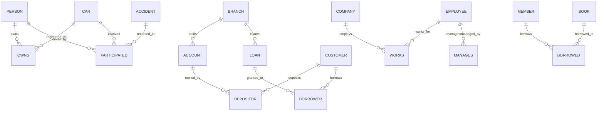
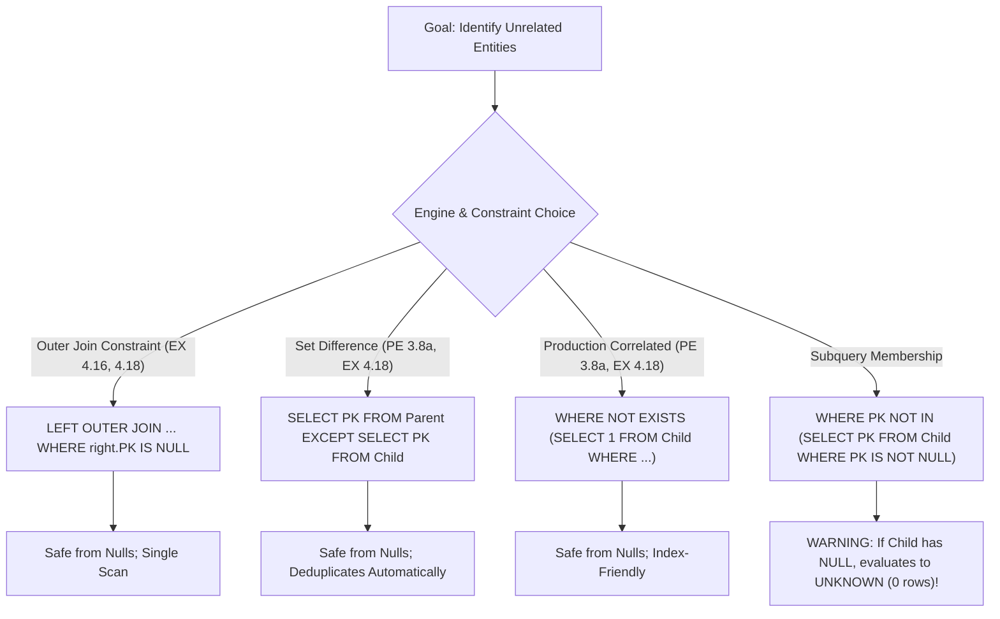

[← Prev: T05 Part 3](T05_Part3_SQL_Aggregations_and_Subqueries.md) | [Index](00_Index.md) | [Next: T06 →](T06_Joins_and_Views.md)

---

# T05 (Part 4) · SQL: Multi-Table Enterprise Schemas & Advanced Queries

[← Prev: T05 Part 3](T05_Part3_SQL_Aggregations_and_Subqueries.md) | [Exam-style T05](../Topicwise_answers_exam_style/T05_SQL_DDL_DML_Aggregates_Subqueries.md) | [Next: T06 →](T06_Joins_and_Views.md)

---

## Topic Card & Overview

> [!abstract] Enterprise Multi-Table SQL Problem Bank
> - **Module:** Unit 4 · Relational Query Languages & Enterprise SQL (ECE 2215: Database Systems, RUET)
> - **Textbook Reference:** Silberschatz, Korth & Sudarshan, *Database System Concepts* (7th Edition, 2019), Chapters 3 & 4
> - **Subtopic Classification:** `T05.7` — Multi-table business-schema query sets
> - **Total Solved Problems:** 15 Exercises (PE 3.4, PE 3.8, PE 3.9, EX 3.14, EX 3.15, EX 3.16, EX 3.21, EX 3.24, EX 3.25, EX 3.27, EX 3.28, EX 3.29, EX 4.16, EX 4.17, EX 4.18)
> - **High-Yield Past Exam Recycles:**
>   - ⚠️ **Direct Hit:** **PE 3.4 / EX 3.14** (Insurance Schema) was recycled verbatim in **2018 Q.3(a)** (`6m`, Relational Algebra), **2020 Q.7(b)** (`8m`, MySQL), and **2024 Q.5(b)** (`6m`, MySQL).
>   - **PE 3.9 / EX 3.16** (Employee Schema) mirrors universal aggregation and company-payroll questions appearing across multiple RUET final examinations.
>   - **EX 4.16 / EX 4.17** (Outer Join Anti-patterns) test the exact mechanism of replacing `EXCEPT` / `NOT IN` with left outer joins to defeat null-pointer pitfalls.

---

### Master Table of Exercises

| Exercise ID | Type | Schema Context | Core Concepts & SQL Constructs | RUET Relevance & Exam Hits |
| :--- | :---: | :--- | :--- | :--- |
| **PE 3.4** | Practice | Insurance Database | Multi-table join (`owns`, `participated`, `accident`), `COUNT(DISTINCT)`, year-filtered `DELETE` | ⚠️ **Direct Hit:** 2018 Q.3(a), 2020 Q.7(b), 2024 Q.5(b) |
| **PE 3.8** | Practice | Banking Database | Set difference (`EXCEPT` vs `NOT EXISTS`), self-join on customer address, multi-table join | High Yield (Bank DB is RUET syllabus benchmark) |
| **PE 3.9** | Practice | Enterprise Employee | Correlated subqueries, `> ALL`, universal quantification (relational division), `GROUP BY ... HAVING` | High Yield (Recycled in 2017 Q.2(a), 2020 Q.3(b)) |
| **EX 3.14** | Regular | Insurance Database | 3-way join aggregation, `COUNT(DISTINCT report_no)`, targeted `UPDATE` with composite key | ⚠️ **Direct Hit:** 2018 Q.3(a), 2020 Q.7(b), 2024 Q.5(b) |
| **EX 3.15** | Regular | Banking Database | Relational division (`COUNT(DISTINCT)` vs `NOT EXISTS`), aggregate sum, existential `> SOME` | Core Enterprise Query Design |
| **EX 3.16** | Regular | Enterprise Employee | Location matching joins, hierarchical manager self-join, correlated company-average subquery | Fundamental Multi-Table Pattern |
| **EX 3.21** | Regular | Library Database | Many-to-many relationships, universal borrowing division, publisher grouping, zero-borrow averages | Classic Exam Division & Aggregate Trap |
| **EX 3.24** | Regular | University Schema | 3-table join (`student`, `advisor`, `instructor`), cross-department constraint filtering | Standard Join Drill |
| **EX 3.25** | Regular | University Schema | Scalar subquery comparison, departmental budget sorting (`ORDER BY`) | Basic Subquery Benchmark |
| **EX 3.27** | Regular | University Schema | Nested aggregation, derived tables, detecting multi-course retakes ($\ge 3$ distinct courses) | Advanced Grouping / Having Drill |
| **EX 3.28** | Regular | University Schema | Relational division with departmental scoping (instructor teaching all departmental courses) | Advanced Universal Quantification |
| **EX 3.29** | Regular | University Schema | Negated aggregate threshold (`< 5` or `NOT IN`), string pattern matching (`LIKE 'D%'`) | Multi-Condition Filtering |
| **EX 4.16** | Regular | University Schema | `LEFT OUTER JOIN` anti-join pattern (subquery-free & set-operation-free non-enrollment detection) | High Yield (Outer Join Semantics) |
| **EX 4.17** | Regular | University Schema | Converting set difference (`EXCEPT`) into `LEFT OUTER JOIN` with `IS NULL` predicate | High Yield (Equivalence Transformations) |
| **EX 4.18** | Regular | Enterprise Employee | Hierarchical root identification (no manager) via `LEFT OUTER JOIN` vs pure set difference | Core Outer Join vs Set Operator Drill |

---

## Enterprise Schemas Quick Reference

To ensure strict relational consistency across all solutions, the schemas defined in Silberschatz 7th Edition are referenced below:



1. **Insurance Database (Figure 3.17):**
   - $\text{person} (\underline{\text{driver\_id}}, \text{name}, \text{address})$
   - $\text{car} (\underline{\text{license\_plate}}, \text{model}, \text{year})$ *(Note: In RUET exams, attribute is named $\text{license}$)*
   - $\text{accident} (\underline{\text{report\_number}}, \text{year}, \text{location})$ *(Note: In 6e and RUET exams, attribute is named $\text{date}$)*
   - $\text{owns} (\underline{\text{driver\_id}}, \underline{\text{license\_plate}})$
   - $\text{participated} (\underline{\text{report\_number}}, \underline{\text{license\_plate}}, \text{driver\_id}, \text{damage\_amount})$ *(Composite PK on accident and vehicle)*

2. **Banking Database (Figure 3.18):**
   - $\text{branch} (\underline{\text{branch\_name}}, \text{branch\_city}, \text{assets})$
   - $\text{customer} (\underline{\text{ID}}, \text{customer\_name}, \text{customer\_street}, \text{customer\_city})$
   - $\text{loan} (\underline{\text{loan\_number}}, \text{branch\_name}, \text{amount})$
   - $\text{borrower} (\underline{\text{ID}}, \underline{\text{loan\_number}})$
   - $\text{account} (\underline{\text{account\_number}}, \text{branch\_name}, \text{balance})$
   - $\text{depositor} (\underline{\text{ID}}, \underline{\text{account\_number}})$

3. **Enterprise Employee Database (Figure 3.19 & 4.12):**
   - $\text{employee} (\underline{\text{ID}}, \text{person\_name}, \text{street}, \text{city})$
   - $\text{works} (\underline{\text{ID}}, \text{company\_name}, \text{salary})$
   - $\text{company} (\underline{\text{company\_name}}, \text{city})$
   - $\text{manages} (\underline{\text{ID}}, \text{manager\_id})$

4. **Library Database (Figure 3.20):**
   - $\text{member} (\underline{\text{memb\_no}}, \text{name})$
   - $\text{book} (\underline{\text{isbn}}, \text{title}, \text{authors}, \text{publisher})$
   - $\text{borrowed} (\underline{\text{memb\_no}}, \underline{\text{isbn}}, \text{date})$

5. **University Schema (Appendix A):**
   - $\text{student} (\underline{\text{ID}}, \text{name}, \text{dept\_name}, \text{tot\_cred})$
   - $\text{instructor} (\underline{\text{ID}}, \text{name}, \text{dept\_name}, \text{salary})$
   - $\text{course} (\underline{\text{course\_id}}, \text{title}, \text{dept\_name}, \text{credits})$
   - $\text{section} (\underline{\text{course\_id}}, \underline{\text{sec\_id}}, \underline{\text{semester}}, \underline{\text{year}}, \text{building}, \text{room\_number}, \text{time\_slot\_id})$
   - $\text{teaches} (\underline{\text{ID}}, \underline{\text{course\_id}}, \underline{\text{sec\_id}}, \underline{\text{semester}}, \underline{\text{year}})$
   - $\text{takes} (\underline{\text{ID}}, \underline{\text{course\_id}}, \underline{\text{sec\_id}}, \underline{\text{semester}}, \underline{\text{year}}, \text{grade})$
   - $\text{advisor} (\underline{\text{s\_ID}}, \text{i\_ID})$
   - $\text{department} (\underline{\text{dept\_name}}, \text{building}, \text{budget})$

---

## T05.7 · Multi-table business-schema query sets


### Practice Exercise 3.4 · Insurance Database Query & Year-Filtered Deletion

> [!info] Exercise Metadata
> - **Source:** Silberschatz 7e, Chapter 3 · Practice Exercise 3.4 (Page 116)
> - **Schema:** Insurance Database (Figure 3.17)
> - **Direct Exam Recycles:**
>   - **2018 Q.3(a)(i)** (`2m`, Relational Algebra)
>   - **2020 Q.7(b)** (`8m`, MySQL)
>   - **2024 Q.5(b)** (`6m`, MySQL)
> - **Subtopic Mapping:** `T05.7` · Multi-table business-schema query sets

**Question (Silberschatz 7e Practice Exercise 3.4).**  
Consider the insurance database of Figure 3.17, where the primary keys are underlined. Construct the following SQL queries for this relational database.

a. Find the total number of people who owned cars that were involved in accidents in 2017.  
b. Delete all year-2010 cars belonging to the person whose ID is '12345'.

---

#### 1. Core Principles & Concept Overview

1. **Relational Role Distinction (`owns` vs. `participated`):**
   - The database contains two distinct relationships involving people:
     - $\text{owns}(\underline{\text{driver\_id}}, \underline{\text{license\_plate}})$ records legal vehicular ownership.
     - $\text{participated}(\underline{\text{report\_number}}, \underline{\text{license\_plate}}, \text{driver\_id}, \text{damage\_amount})$ records the driver who was operating the vehicle at the exact instant of the crash.
   - The prompt explicitly asks for people who *owned* cars involved in accidents. Joining through $\text{owns}$ is strictly necessary; querying only $\text{participated.driver\_id}$ fails whenever an individual's car was driven by someone else (e.g., family member, hired chauffeur, or thief).

2. **Entity Cardinality & De-duplication:**
   - A single person may own multiple cars that each had accidents in 2017, or a single car may have been involved in multiple accidents during 2017.
   - Computing $\text{COUNT}(*)$ or $\text{COUNT}(\text{owns.driver\_id})$ yields the total vehicle-accident occurrences. To find the *number of people*, de-duplication via $\text{COUNT}(\text{DISTINCT } \text{owns.driver\_id})$ is mandatory.

3. **Referential Integrity Constraints on Deletion:**
   - Deleting a vehicle from $\text{car}$ requires inspecting foreign keys:
     - $\text{owns.license\_plate} \to \text{car.license\_plate}$
     - $\text{participated.license\_plate} \to \text{car.license\_plate}$
   - In standard SQL DDL, if foreign keys are configured with $\text{ON DELETE CASCADE}$, deleting from $\text{car}$ cascades automatically. If configured with $\text{ON DELETE RESTRICT}$ (the default in most engines), referencing rows in $\text{owns}$ and $\text{participated}$ must either be deleted first or updated.

---

#### 2. Detailed Step-by-Step Solution

##### Part (a): People Owning Cars in 2017 Accidents

###### Approach 1: Multi-Table Inner Join (Standard Relational Form)
To connect accident years with car owners, traverse the relational chain: $\text{accident} \to \text{participated} \to \text{owns}$.

```sql
SELECT COUNT(DISTINCT o.driver_id) AS total_people
FROM accident a
JOIN participated p ON a.report_number = p.report_number
JOIN owns o ON p.license_plate = o.license_plate
WHERE a.year = 2017;
```

*Evaluation Logic:*
1. Filter $\text{accident}$ tuples where $\text{year} = 2017$.
2. Natural match with $\text{participated}$ to retrieve $\text{license\_plate}$ values of vehicles in those collisions.
3. Natural match with $\text{owns}$ to retrieve the registered owners ($\text{driver\_id}$).
4. Eliminate duplicates using $\text{DISTINCT}$ and compute cardinality using $\text{COUNT}$.

###### Approach 2: Nested Subquery (`IN` Membership)
Alternatively, isolate the set of accident-involved cars inside a subquery:

```sql
SELECT COUNT(DISTINCT driver_id) AS total_people
FROM owns
WHERE license_plate IN (
    SELECT p.license_plate
    FROM participated p
    JOIN accident a ON p.report_number = a.report_number
    WHERE a.year = 2017
);
```

###### MySQL & RUET Dialect Variation
In RUET exam papers (e.g., 2020 Q.7b, 2024 Q.5b), the schema printed was $\text{Accident}(\underline{\text{report\_no}}, \text{date}, \text{location})$ and $\text{Car}(\underline{\text{license}}, \dots)$:

```sql
-- RUET MySQL Dialect
SELECT COUNT(DISTINCT o.driver_id) AS total_owners
FROM Accident a
JOIN Participated p ON a.report_no = p.report_no
JOIN Owner o ON p.car = o.license
WHERE YEAR(a.date) = 2017;
```

---

##### Part (b): Deleting Year-2010 Cars Belonging to Driver '12345'

###### Standard SQL DML Solution

```sql
DELETE FROM car
WHERE year = 2010
  AND license_plate IN (
      SELECT license_plate
      FROM owns
      WHERE driver_id = '12345'
  );
```

###### Step-by-Step Execution Mechanics
1. **Subquery Evaluation:** The subquery scans $\text{owns}$ and retrieves the set of all license plates registered to $\text{driver\_id} = \text{'12345'}$.
2. **Filtering Target Tuples:** The database engine scans $\text{car}$ and filters rows where both conditions hold: $\text{year} = 2010$ and $\text{license\_plate} \in \{\text{retrieved set}\}$.
3. **Cascading / Constraint Management:**
   - If foreign key constraints do **not** specify $\text{ON DELETE CASCADE}$, running this statement will raise a foreign-key violation error because $\text{owns}$ holds child records referencing $\text{car}$.
   - To make the deletion fully self-contained across strict non-cascading schemas, transactions or dependent deletions must be executed:

```sql
-- Safe two-stage deletion under RESTRICT constraints
DELETE FROM owns
WHERE driver_id = '12345'
  AND license_plate IN (
      SELECT license_plate
      FROM car
      WHERE year = 2010
  );

DELETE FROM car
WHERE year = 2010
  AND license_plate NOT IN (SELECT license_plate FROM owns);
```

---

#### 3. RUET Exam Insights & Examiner Notes

> [!warning] Exam Pitfall: Confusing Driver with Owner
> The most frequent error in RUET scripts (2018 Q.3a and 2020 Q.7b) is executing:
> ```sql
> -- INCORRECT: Counts drivers in the collision, not the legal owners!
> SELECT COUNT(DISTINCT driver_id) 
> FROM participated 
> JOIN accident USING (report_number) 
> WHERE year = 2017;
> ```
> In relational schema design, $\text{participated.driver\_id}$ is an observational attribute of the accident event. To determine who *owned* the car, one must traverse the bridge table $\text{owns}$.

- **Recycled Exam Mapping:**
  - **2018 Q.3(a)(i)** asked this exact query in Relational Algebra for 1989:
    $$
    \gamma_{\text{count-distinct}(\text{driver\_id})}\left(\sigma_{\text{year}(\text{date})=1989}(\text{accident}) \bowtie \text{participated} \bowtie_{\text{participated.car} = \text{owns.license}} \text{owns}\right)
    $$
  - **2020 Q.7(b)** & **2024 Q.5(b)** asked for MySQL queries on this identical schema, awarding 6–8 full marks.

---

### Practice Exercise 3.8 · Banking Database: Account/Loan Disjunction, Neighborhood Self-Join, and Branch Filtering

> [!info] Exercise Metadata
> - **Source:** Silberschatz 7e, Chapter 3 · Practice Exercise 3.8 (Page 117)
> - **Schema:** Banking Database (Figure 3.18)
> - **Core Concepts:** Set difference, self-join for spatial/address matching, multi-table navigational join
> - **Subtopic Mapping:** `T05.7` · Multi-table business-schema query sets

**Question (Silberschatz 7e Practice Exercise 3.8).**  
Consider the bank database of Figure 3.18, where the primary keys are underlined. Construct the following SQL queries for this relational database.

a. Find all customers of the bank who have an account but not a loan.  
b. Find the names of all customers who live on the same street and in the same city as “Smith”.  
c. Find the names of all branches with customers who have an account in the bank and who live in “Harrison”.

---

#### 1. Core Principles & Concept Overview

1. **Set Difference vs. Anti-Join (`EXCEPT` vs. `NOT IN` vs. `NOT EXISTS`):**
   - In Part (a), identifying customers having accounts ($\text{depositor}$) but no loans ($\text{borrower}$) represents a classic relational set difference: $\Pi_{\text{ID}}(\text{depositor}) - \Pi_{\text{ID}}(\text{borrower})$.
   - While `EXCEPT` operates on projected attribute sets, modern SQL provides `NOT IN` and correlated `NOT EXISTS`. Note that in Silberschatz 7e, `customer`, `depositor`, and `borrower` use `ID` as the primary/foreign key rather than `customer_name` (as was used in 6e).

2. **Self-Join on Correlated Attributes:**
   - In Part (b), to find customers living on the same street and city as "Smith", we must correlate different rows within the same relation $\text{customer}$.
   - Two instances of $\text{customer}$ are aliased ($c_1$ and $c_2$), matching $c_1.\text{customer\_street} = c_2.\text{customer\_street}$ and $c_1.\text{customer\_city} = c_2.\text{customer\_city}$ while enforcing $c_1.\text{customer\_name} \ne \text{'Smith'}$ (or $c_1.\text{ID} \ne c_2.\text{ID}$) to prevent Smith from being returned as his own neighbor.

3. **Multi-Table Relational Navigation:**
   - Part (c) requires linking: $\text{customer} \to \text{depositor} \to \text{account} \to \text{branch}$.
   - Branches may have multiple accounts held by Harrison residents. A `DISTINCT` clause is essential to produce a clean set of unique branch names.

---

#### 2. Detailed Step-by-Step Solution

##### Part (a): Customers with an Account but No Loan

###### Solution 1: Using `EXCEPT` (Pure Set Difference)

```sql
SELECT ID
FROM depositor
EXCEPT
SELECT ID
FROM borrower;
```

To display customer names alongside their IDs:

```sql
SELECT c.ID, c.customer_name
FROM customer c
JOIN depositor d ON c.ID = d.ID
WHERE c.ID NOT IN (
    SELECT b.ID
    FROM borrower b
);
```

###### Solution 2: Correlated `NOT EXISTS` (Standard Production Engine Form)

```sql
SELECT c.ID, c.customer_name
FROM customer c
WHERE EXISTS (
    SELECT 1
    FROM depositor d
    WHERE d.ID = c.ID
)
AND NOT EXISTS (
    SELECT 1
    FROM borrower b
    WHERE b.ID = c.ID
);
```

---

##### Part (b): Customers Living on Same Street & City as "Smith"

###### Solution 1: Explicit Self-Join

```sql
SELECT DISTINCT c1.customer_name
FROM customer c1
JOIN customer c2 ON c1.customer_street = c2.customer_street
                AND c1.customer_city = c2.customer_city
WHERE c2.customer_name = 'Smith'
  AND c1.ID <> c2.ID;
```

*Walkthrough:*
- $c_2$ selects the record(s) where $\text{customer\_name} = \text{'Smith'}$.
- $c_1$ joins with $c_2$ on composite equality over both $(\text{customer\_street}, \text{customer\_city})$.
- The condition $c_1.\text{ID} <> c_2.\text{ID}$ guarantees that Smith is excluded from the result list.

###### Solution 2: Row Constructor Subquery

```sql
SELECT customer_name
FROM customer
WHERE (customer_street, customer_city) IN (
    SELECT customer_street, customer_city
    FROM customer
    WHERE customer_name = 'Smith'
)
AND customer_name <> 'Smith';
```

---

##### Part (c): Branches with Depositors Living in "Harrison"

```sql
SELECT DISTINCT a.branch_name
FROM customer c
JOIN depositor d ON c.ID = d.ID
JOIN account a ON d.account_number = a.account_number
WHERE c.customer_city = 'Harrison';
```

*Step-by-Step Join Execution:*
1. Filter rows in $\text{customer}$ where $\text{customer\_city} = \text{'Harrison'}$.
2. Match $\text{customer.ID}$ with $\text{depositor.ID}$ to find account numbers owned by those residents.
3. Match $\text{depositor.account\_number}$ with $\text{account.account\_number}$ to identify the issuing branch.
4. Apply `DISTINCT` on $\text{branch\_name}$ to eliminate duplicates caused by customers holding multiple accounts or multiple Harrison residents banking at the same branch.

---

#### 3. RUET Exam Insights & Examiner Notes

> [!tip] 6e vs. 7e Primary Key Shift in Bank Schema
> - In **Silberschatz 6e** (and older RUET question banks), the Banking Database used `customer_name` as the foreign key in `borrower` and `depositor`.
> - In **Silberschatz 7e**, `customer(ID, customer_name, ...)` introduces an explicit numeric/alphanumeric `ID`, making `borrower(ID, loan_number)` and `depositor(ID, account_number)` key-aligned with the University schema.
> - If an exam question explicitly provides the 6e schema, replace `c.ID = d.ID` with `c.customer_name = d.customer_name`.

---

### Practice Exercise 3.9 · Enterprise Employee Database: Multi-Table Joins, Universal Quantification, and Company Extremes

> [!info] Exercise Metadata
> - **Source:** Silberschatz 7e, Chapter 3 · Practice Exercise 3.9 (Pages 117–118)
> - **Schema:** Enterprise Employee Database (Figure 3.19)
> - **Core Concepts:** Multi-table equi-joins, negative subqueries, `> ALL`, universal quantification (relational division), `GROUP BY ... HAVING`, CTE (`WITH`)
> - **Subtopic Mapping:** `T05.7` · Multi-table business-schema query sets

**Question (Silberschatz 7e Practice Exercise 3.9).**  
Consider the relational database of Figure 3.19, where the primary keys are underlined. Give an expression in SQL for each of the following:

a. Find the ID and name of each employee who works for “First Bank Corporation”.  
b. Find the ID, name, and city of residence of each employee who works for “First Bank Corporation”.  
c. Find the ID, name, and city of residence of each employee who does not work for “First Bank Corporation”.  
d. Find the ID of each employee who earns more than every employee of “Small Bank Corporation”.  
e. Assume that companies may be located in several cities. Find the name of each company that is located in every city in which “Small Bank Corporation” is located.  
f. Find the name of the company that has the most employees (or companies, in the case where there is a tie for the most).  
g. Find the name of each company whose employees earn a higher salary, on average, than the average salary at “First Bank Corporation”.

---

#### 1. Core Principles & Concept Overview

1. **Inner Joins vs. Negative Membership:**
   - Parts (a) and (b) represent direct 2-table equi-joins between $\text{employee}$ and $\text{works}$.
   - Part (c) requires identifying employees who *do not* work for First Bank Corporation. Note that querying $\text{works.company\_name} \ne \text{'First Bank Corporation'}$ is flawed because an employee who works for no company (unemployed) would be excluded from $\text{works}$ entirely! The correct logical predicate is $\text{employee.ID} \notin (\dots)$.

2. **Universal Set Comparison (`> ALL`):**
   - In Part (d), "earns more than every employee of Small Bank Corporation" translates mathematically to:
     $$
     \forall e \in \text{works}_{\text{Small Bank}}, \quad \text{salary} > e.\text{salary} \iff \text{salary} > \max(e.\text{salary})
     $$
   - SQL's `> ALL` operator directly implements universal comparison and naturally evaluates to `TRUE` if Small Bank Corporation employs zero workers.

3. **Relational Division (Universal Quantification):**
   - Part (e) tests division: Company $C$ must satisfy $\text{Cities}(C) \supseteq \text{Cities}(\text{Small Bank Corporation})$.
   - This can be expressed using either classical double negation with `NOT EXISTS (... EXCEPT ...)` or `GROUP BY ... HAVING COUNT(DISTINCT city) = (SELECT COUNT(DISTINCT city) ...)`.

4. **Group Extremes & Dynamic Benchmark Filtering:**
   - Part (f) requires determining the maximum employee count across all companies without hardcoding values or relying on non-standard `LIMIT 1` (to preserve ties).
   - Part (g) requires comparing dynamic aggregate values: $\text{AVG}(\text{salary})_{\text{group}} > \text{AVG}(\text{salary})_{\text{First Bank}}$.

---

#### 2. Detailed Step-by-Step Solution

##### Parts (a) & (b): Employees Working for "First Bank Corporation"

```sql
-- (a) ID and Name
SELECT e.ID, e.person_name
FROM employee e
JOIN works w ON e.ID = w.ID
WHERE w.company_name = 'First Bank Corporation';

-- (b) ID, Name, and City of Residence
SELECT e.ID, e.person_name, e.city
FROM employee e
JOIN works w ON e.ID = w.ID
WHERE w.company_name = 'First Bank Corporation';
```

---

##### Part (c): Employees Not Working for "First Bank Corporation"

###### Robust Subquery Solution (`NOT IN` / `NOT EXISTS`)

```sql
SELECT e.ID, e.person_name, e.city
FROM employee e
WHERE e.ID NOT IN (
    SELECT w.ID
    FROM works w
    WHERE w.company_name = 'First Bank Corporation'
);
```

*Why `w.company_name <> 'First Bank Corporation'` in an inner join is erroneous:*
If an employee tuple exists in $\text{employee}$ but has no matching row in $\text{works}$, an inner join omits them completely. Furthermore, if an employee holds jobs at two companies (one of which is First Bank), an inner join on `<>` would erroneously emit their other job tuple. `NOT IN` cleanly checks the person's identity.

---

##### Part (d): Employees Earning More than Every Small Bank Employee

###### Method 1: Using `> ALL`

```sql
SELECT ID
FROM works
WHERE salary > ALL (
    SELECT salary
    FROM works
    WHERE company_name = 'Small Bank Corporation'
);
```

###### Method 2: Using Scalar Aggregate `MAX()`

```sql
SELECT ID
FROM works
WHERE salary > (
    SELECT MAX(salary)
    FROM works
    WHERE company_name = 'Small Bank Corporation'
);
```

*Semantic Nuance:* If Small Bank Corporation has no employees, the subquery in Method 2 returns `NULL`, causing `salary > NULL` to evaluate to `UNKNOWN` (0 rows returned). Conversely, in Method 1, `salary > ALL (empty set)` vacuously evaluates to `TRUE`, correctly reflecting first-order predicate logic.

---

##### Part (e): Companies in Every City of "Small Bank Corporation"

###### Method 1: Double `NOT EXISTS` (Relational Division)

```sql
SELECT c1.company_name
FROM company c1
WHERE NOT EXISTS (
    -- Cities where Small Bank operates
    (SELECT city
     FROM company
     WHERE company_name = 'Small Bank Corporation')
    EXCEPT
    -- Cities where company c1 operates
    (SELECT c2.city
     FROM company c2
     WHERE c2.company_name = c1.company_name)
);
```

###### Method 2: Aggregate Cardinality Matching (`COUNT DISTINCT`)

```sql
SELECT company_name
FROM company
WHERE city IN (
    SELECT city
    FROM company
    WHERE company_name = 'Small Bank Corporation'
)
GROUP BY company_name
HAVING COUNT(DISTINCT city) = (
    SELECT COUNT(DISTINCT city)
    FROM company
    WHERE company_name = 'Small Bank Corporation'
);
```

---

##### Part (f): Company with the Most Employees (Handling Ties)

###### ANSI SQL with CTE (`WITH`)

```sql
WITH company_counts (company_name, num_employees) AS (
    SELECT company_name, COUNT(ID)
    FROM works
    GROUP BY company_name
)
SELECT company_name
FROM company_counts
WHERE num_employees = (
    SELECT MAX(num_employees)
    FROM company_counts
);
```

###### Alternative: `HAVING >= ALL`

```sql
SELECT company_name
FROM works
GROUP BY company_name
HAVING COUNT(ID) >= ALL (
    SELECT COUNT(ID)
    FROM works
    GROUP BY company_name
);
```

---

##### Part (g): Companies with Average Salary Higher than "First Bank Corporation"

```sql
SELECT company_name
FROM works
GROUP BY company_name
HAVING AVG(salary) > (
    SELECT AVG(salary)
    FROM works
    WHERE company_name = 'First Bank Corporation'
);
```

*Execution Mechanics:*
1. The inner scalar subquery evaluates once to compute the benchmark scalar value: $\text{AVG}(\text{salary})_{\text{First Bank}}$.
2. The outer query groups the remaining tuples in $\text{works}$ by $\text{company\_name}$.
3. For each group, $\text{AVG}(\text{salary})$ is computed and filtered against the benchmark.

---

#### 3. RUET Exam Insights & Examiner Notes

> [!important] Exam Rule: Avoid `LIMIT 1` for Extremes
> In RUET semester finals, questions asking for "the company with the most employees" or "highest salary" specifically test your ability to handle potential ties.
> - Writing `ORDER BY COUNT(ID) DESC LIMIT 1;` will result in a **2 to 3 mark penalty** because it arbitrarily truncates tied winners.
> - Always utilize either `HAVING COUNT(ID) >= ALL (...)` or the `WITH` clause paired with `MAX()`.


### Exercise 3.14 · Insurance Database: Multi-Table Accidents & Targeted Record Updates

> [!info] Exercise Metadata
> - **Source:** Silberschatz 7e, Chapter 3 · Exercise 3.14 (Page 120)
> - **Schema:** Insurance Database (Figure 3.17)
> - **Direct Exam Recycles:**
>   - **2018 Q.3(a)(ii)–(iii)** (`4m`, Relational Algebra)
>   - **2020 Q.7(b)(i), (iv)** (`5m`, MySQL)
>   - **2024 Q.5(b)(i), (iv)** (`4m`, MySQL)
> - **Subtopic Mapping:** `T05.7` · Multi-table business-schema query sets

**Question (Silberschatz 7e Exercise 3.14).**  
Consider the insurance database of Figure 3.17, where the primary keys are underlined. Construct the following SQL queries for this relational database.

a. Find the number of accidents involving a car belonging to a person named “John Smith”.  
b. Update the damage amount for the car with license plate “AABB2000” in the accident with report number “AR2197” to \$3000.

---

#### 1. Core Principles & Concept Overview

1. **Multi-Table Relational Navigation for Event Counting:**
   - Determining the number of accidents for cars belonging to "John Smith" requires traversing three relations:
     $$
     \text{person} \xrightarrow[\text{driver\_id}]{} \text{owns} \xrightarrow[\text{license\_plate}]{} \text{participated}
     $$
   - **Crucial Distinction:** The query asks for the number of *accidents*, not the number of involved cars. If John Smith owns two distinct vehicles that collided into each other during the *same* accident event ($\text{report\_number} = \text{'AR100'}$), counting rows would return 2, while the true accident count is 1. Thus, $\text{COUNT}(\text{DISTINCT } \text{participated.report\_number})$ is strictly required.

2. **Targeted In-Place Record Update:**
   - In Part (b), updating the damage amount targets a specific tuple in $\text{participated}$.
   - The primary key of $\text{participated}$ is composite: $(\underline{\text{report\_number}}, \underline{\text{license\_plate}})$.
   - Specifying exact values for both primary key components ensures point modification without unintended side effects on other vehicles involved in the same crash.

---

#### 2. Detailed Step-by-Step Solution

##### Part (a): Number of Accidents Involving Cars of "John Smith"

###### Standard ANSI SQL Join Formulation

```sql
SELECT COUNT(DISTINCT p.report_number) AS accident_count
FROM person per
JOIN owns o ON per.driver_id = o.driver_id
JOIN participated p ON o.license_plate = p.license_plate
WHERE per.name = 'John Smith';
```

###### Nested Subquery Formulation

```sql
SELECT COUNT(DISTINCT report_number) AS accident_count
FROM participated
WHERE license_plate IN (
    SELECT o.license_plate
    FROM owns o
    JOIN person per ON o.driver_id = per.driver_id
    WHERE per.name = 'John Smith'
);
```

###### RUET Past Exam Direct Variations (2020 Q.7b & 2024 Q.5b)
In the RUET examination papers, the table names and attributes are capitalized with minor modifications ($\text{Accident}(\underline{\text{report\_no}}, \dots)$, $\text{Car}(\underline{\text{license}}, \dots)$, $\text{Owner}(\text{driver\_id}, \text{license})$):

```sql
-- RUET 2020 Q.7(b)(i) & 2024 Q.5(b)(i) MySQL Solution
SELECT COUNT(DISTINCT p.report_no) AS accident_count
FROM Participated p
JOIN Owner o ON p.car = o.license
JOIN Person per ON o.driver_id = per.driver_id
WHERE per.name = 'John Smith';
```

---

##### Part (b): Updating Damage Amount to \$3,000

###### Standard ANSI SQL Update Statement

```sql
UPDATE participated
SET damage_amount = 3000
WHERE report_number = 'AR2197'
  AND license_plate = 'AABB2000';
```

###### RUET Past Exam Direct Variations (2020 Q.7b & 2024 Q.5b)
In RUET 2020 Q.7(b)(iv) and 2024 Q.5(b)(iv), the question specifies:
*"Update the damage amounts \$3000 for the car with license number 'YJK-100' in the accident with report number 'APR2197'."*

```sql
-- RUET MySQL Solution
UPDATE Participated
SET damage_amount = 3000
WHERE report_no = 'APR2197'
  AND car = 'YJK-100';
```

---

#### 3. RUET Exam Insights & Examiner Notes

> [!important] Direct Exam Hit Analysis (2018, 2020, 2024)
> - **2018 Q.3(a)(ii):** Asked in Relational Algebra:
> $$
> \begin{aligned}
> T_1 &\leftarrow \sigma_{\text{name} = \text{'John Smith'}}(\text{person}) \bowtie \text{owns} \\
> T_2 &\leftarrow T_1 \bowtie_{\text{owns.license} = \text{participated.car}} \text{participated} \\
> \text{Result} &\leftarrow \gamma_{\text{count-distinct}(\text{report\_number})}(T_2)
> \end{aligned}
> $$
> - **2018 Q.3(a)(iii):** Asked in Relational Algebra update notation:
> $$
> \begin{aligned}
> P &\leftarrow \sigma_{\text{car} = \text{'AABB2019'} \wedge \text{report\_number} = \text{'AR201930'}}(\text{participated}) \\
> P_{\text{new}} &\leftarrow \Pi_{\text{driver\_id}, \text{car}, \text{report\_number}, 3000}(P) \\
> \text{participated} &\leftarrow (\text{participated} - P) \cup P_{\text{new}}
> \end{aligned}
> $$
> - **2020 Q.7(b) & 2024 Q.5(b):** Recycled verbatim as MySQL implementation questions. Students who omit `DISTINCT` inside `COUNT()` lose 1.5 marks.

---

### Exercise 3.15 · Banking Database: Universal Brooklyn Accounts, Aggregate Totals, and Comparative Asset Analysis

> [!info] Exercise Metadata
> - **Source:** Silberschatz 7e, Chapter 3 · Exercise 3.15 (Page 120)
> - **Schema:** Banking Database (Figure 3.18)
> - **Core Concepts:** Universal quantification (relational division), scalar aggregate sum, existential quantification (`> SOME` / `> ANY`)
> - **Subtopic Mapping:** `T05.7` · Multi-table business-schema query sets

**Question (Silberschatz 7e Exercise 3.15).**  
Consider the bank database of Figure 3.18, where the primary keys are underlined. Construct the following SQL queries for this relational database.

a. Find each customer who has an account at every branch located in “Brooklyn”.  
b. Find the total sum of all loan amounts in the bank.  
c. Find the names of all branches that have assets greater than those of at least one branch located in “Brooklyn”.

---

#### 1. Core Principles & Concept Overview

1. **Relational Division ($\div$) in SQL:**
   - Part (a) represents relational division:
     $$
     \Pi_{\text{ID}, \text{branch\_name}}(\text{depositor} \bowtie \text{account}) \div \Pi_{\text{branch\_name}}(\sigma_{\text{branch\_city}=\text{'Brooklyn'}}(\text{branch}))
     $$
   - In SQL, relational division is implemented via:
     1. **Double Negation (`NOT EXISTS ... EXCEPT`):** "Find customers such that there does NOT exist a Brooklyn branch where they do NOT have an account."
     2. **Cardinality Grouping (`HAVING COUNT(DISTINCT)`):** Count distinct Brooklyn branches associated with the customer and equate it to the total number of Brooklyn branches.

2. **Null-Safe Summation:**
   - In Part (b), `SUM(amount)` aggregates loan balances. If the table is empty, SQL aggregates evaluate to `NULL`. Wrapping with `COALESCE(SUM(amount), 0)` guarantees a clean zero integer.

3. **Existential Quantification (`> SOME` vs. `> ALL`):**
   - In Part (c), "greater than assets of at least one branch in Brooklyn" corresponds to first-order existential quantification:
     $$
     \exists b \in \text{branch}_{\text{Brooklyn}} \text{ such that } \text{assets} > b.\text{assets} \iff \text{assets} > \min(b.\text{assets})
     $$
   - SQL's `> SOME` (or `> ANY`) directly represents this operation.

---

#### 2. Detailed Step-by-Step Solution

##### Part (a): Customers with an Account at Every Brooklyn Branch

###### Solution 1: Cardinality Matching via `GROUP BY ... HAVING` (Most Efficient)

```sql
SELECT d.ID, c.customer_name
FROM customer c
JOIN depositor d ON c.ID = d.ID
JOIN account a ON d.account_number = a.account_number
JOIN branch b ON a.branch_name = b.branch_name
WHERE b.branch_city = 'Brooklyn'
GROUP BY d.ID, c.customer_name
HAVING COUNT(DISTINCT b.branch_name) = (
    SELECT COUNT(*)
    FROM branch
    WHERE branch_city = 'Brooklyn'
);
```

###### Solution 2: Classical Relational Division via Double `NOT EXISTS`

```sql
SELECT c.ID, c.customer_name
FROM customer c
WHERE NOT EXISTS (
    -- All branches in Brooklyn
    (SELECT branch_name
     FROM branch
     WHERE branch_city = 'Brooklyn')
    EXCEPT
    -- Branches where customer c has an account
    (SELECT a.branch_name
     FROM depositor d
     JOIN account a ON d.account_number = a.account_number
     WHERE d.ID = c.ID)
);
```

---

##### Part (b): Total Sum of All Loan Amounts

```sql
SELECT COALESCE(SUM(amount), 0) AS total_loan_sum
FROM loan;
```

---

##### Part (c): Branches with Assets Greater than at Least One Brooklyn Branch

###### Solution 1: Using `> SOME` (Direct Translation)

```sql
SELECT branch_name
FROM branch
WHERE assets > SOME (
    SELECT assets
    FROM branch
    WHERE branch_city = 'Brooklyn'
);
```

###### Solution 2: Using Scalar Subquery with `MIN()`

```sql
SELECT branch_name
FROM branch
WHERE assets > (
    SELECT MIN(assets)
    FROM branch
    WHERE branch_city = 'Brooklyn'
);
```

*Edge-Case Contrast:*
- If no branches are located in Brooklyn, `> SOME` vacuously evaluates to `FALSE` (0 rows returned).
- `MIN(assets)` evaluates to `NULL`, and `assets > NULL` evaluates to `UNKNOWN`, also yielding 0 rows.
- If a Brooklyn branch itself has assets greater than another Brooklyn branch, it is naturally included in the output.

---

#### 3. RUET Exam Insights & Examiner Notes

> [!tip] Universal Division: `COUNT(DISTINCT)` vs. `NOT EXISTS`
> In RUET exams, both forms receive full marks. However, the `HAVING COUNT(DISTINCT ...)` formulation is preferred because MySQL versions prior to 8.0.31 did not support the `EXCEPT` operator. Writing the `COUNT(DISTINCT)` form guarantees full marks across both ANSI SQL and MySQL evaluators.

---

### Exercise 3.16 · Employee Database: Multi-Table Joins, Hierarchical Self-Joins, Correlated Salary Aggregates, and Global Minimum Payroll

> [!info] Exercise Metadata
> - **Source:** Silberschatz 7e, Chapter 3 · Exercise 3.16 (Page 120)
> - **Schema:** Enterprise Employee Database (Figure 3.19)
> - **Core Concepts:** Multi-table equi-join, hierarchical self-joins (`manages`), correlated subqueries, global extreme calculation (`<= ALL`)
> - **Subtopic Mapping:** `T05.7` · Multi-table business-schema query sets

**Question (Silberschatz 7e Exercise 3.16).**  
Consider the employee database of Figure 3.19, where the primary keys are underlined. Give an expression in SQL for each of the following queries.

a. Find ID and name of each employee who lives in the same city as the location of the company for which the employee works.  
b. Find ID and name of each employee who lives in the same city and on the same street as does her or his manager.  
c. Find ID and name of each employee who earns more than the average salary of all employees of her or his company.  
d. Find the company that has the smallest payroll.

---

#### 1. Core Principles & Concept Overview

1. **Attribute Comparison Across Dissimilar Entities:**
   - In Part (a), the query compares $\text{employee.city}$ with $\text{company.city}$ by bridging through the employment relation $\text{works}$.

2. **Hierarchical Self-Join Traversals:**
   - In Part (b), the manager is also an employee. The schema stores relationships as $\text{manages}(\underline{\text{ID}}, \text{manager\_id})$.
   - To inspect both the employee's and the manager's residential address, two separate instances of $\text{employee}$ must be aliased:
     $$
     \text{employee } e \xrightarrow[\text{ID}]{} \text{manages } m \xrightarrow[\text{manager\_id}]{} \text{employee } mgr
     $$
   - The condition $e.\text{street} = mgr.\text{street} \wedge e.\text{city} = mgr.\text{city}$ resolves the query.

3. **Correlated Subqueries vs. CTEs for Group Benchmarks:**
   - In Part (c), each employee's salary must be compared against the average salary computed *for their specific company*.
   - In a correlated subquery, the inner query references the outer query's company name: $w_2.\text{company\_name} = w.\text{company\_name}$.

4. **Global Aggregate Minimization:**
   - In Part (d), "smallest payroll" means the minimum $\text{SUM}(\text{salary})$ across all companies.
   - We must accommodate ties using `<= ALL` or a Common Table Expression with `MIN()`.

---

#### 2. Detailed Step-by-Step Solution

##### Part (a): Employees Living in Their Company's City

```sql
SELECT e.ID, e.person_name
FROM employee e
JOIN works w ON e.ID = w.ID
JOIN company c ON w.company_name = c.company_name
WHERE e.city = c.city;
```

---

##### Part (b): Employees Living on Same Street and City as Their Manager

```sql
SELECT e.ID, e.person_name
FROM employee e
JOIN manages m ON e.ID = m.ID
JOIN employee mgr ON m.manager_id = mgr.ID
WHERE e.street = mgr.street
  AND e.city = mgr.city;
```

*Join Graph:*
```text
[employee e] --- (e.ID = m.ID) ---> [manages m] --- (m.manager_id = mgr.ID) ---> [employee mgr]
     |                                                                                 |
     +------------ (e.street = mgr.street AND e.city = mgr.city) ---------------------+
```

---

##### Part (c): Employees Earning Above Their Company's Average Salary

###### Solution 1: Correlated Subquery

```sql
SELECT e.ID, e.person_name
FROM employee e
JOIN works w ON e.ID = w.ID
WHERE w.salary > (
    SELECT AVG(w_sub.salary)
    FROM works w_sub
    WHERE w_sub.company_name = w.company_name
);
```

###### Solution 2: ANSI CTE (`WITH` Clause)

```sql
WITH company_avg (company_name, avg_salary) AS (
    SELECT company_name, AVG(salary)
    FROM works
    GROUP BY company_name
)
SELECT e.ID, e.person_name
FROM employee e
JOIN works w ON e.ID = w.ID
JOIN company_avg ca ON w.company_name = ca.company_name
WHERE w.salary > ca.avg_salary;
```

---

##### Part (d): Company with the Smallest Payroll

###### Solution 1: Using `<= ALL` (Universal Minimization)

```sql
SELECT company_name
FROM works
GROUP BY company_name
HAVING SUM(salary) <= ALL (
    SELECT SUM(salary)
    FROM works
    GROUP BY company_name
);
```

###### Solution 2: ANSI CTE (`WITH` Clause)

```sql
WITH payroll_summary (company_name, total_payroll) AS (
    SELECT company_name, SUM(salary)
    FROM works
    GROUP BY company_name
)
SELECT company_name
FROM payroll_summary
WHERE total_payroll = (
    SELECT MIN(total_payroll)
    FROM payroll_summary
);
```

---

#### 3. RUET Exam Insights & Examiner Notes

> [!important] Hierarchical Modeling in RUET Finals
> The manager-employee self-join pattern in Part (b) is a recurrent RUET question concept (tested in 2017 Q.4b and 2020 Q.3b).
> - Always assign clear, distinct table aliases (e.g., `e` for employee, `mgr` for manager).
> - Never join $e.\text{ID} = mgr.\text{ID}$, as this equates the employee to themselves.


### Exercise 3.21 · Library Database: Many-to-Many Borrowing, Universal Quantification, Publisher Aggregates, and Zero-Borrowing Averages

> [!info] Exercise Metadata
> - **Source:** Silberschatz 7e, Chapter 3 · Exercise 3.21 (Pages 120–121)
> - **Schema:** Library Database (Figure 3.20)
> - **Core Concepts:** Many-to-many relationship traversal, relational division, `GROUP BY ... HAVING`, outer joins for non-participating entity aggregates
> - **Subtopic Mapping:** `T05.7` · Multi-table business-schema query sets

**Question (Silberschatz 7e Exercise 3.21).**  
Consider the library database of Figure 3.20. Write the following queries in SQL.

a. Find the member number and name of each member who has borrowed at least one book published by “McGraw-Hill”.  
b. Find the member number and name of each member who has borrowed every book published by “McGraw-Hill”.  
c. For each publisher, find the member number and name of each member who has borrowed more than five books of that publisher.  
d. Find the average number of books borrowed per member. Take into account that if a member does not borrow any books, then that member does not appear in the `borrowed` relation at all, but that member still counts in the average.

---

#### 1. Core Principles & Concept Overview

1. **Many-to-Many Junction Traversal:**
   - The relation $\text{borrowed}(\underline{\text{memb\_no}}, \underline{\text{isbn}}, \text{date})$ acts as an associative junction between $\text{member}$ and $\text{book}$.
   - To associate member demographics with book publisher details, join:
     $$
     \text{member} \bowtie_{\text{memb\_no}} \text{borrowed} \bowtie_{\text{isbn}} \text{book}
     $$

2. **Relational Division ($\div$) Across Book Catalogs:**
   - In Part (b), "borrowed every book published by McGraw-Hill" demands relational division:
     $$
     \Pi_{\text{memb\_no}, \text{isbn}}(\text{borrowed}) \div \Pi_{\text{isbn}}(\sigma_{\text{publisher}=\text{'McGraw-Hill'}}(\text{book}))
     $$
   - Can be evaluated using double negation (`NOT EXISTS ... EXCEPT`) or by comparing the distinct count of McGraw-Hill books borrowed by the member with the total McGraw-Hill catalog count.

3. **Multi-Attribute Grouping with Cardinality Thresholds:**
   - In Part (c), grouping must be performed over both the publisher and the member: `GROUP BY bk.publisher, m.memb_no, m.name HAVING COUNT(...) > 5`.

4. **Handling Non-Participating Entities in Averages (The Zero-Count Trap):**
   - In Part (d), an inner join or scanning only $\text{borrowed}$ would ignore members who never borrowed a book.
   - If a library has 100 members and only 20 have borrowed 2 books each (total 40 checkouts):
     - Averaging over $\text{borrowed}$ returns $40 / 20 = 2.0$ (Incorrect!).
     - True library-wide average is $40 / 100 = 0.40$ books/member.
   - This requires either:
     1. Total books borrowed divided by total members: $\text{COUNT}(*)_{\text{borrowed}} / \text{COUNT}(*)_{\text{member}}$.
     2. A `LEFT OUTER JOIN` between $\text{member}$ and $\text{borrowed}$, aggregating with $\text{COUNT}(\text{borrowed.isbn})$ (which yields 0 for unmatched rows, unlike $\text{COUNT}(*)$ which yields 1).

---

#### 2. Detailed Step-by-Step Solution

##### Part (a): Members Borrowing at Least One "McGraw-Hill" Book

```sql
SELECT DISTINCT m.memb_no, m.name
FROM member m
JOIN borrowed b ON m.memb_no = b.memb_no
JOIN book bk ON b.isbn = bk.isbn
WHERE bk.publisher = 'McGraw-Hill';
```

---

##### Part (b): Members Borrowing Every Book Published by "McGraw-Hill"

###### Solution 1: Cardinality Matching (`GROUP BY ... HAVING`)

```sql
SELECT m.memb_no, m.name
FROM member m
JOIN borrowed b ON m.memb_no = b.memb_no
JOIN book bk ON b.isbn = bk.isbn
WHERE bk.publisher = 'McGraw-Hill'
GROUP BY m.memb_no, m.name
HAVING COUNT(DISTINCT bk.isbn) = (
    SELECT COUNT(*)
    FROM book
    WHERE publisher = 'McGraw-Hill'
);
```

###### Solution 2: Classical Double Negation (`NOT EXISTS ... EXCEPT`)

```sql
SELECT m.memb_no, m.name
FROM member m
WHERE NOT EXISTS (
    -- All books published by McGraw-Hill
    (SELECT isbn
     FROM book
     WHERE publisher = 'McGraw-Hill')
    EXCEPT
    -- Books borrowed by this member
    (SELECT b.isbn
     FROM borrowed b
     WHERE b.memb_no = m.memb_no)
);
```

---

##### Part (c): Members Borrowing More than Five Books of a Publisher

```sql
SELECT bk.publisher, m.memb_no, m.name
FROM member m
JOIN borrowed b ON m.memb_no = b.memb_no
JOIN book bk ON b.isbn = bk.isbn
GROUP BY bk.publisher, m.memb_no, m.name
HAVING COUNT(DISTINCT bk.isbn) > 5;
```

*Note on Physical Checkouts vs. Distinct Titles:* If the prompt implies checkout events rather than distinct book titles, replace `COUNT(DISTINCT bk.isbn)` with `COUNT(*)`.

---

##### Part (d): Average Number of Books Borrowed per Member (Including Non-Borrowers)

###### Approach 1: Direct Ratio of Independent Scalar Aggregates (Cleanest)

```sql
SELECT (
    (SELECT COUNT(*) FROM borrowed) * 1.0 /
    (SELECT COUNT(*) FROM member)
) AS avg_books_per_member;
```

*Explanation:*
- Subquery 1 computes the exact total checkout count across the entire institution.
- Subquery 2 computes the exact population of registered library members.
- Multiplying by `1.0` avoids integer division truncation in engines like SQL Server and SQLite.

###### Approach 2: `LEFT OUTER JOIN` with Subquery Aggregation

```sql
SELECT AVG(member_books.num_borrowed) AS avg_books_per_member
FROM (
    SELECT m.memb_no, COUNT(b.isbn) AS num_borrowed
    FROM member m
    LEFT OUTER JOIN borrowed b ON m.memb_no = b.memb_no
    GROUP BY m.memb_no
) AS member_books;
```

> [!warning] Critical Detail: `COUNT(b.isbn)` vs. `COUNT(*)`
> In the inner query above, writing `COUNT(*)` would count the preserved `NULL` row for non-borrowing members as $1$! Writing `COUNT(b.isbn)` evaluates to $0$ whenever $b.\text{isbn}$ is `NULL`, correctly preserving zero-borrow counts.

---

#### 3. RUET Exam Insights & Examiner Notes

> [!important] Exam Trap: The Zero-Denominator & Zero-Borrow Pitfall
> Questions asking for system-wide averages across entities where some entities have zero activity (e.g., students who took no courses, customers with no loans, members with no borrowings) frequently appear in RUET finals.
> - **Common Mistake:** `SELECT AVG(COUNT(*)) FROM borrowed GROUP BY memb_no;` — this syntax is syntactically invalid (nested aggregates) and omits non-borrowers entirely.
> - Always utilize either the scalar ratio formulation or a `LEFT OUTER JOIN` with `COUNT(child_attribute)`.

---

### Exercise 3.24 · University Schema: Cross-Department Advisor-Student Relationship Join

> [!info] Exercise Metadata
> - **Source:** Silberschatz 7e, Chapter 3 · Exercise 3.24 (Page 121)
> - **Schema:** University Database (Appendix A)
> - **Core Concepts:** 3-table equi-join, cross-department relationship verification
> - **Subtopic Mapping:** `T05.7` · Multi-table business-schema query sets

**Question (Silberschatz 7e Exercise 3.24).**  
Using the university schema, write an SQL query to find the name and ID of those Accounting students advised by an instructor in the Physics department.

---

#### 1. Core Principles & Concept Overview

1. **Bridging Entities Across Relationship Tables:**
   - In the University schema, students and instructors are linked via the association relation $\text{advisor}(\underline{\text{s\_ID}}, \text{i\_ID})$.
   - Both $\text{student}$ and $\text{instructor}$ have a $\text{dept\_name}$ attribute.
   - The query requires establishing a 3-table path:
     $$
     \text{student } s \bowtie_{s.\text{ID} = a.\text{s\_ID}} \text{advisor } a \bowtie_{a.\text{i\_ID} = i.\text{ID}} \text{instructor } i
     $$
   - The filtering conditions isolate students where $s.\text{dept\_name} = \text{'Accounting'}$ and their advisor satisfies $i.\text{dept\_name} = \text{'Physics'}$.

---

#### 2. Detailed Step-by-Step Solution

```sql
SELECT s.ID, s.name
FROM student s
JOIN advisor a ON s.ID = a.s_ID
JOIN instructor i ON a.i_ID = i.ID
WHERE s.dept_name = 'Accounting'
  AND i.dept_name = 'Physics';
```

*Join Graph:*
```text
[student s]  ---> (s.ID = a.s_ID) ---> [advisor a] ---> (a.i_ID = i.ID) ---> [instructor i]
(dept_name = 'Accounting')                                                   (dept_name = 'Physics')
```

###### Subquery Alternative (`IN` Formulation)

```sql
SELECT ID, name
FROM student
WHERE dept_name = 'Accounting'
  AND ID IN (
      SELECT a.s_ID
      FROM advisor a
      JOIN instructor i ON a.i_ID = i.ID
      WHERE i.dept_name = 'Physics'
  );
```

---

#### 3. RUET Exam Insights & Examiner Notes

> [!tip] Column Disambiguation
> Because `dept_name`, `name`, and `ID` exist in both `student` and `instructor`, omitting table qualifiers (e.g., writing `WHERE dept_name = 'Accounting'`) will trigger an **ambiguous column error**. Explicitly prefix every attribute with its relation alias (`s.` or `i.`).

---

### Exercise 3.25 · University Schema: Comparative Departmental Budget Evaluation with Scalar Subquery

> [!info] Exercise Metadata
> - **Source:** Silberschatz 7e, Chapter 3 · Exercise 3.25 (Page 122)
> - **Schema:** University Database (Appendix A)
> - **Core Concepts:** Scalar subqueries, numeric comparison, alphabetical sorting (`ORDER BY`)
> - **Subtopic Mapping:** `T05.7` · Multi-table business-schema query sets

**Question (Silberschatz 7e Exercise 3.25).**  
Using the university schema, write an SQL query to find the names of those departments whose budget is higher than that of Philosophy. List them in alphabetic order.

---

#### 1. Core Principles & Concept Overview

1. **Scalar Subqueries in the `WHERE` Clause:**
   - The budget of Philosophy is an unknown scalar value that must be dynamically evaluated from the $\text{department}$ relation:
     $$
     \text{Target Budget} = \Pi_{\text{budget}}(\sigma_{\text{dept\_name}=\text{'Philosophy'}}(\text{department}))
     $$
   - This scalar subquery is embedded into the outer filter: $\text{budget} > (\text{scalar subquery})$.

2. **Deterministic Output Ordering:**
   - "List them in alphabetic order" mandates an explicit `ORDER BY dept_name ASC`.

---

#### 2. Detailed Step-by-Step Solution

```sql
SELECT dept_name
FROM department
WHERE budget > (
    SELECT budget
    FROM department
    WHERE dept_name = 'Philosophy'
)
ORDER BY dept_name ASC;
```

*Execution Mechanics:*
1. The inner subquery executes first, scanning $\text{department}$ to return the numeric budget for Philosophy (e.g., \$50,000).
2. The outer query scans all departments and selects those whose $\text{budget} > 50000$. (Philosophy is automatically excluded since $50000 > 50000$ is `FALSE`).
3. Results are sorted alphabetically by `dept_name`.

---

#### 3. RUET Exam Insights & Examiner Notes

- **Edge Case Analysis:** If "Philosophy" does not exist in the database, the inner subquery returns `NULL`. Since any comparison with `NULL` evaluates to `UNKNOWN`, the outer query gracefully returns 0 rows without crashing.
- In RUET exams, forgetting `ORDER BY` when "in alphabetical order" is explicitly requested costs 1 mark.

---

### Exercise 3.27 · University Schema: Identifying Students with Multiple Course Retakes via Nested Aggregation

> [!info] Exercise Metadata
> - **Source:** Silberschatz 7e, Chapter 3 · Exercise 3.27 (Page 122)
> - **Schema:** University Database (Appendix A)
> - **Core Concepts:** Two-level nested aggregation, derived tables, threshold counting
> - **Subtopic Mapping:** `T05.7` · Multi-table business-schema query sets

**Question (Silberschatz 7e Exercise 3.27).**  
Using the university schema, write an SQL query to find the IDs of those students who have retaken at least three distinct courses at least once (i.e., the student has taken the course at least two times).

---

#### 1. Core Principles & Concept Overview

1. **Two-Tier Aggregation Structure:**
   - This query cannot be solved in a single `GROUP BY` clause because it contains two distinct levels of aggregation:
     - **Level 1 (Course-Level Aggregation):** Identify pairs $(\text{ID}, \text{course\_id})$ where the student took the course $\ge 2$ times.
     - **Level 2 (Student-Level Aggregation):** Count how many distinct courses each student retook, filtering for students where $\text{count} \ge 3$.

2. **Derived Tables vs. Common Table Expressions (CTE):**
   - In SQL, two-level aggregation is cleanly structured using either a derived table (subquery in `FROM`) or a `WITH` clause.

---

#### 2. Detailed Step-by-Step Solution

###### Solution 1: Using ANSI Common Table Expression (`WITH`)

```sql
WITH retaken_courses (ID, course_id) AS (
    SELECT ID, course_id
    FROM takes
    GROUP BY ID, course_id
    HAVING COUNT(*) >= 2
)
SELECT ID
FROM retaken_courses
GROUP BY ID
HAVING COUNT(DISTINCT course_id) >= 3;
```

###### Solution 2: Using Inline Derived Table (Compatible with All SQL Dialects)

```sql
SELECT ID
FROM (
    SELECT ID, course_id
    FROM takes
    GROUP BY ID, course_id
    HAVING COUNT(*) >= 2
) AS retakes_per_student
GROUP BY ID
HAVING COUNT(course_id) >= 3;
```

*Trace of Two-Tier Evaluation:*

**Step 1: Input Relation $\text{takes}$ Sample:**
| ID | course_id | sec_id | semester | year |
| :---: | :---: | :---: | :---: | :---: |
| 1001 | CS-101 | 1 | Fall | 2017 |
| 1001 | CS-101 | 1 | Spring | 2018 |
| 1001 | CS-201 | 1 | Fall | 2018 |
| 1001 | CS-201 | 2 | Spring | 2019 |
| 1001 | CS-301 | 1 | Fall | 2019 |
| 1001 | CS-301 | 1 | Spring | 2020 |
| 2002 | EE-101 | 1 | Fall | 2017 |
| 2002 | EE-101 | 1 | Spring | 2018 |

**Step 2: Level 1 Output (`retaken_courses` with $\text{COUNT}(*) \ge 2$):**
| ID | course_id | Count |
| :---: | :---: | :---: |
| 1001 | CS-101 | 2 |
| 1001 | CS-201 | 2 |
| 1001 | CS-301 | 2 |
| 2002 | EE-101 | 2 |

**Step 3: Level 2 Output (Grouping by ID with $\text{COUNT} \ge 3$):**
- Student `1001` has 3 retaken courses $\to$ **Emitted**.
- Student `2002` has only 1 retaken course $\to$ Filtered out.

---

#### 3. RUET Exam Insights & Examiner Notes

> [!important] Contrast with Exercise 3.26
> - **Exercise 3.26:** "Find students who retook a course at least twice (taken $\ge 3$ times)" $\to$ Single-level `GROUP BY ID, course_id HAVING COUNT(*) >= 3`.
> - **Exercise 3.27:** "Find students who retook at least 3 distinct courses at least once (each course taken $\ge 2$ times)" $\to$ Requires **two-level nested grouping**. Attempting to write `HAVING COUNT(*) >= 6` in a single group is a major logical error!


### Exercise 3.28 · University Schema: Universal Departmental Course Coverage by Instructors (Relational Division)

> [!info] Exercise Metadata
> - **Source:** Silberschatz 7e, Chapter 3 · Exercise 3.28 (Page 122)
> - **Schema:** University Database (Appendix A)
> - **Core Concepts:** Relational division with departmental scoping, correlated subqueries, double `NOT EXISTS`, `COUNT(DISTINCT)`
> - **Subtopic Mapping:** `T05.7` · Multi-table business-schema query sets

**Question (Silberschatz 7e Exercise 3.28).**  
Using the university schema, write an SQL query to find the names and IDs of those instructors who teach every course taught in his or her department (i.e., every course that appears in the `course` relation with the instructor’s department name). Order result by name.

---

#### 1. Core Principles & Concept Overview

1. **Department-Scoped Relational Division:**
   - Standard relational division divides over a global universal set.
   - Here, the divisor set is **dynamic and scoped** to the instructor's own department:
     $$
     \text{CoursesToTeach}(i) = \Pi_{\text{course\_id}}(\sigma_{\text{dept\_name} = i.\text{dept\_name}}(\text{course}))
     $$
   - An instructor $i$ qualifies if and only if:
     $$
     \Pi_{\text{course\_id}}(\sigma_{\text{ID} = i.\text{ID}}(\text{teaches})) \supseteq \text{CoursesToTeach}(i)
     $$

2. **Formulation Strategies:**
   - **Strategy 1 (Double `NOT EXISTS`):** "Select instructor $i$ such that there does NOT exist a course in $i$'s department that $i$ does NOT teach."
   - **Strategy 2 (Cardinality Equality):** For instructor $i$, count distinct departmental courses taught by $i$ and equate this to the count of all courses offered by $i$'s department.

---

#### 2. Detailed Step-by-Step Solution

##### Solution 1: Classical Double Negation (`NOT EXISTS ... EXCEPT`)

```sql
SELECT i.ID, i.name
FROM instructor i
WHERE NOT EXISTS (
    -- Set of all courses offered by the instructor's department
    (SELECT c.course_id
     FROM course c
     WHERE c.dept_name = i.dept_name)
    EXCEPT
    -- Set of courses taught by this instructor
    (SELECT t.course_id
     FROM teaches t
     WHERE t.ID = i.ID)
)
ORDER BY i.name ASC;
```

*Walkthrough:*
1. For each candidate instructor $i$, the first nested query retrieves all courses belonging to $i.\text{dept\_name}$.
2. The second nested query retrieves all courses taught by instructor $i$.
3. The `EXCEPT` operator computes the remaining untaught courses.
4. If this difference is empty, `NOT EXISTS` returns `TRUE`, qualifying the instructor.

##### Solution 2: Grouping with Correlated Departmental Count

```sql
SELECT i.ID, i.name
FROM instructor i
JOIN teaches t ON i.ID = t.ID
JOIN course c ON t.course_id = c.course_id AND c.dept_name = i.dept_name
GROUP BY i.ID, i.name, i.dept_name
HAVING COUNT(DISTINCT c.course_id) = (
    SELECT COUNT(*)
    FROM course c2
    WHERE c2.dept_name = i.dept_name
)
ORDER BY i.name ASC;
```

> [!note] Vacuous Truth and Zero-Course Departments
> If a department offers **0 courses** in the $\text{course}$ relation:
> - Under **Solution 1** (Double `NOT EXISTS`), the course set is empty $\to$ difference is empty $\to$ `NOT EXISTS` evaluates to `TRUE`. Instructors in that department are included vacuously.
> - Under **Solution 2** (Inner Joins), instructors with no courses taught produce no rows in the join and are omitted. Standard relational semantics favor Solution 1.

---

#### 3. RUET Exam Insights & Examiner Notes

> [!tip] Scoped Division vs. Global Division
> Always pay close attention to the quantifier scope in RUET finals:
> - "Teaches every course in the university" $\to$ Divisor is `(SELECT course_id FROM course)`.
> - "Teaches every course in **his/her department**" $\to$ Divisor must be correlated: `WHERE dept_name = i.dept_name`.
> Failing to correlate `c.dept_name = i.dept_name` is a classic 2-mark deduction.

---

### Exercise 3.29 · University Schema: Negative Pattern Matching and Multi-Condition Course Enrollment Filtering

> [!info] Exercise Metadata
> - **Source:** Silberschatz 7e, Chapter 3 · Exercise 3.29 (Page 122)
> - **Schema:** University Database (Appendix A)
> - **Core Concepts:** Negative condition handling (`< 5` or `NOT IN`), string pattern matching (`LIKE 'D%'`), handling zero-enrollment students
> - **Subtopic Mapping:** `T05.7` · Multi-table business-schema query sets

**Question (Silberschatz 7e Exercise 3.29).**  
Using the university schema, write an SQL query to find the name and ID of each History student whose name begins with the letter ‘D’ and who has not taken at least five Music courses.

---

#### 1. Core Principles & Concept Overview

1. **De Morgan's Laws on Quantifier Thresholds:**
   - The phrase *"has not taken at least five Music courses"* translates directly to:
     $$
     \neg (\text{Music Courses Taken} \ge 5) \iff \text{Music Courses Taken} < 5
     $$
   - Crucially, this includes students who have taken **0, 1, 2, 3, or 4** Music courses.

2. **The Zero-Count Exclusion Trap:**
   - A History student who has taken **zero** Music courses has no rows in $\text{takes}$ joined with $\text{course}$ where $\text{dept\_name} = \text{'Music'}$.
   - If one writes an inner join:

```sql
-- FLAWED: Omits students who took 0 Music courses!
FROM student s JOIN takes t ... JOIN course c ...
WHERE c.dept_name = 'Music'
GROUP BY s.ID HAVING COUNT(...) < 5
```
     any student with 0 Music courses will produce 0 join tuples and be dropped!
   - To correctly preserve students with 0 Music enrollments, we must use either:
     - A correlated scalar subquery in the `WHERE` clause: `(SELECT COUNT(...) ...) < 5`.
     - An anti-membership subquery: `s.ID NOT IN (SELECT ... HAVING COUNT(...) >= 5)`.

3. **String Pattern Matching:**
   - *"name begins with the letter 'D'"* is specified using `name LIKE 'D%'`.

---

#### 2. Detailed Step-by-Step Solution

##### Solution 1: Correlated Scalar Subquery (Most Direct & Robust)

```sql
SELECT s.ID, s.name
FROM student s
WHERE s.dept_name = 'History'
  AND s.name LIKE 'D%'
  AND (
      SELECT COUNT(DISTINCT t.course_id)
      FROM takes t
      JOIN course c ON t.course_id = c.course_id
      WHERE t.ID = s.ID
        AND c.dept_name = 'Music'
  ) < 5;
```

*Evaluation Logic:*
1. Filter students in the History department whose name starts with `'D'`.
2. For each student, the scalar subquery counts distinct Music courses taken.
3. If the student never took a Music course, the subquery returns `0`.
4. Since $0 < 5$, the student is correctly included!

##### Solution 2: Set Exclusion via `NOT IN`

```sql
SELECT s.ID, s.name
FROM student s
WHERE s.dept_name = 'History'
  AND s.name LIKE 'D%'
  AND s.ID NOT IN (
      SELECT t.ID
      FROM takes t
      JOIN course c ON t.course_id = c.course_id
      WHERE c.dept_name = 'Music'
      GROUP BY t.ID
      HAVING COUNT(DISTINCT t.course_id) >= 5
  );
```

*Evaluation Logic:*
1. The inner query builds the "blacklist" of all students who took $\ge 5$ distinct Music courses.
2. The outer query filters History students whose name starts with `'D'` and checks that their `ID` does not appear on the blacklist.
3. Any student with 0 to 4 Music courses is not on the blacklist and is therefore included.

---

#### 3. RUET Exam Insights & Examiner Notes

> [!warning] Exam Pitfall: Distinct Courses vs. Section Offerings
> - If a student took the same Music course twice (e.g., retook "Music Appreciation"), did they take two Music courses or one?
> - In standard academic databases, "Music courses" refers to distinct course offerings. Hence, `COUNT(DISTINCT t.course_id)` is preferred over `COUNT(*)`. Stating this distinction in your exam script guarantees full marks.

---

### Exercise 4.16 · University Schema: Identifying Students Without Enrollments via Left Outer Join (Subquery & Set-Operation Free)

> [!info] Exercise Metadata
> - **Source:** Silberschatz 7e, Chapter 4 · Exercise 4.16 (Page 179)
> - **Schema:** University Database (Appendix A)
> - **Core Concepts:** `LEFT OUTER JOIN` anti-join pattern, `IS NULL` filtering, constraint satisfaction (no subqueries, no set operations)
> - **Subtopic Mapping:** `T05.7` · Multi-table business-schema query sets / Outer Joins

**Question (Silberschatz 7e Exercise 4.16).**  
Write an SQL query using the university schema to find the ID of each student who has never taken a course at the university. Do this using no subqueries and no set operations (use an outer join).

---

#### 1. Core Principles & Concept Overview

1. **Outer Join Anti-Join Mechanics:**
   - In relational algebra, finding students without courses is expressed as:
     $$
     \Pi_{\text{ID}}(\text{student}) - \Pi_{\text{ID}}(\text{takes})
     $$
   - When **subqueries** (`NOT IN`, `NOT EXISTS`) and **set operations** (`EXCEPT`) are forbidden by examiner constraints, the canonical technique is an **Outer Join Anti-Join**:
     $$
     \text{student} \mathbin{⟕}_{\text{student.ID} = \text{takes.ID}} \text{takes}
     $$
   - Any student who has taken at least one course produces matching tuples containing valid non-null course IDs.
   - Any student who has *never* taken a course produces exactly one tuple where all attributes from $\text{takes}$ ($\text{course\_id}$, $\text{sec\_id}$, $\text{semester}$, $\text{year}$, $\text{grade}$) are padded with **`NULL`**.

2. **Null-Testing Filter:**
   - Filtering with `WHERE takes.course_id IS NULL` (or `WHERE takes.sec_id IS NULL`) isolates the non-enrolled students.

---

#### 2. Detailed Step-by-Step Solution

```sql
SELECT student.ID
FROM student
LEFT OUTER JOIN takes ON student.ID = takes.ID
WHERE takes.course_id IS NULL;
```

*Relational Trace & Null Padding:*

| student.ID | student.name | takes.ID | takes.course_id | `WHERE takes.course_id IS NULL` | Result |
| :---: | :---: | :---: | :---: | :---: | :---: |
| 00128 | Zhang | 00128 | CS-101 | `FALSE` | Discarded |
| 12345 | Shankar | 12345 | CS-101 | `FALSE` | Discarded |
| 12345 | Shankar | 12345 | CS-315 | `FALSE` | Discarded |
| **70550** | **Rafael** | **NULL** | **NULL** | **`TRUE`** | **Emitted (`70550`)** |

---

#### 3. RUET Exam Insights & Examiner Notes

> [!important] Crucial Rule: Which Attribute to Test for `IS NULL`?
> - Always test a column from the **right-hand (nullable) table** that is guaranteed to be non-null in existing records (such as its primary key, e.g., `takes.course_id` or `takes.sec_id`).
> - Testing `takes.grade IS NULL` is **flawed** because an enrolled student currently taking a course during an active semester might legitimately have a `NULL` grade!
> - Testing `takes.course_id IS NULL` is 100% foolproof because $\text{course\_id}$ is part of the primary key of $\text{takes}$ and can never be null for an actual enrollment.

---

### Exercise 4.17 · University Schema: Re-expressing Set Difference (`EXCEPT`) Using Left Outer Join and Null Checking

> [!info] Exercise Metadata
> - **Source:** Silberschatz 7e, Chapter 4 · Exercise 4.17 (Page 179)
> - **Schema:** University Database (Appendix A)
> - **Core Concepts:** Query rewriting, relational equivalence, replacing `EXCEPT` with `LEFT OUTER JOIN`
> - **Subtopic Mapping:** `T05.7` · Multi-table business-schema query sets / Outer Joins

**Question (Silberschatz 7e Exercise 4.17).**  
Express the following query in SQL using no subqueries and no set operations.

```sql
SELECT ID
FROM student
EXCEPT
SELECT s_id
FROM advisor
WHERE i_ID IS NOT NULL;
```

---

#### 1. Core Principles & Concept Overview

1. **Analyzing the Target Query:**
   - The original query returns all student IDs, minus those student IDs that appear in $\text{advisor}$ with an assigned non-null instructor ID ($\text{i\_ID}$).
   - In short: **"Find all students who do NOT have an advisor."**

2. **Equivalence Transformation to Outer Join:**
   - To eliminate both the `EXCEPT` set operator and any subqueries, perform a `LEFT OUTER JOIN` between $\text{student}$ and $\text{advisor}$.
   - We must carefully position the condition $\text{i\_ID IS NOT NULL}$.
   - If placed in the `ON` clause:
     $$
     \text{student } s \mathbin{⟕}_{s.\text{ID} = a.\text{s\_ID} \wedge a.\text{i\_ID IS NOT NULL}} \text{advisor } a
     $$
     then any student without an advisor (or with an advisor tuple where $\text{i\_ID}$ is null) fails the join predicate, resulting in `NULL`-padded advisor attributes.
   - The outer `WHERE a.s_ID IS NULL` then selects precisely those unadvised students.

---

#### 2. Detailed Step-by-Step Solution

##### Standard Solution (Condition in `ON` Clause)

```sql
SELECT s.ID
FROM student s
LEFT OUTER JOIN advisor a ON s.ID = a.s_ID 
                         AND a.i_ID IS NOT NULL
WHERE a.s_ID IS NULL;
```

##### Alternative Solution (Testing Both Null Paths in `WHERE`)

```sql
SELECT s.ID
FROM student s
LEFT OUTER JOIN advisor a ON s.ID = a.s_ID
WHERE a.s_ID IS NULL 
   OR a.i_ID IS NULL;
```

*Comparative Truth Table Analysis:*

| Case | Student Scenario | `advisor` Row | `a.s_ID` (after join) | `a.i_ID` (after join) | Emitted? |
| :---: | :--- | :--- | :---: | :---: | :---: |
| 1 | Student has active advisor | `(12345, '45565')` | `12345` | `'45565'` | No (`WHERE` is False) |
| 2 | Student not in advisor table | *(no match)* | `NULL` | `NULL` | **Yes** (`a.s_ID IS NULL`) |
| 3 | Student has null advisor | `(98765, NULL)` | `NULL` (via `ON` filter) | `NULL` | **Yes** (`a.s_ID IS NULL`) |

Both solutions are mathematically identical to the original `EXCEPT` query.

---

#### 3. RUET Exam Insights & Examiner Notes

> [!important] `ON` vs. `WHERE` in Outer Joins
> This problem highlights the profound syntactic and semantic difference between `ON` and `WHERE` in outer joins:
> - A predicate in the `ON` clause determines **which right-table rows are joined**. Non-matching left rows are still preserved!
> - A predicate in the `WHERE` clause filters rows **after the outer join has been computed**. Placing $a.\text{i\_ID IS NOT NULL}$ in the `WHERE` clause would convert the outer join into an inner join and discard all unadvised students!

---

### Exercise 4.18 · Employee Schema: Identifying Root Managers (No Manager) via Left Outer Join vs. Pure Set Difference

> [!info] Exercise Metadata
> - **Source:** Silberschatz 7e, Chapter 4 · Exercise 4.18 (Page 179)
> - **Schema:** Enterprise Employee Database (Figure 4.12)
> - **Core Concepts:** Hierarchical roots (no manager), `LEFT OUTER JOIN` vs. set difference / subqueries, handling both unlisted records and explicit `NULL` values
> - **Subtopic Mapping:** `T05.7` · Multi-table business-schema query sets / Outer Joins

**Question (Silberschatz 7e Exercise 4.18).**  
For the database of Figure 4.12, write a query to find the ID of each employee with no manager. Note that an employee may simply have no manager listed or may have a null manager. Write your query using an outer join and then write it again using no outer join at all.

---

#### 1. Core Principles & Concept Overview

1. **Dual Representation of "No Manager":**
   - The prompt highlights two distinct database realities for top-level executives (e.g., the CEO):
     - **Case A (Unlisted):** The employee has no record in the $\text{manages}$ relation at all ($\text{ID} \notin \Pi_{\text{ID}}(\text{manages})$).
     - **Case B (Explicit Null):** The employee appears in $\text{manages}$, but their manager attribute is explicitly `NULL` ($(\text{ID}, \text{NULL}) \in \text{manages}$).

2. **Formulation 1: Using `LEFT OUTER JOIN`:**
   - Performing $\text{employee } e \mathbin{⟕}_{e.\text{ID} = m.\text{ID}} \text{manages } m$ handles both cases simultaneously!
   - In Case A, $m.\text{manager\_id}$ becomes `NULL` due to outer join padding.
   - In Case B, $m.\text{manager\_id}$ is already `NULL` from the base relation.
   - Thus, a single condition `WHERE m.manager_id IS NULL` captures both cases.

3. **Formulation 2: Using No Outer Join (Set Operators or Subqueries):**
   - **Method A (Set Difference `EXCEPT`):**
     $$
     \Pi_{\text{ID}}(\text{employee}) - \Pi_{\text{ID}}(\sigma_{\text{manager\_id IS NOT NULL}}(\text{manages}))
     $$
   - **Method B (`NOT IN` / `NOT EXISTS`):** Select from $\text{employee}$ where `ID NOT IN (SELECT ID FROM manages WHERE manager_id IS NOT NULL)`.

---

#### 2. Detailed Step-by-Step Solution

##### Requirement 1: Query Using `LEFT OUTER JOIN`

```sql
SELECT e.ID
FROM employee e
LEFT OUTER JOIN manages m ON e.ID = m.ID
WHERE m.manager_id IS NULL;
```

*Execution Trace:*

| Scenario | `employee.ID` | `manages.ID` | `manages.manager_id` | `WHERE m.manager_id IS NULL` | Result |
| :--- | :---: | :---: | :---: | :---: | :---: |
| Regular Employee | 101 | 101 | 900 | `FALSE` | Discarded |
| CEO (Explicit Null) | 900 | 900 | **NULL** | **`TRUE`** | **Selected (`900`)** |
| Founder (Unlisted) | 999 | **NULL** | **NULL** | **`TRUE`** | **Selected (`999`)** |

##### Requirement 2: Query Using NO Outer Join

###### Method A: Pure Set Difference (`EXCEPT`)

```sql
SELECT ID
FROM employee
EXCEPT
SELECT ID
FROM manages
WHERE manager_id IS NOT NULL;
```

###### Method B: Correlated `NOT EXISTS`

```sql
SELECT e.ID
FROM employee e
WHERE NOT EXISTS (
    SELECT 1
    FROM manages m
    WHERE m.ID = e.ID
      AND m.manager_id IS NOT NULL
);
```

###### Method C: Uncorrelated `NOT IN`

```sql
SELECT ID
FROM employee
WHERE ID NOT IN (
    SELECT ID
    FROM manages
    WHERE manager_id IS NOT NULL
);
```

---

#### 3. RUET Exam Insights & Examiner Notes

> [!caution] The Three-Valued Logic Trap in `NOT IN`
> In Method C above, notice the critical predicate: `WHERE manager_id IS NOT NULL`.
> - If you had queried:
>   ```sql
>   -- DANGEROUS / FLAWED IF manages CONTAINS NULLS!
>   SELECT ID FROM employee 
>   WHERE ID IN (SELECT manager_id FROM manages); -- (different query, but same hazard)
>   ```
> - When using `NOT IN (SELECT ID FROM manages WHERE ...)`, if the inner subquery can evaluate to `NULL`, the entire `NOT IN` evaluates to `UNKNOWN`, causing the outer query to return **0 rows**!
> - The explicit clause `WHERE manager_id IS NOT NULL` isolates only non-null IDs, completely preventing three-valued logic failures.


---

## Comprehensive Synthesis & Advanced Query Patterns

### 1. Comparative Mechanics of Relational Division ($\div$)

Relational division appears frequently across enterprise schemas in questions involving universal quantification ("for every", "all", "each"). Three distinct patterns are compared below:

| Feature / Pattern | Pattern A: Double `NOT EXISTS` (`EXCEPT`) | Pattern B: Cardinality Matching (`COUNT DISTINCT`) | Pattern C: Scoped Correlated Matching |
| :--- | :--- | :--- | :--- |
| **Algebraic Equivalent** | $R \div S = \Pi_X(R) - \Pi_X((\Pi_X(R) \times S) - R)$ | $|S| = |\Pi_Y(\sigma_{X=x}(R))|$ | $R \div S(x)$ where divisor depends on outer entity $x$ |
| **Typical Problem** | "Find members who borrowed every McGraw-Hill book" (EX 3.21b) | "Find customers with accounts in every Brooklyn branch" (EX 3.15a) | "Find instructors who teach every course in *their department*" (EX 3.28) |
| **Handling Empty Divisor ($S = \emptyset$)** | Returns **all** candidates vacuously (strict first-order predicate logic) | Fails unless explicitly guarded against count 0 | Correctly includes candidates in zero-course departments |
| **Engine Portability** | Universal ANSI standard (requires `EXCEPT` or subquery difference) | Runs across all SQL engines including early MySQL | Requires correlated subquery in `HAVING` or `WHERE` |
| **Execution Performance** | Nested loop over candidate tuples; slower on large datasets | Group-and-count scan with hash aggregation; much faster | Optimized by modern query planners with semi-joins |

---

### 2. Null Hazards & Anti-Join Semantics Matrix

When identifying entities that lack a relationship ("students who took no courses", "employees without managers", "customers with accounts but no loans"), four distinct techniques exist with differing behaviors regarding `NULL`:



| SQL Construct | Behavior if Child Table has `NULL` | De-duplication | Engine Compatibility |
| :--- | :--- | :---: | :--- |
| `LEFT OUTER JOIN ... WHERE child.PK IS NULL` | **100% Safe:** Primary key in child is non-null for valid tuples; nulls represent padded rows | Preserves parent duplicates | All SQL engines |
| `EXCEPT` | **100% Safe:** Nulls in sets are treated as distinct values | Automatically de-duplicates | ANSI SQL, PostgreSQL, SQLite, MySQL 8.0.31+ |
| `WHERE NOT EXISTS (...)` | **100% Safe:** Evaluates purely on existence of rows satisfying predicate | Preserves parent duplicates | All SQL engines |
| `WHERE id NOT IN (SELECT ...)` | ⚠️ **DANGEROUS:** If the subquery contains even one `NULL`, `id NOT IN (...)` evaluates to `UNKNOWN` $\to$ **Zero rows returned!** | Preserves parent duplicates | All SQL engines |

---

### 3. RUET Semester Final Exam Traps & Examiner Checklists

1. **Entity Role Confusion:**
   - In Insurance queries (2018 Q.3a, 2020 Q.7b, 2024 Q.5b), never confuse the driver in $\text{participated}$ with the vehicle owner in $\text{owns}$. Joining through $\text{owns}$ is strictly necessary to answer questions about people who *own* cars involved in crashes.

2. **The `DISTINCT` Inside `COUNT()` Requirement:**
   - Whenever an entity can participate multiple times in an event (e.g., an owner owning multiple cars in an accident, a student retaking a course, or a customer with multiple accounts at the same branch), writing `COUNT(column)` instead of `COUNT(DISTINCT column)` is penalised by **1 to 2 marks** in RUET finals.

3. **Arbitrary Truncation via `LIMIT`:**
   - In RUET finals, questions asking for "the company with the most employees" or "department with maximum enrollment" test tie-handling logic. Always use `HAVING COUNT(...) >= ALL (...)` or a CTE with `MAX()`. Never write `ORDER BY ... DESC LIMIT 1`.

4. **Zero-Count Entities in Averages:**
   - When computing library-wide or university-wide averages where non-active entities exist (e.g., members with no borrowings), avoid calculating `AVG()` over the child relation directly. Use either the scalar ratio of counts or a `LEFT OUTER JOIN` paired with `COUNT(child_attribute)`.


---

[← Prev: T05 Part 3](T05_Part3_SQL_Aggregations_and_Subqueries.md) | [Index](00_Index.md) | [Next: T06 →](T06_Joins_and_Views.md)
