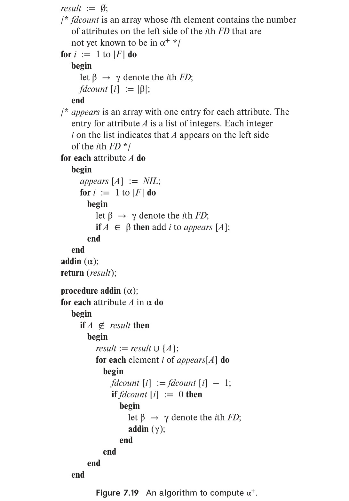

# T08 (Part 1) · Functional Dependencies, Armstrong's Axioms, and Attribute Closures

[← Prev: T07](T07_Triggers_and_Stored_Procedures.md) | [Exam-style T08](../Topicwise_answers_exam_style/T08_Normalization_and_Functional_Dependencies.md) | [Next: T08 Part 2 →](T08_Part2_Canonical_Cover_and_3NF.md)

---

> [!abstract] Topic Overview & Exercise Scope
> **Topic ID:** T08 · Normalization & Functional Dependencies (Part 1 of 3)  
> **Textbook Source:** Silberschatz, Korth, and Sudarshan, *Database System Concepts* (7th Edition, 2019), Chapter 7: *Relational Database Design*, pp. 303–361.  
> **Scope:** Foundational theory of relational design: why normalization is needed, anomalies in unnormalized relations, formal definition and semantic interpretation of functional dependencies (FDs), mapping E-R relationships to FDs, SQL testing and assertions, transitive and partial dependencies, formal soundness proofs of Armstrong's Axioms and derived inference rules, disproving unsound rules via minimal counterexample relations, attribute closure algorithms (naive vs. linear-time Beeri-Bernstein), candidate key discovery, and bridging to BCNF decomposition.  
> **Direct Past Exam Hits:**
> - ⚠️ **Direct Final / Class Test Recycling:** **PE 7.6** is recycled verbatim in **RUET 2021 Q.5(b) [4 Marks]** and **CT-03 Q.01(a) [4 Marks]** (Computing $F^+$, attribute closures, and candidate keys for $R = (A, B, C, D, E)$).
> - **Anomalies & Design Flaws (EX 7.23):** Tested in 2018 Q.4(a), 2019 Q.6(a), 2021 Q.6(c), 2023 Q.2(b), and CT-03 Q.02.
> - **Transitive Dependencies & 3NF Equivalence (EX 7.18):** Tested in CT-03 Q.01(c).
> - **Armstrong's Axioms & Proofs (EX 7.25, PE 7.4, EX 7.27, PE 7.5):** Core RUET syllabus Unit 5 and Lecture Slides Deck 06 (Slides 18–24).

---

## Master Table of Assigned Exercises

| Exercise ID | Classification | Subtopic | Descriptive Title | RUET Exam Relevance |
| :--- | :--- | :--- | :--- | :--- |
| **EX 7.23** | Exercises (§7.7) | `T08.1` | Bad Relational Design: Repetition of Information & Update Anomalies | High · Core theory (recurrent across 5 exam papers) |
| **PE 7.3** | Practice Ex. (§7.7) | `T08.2` | Expressing E-R Cardinality & Participation Constraints via FDs | Medium · Conceptual link between E-R model and Relational Schema |
| **PE 7.2** | Practice Ex. (§7.7) | `T08.2` | Identifying Nontrivial Functional Dependencies from a Relation Table | High · Practical table inspection drill |
| **EX 7.24** | Exercises (§7.7) | `T08.2` | Trivial Functional Dependencies: Formal Justification & Semantics | Medium · Tested in CT-03 Q.01(b) |
| **PE 7.9** | Practice Ex. (§7.7) | `T08.2` | Testing & Enforcing Functional Dependencies in SQL (Queries & Assertions) | High · Advanced SQL constraint design |
| **EX 7.18** | Exercises (§7.7) | `T08.2` | Transitive Dependencies, Prime Attributes & 3NF Equivalence Proof | High · Tested in CT-03 Q.01(c); foundational 3NF theory |
| **EX 7.25** | Exercises (§7.7) | `T08.3` | Formal Soundness Proofs of Armstrong's Primary Axioms | Critical · Deck 06 S18–24; theoretical syllabus foundation |
| **PE 7.4** | Practice Ex. (§7.7) | `T08.3` | Soundness Proof of the Union Rule via Armstrong's Axioms | High · Standard mathematical deduction question |
| **EX 7.27** | Exercises (§7.7) | `T08.3` | Soundness Proof of the Decomposition Rule via Armstrong's Axioms | High · Standard mathematical deduction question |
| **PE 7.5** | Practice Ex. (§7.7) | `T08.3` | Soundness Proof of the Pseudotransitivity Rule via Armstrong's Axioms | High · Classical exam proof drill |
| **EX 7.26** | Exercises (§7.7) | `T08.3` | Disproving Unsound FD Inference Rules via Minimal Counterexamples | High · Methodological counterexample construction |
| **PE 7.6** | Practice Ex. (§7.7) | `T08.4` | Attribute Closures, Closure of $F$, and Candidate Keys for $R=(A,B,C,D,E)$ | ⚠️ **Direct Hit** · Verbatim in 2021 Q.5(b) & CT-03 Q.01(a) |
| **EX 7.28** | Exercises (§7.7) | `T08.4` | Single Attribute Closure: Step-by-Step Derivation of $B^+$ | Medium · Sub-step of candidate key search |
| **PE 7.8** | Practice Ex. (§7.7) | `T08.4` | Linear-Time Attribute Closure Algorithm (Figure 7.19): Proof & Complexity | Advanced · Algorithmic optimality and Beeri-Bernstein data structures |
| **EX 7.31** | Exercises (§7.7) | `T08.4` | Superkey Testing via Closure, BCNF Decomposition & Dependency Preservation | High · Comprehensive multi-step normalization drill |

---

## T08.1 · Redundancy, Design Flaws & Anomalies

### Exercise 7.23 · Bad Relational-Database Design: Repetition of Information & Inability to Represent Information

> [!info] Exercise Metadata
> - **Textbook Reference:** Silberschatz 7e, Chapter 7, Section 7.1 (*Features of Good Relational Designs*), Exercises, p. 357.
> - **Subtopic Classification:** `T08.1 · Why normalize: redundancy and insert/update/delete anomalies`.
> - **RUET Exam Weight:** Recurrent across semester finals (2018 Q.4a [5m], 2019 Q.6a [5m], 2021 Q.6c [5m], 2023 Q.2b [5m]) and Class Test 3 (CT-03 Q.02 [3m]).
> - **Key Concepts:** Data redundancy, update anomalies, insertion anomalies, deletion anomalies, universal schema.

#### Question (Silberschatz 7e Exercise 7.23)
Explain what is meant by *repetition of information* and *inability to represent information*. Explain why each of these properties may indicate a bad relational-database design.

---

#### 1. Core Principles & Concept Overview
A bad database design typically arises when an enterprise attempts to store multiple real-world entities or relationships within a single oversized relation schema (often called a "universal relation" or unnormalized table). Such schemas suffer from two fundamental structural flaws:
1. **Repetition of Information (Redundancy):** Facts that pertain to an entity are stored redundantly in every tuple that associates with that entity.
2. **Inability to Represent Information (Operational Anomalies):** Constraints inherent in relational table structures prevent recording independent facts about one entity without linking it to another, or cause unintended loss of facts when deleting related data.

---

#### 2. Detailed Step-by-Step Solution

##### A. Repetition of Information
- **Definition:** Repetition of information occurs when a database schema forces the same fact (the value of an attribute or a set of attributes) to be replicated across multiple distinct tuples.
- **Concrete Example:** Consider the combined relation schema:
  
  $$
  \text{in\_dep}(\underline{\text{ID}}, \text{name}, \text{salary}, \text{dept\_name}, \text{building}, \text{budget})
  $$

  Here, every instructor in the Computer Science department will duplicate the department's building (`Taylor`) and budget (`100000`):

  | ID | name | salary | dept_name | building | budget |
  | :--- | :--- | :--- | :--- | :--- | :--- |
  | 10101 | Srinivasan | 65000 | Comp. Sci. | Taylor | 100000 |
  | 45565 | Katz | 75000 | Comp. Sci. | Taylor | 100000 |
  | 83821 | Brandt | 92000 | Comp. Sci. | Taylor | 100000 |

- **Why It Indicates Bad Design:**
  1. **Storage Waste:** Redundant data unnecessarily consumes physical disk blocks and buffer cache memory.
  2. **Update Anomaly (Data Inconsistency):** If the budget of `Comp. Sci.` changes, every tuple belonging to a `Comp. Sci.` instructor must be updated. If the database engine or application updates some tuples but fails or crashes before updating others, the database enters an inconsistent state where two different budget amounts exist simultaneously for the same department.

##### B. Inability to Represent Information
- **Definition:** Inability to represent information manifests as the inability to insert or maintain a valid enterprise fact without creating artificial, dangling, or null data, or the unavoidable deletion of one fact as a side-effect of deleting another.
- **Manifestations:**
  1. **Insertion Anomaly:**
     - Suppose the university creates a new department called `Biotechnology` in the `Bio-Eng` building with a budget of `80000`, but has not hired any instructors yet.
     - Because $\text{ID}$ is the primary key of $\text{in\_dep}$, we cannot insert a tuple for this department without setting $\text{ID} = \text{null}$, which violates the fundamental **Entity Integrity Constraint** ($\text{ID}$ cannot be null in a primary key).
     - Alternatively, inserting a dummy or placeholder instructor $\text{ID}$ pollutes the database with fake entities and falsifies aggregate queries (such as `AVG(salary)`).
  2. **Deletion Anomaly:**
     - Suppose the `Music` department currently has only one instructor, `Mozart` (ID `12121`).
     - If Mozart leaves the university and we execute a `DELETE` query to remove his instructor record, the tuple containing Mozart is purged.
     - Because the department's building (`Packard`) and budget (`80000`) exist only within that tuple, the database completely loses the record of the `Music` department's existence!

##### C. Summary Comparison Table

| Design Defect | Relational Cause | Immediate Consequence | Database Remedy |
| :--- | :--- | :--- | :--- |
| **Repetition of Information** | Mixing independent entity attributes; non-key functional dependency $X \rightarrow Y$ | Redundant storage, update anomaly, inconsistent states | Decompose into distinct schemas $R_1(X, Y)$ and $R_2(R - Y)$ |
| **Insertion Anomaly** | Primary key requires attributes from an entity that might not exist yet | Inability to record independent facts; null-value pollution | Decompose so each real-world entity has its own primary table |
| **Deletion Anomaly** | Tying the lifespan of one entity to the lifespan of another in a single tuple | Accidental data loss upon deletion of an unrelated entity | Normalized schemas linked via foreign keys |

---

#### 3. RUET Exam Insights & Examiner Notes
> [!tip] Scoring Strategy for RUET Semester Finals
> - When asked to "Mention the problems caused by an unnormalized relation" (e.g., 2018 Q.4a, 2021 Q.6c, CT-03 Q.02), always structure your answer into **four explicit headings**:
>   1. *Data Redundancy*
>   2. *Update Anomaly*
>   3. *Insertion Anomaly*
>   4. *Deletion Anomaly*
> - Draw a small 3-row, 4-column unnormalized table (such as `Emp_Dept` or `in_dep`) and provide a concrete numerical trace of each anomaly. RUET examiners deduct marks for abstract definitions lacking tabular illustrations.

---

## T08.2 · Functional Dependencies, Semantics, SQL Enforcements & Transitive Dependencies

### Exercise 7.3 · Expressing E-R Cardinality & Participation Constraints via Functional Dependencies

> [!info] Exercise Metadata
> - **Textbook Reference:** Silberschatz 7e, Chapter 7, Section 7.2 (*Atomic Domains and First Normal Form*) & Section 7.3 (*Functional Dependencies*), Practice Exercises, p. 354.
> - **Subtopic Classification:** `T08.2 · FDs: trivial, full/partial, transitive; prime vs non-prime attributes`.
> - **RUET Exam Weight:** Bridges Topic T02 (E-R Modeling) and Topic T08 (Relational Design & FDs).
> - **Key Concepts:** Cardinality ratios ($1:1$, $1:N$, $M:N$), total participation, candidate keys, semantic constraints.

#### Question (Silberschatz 7e Practice Exercise 7.3)
Explain how functional dependencies can be used to indicate the following:
- A one-to-one relationship set exists between entity sets $\text{entity\_set\_1}$ and $\text{entity\_set\_2}$.
- A many-to-one relationship set exists between entity sets $\text{entity\_set\_1}$ and $\text{entity\_set\_2}$.
- A many-to-many relationship set exists between entity sets $\text{entity\_set\_1}$ and $\text{entity\_set\_2}$.
- Total participation exists for entity set $\text{entity\_set\_1}$ in relationship set $\text{relationship\_set\_1}$.

---

#### 1. Core Principles & Concept Overview
Let $E_1$ and $E_2$ be two entity sets with primary keys $K_1$ and $K_2$, respectively. When a binary relationship set $R$ connects $E_1$ and $E_2$, the relational schema for $R$ contains at minimum the combined primary key attributes:

$$
R(K_1, K_2, \text{descriptive\_attributes})
$$

A functional dependency $\alpha \rightarrow \beta$ asserts that any two tuples agreeing on $\alpha$ must agree on $\beta$. This mathematical property directly models cardinality constraints by establishing whether an entity in one set can pair with at most one entity in the other set.

---

#### 2. Detailed Step-by-Step Solution

##### A. One-to-One ($1:1$) Relationship Set
- **Mapping:** In a $1:1$ relationship between $E_1$ and $E_2$, each entity in $E_1$ is associated with at most one entity in $E_2$, and each entity in $E_2$ is associated with at most one entity in $E_1$.
- **Functional Dependencies:**
  
  $$
  K_1 \rightarrow K_2 \quad \text{and} \quad K_2 \rightarrow K_1
  $$

- **Implication:**
  - $K_1 \rightarrow K_2$ guarantees that no $K_1$ value appears with two different $K_2$ values.
  - $K_2 \rightarrow K_1$ guarantees that no $K_2$ value appears with two different $K_1$ values.
  - Both $K_1$ and $K_2$ are candidate keys for the relation schema $R$.

##### B. Many-to-One ($N:1$) Relationship Set from $E_1$ to $E_2$
- **Mapping:** Each entity in $E_1$ is associated with at most one entity in $E_2$, but an entity in $E_2$ may be associated with multiple entities in $E_1$.
- **Functional Dependencies:**
  
  $$
  K_1 \rightarrow K_2
  $$

  (while $K_2 \rightarrow K_1$ does **not** hold).
- **Implication:**
  - Given an entity identifier $K_1$, its corresponding partner $K_2$ is uniquely determined.
  - Conversely, multiple tuples may share the same $K_2$ while having distinct $K_1$ values.
  - The primary key of the relation schema $R$ is $K_1$.

##### C. Many-to-Many ($M:N$) Relationship Set
- **Mapping:** An entity in $E_1$ may be associated with many entities in $E_2$, and an entity in $E_2$ may be associated with many entities in $E_1$.
- **Functional Dependencies:**
  - Neither $K_1 \rightarrow K_2$ nor $K_2 \rightarrow K_1$ holds.
  - The only nontrivial functional dependency on the relation is the trivial dependency:
    
    $$
    \{K_1, K_2\} \rightarrow \text{descriptive\_attributes}
    $$

- **Implication:**
  - Neither key alone functionally determines the other. The minimal superkey is the composite set $\{K_1, K_2\}$, which forms the primary key of schema $R$.

##### D. Total Participation of Entity Set $E_1$ in Relationship Set $R$
- **Theoretical Limitation of Pure FDs:**
  - Functional dependencies are *universal constraints on existing tuples*: they state that **if** tuples exist, certain attributes determine others.
  - FDs **cannot** enforce an existential quantifier; that is, an FD alone cannot mandate that *for every* tuple $e \in E_1$, there *must exist* a corresponding tuple in $R$.
- **How Total Participation is Enforced in the Relational Model:**
  1. **Schema Merging (for $N:1$ or $1:1$ Relationships):**
     - If $E_1$ has total participation in an $N:1$ relationship $R$ with $E_2$, the relation schemas of $E_1$ and $R$ are merged into a single schema:
       
       $$
       E_1(K_1, \text{attributes\_of\_}E_1, K_2, \text{attributes\_of\_}R)
       $$
     
     - Total participation is enforced by specifying a **NOT NULL** constraint on the foreign key attribute $K_2$:
       
       $$
       K_2 \text{ NOT NULL REFERENCES } E_2(K_2)
       $$
     
  2. **Referential Integrity / SQL Assertions (for $M:N$ Relationships):**
     - Total participation requires an inclusion dependency (referential integrity constraint) from the entity set to the relationship set:
       
       $$
       \Pi_{K_1}(E_1) \subseteq \Pi_{K_1}(R)
       $$
     
     - In standard SQL, this is expressed declaratively via an assertion:
       ```sql
       CREATE ASSERTION check_total_participation CHECK (
           NOT EXISTS (
               SELECT K1 FROM E1
               EXCEPT
               SELECT K1 FROM R
           )
       );
       ```

---

#### 3. RUET Exam Insights & Examiner Notes
> [!important] Crucial Distinction
> In university exams, when asked how FDs represent constraints, clearly state that **cardinality ratios ($1:1, 1:N, M:N$) are fully expressible using functional dependencies**, whereas **total participation requires existential enforcement (foreign keys with `NOT NULL` or inclusion dependencies)** because standard functional dependencies cannot prevent an entity in $E_1$ from being completely absent in $R$.

---

### Exercise 7.2 · Identifying Nontrivial Functional Dependencies from a Relation Table

> [!info] Exercise Metadata
> - **Textbook Reference:** Silberschatz 7e, Chapter 7, Section 7.3 (*Functional Dependencies*), Practice Exercises, p. 354.
> - **Subtopic Classification:** `T08.2 · FDs: trivial, full/partial, transitive; prime vs non-prime attributes`.
> - **RUET Exam Weight:** Standard practical drill for table analysis and key discovery.
> - **Key Concepts:** Nontrivial FDs, instance satisfaction, counterexample pairs, attribute projection.

#### Question (Silberschatz 7e Practice Exercise 7.2)
List all nontrivial functional dependencies satisfied by the relation of Figure 7.18.

  
*Figure 7.18 — Relation $r(A, B, C)$ for Exercise 7.2.*

The relation instance $r$ over schema $R(A, B, C)$ contains the following 4 tuples:

| Tuple | $A$ | $B$ | $C$ |
| :---: | :---: | :---: | :---: |
| $t_1$ | $a_1$ | $b_1$ | $c_1$ |
| $t_2$ | $a_1$ | $b_1$ | $c_2$ |
| $t_3$ | $a_2$ | $b_1$ | $c_1$ |
| $t_4$ | $a_2$ | $b_1$ | $c_3$ |

---

#### 1. Core Principles & Concept Overview
- **Definition of FD Satisfaction:** A functional dependency $\alpha \rightarrow \beta$ is *satisfied* by a relation instance $r$ if for every pair of tuples $t_i, t_j \in r$:
  
  $$
  t_i[\alpha] = t_j[\alpha] \implies t_i[\beta] = t_j[\beta]
  $$

- **Definition of Nontrivial FD:** An FD $\alpha \rightarrow \beta$ is *nontrivial* if $\beta \not\subseteq \alpha$. It is *completely nontrivial* if $\alpha \cap \beta = \emptyset$.
- **Methodology:** We systematically test all possible non-empty subsets of attributes for the left-hand side ($\text{LHS}$) and right-hand side ($\text{RHS}$).

---

#### 2. Detailed Step-by-Step Solution

##### Step 1: Testing Single-Attribute Left-Hand Sides

1. **Testing $A$ as Determinant:**
   - **Does $A \rightarrow B$ hold?**
     - For $A = a_1$: $t_1[B] = b_1$, $t_2[B] = b_1$ (matches).
     - For $A = a_2$: $t_3[B] = b_1$, $t_4[B] = b_1$ (matches).
     - $\implies$ **$A \rightarrow B$ holds!**
   - **Does $A \rightarrow C$ hold?**
     - For $A = a_1$: $t_1[C] = c_1$, but $t_2[C] = c_2$.
     - Since $c_1 \neq c_2$, the FD is violated.
     - $\implies$ **$A \rightarrow C$ does NOT hold.**

2. **Testing $B$ as Determinant:**
   - **Does $B \rightarrow A$ hold?**
     - For $B = b_1$: $t_1[A] = a_1$, but $t_3[A] = a_2$.
     - Since $a_1 \neq a_2$, the FD is violated.
     - $\implies$ **$B \rightarrow A$ does NOT hold.**
   - **Does $B \rightarrow C$ hold?**
     - For $B = b_1$: $t_1[C] = c_1, t_2[C] = c_2, t_4[C] = c_3$.
     - Multiple distinct $C$ values exist for the same $B$.
     - $\implies$ **$B \rightarrow C$ does NOT hold.**

3. **Testing $C$ as Determinant:**
   - **Does $C \rightarrow A$ hold?**
     - For $C = c_1$: $t_1[A] = a_1$, but $t_3[A] = a_2$.
     - Since $a_1 \neq a_2$, the FD is violated.
     - $\implies$ **$C \rightarrow A$ does NOT hold.**
   - **Does $C \rightarrow B$ hold?**
     - For $C = c_1$: $t_1[B] = b_1, t_3[B] = b_1$.
     - For $C = c_2$: $t_2[B] = b_1$.
     - For $C = c_3$: $t_4[B] = b_1$.
     - In all cases, $B$ is uniquely $b_1$.
     - $\implies$ **$C \rightarrow B$ holds!**

##### Step 2: Testing Two-Attribute Left-Hand Sides

1. **Testing $AB$ as Determinant:**
   - Nontrivial target: $C$.
   - Does $AB \rightarrow C$ hold?
     - $t_1[AB] = (a_1, b_1)$ gives $C = c_1$.
     - $t_2[AB] = (a_1, b_1)$ gives $C = c_2 \neq c_1$.
     - $\implies$ **$AB \rightarrow C$ does NOT hold.**

2. **Testing $BC$ as Determinant:**
   - Nontrivial target: $A$.
   - Does $BC \rightarrow A$ hold?
     - $t_1[BC] = (b_1, c_1)$ gives $A = a_1$.
     - $t_3[BC] = (b_1, c_1)$ gives $A = a_2 \neq a_1$.
     - $\implies$ **$BC \rightarrow A$ does NOT hold.**

3. **Testing $AC$ as Determinant:**
   - Nontrivial target: $B$.
   - Does $AC \rightarrow B$ hold?
     - All tuples have $B = b_1$. Thus $AC \rightarrow B$ holds vacuously.
     - (Note: $AC \rightarrow B$ is logically implied by $A \rightarrow B$ via Augmentation: $A \rightarrow B \implies AC \rightarrow BC \implies AC \rightarrow B$).
     - $\implies$ **$AC \rightarrow B$ holds!**

##### Step 3: Complete List of Satisfied Nontrivial Functional Dependencies

The complete set of nontrivial functional dependencies satisfied by relation $r$ is:

$$
\begin{aligned}
A &\rightarrow B \\
C &\rightarrow B \\
AC &\rightarrow B
\end{aligned}
$$

*(If we include non-completely trivial dependencies where the RHS contains both determined and determinant attributes, $A \rightarrow AB$, $C \rightarrow BC$, and $AC \rightarrow BC$ are also satisfied).*

---

#### 3. RUET Exam Insights & Examiner Notes
> [!note] Critical Exam Observation
> Notice that attribute $B$ is constant ($b_1$) across all 4 tuples. In any relation instance where an attribute takes exactly one constant value across all rows, **any attribute set functionally determines that constant attribute**! However, as a database designer, you must remind the examiner that satisfaction in an instance does not imply that $A \rightarrow B$ is a real-world enterprise rule.

---

### Exercise 7.24 · Nature and Characterization of Trivial Functional Dependencies

> [!info] Exercise Metadata
> - **Textbook Reference:** Silberschatz 7e, Chapter 7, Section 7.3.1 (*Closure of a Set of Functional Dependencies*), Exercises, p. 357.
> - **Subtopic Classification:** `T08.2 · FDs: trivial, full/partial, transitive; prime vs non-prime attributes`.
> - **RUET Exam Weight:** Tested in CT-03 Q.01(b) [2 Marks].
> - **Key Concepts:** Trivial FDs, Armstrong's reflexivity, tuple projection, schema integrity.

#### Question (Silberschatz 7e Exercise 7.24)
Why are certain functional dependencies called trivial functional dependencies?

---

#### 1. Core Principles & Concept Overview
In relational database theory, an integrity constraint is meaningful only if it restricts the possible relation instances that can be stored in the database. A functional dependency $\alpha \rightarrow \beta$ is termed **trivial** if it is impossible for *any* relation instance to ever violate it, regardless of the real-world semantics of the data.

---

#### 2. Detailed Step-by-Step Solution

##### A. Formal Mathematical Definition
A functional dependency $\alpha \rightarrow \beta$ is **trivial** if and only if the right-hand side attribute set is a subset of the left-hand side attribute set:

$$
\beta \subseteq \alpha
$$

##### B. Proof That Trivial Dependencies Hold on All Relations
Let $r(R)$ be an arbitrary relation instance over schema $R$, and let $\alpha, \beta \subseteq R$ such that $\beta \subseteq \alpha$.
1. By the definition of functional dependency, $\alpha \rightarrow \beta$ holds on $r$ if for all tuples $t_1, t_2 \in r$:
   
   $$
   t_1[\alpha] = t_2[\alpha] \implies t_1[\beta] = t_2[\beta]
   $$

2. Suppose $t_1[\alpha] = t_2[\alpha]$. This equality means that for every individual attribute $A \in \alpha$, $t_1[A] = t_2[A]$.
3. Since $\beta \subseteq \alpha$, every attribute $B \in \beta$ is necessarily in $\alpha$.
4. It immediately follows that $t_1[B] = t_2[B]$ for every $B \in \beta$, which means:
   
   $$
   t_1[\beta] = t_2[\beta]
   $$

5. Because this implication holds unconditionally for *every conceivable* relation instance $r$, no tuple insertion or update can ever violate $\alpha \rightarrow \beta$.

##### C. Why They Are Called "Trivial"
They are named *trivial* because:
1. **Zero Information Content:** They provide zero semantic constraint on the enterprise. Stating that $\{\text{ID}, \text{name}\} \rightarrow \text{name}$ tells us nothing about how instructors relate to departments; it merely reflects the set-theoretic fact that knowing both $\text{ID}$ and $\text{name}$ gives us $\text{name}$.
2. **Vacuous Enforcement:** Database management systems do not need to construct index checks or verification code to enforce them; they are satisfied automatically by definition of tuple access.
3. **Armstrong's Foundation:** They correspond directly to the **Reflexivity Rule** of Armstrong's Axioms.

---

#### 3. RUET Exam Insights & Examiner Notes
> [!tip] Mark Calibration
> For a 2-mark question (as in CT-03 Q.01b), examiners look for:
> 1. The formal mathematical condition: $\beta \subseteq \alpha$.
> 2. The statement that "they are satisfied by all relations without imposing any constraint on the real-world domain."
> 3. One example (e.g., $AB \rightarrow A$ or $A \rightarrow A$).

---

### Exercise 7.9 · Testing & Enforcing Functional Dependencies in SQL (Table Queries & Assertions)

> [!info] Exercise Metadata
> - **Textbook Reference:** Silberschatz 7e, Chapter 7, Section 7.3 (*Functional Dependencies*), Practice Exercises, p. 354.
> - **Subtopic Classification:** `T08.2 · FDs: trivial, full/partial, transitive; prime vs non-prime attributes`.
> - **RUET Exam Weight:** Bridges SQL DDL/integrity constraints (T05/T07) with normalization theory (T08).
> - **Key Concepts:** SQL group by / having count(distinct), self-joins, SQL assertions, triggers, materialized views.

#### Question (Silberschatz 7e Practice Exercise 7.9)
Given the database schema $R(A, B, C)$, and a relation $r$ on the schema $R$, write an SQL query to test whether the functional dependency $B \rightarrow C$ holds on relation $r$. Also write an SQL assertion that enforces the functional dependency. Assume that no null values are present. (Although part of the SQL standard, such assertions are not supported by any database implementation currently.)

---

#### 1. Core Principles & Concept Overview
The functional dependency $B \rightarrow C$ asserts that every value of attribute $B$ must map to exactly one value of attribute $C$.
- **Violation Condition:** A relation violates $B \rightarrow C$ if and only if there exists some value of $B$ that is associated with **two or more distinct values of $C$**.
- **Testing Strategy:**
  1. Group tuples by $B$.
  2. Count the number of distinct $C$ values in each group using `COUNT(DISTINCT C)`.
  3. Filter groups having `COUNT(DISTINCT C) > 1`. If the query returns zero rows, the dependency holds!

---

#### 2. Detailed Step-by-Step Solution

##### A. SQL Query to Test if $B \rightarrow C$ Holds
```sql
SELECT B
FROM r
GROUP BY B
HAVING COUNT(DISTINCT C) > 1;
```
- **Interpretation:**
  - If the query result is **empty**, then for every value of $B$, there is at most one distinct value of $C$. Hence, $B \rightarrow C$ **holds** on relation $r$.
  - If the query returns **one or more rows**, each returned $B$ value represents a violation where a single $B$ maps to multiple distinct $C$ values. Hence, $B \rightarrow C$ **does not hold**.

###### Alternative Formulation via Self-Join:
```sql
SELECT DISTINCT r1.B, r1.C AS C1, r2.C AS C2
FROM r AS r1
JOIN r AS r2 ON r1.B = r2.B
WHERE r1.C <> r2.C;
```
*(This query explicitly returns the conflicting tuple pairs that violate the dependency).*

##### B. SQL Assertion to Enforce $B \rightarrow C$
The SQL standard provides the `CREATE ASSERTION` statement to declare global integrity constraints spanning one or more tables:

```sql
CREATE ASSERTION check_B_determines_C CHECK (
    NOT EXISTS (
        SELECT B
        FROM r
        GROUP BY B
        HAVING COUNT(DISTINCT C) > 1
    )
);
```

###### Alternative Formulation via Self-Join:
```sql
CREATE ASSERTION check_B_determines_C_join CHECK (
    NOT EXISTS (
        SELECT *
        FROM r AS r1, r AS r2
        WHERE r1.B = r2.B AND r1.C <> r2.C
    )
);
```

##### C. Real-World Engineering Note: How to Enforce $B \rightarrow C$ Without Assertions
Because commercial database engines (PostgreSQL, MySQL, Oracle, Microsoft SQL Server) do not implement `CREATE ASSERTION` due to performance overhead, database engineers enforce $B \rightarrow C$ using two practical techniques:
1. **Schema Normalization (Preferred):** Decompose $R(A, B, C)$ into:
   - $R_1(\underline{B}, C)$ with primary key $B$.
   - $R_2(\underline{A, B})$ with foreign key $B \text{ REFERENCES } R_1(B)$.
   Now, $B \rightarrow C$ is enforced automatically with $O(1)$ B-tree index checks on $R_1$.
2. **Immediate Triggers:** Write a `BEFORE INSERT OR UPDATE` trigger on $r$ that rejects any new tuple if `EXISTS (SELECT 1 FROM r WHERE B = NEW.B AND C <> NEW.C)`.

---

#### 3. RUET Exam Insights & Examiner Notes
> [!tip] Examiner's Favorite Twist
> When writing the assertion, students often forget the `NOT EXISTS` wrapper. An assertion condition inside `CHECK (...)` must evaluate to `TRUE`. Since the violation query returns rows when the FD is broken, wrapping it in `NOT EXISTS (...)` ensures that the assertion evaluates to `TRUE` if and only if there are zero violations.

---

### Exercise 7.18 · Prime Attributes, Transitive Dependencies, and Equivalence of 3NF Definitions

> [!info] Exercise Metadata
> - **Textbook Reference:** Silberschatz 7e, Chapter 7, Section 7.5.1 (*Third Normal Form*), Exercises, pp. 356–357.
> - **Subtopic Classification:** `T08.2 · FDs: trivial, full/partial, transitive; prime vs non-prime attributes`.
> - **RUET Exam Weight:** Directly tested in CT-03 Q.01(c) [2 Marks]; foundational theory for 3NF normalization.
> - **Key Concepts:** Prime attributes, transitive functional dependencies, Codd's 3NF definition vs. Modern 3NF definition, equivalence proof.

#### Question (Silberschatz 7e Exercise 7.18)
Let a *prime attribute* be one that appears in at least one candidate key. Let $\alpha$ and $\beta$ be sets of attributes such that $\alpha \rightarrow \beta$ holds, but $\beta \rightarrow \alpha$ does not hold. Let $A$ be an attribute that is not in $\alpha$, is not in $\beta$, and for which $\beta \rightarrow A$ holds. We say that $A$ is *transitively dependent* on $\alpha$. We can restate the definition of 3NF as follows:

> **Definition (Codd's Classical 3NF):** A relation schema $R$ is in 3NF with respect to a set $F$ of functional dependencies if there are no nonprime attributes $A$ in $R$ for which $A$ is transitively dependent on a key for $R$.

Show that this new definition is equivalent to the original one.

---

#### 1. Core Principles & Concept Overview
To prove that two definitions are equivalent, we must prove a bidirectional logical implication ($\iff$):
1. **Modern 3NF Definition:** A relation schema $R$ is in 3NF with respect to $F$ if for all functional dependencies $\gamma \rightarrow \delta \in F^+$, at least one of the following holds:
   - $\delta \subseteq \gamma$ (trivial FD).
   - $\gamma$ is a superkey for $R$.
   - Each attribute $A \in \delta - \gamma$ is a prime attribute of $R$.
2. **Codd's Transitive-Dependency 3NF Definition:** No nonprime attribute of $R$ is transitively dependent on any candidate key of $R$.

---

#### 2. Detailed Step-by-Step Solution

##### Step 1: Proving (Modern 3NF $\implies$ Classical Transitive-Dependency 3NF)
We prove the contrapositive: if a relation schema $R$ violates Codd's transitive-dependency 3NF definition, it must also violate the modern 3NF definition.

1. Suppose $R$ violates Codd's definition. Then there exists:
   - A candidate key $K$ of $R$.
   - An attribute set $\beta \subset R$.
   - A nonprime attribute $A \in R$ such that $A \notin K$ and $A \notin \beta$.
   - Such that:
     
     $$
     \begin{aligned}
     K &\rightarrow \beta \text{ holds,} \\
     \beta &\rightarrow K \text{ does NOT hold,} \\
     \beta &\rightarrow A \text{ holds.}
     \end{aligned}
     $$

2. Now examine the functional dependency $\beta \rightarrow A$.
3. We test the three conditions of the modern 3NF definition on $\beta \rightarrow A$:
   - **Is $\beta \rightarrow A$ trivial?**  
     No, because the definition of transitive dependency specifies that $A \notin \beta$ (so $A \not\subseteq \beta$).
   - **Is $\beta$ a superkey of $R$?**  
     No, because if $\beta$ were a superkey, $\beta \rightarrow R$ would hold, which implies $\beta \rightarrow K$. But by definition of transitive dependency, $\beta \rightarrow K$ does **not** hold.
   - **Is $A$ a prime attribute?**  
     No, because the definition of transitive dependency explicitly specifies that $A$ is a **nonprime** attribute.
4. Since $\beta \rightarrow A$ is a nontrivial functional dependency in $F^+$ where $\beta$ is not a superkey and $A$ is not prime, relation schema $R$ violates the modern 3NF definition.
5. Therefore: $\text{Modern 3NF} \implies \text{Classical 3NF}$.

---

##### Step 2: Proving (Classical Transitive-Dependency 3NF $\implies$ Modern 3NF)
Again, we prove the contrapositive: if $R$ violates the modern 3NF definition, it must also violate Codd's transitive-dependency definition.

1. Suppose $R$ violates the modern 3NF definition.
2. Then there exists some functional dependency $\gamma \rightarrow \delta \in F^+$ that violates all three conditions. Decomposing $\delta$ into single attributes, there must exist at least one attribute $A \in \delta$ such that:
   - $A \notin \gamma$ (the dependency $\gamma \rightarrow A$ is nontrivial).
   - $\gamma$ is **not a superkey** of $R$.
   - $A$ is a **nonprime attribute** of $R$.
3. Let $K$ be any candidate key of $R$.
4. We evaluate the relationships between $K, \gamma,$ and $A$:
   - Since $K$ is a candidate key, $K \rightarrow \gamma$ holds unconditionally (because $K \rightarrow R$ and $\gamma \subseteq R$).
   - Can $\gamma \rightarrow K$ hold? No, because if $\gamma \rightarrow K$, then $\gamma$ would functionally determine a candidate key, making $\gamma$ a superkey of $R$, which contradicts our premise that $\gamma$ is not a superkey.
   - Is $A \in K$? No, because $K$ is a candidate key and $A$ is nonprime (prime attributes are those that belong to at least one candidate key).
   - Is $A \in \gamma$? No, by construction $A \notin \gamma$.
   - Does $\gamma \rightarrow A$ hold? Yes, from our premise in step 2.
5. Now, assign:
   
   $$
   \alpha = K \quad \text{and} \quad \beta = \gamma
   $$

   We verify all five conditions of transitive dependency:
   - $K \rightarrow \gamma$ holds.
   - $\gamma \rightarrow K$ does not hold.
   - $A \notin K$.
   - $A \notin \gamma$.
   - $\gamma \rightarrow A$ holds.
6. Thus, the nonprime attribute $A$ is transitively dependent on the candidate key $K$!
7. This directly violates Codd's 3NF definition.
8. Therefore: $\text{Classical 3NF} \implies \text{Modern 3NF}$.

---

##### Conclusion
Both implications hold:

$$
\text{Modern 3NF Definition} \iff \text{Classical Transitive-Dependency 3NF Definition}
$$

The two definitions are strictly mathematically equivalent.

---

#### 3. RUET Exam Insights & Examiner Notes
> [!note] Why Did Modern Textbooks Change Codd's Definition?
> In RUET exams (e.g., CT-03 Q.01c), examiners appreciate students noting **why** Silberschatz and modern database theory use the modern 3-clause definition instead of Codd's classical one:
> - Codd's definition requires verifying a negative condition ($\beta \rightarrow K$ does not hold), which requires checking that no candidate key is determined by $\beta$.
> - The modern definition is purely constructive: you take each FD $\alpha \rightarrow \beta$ and test if $\alpha$ is a superkey or if each RHS attribute is prime, which is directly checkable in algorithmic 3NF testing.

---

## T08.3 · Armstrong's Axioms, Formal Proofs & Inference Rules

### Exercise 7.25 · Soundness Proof of Armstrong's Primary Axioms

> [!info] Exercise Metadata
> - **Textbook Reference:** Silberschatz 7e, Chapter 7, Section 7.3.1 (*Closure of a Set of Functional Dependencies*), Exercises, p. 357.
> - **Subtopic Classification:** `T08.3 · Armstrong's axioms`.
> - **RUET Exam Weight:** Direct theoretical syllabus requirement (Unit 5; Lecture Slides Deck 06, Slides 18–24).
> - **Key Concepts:** Soundness, completeness, reflexivity, augmentation, transitivity, tuple-level mathematical proofs.

#### Question (Silberschatz 7e Exercise 7.25)
Use the definition of functional dependency to argue that each of Armstrong’s axioms (reflexivity, augmentation, and transitivity) is sound.

---

#### 1. Core Principles & Concept Overview
- **Definition of Soundness:** An inference rule for functional dependencies is **sound** if and only if, whenever the premises of the rule hold on a relation instance $r$, the conclusion inferred by the rule also holds on relation instance $r$.
- **Formal Definition of FD:** A functional dependency $X \rightarrow Y$ holds on relation $r(R)$ if for all tuples $t_1, t_2 \in r$:
  
  $$
  t_1[X] = t_2[X] \implies t_1[Y] = t_2[Y]
  $$

---

#### 2. Detailed Step-by-Step Solution

##### A. Soundness of the Reflexivity Rule
- **Rule Statement:** If $\beta \subseteq \alpha$, then $\alpha \rightarrow \beta$.
- **Formal Proof:**
  1. Let $r(R)$ be any relation instance over schema $R$, and let $\alpha, \beta \subseteq R$ such that $\beta \subseteq \alpha$.
  2. Let $t_1, t_2$ be any two tuples in $r$ such that:
     
     $$
     t_1[\alpha] = t_2[\alpha]
     $$

  3. By definition of tuple projection onto a set of attributes, $t_1[\alpha] = t_2[\alpha]$ means that for every individual attribute $A \in \alpha$:
     
     $$
     t_1[A] = t_2[A]
     $$

  4. Since $\beta \subseteq \alpha$, every attribute $B \in \beta$ must also belong to $\alpha$ ($B \in \beta \implies B \in \alpha$).
  5. Therefore, $t_1[B] = t_2[B]$ holds for every attribute $B \in \beta$.
  6. This directly implies:
     
     $$
     t_1[\beta] = t_2[\beta]
     $$

  7. Since $t_1[\alpha] = t_2[\alpha] \implies t_1[\beta] = t_2[\beta]$ holds for all tuples $t_1, t_2 \in r$, $\alpha \rightarrow \beta$ holds on $r$.
  8. Hence, the **Reflexivity Rule is sound**. $\blacksquare$

---

##### B. Soundness of the Augmentation Rule
- **Rule Statement:** If $\alpha \rightarrow \beta$, then $\gamma\alpha \rightarrow \gamma\beta$ (or $\alpha\gamma \rightarrow \beta\gamma$).
- **Formal Proof:**
  1. Assume that $\alpha \rightarrow \beta$ holds on relation instance $r(R)$.
  2. Let $\gamma$ be an arbitrary set of attributes in $R$.
  3. Let $t_1, t_2$ be any two tuples in $r$ such that:
     
     $$
     t_1[\gamma\alpha] = t_2[\gamma\alpha]
     $$

  4. By definition of attribute concatenation (union), $t_1[\gamma\alpha] = t_2[\gamma\alpha]$ implies both:
     
     $$
     \begin{aligned}
     \text{(i) } t_1[\gamma] &= t_2[\gamma] \\
     \text{(ii) } t_1[\alpha] &= t_2[\alpha]
     \end{aligned}
     $$

  5. Because we assumed $\alpha \rightarrow \beta$ holds on $r$, condition (ii) $t_1[\alpha] = t_2[\alpha]$ strictly implies:
     
     $$
     \text{(iii) } t_1[\beta] = t_2[\beta]
     $$

  6. Combining condition (i) $t_1[\gamma] = t_2[\gamma]$ and condition (iii) $t_1[\beta] = t_2[\beta]$, we obtain:
     
     $$
     t_1[\gamma\beta] = t_2[\gamma\beta]
     $$

  7. Therefore, whenever $t_1[\gamma\alpha] = t_2[\gamma\alpha]$, it must be that $t_1[\gamma\beta] = t_2[\gamma\beta]$.
  8. Hence, $\gamma\alpha \rightarrow \gamma\beta$ holds on $r$, and the **Augmentation Rule is sound**. $\blacksquare$

---

##### C. Soundness of the Transitivity Rule
- **Rule Statement:** If $\alpha \rightarrow \beta$ and $\beta \rightarrow \gamma$, then $\alpha \rightarrow \gamma$.
- **Formal Proof:**
  1. Assume that both $\alpha \rightarrow \beta$ and $\beta \rightarrow \gamma$ hold on relation instance $r(R)$.
  2. Let $t_1, t_2$ be any two tuples in $r$ such that:
     
     $$
     t_1[\alpha] = t_2[\alpha]
     $$

  3. Because $\alpha \rightarrow \beta$ holds on $r$, $t_1[\alpha] = t_2[\alpha]$ strictly implies:
     
     $$
     t_1[\beta] = t_2[\beta]
     $$

  4. Because $\beta \rightarrow \gamma$ holds on $r$, $t_1[\beta] = t_2[\beta]$ strictly implies:
     
     $$
     t_1[\gamma] = t_2[\gamma]
     $$

  5. By the transitive property of mathematical equality on vectors/tuples:
     
     $$
     t_1[\alpha] = t_2[\alpha] \implies t_1[\gamma] = t_2[\gamma]
     $$

  6. Therefore, $\alpha \rightarrow \gamma$ holds on $r$.
  7. Hence, the **Transitivity Rule is sound**. $\blacksquare$

---

#### 3. RUET Exam Insights & Examiner Notes
> [!tip] Presentation Standard
> In RUET exams, stating the rule without defining the tuple-level condition ($t_1[\alpha] = t_2[\alpha] \implies t_1[\beta] = t_2[\beta]$) will result in deduction of 50% marks. Always write:
> 1. "Let $t_1, t_2 \in r$ such that..."
> 2. Show the projection step.
> 3. Conclude with $Q.E.D.$ or $\blacksquare$.

---

### Exercise 7.4 · Soundness Proof of the Union Rule via Armstrong's Axioms

> [!info] Exercise Metadata
> - **Textbook Reference:** Silberschatz 7e, Chapter 7, Section 7.3.1 (*Closure of a Set of Functional Dependencies*), Practice Exercises, p. 354.
> - **Subtopic Classification:** `T08.3 · Armstrong's axioms`.
> - **RUET Exam Weight:** Standard 3-mark derived rule proof question.
> - **Key Concepts:** Union rule, derived inference rules, axiomatic deduction.

#### Question (Silberschatz 7e Practice Exercise 7.4)
Use Armstrong’s axioms to prove the soundness of the union rule.  
*(Hint: Use the augmentation rule on $\alpha \rightarrow \beta$ and $\alpha \rightarrow \gamma$, and then use the transitivity rule.)*

---

#### 1. Core Principles & Concept Overview
- **Union Rule:** If $\alpha \rightarrow \beta$ and $\alpha \rightarrow \gamma$, then $\alpha \rightarrow \beta\gamma$.
- **Goal:** Derive $\alpha \rightarrow \beta\gamma$ using **only** the three primary Armstrong's Axioms (Reflexivity, Augmentation, Transitivity).

---

#### 2. Detailed Step-by-Step Solution

##### Formal Derivation

| Step | Expression | Justification |
| :---: | :--- | :--- |
| 1 | $\alpha \rightarrow \beta$ | Given premise |
| 2 | $\alpha \rightarrow \gamma$ | Given premise |
| 3 | $\alpha\alpha \rightarrow \alpha\beta \iff \alpha \rightarrow \alpha\beta$ | Augmentation rule on Step 1 (augmenting with $\alpha$) |
| 4 | $\alpha\beta \rightarrow \beta\gamma$ | Augmentation rule on Step 2 (augmenting with $\beta$) |
| 5 | $\alpha \rightarrow \beta\gamma$ | Transitivity rule applied to Step 3 ($\alpha \rightarrow \alpha\beta$) and Step 4 ($\alpha\beta \rightarrow \beta\gamma$) |

$\blacksquare$

---

#### 3. RUET Exam Insights & Examiner Notes
> [!note] Alternative Step 3
> Notice that $\alpha\alpha$ is identical to $\alpha$ because attribute sets are sets under set union ($\alpha \cup \alpha = \alpha$). State this set-theoretic identity explicitly so the examiner sees complete rigor.

---

### Exercise 7.27 · Soundness Proof of the Decomposition Rule via Armstrong's Axioms

> [!info] Exercise Metadata
> - **Textbook Reference:** Silberschatz 7e, Chapter 7, Section 7.3.1 (*Closure of a Set of Functional Dependencies*), Exercises, p. 357.
> - **Subtopic Classification:** `T08.3 · Armstrong's axioms`.
> - **RUET Exam Weight:** Standard derived rule proof; direct counterpart to the Union Rule.
> - **Key Concepts:** Decomposition (projectivity) rule, Armstrong's reflexivity and transitivity.

#### Question (Silberschatz 7e Exercise 7.27)
Use Armstrong’s axioms to prove the soundness of the decomposition rule.

---

#### 1. Core Principles & Concept Overview
- **Decomposition Rule (Projectivity):** If $\alpha \rightarrow \beta\gamma$, then $\alpha \rightarrow \beta$ and $\alpha \rightarrow \gamma$.
- **Goal:** Derive $\alpha \rightarrow \beta$ and $\alpha \rightarrow \gamma$ using only Armstrong's Axioms.

---

#### 2. Detailed Step-by-Step Solution

##### Formal Derivation of $\alpha \rightarrow \beta$

| Step | Expression | Justification |
| :---: | :--- | :--- |
| 1 | $\alpha \rightarrow \beta\gamma$ | Given premise |
| 2 | $\beta \subseteq \beta\gamma$ | Fundamental set theory property |
| 3 | $\beta\gamma \rightarrow \beta$ | Reflexivity rule applied to Step 2 |
| 4 | $\alpha \rightarrow \beta$ | Transitivity rule applied to Step 1 ($\alpha \rightarrow \beta\gamma$) and Step 3 ($\beta\gamma \rightarrow \beta$) |

##### Formal Derivation of $\alpha \rightarrow \gamma$

| Step | Expression | Justification |
| :---: | :--- | :--- |
| 5 | $\gamma \subseteq \beta\gamma$ | Fundamental set theory property |
| 6 | $\beta\gamma \rightarrow \gamma$ | Reflexivity rule applied to Step 5 |
| 7 | $\alpha \rightarrow \gamma$ | Transitivity rule applied to Step 1 ($\alpha \rightarrow \beta\gamma$) and Step 6 ($\beta\gamma \rightarrow \gamma$) |

$\blacksquare$

---

#### 3. RUET Exam Insights & Examiner Notes
> [!tip] Crucial Normalization Insight
> The decomposition rule allows us to split multi-attribute right-hand sides into individual dependencies (e.g., $A \rightarrow BC \implies A \rightarrow B$ and $A \rightarrow C$). However, warn the reader that **left-hand sides can NEVER be decomposed!** That is, $AB \rightarrow C$ does **not** imply $A \rightarrow C$ or $B \rightarrow C$.

---

### Exercise 7.5 · Soundness Proof of the Pseudotransitivity Rule via Armstrong's Axioms

> [!info] Exercise Metadata
> - **Textbook Reference:** Silberschatz 7e, Chapter 7, Section 7.3.1 (*Closure of a Set of Functional Dependencies*), Practice Exercises, p. 354.
> - **Subtopic Classification:** `T08.3 · Armstrong's axioms`.
> - **RUET Exam Weight:** Frequently set in semester final exams as a 3-mark or 4-mark proof question.
> - **Key Concepts:** Pseudotransitivity, augmentation, transitivity.

#### Question (Silberschatz 7e Practice Exercise 7.5)
Use Armstrong’s axioms to prove the soundness of the pseudotransitivity rule.

---

#### 1. Core Principles & Concept Overview
- **Pseudotransitivity Rule:** If $\alpha \rightarrow \beta$ and $\gamma\beta \rightarrow \delta$, then $\alpha\gamma \rightarrow \delta$.
- **Intuition:** We can replace $\beta$ on the left-hand side of $\gamma\beta \rightarrow \delta$ with $\alpha$, provided we retain the context $\gamma$.

---

#### 2. Detailed Step-by-Step Solution

##### Formal Derivation

| Step | Expression | Justification |
| :---: | :--- | :--- |
| 1 | $\alpha \rightarrow \beta$ | Given premise 1 |
| 2 | $\gamma\beta \rightarrow \delta$ | Given premise 2 |
| 3 | $\alpha\gamma \rightarrow \beta\gamma \iff \gamma\alpha \rightarrow \gamma\beta$ | Augmentation rule applied to Step 1 (augmenting both sides with $\gamma$) |
| 4 | $\beta\gamma \rightarrow \delta \iff \gamma\beta \rightarrow \delta$ | Premise 2 (order of attributes in set union does not matter: $\beta\gamma = \gamma\beta$) |
| 5 | $\alpha\gamma \rightarrow \delta$ | Transitivity rule applied to Step 3 ($\alpha\gamma \rightarrow \beta\gamma$) and Step 4 ($\beta\gamma \rightarrow \delta$) |

$\blacksquare$

---

#### 3. RUET Exam Insights & Examiner Notes
> [!note] Exam Checklist
> All three derived rules (Union, Decomposition, Pseudotransitivity) rely solely on **Augmentation** followed by **Transitivity** (with Decomposition also using **Reflexivity**). Remembering this two-axiom pattern ensures 100% accuracy in closed-book exam conditions.

---

### Exercise 7.26 · Disproving Unsound Inference Rules via Minimal Counterexamples

> [!info] Exercise Metadata
> - **Textbook Reference:** Silberschatz 7e, Chapter 7, Section 7.3.1 (*Closure of a Set of Functional Dependencies*), Exercises, p. 357.
> - **Subtopic Classification:** `T08.3 · Armstrong's axioms`.
> - **RUET Exam Weight:** Tests mathematical maturity; popular in RUET Class Tests and conceptual interview drills.
> - **Key Concepts:** Unsoundness, counterexample construction, minimal relation instances.

#### Question (Silberschatz 7e Exercise 7.26)
Consider the following proposed rule for functional dependencies:

$$
\text{If } \alpha \rightarrow \beta \text{ and } \gamma \rightarrow \beta, \text{ then } \alpha \rightarrow \gamma.
$$

Prove that this rule is not sound by showing a relation $r$ that satisfies $\alpha \rightarrow \beta$ and $\gamma \rightarrow \beta$, but does not satisfy $\alpha \rightarrow \gamma$.

---

#### 1. Core Principles & Concept Overview
An inference rule is **sound** if and only if it holds for *all* relational schemas and *all* relation instances that satisfy the premises. To prove that a rule is **unsound**, it is sufficient to exhibit a **single counterexample**: a concrete schema $R$ and a specific instance $r$ where all premises evaluate to `TRUE`, but the conclusion evaluates to `FALSE`.

---

#### 2. Detailed Step-by-Step Solution

##### Step 1: Schema & Attribute Selection
Let schema $R = (A, B, C)$. Let the attribute sets be singletons:

$$
\alpha = \{A\}, \quad \beta = \{B\}, \quad \gamma = \{C\}
$$

The proposed rule asserts:

$$
\text{If } A \rightarrow B \text{ and } C \rightarrow B, \text{ then } A \rightarrow C.
$$

##### Step 2: Minimal Counterexample Relation Instance
Construct the relation instance $r$ with exactly 2 tuples:

| Tuple | $A$ | $B$ | $C$ |
| :---: | :---: | :---: | :---: |
| $t_1$ | 1 | 1 | 1 |
| $t_2$ | 1 | 1 | 2 |

##### Step 3: Verification of Premises
1. **Testing Premise 1 ($A \rightarrow B$):**
   - $t_1[A] = 1$ and $t_2[A] = 1$ (the tuples agree on $A$).
   - $t_1[B] = 1$ and $t_2[B] = 1$ (the tuples agree on $B$).
   - Thus, $t_1[A] = t_2[A] \implies t_1[B] = t_2[B]$.
   - Premise 1 ($A \rightarrow B$) **holds**.
2. **Testing Premise 2 ($C \rightarrow B$):**
   - $t_1[C] = 1$ and $t_2[C] = 2$.
   - Since $t_1[C] \neq t_2[C]$, the antecedent is false for the tuple pair. In classical logic, $(F \implies P)$ is vacuously true.
   - For all pairs with identical $C$ values (namely $t_1$ with itself and $t_2$ with itself), the $B$ values match.
   - Premise 2 ($C \rightarrow B$) **holds**.

##### Step 4: Verification of Conclusion
- **Testing Conclusion ($A \rightarrow C$):**
  - We observe $t_1[A] = t_2[A] = 1$.
  - However, $t_1[C] = 1$, whereas $t_2[C] = 2$.
  - Since $1 \neq 2$, $t_1[A] = t_2[A]$ does **NOT** imply $t_1[C] = t_2[C]$.
  - Therefore, $A \rightarrow C$ **fails** on relation $r$!

##### Step 5: Real-World Intuitive Analogy
Consider university employees:
- Let $A = \text{National\_ID}$ (unique person).
- Let $B = \text{Department\_Building}$ (building where they work).
- Let $C = \text{Department\_Code}$ (academic department).
Knowing an instructor's $\text{National\_ID}$ determines their building ($A \rightarrow B$). Knowing a department code determines the building ($C \rightarrow B$). However, knowing an instructor's $\text{National\_ID}$ does not determine a unique department code if an instructor is jointly appointed across two different departments that happen to share the same building!

##### Conclusion
Because relation instance $r$ satisfies both $A \rightarrow B$ and $C \rightarrow B$ while violating $A \rightarrow C$, the proposed rule is **not sound**. $\blacksquare$

---

#### 3. RUET Exam Insights & Examiner Notes
> [!tip] 2-Tuple Proof Pattern
> When disproving an FD rule in an exam, **always aim for a 2-tuple table**. A 2-tuple table is the minimal mathematical structure required to show a functional dependency violation ($t_1[\alpha] = t_2[\alpha]$ but $t_1[\gamma] \neq t_2[\gamma]$).

---

## T08.4 · Attribute Closure, Candidate Keys & Algorithmic Complexity

### Exercise 7.6 · Complete Closure ($F^+$), Attribute Closures, and Candidate Keys for $R=(A,B,C,D,E)$

> [!info] Exercise Metadata
> - **Textbook Reference:** Silberschatz 7e, Chapter 7, Section 7.3.1 (*Closure of a Set of Functional Dependencies*) & Section 7.3.2 (*Closure of Attribute Sets*), Practice Exercises, p. 354.
> - **Subtopic Classification:** `T08.4 · Attribute closure X+, F+, finding candidate keys`.
> - **RUET Exam Weight:** ⚠️ **Direct Hit!** Recycled verbatim in **RUET 2021 Q.5(b) [4 Marks]** and **CT-03 Q.01(a) [4 Marks]**.
> - **Key Concepts:** Closure of $F$ ($F^+$), attribute closure $X^+$, candidate keys, minimality.

#### Question (Silberschatz 7e Practice Exercise 7.6)
Compute the closure of the following set $F$ of functional dependencies for relation schema $R = (A, B, C, D, E)$:

$$
\begin{aligned}
A &\rightarrow BC \\
CD &\rightarrow E \\
B &\rightarrow D \\
E &\rightarrow A
\end{aligned}
$$

List the candidate keys for $R$.

---

#### 1. Core Principles & Concept Overview
1. **Closure of a Set of Dependencies ($F^+$):** The set of all functional dependencies logically implied by $F$. For a schema with 5 attributes, there are $2^5 = 32$ possible left-hand sides and $2^5 = 32$ possible right-hand sides, yielding $32 \times 32 = 1024$ possible dependencies. Thus, $F^+$ contains well over 100 dependencies (trivial and nontrivial). In database practice and RUET exams, $F^+$ is characterized by computing the attribute closure of all individual attributes and combinations, and listing all essential nontrivial dependencies.
2. **Attribute Closure Algorithm:** To compute $\alpha^+$ under $F$:
   - Initialize $\text{result} = \alpha$.
   - While changes occur, if $\beta \rightarrow \gamma \in F$ and $\beta \subseteq \text{result}$, set $\text{result} = \text{result} \cup \gamma$.
3. **Candidate Key Definition:** A set of attributes $K \subseteq R$ is a candidate key if:
   - $K^+ = R$ ($K$ is a superkey).
   - No proper subset $K' \subset K$ satisfies $K'^+ = R$ (minimality).

---

#### 2. Detailed Step-by-Step Solution

##### Step 1: Systematic Computation of Single-Attribute Closures

1. **Computing $A^+$:**
   - $\text{result}^{(0)} = \{A\}$
   - Apply $A \rightarrow BC$: $\text{result}^{(1)} = \{A, B, C\}$
   - Apply $B \rightarrow D$: $\text{result}^{(2)} = \{A, B, C, D\}$
   - Apply $CD \rightarrow E$: $\text{result}^{(3)} = \{A, B, C, D, E\} = R$
   - **$A^+ = \{A, B, C, D, E\}$**

2. **Computing $B^+$:**
   - $\text{result}^{(0)} = \{B\}$
   - Apply $B \rightarrow D$: $\text{result}^{(1)} = \{B, D\}$
   - No other dependency has its LHS $\subseteq \{B, D\}$.
   - **$B^+ = \{B, D\}$**

3. **Computing $C^+$:**
   - $\text{result}^{(0)} = \{C\}$
   - No dependency in $F$ has LHS $\subseteq \{C\}$.
   - **$C^+ = \{C\}$**

4. **Computing $D^+$:**
   - $\text{result}^{(0)} = \{D\}$
   - No dependency in $F$ has LHS $\subseteq \{D\}$.
   - **$D^+ = \{D\}$**

5. **Computing $E^+$:**
   - $\text{result}^{(0)} = \{E\}$
   - Apply $E \rightarrow A$: $\text{result}^{(1)} = \{A, E\}$
   - Since $A^+ = R$, all attributes determined by $A$ are also determined by $E$:
     - Apply $A \rightarrow BC \implies \{A, B, C, E\}$
     - Apply $B \rightarrow D \implies \{A, B, C, D, E\} = R$
   - **$E^+ = \{A, B, C, D, E\}$**

##### Step 2: Essential Two-Attribute Closures
Since attributes $B, C, D$ alone do not determine $R$, we test pairs among them:
1. **Computing $(BC)^+$:**
   - $\text{result}^{(0)} = \{B, C\}$
   - Apply $B \rightarrow D$: $\{B, C, D\}$
   - Apply $CD \rightarrow E$: $\{B, C, D, E\}$
   - Apply $E \rightarrow A$: $\{A, B, C, D, E\} = R$
   - **$(BC)^+ = \{A, B, C, D, E\}$**
2. **Computing $(CD)^+$:**
   - $\text{result}^{(0)} = \{C, D\}$
   - Apply $CD \rightarrow E$: $\{C, D, E\}$
   - Apply $E \rightarrow A$: $\{A, C, D, E\}$
   - Apply $A \rightarrow BC$: $\{A, B, C, D, E\} = R$
   - **$(CD)^+ = \{A, B, C, D, E\}$**
3. **Computing $(BD)^+$:**
   - $(BD)^+ = B^+ \cup D^+ = \{B, D\} \neq R$.

##### Step 3: Determining the Candidate Keys
A candidate key must determine all attributes $\{A, B, C, D, E\}$ and be minimal.
- **Singletons:**
  - $A^+ = R \implies \mathbf{\{A\}}$ **is a candidate key.**
  - $E^+ = R \implies \mathbf{\{E\}}$ **is a candidate key.**
- **Pairs:**
  - $(BC)^+ = R$. Since neither $B^+ = R$ nor $C^+ = R$, $\mathbf{\{BC\}}$ **is a candidate key.**
  - $(CD)^+ = R$. Since neither $C^+ = R$ nor $D^+ = R$, $\mathbf{\{CD\}}$ **is a candidate key.**
- **Can any other combination be a candidate key?**
  - Any set containing $A$ or $E$ (e.g., $AB, AE, ACD$) is a superkey but **not minimal** because $\{A\}$ or $\{E\}$ is a proper subset.
  - Any set containing $BC$ (e.g., $BCD$) or $CD$ is not minimal because $\{BC\}$ or $\{CD\}$ is a proper subset.
  - The only remaining combination of attributes from $\{B, C, D\}$ is $\{B, D\}$, but $(BD)^+ = \{B, D\} \neq R$.
  - Therefore, no other candidate keys exist.

$$
\boxed{\text{Candidate Keys for } R = \{A\}, \; \{E\}, \; \{BC\}, \; \{CD\}}
$$

##### Step 4: Characterization of $F^+$ (Closure of $F$)
The set $F^+$ consists of all dependencies $X \rightarrow Y$ such that $Y \subseteq X^+$.
1. **All trivial dependencies:** For any $X \subseteq R$ and $Y \subseteq X$, $X \rightarrow Y \in F^+$.
2. **Key Nontrivial Dependencies Derived via Armstrong's Axioms:**
   - **Derived from $A$:** Since $A^+ = R$, $A \rightarrow B$, $A \rightarrow C$, $A \rightarrow D$, $A \rightarrow E$, and any combination thereof belongs to $F^+$.
   - **Derived from $E$:** Since $E^+ = R$, $E \rightarrow A$, $E \rightarrow B$, $E \rightarrow C$, $E \rightarrow D$, etc., belong to $F^+$.
   - **Derived from $BC$:** $BC \rightarrow A$, $BC \rightarrow D$, $BC \rightarrow E$, etc.
   - **Derived from $CD$:** $CD \rightarrow A$, $CD \rightarrow B$, $CD \rightarrow E$, etc.
   - **Derived from $B$:** $B \rightarrow D$.
   - **Dependencies with additional attributes:** Any dependency formed by augmenting the above (e.g., $AB \rightarrow CD$, $BCE \rightarrow D$) belongs to $F^+$.

---

#### 3. RUET Exam Insights & Examiner Notes
> [!tip] Direct Exam Hit: RUET 2021 Q.5(b)
> In the 2021 semester final, this exact question carried **4 marks**. In the exam hall:
> 1. Write the 5 single-attribute closures ($A^+, B^+, C^+, D^+, E^+$).
> 2. Write the 2 key pair closures ($(BC)^+, (CD)^+$).
> 3. State clearly: "Since $F^+$ has over 100 dependencies, we represent it via the attribute closures and candidate keys."
> 4. Box the four candidate keys: $\mathbf{\{A\}, \{E\}, \{BC\}, \{CD\}}$.

---

### Exercise 7.28 · Computing Single Attribute Closure $B^+$ under Set $F$

> [!info] Exercise Metadata
> - **Textbook Reference:** Silberschatz 7e, Chapter 7, Section 7.3.2 (*Closure of Attribute Sets*), Exercises, p. 357.
> - **Subtopic Classification:** `T08.4 · Attribute closure X+, F+, finding candidate keys`.
> - **RUET Exam Weight:** Standard 2-mark sub-question testing step-by-step trace of the attribute closure algorithm.
> - **Key Concepts:** Attribute closure trace, termination condition.

#### Question (Silberschatz 7e Exercise 7.28)
Using the functional dependencies of Exercise 7.6, compute $B^+$.

---

#### 1. Core Principles & Concept Overview
Given:
- Schema $R = (A, B, C, D, E)$
- Dependency set $F = \{A \rightarrow BC, \; CD \rightarrow E, \; B \rightarrow D, \; E \rightarrow A\}$
- Target attribute set: $\alpha = \{B\}$

The algorithm maintains a set `result` initialized to $\{B\}$ and sweeps through $F$, adding $\gamma$ whenever $\beta \rightarrow \gamma \in F$ and $\beta \subseteq \text{result}$.

---

#### 2. Detailed Step-by-Step Solution

##### Step-by-Step Algorithm Execution Trace

1. **Initialization:**
   
   $$
   \text{result}^{(0)} = \{B\}
   $$

2. **Iteration 1:**
   - Check $A \rightarrow BC$: LHS is $\{A\}$. Since $\{A\} \not\subseteq \{B\}$, cannot fire.
   - Check $CD \rightarrow E$: LHS is $\{C, D\}$. Since $\{C, D\} \not\subseteq \{B\}$, cannot fire.
   - Check $B \rightarrow D$: LHS is $\{B\}$. Since $\{B\} \subseteq \{B\}$, this dependency fires!
     
     $$
     \text{result}^{(1)} = \text{result}^{(0)} \cup \{D\} = \{B, D\}
     $$

   - Check $E \rightarrow A$: LHS is $\{E\}$. Since $\{E\} \not\subseteq \{B, D\}$, cannot fire.
   - *Changes occurred in this pass* (`result` grew from $\{B\}$ to $\{B, D\}$).

3. **Iteration 2:**
   - Current state: $\text{result} = \{B, D\}$.
   - Check $A \rightarrow BC$: LHS $\{A\} \not\subseteq \{B, D\}$.
   - Check $CD \rightarrow E$: LHS $\{C, D\} \not\subseteq \{B, D\}$ (attribute $C$ is missing).
   - Check $B \rightarrow D$: Attribute $D$ is already in `result`.
   - Check $E \rightarrow A$: LHS $\{E\} \not\subseteq \{B, D\}$.
   - *No changes occurred in this pass.*

4. **Termination:**
   The algorithm terminates because a full pass over all dependencies in $F$ produced zero additions.

$$
\boxed{B^+ = \{B, D\}}
$$

---

#### 3. RUET Exam Insights & Examiner Notes
> [!note] Common Student Error
> Students often mistakenly see $B \rightarrow D$ and then jump to $CD \rightarrow E$. Note that $CD \rightarrow E$ requires **both** $C$ and $D$. Since $C \notin B^+$, $CD \rightarrow E$ cannot fire! Always list why other FDs fail to trigger.

---

### Exercise 7.8 · Linear-Time Attribute Closure Algorithm (Figure 7.19): Proof & Complexity

> [!info] Exercise Metadata
> - **Textbook Reference:** Silberschatz 7e, Chapter 7, Section 7.4.2 (*Testing for Superkeys*) & Practice Exercises, pp. 354–356.
> - **Subtopic Classification:** `T08.4 · Attribute closure X+, F+, finding candidate keys`.
> - **RUET Exam Weight:** Advanced algorithmic design and analysis; covers the classic Beeri-Bernstein linear-time algorithm.
> - **Key Concepts:** Time complexity, Beeri-Bernstein algorithm, inverted index (`appears`), countdown array (`fdcount`), soundness and completeness proofs.

#### Question (Silberschatz 7e Practice Exercise 7.8)
Consider the algorithm in Figure 7.19 to compute $\alpha^+$. Show that this algorithm is more efficient than the one presented in Figure 7.8 (Section 7.4.2) and that it computes $\alpha^+$ correctly.

  
*Figure 7.19 — An efficient algorithm to compute $\alpha^+$ using `fdcount` and `appears` data structures.*

The pseudocode of Figure 7.19 is defined as:

```pascal
result := ∅;
/* fdcount is an array whose ith element contains the number
   of attributes on the left side of the ith FD that are
   not yet known to be in α+ */
for i := 1 to |F| do
begin
    let β → γ denote the ith FD;
    fdcount[i] := |β|;
end;

/* appears is an array with one entry for each attribute. The
   entry for attribute A is a list of integers. Each integer
   i on the list indicates that A appears on the left side
   of the ith FD */
for each attribute A do
begin
    appears[A] := NIL;
    for i := 1 to |F| do
    begin
        let β → γ denote the ith FD;
        if A ∈ β then add i to appears[A];
    end;
end;

addin(α);
return (result);

procedure addin(α);
for each attribute A in α do
begin
    if A ∉ result then
    begin
        result := result ∪ {A};
        for each element i of appears[A] do
        begin
            fdcount[i] := fdcount[i] - 1;
            if fdcount[i] = 0 then
            begin
                let β → γ denote the ith FD;
                addin(γ);
            end;
        end;
    end;
end;
```

---

#### 1. Core Principles & Concept Overview
- **The Standard Naive Algorithm (Figure 7.8 in textbook):** Repeatedly scans the entire set $F$ in a `while` loop. In each iteration, it tests the subset condition $\beta \subseteq \text{result}$ for every $\beta \rightarrow \gamma \in F$.
- **The Optimized Algorithm (Figure 7.19 / Beeri-Bernstein):** Rather than re-evaluating every FD on every iteration, it pre-indexes the dependencies:
  - `appears[A]`: Inverted index pointing to all FDs where $A$ appears on the left-hand side.
  - `fdcount[i]`: Counter tracking how many LHS attributes of the $i$-th FD have *not yet* been discovered in `result`.
  - When an attribute $A$ enters `result`, only FDs in `appears[A]` are touched, decrementing their counters. When `fdcount[i]` drops to 0, all LHS attributes have been found, and the RHS $\gamma$ is immediately enqueued.

---

#### 2. Detailed Step-by-Step Solution

##### Part A: Efficiency Analysis & Comparison

###### 1. Time Complexity of the Naive Algorithm (Figure 7.8)
In the naive algorithm:
- In the worst case, each iteration of the outer `while` loop adds only a single attribute to `result`. Thus, the while loop can execute up to $|R| = n$ times (where $n$ is the number of attributes).
- In every pass of the while loop, the algorithm scans **all** $|F|$ dependencies.
- For each dependency $\beta \rightarrow \gamma$, testing whether $\beta \subseteq \text{result}$ requires inspecting each attribute in $\beta$, which takes $O(|\beta|)$ time.
- Total worst-case time complexity:
  
  $$
  T_{\text{naive}} = O\left( |R| \cdot \sum_{\beta \rightarrow \gamma \in F} |\beta| \right) = O(n \cdot \|F\|)
  $$

  where $\|F\|$ is the total length of the representation of all functional dependencies in $F$. This is quadratic in the input size.

###### 2. Time Complexity of the Optimized Algorithm (Figure 7.19)
We analyze each phase of Figure 7.19:
1. **Initialization Phase:**
   - Initializing `fdcount`: For each FD $i$ from $1$ to $|F|$, computing $|\beta|$ takes time proportional to $|\beta|$. Total time: $O(\sum |\beta|)$.
   - Initializing `appears`: Scanning each attribute $A \in \beta$ across all FDs takes time proportional to the total number of attribute occurrences on the left-hand sides: $O(\sum |\beta|)$.
2. **Execution of `addin` Phase:**
   - The outer check `if A ∉ result` ensures that the body of the `if` block executes **at most once per attribute** $A \in R$.
   - When attribute $A$ is added to `result`, the algorithm iterates over each element $i \in appears[A]$.
   - The total number of steps spent inside the inner loop over the entire run of the algorithm is equal to:
     
     $$
     \sum_{A \in R} |appears[A]| = \sum_{i=1}^{|F|} |\beta_i|
     $$
     
     because each appearance of an attribute on the left-hand side of an FD is processed exactly once!
   - Inside the loop, decrementing `fdcount[i]` takes $O(1)$ constant time.
   - The condition `fdcount[i] = 0` can become true **at most once** for each dependency $i$ (since counters are only decremented). When it does, `addin(\gamma_i)` is invoked, taking $O(|\gamma_i|)$ time.
   - Total time spent in the `addin` calls across the entire execution is:
     
     $$
     O\left( \sum_{i=1}^{|F|} |\beta_i| + \sum_{i=1}^{|F|} |\gamma_i| \right) = O(\|F\|)
     $$

###### 3. Efficiency Conclusion
The algorithm in Figure 7.19 runs in **strictly linear time** $O(\|F\|)$ with respect to the total size of the functional dependency set, completely avoiding the redundant $n$-fold re-scanning of $F$ present in Figure 7.8.

---

##### Part B: Proof of Correctness
To prove that the algorithm computes $\alpha^+$ correctly, we must prove two properties: **Soundness** (everything it adds belongs to $\alpha^+$) and **Completeness** (every attribute in $\alpha^+$ is eventually added).

###### 1. Soundness ($\text{result} \subseteq \alpha^+$)
We prove that every attribute added to `result` is in $\alpha^+$ by mathematical induction on the number of execution steps of `result := result ∪ {A}`.
- **Base Step:** The first call is `addin(α)`. Each attribute $A \in \alpha$ is added. By Armstrong's reflexivity axiom, $\alpha \rightarrow \alpha$, so every $A \in \alpha$ belongs to $\alpha^+$.
- **Inductive Step:** Suppose that all attributes currently in `result` belong to $\alpha^+$ (i.e., $\alpha \rightarrow \text{result}$).  
  Now suppose attribute $C$ is added to `result` via `addin(γ)` triggered by the $i$-th dependency $\beta \rightarrow \gamma$.
  - The procedure calls `addin(γ)` if and only if `fdcount[i] = 0`.
  - `fdcount[i]` was initialized to $|\beta|$ and was decremented once for each distinct attribute in $\beta$ that entered `result`.
  - Therefore, `fdcount[i] = 0` implies that **every** attribute $B \in \beta$ is already in `result`.
  - By the inductive hypothesis, $\alpha \rightarrow B$ for all $B \in \beta$, which means $\alpha \rightarrow \beta$.
  - Since $\beta \rightarrow \gamma \in F$, by Armstrong's transitivity axiom, $\alpha \rightarrow \gamma$.
  - Thus, every attribute $C \in \gamma$ satisfies $\alpha \rightarrow C$, so $C \in \alpha^+$.
- Therefore, by induction, every attribute added to `result` is a member of $\alpha^+$. Soundness is established. $\blacksquare$

###### 2. Completeness ($\alpha^+ \subseteq \text{result}$)
We prove that every attribute in $\alpha^+$ is added to `result` using a proof by contradiction and relation construction.
- Suppose for contradiction that there exists some attribute $X \in \alpha^+$ such that upon algorithm termination, $X \notin \text{result}$.
- Construct a relation instance $r$ containing exactly two tuples $t_1, t_2$ over schema $R$ defined as follows:
  - For every attribute $Y \in \text{result}$, let $t_1[Y] = t_2[Y] = 0$.
  - For every attribute $Z \notin \text{result}$, let $t_1[Z] = 0$ and $t_2[Z] = 1$.
- We now test whether relation $r$ satisfies every functional dependency $\beta \rightarrow \gamma \in F$:
  - **Case 1: $\beta \subseteq \text{result}$.**  
    If $\beta \subseteq \text{result}$, then every attribute of $\beta$ was added to `result` during the algorithm's execution. Consequently, `fdcount` for this dependency was decremented $|\beta|$ times, reaching `0`. Therefore, `addin(γ)` was executed, ensuring that all attributes in $\gamma$ were also added to `result` ($\gamma \subseteq \text{result}$).  
    Since both $\beta \subseteq \text{result}$ and $\gamma \subseteq \text{result}$, by our tuple definition:
    
    $$
    t_1[\beta] = t_2[\beta] = 0 \quad \text{and} \quad t_1[\gamma] = t_2[\gamma] = 0
    $$
    
    Thus, $\beta \rightarrow \gamma$ is satisfied on $r$.
  - **Case 2: $\beta \not\subseteq \text{result}$.**  
    If $\beta \not\subseteq \text{result}$, there exists at least one attribute $B \in \beta$ such that $B \notin \text{result}$. By our tuple construction, $t_1[B] = 0$ and $t_2[B] = 1$. Thus, $t_1[\beta] \neq t_2[\beta]$.  
    In classical logic, an implication with a false antecedent is vacuously true. Hence, $\beta \rightarrow \gamma$ is satisfied on $r$.
- Since every dependency in $F$ is satisfied, the relation instance $r$ **satisfies all functional dependencies in $F$**.
- Now examine the dependency $\alpha \rightarrow X$:
  - Because $\alpha \subseteq \text{result}$ (from the initial `addin(α)` call), we have $t_1[\alpha] = t_2[\alpha] = 0$.
  - But by assumption, $X \notin \text{result}$, so $t_1[X] = 0$ and $t_2[X] = 1$, which means $t_1[X] \neq t_2[X]$.
  - Therefore, the functional dependency $\alpha \rightarrow X$ is **violated** on relation instance $r$!
- This contradicts the definition of $\alpha^+$: if $X \in \alpha^+$, then $\alpha \rightarrow X$ must hold on *every* relation instance that satisfies $F$.
- Hence, our assumption was false, and no such attribute $X$ can exist.
- Therefore, $\alpha^+ \subseteq \text{result}$. Completeness is established. $\blacksquare$

---

#### 3. RUET Exam Insights & Examiner Notes
> [!important] Textbook Milestone
> The completeness proof using a constructed 2-tuple relation ($t_1=0$ everywhere, $t_2=0$ on `result` and $1$ outside `result`) is the standard proof technique of Beeri and Bernstein (1979). Master this construction: it demonstrates the deepest possible understanding of database dependency theory.

---

### Exercise 7.31 · Superkey Testing via Closure, BCNF Decomposition & Dependency Preservation

> [!info] Exercise Metadata
> - **Textbook Reference:** Silberschatz 7e, Chapter 7, Section 7.4.1 (*Boyce-Codd Normal Form*) & Section 7.4.2 (*Testing for BCNF*), Exercises, p. 358.
> - **Subtopic Classification:** `T08.4 · Attribute closure X+, F+, finding candidate keys` (bridging to BCNF decomposition).
> - **RUET Exam Weight:** Standard multi-part normalization final question (combining CK discovery, BCNF violation analysis, recursive decomposition, and dependency preservation checking).
> - **Key Concepts:** Boyce-Codd Normal Form (BCNF), superkey test, BCNF decomposition algorithm, projection of functional dependencies, dependency preservation failure.

#### Question (Silberschatz 7e Exercise 7.31)
Consider the schema $R = (A, B, C, D, E, G)$ and the set $F$ of functional dependencies:

$$
\begin{aligned}
AB &\rightarrow CD \\
B &\rightarrow D \\
DE &\rightarrow B \\
DEG &\rightarrow AB \\
AC &\rightarrow DE
\end{aligned}
$$

$R$ is not in BCNF for many reasons, one of which arises from the functional dependency $AB \rightarrow CD$. Explain why $AB \rightarrow CD$ shows that $R$ is not in BCNF and then use the BCNF decomposition algorithm starting with $AB \rightarrow CD$ to generate a BCNF decomposition of $R$. Once that is done, determine whether your result is or is not dependency preserving, and explain your reasoning.

---

#### 1. Core Principles & Concept Overview
1. **BCNF Definition:** A relation schema $R_i$ is in BCNF with respect to $F$ if for all functional dependencies $\alpha \rightarrow \beta \in F^+$, at least one of the following holds:
   - $\beta \subseteq \alpha$ (trivial dependency).
   - $\alpha$ is a superkey of $R_i$ (i.e., $\alpha^+ \cap R_i = R_i$).
2. **BCNF Decomposition Algorithm:** If a nontrivial dependency $\alpha \rightarrow \beta$ violates BCNF on schema $R_i$:
   - Decompose $R_i$ into two schemas:
     
     $$
     \begin{aligned}
     R_{i1} &= \alpha \cup \beta \\
     R_{i2} &= R_i - (\beta - \alpha)
     \end{aligned}
     $$

   - Recursively test $R_{i1}$ and $R_{i2}$ until all decomposed schemas are in BCNF.
3. **Dependency Preservation:** A decomposition $\{R_1, R_2, \dots, R_k\}$ is dependency preserving if:
   
   $$
   (F_1 \cup F_2 \cup \dots \cup F_k)^+ = F^+
   $$

   where $F_i = \Pi_{R_i}(F) = \{ \alpha \rightarrow \beta \in F^+ \mid \alpha \cup \beta \subseteq R_i \}$.

---

#### 2. Detailed Step-by-Step Solution

##### Step 1: Explaining Why $AB \rightarrow CD$ Shows $R$ Is Not in BCNF
We test the BCNF conditions for $AB \rightarrow CD$ on $R(A, B, C, D, E, G)$:
1. **Is $AB \rightarrow CD$ trivial?**  
   $CD \not\subseteq AB$, so it is nontrivial.
2. **Is $AB$ a superkey of $R$?**  
   We compute the attribute closure $(AB)^+$ under $F$:
   - $\text{result}^{(0)} = \{A, B\}$
   - Apply $AB \rightarrow CD$: $\{A, B, C, D\}$
   - Apply $B \rightarrow D$: $\{A, B, C, D\}$
   - Apply $AC \rightarrow DE$ (since $A, C \in \text{result}$): $\{A, B, C, D, E\}$
   - Apply $DE \rightarrow B$: already present.
   - Check $DEG \rightarrow AB$: LHS contains $G$. Since $G \notin \text{result}$, this FD cannot fire.
   - Result:
     
     $$
     (AB)^+ = \{A, B, C, D, E\}
     $$

3. Notice that attribute $G \notin (AB)^+$.
4. Since $(AB)^+ \neq R$, $AB$ is **not a superkey** of $R$.
5. Because $AB \rightarrow CD$ is a nontrivial functional dependency whose determinant $AB$ is not a superkey, relation schema $R$ **violates BCNF**.

---

##### Step 2: BCNF Decomposition Starting with $AB \rightarrow CD$

###### Decomposition Step 1:
Using $AB \rightarrow CD$, we decompose $R(A, B, C, D, E, G)$ into:
- $R_1 = AB \cup CD = (A, B, C, D)$
- $R_2 = R - (CD - AB) = (A, B, C, D, E, G) - \{C, D\} = (A, B, E, G)$

---

###### Sub-problem 1: Analyzing $R_1(A, B, C, D)$
We examine the functional dependencies that hold on $R_1$:
1. $AB \rightarrow CD$ holds on $R_1$. Since $(AB)^+ \cap R_1 = \{A, B, C, D\} = R_1$, $AB$ is a superkey of $R_1$.
2. However, the dependency $B \rightarrow D \in F$ involves only attributes in $R_1$.
   - Is $B \rightarrow D$ trivial? No ($D \notin \{B\}$).
   - Compute $B^+$ on $R_1$: $B^+ = \{B, D\}$.
   - $(B)^+ \cap R_1 = \{B, D\} \neq R_1$. Thus, $B$ is **not a superkey** of $R_1$.
   - Therefore, $B \rightarrow D$ **violates BCNF on $R_1$**!
3. We decompose $R_1(A, B, C, D)$ using $B \rightarrow D$:
   - $R_{11} = B \cup D = \mathbf{(B, D)}$
   - $R_{12} = R_1 - (D - B) = (A, B, C, D) - \{D\} = \mathbf{(A, B, C)}$
4. **Verifying BCNF on $R_{11}$ and $R_{12}$:**
   - On $R_{11}(B, D)$: The only nontrivial FD is $B \rightarrow D$. $B$ is a candidate key. $R_{11}$ is in **BCNF**.
   - On $R_{12}(A, B, C)$: The only FDs holding are trivial or derived from $AB \rightarrow C$ (since $(AB)^+ = \{A, B, C, D, E\}$). Here, $\{A, B\}$ is a superkey. No single attribute determines another ($A^+ = \{A\}$, $B^+ = \{B, D\}$, $C^+ = \{C\}$). Thus, all determinants are superkeys. $R_{12}$ is in **BCNF**.

---

###### Sub-problem 2: Analyzing $R_2(A, B, E, G)$
We analyze the functional dependencies projected onto $R_2(A, B, E, G)$:
1. Notice that attribute $G$ does not appear on the right-hand side of any dependency in $F$. Therefore, **any candidate key of $R_2$ must contain $G$**.
2. We compute the closure of attribute subsets in $R_2$:
   - We know $(AB)^+ = \{A, B, C, D, E\}$.
   - Projecting onto $R_2$: $(AB)^+ \cap R_2 = \{A, B, E\}$.
   - This means the functional dependency $AB \rightarrow E$ holds on $R_2$!
3. We test $AB \rightarrow E$ on $R_2$:
   - Is $AB \rightarrow E$ trivial? No ($E \notin \{A, B\}$).
   - Is $AB$ a superkey of $R_2$? No, because $(AB)^+ \cap R_2 = \{A, B, E\} \neq \{A, B, E, G\}$ ($G$ is missing!).
   - Therefore, $AB \rightarrow E$ **violates BCNF on $R_2$**!
4. We decompose $R_2(A, B, E, G)$ using $AB \rightarrow E$:
   - $R_{21} = AB \cup E = \mathbf{(A, B, E)}$
   - $R_{22} = R_2 - (E - AB) = (A, B, E, G) - \{E\} = \mathbf{(A, B, G)}$
5. **Verifying BCNF on $R_{21}$ and $R_{22}$:**
   - On $R_{21}(A, B, E)$: The nontrivial FD holding is $AB \rightarrow E$. $AB$ is a superkey of $R_{21}$ ($(AB)^+ \cap R_{21} = \{A, B, E\}$). Thus, $R_{21}$ is in **BCNF**.
   - On $R_{22}(A, B, G)$: The candidate key is the entire attribute set $\{A, B, G\}$ (since $G$ cannot be derived and neither $A$ nor $B$ alone can derive the other). No nontrivial dependencies hold with a proper subset on the LHS. Thus, $R_{22}$ is in **BCNF**.

---

###### Final BCNF Decomposition
The resulting set of BCNF schemas is:

$$
\boxed{\mathcal{D} = \{ R_{11}(B, D), \; R_{12}(A, B, C), \; R_{21}(A, B, E), \; R_{22}(A, B, G) \}}
$$

*(Every decomposed relation is in BCNF, and the decomposition guarantees the lossless-join property).*

---

##### Step 3: Determining Dependency Preservation
To determine whether $\mathcal{D}$ is dependency preserving, we must test whether every original dependency in $F$ can be inferred from the union of dependencies holding on the individual schemas:

$$
F' = F_1 \cup F_2 \cup F_3 \cup F_4
$$

We test each original dependency:

1. **Dependency $B \rightarrow D$:**
   - Attributes $\{B, D\} \subseteq R_{11}$.
   - $B \rightarrow D$ is directly preserved in $R_{11}$. $\checkmark$

2. **Dependency $AB \rightarrow CD$:**
   - $AB \rightarrow C$ is preserved in $R_{12}(A, B, C)$.
   - $B \rightarrow D$ is preserved in $R_{11}(B, D)$. By augmentation, $AB \rightarrow D$.
   - By the union rule, $AB \rightarrow CD$ is preserved. $\checkmark$

3. **Dependency $DE \rightarrow B$:**
   - Attributes $\{D, E, B\}$ do not appear together in *any* schema in $\mathcal{D}$:
     - $R_{11}$ contains $\{B, D\}$ (missing $E$).
     - $R_{12}$ contains $\{A, B, C\}$ (missing $D, E$).
     - $R_{21}$ contains $\{A, B, E\}$ (missing $D$).
     - $R_{22}$ contains $\{A, B, G\}$ (missing $D, E$).
   - We test if $DE \rightarrow B$ can be derived from $F'$ by computing $(DE)^+$ under $F'$:
     - Initialize $\text{result} = \{D, E\}$.
     - Dependencies in $R_{11}$: $B \rightarrow D$. Cannot fire (need $B$).
     - Dependencies in $R_{12}$: only FDs over $\{A, B, C\}$. Cannot fire.
     - Dependencies in $R_{21}$: $AB \rightarrow E$. Cannot fire.
     - Dependencies in $R_{22}$: trivial only.
     - Thus, under $F'$, $(DE)^+_{F'} = \{D, E\}$.
   - Since $B \notin (DE)^+_{F'}$, **the functional dependency $DE \rightarrow B$ CANNOT be enforced on individual relations without computing an expensive relational join!**
   - $\implies DE \rightarrow B$ is **LOST**!

4. **Dependency $DEG \rightarrow AB$:**
   - Attributes $\{D, E, G, A, B\}$ are split across all schemas. Under $F'$, $(DEG)^+_{F'} = \{D, E, G\} \not\supseteq \{A, B\}$.
   - $\implies DEG \rightarrow AB$ is **LOST**!

5. **Dependency $AC \rightarrow DE$:**
   - Attributes $\{A, C, D, E\}$ are split. Under $F'$, $(AC)^+_{F'} = \{A, C\} \not\supseteq \{D, E\}$.
   - $\implies AC \rightarrow DE$ is **LOST**!

---

##### Conclusion
The decomposition $\mathcal{D}$ is **NOT dependency preserving**.

**Reasoning:**  
The dependencies $DE \rightarrow B$, $DEG \rightarrow AB$, and $AC \rightarrow DE$ are not preserved. Enforcing these constraints in the database would require computing a natural join ($R_{11} \bowtie R_{12} \bowtie R_{21} \bowtie R_{22}$) on every tuple insertion or update, which defeats the performance goal of relational decomposition. This illustrates the fundamental theoretical trade-off of database design: **BCNF guarantees elimination of all redundancy due to functional dependencies, but does not always preserve functional dependencies** (whereas 3NF always guarantees dependency preservation at the cost of permitting some redundancy).

---

#### 3. RUET Exam Insights & Examiner Notes
> [!tip] Scoring Guide for Comprehensive Normalization Questions
> When an exam question asks you to "determine whether your result is dependency preserving and explain your reasoning" (e.g., 2017 Q.3b, 2023 Q.2a), examiners allocate:
> - **2 Marks** for the initial BCNF violation explanation ($(AB)^+ \neq R$).
> - **3 Marks** for the correct decomposition tree showing the intermediate relations.
> - **2 Marks** for testing the closure of the LHS of the lost dependencies under the projected FD sets ($F'$).
> - **1 Mark** for the clear concluding statement ("NOT dependency preserving").

---
