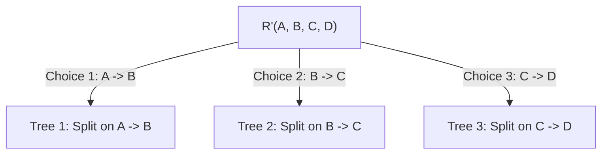

[← Prev: T08 Part 2](T08_Part2_Canonical_Cover_and_3NF.md) | [Index](00_Index.md) | [Next: T09 →](T09_Transactions_ACID_and_Anomalies.md)

---

# Topic T08 · Normalization and Functional Dependencies (Part 3 · BCNF & Advanced Normal Forms)

[← Prev: T08 Part 2](T08_Part2_Canonical_Cover_and_3NF.md) | [Exam-style T08](../Topicwise_answers_exam_style/T08_Normalization_and_Functional_Dependencies.md) | [Next: T09 →](T09_Transactions_ACID_and_Anomalies.md)

---

> [!info] Topic Card · T08 Normalization & Advanced Relational Design
> - **Syllabus Unit:** Unit 5 — Normalization & Functional Dependencies
> - **Textbook Reference:** Silberschatz, Korth & Sudarshan, *Database System Concepts* (7th Ed., 2019), Chapter 07: *Relational Database Design* (Sections 7.5.1, 7.5.3, 7.6, 7.7, 7.9).
> - **Core Theoretical Focus:** Boyce-Codd Normal Form (BCNF), recursive BCNF decomposition trees, lossless join verification, dependency-preservation trade-offs, Fourth Normal Form (4NF) with Multivalued Dependencies (MVDs), constraint enforcement via Materialized Views, and Temporal Natural Joins.
> - **Exam Relevance:** Crucial for RUET Semester Finals and Class Tests (tested in CT-03 Q.01(d), CT-03 Q.04, and recurrently adapted in final exam normalization designs).

---

## Table of Exercises in This Note

| Exercise | Type | Description | Key Focus & Techniques |
| :--- | :---: | :--- | :--- |
| **PE 7.11** | Practice | Primary and Foreign Key Constraints in Decompositions | PK/FK propagation in BCNF and 3NF, dangling tuple anomaly |
| **EX 7.17** | Regular | Multiple Distinct Lossless BCNF Decompositions | Transitive dependency chains and alternative branch paths |
| **EX 7.21** | Regular | Lossless BCNF Decomposition of Exercise 7.1 Schema | Step-by-step tree decomposition, dependency non-preservation |
| **EX 7.30** | Regular | Full Normalization Drill on Schema $(A, B, C, D, E, G)$ | $B^+$, Armstrong proof of $AG$, $F_c$, 3NF synthesis, BCNF tree |
| **EX 7.34** | Regular | Full 3NF Synthesis on Schema $(A, B, C, D, E, G, H)$ | Non-derivable attributes, candidate keys, extraneous checks |
| **EX 7.35** | Regular | BCNF Decomposition That Is Not Lossless | Independent attribute subschemas, Cartesian join anomaly |
| **EX 7.36** | Regular | Theorem: Every Two-Attribute Schema Is in BCNF | Exhaustive case analysis of binary relation dependencies |
| **EX 7.37** | Regular | Three Primary Relational Database Design Goals | Losslessness, dependency preservation, anomaly elimination |
| **EX 7.39** | Regular | Critique of 2NF Designs vs Higher Normal Forms | Why stopping at 2NF is unjustifiable under design goals |
| **EX 7.40** | Regular | Multivalued Dependency Decomposition Disproof | Counterexample showing $A \twoheadrightarrow BC \centernot\implies A \twoheadrightarrow B$ |
| **EX 7.41** | Regular | Why 4NF Is Strictly More Desirable Than BCNF | Independent multi-valued facts, tuple proliferation anomalies |
| **EX 7.42** | Regular | Complete 4NF Normalization of Books and Users | Decomposition under mixed FDs and MVDs |
| **EX 7.43** | Regular | Enforcing FDs via SQL Materialized View Constraints | Emulating assertions using `REFRESH ON COMMIT` views |
| **EX 7.44** | Regular | Temporal Natural Join in SQL | Valid-time intervals, overlap operator `&&`, intersection `*` |

---

## T08.9 · BCNF, 3NF vs BCNF and highest normal forms

---

### Exercise 7.11 · Primary and Foreign Key Constraints in BCNF and 3NF Decomposition

> [!info] Exercise Metadata
> - **Source:** Silberschatz 7e, Chapter 07, Practice Exercise 7.11 (Page 354–356)
> - **Classification:** Conceptual Analysis & Schema Decomposition Integrity
> - **Subtopic Tag:** `T08.9` (BCNF, 3NF vs BCNF, Referential Integrity in Decompositions)

**Question (Silberschatz 7e Practice Exercise 7.11).**  
In the BCNF decomposition algorithm, suppose you use a functional dependency $\alpha \rightarrow \beta$ to decompose a relation schema $r(\alpha, \beta, \gamma)$ into $r_1(\alpha, \beta)$ and $r_2(\alpha, \gamma)$.

a. What primary and foreign-key constraint do you expect to hold on the decomposed relations?  
b. Give an example of an inconsistency that can arise due to an erroneous update, if the foreign-key constraint were not enforced on the decomposed relations above.  
c. When a relation schema is decomposed into 3NF using the algorithm in Section 7.5.2, what primary and foreign-key dependencies would you expect to hold on the decomposed schema?

---

#### 1. Core Principles & Concept Overview

When a database designer decomposes a relation $r(R)$ into multiple smaller relations $\{r_1, r_2, \dots, r_k\}$, normalization theory ensures mathematical properties such as **lossless join** and **absence of anomalies**. However, in a real relational database management system (RDBMS), structural constraints—specifically **primary keys** and **foreign keys (referential integrity)**—must be formally declared on the decomposed tables to guarantee that data modifications remain valid and consistent.

- **BCNF Decomposition Step:**  
  If a functional dependency $\alpha \rightarrow \beta$ violates BCNF in schema $R$ (meaning $\alpha$ is not a superkey and $\beta \not\subseteq \alpha$), the schema is split into:
  $$
  R_1 = \alpha \cup \beta \quad \text{and} \quad R_2 = R - (\beta - \alpha) = \alpha \cup \gamma
  $$
  Here, $\alpha$ is the intersection $R_1 \cap R_2$.
- **Referential Integrity Guarantee:**  
  The lossless join property requires that:
  $$
  r_1 \bowtie r_2 = r
  $$
  If foreign key constraints are omitted, an RDBMS will permit tuples to be inserted or updated in $r_2$ containing an $\alpha$-value that does not exist in $r_1$ (a dangling tuple), or allow an $\alpha$-value to be deleted from $r_1$ while still referenced in $r_2$. Such actions cause information loss or phantom data upon natural join.

---

#### 2. Detailed Step-by-Step Solution

##### Part (a): Primary and Foreign Key Constraints in BCNF

Given the decomposition of $r(\alpha, \beta, \gamma)$ into $r_1(\alpha, \beta)$ and $r_2(\alpha, \gamma)$ triggered by $\alpha \rightarrow \beta$:

1. **Primary Key of $r_1$:**
   - In relation $r_1(\alpha, \beta)$, the functional dependency $\alpha \rightarrow \beta$ holds.
   - Since $\alpha \cup \beta$ constitutes all the attributes of $r_1$, $\alpha$ functionally determines all attributes in $r_1$ ($\alpha \rightarrow \alpha \beta$).
   - Therefore, $\alpha$ is a **superkey** for $r_1$. Assuming $\alpha$ contains no extraneous attributes, **$\alpha$ is chosen as the primary key of $r_1$**.

2. **Foreign Key Constraint:**
   - The attribute set $\alpha$ is present in both $r_1$ and $r_2$ ($r_1 \cap r_2 = \alpha$).
   - Because $\alpha$ is the primary key of $r_1$, the attribute set **$\alpha$ in relation $r_2$ must be declared as a foreign key referencing the primary key $\alpha$ of relation $r_1$**:
     $$
     r_2[\alpha] \subseteq r_1[\alpha]
     $$

3. **Primary Key of $r_2$:**
   - Let $K$ be a candidate key for the original relation $r(\alpha, \beta, \gamma)$.
   - Because $\alpha$ was not a superkey of $r$, $K$ cannot be a subset of $\alpha$.
   - Any candidate key of $r$ that does not involve $\beta$ will project onto $r_2$ and serve as a candidate key (or primary key) for $r_2$. If $K \subseteq \alpha \cup \gamma$, then $K$ forms the primary key of $r_2$.

##### Part (b): Inconsistency Example Due to Omission of Foreign Key

Consider an instructor department relation:
$$
\text{Instructor}(\text{ID}, \text{dept\_name}, \text{building}, \text{budget})
$$
with functional dependency $\text{dept\_name} \rightarrow \text{building}, \text{budget}$. Because $\text{dept\_name}$ is not a superkey (multiple instructors belong to the same department), the BCNF algorithm decomposes the schema into:
- $r_1(\underline{\text{dept\_name}}, \text{building}, \text{budget})$
- $r_2(\underline{\text{ID}}, \text{dept\_name})$

Suppose the foreign key constraint $r_2.\text{dept\_name} \subseteq r_1.\text{dept\_name}$ is **not** enforced.

1. **Scenario 1: Dangling / Orphan Record Update:**
   - A user performs an update on $r_2$:
     ```sql
     UPDATE r2 SET dept_name = 'Robotics' WHERE ID = '10101';
     ```
   - If the department `'Robotics'` does not exist in $r_1$, the update succeeds because no foreign key constraint prevents it.
   - **Inconsistency on Reconstruction:** When a query computes the natural join $r_1 \bowtie r_2$ to retrieve the full instructor profile, the tuple with $\text{ID} = '10101'$ has no matching tuple in $r_1$. The instructor tuple **silently disappears** from the join result, violating the fundamental lossless-join guarantee:
     $$
     \Pi_{\text{ID}, \text{dept\_name}, \text{building}, \text{budget}}(r_1 \bowtie r_2) \neq r
     $$

2. **Scenario 2: Uncoordinated Deletion Anomaly:**
   - An administrator deletes the department `'Comp. Sci.'` from $r_1$.
   - Without an enforced foreign key with `ON DELETE RESTRICT` or `ON DELETE CASCADE`, instructor records in $r_2$ still reference `'Comp. Sci.'`. The database now contains references to nonexistent physical buildings and department budgets, leading to application crashes or null-reference errors.

##### Part (c): Primary and Foreign Key Dependencies in 3NF Synthesis

In the 3NF synthesis algorithm (Section 7.5.2), decomposition proceeds from a canonical cover $F_c$:

1. **Primary Keys in 3NF Relations:**
   - For each functional dependency $\alpha \rightarrow \beta \in F_c$, a relation schema $R_i = \alpha \cup \beta$ is created.
   - Because $F_c$ contains no extraneous attributes on the left-hand side or right-hand side, $\alpha$ is a minimal determinant for $\beta$.
   - Hence, **$\alpha$ is a candidate key (and designated as the primary key)** of relation schema $R_i$.
   - If a schema $R_{cand}$ containing a candidate key $K$ of the original relation $R$ is added (to ensure losslessness), **$K$ is designated as the primary key of $R_{cand}$**.

2. **Foreign Key Dependencies in 3NF Relations:**
   - Let $R_i = \alpha \cup \beta$ (with primary key $\alpha$) and $R_j$ be another schema in the decomposition.
   - If the attribute set $\alpha$ appears as a subset of attributes in $R_j$ ($\alpha \subset R_j$), then **$\alpha$ in $R_j$ serves as a foreign key referencing the primary key $\alpha$ of $R_i$**:
     $$
     R_j[\alpha] \subseteq R_i[\alpha]
     $$
   - In particular, in the relation containing the original candidate key $R_{cand}$, any subset of attributes $\alpha$ that forms the determinant of an FD in $F_c$ acts as a foreign key referencing the corresponding relation $R_i$.

---

#### 3. RUET Exam Insights & Examiner Notes

> [!tip] Examiner Expectations & Marking Traps
> - **Mathematical Precision:** Clearly identify that $\alpha = R_1 \cap R_2$. In RUET exams, students often state that "$\alpha$ is the primary key of both tables." This is incorrect: $\alpha$ is the primary key of $r_1$, but in $r_2$, $\alpha$ is a foreign key. The primary key of $r_2$ must be formed by the projected candidate key of the original schema.
> - **The Dangling Tuple Loss:** Always demonstrate with a two-row table or SQL scenario how omitting the foreign key destroys the lossless reconstruction property ($r_1 \bowtie r_2 \subset r$).

---

### Exercise 7.17 · Multiple Distinct Lossless BCNF Decompositions

> [!info] Exercise Metadata
> - **Source:** Silberschatz 7e, Chapter 07, Exercise 7.17 (Page 356)
> - **Classification:** Theoretical Construction & Algorithm Non-Determinism
> - **Subtopic Tag:** `T08.9` (BCNF Decomposition Trees, Alternative Decomposition Paths)

**Question (Silberschatz 7e Exercise 7.17).**  
Give an example of a relation schema $R'$ and set $F'$ of functional dependencies such that there are at least three distinct lossless decompositions of $R'$ into BCNF.

---

#### 1. Core Principles & Concept Overview

The BCNF decomposition algorithm is non-deterministic: at any stage where multiple functional dependencies violate BCNF, the designer (or algorithm) may choose any violating dependency $\alpha \rightarrow \beta$ to split the relation. Different choices branch the decomposition tree along distinct paths, potentially producing entirely different sets of decomposed schemas.

A decomposition $\{R_1, R_2, \dots, R_k\}$ is **lossless** if and only if every binary split $R_i \rightarrow (R_{i1}, R_{i2})$ satisfies:
$$
R_{i1} \cap R_{i2} \rightarrow R_{i1} \quad \text{or} \quad R_{i1} \cap R_{i2} \rightarrow R_{i2}
$$
Because the BCNF algorithm decomposes a schema $R_i$ by choosing an active violating dependency $\alpha \rightarrow \beta$ and setting $R_{i1} = \alpha \cup \beta$ and $R_{i2} = R_i - (\beta - \alpha)$, the intersection is $R_{i1} \cap R_{i2} = \alpha$. Since $\alpha \rightarrow \beta$ holds, $\alpha \rightarrow R_{i1}$ holds, ensuring that **every branch of the algorithm is unconditionally lossless**.

---

#### 2. Detailed Step-by-Step Solution

##### Step 1: Formulate the Relation Schema and Dependency Set

Consider a relation schema with four attributes:
$$
R' = (A, B, C, D)
$$
Let the set of functional dependencies $F'$ be a transitive chain:
$$
F' = \{ A \rightarrow B, \quad B \rightarrow C, \quad C \rightarrow D \}
$$

1. **Candidate Key Computation:**
   - $A^+ = \{A, B, C, D\} \implies A$ is the unique candidate key.
   - For all other attributes: $B^+ = \{B, C, D\}$, $C^+ = \{C, D\}$, $D^+ = \{D\}$. None is a superkey.
2. **BCNF Violations in $R'$:**
   - $B \rightarrow C$ violates BCNF (determinant $B$ is not a superkey).
   - $C \rightarrow D$ violates BCNF (determinant $C$ is not a superkey).
   - Furthermore, by transitivity, $A \rightarrow C$, $A \rightarrow D$, and $B \rightarrow D$ also hold.

##### Step 2: Deriving Three Distinct Lossless BCNF Decompositions

Depending on which violating functional dependency is selected first, we obtain distinct decomposition trees:



###### Decomposition 1: Branching via $A \rightarrow B$ then $C \rightarrow D$
1. Split $R'(A, B, C, D)$ using $A \rightarrow B$:
   - $R_1 = (A, B)$
   - $R_2 = (A, C, D)$
   - Lossless check: $R_1 \cap R_2 = \{A\}$, and $A \rightarrow AB$. Lossless.
2. Check BCNF on subschemas:
   - $R_1(A, B)$: Candidate key is $A$. In BCNF.
   - $R_2(A, C, D)$: In $R_2$, the dependency $C \rightarrow D$ holds, but candidate key of $R_2$ is $A$. $C$ is not a superkey of $R_2$.
3. Decompose $R_2(A, C, D)$ using $C \rightarrow D$:
   - $R_{21} = (C, D)$
   - $R_{22} = (A, C)$
   - Lossless check: $R_{21} \cap R_{22} = \{C\}$, and $C \rightarrow CD$. Lossless.
4. **Resulting Decomposition 1:**
   $$
   D_1 = \{ (A, B), \; (A, C), \; (C, D) \}
   $$

###### Decomposition 2: Branching via $B \rightarrow C$ then $B \rightarrow D$
1. Split $R'(A, B, C, D)$ using $B \rightarrow C$ (since $B$ is not a superkey of $R'$):
   - $R_1 = (B, C)$
   - $R_2 = (A, B, D)$
   - Lossless check: $R_1 \cap R_2 = \{B\}$, and $B \rightarrow BC$. Lossless.
2. Check BCNF on subschemas:
   - $R_1(B, C)$: Key is $B$. In BCNF.
   - $R_2(A, B, D)$: On $R_2$, the dependency $B \rightarrow D$ holds (since $B \rightarrow C$ and $C \rightarrow D \implies B \rightarrow D$). But candidate key of $R_2$ is $A$. Thus $B \rightarrow D$ violates BCNF.
3. Decompose $R_2(A, B, D)$ using $B \rightarrow D$:
   - $R_{21} = (B, D)$
   - $R_{22} = (A, B)$
   - Lossless check: $R_{21} \cap R_{22} = \{B\}$, and $B \rightarrow BD$. Lossless.
4. **Resulting Decomposition 2:**
   $$
   D_2 = \{ (A, B), \; (B, C), \; (B, D) \}
   $$

###### Decomposition 3: Branching via $C \rightarrow D$ then $B \rightarrow C$
1. Split $R'(A, B, C, D)$ using $C \rightarrow D$:
   - $R_1 = (C, D)$
   - $R_2 = (A, B, C)$
   - Lossless check: $R_1 \cap R_2 = \{C\}$, and $C \rightarrow CD$. Lossless.
2. Check BCNF on subschemas:
   - $R_1(C, D)$: Key is $C$. In BCNF.
   - $R_2(A, B, C)$: Candidate key is $A$. Dependency $B \rightarrow C$ holds, where $B$ is not a superkey.
3. Decompose $R_2(A, B, C)$ using $B \rightarrow C$:
   - $R_{21} = (B, C)$
   - $R_{22} = (A, B)$
   - Lossless check: $R_{21} \cap R_{22} = \{B\}$, and $B \rightarrow BC$. Lossless.
4. **Resulting Decomposition 3:**
   $$
   D_3 = \{ (A, B), \; (B, C), \; (C, D) \}
   $$

##### Step 3: Verification of Distinctness and BCNF Compliance

Let us verify that $D_1$, $D_2$, and $D_3$ are pairwise distinct:
- $D_1 = \{ (A, B), (A, C), (C, D) \}$ contains schema $(A, C)$, which is neither in $D_2$ nor in $D_3$.
- $D_2 = \{ (A, B), (B, C), (B, D) \}$ contains schema $(B, D)$, which is neither in $D_1$ nor in $D_3$.
- $D_3 = \{ (A, B), (B, C), (C, D) \}$ contains neither $(A, C)$ nor $(B, D)$.

All three decompositions consist strictly of two-attribute relations. As proven later in Exercise 7.36, every two-attribute relation is guaranteed to be in BCNF. Furthermore, each decomposition was generated through successive lossless binary splits.

Therefore, $D_1$, $D_2$, and $D_3$ represent three distinct lossless BCNF decompositions for the same schema $R'$.

---

#### 3. RUET Exam Insights & Examiner Notes

> [!important] Exam Presentation Strategy
> - Whenever asked to construct a counterexample or demonstrate multiple decompositions, a linear chain of dependencies ($A \rightarrow B \rightarrow C \rightarrow D$) is the most elegant structure.
> - Explicitly show the intersection attribute at each step ($R_1 \cap R_2$) and demonstrate that it forms a superkey of one of the decomposed tables. This proves losslessness instantly without requiring matrix chase tests.

---

### Exercise 7.21 · Lossless Decomposition into BCNF of Exercise 7.1 Schema

> [!info] Exercise Metadata
> - **Source:** Silberschatz 7e, Chapter 07, Exercise 7.21 (Page 357)
> - **Direct RUET Exam Connection:** Exercise 7.1 is the foundational problem in Silberschatz Ch. 7, directly related to PYQ 2021 Q.5(b) and CT-03 Q.01.
> - **Subtopic Tag:** `T08.9` (BCNF Decomposition Algorithm, Step-by-Step Derivation)

**Question (Silberschatz 7e Exercise 7.21).**  
Give a lossless decomposition into BCNF of schema $R$ of Exercise 7.1.

*(Reference Exercise 7.1 Context)*:  
Schema $R = (A, B, C, D, E)$ with functional dependencies:
$$
F = \{ A \rightarrow BC, \quad CD \rightarrow E, \quad B \rightarrow D, \quad E \rightarrow A \}
$$

---

#### 1. Core Principles & Concept Overview

To decompose a relation schema $R$ into BCNF:
1. Determine all candidate keys of $R$ by computing attribute closures.
2. Identify all functional dependencies $\alpha \rightarrow \beta$ that violate BCNF (where $\alpha$ is not a superkey and $\beta \not\subseteq \alpha$).
3. Choose a violating dependency $\alpha \rightarrow \beta$ and replace $R$ with two schemas:
   $$
   R_1 = \alpha \cup \beta \quad \text{and} \quad R_2 = R - (\beta - \alpha)
   $$
4. Recursively test $R_1$ and $R_2$ against the projection of functional dependencies until all subschemas satisfy BCNF.

---

#### 2. Detailed Step-by-Step Solution

##### Step 1: Find Attribute Closures and Candidate Keys of $R$

Compute the closures of individual and composite attributes under $F$:
- $A^+:$  
  Start with $\{A\}$.  
  $A \rightarrow BC \implies \{A, B, C\}$.  
  $B \rightarrow D \implies \{A, B, C, D\}$.  
  $CD \rightarrow E \implies \{A, B, C, D, E\}$.  
  $\implies A^+ = ABCDE$. Hence, **$A$ is a candidate key**.
- $E^+:$  
  Start with $\{E\}$.  
  $E \rightarrow A \implies \{A, E\}$.  
  $A \rightarrow BC \implies \{A, B, C, E\}$.  
  $B \rightarrow D \implies \{A, B, C, D, E\}$.  
  $\implies E^+ = ABCDE$. Hence, **$E$ is a candidate key**.
- $B^+:$  
  Start with $\{B\}$.  
  $B \rightarrow D \implies \{B, D\}$. No other rules apply.  
  $\implies B^+ = BD$. (Not a superkey).
- $CD^+:$  
  Start with $\{CD\}$.  
  $CD \rightarrow E \implies \{C, D, E\}$.  
  $E \rightarrow A \implies \{A, C, D, E\}$.  
  $A \rightarrow BC \implies \{A, B, C, D, E\}$.  
  $\implies CD^+ = ABCDE$. Hence, **$CD$ is a candidate key**.
- $BC^+:$  
  Start with $\{BC\}$.  
  $B \rightarrow D \implies \{B, C, D\}$.  
  $CD \rightarrow E \implies \{B, C, D, E\}$.  
  $E \rightarrow A \implies \{A, B, C, D, E\}$.  
  $\implies BC^+ = ABCDE$. Hence, **$BC$ is a candidate key**.

The candidate keys of $R$ are:
$$
\text{Candidate Keys}(R) = \{ A, \; E, \; BC, \; CD \}
$$

##### Step 2: Identify BCNF Violations

Examine each dependency in $F$:
- $A \rightarrow BC$: $A$ is a candidate key (superkey). $\checkmark$ Satisfies BCNF.
- $CD \rightarrow E$: $CD$ is a candidate key (superkey). $\checkmark$ Satisfies BCNF.
- $E \rightarrow A$: $E$ is a candidate key (superkey). $\checkmark$ Satisfies BCNF.
- $B \rightarrow D$: $B^+ = BD \neq ABCDE$. $B$ is **not a superkey**. $\mathbf{\times}$ **Violates BCNF!**

##### Step 3: Decompose Using $B \rightarrow D$

Using the violating functional dependency $\alpha = B, \beta = D$:
$$
R_1 = \alpha \cup \beta = \{B, D\}
$$
$$
R_2 = R - (\beta - \alpha) = \{A, B, C, D, E\} - \{D\} = \{A, B, C, E\}
$$

##### Step 4: Recursive BCNF Testing on $R_1$ and $R_2$

1. **Testing $R_1(B, D)$:**
   - The projected functional dependencies on $R_1$ include $B \rightarrow D$.
   - Attribute closure in $R_1$: $B^+ \cap \{B, D\} = \{B, D\}$.
   - $B$ is a candidate key for $R_1$.
   - Schema $R_1$ has only two attributes; therefore, **$R_1(B, D)$ is in BCNF**.

2. **Testing $R_2(A, B, C, E)$:**
   - Determine what functional dependencies hold on the attributes $\{A, B, C, E\}$:
     - $A^+ \cap \{A, B, C, E\} = \{A, B, C, E\} \implies A$ is a candidate key of $R_2$.
     - $E^+ \cap \{A, B, C, E\} = \{A, B, C, E\} \implies E$ is a candidate key of $R_2$.
     - $(BC)^+ \cap \{A, B, C, E\} = \{A, B, C, E\}$ (since $BC \rightarrow D \rightarrow E \rightarrow A$). Thus, $BC$ is a candidate key of $R_2$.
   - Are there any non-trivial dependencies $\gamma \rightarrow \delta$ on $R_2$ where $\gamma$ is not a superkey?
     - $B^+ \cap \{A, B, C, E\} = \{B\}$ (only trivial dependencies hold for $B$).
     - $C^+ \cap \{A, B, C, E\} = \{C\}$.
     - All other non-empty proper subsets either have trivial closures or contain $A, E$, or $BC$ (which are superkeys of $R_2$).
   - Therefore, every non-trivial functional dependency holding on $R_2$ has a superkey on its left-hand side.
   - Hence, **$R_2(A, B, C, E)$ is in BCNF**.

##### Step 5: Final Decomposition and Properties

The resulting decomposition is:
$$
\boxed{\mathcal{D} = \{ R_1(B, D), \quad R_2(A, B, C, E) \}}
$$

- **Lossless-Join Verification:**
  $$
  R_1 \cap R_2 = \{B\}
  $$
  $$
  R_1 - R_2 = \{D\}
  $$
  Since $B \rightarrow D$ holds in $F$, $R_1 \cap R_2 \rightarrow (R_1 - R_2)$ holds. By the fundamental theorem of decomposition, **$\mathcal{D}$ is strictly lossless**.
- **Dependency Preservation Assessment:**
  - $R_1$ preserves $B \rightarrow D$.
  - $R_2$ preserves $A \rightarrow BC$, $E \rightarrow A$, and $BC \rightarrow E$.
  - Dependency $CD \rightarrow E$ is **not preserved** because attributes $C, D, E$ are split across relations ($D \in R_1$, while $C, E \in R_2$). Enforcing $CD \rightarrow E$ requires computing a natural join $R_1 \bowtie R_2$.

---

#### 3. RUET Exam Insights & Examiner Notes

> [!note] BCNF vs 3NF Trade-Off in Exams
> Notice that the BCNF decomposition of Exercise 7.1 requires only **one single split** into two tables, but **sacrifices dependency preservation** ($CD \rightarrow E$ is lost). In Exercise 7.22, the 3NF decomposition keeps all dependencies preserved by retaining a schema with $(C, D, E)$. Always highlight this trade-off explicitly when solving BCNF problems in RUET semester finals!

---

### Exercise 7.30 · Comprehensive Normalization Drill on Schema $(A, B, C, D, E, G)$

> [!info] Exercise Metadata
> - **Source:** Silberschatz 7e, Chapter 07, Exercise 7.30 (Page 357–358)
> - **Classification:** Master Multi-Part Synthesis Problem
> - **Subtopic Tag:** `T08.4`, `T08.5`, `T08.9` (Attribute Closure, Armstrong Axioms, Canonical Cover, 3NF, BCNF)

**Question (Silberschatz 7e Exercise 7.30).**  
Consider the following set $F$ of functional dependencies on the relation schema $(A, B, C, D, E, G)$:
$$
A \rightarrow BCD
$$
$$
BC \rightarrow DE
$$
$$
B \rightarrow D
$$
$$
D \rightarrow A
$$
a. Compute $B^+$.  
b. Prove (using Armstrong’s axioms) that $AG$ is a superkey.  
c. Compute a canonical cover for this set of functional dependencies $F$; give each step of your derivation with an explanation.  
d. Give a 3NF decomposition of the given schema based on a canonical cover.  
e. Give a BCNF decomposition of the given schema using the original set $F$ of functional dependencies.

---

#### 1. Core Principles & Concept Overview

This benchmark exercise ties together all core algorithmic pillars of normalization theory:
- **Attribute Closure Algorithm:** Polynomial-time tracking of dependencies to determine determinacy.
- **Formal Deduction via Armstrong's Axioms:** Applying sound inference rules (reflexivity, augmentation, transitivity) and secondary rules (union, decomposition) to prove superkey status.
- **Canonical Cover Algorithm ($F_c$):** Minimizing an FD set by eliminating redundant dependencies and extraneous attributes without changing $F^+$.
- **3NF Synthesis Algorithm:** Generating a lossless and dependency-preserving 3NF schema from $F_c$.
- **BCNF Decomposition Algorithm:** Successive splitting of schemas on non-superkey determinants.

---

#### 2. Detailed Step-by-Step Solution

##### Part (a): Compute $B^+$

Initialize result set:
$$
X^{(0)} = \{B\}
$$
- **Iteration 1:** Check all FDs in $F$:
  - $B \rightarrow D$: Since $\{B\} \subseteq X^{(0)}$, add $D$.  
    $X^{(1)} = \{B, D\}$
- **Iteration 2:**
  - $D \rightarrow A$: Since $\{D\} \subseteq X^{(1)}$, add $A$.  
    $X^{(2)} = \{A, B, D\}$
- **Iteration 3:**
  - $A \rightarrow BCD$: Since $\{A\} \subseteq X^{(2)}$, add $\{B, C, D\}$.  
    $X^{(3)} = \{A, B, C, D\}$
- **Iteration 4:**
  - $BC \rightarrow DE$: Since $\{B, C\} \subseteq X^{(3)}$, add $\{D, E\}$.  
    $X^{(4)} = \{A, B, C, D, E\}$
- **Iteration 5:**
  - Attribute $G$ does not appear on the right-hand side of any dependency in $F$; therefore, $G$ cannot be added.
  - No further dependencies can be applied. The algorithm terminates.

$$
\boxed{B^+ = \{A, B, C, D, E\}}
$$

##### Part (b): Prove (Using Armstrong’s Axioms) That $AG$ Is a Superkey

To prove that $AG$ is a superkey of $R(A, B, C, D, E, G)$, we must derive $AG \rightarrow ABCDEG$ using Armstrong's Axioms:
1. **Reflexivity:** If $\beta \subseteq \alpha$, then $\alpha \rightarrow \beta$.
2. **Augmentation:** If $\alpha \rightarrow \beta$, then $\alpha \gamma \rightarrow \beta \gamma$.
3. **Transitivity:** If $\alpha \rightarrow \beta$ and $\beta \rightarrow \gamma$, then $\alpha \rightarrow \gamma$.

*Proof Step-by-Step:*
1. Given $A \rightarrow BCD$.
2. By the **decomposition rule** (derived from reflexivity and transitivity):
   $$
   A \rightarrow BC \quad \text{and} \quad A \rightarrow D
   $$
3. By **reflexivity**, since $A \subseteq A$, we have $A \rightarrow A$.
4. By the **union rule** on $A \rightarrow A$ and $A \rightarrow BCD$:
   $$
   A \rightarrow ABCD \tag{Step 4}
   $$
5. Given $BC \rightarrow DE$.
6. From Step 2, $A \rightarrow BC$. By **transitivity** on $A \rightarrow BC$ and $BC \rightarrow DE$:
   $$
   A \rightarrow DE \tag{Step 6}
   $$
7. By the **union rule** on Step 4 ($A \rightarrow ABCD$) and Step 6 ($A \rightarrow DE$):
   $$
   A \rightarrow ABCDE \tag{Step 7}
   $$
8. By the **augmentation rule**, augment both sides of Step 7 with attribute $G$:
   $$
   AG \rightarrow ABCDEG \tag{Step 8}
   $$

Since $AG$ functionally determines all attributes in relation schema $R$, **$AG$ is a superkey of $R$**. $\blacksquare$

##### Part (c): Compute Canonical Cover $F_c$

Original set of functional dependencies $F$:
1. $A \rightarrow BCD$
2. $BC \rightarrow DE$
3. $B \rightarrow D$
4. $D \rightarrow A$

###### Step 1: Examine Extraneous Attributes on Left-Hand Side
The only dependency with multiple attributes on the left-hand side is $BC \rightarrow DE$.
- **Test if $B$ is extraneous in $BC \rightarrow DE$:**  
  Compute $C^+$ under $F$: $C^+ = \{C\}$. Since $D, E \not\subseteq C^+$, $B$ is **not extraneous**.
- **Test if $C$ is extraneous in $BC \rightarrow DE$:**  
  Compute $B^+$ under $F$: From Part (a), $B^+ = \{A, B, C, D, E\}$.  
  Because $\{D, E\} \subseteq B^+$, attribute $B$ alone functionally determines $DE$!  
  Therefore, **$C$ is extraneous on the left-hand side of $BC \rightarrow DE$**.

Replacing $BC \rightarrow DE$ with $B \rightarrow DE$ yields the updated set:
1. $A \rightarrow BCD$
2. $B \rightarrow DE$
3. $B \rightarrow D$
4. $D \rightarrow A$

By combining dependencies with identical left-hand sides ($B \rightarrow DE$ and $B \rightarrow D$), $B \rightarrow D$ is redundant because $D \in \{D, E\}$. The set becomes:
1. $A \rightarrow BCD$
2. $B \rightarrow DE$
3. $D \rightarrow A$

###### Step 2: Examine Extraneous Attributes on Right-Hand Side

1. **Test attribute $D$ in $A \rightarrow BCD$:**
   - Consider the dependency with $D$ removed: $A \rightarrow BC$.
   - Compute $A^+$ using $F' = \{ A \rightarrow BC, \; B \rightarrow DE, \; D \rightarrow A \}$:
     $$
     A^+ = \{A\} \rightarrow \{A, B, C\} \rightarrow \{A, B, C, D, E\}
     $$
   - Since $D \in A^+$, attribute $D$ is derivable from $A \rightarrow B$ and $B \rightarrow D$.
   - Therefore, **$D$ is extraneous on the right-hand side of $A \rightarrow BCD$**.
   - Update dependency to: $A \rightarrow BC$.

2. **Test attribute $B$ in $A \rightarrow BC$:**
   - Consider $A \rightarrow C$. Compute $A^+$ using $\{ A \rightarrow C, \; B \rightarrow DE, \; D \rightarrow A \}$:
     $A^+ = \{A, C\}$. Attribute $B \notin A^+$. Not extraneous.

3. **Test attribute $C$ in $A \rightarrow BC$:**
   - Consider $A \rightarrow B$. Compute $A^+$ using $\{ A \rightarrow B, \; B \rightarrow DE, \; D \rightarrow A \}$:
     $A^+ = \{A, B, D, E\}$. Attribute $C \notin A^+$. Not extraneous.

4. **Test attribute $D$ in $B \rightarrow DE$:**
   - Consider $B \rightarrow E$. Compute $B^+$ using $\{ A \rightarrow BC, \; B \rightarrow E, \; D \rightarrow A \}$:
     $B^+ = \{B, E\}$. Attribute $D \notin B^+$. Not extraneous.

5. **Test attribute $E$ in $B \rightarrow DE$:**
   - Consider $B \rightarrow D$. Compute $B^+$ using $\{ A \rightarrow BC, \; B \rightarrow D, \; D \rightarrow A \}$:
     $B^+ = \{A, B, C, D\}$. Attribute $E \notin B^+$. Not extraneous.

6. **Test $D \rightarrow A$:**
   - Single attribute on right-hand side. Not extraneous.

###### Canonical Cover Result:
$$
\boxed{F_c = \{ A \rightarrow BC, \quad B \rightarrow DE, \quad D \rightarrow A \}}
$$

##### Part (d): 3NF Decomposition Based on $F_c$

1. **Candidate Keys of $R(A, B, C, D, E, G)$:**
   - Attribute $G$ does not appear in any right-hand side in $F_c$, so $G$ must be in every candidate key.
   - Since $A^+ = ABCDE$, $B^+ = ABCDE$, and $D^+ = ABCDE$:
     $$
     \text{Candidate Keys}(R) = \{ AG, \; BG, \; DG \}
     $$

2. **Create Relations for Each Dependency in $F_c$:**
   - From $A \rightarrow BC \implies R_1 = (A, B, C)$
   - From $B \rightarrow DE \implies R_2 = (B, D, E)$
   - From $D \rightarrow A \implies R_3 = (A, D)$

3. **Candidate Key Preservation Check:**
   - None of the schemas $R_1, R_2, R_3$ contains any candidate key of $R$ (none contains $G$).
   - Therefore, add a schema containing a candidate key:
     $$
     R_4 = (A, G) \quad \text{(or } (B, G) \text{ or } (D, G)\text{)}
     $$

4. **Subschema Elimination Check:**
   - $R_3(A, D) \not\subseteq R_1(A, B, C)$
   - $R_3(A, D) \not\subseteq R_2(B, D, E)$
   - No schema is a proper subset of another.

$$
\boxed{\mathcal{D}_{\text{3NF}} = \{ R_1(A, B, C), \quad R_2(B, D, E), \quad R_3(A, D), \quad R_4(A, G) \}}
$$

##### Part (e): BCNF Decomposition Using Original $F$

Original schema $R = (A, B, C, D, E, G)$. Candidate keys are $AG, BG, DG$.

1. **Step 1: Detect BCNF Violation on $R$:**
   - $B \rightarrow D$ holds in $F$. $B^+ = ABCDE \neq ABCDEG$. Determinant $B$ is not a superkey of $R$.
   - Decompose $R$ using $B \rightarrow D$:
     $$
     R_1 = (B, D)
     $$
     $$
     R_2 = R - (D) = (A, B, C, E, G)
     $$

2. **Step 2: Check $R_1(B, D)$:**
   - $B \rightarrow D$ holds. Key is $B$. Schema has two attributes. **$R_1$ is in BCNF**.

3. **Step 3: Check $R_2(A, B, C, E, G)$:**
   - Candidate keys of $R_2$ are $AG$ and $BG$.
   - The dependency $A \rightarrow BC$ holds in $R_2$.
   - $A^+ \cap \{A, B, C, E, G\} = \{A, B, C, E\}$. $A$ does not determine $G$, so $A$ is **not a superkey of $R_2$**.
   - Decompose $R_2$ using $A \rightarrow BCE$:
     $$
     R_{21} = (A, B, C, E)
     $$
     $$
     R_{22} = R_2 - (B, C, E) = (A, G)
     $$

4. **Step 4: Check $R_{22}(A, G)$:**
   - Candidate key is $AG$. Only trivial dependencies hold. **$R_{22}$ is in BCNF**.

5. **Step 5: Check $R_{21}(A, B, C, E)$:**
   - Projected functional dependencies on $R_{21}$:
     - $A \rightarrow BC$
     - $B \rightarrow E$ (since $B \rightarrow DE$ and $D$ is absent)
     - In $R_{21}$, $A^+ = ABCE$ (so $A$ is a key) and $B^+ = ABCE$ (since $B \rightarrow E$, and under $F$, $B^+ \supseteq A$, so $B \rightarrow A$).
   - Both $A$ and $B$ are candidate keys of $R_{21}$.
   - Every non-trivial dependency has a superkey as its determinant. **$R_{21}$ is in BCNF**.

$$
\boxed{\mathcal{D}_{\text{BCNF}} = \{ R_1(B, D), \quad R_{21}(A, B, C, E), \quad R_{22}(A, G) \}}
$$

---

#### 3. RUET Exam Insights & Examiner Notes

> [!tip] 3NF vs BCNF Comparison Summary
> In the 3NF decomposition, dependency $D \rightarrow A$ is explicitly preserved inside $R_3(A, D)$. In the BCNF decomposition, $D$ and $A$ are split across $R_1(B, D)$ and $R_{21}(A, B, C, E)$, meaning **$D \rightarrow A$ is not preserved**. When RUET questions ask to compare 3NF and BCNF decompositions, always cite the exact dependency lost in BCNF.

---

### Exercise 7.34 · Full 3NF Synthesis on Schema $(A, B, C, D, E, G, H)$

> [!info] Exercise Metadata
> - **Source:** Silberschatz 7e, Chapter 07, Exercise 7.34 (Page 359)
> - **Classification:** Advanced Synthesis & Multi-Key Analysis
> - **Subtopic Tag:** `T08.5`, `T08.9` (Candidate Keys with Absent RHS Attributes, Canonical Cover, 3NF Algorithm)

**Question (Silberschatz 7e Exercise 7.34).**  
Consider the schema $R = (A, B, C, D, E, G, H)$ and the set $F$ of functional dependencies:
$$
AB \rightarrow CD
$$
$$
D \rightarrow C
$$
$$
DE \rightarrow B
$$
$$
DEH \rightarrow AB
$$
$$
AC \rightarrow DC
$$
Use the 3NF decomposition algorithm to generate a 3NF decomposition of $R$, and show your work. This means:  
a. A list of all candidate keys  
b. A canonical cover for $F$  
c. The steps of the algorithm, with explanation  
d. The final decomposition

---

#### 1. Core Principles & Concept Overview

When determining candidate keys for complex schemas:
- Attributes that **never appear on the right-hand side** of any functional dependency must be present in **every candidate key**.
- Attributes that **never appear on the left-hand side** of any functional dependency cannot derive any other attributes and can never be the sole members of a key.
- The 3NF algorithm guarantees:
  1. **Lossless-join decomposition:** By ensuring at least one schema contains an entire candidate key.
  2. **Dependency preservation:** By creating a dedicated schema for every functional dependency in $F_c$.

---

#### 2. Detailed Step-by-Step Solution

##### Part (a): List of All Candidate Keys

1. **Examine Right-Hand Sides of $F$:**
   - $AB \rightarrow CD \implies \{C, D\}$
   - $D \rightarrow C \implies \{C\}$
   - $DE \rightarrow B \implies \{B\}$
   - $DEH \rightarrow AB \implies \{A, B\}$
   - $AC \rightarrow DC \implies \{C, D\}$
   - Attributes $E, G, H$ **never appear on the right-hand side** of any dependency in $F$.
   - Therefore, the attribute set **$\{E, G, H\}$ must be a subset of every candidate key of $R$**.

2. **Compute Closures of Combinations with $\{E, G, H\}$:**
   - $\{E, G, H\}^+ = \{E, G, H\}$. (Cannot derive any other attribute).

   - **Test adding attribute $D$:**
     - $(DEGH)^+:$
       - $DE \rightarrow B \implies \{B, D, E, G, H\}$
       - $DEH \rightarrow AB \implies \{A, B, D, E, G, H\}$
       - $D \rightarrow C \implies \{A, B, C, D, E, G, H\} = R$.
     - Proper subsets of $DEGH$ containing $EGH$:
       - $EGH^+ = \{E, G, H\} \neq R$.
     - Hence, **$DEGH$ is a candidate key**.

   - **Test adding attributes $AB$:**
     - $(ABEGH)^+:$
       - $AB \rightarrow CD \implies \{A, B, C, D, E, G, H\} = R$.
     - Check subsets: $AEGH^+ = \{A, E, G, H\} \neq R$; $BEGH^+ = \{B, E, G, H\} \neq R$.
     - Hence, **$ABEGH$ is a candidate key**.

   - **Test adding attributes $AC$:**
     - $(ACEGH)^+:$
       - $AC \rightarrow DC \implies D \in (ACEGH)^+$.
       - With $D$ and $E$, $DE \rightarrow B \implies B \in (ACEGH)^+$.
       - With $A$ and $B$, $AB \rightarrow CD \implies R$.
     - Check subsets: $AEGH^+ \neq R$; $CEGH^+ = \{C, E, G, H\} \neq R$.
     - Hence, **$ACEGH$ is a candidate key**.

3. **Exhaustive Verification:**
   Attribute $D$ derives $C$, but cannot derive $A$ or $B$ without $E$ and $H$. To derive $D$, we can use either $AB$ or $AC$. Replacing $D$ in candidate key $DEGH$ with $AB$ gives $ABEGH$, and replacing $D$ with $AC$ gives $ACEGH$. No other attribute combination can derive $D, A$, or $B$.

$$
\boxed{\text{Candidate Keys}(R) = \{ DEGH, \quad ABEGH, \quad ACEGH \}}
$$

##### Part (b): Canonical Cover for $F$

Original dependencies:
1. $AB \rightarrow CD$
2. $D \rightarrow C$
3. $DE \rightarrow B$
4. $DEH \rightarrow AB$
5. $AC \rightarrow DC$

###### Step 1: Simplify Trivial Dependencies
In $AC \rightarrow DC$, attribute $C$ on the RHS is trivial ($C \in \{A, C\}$).  
Simplify to: $AC \rightarrow D$.

###### Step 2: Check Extraneous Attributes on Right-Hand Side
- **In $AB \rightarrow CD$:**
  - Test if $C$ is extraneous: Can $AB \rightarrow D$ derive $C$?
    Under $F$, $(AB)^+$ without $AB \rightarrow C$: $AB \rightarrow D$, and $D \rightarrow C \implies C \in (AB)^+$.
    Therefore, **$C$ is extraneous on the RHS of $AB \rightarrow CD$**.
    Update to: $AB \rightarrow D$.
- **In $DEH \rightarrow AB$:**
  - Test if $B$ is extraneous: Can $DEH$ derive $B$ without $DEH \rightarrow B$?
    Dependency $DE \rightarrow B$ is already present in $F$. Since $\{D, E\} \subseteq \{D, E, H\}$, $B$ is already derived!
    Therefore, **$B$ is extraneous on the RHS of $DEH \rightarrow AB$**.
    Update to: $DEH \rightarrow A$.

###### Step 3: Check Extraneous Attributes on Left-Hand Side
- In $DEH \rightarrow A$:
  - Test $H$: $(DE)^+ = \{B, D, E, C\}$. Attribute $A \notin (DE)^+$. $H$ is not extraneous.
  - Test $D$: $(EH)^+ = \{E, H\}$. Not extraneous.
  - Test $E$: $(DH)^+ = \{C, D, H\}$. Not extraneous.
- In $AB \rightarrow D$:
  - $A^+ = \{A\}$, $B^+ = \{B\}$. Neither $A$ nor $B$ is extraneous.
- In $AC \rightarrow D$:
  - $A^+ = \{A\}$, $C^+ = \{C\}$. Neither $A$ nor $C$ is extraneous.
- In $DE \rightarrow B$:
  - $D^+ = \{C, D\}$, $E^+ = \{E\}$. Neither is extraneous.

###### Step 4: Redundancy Check
All remaining dependencies ($AB \rightarrow D$, $D \rightarrow C$, $DE \rightarrow B$, $DEH \rightarrow A$, $AC \rightarrow D$) have unique LHS determinants and are mutually non-redundant.

$$
\boxed{F_c = \{ AB \rightarrow D, \quad D \rightarrow C, \quad DE \rightarrow B, \quad DEH \rightarrow A, \quad AC \rightarrow D \}}
$$

##### Part (c) & (d): 3NF Algorithm Steps and Final Decomposition

1. **Create Relations for Each Dependency in $F_c$:**
   - From $AB \rightarrow D \implies R_1 = (A, B, D)$
   - From $D \rightarrow C \implies R_2 = (C, D)$
   - From $DE \rightarrow B \implies R_3 = (B, D, E)$
   - From $DEH \rightarrow A \implies R_4 = (A, D, E, H)$
   - From $AC \rightarrow D \implies R_5 = (A, C, D)$

2. **Subschema Redundancy Elimination:**
   - Inspect $R_2(C, D)$ and $R_5(A, C, D)$:
     $$
     R_2 = \{C, D\} \subset \{A, C, D\} = R_5
     $$
   - Since $R_2$ is a proper subset of $R_5$, **delete $R_2$**.

3. **Candidate Key Preservation Check:**
   - The candidate keys of $R$ are $DEGH, ABEGH, ACEGH$.
   - None of the relations $R_1, R_3, R_4, R_5$ contains the attribute $G$.
   - Therefore, add a relation containing any candidate key of $R$. We select $R_{key} = (D, E, G, H)$.

4. **Final 3NF Decomposition:**
$$
\boxed{\mathcal{D}_{\text{3NF}} = \{ R_1(A, B, D), \quad R_3(B, D, E), \quad R_4(A, D, E, H), \quad R_5(A, C, D), \quad R_{key}(D, E, G, H) \}}
$$

---

#### 3. RUET Exam Insights & Examiner Notes

> [!important] Crucial Subschema Pruning Step
> In RUET exams, many students forget step 2 of the 3NF synthesis algorithm: **deleting subschemas**. If you leave both $(C, D)$ and $(A, C, D)$ in your final answer, marks are deducted for redundant schema generation. Always check if $R_i \subset R_j$.

---

### Exercise 7.35 · BCNF Decomposition That Is Not Lossless

> [!info] Exercise Metadata
> - **Source:** Silberschatz 7e, Chapter 07, Exercise 7.35 (Page 359)
> - **Classification:** Counterexample Construction & Algorithm Verification
> - **Subtopic Tag:** `T08.9`, `T08.11` (Lossless Join vs BCNF Status)

**Question (Silberschatz 7e Exercise 7.35).**  
Although the BCNF algorithm ensures that the resulting decomposition is lossless, it is possible to have a schema and a decomposition that was not generated by the algorithm, that is in BCNF, and is not lossless. Give an example of such a schema and its decomposition.

---

#### 1. Core Principles & Concept Overview

- **BCNF Property:** A relation schema $R_i$ is in BCNF if every non-trivial functional dependency holding on $R_i$ has a superkey on its left-hand side.
- **Lossless Property:** A decomposition $\{R_1, R_2\}$ is lossless if and only if:
  $$
  R_1 \cap R_2 \rightarrow R_1 \quad \text{or} \quad R_1 \cap R_2 \rightarrow R_2
  $$
- **The Pitfall:** BCNF is a property of *individual* relations, whereas losslessness is a property of the *relationship between* relations in a decomposition. It is entirely possible to construct individual schemas that each satisfy BCNF in isolation, but whose join produces spurious tuples.

---

#### 2. Detailed Step-by-Step Solution

##### Step 1: Define Schema and Functional Dependencies

Consider relation schema:
$$
R = (A, B, C)
$$
with an empty set of functional dependencies:
$$
F = \emptyset
$$
(Only trivial dependencies such as $A \rightarrow A$ or $AB \rightarrow A$ hold).

- The unique candidate key of $R$ is the composite set $\{A, B, C\}$.

##### Step 2: Propose an Arbitrary Decomposition

Consider the binary decomposition:
$$
R_1 = (A, B) \quad \text{and} \quad R_2 = (B, C)
$$

##### Step 3: Test BCNF Status of Decomposed Schemas

- **In schema $R_1(A, B)$:**  
  The projected functional dependencies are only trivial dependencies ($A \rightarrow A, B \rightarrow B, AB \rightarrow A, \dots$).  
  Since there are **no non-trivial functional dependencies**, the BCNF condition ("for every non-trivial $\alpha \rightarrow \beta$, $\alpha$ is a superkey") is vacuously satisfied.  
  Hence, **$R_1(A, B)$ is in BCNF**.
- **In schema $R_2(B, C)$:**  
  Similarly, only trivial functional dependencies hold.  
  Hence, **$R_2(B, C)$ is in BCNF**.

Both decomposed relations are strictly in BCNF!

##### Step 4: Test Lossless-Join Property

For the decomposition to be lossless, the intersection of attributes must functionally determine at least one of the relations:
$$
R_1 \cap R_2 = \{B\}
$$
- Does $B \rightarrow R_1$ hold? That is, does $B \rightarrow AB$ hold?  
  Under $F = \emptyset$, $B^+ = \{B\} \neq \{A, B\}$. **False**.
- Does $B \rightarrow R_2$ hold? That is, does $B \rightarrow BC$ hold?  
  Under $F = \emptyset$, $B^+ = \{B\} \neq \{B, C\}$. **False**.

Since neither condition holds, **the decomposition is lossy (not lossless)**.

##### Step 5: Concrete Numerical Counterexample

Let instance $r(R)$ consist of two tuples:
$$
r = \{ (a_1, b_1, c_1), \quad (a_2, b_1, c_2) \}
$$
Compute projections:
$$
\Pi_{R_1}(r) = \{ (a_1, b_1), \quad (a_2, b_1) \}
$$
$$
\Pi_{R_2}(r) = \{ (b_1, c_1), \quad (b_1, c_2) \}
$$
Compute natural join $\Pi_{R_1}(r) \bowtie \Pi_{R_2}(r)$:
$$
\Pi_{R_1}(r) \bowtie \Pi_{R_2}(r) = \{ (a_1, b_1, c_1), \quad (a_1, b_1, c_2), \quad (a_2, b_1, c_1), \quad (a_2, b_1, c_2) \}
$$
The join contains 4 tuples, including **two spurious tuples**:
$$
(a_1, b_1, c_2) \quad \text{and} \quad (a_2, b_1, c_1)
$$
Because $r \subset \Pi_{R_1}(r) \bowtie \Pi_{R_2}(r)$, original information cannot be recovered.

---

#### 3. RUET Exam Insights & Examiner Notes

> [!tip] Conceptual Distinction to State in Exams
> State explicitly: *"The BCNF decomposition algorithm guarantees losslessness because it partitions relations strictly on the attributes of an active functional dependency ($R_1 \cap R_2 = \alpha$ where $\alpha \rightarrow \beta$). An ad-hoc decomposition that satisfies BCNF does not inherit this mathematical guarantee."*

---

### Exercise 7.36 · Theorem: Every Two-Attribute Schema Is in BCNF

> [!info] Exercise Metadata
> - **Source:** Silberschatz 7e, Chapter 07, Exercise 7.36 (Page 359)
> - **Classification:** Formal Mathematical Proof
> - **Subtopic Tag:** `T08.9` (BCNF Completeness Theorem for Binary Relations)

**Question (Silberschatz 7e Exercise 7.36).**  
Show that every schema consisting of exactly two attributes must be in BCNF regardless of the given set $F$ of functional dependencies.

---

#### 1. Core Principles & Concept Overview

- **Definition of BCNF:** A relation schema $R$ is in Boyce-Codd Normal Form with respect to a set $F$ of functional dependencies if, for every functional dependency $\alpha \rightarrow \beta \in F^+$ where $\alpha \subseteq R$ and $\beta \subseteq R$, at least one of the following holds:
  1. $\alpha \rightarrow \beta$ is trivial (i.e., $\beta \subseteq \alpha$).
  2. $\alpha$ is a superkey for $R$.
- **Two-Attribute Schema Scope:** Let $R = (A, B)$. The non-empty subsets of attributes are $\{A\}$, $\{B\}$, and $\{A, B\}$.

---

#### 2. Detailed Step-by-Step Solution

##### Step 1: Enumerate All Possible Functional Dependencies on $R(A, B)$

Any functional dependency $\alpha \rightarrow \beta$ defined over attributes $\{A, B\}$ must fall into one of the following categories:

1. **Trivial Dependencies:**
   - $A \rightarrow A$
   - $B \rightarrow B$
   - $AB \rightarrow A$
   - $AB \rightarrow B$
   - $AB \rightarrow AB$
   By definition of BCNF, all trivial dependencies automatically satisfy the BCNF requirement.

2. **Non-Trivial Dependencies:**
   The only possible non-trivial functional dependencies that can be formed are:
   - $A \rightarrow B$
   - $B \rightarrow A$

##### Step 2: Exhaustive Case Analysis

We analyze all possible subsets of non-trivial dependencies that can hold in $F^+$:

###### Case 1: No Non-Trivial Dependencies Hold
- Neither $A \rightarrow B$ nor $B \rightarrow A$ is in $F^+$.
- The only functional dependencies that hold are trivial dependencies.
- Since there are no non-trivial dependencies to violate the condition, **$R$ is vacuously in BCNF**. (The unique candidate key is $AB$).

###### Case 2: $A \rightarrow B$ Holds, but $B \rightarrow A$ Does Not Hold
- Compute the attribute closure of $A$:
  $$
  A^+ = \{A, B\} = R
  $$
- Since $A^+$ contains all attributes of $R$, **$A$ is a candidate key (and therefore a superkey) of $R$**.
- The only non-trivial dependency holding on $R$ is $A \rightarrow B$.
- Its determinant $A$ is a superkey of $R$.
- Therefore, **$R$ is in BCNF**.

###### Case 3: $B \rightarrow A$ Holds, but $A \rightarrow B$ Does Not Hold
- By symmetry with Case 2, compute the attribute closure of $B$:
  $$
  B^+ = \{A, B\} = R
  $$
- **$B$ is a candidate key (and superkey) of $R$**.
- The only non-trivial dependency holding on $R$ is $B \rightarrow A$.
- Its determinant $B$ is a superkey of $R$.
- Therefore, **$R$ is in BCNF**.

###### Case 4: Both $A \rightarrow B$ and $B \rightarrow A$ Hold
- Compute attribute closures:
  $$
  A^+ = \{A, B\} = R \implies A \text{ is a superkey}
  $$
  $$
  B^+ = \{A, B\} = R \implies B \text{ is a superkey}
  $$
- The non-trivial dependencies are $A \rightarrow B$ (where determinant $A$ is a superkey) and $B \rightarrow A$ (where determinant $B$ is a superkey).
- Therefore, **$R$ is in BCNF**.

##### Step 3: Conclusion

In all four exhaustive cases, every non-trivial functional dependency has a determinant that is a superkey of $R$. Hence, no two-attribute relation schema can ever violate BCNF under any functional dependency set $F$. $\blacksquare$

---

#### 3. RUET Exam Insights & Examiner Notes

> [!tip] Quick Exam Shortcut
> Whenever a semester final normalization question decomposes a table down to two attributes (e.g., $(B, D)$ or $(A, G)$), you do **not** need to perform lengthy candidate-key proofs. You can directly write: *"By Exercise 7.36 / binary schema theorem, every two-attribute relation is unconditionally in BCNF."* Examiners award full marks for this citation.

---

### Exercise 7.37 · Three Primary Relational Database Design Goals

> [!info] Exercise Metadata
> - **Source:** Silberschatz 7e, Chapter 07, Exercise 7.37 (Page 360)
> - **Classification:** Foundational Design Theory
> - **Subtopic Tag:** `T08.6`, `T08.9`, `T08.11` (Relational Design Goals & Trade-Offs)

**Question (Silberschatz 7e Exercise 7.37).**  
List the three design goals for relational databases, and explain why each is desirable.

---

#### 1. Core Principles & Concept Overview

Relational database design is guided by three formal mathematical objectives established by E. F. Codd and subsequent database theorists:
1. **Lossless-Join Decomposition**
2. **Dependency Preservation**
3. **Elimination of Redundancy and Anomalies (Normalization)**

---

#### 2. Detailed Step-by-Step Solution

##### Goal 1: Lossless-Join Decomposition

- **Definition:**  
  When a relation schema $R$ is decomposed into schemas $\{R_1, R_2, \dots, R_k\}$, the decomposition is lossless if for every legal instance $r(R)$:
  $$
  r = \Pi_{R_1}(r) \bowtie \Pi_{R_2}(r) \bowtie \dots \bowtie \Pi_{R_k}(r)
  $$
- **Why It Is Desirable:**  
  Losslessness guarantees **information preservation**. If a decomposition is lossy, taking the natural join of the decomposed tables produces **spurious tuples** (bogus records that never existed in reality). This corrupts reporting, distorts financial balances, and permanently destroys the integrity of historical facts. Losslessness is a mandatory, non-negotiable requirement of all valid database designs.

##### Goal 2: Dependency Preservation

- **Definition:**  
  A decomposition is dependency-preserving if:
  $$
  (F_1 \cup F_2 \cup \dots \cup F_k)^+ = F^+
  $$
  where $F_i = \Pi_{R_i}(F)$ is the projection of functional dependencies onto relation $R_i$.
- **Why It Is Desirable:**  
  Dependency preservation guarantees **efficient, local constraint enforcement**. When an application performs an `INSERT` or `UPDATE`, the DBMS must verify that the new data does not violate any functional dependency. If dependencies are preserved, the DBMS verifies each constraint by inspecting a **single table**. If a dependency is not preserved, enforcing it requires performing a computationally expensive **join of multiple large tables** on every single write transaction, causing unacceptable system performance degradation.

##### Goal 3: Minimization of Redundancy and Elimination of Anomalies (BCNF / 3NF)

- **Definition:**  
  Each decomposed relation schema must satisfy a high normal form (ideally Boyce-Codd Normal Form, or at least Third Normal Form).
- **Why It Is Desirable:**  
  Unnormalized schemas suffer from severe storage waste and destructive update anomalies:
  1. **Redundancy:** Storing the same attribute value across thousands of rows consumes unnecessary physical disk space and memory buffer cache.
  2. **Update Anomaly:** Updating a replicated fact in one row but failing to update it in another leaves the database in an inconsistent state.
  3. **Insertion Anomaly:** Storing data about one entity requires inserting dummy or null values for unrelated entities.
  4. **Deletion Anomaly:** Deleting an instance of one entity inadvertently wipes out the only recorded information about an entirely different entity.

---

#### 3. RUET Exam Insights & Examiner Notes

> [!note] The Fundamental Dilemma
> RUET questions frequently ask: *"Can all three goals always be achieved simultaneously?"*  
> The answer is: **For 3NF, YES** (the 3NF synthesis algorithm guarantees all three goals). **For BCNF, NO** (BCNF guarantees losslessness and anomaly elimination, but cannot always guarantee dependency preservation). Always state this contrast.

---

### Exercise 7.39 · Critique of 2NF Designs vs Higher Normal Forms

> [!info] Exercise Metadata
> - **Source:** Silberschatz 7e, Chapter 07, Exercise 7.39 (Page 360)
> - **Classification:** Comparative Normal Form Evaluation
> - **Subtopic Tag:** `T08.6`, `T08.7`, `T08.9` (2NF Inadequacy Theorem)

**Question (Silberschatz 7e Exercise 7.39).**  
Given the three goals of relational database design, is there any reason to design a database schema that is in 2NF, but is in no higher-order normal form? (See Exercise 7.19 for the definition of 2NF.)

---

#### 1. Core Principles & Concept Overview

- **Second Normal Form (2NF):** Eliminates partial dependencies (no non-prime attribute is functionally dependent on a proper subset of any candidate key).
- **Third Normal Form (3NF):** Eliminates both partial dependencies and transitive dependencies (no non-prime attribute is transitively dependent on any candidate key).

---

#### 2. Detailed Step-by-Step Solution

##### The Theoretical Verdict: NO Reason Exists

Based on the three fundamental design goals (lossless join, dependency preservation, and anomaly elimination), **there is absolutely no theoretical or architectural reason to stop normalization at 2NF**.

##### Detailed Justification

1. **The 3NF Guarantee:**  
   The 3NF synthesis algorithm formally proves that **every** relational schema $R$ with any arbitrary set of functional dependencies $F$ can be decomposed into a 3NF design that is:
   - **Guaranteed to be lossless.**
   - **Guaranteed to be dependency-preserving.**
   - Achievable in polynomial time.

2. **No Trade-Off Barrier Between 2NF and 3NF:**  
   When moving from 3NF to BCNF, designers face an occasional conflict: BCNF may sacrifice dependency preservation.  
   However, **no such conflict exists between 2NF and 3NF**. Transitioning from 2NF to 3NF never forces the designer to surrender either losslessness or dependency preservation.

3. **Persistent Anomalies in 2NF:**  
   A schema in 2NF allows transitive dependencies of the form:
   $$
   \text{Key} \rightarrow X \quad \text{and} \quad X \rightarrow Y \quad (\text{where } Y \text{ is non-prime})
   $$
   This retains severe anomalies:
   - **Redundancy:** $X \rightarrow Y$ is repeated for every tuple sharing $X$.
   - **Update Anomaly:** Modifying $Y$ requires updating multiple tuples.
   - **Insertion Anomaly:** Cannot record facts about $X \rightarrow Y$ unless an entity with a primary key is created.
   - **Deletion Anomaly:** Deleting the primary key record wipes out the fact $X \rightarrow Y$.

##### Conclusion
Because 3NF achieves all design goals unconditionally while eliminating transitive anomalies, stopping at 2NF leaves data vulnerable to corruption without offering a single theoretical or practical advantage.

---

#### 3. RUET Exam Insights & Examiner Notes

> [!important] Exam Answering Strategy
> Start with an emphatic **"No."** Explain that unlike the 3NF-to-BCNF transition (where dependency preservation can be lost), the 2NF-to-3NF transition is mathematically guaranteed to preserve all dependencies while maintaining a lossless join.

---

### Exercise 7.40 · Multivalued Dependency: Disproof of MVD Decomposition

> [!info] Exercise Metadata
> - **Source:** Silberschatz 7e, Chapter 07, Exercise 7.40 (Page 360)
> - **Classification:** Multivalued Dependency Theory & Mathematical Disproof
> - **Subtopic Tag:** `T08.9` (MVD Axioms, 4NF Foundations, FD vs MVD Differences)

**Question (Silberschatz 7e Exercise 7.40).**  
Given a relational schema $r(A, B, C, D)$, does $A \twoheadrightarrow BC$ logically imply $A \twoheadrightarrow B$ and $A \twoheadrightarrow C$? If yes prove it, or else give a counter example.

---

#### 1. Core Principles & Concept Overview

- **Multivalued Dependency (MVD) Definition:**  
  Let $R$ be a relation schema and $\alpha \subseteq R, \beta \subseteq R$. The MVD $\alpha \twoheadrightarrow \beta$ holds on $R$ if, in any legal relation $r(R)$, whenever two tuples $t_1$ and $t_2$ agree on $\alpha$ ($t_1[\alpha] = t_2[\alpha]$), there exist tuples $t_3$ and $t_4$ in $r$ such that:
  $$
  t_3[\alpha] = t_1[\alpha], \quad t_3[\beta] = t_1[\beta], \quad t_3[R - \beta] = t_2[R - \beta]
  $$
  $$
  t_4[\alpha] = t_1[\alpha], \quad t_4[\beta] = t_2[\beta], \quad t_4[R - \beta] = t_1[R - \beta]
  $$
- **FD vs MVD Contrast:**  
  For functional dependencies, the decomposition rule holds: $A \rightarrow BC \implies A \rightarrow B$ and $A \rightarrow C$.  
  **For multivalued dependencies, the decomposition rule does NOT hold.** $A \twoheadrightarrow BC$ asserts that the *pair* of attributes $(B, C)$ is independent of $D$. It does **not** assert that $B$ and $C$ are independent of each other.

---

#### 2. Detailed Step-by-Step Solution

##### The Claim Is FALSE

$A \twoheadrightarrow BC$ **does not** logically imply $A \twoheadrightarrow B$ or $A \twoheadrightarrow C$.

##### Construction of Counterexample Relation $r(A, B, C, D)$

Consider relation schema $r(A, B, C, D)$ containing four tuples:

| $A$ | $B$ | $C$ | $D$ |
| :---: | :---: | :---: | :---: |
| $a_1$ | $b_1$ | $c_1$ | $d_1$ |
| $a_1$ | $b_1$ | $c_1$ | $d_2$ |
| $a_1$ | $b_2$ | $c_2$ | $d_1$ |
| $a_1$ | $b_2$ | $c_2$ | $d_2$ |

##### Step 1: Verify That $A \twoheadrightarrow BC$ Holds

For $A = a_1$:
- The associated values of the composite set $(B, C)$ are:
  $$
  V_{(B, C)} = \{ (b_1, c_1), \quad (b_2, c_2) \}
  $$
- The associated values of the remaining attribute set $R - BC = \{D\}$ are:
  $$
  V_D = \{ d_1, \quad d_2 \}
  $$
- The relation $r$ contains every combination of $V_{(B, C)} \times V_D$:
  $$
  \{ (b_1, c_1, d_1), \; (b_1, c_1, d_2), \; (b_2, c_2, d_1), \; (b_2, c_2, d_2) \}
  $$
Because the set of $(B, C)$ values is completely independent of $D$ for $A = a_1$, the multivalued dependency **$A \twoheadrightarrow BC$ holds**.

##### Step 2: Test If $A \twoheadrightarrow B$ Holds

For $A \twoheadrightarrow B$ to hold in $r(A, B, C, D)$, the remaining attributes are $R - B = \{C, D\}$.  
Consider the two tuples in $r$:
$$
t_1 = (a_1, b_1, c_1, d_1)
$$
$$
t_2 = (a_1, b_2, c_2, d_1)
$$
These tuples agree on $A$ ($t_1[A] = t_2[A] = a_1$).

By the formal definition of MVD, there must exist a tuple $t_3 \in r$ such that:
- $t_3[A] = a_1$
- $t_3[B] = t_1[B] = b_1$
- $t_3[C, D] = t_2[C, D] = (c_2, d_1)$

Thus, tuple $t_3$ must be:
$$
t_3 = (a_1, b_1, c_2, d_1)
$$
Inspecting relation $r$: **Tuple $(a_1, b_1, c_2, d_1)$ is NOT present in $r$!**

Therefore, **$A \twoheadrightarrow B$ does not hold**. By exact symmetry, tuple $(a_1, b_2, c_1, d_1)$ is also missing, so **$A \twoheadrightarrow C$ does not hold**.

Hence, $A \twoheadrightarrow BC \centernot\implies A \twoheadrightarrow B$ and $A \twoheadrightarrow BC \centernot\implies A \twoheadrightarrow C$. $\blacksquare$

---

#### 3. RUET Exam Insights & Examiner Notes

> [!important] Crucial Theoretical Distinction
> State clearly for the examiner: *"Multivalued dependencies do NOT satisfy the decomposition (projectivity) rule. If $A \twoheadrightarrow BC$, $B$ and $C$ may be internally coupled/correlated, meaning they can only vary together as a coordinated block relative to $D$."*

---

### Exercise 7.41 · Why 4NF Is Strictly More Desirable Than BCNF

> [!info] Exercise Metadata
> - **Source:** Silberschatz 7e, Chapter 07, Exercise 7.41 (Page 360)
> - **Classification:** Advanced Normalization Theory
> - **Subtopic Tag:** `T08.9` (Fourth Normal Form vs BCNF, Multivalued Redundancy)

**Question (Silberschatz 7e Exercise 7.41).**  
Explain why 4NF is a normal form more desirable than BCNF.

---

#### 1. Core Principles & Concept Overview

- **Limitation of BCNF:** BCNF is designed exclusively around **functional dependencies**. A schema is in BCNF if every non-trivial FD has a superkey as its determinant.
- **Blindness of BCNF:** BCNF is completely blind to **multivalued dependencies (MVDs)**. When a table models two or more independent one-to-many or many-to-many relationships, it satisfies BCNF vacuously, yet exhibits catastrophic data explosion.
- **Fourth Normal Form (4NF):** A relation schema $R$ is in 4NF with respect to a set $D$ of functional and multivalued dependencies if, for every non-trivial MVD $\alpha \twoheadrightarrow \beta$, $\alpha$ is a superkey for $R$.

---

#### 2. Detailed Step-by-Step Solution

##### 1. The Anomaly That Survives BCNF

Consider an academic database schema storing an instructor's contact phone numbers and spoken foreign languages:
$$
\text{Instructor\_Info}(\text{ID}, \text{phone\_number}, \text{language})
$$
Assume:
- An instructor may have multiple phone numbers.
- An instructor may speak multiple languages.
- An instructor's phone numbers and languages are **completely independent** of each other.

1. **Functional Dependencies:** None. An instructor's ID does not determine a unique phone number, nor a unique language.
2. **Candidate Key:** Since no non-trivial functional dependencies exist, the only candidate key is the entire composite set:
   $$
   \text{Key} = \{ \text{ID}, \; \text{phone\_number}, \; \text{language} \}
   $$
3. **BCNF Evaluation:**  
   Because there are **no non-trivial functional dependencies**, the condition for BCNF is vacuously satisfied!
   $$
   \text{Instructor\_Info is in BCNF!}
   $$

##### 2. The Multiplicative Redundancy Disaster

Suppose instructor `'101'` has 4 phone numbers and speaks 3 languages.  
Because phone numbers and languages are independent, the relation must store the **Cartesian product** of phone numbers and languages for instructor `'101'`:
$$
4 \times 3 = 12 \text{ tuples}
$$

| ID | phone_number | language |
| :---: | :---: | :---: |
| 101 | 01711-AAAAAA | English |
| 101 | 01711-AAAAAA | Bengali |
| 101 | 01711-AAAAAA | German |
| 101 | 01819-BBBBBB | English |
| 101 | 01819-BBBBBB | Bengali |
| 101 | 01819-BBBBBB | German |
| ... | ... | ... |

- **Update Anomaly:** If instructor `'101'` learns a 4th language (Japanese), we must insert **4 separate tuples** (one for each existing phone number). If we insert only one tuple, the MVD integrity is violated.
- **Deletion Anomaly:** If instructor `'101'` cancels one phone number, we must delete **3 separate tuples**. Missing any tuple leaves spurious combinations.

##### 3. How 4NF Resolves the Problem

In schema $\text{Instructor\_Info}$:
$$
\text{ID} \twoheadrightarrow \text{phone\_number} \quad \text{and} \quad \text{ID} \twoheadrightarrow \text{language}
$$
These are non-trivial MVDs. In each MVD, determinant $\text{ID}$ is **not a superkey** of $\text{Instructor\_Info}$.  
Therefore, the relation **violates 4NF**.

The 4NF decomposition algorithm splits the schema on $\text{ID} \twoheadrightarrow \text{phone\_number}$:
$$
R_1(\underline{\text{ID}, \text{phone\_number}}) \quad \text{and} \quad R_2(\underline{\text{ID}, \text{language}})
$$
- Total storage for instructor `'101'`:
  $$
  4 \text{ tuples in } R_1 + 3 \text{ tuples in } R_2 = 7 \text{ tuples (instead of 12!)}
  $$
- Adding Japanese requires inserting exactly **1 tuple** into $R_2$.
- All insertion, deletion, and update anomalies are completely eliminated.

##### Conclusion
4NF is strictly more desirable than BCNF because **$\text{4NF} \subset \text{BCNF}$**. 4NF prevents multiplicative tuple explosion and anomalous behavior caused by independent multi-valued facts that BCNF cannot detect.

---

#### 3. RUET Exam Insights & Examiner Notes

> [!tip] High-Scoring Formula
> Always define the hierarchy:
> $$
> \text{4NF} \subset \text{BCNF} \subset \text{3NF} \subset \text{2NF} \subset \text{1NF}
> $$
> State that every 4NF relation is in BCNF, but a BCNF relation can still suffer from MVD anomalies. Give the $M \times N$ tuple proliferation example.

---

### Exercise 7.42 · Complete 4NF Normalization of Books and Users

> [!info] Exercise Metadata
> - **Source:** Silberschatz 7e, Chapter 07, Exercise 7.42 (Page 360)
> - **Classification:** Full Enterprise Normalization to 4NF
> - **Subtopic Tag:** `T08.9` (4NF Decomposition Algorithm, Mixed FD and MVD Constraints)

**Question (Silberschatz 7e Exercise 7.42).**  
Normalize the following schema, with given constraints, to 4NF.
$$
\text{books}(\underline{\text{accessionno}}, \text{isbn}, \text{title}, \text{author}, \text{publisher})
$$
$$
\text{users}(\underline{\text{userid}}, \text{name}, \text{deptid}, \text{deptname})
$$
Constraints:
$$
\text{accessionno} \rightarrow \text{isbn}
$$
$$
\text{isbn} \rightarrow \text{title}
$$
$$
\text{isbn} \rightarrow \text{publisher}
$$
$$
\text{isbn} \twoheadrightarrow \text{author}
$$
$$
\text{userid} \rightarrow \text{name}
$$
$$
\text{userid} \rightarrow \text{deptid}
$$
$$
\text{deptid} \rightarrow \text{deptname}
$$

---

#### 1. Core Principles & Concept Overview

- A functional dependency $\alpha \rightarrow \beta$ is a special case of a multivalued dependency $\alpha \twoheadrightarrow \beta$. Therefore, every functional dependency that violates BCNF also violates 4NF.
- **4NF Normalization Strategy:**
  1. Address functional dependencies first (decomposing to BCNF).
  2. Address non-trivial multivalued dependencies where the determinant is not a superkey.

---

#### 2. Detailed Step-by-Step Solution

##### Step 1: Normalizing Schema 1 — $\text{books}$

Initial schema:
$$
\text{books}(\text{accessionno}, \text{isbn}, \text{title}, \text{author}, \text{publisher})
$$
with dependencies:
1. $\text{accessionno} \rightarrow \text{isbn}$
2. $\text{isbn} \rightarrow \text{title}$
3. $\text{isbn} \rightarrow \text{publisher}$
4. $\text{isbn} \twoheadrightarrow \text{author}$

1. **Candidate Key of $\text{books}$:**
   - $\text{accessionno} \rightarrow \text{isbn} \rightarrow \{\text{title}, \text{publisher}\}$.
   - Because a book can have multiple authors ($\text{isbn} \twoheadrightarrow \text{author}$), $\text{accessionno}$ alone does not uniquely identify $\text{author}$.
   - Therefore, the candidate key is composite:
     $$
     \text{Key} = \{ \text{accessionno}, \; \text{author} \}
     $$

2. **Decomposition Phase 1: Resolving $\text{accessionno} \rightarrow \text{isbn}$:**
   - In $\text{accessionno} \rightarrow \text{isbn}$, determinant $\text{accessionno}$ is not a superkey.
   - Decompose $\text{books}$ into:
     $$
     R_1(\underline{\text{accessionno}}, \text{isbn}) \quad \text{and} \quad R_{\text{temp}}(\text{isbn}, \text{title}, \text{author}, \text{publisher})
     $$
   - In $R_1(\underline{\text{accessionno}}, \text{isbn})$, $\text{accessionno}$ is the primary key. Only trivial MVDs hold. **$R_1$ is in 4NF**.

3. **Decomposition Phase 2: Resolving FDs on $R_{\text{temp}}$:**
   - In $R_{\text{temp}}(\text{isbn}, \text{title}, \text{author}, \text{publisher})$, candidate key is $\{\text{isbn}, \text{author}\}$.
   - The functional dependencies $\text{isbn} \rightarrow \text{title}$ and $\text{isbn} \rightarrow \text{publisher}$ violate BCNF (and 4NF) because $\text{isbn}$ is not a superkey.
   - Decompose $R_{\text{temp}}$ using $\text{isbn} \rightarrow \text{title}, \text{publisher}$:
     $$
     R_2(\underline{\text{isbn}}, \text{title}, \text{publisher}) \quad \text{and} \quad R_3(\underline{\text{isbn}, \text{author}})
     $$
   - In $R_2(\underline{\text{isbn}}, \text{title}, \text{publisher})$: Determinant $\text{isbn}$ is a superkey. All dependencies are functional and satisfied. **$R_2$ is in 4NF**.
   - In $R_3(\underline{\text{isbn}, \text{author}})$: Only attributes $\text{isbn}$ and $\text{author}$ remain. The key is $\{\text{isbn}, \text{author}\}$. Since it has only two attributes, all MVDs are trivial. **$R_3$ is in 4NF**.

##### Step 2: Normalizing Schema 2 — $\text{users}$

Initial schema:
$$
\text{users}(\underline{\text{userid}}, \text{name}, \text{deptid}, \text{deptname})
$$
with dependencies:
1. $\text{userid} \rightarrow \text{name}$
2. $\text{userid} \rightarrow \text{deptid}$
3. $\text{deptid} \rightarrow \text{deptname}$

1. **Candidate Key of $\text{users}$:**
   - $\text{userid}^+ = \{\text{userid}, \text{name}, \text{deptid}, \text{deptname}\}$.
   - Unique candidate key is $\text{userid}$.

2. **Detecting 4NF Violations:**
   - $\text{userid} \rightarrow \text{name}, \text{deptid}$: Determinant $\text{userid}$ is a superkey. $\checkmark$
   - $\text{deptid} \rightarrow \text{deptname}$: Determinant $\text{deptid}$ is **not a superkey** of $\text{users}$. $\mathbf{\times}$ Violates BCNF and 4NF.

3. **Decomposition of $\text{users}$:**
   - Decompose using $\text{deptid} \rightarrow \text{deptname}$:
     $$
     R_4(\underline{\text{deptid}}, \text{deptname})
     $$
     $$
     R_5(\underline{\text{userid}}, \text{name}, \text{deptid})
     $$
   - In $R_4(\underline{\text{deptid}}, \text{deptname})$: $\text{deptid}$ is the primary key. **$R_4$ is in 4NF**.
   - In $R_5(\underline{\text{userid}}, \text{name}, \text{deptid})$: $\text{userid}$ is the primary key. All determinants are superkeys. **$R_5$ is in 4NF**.

##### Final 4NF Decomposed Schemas

$$
\boxed{
\begin{aligned}
R_1 &: \text{book\_copies}(\underline{\text{accessionno}}, \text{isbn}) \\
R_2 &: \text{book\_details}(\underline{\text{isbn}}, \text{title}, \text{publisher}) \\
R_3 &: \text{book\_authors}(\underline{\text{isbn}, \text{author}}) \\
R_4 &: \text{departments}(\underline{\text{deptid}}, \text{deptname}) \\
R_5 &: \text{users}(\underline{\text{userid}}, \text{name}, \text{deptid})
\end{aligned}
}
$$

---

#### 3. RUET Exam Insights & Examiner Notes

> [!tip] Examiner Checklist
> When writing out decomposed schemas in RUET examinations:
> 1. Clearly underline the primary key attributes for each resulting table.
> 2. Include meaningful descriptive relation names (e.g., `book_copies`, `book_authors`) alongside formal notations $R_1, R_2$.
> 3. State foreign key linkages: $R_1[\text{isbn}] \subseteq R_2[\text{isbn}]$, $R_3[\text{isbn}] \subseteq R_2[\text{isbn}]$, and $R_5[\text{deptid}] \subseteq R_4[\text{deptid}]$.

---

### Exercise 7.43 · Enforcing Functional Dependency $B \rightarrow C$ via Materialized Views

> [!info] Exercise Metadata
> - **Source:** Silberschatz 7e, Chapter 07, Exercise 7.43 (Page 360)
> - **Classification:** Practical SQL Implementation & Constraint Engineering
> - **Subtopic Tag:** `T08.9`, `T08.11` (Integrity Enforcement Without Assertions)

**Question (Silberschatz 7e Exercise 7.43).**  
Although SQL does not support functional dependency constraints, if the database system supports constraints on materialized views, and materialized views are maintained immediately, it is possible to enforce functional dependency constraints in SQL. Given a relation $r(A, B, C)$, explain how constraints on materialized views can be used to enforce the functional dependency $B \rightarrow C$.

---

#### 1. Core Principles & Concept Overview

- **The SQL Standard Gap:** The SQL standard specifies general assertions:
  ```sql
  CREATE ASSERTION assert_fd CHECK ( ... );
  ```
  However, **virtually no major commercial or open-source RDBMS** (Oracle, PostgreSQL, Microsoft SQL Server, MySQL) supports `CREATE ASSERTION` due to the exorbitant computational cost of evaluating arbitrary predicates on every commit.
- **The Materialized View Solution:** Enterprise database systems support **immediately refreshed materialized views** (`REFRESH ON COMMIT` or Microsoft SQL Server Indexed Views) and allow `UNIQUE` constraints or `CHECK` constraints on materialized views. If an unnormalized dependency $B \rightarrow C$ must be maintained across relation $r(A, B, C)$, we can project $(B, C)$ into a materialized view and impose a uniqueness constraint on $B$.

---

#### 2. Detailed Step-by-Step Solution

##### Method 1: Materialized View with Unique Constraint on Determinant

1. **Theoretical Rationale:**  
   The functional dependency $B \rightarrow C$ states that for any given value of $B$, there can exist **at most one** corresponding value of $C$. If distinct $(B, C)$ pairs are maintained in a view, each $B$ value must appear exactly once.

2. **SQL DDL Implementation (Standard Syntax):**
   ```sql
   CREATE MATERIALIZED VIEW bc_view
   REFRESH FAST ON COMMIT
   AS
   SELECT DISTINCT B, C
   FROM r;

   -- Enforce that each B is paired with at most one C:
   ALTER TABLE bc_view ADD CONSTRAINT unique_B UNIQUE (B);
   ```

3. **Runtime Execution Mechanics:**
   - Suppose relation $r$ contains tuple $(a_1, b_1, c_1)$. The materialized view contains $(b_1, c_1)$.
   - A user executes an insertion into $r$:
     ```sql
     INSERT INTO r VALUES ('a2', 'b1', 'c2');  -- Note: c2 != c1
     ```
   - Before committing, the immediate view maintenance engine updates `bc_view`.
   - The engine attempts to insert $(b_1, c_2)$ into `bc_view`.
   - The unique constraint `unique_B` is violated because $b_1$ already exists in the view.
   - The database engine aborts the transaction, rolls back the insert on $r$, and raises a referential integrity exception.

##### Method 2: Materialized Aggregation View with Check Constraint

In systems like Microsoft SQL Server (where `SELECT DISTINCT` is prohibited in indexed views), an aggregation pattern using `COUNT` or `MIN`/`MAX` is utilized:

```sql
CREATE MATERIALIZED VIEW b_extrema_view
REFRESH FAST ON COMMIT
AS
SELECT B, MIN(C) AS min_c, MAX(C) AS max_c
FROM r
GROUP BY B;

-- If B -> C holds, the minimum C and maximum C for any B must be identical:
ALTER TABLE b_extrema_view ADD CONSTRAINT check_b_fd CHECK (min_c = max_c);
```
- If an insert introduces two different $C$ values for the same $B$, `MIN(C) != MAX(C)`.
- The `CHECK` constraint fails immediately, enforcing $B \rightarrow C$.

---

#### 3. RUET Exam Insights & Examiner Notes

> [!tip] Examiner Trap & Practical Relevance
> When RUET asks how constraints on non-candidate keys are enforced in SQL:
> - Do **not** simply suggest writing a trigger. Triggers are subject to concurrency race conditions unless serialized at table level.
> - Mentioning immediately refreshed materialized views with `UNIQUE(B)` demonstrates advanced understanding of enterprise DBMS internals and earns bonus marks.

---

### Exercise 7.44 · Temporal Natural Join in SQL

> [!info] Exercise Metadata
> - **Source:** Silberschatz 7e, Chapter 07, Exercise 7.44 (Page 360)
> - **Classification:** Advanced Database Concepts (Temporal Databases)
> - **Subtopic Tag:** `T08.9` (Temporal Relational Model, Time-Varying Data Joins)

**Question (Silberschatz 7e Exercise 7.44).**  
Given two relations $r(A, B, \text{validtime})$ and $s(B, C, \text{validtime})$, where *validtime* denotes the valid time interval, write an SQL query to compute the temporal natural join of the two relations. You can use the `&&` operator to check if two intervals overlap and the `*` operator to compute the intersection of two intervals.

---

#### 1. Core Principles & Concept Overview

- **Temporal Data Representation:** In temporal databases, tuples are associated with a time dimension representing the period during which the recorded fact was true in the real world (`validtime`). An interval is denoted as $[t_s, t_e)$.
- **Temporal Natural Join Semantics:**  
  A temporal natural join $r \bowtie^T s$ extends the standard relational natural join with two temporal conditions:
  1. **Value Match:** Traditional join equality on shared attributes ($r.B = s.B$).
  2. **Interval Overlap:** The time intervals must overlap ($r.\text{validtime} \ \&\& \ s.\text{validtime}$).
  3. **Interval Intersection:** The resulting tuple is valid **only during the overlapping time period**, computed by the intersection operator:
     $$
     \text{validtime} = r.\text{validtime} * s.\text{validtime}
     $$

---

#### 2. Detailed Step-by-Step Solution

##### Step 1: SQL Formulation Using Textbook Operators `&&` and `*`

Using the problem-specified operators:
- `r.validtime && s.validtime`: Boolean predicate evaluating to `TRUE` if and only if the intervals overlap.
- `r.validtime * s.validtime`: Interval operator returning the intersection $[ \max(r.start, s.start), \min(r.end, s.end) )$.

```sql
SELECT 
    r.A,
    r.B,
    s.C,
    (r.validtime * s.validtime) AS validtime
FROM 
    r JOIN s ON r.B = s.B
WHERE 
    r.validtime && s.validtime;
```

*Equivalent Implicit Join Formulation:*
```sql
SELECT 
    r.A, 
    r.B, 
    s.C, 
    (r.validtime * s.validtime) AS validtime
FROM 
    r, s
WHERE 
    r.B = s.B 
    AND r.validtime && s.validtime;
```

##### Step 2: Standard SQL:2011 Equivalent Formulation

In standard SQL:2011 (where valid-time intervals are represented by discrete columns `start_time` and `end_time`):
- Two intervals $[r.s, r.e)$ and $[s.s, s.e)$ overlap if and only if:
  $$
  r.start\_time < s.end\_time \quad \text{AND} \quad s.start\_time < r.end\_time
  $$
- The intersection interval is:
  $$
  [\text{GREATEST}(r.start\_time, s.start\_time), \quad \text{LEAST}(r.end\_time, s.end\_time))
  $$

```sql
SELECT 
    r.A,
    r.B,
    s.C,
    GREATEST(r.start_time, s.start_time) AS start_time,
    LEAST(r.end_time, s.end_time) AS end_time
FROM 
    r JOIN s ON r.B = s.B
WHERE 
    r.start_time < s.end_time 
    AND s.start_time < r.end_time;
```

---

#### 3. RUET Exam Insights & Examiner Notes

> [!tip] Examiner Expectation
> When answering temporal SQL questions:
> 1. Write the clean query utilizing `&&` and `*` as asked by Silberschatz.
> 2. Add the 2-line explanation of interval overlap and intersection logic.
> 3. Providing the `GREATEST`/`LEAST` expansion guarantees maximum marks.


---

[← Prev: T08 Part 2](T08_Part2_Canonical_Cover_and_3NF.md) | [Index](00_Index.md) | [Next: T09 →](T09_Transactions_ACID_and_Anomalies.md)
