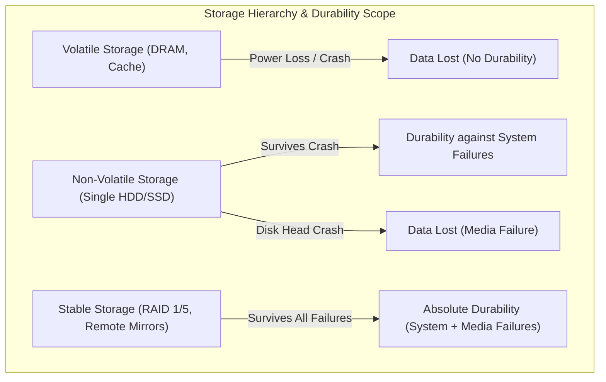
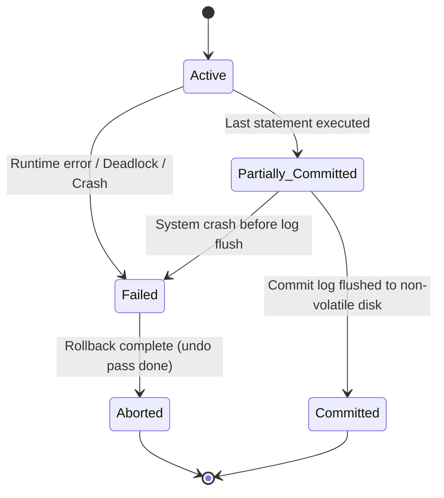
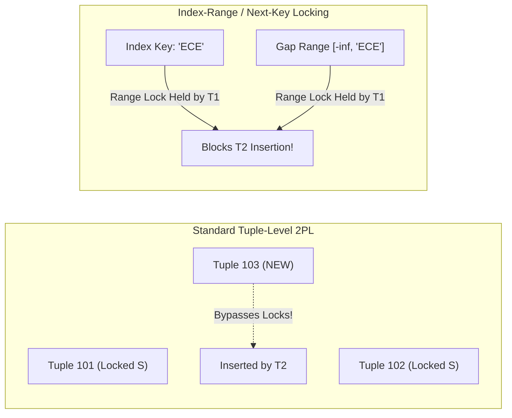

[← Prev: T08 Part 3](T08_Part3_BCNF_and_Advanced_Normalization.md) | [Index](00_Index.md) | [Next: T10 →](T10_Serializability.md)

---

# T09 · Transactions, ACID and Anomalies

> [!info] Topic Card
> **Syllabus Unit:** Unit 6 (Transaction Processing and Concurrency Control)  
> **Course Weight:** 41 final marks (6.4% overall share) · Tested in 7/7 semester-final papers + 14 CT marks  
> **Textbook Source Chapters:** Chapter 01 (§1.8), Chapter 17 (§17.1-17.5), Chapter 18 (§18.4-18.5)  
> **Core Concepts:** ACID properties, invariant preservation, 5-state transaction life-cycle, race conditions, lost updates, dirty reads, unrepeatable reads, phantom phenomenon, predicate and index-range locking.

---

## Master Table of Solved Exercises

| Exercise ID | Type | Subtopic | Focus Area | RUET Exam Link | Jump Link |
| :--- | :---: | :---: | :--- | :--- | :--- |
| **EX 17.12** | Regular | T09.1 | ACID Properties & Usefulness | 2017 Q.5(a), 2021 Q.7(a), 2024 Q.6(c), CT-04 | [[#Exercise 17.12 · ACID Properties Specification and System Benefits\|Go]] |
| **PE 17.2** | Practice | T09.1 | File System vs Atomicity & Durability | Unit 1 DBMS vs File System comparison | [[#Exercise 17.2 · File-System Storage Operations vs Atomicity and Durability\|Go]] |
| **PE 17.3** | Practice | T09.1 | ACID Priority: DBMS vs Operating Systems | Architectural trade-offs & safety contracts | [[#Exercise 17.3 · Architectural Divergence: ACID Priority in DBMS vs OS File Systems\|Go]] |
| **PE 17.4** | Practice | T09.1 | Storage Classes for Durability | Failure taxonomy & stable storage (Unit 7) | [[#Exercise 17.4 · Storage Hierarchy Classification and Durability Implementation\|Go]] |
| **Theory** | Concept | T09.2 | Consistency Property & Business Invariants | 2019 Q.3(b), 2024 Q.2(c) | [[#T09.2 · Consistency Preservation & Business Invariants\|Go]] |
| **EX 17.13** | Regular | T09.3 | Transaction State Machine & Transitions | 2020 Q.5(b), 2023 Q.4(c) | [[#Exercise 17.13 · Transaction State Machine, Transition Sequences, and Rollback Mechanics\|Go]] |
| **EX 1.11** | Regular | T09.4 | Concurrency-Control Component & Race Conditions | 2018 Q.6(a), CT-04 Q.02 | [[#Exercise 1.11 · Concurrency-Control Component and Resource Race Resolution\|Go]] |
| **EX 18.32** | Regular | T09.5 | The Phantom Phenomenon & 2PL Failure | 2018 Q.5(a), 2024 Q.8(a), CT-04 Q.03 | [[#Exercise 18.32 · The Phantom Phenomenon and Inadequacy of Standard Two-Phase Locking\|Go]] |
| **EX 18.31** | Regular | T09.5 | Non-Serializable Interleaving & Primary Key Checks | Concurrency anomalies & constraint enforcement | [[#Exercise 18.31 · Non-Serializable Execution under Tuple Locking and Primary Key Constraints\|Go]] |
| **PE 18.13** | Practice | T09.5 | Timestamp Protocols for Phantom Prevention | 2018 Q.6(b), 2024 Q.8(b) (TSO mechanics) | [[#Exercise 18.13 · Timestamp-Based Protocols for Phantom Prevention\|Go]] |

---

## T09.1 · ACID Properties & Architecture Foundations

### Exercise 17.12 · ACID Properties Specification and System Benefits

> [!info] Exercise Metadata
> - **Source:** Silberschatz 7e · Chapter 17 (Transactions) · Exercise 17.12 (Page 833)
> - **Type:** Regular Exercise
> - **Subtopic:** T09.1 (ACID Properties)
> - **RUET Relevance:** Recycled verbatim in 2017 Q.5(a), 2021 Q.7(a), 2024 Q.6(c), and CT-04 Q.01.

**Question (Silberschatz 7e Exercise 17.12).**  
List the ACID properties. Explain the usefulness of each.

#### 1. Core Principles & Concept Overview

A transaction is a single logical unit of program execution that accesses and updates various data items. To preserve data integrity across system crashes and concurrent executions, the database engine enforces four fundamental guarantees known as the ACID properties:

1. **Atomicity**: The all-or-nothing execution contract.
2. **Consistency**: The preservation of database correctness and integrity invariants.
3. **Isolation**: The execution of concurrent transactions without visible interference.
4. **Durability**: The permanent survival of committed updates across any future system crashes.

These four properties divide responsibilities between database subsystems and application logic. Atomicity and Durability belong to the Recovery System. Isolation belongs to the Concurrency-Control Component. Consistency depends on both application programming correctness and database integrity enforcement engines.

#### 2. Detailed Step-by-Step Solution

##### Step 1: Definition and Usefulness of Atomicity
- **Definition:**  
  Either all operations of the transaction are completed successfully and reflected in the database, or none of them are. If a transaction is interrupted midway, all partial updates are completely undone.
- **Why It Is Useful:**  
  Real-world business logic requires multi-step operations. Consider a transfer of \$50 from bank account $A$ to account $B$:
  
$$
T_1: \text{read}(A) \to A := A - 50 \to \text{write}(A) \to \text{read}(B) \to B := B + 50 \to \text{write}(B)
$$

  If a power failure or system crash strikes after $\text{write}(A)$ but before $\text{write}(B)$, account $A$ loses \$50 while account $B$ receives nothing. Money vanishes from thin air.  
  Atomicity prevents this half-baked state. The recovery manager reads write-ahead log records during system restart, detects that $T_1$ never reached its commit point, and executes an undo pass to restore account $A$ to its original balance.

##### Step 2: Definition and Usefulness of Consistency
- **Definition:**  
  Execution of a transaction in isolation preserves database consistency. If the database starts in a valid state satisfying all integrity constraints, it must end in a valid state after transaction completion.
- **Why It Is Useful:**  
  Databases enforce business invariants. In the banking example, the sum of balances $(A + B)$ must remain constant before and after the transfer. Other invariants include non-negative account balances and valid foreign keys.  
  Consistency ensures that no legal operation creates illegal data. While explicit declarative constraints (like primary keys and `CHECK` rules) are enforced by the database, logical consistency also requires application programmers to write correct update equations.

##### Step 3: Definition and Usefulness of Isolation
- **Definition:**  
  Even though multiple transactions run concurrently, the system guarantees that for every pair of transactions $T_i$ and $T_j$, it appears to $T_i$ that $T_j$ finished execution before $T_i$ started, or that $T_j$ started execution after $T_i$ finished.
- **Why It Is Useful:**  
  During execution, transactions pass through intermediate states where invariants are temporarily broken. In $T_1$, after $A := A - 50$ is written, the combined balance $(A + B)$ is \$50 short until $B := B + 50$ completes.  
  If a concurrent transaction $T_2$ reads $A$ and $B$ to compute total bank assets while $T_1$ is in this intermediate state, $T_2$ reads an incorrect, inconsistent summary. Isolation hides uncommitted intermediate states, preventing concurrency bugs such as dirty reads, lost updates, and phantom tuples.

##### Step 4: Definition and Usefulness of Durability
- **Definition:**  
  Once a transaction completes successfully and the system notifies the user that the transaction committed, the updates made by that transaction persist permanently in the database. These updates cannot be lost, even if the system crashes immediately afterward.
- **Why It Is Useful:**  
  Durability provides financial and operational finality. Once an airline ticket purchase or bank deposit commits, the customer receives an official confirmation. If a power outage occurs two seconds later, the ticket or deposit remains recorded. The recovery system guarantees durability by flushing log records to non-volatile storage before confirming the commit.

##### Architectural Responsibility Summary

| Property | Primary Responsibility | Key Mechanism |
| :--- | :--- | :--- |
| **Atomicity** | Recovery System | Write-Ahead Logging (WAL), Undo passes |
| **Consistency** | Application Programmer + DBMS Engine | Schema constraints, assertions, correct application math |
| **Isolation** | Concurrency-Control Component | Strict 2PL, Timestamp Ordering, MVCC, Lock Manager |
| **Durability** | Recovery System | Log force-writing to non-volatile disk, Redo passes |

#### 3. RUET Exam Insights & Examiner Notes

- **Recycled Exam History:** This exact question appeared in RUET 2017 Q.5(a), 2021 Q.7(a), and 2024 Q.6(c), worth 4 marks each. It also appeared in CT-04 Q.01 for 6 marks.
- **Examiner Scoring Key:** RUET examiners allocate 1 mark per property. Full marks require two parts for each property: the formal definition and the explicit real-world consequence if that property is absent.
- **Common Student Blunder:** Students often state that the DBMS is solely responsible for consistency. Point out that the programmer must write correct SQL logic; if the code subtracts \$50 from $A$ and mistakenly adds \$40 to $B$, the DBMS cannot detect the logic flaw.

---

### Exercise 17.2 · File-System Storage Operations vs Atomicity and Durability

> [!info] Exercise Metadata
> - **Source:** Silberschatz 7e · Chapter 17 (Transactions) · Practice Exercise 17.2 (Page 832)
> - **Type:** Practice Exercise
> - **Subtopic:** T09.1 (ACID Architecture & Storage Operations)
> - **RUET Relevance:** Directly underpins the Unit 1 comparison between File Processing Systems and DBMS.

**Question (Silberschatz 7e Practice Exercise 17.2).**  
Consider a file system such as the one on your favorite operating system.  
a. What are the steps involved in the creation and deletion of files and in writing data to a file?  
b. Explain how the issues of atomicity and durability are relevant to the creation and deletion of files and to writing data to files.

#### 1. Core Principles & Concept Overview

Operating systems manage files via low-level storage data structures, including inode tables, directory entries, and free-block allocation bitmaps. A standard operating system treats a file as an uninterpreted byte sequence.

Because file operations involve multiple discrete disk block writes, unexpected crashes leave the file system in an inconsistent state unless specialized transactional techniques (such as journaling) are used.

#### 2. Detailed Step-by-Step Solution

##### Part (a): Low-Level Steps in File Operations

###### 1. File Creation Steps
1. **Allocate Metadata:** Search the inode allocation bitmap for an unallocated inode. Mark the selected bit as allocated.
2. **Initialize Inode:** Set file attributes in the inode block, including ownership (UID, GID), access permissions, creation timestamp, size initialized to zero, and empty block pointers.
3. **Directory Update:** Locate the parent directory inode and read its directory data blocks. Insert a new directory entry mapping the target file name to the newly allocated inode number.
4. **Update Parent Metadata:** Increment the parent directory's modification timestamp and write back the parent directory block to disk.

###### 2. File Deletion Steps
1. **Directory Search:** Traverse the directory hierarchy to locate the target directory entry.
2. **Unlink Entry:** Remove the directory entry from the parent directory block and decrement the link counter in the file inode.
3. **Deallocate Data Blocks:** If the link counter reaches zero, read the inode's block pointers (direct, indirect, double-indirect). For every allocated block, mark its corresponding bit as free in the free-space block bitmap.
4. **Deallocate Inode:** Mark the inode bit as free in the inode allocation bitmap and clear the inode table entry.
5. **Update Parent Directory:** Update the parent directory inode modification timestamp and commit directory blocks to disk.

###### 3. Writing Data to a File Steps
1. **Locate Inode:** Look up the file inode in memory cache or disk.
2. **Allocate Storage Blocks:** If the write operation appends data beyond the current file boundary, search the free-space bitmap for unallocated data blocks, mark them as allocated, and attach their physical addresses to the inode block pointers.
3. **Buffer Cache Write:** Transfer data from user-space application memory to the operating system kernel page cache (buffer cache).
4. **Dirty Page Marking:** Mark modified cache pages as dirty in memory.
5. **Update Metadata:** Update the file size and modification timestamp inside the in-memory inode.
6. **Physical Writeback:** Flush dirty data blocks and the modified inode to physical disk either asynchronously (via kernel flusher daemons) or synchronously (via `fsync`).

##### Part (b): Relevance of Atomicity and Durability

###### 1. Relevance to Atomicity
Atomicity requires that multi-step operations complete as a unified unit or leave no trace if interrupted:
- **File Creation Anomaly:** Suppose the operating system allocates an inode in the bitmap but power cuts off before the directory entry is written to disk. On reboot, the inode remains marked as allocated in the bitmap, but no directory points to it. The system leaks disk resources permanently through an orphaned inode.
- **File Deletion Anomaly:** Suppose the system removes the directory entry and crashes before marking data blocks as free in the block bitmap. Those blocks remain permanently marked as occupied, causing lost storage capacity. Alternatively, if the inode is freed but the directory entry remains, a newly created file might be allocated that same inode, resulting in corrupted cross-linked directory pointers.
- **File Writing Anomaly:** Writing a 16 KB buffer requires updating multiple physical disk sectors (typically 4 KB sectors). If a power cut hits during the second sector write, the file contains half old data and half new data, called a torn write.
- **Modern OS Remedy:** Modern operating systems implement journaling file systems (such as ext4, NTFS, and APFS). The OS writes metadata modifications to an append-only journal before applying them in place, guaranteeing metadata atomicity.

###### 2. Relevance to Durability
Durability requires that once a write operation returns a success code to the user, the data will survive any immediate hardware crash:
- **OS Buffering Trap:** In standard operating systems, calling `write()` does not immediately write data to the physical magnetic platter or flash storage cells. To maximize throughput, the OS writes data into volatile RAM page cache and returns success immediately.
- **Durability Exposure:** The OS holds dirty pages in memory for 5 to 30 seconds before writing them to disk. If power fails during this window, the written data vanishes completely, even though the user application received a successful return status.
- **Enforcing Durability:** To guarantee durability, applications must issue explicit synchronous flushes using system calls like `fsync(fd)` or open files with the `O_SYNC` flag. In contrast, database systems enforce durability automatically by flushing write-ahead log records to non-volatile disk before committing any transaction.

#### 3. RUET Exam Insights & Examiner Notes

- **Syllabus Connection:** Connects Unit 1 (File Processing System limitations) directly with Unit 6 (Atomicity) and Unit 7 (Recovery).
- **Exam Strategy:** If RUET questions ask why traditional file systems require utilities like `fsck` or `chkdsk` after a sudden shutdown while a DBMS recovers automatically, use the steps from this exercise. Explain that traditional file systems update metadata blocks non-atomically in place, whereas a DBMS uses a write-ahead log.

---

### Exercise 17.3 · Architectural Divergence: ACID Priority in DBMS vs OS File Systems

> [!info] Exercise Metadata
> - **Source:** Silberschatz 7e · Chapter 17 (Transactions) · Practice Exercise 17.3 (Page 832)
> - **Type:** Practice Exercise
> - **Subtopic:** T09.1 (Architectural Foundations of Transactions)
> - **RUET Relevance:** Explains the design divergence between OS storage layers and DBMS engines.

**Question (Silberschatz 7e Practice Exercise 17.3).**  
Database-system implementers have paid much more attention to the ACID properties than have file-system implementers. Why might this be the case?

#### 1. Core Principles & Concept Overview

Operating systems and database engines solve fundamentally different operational problems. Operating systems optimize for general-purpose workloads, raw execution speed, and low overhead. Database management systems optimize for data reliability, multi-record consistency invariants, and high-concurrency shared state updates.

#### 2. Detailed Step-by-Step Solution

##### 1. Awareness of Data Semantics and Business Invariants
- **DBMS Layer:** A database engine manages structured data bound by relational schemas, foreign keys, and complex mathematical business rules. Invariants link multiple separate records together (for instance, the conservation equation $\sum \text{Balance}_i = C$). Violating an invariant corrupts financial or institutional records.
- **File System Layer:** An operating system views files as unformatted streams of raw bytes. The file system does not understand the internal semantics of the bytes inside a file. It cannot determine whether byte offset 100 in file $A$ correlates with byte offset 500 in file $B$. Because the OS cannot comprehend cross-record invariants, it cannot define or verify application consistency.

##### 2. Concurrency Granularity and Access Patterns
- **DBMS Layer:** Database engines serve thousands of concurrent clients executing simultaneous queries and updates on the same tables. Two users may update adjacent records in the same disk block at the exact same millisecond. Fine-grained tuple-level locking, multi-version concurrency control (MVCC), and strict isolation are required to avoid lost updates.
- **File System Layer:** Operating system file access is typically single-user or coarse-grained. A word processor, C++ compiler, or video editor usually opens a file exclusively. When files are shared, operations are coarse (such as appending to a shared log), where simple file-level or byte-range OS locks suffice.

##### 3. The Performance Overhead of Strict ACID Guarantees
- Ensuring absolute durability requires synchronous disk writes. Physical disk writes take milliseconds, whereas writing to memory takes nanoseconds.
- If an operating system forced every file `write()` to flush synchronously to physical disk to satisfy ACID durability, everyday tasks like software compilation, video rendering, and web browsing would slow down by orders of magnitude.
- Operating systems intentionally sacrifice strict ACID guarantees on file contents to provide fast I/O throughput.

##### 4. User Expectations and Failure Tolerances
- **Desktop/OS Expectation:** If a text editor crashes due to a sudden power outage, users accept losing the last two minutes of unsaved typing. The operating system provides basic reboot sanity, while user applications handle autosave backups.
- **Database Expectation:** In banking, airline reservations, or inventory systems, losing a single committed transaction causes financial discrepancies and legal liability. A database system cannot lose data under any circumstances once a commit is acknowledged.

##### 5. Structural Convergence in Modern File Systems
- Modern file systems (such as ext4, NTFS, ZFS, and Btrfs) have adopted database techniques like metadata journaling and copy-on-write trees.
- However, they apply these transactional techniques primarily to file system metadata rather than user payload data, confirming that full ACID semantics remain the primary domain of database engines.

#### 3. RUET Exam Insights & Examiner Notes

- **Key Takeaway:** Emphasize the distinction between raw data throughput (OS priority) and multi-record semantic correctness (DBMS priority).
- **Exam Tip:** Use this comparison when answering questions on why DBMS engines sit on top of operating systems rather than relying on native OS file calls for transaction handling.

---

### Exercise 17.4 · Storage Hierarchy Classification and Durability Implementation

> [!info] Exercise Metadata
> - **Source:** Silberschatz 7e · Chapter 17 (Transactions) · Practice Exercise 17.4 (Page 832)
> - **Type:** Practice Exercise
> - **Subtopic:** T09.1 / T12.1 (Storage Hierarchy and Durability)
> - **RUET Relevance:** Directly maps to Unit 7 physical storage classification and failure recovery questions.

**Question (Silberschatz 7e Practice Exercise 17.4).**  
What class or classes of storage can be used to ensure durability? Why?

#### 1. Core Principles & Concept Overview

Durability requires that committed updates persist across any subsequent system crash. To evaluate how durability is achieved, the database architecture classifies physical storage media into three distinct tiers:

1. **Volatile Storage:** Memory that loses its contents when power is removed (CPU registers, cache, main memory DRAM).
2. **Non-Volatile Storage:** Media that retains stored bits without continuous electrical power (Hard Disk Drives, Solid-State Drives, flash memory, magnetic tapes).
3. **Stable Storage:** An idealized storage abstraction that guarantees data is never lost under any failure condition, including media corruption and catastrophic head crashes.

#### 2. Detailed Step-by-Step Solution

##### Step 1: Analysis of Volatile Storage
- Volatile memory access takes between 10 ns and 100 ns.
- However, volatile storage cannot guarantee durability. Any sudden power outage, operating system kernel panic, or CPU reset clears volatile RAM instantly.
- Any transaction updates that reside solely in volatile buffer caches are wiped out upon a crash.

##### Step 2: Analysis of Non-Volatile Storage
- Non-volatile storage devices (magnetic HDDs, flash SSDs) survive power failures and system crashes.
- **Can it ensure durability?** Yes, but only against **system failures** (such as power outages or operating system crashes).
- **How it works:** Before confirming that a transaction has committed, the DBMS forces all write-ahead log records for that transaction from volatile RAM buffers onto non-volatile storage. If the power cuts out a fraction of a second later, the recovery manager reads the log from the non-volatile drive during restart and reapplies all committed updates via a redo pass.
- **Limitation:** A single non-volatile drive *cannot* guarantee durability against **media failure**. If a hard drive suffers a physical head crash, motor seizure, or controller burnout, all data on that drive is lost permanently.

##### Step 3: Analysis of Stable Storage
- Stable storage is an architectural guarantee designed to survive both system crashes and physical media failures.
- It is implemented in practice by introducing redundancy across independent non-volatile storage devices.
- **Implementation Mechanisms:**
  1. **RAID Mirroring (RAID 1 / RAID 10):** Writing identical copies of every data block to multiple physically independent disks.
  2. **Write-with-Verification Protocol:**
     - Step 1: Write the data block to primary disk 1.
     - Step 2: Read back the block from disk 1 and verify its cryptographic checksum.
     - Step 3: If verification passes, write the identical block to backup mirror disk 2.
     - Step 4: Read back and verify the checksum on disk 2.
     - If a crash occurs during a write, the recovery routine compares both disks, detects the invalid checksum on the damaged block, and restores it using the uncorrupted copy from the mirror disk.
  3. **Geographic Remote Replication:** Mirroring log records over dedicated fiber networks to off-site disaster-recovery data centers to survive physical site destructions (such as fires or earthquakes).

##### Step 4: Final Conclusion
- **Non-volatile storage** ensures durability against standard software crashes and power interruptions, assuming proper write-ahead logging protocols.
- **Stable storage** is required to guarantee durability against physical hardware media failures and environmental disasters.



#### 3. RUET Exam Insights & Examiner Notes

- **Syllabus Overlap:** This topic links Unit 6 transaction durability to Unit 7 failure recovery and RAID levels.
- **Examiner Scoring Focus:** Always explicitly separate "system crashes" from "media failures". State clearly that non-volatile storage handles system crashes, while stable storage is mandatory to survive media destruction.

---

## T09.2 · Consistency Preservation & Business Invariants

### Detailed Exposition · Consistency Invariants & Application vs DBMS Boundaries

> [!info] Subtopic Reference & Question Scope
> - **Course Subtopic:** T09.2 (Consistency property alone, with example)
> - **RUET Exam History:** Asked in 2019 Q.3(b) (4 marks) and 2024 Q.2(c) (2 marks).
> - **Core Problem:** Why consistency cannot be guaranteed solely by the DBMS without correct application code.

#### 1. Core Principles & Concept Overview

A database state is a snapshot of all data items at a given instant. The database schema defines a set of **integrity constraints and business invariants** $\mathcal{I}$. A database state $S$ is defined as **consistent** if and only if it satisfies all invariants:

$$
S \models \mathcal{I}
$$

The Consistency property mandates that if a transaction $T$ executes on an initially consistent state $S$, then upon completion of $T$, the resulting database state $S'$ must also be consistent:

$$
S \models \mathcal{I} \implies T(S) \models \mathcal{I}
$$

Consistency divides into two classes of invariants:
1. **Explicit Constraints:** Formally declared in the database schema (such as `PRIMARY KEY`, `FOREIGN KEY`, `NOT NULL`, and `CHECK` expressions).
2. **Implicit Invariants:** High-level business logic residing entirely in the real-world application domain (such as conservation of account balances or inventory balancing equations).

#### 2. Detailed Step-by-Step Technical Analysis

##### 1. The Division of Responsibilities
- **The DBMS Responsibility:** The database engine automatically monitors and enforces all explicit constraints. If a transaction attempts to insert a duplicate primary key or set a negative balance when a `CHECK (balance >= 0)` rule is declared, the DBMS rejects the operation and aborts the transaction.
- **The Application Programmer's Responsibility:** The database engine cannot understand arbitrary business rules unless they are explicitly programmed. If an application contains an arithmetic bug, the DBMS will execute the operations faithfully, preserving atomicity and durability while producing an inconsistent database state.

##### 2. Concrete Financial Example: The \$50 Transfer Logic Flaw
Consider accounts $A$ and $B$ with an implicit invariant that total funds are conserved:

$$
\text{Invariant: } A + B = \text{constant}
$$

Let initial state $S_0$ be $A = 1000$ and $B = 2000$. The total balance is:

$$
\text{Total} = 1000 + 2000 = 3000
$$

Now suppose a programmer writes a fund transfer transaction to move \$50 from $A$ to $B$, but introduces a coding typo on line 5:

$$
\begin{array}{ll}
1. & \text{read}(A); \\
2. & A := A - 50; \\
3. & \text{write}(A); \\
4. & \text{read}(B); \\
5. & B := B + 40; \quad \text{/* TYPO: Should be +50, but written as +40 */} \\
6. & \text{write}(B);
\end{array}
$$

Let us evaluate the ACID properties of this execution:
1. **Atomicity:** Holds. All six instructions execute completely. No system crash occurs.
2. **Isolation:** Holds. The transaction executes in complete isolation without concurrent interference.
3. **Durability:** Holds. Both $A = 950$ and $B = 2040$ are successfully flushed to non-volatile disk.
4. **Consistency:** **VIOLATED!**  
   The new total balance is:
   
$$
\text{Total}' = 950 + 2040 = 2990 \ne 3000
$$

   Ten dollars has been destroyed. Because neither account went negative and both values remained valid numbers, no schema-level check constraint was triggered. The database remains in an inconsistent state solely due to application logic error.

#### 3. RUET Exam Insights & Examiner Notes

- **How Examiners Ask This:** RUET 2019 Q.3(b) asked: *"Explain the consistency property of transaction with an example."* RUET 2024 Q.2(c) asked: *"Explain consistency preservation."*
- **Scoring Requirement:** Always write out the six-line bank transfer code block. State the initial total $(A + B)$, show the code execution, compute the final total, and explicitly state that the invariant is preserved if math is correct, but violated if the programmer introduces a logic bug.

---

## T09.3 · Transaction States & Life-Cycle Transitions

### Exercise 17.13 · Transaction State Machine, Transition Sequences, and Rollback Mechanics

> [!info] Exercise Metadata
> - **Source:** Silberschatz 7e · Chapter 17 (Transactions) · Exercise 17.13 (Page 833)
> - **Type:** Regular Exercise
> - **Subtopic:** T09.3 (Transaction States & Life-Cycle)
> - **RUET Relevance:** Recycled in RUET 2020 Q.5(b) (4 marks) and 2023 Q.4(c) (3 marks).

**Question (Silberschatz 7e Exercise 17.13).**  
During its execution, a transaction passes through several states, until it finally commits or aborts. List all possible sequences of states through which a transaction may pass. Explain why each state transition may occur.

#### 1. Core Principles & Concept Overview

A transaction is a dynamic process. To manage execution, recovery, and concurrency, the database engine models a transaction as a finite state machine comprising five distinct states:

1. **Active**: The initial state. The transaction enters this state upon initiation and remains active while executing its read, write, and computational operations.
2. **Partially Committed**: Entered immediately after the final statement of the transaction has been executed. Updates may still reside in volatile main memory buffers.
3. **Committed**: Entered after the transaction successfully completes and the database engine has flushed all required log records to non-volatile storage. This is an irreversible terminal state.
4. **Failed**: Entered when normal execution cannot continue due to logical errors, constraint violations, deadlocks, or hardware faults.
5. **Aborted**: Entered after the transaction has been rolled back and the database has been restored to its pre-transaction state.

#### 2. Detailed Step-by-Step Solution

##### Step 1: Transaction State Transition Diagram



##### Step 2: Detailed Explanation of State Transitions

1. **Active $\to$ Partially Committed:**  
   - *Why it occurs:* The transaction successfully executes its last program statement. All arithmetic operations and data modifications have completed in memory buffers.
   - *Note:* The transaction has not yet committed. If a power failure occurs at this exact moment, all modifications in memory buffers are lost, and the transaction must fail.
2. **Partially Committed $\to$ Committed:**  
   - *Why it occurs:* The database recovery manager successfully writes a `<commit T>` record into the write-ahead log and flushes the log block from memory buffers to non-volatile disk. Once the log record is durable on disk, the transaction officially commits and notifies the user.
3. **Active $\to$ Failed:**  
   - *Why it occurs:* Execution encounters a fatal error before the last statement executes. Triggers include:
     - Internal logical errors (such as integer division by zero or invalid array indexing).
     - Integrity constraint violations (such as inserting a duplicate primary key).
     - Concurrency intervention (the lock manager aborts the transaction to break a deadlock).
     - Hardware crashes or power outages.
4. **Partially Committed $\to$ Failed:**  
   - *Why it occurs:* The application finished its last statement, but a system failure (such as an OS crash, power loss, or disk write error) strikes while the recovery manager is attempting to flush the commit log record or dirty buffer blocks to disk.
5. **Failed $\to$ Aborted:**  
   - *Why it occurs:* The recovery system executes the rollback procedure. It scans the write-ahead log backward, reads the before-images of all data items updated by the transaction, writes those original values back to the database, releases all held locks, and flushes an `<abort T>` record to disk.

##### Step 3: Enumeration of All Possible State Sequences
A transaction can take exactly three distinct execution paths from start to finish:

###### Path 1: Successful Execution Path (Commit)
$$
\text{Active} \longrightarrow \text{Partially Committed} \longrightarrow \text{Committed}
$$
The transaction executes all instructions normally, flushes its commit log record to non-volatile storage, and reaches the committed state.

###### Path 2: Early Failure Path (Abort during execution)
$$
\text{Active} \longrightarrow \text{Failed} \longrightarrow \text{Aborted}
$$
The transaction encounters a runtime exception, constraint violation, or deadlock abort while executing its statements. The system halts execution, enters the Failed state, rolls back all partial writes, and reaches the Aborted state.

###### Path 3: Late Failure Path (Abort during commit processing)
$$
\text{Active} \longrightarrow \text{Partially Committed} \longrightarrow \text{Failed} \longrightarrow \text{Aborted}
$$
The transaction finishes all program statements, but a hardware or power failure strikes while attempting to make the commit durable. The system marks the transaction as Failed, reboots, executes an undo pass to clean up partial updates, and terminates in the Aborted state.

##### Step 4: Post-Abort Recovery Decisions
Once a transaction enters the Aborted state, the database engine chooses one of two paths:
1. **Restart:** If the transaction aborted due to external system events (such as deadlock victim selection, transient network timeouts, or power failures), the engine restarts the transaction with a fresh timestamp.
2. **Kill:** If the transaction aborted due to internal logical bugs (such as bad user input, division by zero, or unresolvable schema constraint violations), the engine terminates the transaction and reports an error to the user.

#### 3. RUET Exam Insights & Examiner Notes

- **Recycled Exam History:** Appeared in RUET 2020 Q.5(b) (4 marks) and 2023 Q.4(c) (3 marks).
- **Examiner Scoring Focus:** To obtain maximum marks:
  1. Draw the state diagram clearly with all five states.
  2. Clearly distinguish between **Partially Committed** and **Committed**. Emphasize that in Partially Committed, data still resides in volatile memory buffers; the transition to Committed occurs only after the commit log record is safely flushed to non-volatile disk.
  3. Enumerate all three distinct paths explicitly.

---

## T09.4 · Concurrent Execution, Throughput & Component Roles

### Exercise 1.11 · Concurrency-Control Component and Resource Race Resolution

> [!info] Exercise Metadata
> - **Source:** Silberschatz 7e · Chapter 1 (Introduction) · Exercise 1.11 (Page 32)
> - **Type:** Regular Exercise
> - **Subtopic:** T09.4 (Concurrent Execution & Component Architecture)
> - **RUET Relevance:** Explains the real-world race condition tested in 2018 Q.6(a) and CT-04 Q.02.

**Question (Silberschatz 7e Exercise 1.11).**  
Assume that two students are trying to register for a course in which there is only one open seat. What component of a database system prevents both students from being given that last seat?

#### 1. Core Principles & Concept Overview

When multiple users access shared database records simultaneously, uncoordinated read and write operations interleave to create race conditions. 

Without transaction management, concurrent transactions overwrite each other's changes, leading to lost updates. The database engine prevents this through its **Concurrency-Control Component** (specifically the **Lock Manager** within the Transaction Manager).

#### 2. Detailed Step-by-Step Solution

##### Step 1: The Race Condition Without Concurrency Control
Let the shared record be `Course(course_id, seats_available)`.  
Initially, `seats_available = 1`.

Suppose Student 1 ($T_1$) and Student 2 ($T_2$) submit registration requests simultaneously. Without concurrency control, their operations interleave as follows:

| Time | Transaction $T_1$ (Student 1) | Transaction $T_2$ (Student 2) | Value of `seats_available` in DB |
| :---: | :--- | :--- | :---: |
| $t_1$ | $\text{read}(\text{seats\_available})$ [reads 1] | | 1 |
| $t_2$ | | $\text{read}(\text{seats\_available})$ [reads 1] | 1 |
| $t_3$ | Checks: $1 > 0 \implies \text{True}$ | | 1 |
| $t_4$ | | Checks: $1 > 0 \implies \text{True}$ | 1 |
| $t_5$ | $\text{seats\_available} := 1 - 1 = 0$ | | 1 |
| $t_6$ | $\text{write}(\text{seats\_available})$ [writes 0] | | 0 |
| $t_7$ | | $\text{seats\_available} := 1 - 1 = 0$ | 0 |
| $t_8$ | | $\text{write}(\text{seats\_available})$ [writes 0] | 0 |
| $t_9$ | $\text{commit}$ [Seat confirmed] | | 0 |
| $t_{10}$ | | $\text{commit}$ [Seat confirmed] | 0 |

- **Anomaly:** Both students receive confirmation for the final seat. Two students are registered, but the classroom has capacity for only one. This is a classic **lost update** race condition.

##### Step 2: The Responsible Database Component
The component that prevents this anomaly is the **Concurrency-Control Component** (implemented via the **Lock Manager** within the Transaction Processing Subsystem).

##### Step 3: How the Concurrency-Control Component Resolves the Conflict
The Concurrency-Control Component uses locking protocols (such as Strict Two-Phase Locking) or atomic SQL conditional updates:

1. **Locking Mechanism:**
   - When $T_1$ reads `seats_available`, it issues an exclusive lock request ($X$-lock) or shared lock with intent to update:
     
```sql
SELECT seats_available FROM Course WHERE course_id = 'ECE2215' FOR UPDATE;
```

   - The Lock Manager grants the exclusive lock to $T_1$.
   - When $T_2$ executes the same query, the Lock Manager detects a lock conflict. The Lock Manager blocks $T_2$ and places it in a wait queue.
   - $T_1$ reads `seats_available = 1`, decrements the value to 0, writes 0 to disk, and commits.
   - Upon $T_1$'s commit, the Lock Manager releases the exclusive lock and grants it to $T_2$.
   - $T_2$ now reads the updated value: `seats_available = 0`.
   - $T_2$'s condition check ($0 > 0$) evaluates to **False**. The transaction throws a "Course Full" notification and aborts cleanly.
2. **Atomic Single-Statement Update:**
   - Alternatively, modern database systems execute atomic conditional updates:
     
```sql
UPDATE Course 
SET seats_available = seats_available - 1 
WHERE course_id = 'ECE2215' AND seats_available > 0;
```

   - The database engine evaluates the `WHERE` condition under an internal row-level mutex. Only one transaction succeeds in updating the row; the second finds zero matching rows.

##### Step 4: Broader Context: Why Database Systems Support Concurrency
Despite the overhead of lock managers, database systems run transactions concurrently for two major performance reasons:
1. **Improved Hardware Throughput and Resource Utilization:** While one transaction waits for a slow disk I/O operation to complete, the CPU executes computational instructions for other active transactions.
2. **Reduced Average Response and Waiting Time:** In a serial schedule, a short transaction behind a long transaction (such as a multi-hour report generation) waits for hours. Concurrent execution allows short transactions to complete in milliseconds.

#### 3. RUET Exam Insights & Examiner Notes

- **Exam Link:** Directly explains the motivation for concurrency control examined in RUET 2018 Q.6(a) and CT-04 Q.02.
- **Examiner Scoring Focus:** When explaining course registration or ticket booking race conditions, write out the interleaved timeline table. Point out that both transactions read the same initial value before either writes the updated value.

---

## T09.5 · Concurrency Anomalies & The Phantom Phenomenon

### Exercise 18.32 · The Phantom Phenomenon and Inadequacy of Standard Two-Phase Locking

> [!info] Exercise Metadata
> - **Source:** Silberschatz 7e · Chapter 18 (Concurrency Control) · Exercise 18.32 (Page 904)
> - **Type:** Regular Exercise
> - **Subtopic:** T09.5 (Concurrency Anomalies & Phantom Problem)
> - **RUET Relevance:** Core concept behind concurrency anomalies asked in 2018 Q.5(a), 2024 Q.8(a), and CT-04 Q.03.

**Question (Silberschatz 7e Exercise 18.32).**  
Explain the phantom phenomenon. Why may this phenomenon lead to an incorrect concurrent execution despite the use of the two-phase locking protocol?

#### 1. Core Principles & Concept Overview

The **Phantom Phenomenon** is a concurrency anomaly that occurs when a transaction queries a dynamic collection of tuples satisfying a search predicate, while a concurrent transaction inserts, deletes, or updates tuples that satisfy that same search predicate.

Standard Two-Phase Locking (2PL) operates by placing locks on individual, currently existing data items (records or tuples). It cannot lock a tuple that does not yet exist in the database. As a result, standard tuple-level 2PL fails to prevent phantom insertions.

#### 2. Detailed Step-by-Step Solution

##### Step 1: Definition of the Phantom Phenomenon
The phantom phenomenon occurs when:
1. Transaction $T_1$ executes a query using a predicate condition (for example, `WHERE dept_name = 'ECE'`).
2. Transaction $T_2$ concurrently inserts a new tuple (or modifies an existing tuple) that satisfies $T_1$'s predicate condition, and commits.
3. Transaction $T_1$ re-executes the exact same predicate query and discovers a "phantom" tuple that was absent during its initial execution.

##### Step 2: Concrete Demonstration of 2PL Inadequacy
Consider an instructor table `Instructor(ID, name, dept_name, salary)` containing two instructors in the ECE department:
- `(101, 'Rahim', 'ECE', 50000)`
- `(102, 'Karim', 'ECE', 60000)`

Now consider two concurrent transactions:
- **Transaction $T_1$:** Computes the total salary expenditure for the ECE department, performs audit logging, and re-reads the total.
- **Transaction $T_2$:** Hires a new instructor into the ECE department with salary 70000.

Let both transactions follow the Strict Two-Phase Locking protocol on existing tuples:

| Step | Transaction $T_1$ | Transaction $T_2$ | Locks Held / System State |
| :---: | :--- | :--- | :--- |
| 1 | `SELECT SUM(salary) FROM Instructor WHERE dept_name = 'ECE';` | | $T_1$ acquires $S$-lock on tuple 101 and $S$-lock on tuple 102. Sum computed = 110000. |
| 2 | | `INSERT INTO Instructor VALUES (103, 'Fahim', 'ECE', 70000);` | Tuple 103 did not exist in Step 1. $T_1$ holds no lock on it. $T_2$ acquires $X$-lock on new tuple 103. |
| 3 | | `COMMIT;` | $T_2$ writes tuple 103, commits, and releases its $X$-lock. |
| 4 | `SELECT SUM(salary) FROM Instructor WHERE dept_name = 'ECE';` | | $T_1$ scans table, reads tuples 101, 102, and new tuple 103. New sum = 180000. |
| 5 | `COMMIT;` | | $T_1$ releases $S$-locks on 101 and 102. |

##### Step 3: Why This Schedule Violates Serializability
In any serial execution:
- If $T_1$ runs before $T_2$ ($\langle T_1, T_2 \rangle$), $T_1$ must see sum 110000 on both reads.
- If $T_2$ runs before $T_1$ ($\langle T_2, T_1 \rangle$), $T_1$ must see sum 180000 on both reads.
In the actual execution, $T_1$'s first read observed a state prior to $T_2$'s insert, while its second read observed a state after $T_2$'s insert. No equivalent serial order exists. 2PL failed because tuple 103 was not present on disk when $T_1$ acquired its locks.

##### Step 4: Solutions to Prevent Phantoms
To eliminate phantoms, the database system must lock logical sets of tuples rather than individual physical records:

1. **Predicate Locking:**
   - The transaction locks the predicate itself (for example, the boolean condition `dept_name = 'ECE'`).
   - If another transaction attempts to insert or modify any tuple matching that predicate, the lock manager detects a predicate conflict and halts the operation.
   - *Limitation:* Detecting overlap between arbitrary SQL predicates is computationally expensive and NP-complete in the general case.
2. **Index-Locking Protocols / Next-Key Locking:**
   - If an index exists on `dept_name`, the database engine locks the index leaf page containing the key value `'ECE'`.
   - In modern engines like InnoDB, the engine uses **Next-Key Locking**: it locks the specific key value `'ECE'` plus the gap immediately preceding and following it in the B+-tree index.
   - Any concurrent transaction attempting to insert a new tuple with `dept_name = 'ECE'` must insert an entry into that index gap. The engine detects the gap conflict and blocks the insert until $T_1$ commits.



#### 3. RUET Exam Insights & Examiner Notes

- **Distinction Trap:** RUET examiners often test whether students understand the difference between an **Unrepeatable Read** and a **Phantom Read**:
  - *Unrepeatable Read:* An *existing* tuple read by $T_1$ is modified or deleted by $T_2$.
  - *Phantom Read:* $T_2$ inserts a *brand-new* tuple satisfying $T_1$'s search condition.
- **Exam Summary:** Always explain that 2PL guarantees serializability only for a static database where data items do not appear or disappear. For dynamic databases with inserts and deletes, index-range locking is mandatory.

---

### Exercise 18.31 · Non-Serializable Execution under Tuple Locking and Primary Key Constraints

> [!info] Exercise Metadata
> - **Source:** Silberschatz 7e · Chapter 18 (Concurrency Control) · Exercise 18.31 (Page 904)
> - **Type:** Regular Exercise
> - **Subtopic:** T09.5 (Concurrency Anomalies & Serializability)
> - **RUET Relevance:** Advanced analytical problem demonstrating the interaction between locking protocols and schema constraints.

**Question (Silberschatz 7e Exercise 18.31).**  
Consider a relation $r(A, B, C)$ and a transaction $T$ that does the following: find the maximum $A$ value in $r$, and insert a new tuple in $r$ whose $A$ value is 1+ the maximum $A$ value. Assume that an index is used to find the maximum $A$ value.  
a. Suppose that the transaction locks each tuple it reads in S mode, and the tuple it creates in X mode, and performs no other locking. Now suppose two instances of $T$ are run concurrently. Explain how the resultant execution could be non-serializable.  
b. Now suppose that $r.A$ is declared as a primary key. Can the above non-serializable execution occur in this case? Explain why or why not.

#### 1. Core Principles & Concept Overview

This problem analyzes a blind insertion race condition where two transactions concurrently compute an incremental primary key or counter ($A_{\text{new}} = \max(A) + 1$). It illustrates how tuple-level shared locking allows non-serializable interleavings, and proves how primary key uniqueness constraints prevent duplicate commits.

#### 2. Detailed Step-by-Step Solution

##### Part (a): Demonstrating Non-Serializable Execution

Let $T_1$ and $T_2$ be two concurrent instances of transaction $T$.  
Suppose relation $r$ contains existing tuples, and the current maximum value of attribute $A$ is 50.

###### Step 1: Trace of the Interleaved Execution
1. **$T_1$ searches for maximum $A$:**  
   $T_1$ traverses the index on $A$, locates the tuple $t_{\max} = (50, b_1, c_1)$, and requests a shared lock ($S$-lock) on $t_{\max}$. The lock is granted. $T_1$ computes:
   
$$
A_{\text{new1}} = 50 + 1 = 51
$$

2. **$T_2$ searches for maximum $A$:**  
   $T_2$ traverses the index on $A$ and also reads tuple $t_{\max} = (50, b_1, c_1)$. Since shared locks are compatible with shared locks ($S$ mode is compatible with $S$ mode), $T_2$ is granted an $S$-lock on $t_{\max}$. $T_2$ computes:
   
$$
A_{\text{new2}} = 50 + 1 = 51
$$

3. **$T_1$ inserts new tuple:**  
   $T_1$ creates new tuple $t_{\text{new1}} = (51, b_{\text{new1}}, c_{\text{new1}})$, acquires an exclusive lock ($X$-lock) on this new tuple, and inserts it into $r$. $T_1$ commits and releases all its locks.
4. **$T_2$ inserts new tuple:**  
   $T_2$ creates new tuple $t_{\text{new2}} = (51, b_{\text{new2}}, c_{\text{new2}})$, acquires an exclusive lock ($X$-lock) on this new tuple, and inserts it into $r$. $T_2$ commits and releases all its locks.

###### Step 2: Proof of Non-Serializability
- In the final state, relation $r$ contains two distinct tuples with the exact same attribute value $A = 51$.
- Let us evaluate all possible serial schedules:
  - **Serial Schedule $\langle T_1, T_2 \rangle$:** $T_1$ executes first, reads maximum 50, and inserts 51. Then $T_2$ executes, reads the new maximum 51, and inserts $51 + 1 = 52$. The resulting inserted values are $\{51, 52\}$.
  - **Serial Schedule $\langle T_2, T_1 \rangle$:** $T_2$ executes first, reads 50, and inserts 51. Then $T_1$ executes, reads 51, and inserts 52. The resulting inserted values are $\{51, 52\}$.
- In no valid serial schedule can both transactions insert $A = 51$.
- Therefore, the concurrent execution produces an outcome that cannot be generated by any serial ordering. The schedule is non-serializable.

##### Part (b): Impact of Declaring $r.A$ as Primary Key

###### Question: Can the non-serializable execution occur if $r.A$ is a primary key?
**Answer: No, the non-serializable execution cannot occur.**

###### Detailed Justification:
1. **Uniqueness Constraint Enforcement:**  
   Declaring $r.A$ as a primary key mandates that no two tuples in relation $r$ may have identical values for attribute $A$.
2. **Index-Level Lock Conflict:**  
   To enforce primary key uniqueness, the DBMS maintains an underlying unique B+-tree index on attribute $A$.
   - When $T_1$ inserts tuple $(51, \dots)$, it inserts key 51 into the unique index and holds an exclusive lock on that key or index leaf node until commit.
   - When $T_2$ attempts to insert its tuple $(51, \dots)$, the DBMS attempts to insert key 51 into the unique index.
3. **Detection and Abort:**  
   - If $T_1$ has not yet committed, $T_2$'s index write is blocked by $T_1$'s exclusive lock.
   - Once $T_1$ commits, $T_2$ attempts to complete its insertion. The unique index checks for existence and detects that key 51 already exists in relation $r$.
   - The database engine raises a **Primary Key Constraint Violation** exception.
   - The engine terminates $T_2$, marks it as Failed, and executes an abort rollback.
4. **Conclusion:**  
   Because $T_2$ is aborted, its conflicting write never commits to disk. If $T_2$ is subsequently restarted by the transaction manager, it re-reads relation $r$, discovers that the new maximum is 51, and inserts 52, preserving serializability.

#### 3. RUET Exam Insights & Examiner Notes

- **Analytical Value:** This exercise illustrates the interplay between transaction locking and schema integrity rules.
- **Examiner Scoring Focus:** In part (a), explicitly show the contradiction with both possible serial schedules ($\langle T_1, T_2 \rangle$ and $\langle T_2, T_1 \rangle$). In part (b), state clearly that the primary key does not prevent the initial concurrent read, but forces an abort during the insertion step via unique index conflict detection.

---

### Exercise 18.13 · Timestamp-Based Protocols for Phantom Prevention

> [!info] Exercise Metadata
> - **Source:** Silberschatz 7e · Chapter 18 (Concurrency Control) · Practice Exercise 18.13 (Page 903)
> - **Type:** Practice Exercise
> - **Subtopic:** T09.5 / T11.3 (Timestamp Ordering & Dynamic Databases)
> - **RUET Relevance:** Advanced timestamp protocol mechanics tested in 2018 Q.6(b) and 2024 Q.8(b).

**Question (Silberschatz 7e Practice Exercise 18.13).**  
Devise a timestamp-based protocol that avoids the phantom phenomenon.

#### 1. Core Principles & Concept Overview

In the standard Timestamp Ordering (TSO) protocol, every transaction $T_i$ is assigned a unique fixed timestamp $TS(T_i)$ upon entry. Every existing data item $Q$ maintains two timestamps:
- $W\text{-timestamp}(Q)$: The largest timestamp of any transaction that successfully executed $\text{write}(Q)$.
- $R\text{-timestamp}(Q)$: The largest timestamp of any transaction that successfully executed $\text{read}(Q)$.

In a dynamic database with insertions, naive TSO suffers from the phantom phenomenon: if transaction $T_i$ reads a range of tuples matching predicate $P$, it updates the read timestamps only on tuples that currently exist. If a younger or older transaction $T_j$ inserts a new tuple satisfying predicate $P$, the new tuple has default timestamps, allowing $T_j$ to bypass conflict checks against $T_i$.

#### 2. Detailed Step-by-Step Solution

To eliminate phantoms under timestamp ordering, the protocol must track read and write timestamps on logical collections or key ranges rather than isolated tuples alone.

##### Protocol Formulation 1: Relation-Level Granular Timestamping (Coarse-Grained)

###### Protocol Rules:
1. Associate read and write timestamps with the entire relation $r$:
   - $R\text{-timestamp}(r)$: The largest timestamp of any transaction that performed a predicate search or range read on relation $r$.
   - $W\text{-timestamp}(r)$: The largest timestamp of any transaction that inserted, deleted, or updated a tuple in relation $r$.
2. **Predicate Read Rule:**  
   When transaction $T_i$ issues a query with predicate $P$ over relation $r$:
   - If $TS(T_i) < W\text{-timestamp}(r)$, then $T_i$ is attempting to read an obsolete relation snapshot that has already been modified by a newer transaction. Reject the read and **rollback $T_i$**.
   - If $TS(T_i) \ge W\text{-timestamp}(r)$, execute the predicate read and update:
     
$$
R\text{-timestamp}(r) = \max(R\text{-timestamp}(r), TS(T_i))
$$

3. **Tuple Insertion Rule:**  
   When transaction $T_j$ attempts to insert a new tuple into relation $r$:
   - Inserting a tuple modifies the contents of relation $r$, so it is treated as a write operation on $r$.
   - If $TS(T_j) < R\text{-timestamp}(r)$, then a transaction with a larger timestamp has already performed a predicate read over $r$ and missed this tuple. If allowed, this insertion would create a phantom tuple for the earlier read. Reject the insert and **rollback $T_j$**.
   - If $TS(T_j) < W\text{-timestamp}(r)$, a newer transaction has already modified the relation. Reject and **rollback $T_j$**.
   - Otherwise, allow the insertion and update:
     
$$
W\text{-timestamp}(r) = \max(W\text{-timestamp}(r), TS(T_j))
$$

###### Evaluation:
- **Correctness:** Completely eliminates the phantom phenomenon.
- **Drawback:** Severely restricts concurrency because any insertion aborts or blocks concurrent predicate reads across the entire table.

---

##### Protocol Formulation 2: Index-Range / Bucket Timestamping (Fine-Grained)

###### Protocol Rules:
1. Assume relation $r$ has an index (such as a B+-tree) on the predicate attribute.
2. Partition the attribute domain into discrete key intervals or leaf buckets $B_1, B_2, \dots, B_m$.
3. Associate read and write timestamps with each index bucket $B_k$:
   - $R\text{-timestamp}(B_k)$: The largest timestamp of any transaction that scanned range $B_k$.
   - $W\text{-timestamp}(B_k)$: The largest timestamp of any transaction that inserted or deleted a key within range $B_k$.
4. **Predicate Range Read Execution:**  
   When $T_i$ scans a predicate covering index buckets $B_{\text{start}}$ through $B_{\text{end}}$:
   - For every bucket $B_k$ in the range, check if $TS(T_i) < W\text{-timestamp}(B_k)$. If true for any bucket, **rollback $T_i$**.
   - Otherwise, execute the scan and update for all buckets in the range:
     
$$
R\text{-timestamp}(B_k) = \max(R\text{-timestamp}(B_k), TS(T_i))
$$

5. **Insertion Execution:**  
   When $T_j$ inserts a tuple with key value $v$:
   - Identify the specific index bucket $B_k$ that contains value $v$.
   - If $TS(T_j) < R\text{-timestamp}(B_k)$, a transaction with a higher timestamp has already read this range and missed $v$. To prevent a phantom, reject the insert and **rollback $T_j$**.
   - If $TS(T_j) < W\text{-timestamp}(B_k)$, rollback $T_j$.
   - Otherwise, insert the tuple and update:
     
$$
W\text{-timestamp}(B_k) = \max(W\text{-timestamp}(B_k), TS(T_j))
$$

###### Evaluation:
- **Correctness:** Completely eliminates phantoms.
- **Advantage:** Delivers high concurrency because transactions inserting into bucket $B_1$ do not conflict with transactions querying bucket $B_5$.

#### 3. RUET Exam Insights & Examiner Notes

- **Syllabus Connection:** Direct extension of Timestamp Ordering tested in RUET 2018 Q.6(b) and 2024 Q.8(b).
- **Examiner Scoring Focus:** When asked to devise a concurrency protocol, examiners look for precise boolean condition checks ($TS(T_i) < \text{timestamp}$), explicit rollback triggers, and correct timestamp update equations. Presenting both the coarse relation-level approach and the fine index-range approach demonstrates thorough mastery.

---

## 4. Complete Concurrency Anomalies Comparative Reference

To support RUET exam preparation for T09.5, the table below contrasts all five major concurrency anomalies, their execution mechanisms, and their prevention rules:

| Anomaly Name | Alternative Term | Informal Description | Execution Hazard Mechanism | Minimum Prevention Isolation Level |
| :--- | :--- | :--- | :--- | :--- |
| **Lost Update** | Overwrite Hazard | Two transactions read the same data; both write updates; one overwrites the other. | $R_1(A) \to R_2(A) \to W_1(A) \to W_2(A)$ ($T_1$'s update is obliterated). | Read Committed / Strict 2PL |
| **Dirty Read** | Reading Uncommitted Data | A transaction reads a value modified by another uncommitted transaction that later aborts. | $W_1(A) \to R_2(A) \to \text{Abort}_1$ ($T_2$ processed an imaginary value). | Read Committed |
| **Unrepeatable Read** | Fuzzy Read | A transaction reads an existing row twice, but finds different attribute values because another transaction modified it. | $R_1(A) \to W_2(A) \to \text{Commit}_2 \to R_1(A)$ ($T_1$ reads two conflicting values for the same row). | Repeatable Read |
| **Phantom Phenomenon** | Dynamic Range Anomaly | A transaction re-executes a range query and discovers new rows inserted by a committed transaction. | $R_1(\text{range}) \to \text{Insert}_2(\text{tuple}) \to \text{Commit}_2 \to R_1(\text{range})$ (new tuple appears). | Serializable (Predicate / Index Locking) |
| **Incorrect Summary** | Inconsistent Analysis | An aggregate query reads some values before an update and other values after the update. | $R_1(A) \to W_2(A) \to W_2(B) \to \text{Commit}_2 \to R_1(B)$ ($T_1$ reads inconsistent sum). | Repeatable Read / Serializable |


---

[← Prev: T08 Part 3](T08_Part3_BCNF_and_Advanced_Normalization.md) | [Index](00_Index.md) | [Next: T10 →](T10_Serializability.md)
