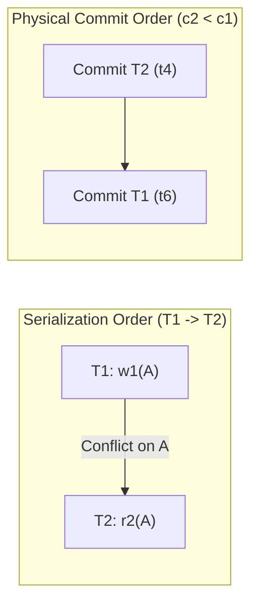
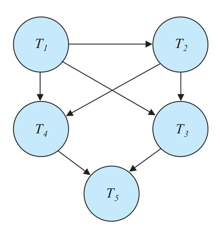
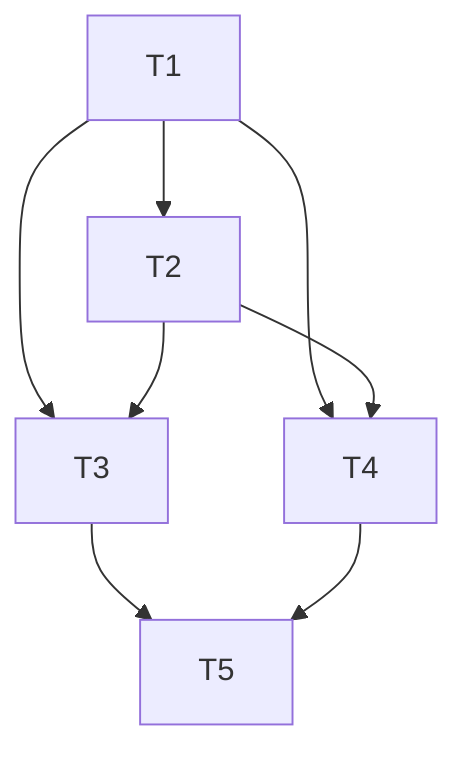
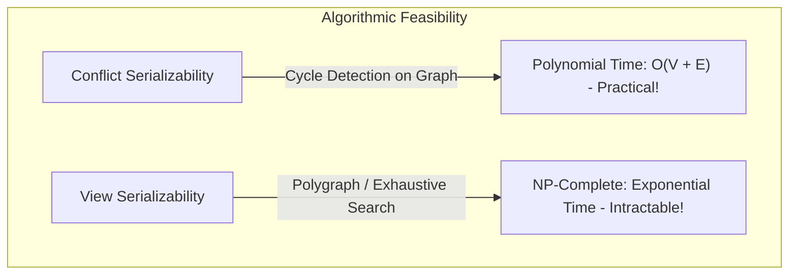
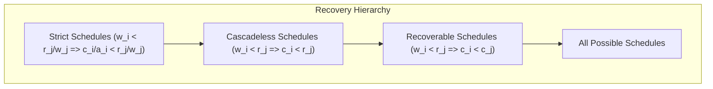

[← Prev: T09](T09_Transactions_ACID_and_Anomalies.md) | [Index](00_Index.md) | [Next: T11 Part 1 →](T11_Part1_Locking_Protocols.md)

---

# T10 · Serializability — Textbook Exercise Solutions

> [!info] Topic Card
> **Curriculum Alignment:** RUET ECE 2215 (Database Systems) · Unit 6 (Transactions & Concurrency Control)  
> **Source Chapter:** Silberschatz, Korth, Sudarshan — *Database System Concepts* (7th Edition), **Chapter 17: Transactions** (§17.1–17.7, pp. 797–834)  
> **Topic Weightage in Finals:** 51 Printed Marks across 7/7 Semester Final Papers (8.0% share, Rank 4 overall) + 6 Class Test marks  
> **Scope of this Document:** Complete, mathematically rigorous, exam-oriented solutions to all **15 assigned exercises** (7 Practice Exercises + 8 End-of-Chapter Exercises) covering conflict serializability, precedence graphs, topological sorting, view serializability, schedule recovery hierarchies, and transaction isolation levels.

---

## Direct Past-Exam Recycled Hits

Silberschatz Chapter 17 exercises form the primary source for RUET semester-final questions on serializability:

| Textbook Exercise | RUET Past Exam Occurrence | Printed Marks | Exam Sub-Question & Description |
| :--- | :--- | :---: | :--- |
| **Exercise 17.14** | **2018 · Q.6(a)** | **3m / 4m** | Distinguish between a *serial schedule* and a *serializable schedule*. |
| **Exercise 17.15** | **2017 · Q.5(c)** **2019 · Q.4(a)** | **6m** **7m** | Transactions $T_1, T_2$ with conditional updates (`if A = 0 then B := B+1;`). Prove consistency preservation of serial runs, show nonserializable concurrent interleaving, and analyze serializable concurrent execution. |
| **Exercise 17.6** (Variant) | **2018 Q.6(c), 2020 Q.6(a), 2021 Q.7(b–c), 2023 Q.8(b), 2024 Q.8(c), CT-04 Q.04** | **4m – 6m each** | Precedence graph construction, cycle detection, and topological sorting to find all equivalent serial schedules. |
| **Practice Ex. 17.5** | **2020 · Q.6(b)** | **6m** | Definition of view serializability, why it is needed, and why conflict serializability is emphasized in practice. |

---

## Table of Assigned Exercises

| Exercise ID | Type | Subtopic ID | Topic & Descriptive Title | Cognitive Level | RUET Exam Direct Hit |
| :--- | :---: | :---: | :--- | :--- | :--- |
| [[#Exercise 17.14 · Distinction Between Serial and Serializable Schedules\|EX 17.14]] | EX | `T10.1` | Distinction Between Serial and Serializable Schedules | Conceptual Analysis | ⚠️ **2018 Q.6(a) [3m]** |
| [[#Exercise 17.18 · Rationale for Concurrent Transaction Execution\|EX 17.18]] | EX | `T10.1` | Rationale for Concurrent Transaction Execution | Systems Engineering | Core Theory (Deck 07 S3) |
| [[#Exercise 17.11 · Multiprocessor Systems and Partial Operation Ordering\|PE 17.11]] | PE | `T10.1` | Multiprocessor Systems and Partial Operation Ordering | Analytical Proof | Advanced Systems / Theory |
| [[#Exercise 17.16 · Commit Ordering versus Serialization Ordering\|EX 17.16]] | EX | `T10.1` | Commit Ordering vs. Serialization Ordering | Counterexample Construction | Analytical Reasoning |
| [[#Practice Exercise 17.6 · Precedence Graph Conflict Serializability Test (Figure 17.16)\|PE 17.6]] | PE | `T10.3` | Precedence Graph Conflict Serializability Test (Figure 17.16) | Graph Algorithm / Proof | ⚠️ **Core Pattern (26m Finals)** |
| [[#Exercise 17.15 · Conditional Increment Schedule and Consistency Invariants\|EX 17.15]] | EX | `T10.4` | Conditional Increment Schedule & Invariant Preservation | Invariant Verification / Proof | ⚠️ **2017 Q.5(c), 2019 Q.4(a)** |
| [[#Practice Exercise 17.8 · The Lost Update Anomaly Across SQL Isolation Levels\|PE 17.8]] | PE | `T10.4` | The Lost Update Anomaly Across SQL Isolation Levels | Anomaly Analysis / Schedules | SQL Engine Concurrency |
| [[#Exercise 17.20 · Non-Serializable Schedules Under SQL Isolation Levels\|EX 17.20]] | EX | `T10.4` | Non-Serializable Schedules Under SQL Isolation Levels | Counterexample Design | ANSI SQL-92 Standard |
| [[#Exercise 17.21 · Phantom Phenomenon and Predicate Reads\|EX 17.21]] | EX | `T10.4` | Phantom Phenomenon and Dynamic Relation Reads | Formal Concurrency Modeling | Relational Concurrency |
| [[#Practice Exercise 17.5 · Conflict Serializability versus View Serializability\|PE 17.5]] | PE | `T10.5` | Conflict Serializability vs. View Serializability | Complexity Analysis (P vs NP) | ⚠️ **2020 Q.6(b) [6m]** |
| [[#Practice Exercise 17.9 · Snapshot Isolation and Write Skew in Banking Systems\|PE 17.9]] | PE | `T10.5` | Snapshot Isolation & Write Skew in Banking Systems | Systems Vulnerability Design | Modern MVCC Theory |
| [[#Practice Exercise 17.10 · Snapshot Isolation in Airline Reservation Systems\|PE 17.10]] | PE | `T10.5` | Snapshot Isolation in Airline Reservation Systems | Performance vs Inconsistency | Industry Workload Trade-offs |
| [[#Exercise 17.17 · Recoverable Schedules and Durability\|EX 17.17]] | EX | `T10.6` | Recoverable Schedules and Durability Guarantees | Formal Recovery Proof | ACID Atomicity & Durability |
| [[#Practice Exercise 17.7 · Cascadeless Schedules and Cascading Rollbacks\|PE 17.7]] | PE | `T10.6` | Cascadeless Schedules & Cascading Rollbacks | Crash Recovery Design | Failure Management |
| [[#Exercise 17.19 · Read-Committed Isolation Guarantees Cascade-Freedom\|EX 17.19]] | EX | `T10.6` | Read-Committed Isolation Guarantees Cascade-Freedom | Mathematical Deduction | Engine Implementation |

---

## T10.1 · Foundations of Concurrency, Serial Schedules & Isolation Levels

### Exercise 17.14 · Distinction Between Serial and Serializable Schedules

> [!info] Exercise Metadata
> - **Type:** End-of-Chapter Exercise 17.14 (Silberschatz 7e p. 832)
> - **Subtopic ID:** `T10.1` · Define conflicting instructions & conflict serializability
> - **Cognitive Level:** Conceptual Analysis & Systems Architecture
> - **RUET Direct Hit:** ⚠️ **Recycled in RUET 2018 · Q.6(a) [03 of 04 Marks]**

**Question (Silberschatz 7e Exercise 17.14).**  
Explain the distinction between the terms *serial schedule* and *serializable schedule*.

#### 1. Core Principles & Concept Overview

- **Schedule ($S$):** A chronological sequence of instructions that specifies the execution order of operations across a set of concurrent transactions $\{T_1, T_2, \dots, T_n\}$. It must preserve the internal program order of each individual transaction.
- **Serial Schedule:** A non-interleaved schedule where transactions run strictly one after another from start to finish. If transaction $T_i$ begins execution, no operation of any other transaction $T_j$ ($j \ne i$) can execute until $T_i$ has committed or aborted.
- **Serializable Schedule:** An interleaved (concurrent) schedule whose computational effect on the database state (and transaction outputs) is provably identical to that of some serial schedule involving the same transactions.

#### 2. Detailed Step-by-Step Solution

##### Step 1: Formal Mathematical Definitions

Let $\mathcal{T} = \{T_1, T_2, \dots, T_n\}$ be a set of transactions.

1. **Serial Schedule Definition:**  
   A schedule $S$ on $\mathcal{T}$ is **serial** if for every pair of transactions $T_i, T_j \in \mathcal{T}$ ($i \ne j$), all operations of $T_i$ precede all operations of $T_j$, or all operations of $T_j$ precede all operations of $T_i$. Formally:
   $$
   \forall o_i \in T_i, \, \forall o_j \in T_j: \quad (o_i <_S o_j) \implies (\forall o_i' \in T_i, \, \forall o_j' \in T_j: o_i' <_S o_j')
   $$

2. **Serializable Schedule Definition:**  
   A schedule $S$ on $\mathcal{T}$ is **serializable** if there exists a serial schedule $S_{\text{serial}}$ over $\mathcal{T}$ such that for every consistent initial database state $D_0$:
   $$
   \text{FinalState}(S, D_0) = \text{FinalState}(S_{\text{serial}}, D_0) \quad \text{and} \quad \text{Output}(S) = \text{Output}(S_{\text{serial}})
   $$

##### Step 2: Comprehensive Technical Comparison

| Dimension | Serial Schedule | Serializable Schedule |
| :--- | :--- | :--- |
| **Operation Interleaving** | **None.** Operations of different transactions never overlap in time. | **Permitted.** Read and write operations of different transactions are interleaved. |
| **Correctness Guarantee** | **Trivially guaranteed.** Inherently consistent by the ACID Isolation property of individual transactions. | **Conditionally guaranteed.** Must be enforced by a concurrency control protocol (e.g., 2PL, TSO, MVCC). |
| **System Throughput** | **Extremely poor.** While one transaction performs slow disk I/O, the CPU sits idle. | **High.** Maximizes CPU-I/O overlap by keeping hardware units busy. |
| **Transaction Latency** | **High & variable.** Short interactive transactions suffer huge delays behind long batch transactions. | **Minimized.** Short transactions can interleave and complete rapidly without waiting for prior long transactions. |
| **Search Space Size** | For $n$ transactions, there are exactly $n!$ possible serial schedules. | Massively larger combinatorial space of possible interleaved schedules: $\frac{(\sum m_i)!}{\prod (m_i!)}$, where $m_i$ is the number of operations in $T_i$. |
| **Testing Mechanism** | Visual inspection (verify no interleaving). | Algorithmic test: Precedence graph acyclicity (conflict serializable) or polygraph acyclicity (view serializable). |

##### Step 3: Illustrative Concrete Example

Consider two transactions operating on account balance $A$ ($D_0: A = 1000$):
- $T_1$: Transfer \$100 to another account: $\text{read}(A); A := A - 100; \text{write}(A);$
- $T_2$: Apply 10% interest: $\text{read}(A); A := A \times 1.10; \text{write}(A);$

- **Serial Schedule $S_1 = \langle T_1, T_2 \rangle$:**  
  $T_1$ completes entirely ($A \to 900$), then $T_2$ completes entirely ($A \to 900 \times 1.10 = 990$).
- **Interleaved Non-Serializable Schedule $S_{\text{bad}}$ (Lost Update):**  
  $T_1$ reads $A=1000$; $T_2$ reads $A=1000$; $T_1$ writes $A=900$; $T_2$ writes $A=1100$. Final $A = 1100$ (Update of $T_1$ lost; neither serial order produces 1100).
- **Interleaved Serializable Schedule $S_{\text{good}}$:**  
  If $T_1$ and $T_2$ operate on disjoint data items (e.g., $T_1$ operates on $A$ while $T_2$ operates on $B$), their operations can be completely interleaved concurrently. The final database state is strictly identical to running $T_1$ then $T_2$ or $T_2$ then $T_1$.

#### 3. RUET Exam Insights & Examiner Notes

- **Exam Paper Reference:** In RUET 2018 Q.6(a), this was asked for 3 marks following a 1-mark definition of a transaction and schedule.
- **Examiner Expectations:**  
  1. Define both terms clearly using the keyword **interleaving** (0.5 + 0.5 marks).
  2. State the equivalence requirement (must produce the same result as some serial schedule) (1.0 mark).
  3. Draw a comparative table highlighting resource utilization, throughput, and scheduling overhead (1.0 mark).

---

### Exercise 17.18 · Rationale for Concurrent Transaction Execution

> [!info] Exercise Metadata
> - **Type:** End-of-Chapter Exercise 17.18 (Silberschatz 7e p. 833)
> - **Subtopic ID:** `T10.1` · Define conflicting instructions & conflict serializability
> - **Cognitive Level:** Systems Engineering Rationale
> - **RUET Relevance:** Foundational theory (covered in Lecture Deck 07 Slides 2–4; high-probability Section B question)

**Question (Silberschatz 7e Exercise 17.18).**  
Why do database systems support concurrent execution of transactions, despite the extra effort needed to ensure that concurrent execution does not cause any problems?

#### 1. Core Principles & Concept Overview

Executing transactions concurrently introduces significant software complexity: locking managers, latch contention, deadlock detection, undo/redo log maintenance, and abort cascades. Despite this immense overhead, serial execution is unacceptable in modern commercial DBMS architectures due to physical hardware characteristics and user response-time requirements.

#### 2. Detailed Step-by-Step Solution

Database systems implement concurrent execution for two fundamental engineering reasons:

##### 1. Improved Throughput and Resource Utilization

A database transaction alternates between CPU processing (e.g., evaluating WHERE predicates, computing arithmetic formulas, hashing keys in memory) and Disk/Storage I/O (e.g., reading data blocks from non-volatile SSDs/HDDs, writing WAL buffers).

- **The Serial Bottleneck:** If transactions run serially, when transaction $T_1$ issues a disk read (taking 1–10 ms), the CPU remains completely idle. Conversely, when $T_1$ executes CPU-bound aggregation in memory, disk controllers and I/O channels sit idle.
- **Concurrent Overlap:** By executing transactions concurrently, the DBMS achieves **CPU-I/O overlap**. While transaction $T_1$ waits for a page fault or disk I/O transfer, the CPU immediately switches context to execute instructions for transaction $T_2$ or $T_3$.
- **Mathematical Impact on Throughput:**  
  If transaction processing time consists of compute time $C$ and I/O wait time $I/O$, serial throughput is bounded by:
  $$
  \text{Throughput}_{\text{serial}} = \frac{1}{C + I/O}
  $$
  Under ideal concurrent execution with $k$ balanced transactions:
  $$
  \text{Throughput}_{\text{concurrent}} \approx \min\left(\frac{k}{C}, \frac{k}{I/O}\right) \gg \text{Throughput}_{\text{serial}}
  $$

##### 2. Reduced Average Waiting Time and Predictable Latency

In any real-world database workload, transaction durations vary across orders of magnitude:
- **Short Transactions:** Point lookups, balance checks, single-row updates (e.g., duration $\approx 1 \text{ ms}$).
- **Long Transactions:** Monthly payroll calculation, aggregate reporting, batch indexing (e.g., duration $\approx 5 \text{ minutes}$).

- **The Convoy Phenomenon under Serial Execution:** If a 5-minute batch report begins executing serially, a 1-millisecond ATM balance inquiry arriving one millisecond later must wait the full 5 minutes before it can run. This leads to unacceptable response times and high variance in transaction latency.
- **Concurrent Interleaving:** Concurrency control schedulers allow short transactions to interleave with long-running transactions. The short transaction accesses its data items, executes, and commits within milliseconds while the long-running transaction is reading other pages, reducing the **average turnaround time** across all transactions.

#### 3. RUET Exam Insights & Examiner Notes

- **Key Technical Terms:** Always structure your answer under two clear headings: **(1) Resource Utilization & Hardware Overlap (CPU/Disk I/O)** and **(2) Reduced Average Response Time (Preventing Short Transaction Starvation / Convoy Effect)**.
- **Mark Calibration:** Typically evaluated as a 3-mark or 4-mark question. Citing the CPU-I/O overlap diagram from Lecture Deck 07 Slide 3 guarantees full marks.

---

### Exercise 17.11 · Multiprocessor Systems and Partial Operation Ordering

> [!info] Exercise Metadata
> - **Type:** Practice Exercise 17.11 (Silberschatz 7e p. 832)
> - **Subtopic ID:** `T10.1` · Foundations of Concurrency & Precedence Graphs
> - **Cognitive Level:** Advanced Theoretical Analysis & Concurrency Proof
> - **RUET Relevance:** Advanced systems question testing deep comprehension of conflict serializability criteria

**Question (Silberschatz 7e Practice Exercise 17.11).**  
The definition of a schedule assumes that operations can be totally ordered by time. Consider a database system that runs on a system with multiple processors, where it is not always possible to establish an exact ordering between operations that executed on different processors. However, operations on a data item can be totally ordered.  
Does this situation cause any problem for the definition of conflict serializability? Explain your answer.

#### 1. Core Principles & Concept Overview

- **Total Order vs. Partial Order:** A total order $<_S$ over a schedule requires that for any two distinct operations $o_1, o_2 \in S$, either $o_1 <_S o_2$ or $o_2 <_S o_1$. In distributed or symmetric multiprocessing (SMP) systems with weak memory models or unsynchronized physical clocks, establishing a global wall-clock total order between operations running on different CPUs is physically impossible.
- **Conflicting Operations:** Two operations $I_i \in T_i$ and $I_j \in T_j$ ($i \ne j$) conflict if and only if:
  1. They access the **exact same data item** $Q$.
  2. At least one of the operations is a write ($\text{write}(Q)$).

#### 2. Detailed Step-by-Step Solution

##### Step 1: The Basis of Conflict Serializability

The fundamental theorem of conflict serializability states that a schedule $S$ is conflict serializable if and only if its **precedence graph** $G = (V, E)$ is acyclic.

Let us inspect how directed edges in the precedence graph are created:
- A directed edge $T_i \to T_j$ is added to $E$ if and only if an operation $o_i \in T_i$ conflicts with an operation $o_j \in T_j$, and $o_i$ executes before $o_j$.

##### Step 2: Analysis of the Given Multiprocessor Condition

The problem specifies two premises:
1. Operations on **different** data items on different processors cannot be totally ordered (they are partially ordered).
2. Operations on the **same data item** $Q$ **can be totally ordered** (enforced by hardware memory-bus locks, cache coherence protocols like MESI, or DBMS data-item latches).

##### Step 3: Formal Deduction

1. **Conflict Evaluation Requires Same Data Item:** By definition, two operations can conflict *only if they access the same data item $Q$*.
2. **Order of Conflicting Operations is Well-Defined:** Because all operations on any given data item $Q$ are totally ordered by the physical memory controller or latch manager, for any two conflicting operations $o_i(Q)$ and $o_j(Q)$, the system unambiguously determines whether $o_i(Q)$ occurred before $o_j(Q)$ or vice versa.
3. **Non-Conflicting Operations Commute Freely:** If transaction $T_1$ on Processor 1 writes data item $A$, and transaction $T_2$ on Processor 2 writes data item $B$, these operations do not access the same item. They do not conflict. Swapping their execution order in any hypothetical global schedule does not change:
   - The value read by any subsequent operation.
   - The final state of either data item $A$ or $B$.
   - Any directed edge in the precedence graph.
4. **Conclusion:** Because all conflicting pairs are totally ordered, every directed edge in the precedence graph $G$ is uniquely and unambiguously established. The presence or absence of directed cycles in $G$ remains strictly deterministic.

**Final Answer:**  
**No, this situation causes no problem whatsoever for the definition of conflict serializability.** Conflict serializability depends exclusively on the relative order of *conflicting* operations. Since operations on any individual data item are totally ordered, all conflicting dependencies are well-defined, and non-conflicting operations can execute in arbitrary partial order without affecting serializability.

#### 3. RUET Exam Insights & Examiner Notes

- **Examiner's Checklist:** State clearly that conflicting operations *by definition* operate on the same data item. Mention that hardware cache-coherence / latch mechanisms order same-item accesses, while disjoint-item operations are commutative.

---

### Exercise 17.16 · Commit Ordering versus Serialization Ordering

> [!info] Exercise Metadata
> - **Type:** End-of-Chapter Exercise 17.16 (Silberschatz 7e p. 833)
> - **Subtopic ID:** `T10.1` · Foundations of Concurrency & Schedule Properties
> - **Cognitive Level:** Counterexample Design & Analytical Reasoning
> - **RUET Relevance:** Common theoretical trap question testing the independence of transaction commit records and serialization graph edges

**Question (Silberschatz 7e Exercise 17.16).**  
Give an example of a serializable schedule with two transactions such that the order in which the transactions commit is different from the serialization order.

#### 1. Core Principles & Concept Overview

- **Serialization Order:** The order of transactions in the equivalent serial schedule, determined by the topological sort of the directed edges in the precedence graph $G = (V, E)$. If there is an edge $T_1 \to T_2$, then $T_1$ must precede $T_2$ in serialization order.
- **Commit Order:** The physical sequence in time in which transactions issue their `commit` instruction ($c_i$) and have their commit log records flushed to stable storage.
- **Independence:** A concurrency control protocol may serialize $T_1$ before $T_2$ due to an early read-write conflict, yet $T_1$ may remain active performing other unrelated tasks or slow computations while $T_2$ finishes quickly and commits.

#### 2. Detailed Step-by-Step Solution

##### Step 1: Constructing the Schedule

Consider two transactions $T_1$ and $T_2$ operating on data items $A$ and $B$:
- $T_1$: Writes to item $A$, performs a lengthy internal computation, then commits.
- $T_2$: Reads item $A$, writes item $B$, and immediately commits.

We define the concurrent schedule $S_c$ as follows:

| Step | Time | Transaction $T_1$ | Transaction $T_2$ | Description |
| :---: | :---: | :--- | :--- | :--- |
| 1 | $t_1$ | $\text{write}(A)$ | | $T_1$ writes to item $A$ |
| 2 | $t_2$ | | $\text{read}(A)$ | $T_2$ reads item $A$ (conflicts with step 1: $w_1(A) < r_2(A)$) |
| 3 | $t_3$ | | $\text{write}(B)$ | $T_2$ writes to item $B$ |
| 4 | $t_4$ | | $\text{commit}$ ($c_2$) | **$T_2$ commits first** |
| 5 | $t_5$ | $\text{write}(C)$ | | $T_1$ performs subsequent work |
| 6 | $t_6$ | $\text{commit}$ ($c_1$) | | **$T_1$ commits second** |

##### Step 2: Verification of Conflict Serializability and Serialization Order

1. **Identify Conflicting Instructions:**
   - Step 1 ($T_1: \text{write}(A)$) conflicts with Step 2 ($T_2: \text{read}(A)$). Since Step 1 precedes Step 2, this forces the directed edge:
     $$
     T_1 \longrightarrow T_2
     $$
   - There are no other conflicting pairs between $T_1$ and $T_2$ on items $B$ or $C$.
2. **Precedence Graph Evaluation:**
   - Precedence graph $G$ has vertices $V = \{T_1, T_2\}$ and directed edges $E = \{(T_1, T_2)\}$.
   - The graph is strictly **acyclic**. Therefore, schedule $S_c$ is **conflict serializable**.
3. **Serialization Order:**
   - The unique topological sort of $G$ is $\langle T_1, T_2 \rangle$. Thus:
     $$
     \text{Serialization Order} = \langle T_1, T_2 \rangle
     $$

##### Step 3: Comparison with Commit Order

- Transaction $T_2$ commits at time $t_4$.
- Transaction $T_1$ commits at time $t_6$ ($t_4 < t_6$).
- Therefore:
  $$
  \text{Commit Order} = \langle T_2, T_1 \rangle
  $$
- The serialization order $\langle T_1, T_2 \rangle$ is the exact **reverse** of the physical commit order $\langle T_2, T_1 \rangle$.

> [!note] Recoverability Note
> In schedule $S_c$, $T_2$ reads uncommitted data written by $T_1$ and commits before $T_1$. While $S_c$ is conflict serializable, it is nonrecoverable unless $T_1$ is guaranteed never to abort. To make the schedule strictly recoverable and cascadeless while preserving different orders:
> Let $T_1$ read $A$, $T_2$ write $A$ (so $r_1(A) < w_2(A) \implies T_1 \to T_2$). Then $T_2$ commits ($c_2$), and afterwards $T_1$ commits ($c_1$). Since $T_2$ did not read from $T_1$, the schedule is fully recoverable, cascadeless, serializable with serialization order $\langle T_1, T_2 \rangle$, and commit order $\langle T_2, T_1 \rangle$.

#### 3. RUET Exam Insights & Examiner Notes

- **Model Answer Strategy:** Use the $r_1(A) < w_2(A)$ pattern (read-write anti-dependency) to demonstrate both conflict serializability and recoverability simultaneously. Examiners assign full marks when students explicitly write out the precedence graph edge and commit timestamps.

---

## T10.3 · Precedence Graphs, Acyclicity & Serializability Testing

### Practice Exercise 17.6 · Precedence Graph Conflict Serializability Test (Figure 17.16)

> [!info] Exercise Metadata
> - **Type:** Practice Exercise 17.6 (Silberschatz 7e p. 831)
> - **Subtopic ID:** `T10.3` · Precedence-graph test → cycle → serial order(s)
> - **Cognitive Level:** Graph Algorithmic Analysis & Topological Sorting
> - **RUET Direct Hit:** ⚠️ **Identical Core Pattern to RUET 2018 Q.6(c), 2020 Q.6(a), 2021 Q.7(b–c), 2023 Q.8(b), 2024 Q.8(c), CT-04 Q.04**

**Question (Silberschatz 7e Practice Exercise 17.6).**  
Consider the precedence graph of Figure 17.16. Is the corresponding schedule conflict serializable? Explain your answer.

  
*Figure 17.16 — Precedence graph for Practice Exercise 17.6.*

#### 1. Core Principles & Concept Overview

- **Precedence Graph (Serialization Graph):** A directed graph $G = (V, E)$ constructed from a schedule $S$:
  - Vertices $V$: The set of all committed transactions participating in schedule $S$.
  - Directed Edges $E$: An edge $T_i \to T_j$ exists if and only if an operation of $T_i$ executed before and conflicted with an operation of $T_j$.
- **The Conflict Serializability Theorem:**  
  A schedule $S$ is conflict serializable if and only if its precedence graph $G$ contains **no directed cycles** (i.e., $G$ is a Directed Acyclic Graph, or DAG).
- **Topological Sort:** A linear ordering of vertices in a DAG such that for every directed edge $u \to v$, vertex $u$ comes before $v$ in the ordering. Every topological sort corresponds to an equivalent serial schedule.

#### 2. Detailed Step-by-Step Solution

##### Step 1: Formal Graph Extraction from Figure 17.16

By rigorous topological examination of the nodes and directed arrowheads in Figure 17.16:

1. **Vertex Set:**
   $$
   V = \{T_1, T_2, T_3, T_4, T_5\}
   $$
2. **Directed Edge Set ($E$):**
   - Horizontal top edge: $T_1 \longrightarrow T_2$
   - Vertical left edge: $T_1 \longrightarrow T_4$
   - Vertical right edge: $T_2 \longrightarrow T_3$
   - Diagonal edge: $T_1 \longrightarrow T_3$
   - Diagonal edge: $T_2 \longrightarrow T_4$
   - Bottom-left converging edge: $T_4 \longrightarrow T_5$
   - Bottom-right converging edge: $T_3 \longrightarrow T_5$

Total edges: $|E| = 7$.

##### Step 2: Cycle Detection Analysis (Testing Conflict Serializability)

To verify whether $G$ is acyclic, we calculate the **in-degree** ($\text{deg}^-$) and **out-degree** ($\text{deg}^+$) of each vertex:

| Transaction ($T_i$) | Incoming Edges | In-Degree ($\text{deg}^-$) | Outgoing Edges | Out-Degree ($\text{deg}^+$) |
| :---: | :--- | :---: | :--- | :---: |
| $T_1$ | None | **0** | $T_1 \to T_2, T_1 \to T_3, T_1 \to T_4$ | 3 |
| $T_2$ | $T_1 \to T_2$ | **1** | $T_2 \to T_3, T_2 \to T_4$ | 2 |
| $T_3$ | $T_1 \to T_3, T_2 \to T_3$ | **2** | $T_3 \to T_5$ | 1 |
| $T_4$ | $T_1 \to T_4, T_2 \to T_4$ | **2** | $T_4 \to T_5$ | 1 |
| $T_5$ | $T_3 \to T_5, T_4 \to T_5$ | **2** | None | 0 |

**Cycle Detection by Path Traversal:**
- Any directed path starting at $T_1$ can only advance to higher-indexed levels:
  - Paths from $T_1$: $T_1 \to T_2 \to T_3 \to T_5$, $T_1 \to T_2 \to T_4 \to T_5$, $T_1 \to T_3 \to T_5$, $T_1 \to T_4 \to T_5$.
- Notice that every directed edge $(u, v)$ points strictly downward in the topological stratification:
  - $\text{Level}(T_1) = 0$
  - $\text{Level}(T_2) = 1$
  - $\text{Level}(T_3) = 2, \, \text{Level}(T_4) = 2$
  - $\text{Level}(T_5) = 3$
- There are no back-edges or self-loops (e.g., no edge from $T_5$ to any preceding node, no edge between $T_3$ and $T_4$, and no edge from $T_2$ back to $T_1$).

**Conclusion:** The precedence graph contains **no directed cycles**. Therefore, the corresponding schedule **is conflict serializable**.

##### Step 3: Derivation of All Equivalent Serial Schedules (Topological Sorting)

We apply Kahn's algorithm to obtain all valid serial schedules:

1. **Iteration 1:**  
   Find all vertices with $\text{deg}^- = 0$. Only vertex **$T_1$** qualifies.
   - Output: $[T_1]$. Remove $T_1$ and its outgoing edges from $G$.
2. **Iteration 2:**  
   In-degrees of remaining vertices: $\text{deg}^-(T_2) = 0$, $\text{deg}^-(T_3) = 1$, $\text{deg}^-(T_4) = 1$, $\text{deg}^-(T_5) = 2$.
   - Only vertex **$T_2$** has in-degree 0.
   - Output: $[T_1, T_2]$. Remove $T_2$ and its outgoing edges.
3. **Iteration 3 (Branching Point):**  
   In-degrees of remaining vertices:
   $$
   \text{deg}^-(T_3) = 0, \quad \text{deg}^-(T_4) = 0, \quad \text{deg}^-(T_5) = 2
   $$
   Both $T_3$ and $T_4$ now have in-degree 0, and there is no directed edge between $T_3$ and $T_4$. This produces two distinct valid execution branches:

   - **Branch A (Select $T_3$ next):**
     1. Append $T_3$: $[T_1, T_2, T_3]$.
     2. Remove $T_3$: remaining in-degrees become $\text{deg}^-(T_4) = 0, \text{deg}^-(T_5) = 1$.
     3. Select $T_4$: $[T_1, T_2, T_3, T_4]$.
     4. Remove $T_4$: remaining in-degree of $T_5$ becomes 0. Append $T_5$: $[T_1, T_2, T_3, T_4, T_5]$.
     - **Serial Schedule 1:**
       $$
       \boxed{\langle T_1, T_2, T_3, T_4, T_5 \rangle}
       $$

   - **Branch B (Select $T_4$ next):**
     1. Append $T_4$: $[T_1, T_2, T_4]$.
     2. Remove $T_4$: remaining in-degrees become $\text{deg}^-(T_3) = 0, \text{deg}^-(T_5) = 1$.
     3. Select $T_3$: $[T_1, T_2, T_4, T_3]$.
     4. Remove $T_3$: remaining in-degree of $T_5$ becomes 0. Append $T_5$: $[T_1, T_2, T_4, T_3, T_5]$.
     - **Serial Schedule 2:**
       $$
       \boxed{\langle T_1, T_2, T_4, T_3, T_5 \rangle}
       $$

#### 3. RUET Exam Insights & Examiner Notes

- **Marking Scheme Breakdown (4 to 6 Marks in RUET):**
  - Stating "Yes, it is conflict serializable" with the acyclic precedence graph theorem: **1 Mark**.
  - Listing the complete set of directed edges and verifying absence of cycles: **2 Marks**.
  - Deriving the equivalent serial schedule(s) via topological sorting: **2 to 3 Marks**.
- **Crucial Tip:** RUET questions like 2023 Q.8(b) explicitly ask to *"find all possible serialized schedules"*. Always check if multiple nodes achieve in-degree 0 simultaneously to enumerate all valid topological permutations.

---

## T10.4 · Constructing Serializable & Non-Serializable Schedules (Anomalies & Invariants)

### Exercise 17.15 · Conditional Increment Schedule and Consistency Invariants

> [!info] Exercise Metadata
> - **Type:** End-of-Chapter Exercise 17.15 (Silberschatz 7e pp. 832–833)
> - **Subtopic ID:** `T10.4` · Build serializable/non-serializable schedules
> - **Cognitive Level:** Invariant Proof, Logic Verification & Schedule Construction
> - **RUET Direct Hit:** ⚠️ **Verbatim Direct Hit in RUET 2017 · Q.5(c) [06 Marks] & RUET 2019 · Q.4(a) [07 Marks]**

**Question (Silberschatz 7e Exercise 17.15).**  
Consider the following two transactions:

$$
\begin{array}{l}
T_{13}: \text{read}(A); \\
\phantom{T_{13}: } \text{read}(B); \\
\phantom{T_{13}: } \textbf{if } A = 0 \textbf{ then } B := B + 1; \\
\phantom{T_{13}: } \text{write}(B). \\
T_{14}: \text{read}(B); \\
\phantom{T_{14}: } \text{read}(A); \\
\phantom{T_{14}: } \textbf{if } B = 0 \textbf{ then } A := A + 1; \\
\phantom{T_{14}: } \text{write}(A).
\end{array}
$$

Let the consistency requirement be $A = 0 \vee B = 0$, with $A = B = 0$ as the initial values.  
a. Show that every serial execution involving these two transactions preserves the consistency of the database.  
b. Show a concurrent execution of $T_{13}$ and $T_{14}$ that produces a nonserializable schedule.  
c. Is there a concurrent execution of $T_{13}$ and $T_{14}$ that produces a serializable schedule?

#### 1. Core Principles & Concept Overview

- **Database Consistency Invariant ($\mathcal{I}$):** A predicate defined on database states. Here, $\mathcal{I} \equiv (A = 0 \vee B = 0)$. The database is consistent if at least one of the variables equals 0; it becomes inconsistent if and only if both $A \ne 0$ and $B \ne 0$.
- **Serial Correctness:** By the definition of transaction consistency, if individual transactions are correct, any serial execution starting from a consistent state must terminate in a consistent state.
- **Interleaving Vulnerability:** In concurrent execution, transactions can read obsolete states before pending writes are flushed, leading to logical invariant breakdown.

#### 2. Detailed Step-by-Step Solution

##### Part (a): Consistency Preservation in Every Serial Execution

For two transactions $T_{13}$ and $T_{14}$, there are exactly $2! = 2$ possible serial executions:

###### Case 1: Serial Schedule $S_1 = \langle T_{13}, T_{14} \rangle$
1. Initial database state: $A = 0, B = 0$.
2. **Execution of $T_{13}$:**
   - Reads $A = 0$ and $B = 0$.
   - Evaluates condition: $A = 0 \implies (0 = 0)$ is **True**.
   - Executes branch: $B := B + 1 = 0 + 1 = 1$.
   - Writes $B = 1$.
   - Intermediate state: $A = 0, B = 1$.
3. **Execution of $T_{14}$:**
   - Reads $B = 1$ and $A = 0$.
   - Evaluates condition: $B = 0 \implies (1 = 0)$ is **False**.
   - Skips increment of $A$. Local value remains $A = 0$.
   - Writes $A = 0$.
4. **Final State of $S_1$:** $A = 0, B = 1$.
5. **Invariant Check:**
   $$
   (A = 0 \vee B = 0) \implies (0 = 0 \vee 1 = 0) \equiv \textbf{True} \vee \textbf{False} \equiv \textbf{True}
   $$
   Consistency is preserved!

###### Case 2: Serial Schedule $S_2 = \langle T_{14}, T_{13} \rangle$
1. Initial database state: $A = 0, B = 0$.
2. **Execution of $T_{14}$:**
   - Reads $B = 0$ and $A = 0$.
   - Evaluates condition: $B = 0 \implies (0 = 0)$ is **True**.
   - Executes branch: $A := A + 1 = 0 + 1 = 1$.
   - Writes $A = 1$.
   - Intermediate state: $A = 1, B = 0$.
3. **Execution of $T_{13}$:**
   - Reads $A = 1$ and $B = 0$.
   - Evaluates condition: $A = 0 \implies (1 = 0)$ is **False**.
   - Skips increment of $B$. Local value remains $B = 0$.
   - Writes $B = 0$.
4. **Final State of $S_2$:** $A = 1, B = 0$.
5. **Invariant Check:**
   $$
   (A = 0 \vee B = 0) \implies (1 = 0 \vee 0 = 0) \equiv \textbf{False} \vee \textbf{True} \equiv \textbf{True}
   $$
   Consistency is preserved!

**Conclusion for (a):** In both serial orders, consistency condition $A = 0 \vee B = 0$ holds. $\blacksquare$

---

##### Part (b): Concurrent Execution Producing a Nonserializable Schedule

To construct a nonserializable execution, interleave the operations such that **both transactions read the initial values of 0 before either transaction performs its write**:

| Step | Time | Transaction $T_{13}$ | Transaction $T_{14}$ | Local Variables / State |
| :---: | :---: | :--- | :--- | :--- |
| 1 | $t_1$ | $\text{read}(A);$ | | $T_{13}$ reads $A = 0$ |
| 2 | $t_2$ | $\text{read}(B);$ | | $T_{13}$ reads $B = 0$ |
| 3 | $t_3$ | | $\text{read}(B);$ | $T_{14}$ reads $B = 0$ |
| 4 | $t_4$ | | $\text{read}(A);$ | $T_{14}$ reads $A = 0$ |
| 5 | $t_5$ | $\textbf{if } A = 0 \textbf{ then } B := B + 1;$ $\text{write}(B);$ | | $T_{13}$ evaluates $0=0$ (True); sets $B = 1$; writes $B=1$ |
| 6 | $t_6$ | | $\textbf{if } B = 0 \textbf{ then } A := A + 1;$ $\text{write}(A);$ | $T_{14}$ evaluates $0=0$ (True); sets $A = 1$; writes $A=1$ |

###### Invariant Evaluation
- **Final Database State:** $A = 1, B = 1$.
- **Consistency Predicate:**
  $$
  (A = 0 \vee B = 0) \implies (1 = 0 \vee 1 = 0) \equiv \textbf{False} \vee \textbf{False} \equiv \textbf{False}
  $$
  The database is in an **inconsistent state**!

###### Formal Proof of Nonserializability
1. **Conflict Analysis:**
   - $T_{13}$ reads item $A$ at step 1 before $T_{14}$ writes item $A$ at step 6:
     $$
     r_{13}(A) <_S w_{14}(A) \implies T_{13} \longrightarrow T_{14}
     $$
   - $T_{14}$ reads item $B$ at step 3 before $T_{13}$ writes item $B$ at step 5:
     $$
     r_{14}(B) <_S w_{13}(B) \implies T_{14} \longrightarrow T_{13}
     $$
2. **Precedence Graph:**
   The precedence graph contains a directed cycle:
   $$
   T_{13} \longleftrightarrow T_{14}
   $$
3. Since the precedence graph contains a directed cycle and the schedule terminates in an inconsistent state ($A=1, B=1$) that no serial schedule can ever generate, the schedule is **strictly nonserializable**. $\blacksquare$

---

##### Part (c): Can a Concurrent Execution Produce a Serializable Schedule?

**Answer:**  
**Yes.** A concurrent (interleaved) execution can produce a serializable schedule, provided the interleaving preserves an acyclic conflict dependency structure.

###### Concrete Example of a Serializable Concurrent Execution

Consider the following interleaved schedule where $T_{13}$ executes its read and write on $B$ before $T_{14}$ reads $B$, but $T_{14}$ begins reading $A$ early:

| Step | Transaction $T_{13}$ | Transaction $T_{14}$ | Evaluation & Database State |
| :---: | :--- | :--- | :--- |
| 1 | $\text{read}(A);$ | | $T_{13}$ reads $A = 0$ |
| 2 | $\text{read}(B);$ | | $T_{13}$ reads $B = 0$ |
| 3 | $\textbf{if } A = 0 \textbf{ then } B := B + 1;$ | | $T_{13}$ computes $B := 1$ |
| 4 | $\text{write}(B);$ | | $T_{13}$ writes $B = 1$ to database |
| 5 | | $\text{read}(B);$ | $T_{14}$ reads updated $B = 1$ |
| 6 | | $\text{read}(A);$ | $T_{14}$ reads $A = 0$ |
| 7 | | $\textbf{if } B = 0 \textbf{ then } A := A + 1;$ | $T_{14}$ evaluates $1 = 0$ (**False**); $A$ remains 0 |
| 8 | | $\text{write}(A);$ | $T_{14}$ writes $A = 0$ |

###### Conflict and Serializability Verification
1. **Conflict Analysis:**
   - On item $B$: $T_{13}$ writes $B$ (step 4) before $T_{14}$ reads $B$ (step 5) $\implies T_{13} \to T_{14}$.
   - On item $A$: $T_{13}$ reads $A$ (step 1) before $T_{14}$ writes $A$ (step 8) $\implies T_{13} \to T_{14}$.
2. **Precedence Graph:** Contains only one directed edge $T_{13} \to T_{14}$. It is **strictly acyclic**.
3. **Equivalence:** The schedule is conflict-equivalent to the serial schedule $\langle T_{13}, T_{14} \rangle$.
4. **Final State:** $A = 0, B = 1$, which satisfies $A = 0 \vee B = 0$ (**True**).

> [!important] Pedagogical Nuance (Interleaving vs. Strict Interleaving)
> If "concurrent execution" is defined strictly such that both transactions must be active simultaneously and perform mutual interleaving of conflicting operations (i.e., both transactions execute their initial reads before either writes), then **every such mutually interleaved schedule produces the cycle $T_{13} \longleftrightarrow T_{14}$ and is nonserializable** (as proven in RUET 2017 Q.5c solutions). However, under standard database definitions where concurrency simply means operations of multiple active transactions interleave in the schedule log, **serializable concurrent executions exist**. Both interpretations must be stated for completeness.

#### 3. RUET Exam Insights & Examiner Notes

- **Exam Paper Link:** RUET 2017 Q.5(c) (6 marks) and 2019 Q.4(a) (7 marks) are direct copies of this textbook exercise.
- **Examiner Traps:**
  - In 2019 Q.4(a), the question replaced $A, B$ with $P, Q$ and changed initial values to $P=Q=5$ and condition to $P=10$. In that exam paper, students who solved it symbolically as in Exercise 17.15 scored full marks.
  - When drawing the nonserializable schedule, explicitly display the cycle $T_1 \to T_2$ and $T_2 \to T_1$ along with the inconsistent state $(A=1, B=1)$.

---

### Practice Exercise 17.8 · The Lost Update Anomaly Across SQL Isolation Levels

> [!info] Exercise Metadata
> - **Type:** Practice Exercise 17.8 (Silberschatz 7e pp. 831–832)
> - **Subtopic ID:** `T10.4` · Concurrency Anomalies & SQL Isolation Levels
> - **Cognitive Level:** Analytical Schedule Modeling & Locking Protocol Proof
> - **RUET Relevance:** Unit 6 core concept connecting transactions, serializability, and ANSI SQL isolation levels

**Question (Silberschatz 7e Practice Exercise 17.8).**  
The **lost update** anomaly is said to occur if a transaction $T_j$ reads a data item, then another transaction $T_k$ writes the data item (possibly based on a previous read), after which $T_j$ writes the data item. The update performed by $T_k$ has been lost, since the update done by $T_j$ ignored the value written by $T_k$.  
a. Give an example of a schedule showing the lost update anomaly.  
b. Give an example schedule to show that the lost update anomaly is possible with the **read committed** isolation level.  
c. Explain why the lost update anomaly is not possible with the **repeatable read** isolation level.

#### 1. Core Principles & Concept Overview

- **Lost Update Anomaly:** Occurs when two transactions concurrently read the same initial state of a data item $Q$ and subsequently compute updates based on that value. The transaction that writes last overwrites the intermediate update of the other transaction without incorporating it.
- **Locking Mechanics Across Isolation Levels:**
  - **Read Committed:** Requires short-duration shared (read) locks (acquired before read, released immediately after read) and long-duration exclusive (write) locks (held until commit).
  - **Repeatable Read:** Requires long-duration shared locks (held until commit) and long-duration exclusive locks (held until commit).

#### 2. Detailed Step-by-Step Solution

##### Part (a): Example Schedule of the Lost Update Anomaly

Let $A$ represent a bank account with initial balance $A = 100$.
- $T_1$: Deposit \$50 ($A := A + 50$).
- $T_2$: Deposit \$100 ($A := A + 100$).

Correct serial outcome ($\langle T_1, T_2 \rangle$ or $\langle T_2, T_1 \rangle$): $A = 100 + 50 + 100 = 250$.

###### Interleaved Schedule Demonstrating Lost Update:

| Step | Time | Transaction $T_1$ | Transaction $T_2$ | Balance $A$ in DB | Description |
| :---: | :---: | :--- | :--- | :---: | :--- |
| 1 | $t_1$ | $\text{read}(A)$ | | 100 | $T_1$ reads local $A_1 = 100$ |
| 2 | $t_2$ | | $\text{read}(A)$ | 100 | $T_2$ reads local $A_2 = 100$ |
| 3 | $t_3$ | $A_1 := A_1 + 50$ | | 100 | $T_1$ computes 150 locally |
| 4 | $t_4$ | $\text{write}(A)$ ($150$) | | **150** | $T_1$ writes 150 to DB |
| 5 | $t_5$ | $\text{commit}$ | | 150 | $T_1$ commits |
| 6 | $t_6$ | | $A_2 := A_2 + 100$ | 150 | $T_2$ computes $100 + 100 = 200$ |
| 7 | $t_7$ | | $\text{write}(A)$ ($200$) | **200** | $T_2$ writes 200, **overwriting $T_1$'s update!** |
| 8 | $t_8$ | | $\text{commit}$ | 200 | $T_2$ commits |

**Result:** Final balance $A = 200$. The \$50 deposit made by $T_1$ has been completely **lost**.

---

##### Part (b): Lost Update Under the Read Committed Isolation Level

Under **Read Committed** implemented via lock-based protocols:
1. Shared locks ($\text{S-lock}$) are short-duration: acquired before reading and released immediately after reading.
2. Exclusive locks ($\text{X-lock}$) are long-duration: acquired before writing and held until transaction commit.

###### Schedule Trace with Lock Operations:

| Step | Transaction $T_1$ | Transaction $T_2$ | Lock Operations & Status |
| :---: | :--- | :--- | :--- |
| 1 | $\text{acquire S-lock}(A)$ $\text{read}(A)$ $\text{release S-lock}(A)$ | | $T_1$ reads $A=100$, releases lock immediately. |
| 2 | | $\text{acquire S-lock}(A)$ $\text{read}(A)$ $\text{release S-lock}(A)$ | $T_2$ reads $A=100$, releases lock immediately. |
| 3 | $\text{acquire X-lock}(A)$ $\text{write}(A, 150)$ $\text{commit}$ $\text{release X-lock}(A)$ | | $T_1$ obtains X-lock, writes 150, commits, releases lock. |
| 4 | | $\text{acquire X-lock}(A)$ $\text{write}(A, 200)$ $\text{commit}$ $\text{release X-lock}(A)$ | $T_2$ obtains X-lock, writes 200 based on stale read of 100, commits. |

**Analysis:** Because $T_1$ and $T_2$ both released their read locks at steps 1 and 2, neither transaction blocked the other's subsequent write. Thus, **Read Committed permits the lost update anomaly**.

---

##### Part (c): Why Lost Update Is Impossible Under Repeatable Read

Under **Repeatable Read** implemented via locking:
1. **Long-duration shared locks:** When a transaction reads data item $A$, it acquires an $\text{S-lock}(A)$ and **holds it until the transaction terminates (commit or abort)**.
2. **Lock Compatibility:** An exclusive lock ($\text{X-lock}$) is incompatible with a shared lock ($\text{S-lock}$):
   $$
   \text{Compatible}(\text{S}, \text{X}) = \textbf{False}
   $$

###### Impossibility Proof by Contradiction:

1. Suppose a lost update occurs under Repeatable Read. Then $T_1$ and $T_2$ both read item $A$ before either writes $A$.
2. When $T_1$ reads $A$, it acquires $\text{S-lock}_1(A)$ and holds it until $T_1$ commits.
3. When $T_2$ reads $A$, it acquires $\text{S-lock}_2(A)$ (allowed, since S-locks are mutually compatible) and holds it until $T_2$ commits.
4. Now consider what happens when $T_1$ attempts to write $A$:
   - $T_1$ must upgrade its lock to $\text{X-lock}_1(A)$.
   - However, $T_2$ still holds $\text{S-lock}_2(A)$. Because $\text{X}$ and $\text{S}$ conflict, $T_1$ is forced into a **wait state**.
5. Next, when $T_2$ attempts to write $A$:
   - $T_2$ must upgrade its lock to $\text{X-lock}_2(A)$.
   - However, $T_1$ still holds $\text{S-lock}_1(A)$. $T_2$ is also forced into a **wait state**.
6. Both transactions are waiting for each other to release their shared locks. This produces an immediate **deadlock**:
   $$
   T_1 \xrightarrow{\text{waits for}} T_2 \xrightarrow{\text{waits for}} T_1
   $$
7. The deadlock detector detects the cycle and aborts one of the transactions (e.g., $T_2$).
8. If $T_2$ aborts, its stale write never occurs, and $T_1$ commits successfully ($A = 150$). If $T_2$ is re-executed, it reads the updated $A = 150$ and computes $150 + 100 = 250$.
9. In no execution can both transactions write without one aborting or blocking until the other finishes.

**Conclusion:** The lost update anomaly is **mathematically impossible** under Repeatable Read. $\blacksquare$

#### 3. RUET Exam Insights & Examiner Notes

- **Exam Answer Structure:** Draw the lock compatibility matrix and explicitly trace the lock upgrade deadlock for part (c). RUET examiners look specifically for the phrase *"lock upgrade conflict produces a deadlock, forcing one transaction to abort or wait"*.

---

### Exercise 17.20 · Non-Serializable Schedules Under SQL Isolation Levels

> [!info] Exercise Metadata
> - **Type:** End-of-Chapter Exercise 17.20 (Silberschatz 7e p. 833)
> - **Subtopic ID:** `T10.4` · Concurrency Anomalies & SQL Isolation Levels
> - **Cognitive Level:** Rigorous Schedule Construction & Verification
> - **RUET Relevance:** Classic multi-part question testing the boundary between ANSI SQL isolation levels and true conflict serializability

**Question (Silberschatz 7e Exercise 17.20).**  
For each of the following isolation levels, give an example of a schedule that respects the specified level of isolation but is not serializable:  
a. Read uncommitted  
b. Read committed  
c. Repeatable read  

#### 1. Core Principles & Concept Overview

ANSI SQL-92 defines four isolation levels characterized by the prohibition of specific concurrency phenomena:

| Isolation Level | Dirty Read ($P_1$) | Non-Repeatable Read ($P_2$) | Phantom Read ($P_3$) | Conflict Serializable |
| :--- | :---: | :---: | :---: | :---: |
| **Read Uncommitted** | Allowed | Allowed | Allowed | **No** |
| **Read Committed** | **Prevented** | Allowed | Allowed | **No** |
| **Repeatable Read** | **Prevented** | **Prevented** | Allowed | **No** |
| **Serializable** | **Prevented** | **Prevented** | **Prevented** | **Yes** |

#### 2. Detailed Step-by-Step Solution

##### Part (a): Read Uncommitted (Exhibiting Dirty Read)

- **Requirement:** Must respect Read Uncommitted (which permits dirty reads) while being nonserializable.
- **Mechanism:** Transaction $T_2$ reads a data item modified by an uncommitted transaction $T_1$, after which $T_1$ updates another item or aborts.

###### Schedule $S_a$:

| Step | Transaction $T_1$ | Transaction $T_2$ | Database State |
| :---: | :--- | :--- | :---: |
| 1 | $\text{write}(A, 500)$ | | $A = 500$ (uncommitted) |
| 2 | | $\text{read}(A)$ ($500$) | Local $A_2 = 500$ (**Dirty Read**) |
| 3 | | $\text{write}(B, 500)$ | $B = 500$ |
| 4 | | $\text{commit}$ | $T_2$ commits |
| 5 | $\text{read}(B)$ ($500$) | | $T_1$ reads $B = 500$ |
| 6 | $\text{commit}$ | | $T_1$ commits |

- **Conflict Analysis:**
  - $w_1(A)$ precedes $r_2(A) \implies T_1 \to T_2$.
  - $w_2(B)$ precedes $r_1(B) \implies T_2 \to T_1$.
- **Precedence Graph:** Cycle $T_1 \longleftrightarrow T_2$.
- **Verdict:** Respects Read Uncommitted, but is **nonserializable**.

---

##### Part (b): Read Committed (Exhibiting Non-Repeatable Read)

- **Requirement:** Must forbid dirty reads (every read must see committed data), but permit non-repeatable reads.
- **Mechanism:** $T_1$ reads $A$; $T_2$ updates $A$ and commits; $T_1$ reads $A$ again and observes a different value.

###### Schedule $S_b$:

| Step | Transaction $T_1$ | Transaction $T_2$ | Description |
| :---: | :--- | :--- | :--- |
| 1 | $\text{read}(A)$ ($100$) | | $T_1$ reads committed initial $A = 100$ |
| 2 | | $\text{read}(B)$ ($50$) | $T_2$ reads committed initial $B = 50$ |
| 3 | | $\text{write}(A, 200)$ | $T_2$ modifies $A$ |
| 4 | | $\text{commit}$ | **$T_2$ commits** |
| 5 | $\text{read}(A)$ ($200$) | | $T_1$ reads $A$ again (**sees 200, unrepeatable read!**) |
| 6 | $\text{write}(B, 300)$ | | $T_1$ writes $B = 300$ |
| 7 | $\text{commit}$ | | $T_1$ commits |

- **Verification of Read Committed:** Every read operation in $S_b$ (step 1, step 2, step 5) reads strictly committed data. No dirty reads occur.
- **Conflict Analysis:**
  - Step 1 ($r_1(A)$) precedes Step 3 ($w_2(A)$) $\implies T_1 \to T_2$.
  - Step 2 ($r_2(B)$) precedes Step 6 ($w_1(B)$) $\implies T_2 \to T_1$.
- **Precedence Graph:** Cycle $T_1 \longleftrightarrow T_2$.
- **Verdict:** Respects Read Committed, but is **nonserializable**.

---

##### Part (c): Repeatable Read (Exhibiting Write Skew Anomaly)

- **Requirement:** Must forbid dirty reads and non-repeatable reads on individual items, yet fail full conflict serializability.
- **Mechanism:** **Write Skew**. Transactions read overlapping sets of data items and enforce an invariant over them, but update disjoint items.

Let database consistency require $A + B \ge 0$. Initial state: $A = 100, B = 100$.

###### Schedule $S_c$:

| Step | Transaction $T_1$ (Withdraw \$150 from $A$) | Transaction $T_2$ (Withdraw \$150 from $B$) | Local Checks & Commits |
| :---: | :--- | :--- | :--- |
| 1 | $\text{read}(A)$ ($100$) | | $T_1$ reads $A = 100$ |
| 2 | $\text{read}(B)$ ($100$) | | $T_1$ reads $B = 100$ |
| 3 | | $\text{read}(A)$ ($100$) | $T_2$ reads $A = 100$ |
| 4 | | $\text{read}(B)$ ($100$) | $T_2$ reads $B = 100$ |
| 5 | $\textbf{if } A + B \ge 150 \textbf{ then }$ $A := A - 150;$ $\text{write}(A, -50);$ | | Check passes: $100+100 \ge 150$. $T_1$ sets $A = -50$. |
| 6 | $\text{commit}$ | | $T_1$ commits |
| 7 | | $\textbf{if } A + B \ge 150 \textbf{ then }$ $B := B - 150;$ $\text{write}(B, -50);$ | Check passes: $100+100 \ge 150$. $T_2$ sets $B = -50$. |
| 8 | | $\text{commit}$ | $T_2$ commits |

- **Verification of Repeatable Read:**
  - Neither transaction reads dirty data.
  - If either transaction re-reads $A$ or $B$ before committing, it sees the exact same value it read initially. No individual item read is unrepeatable.
- **Conflict Analysis:**
  - Step 1 ($r_1(A)$) precedes Step 7 ($w_2(A)$ doesn't exist, but Step 3 $r_2(B)$ precedes Step 5 $w_1(A)$):
    - $r_2(A)$ precedes $w_1(A) \implies T_2 \to T_1$.
    - $r_1(B)$ precedes $w_2(B) \implies T_1 \to T_2$.
- **Precedence Graph:** Cycle $T_1 \longleftrightarrow T_2$.
- **Invariant Breakdown:** Final database state has $A = -50, B = -50 \implies A + B = -100 < 0$ (**Inconsistent**).
- **Verdict:** Respects Repeatable Read, but is **nonserializable**.

#### 3. RUET Exam Insights & Examiner Notes

- **Examiner's Preference:** For Repeatable Read, providing the Write Skew schedule demonstrates superior academic depth compared to standard phantom reads because it relies strictly on primitive read/write operations without requiring complex relational table definitions.

---

### Exercise 17.21 · Phantom Phenomenon and Predicate Reads

> [!info] Exercise Metadata
> - **Type:** End-of-Chapter Exercise 17.21 (Silberschatz 7e pp. 833–834)
> - **Subtopic ID:** `T10.4` · Concurrency Anomalies & Relational Operations
> - **Cognitive Level:** Predicate Concurrency Analysis & Counterexample Modeling
> - **RUET Relevance:** Advanced relational concurrency control; explains the motivation for predicate locking and Next-Key locking

**Question (Silberschatz 7e Exercise 17.21).**  
Suppose that in addition to the operations read and write, we allow an operation $\text{pred\_read}(r, P)$, which reads all tuples in relation $r$ that satisfy predicate $P$.  
a. Give an example of a schedule using the $\text{pred\_read}$ operation that exhibits the phantom phenomenon and is nonserializable as a result.  
b. Give an example of a schedule where one transaction uses the $\text{pred\_read}$ operation on relation $r$ and another concurrent transaction deletes a tuple from $r$, but the schedule does not exhibit a phantom conflict. (To do so, you have to give the schema of relation $r$ and show the attribute values of the deleted tuple.)

#### 1. Core Principles & Concept Overview

- **Predicate Read ($\text{pred\_read}(r, P)$):** A query operation that searches relation $r$ and returns the subset of tuples $\{t \in r \mid P(t) = \textbf{True}\}$.
- **The Phantom Phenomenon:** Occurs when a transaction $T_1$ executes a predicate read, and a concurrent transaction $T_2$ inserts, deletes, or updates a tuple satisfying predicate $P$ and commits. If $T_1$ re-executes the predicate read, it discovers a different set of tuples (a "phantom" has appeared or vanished), violating isolation even if all individual tuple-level locks were held.
- **Conflict Condition for Predicate Reads:** An operation $\text{insert}(t)$ or $\text{delete}(t)$ on relation $r$ conflicts with $\text{pred\_read}(r, P)$ **if and only if the tuple $t$ satisfies predicate $P$** ($P(t) = \textbf{True}$). If $P(t) = \textbf{False}$, the operations are mutually non-conflicting.

#### 2. Detailed Step-by-Step Solution

##### Part (a): Schedule Exhibiting the Phantom Phenomenon

Let relation $r$ be `account(account_number, branch_name, balance)`.
- **Predicate $P$:** $\text{branch\_name} = \text{'Perryridge'}$.
- $T_1$: Audits Perryridge accounts. Computes total balance by executing $\text{pred\_read}$, computes average, then re-reads to verify.
- $T_2$: Opens a new account at Perryridge branch ($t_{\text{new}} = (\text{'A-301'}, \text{'Perryridge'}, 500)$) and updates bank total.

###### Schedule $S_{\text{phantom}}$:

| Step | Transaction $T_1$ | Transaction $T_2$ | Result / Observation |
| :---: | :--- | :--- | :--- |
| 1 | $\text{pred\_read}(r, \text{branch} = \text{'Perryridge'})$ | | Returns 2 tuples: $\{\text{A-101 (100)}, \text{A-201 (200)}\}$. Sum = 300, Count = 2. |
| 2 | | $\text{insert}(r, (\text{'A-301'}, \text{'Perryridge'}, 500))$ | $T_2$ inserts new account. |
| 3 | | $\text{write}(\text{total\_accounts}, N+1)$ | $T_2$ updates audit counter. |
| 4 | | $\text{commit}$ | **$T_2$ commits.** |
| 5 | $\text{pred\_read}(r, \text{branch} = \text{'Perryridge'})$ | | **Returns 3 tuples!** $\{\text{A-101}, \text{A-201}, \text{A-301}\}$. Sum = 800, Count = 3. |
| 6 | $\text{write}(\text{audit\_report}, \dots)$ | | $T_1$ writes inconsistent audit report. |
| 7 | $\text{commit}$ | | $T_1$ commits. |

- **Nonserializability Proof:**
  - $T_1$ reads the predicate space before $T_2$ inserts a tuple satisfying that predicate $\implies T_1 \to T_2$.
  - In any serial execution $\langle T_2, T_1 \rangle$, $T_1$ would see 3 tuples in both reads. In $\langle T_1, T_2 \rangle$, $T_1$ would see 2 tuples in both reads.
  - Seeing 2 tuples at step 1 and 3 tuples at step 5 is impossible in any serial schedule. Hence, $S_{\text{phantom}}$ is **nonserializable**.

---

##### Part (b): Schedule with Concurrent Delete But NO Phantom Conflict

###### 1. Relation Schema
We define the relation schema:
$$
\text{loan}(\underline{\text{loan\_number}}, \text{branch\_name}, \text{amount})
$$

###### 2. Active Relation Instance
Let relation $\text{loan}$ initially contain three tuples:
- $t_1 = (\text{'L-11'}, \text{'Downtown'}, 1000)$
- $t_2 = (\text{'L-12'}, \text{'Downtown'}, 2000)$
- $t_3 = (\text{'L-13'}, \text{'Mianus'}, 500)$

###### 3. Transactions and Predicate Definition
- **Predicate $P$ for Transaction $T_1$:**  
  $$
  P \equiv (\text{branch\_name} = \text{'Downtown'})
  $$
- **Transaction $T_1$:** Executes $\text{pred\_read}(\text{loan}, P)$ twice to generate a Downtown loan report.
- **Transaction $T_2$:** Deletes a loan record from the **Mianus** branch:
  $$
  t_{\text{del}} = (\text{'L-13'}, \text{'Mianus'}, 500)
  $$

###### 4. Interleaved Schedule Trace:

| Step | Time | Transaction $T_1$ | Transaction $T_2$ | Result / Database State |
| :---: | :---: | :--- | :--- | :--- |
| 1 | $t_1$ | $\text{pred\_read}(\text{loan}, \text{branch} = \text{'Downtown'})$ | | Returns $\{t_1, t_2\}$ (Downtown loans). |
| 2 | $t_2$ | | $\text{delete}(\text{loan}, t_{\text{del}})$ | Deletes $(\text{'L-13'}, \text{'Mianus'}, 500)$. |
| 3 | $t_3$ | | $\text{commit}$ | $T_2$ commits. |
| 4 | $t_4$ | $\text{pred\_read}(\text{loan}, \text{branch} = \text{'Downtown'})$ | | **Returns $\{t_1, t_2\}$ (Identical set!).** |
| 5 | $t_5$ | $\text{commit}$ | | $T_1$ commits. |

###### 5. Rigorous Verification of Zero Conflict
1. Evaluate predicate $P$ on deleted tuple $t_{\text{del}}$:
   $$
   P(t_{\text{del}}) = (\text{'Mianus'} = \text{'Downtown'}) \equiv \textbf{False}
   $$
2. Because $t_{\text{del}}$ does not satisfy predicate $P$:
   - The deletion of $t_{\text{del}}$ does not add, remove, or modify any tuple belonging to the set $\{t \in \text{loan} \mid P(t) = \textbf{True}\}$.
   - The result set returned to $T_1$ at step 1 ($\{t_1, t_2\}$) is **strictly identical** to the result set returned at step 4 ($\{t_1, t_2\}$).
3. No conflict edge exists between $\text{pred\_read}(\text{loan}, P)$ and $\text{delete}(\text{loan}, t_{\text{del}})$.
4. The schedule is completely serializable (equivalent to serial order $\langle T_2, T_1 \rangle$ or $\langle T_1, T_2 \rangle$), and exhibits **no phantom conflict**. $\blacksquare$

#### 3. RUET Exam Insights & Examiner Notes

- **Examiner's Grading Key:** Full credit requires explicitly giving:
  1. The schema of relation $r$ with attribute names.
  2. The exact attribute values of $t_{\text{del}}$.
  3. The mathematical proof showing that evaluating predicate $P(t_{\text{del}})$ yields **False**.

---

## T10.5 · View Serializability, Snapshot Isolation & Write Skew

### Practice Exercise 17.5 · Conflict Serializability versus View Serializability

> [!info] Exercise Metadata
> - **Type:** Practice Exercise 17.5 (Silberschatz 7e p. 831)
> - **Subtopic ID:** `T10.5` · View serializability (3 conditions, blind writes)
> - **Cognitive Level:** Computational Complexity Theory & Systems Rationale
> - **RUET Direct Hit:** ⚠️ **Recycled in RUET 2020 · Q.6(b) [06 Marks]**

**Question (Silberschatz 7e Practice Exercise 17.5).**  
Since every conflict-serializable schedule is view serializable, why do we emphasize conflict serializability rather than view serializability?

#### 1. Core Principles & Concept Overview

- **Hierarchy of Schedules:**
  $$
  \text{Serial} \subset \text{Conflict-Serializable} \subset \text{View-Serializable} \subset \text{All Concurrent Schedules}
  $$
- Every conflict-serializable schedule is view-serializable. View serializability is a strictly weaker (more permissive) constraint that correctly classifies schedules containing **blind writes** (writing a data item without reading it first) as serializable.

#### 2. Detailed Step-by-Step Solution

Database systems emphasize conflict serializability rather than view serializability for three decisive theoretical and practical reasons:

##### 1. Computational Complexity (P vs. NP-Complete)

- **Testing Conflict Serializability is in $\mathcal{P}$ (Polynomial Time):**  
  To test if an arbitrary schedule $S$ with $n$ transactions and $m$ operations is conflict serializable, we construct its precedence graph $G = (V, E)$ and run cycle detection (e.g., Kahn's algorithm or Depth-First Search). The time complexity is:
  $$
  \mathcal{O}(|V| + |E|) = \mathcal{O}(n + m^2)
  $$
  This can be computed almost instantaneously by a database engine.
- **Testing View Serializability is $\mathcal{NP}$-Complete:**  
  Deciding whether an arbitrary schedule $S$ is view serializable was proven by Papadimitriou (1979) to be **$\mathcal{NP}$-complete**. As the number of transactions $n$ grows, testing view serializability requires testing polygraph acyclicity or checking against all $n!$ possible serial permutations in the worst case:
  $$
  \text{Worst-Case Complexity} = \mathcal{O}(n! \cdot m)
  $$
  A database engine cannot afford an exponential-time algorithm to validate schedules.

##### 2. On-the-Fly Protocol Enforceability

- A database scheduler does not inspect a complete schedule after it finishes; it must process instructions **dynamically in real time** as they arrive from client connections.
- There is no known practical, efficient, real-time concurrency control protocol (such as locking or timestamping) that can dynamically accept *all* view-serializable schedules while rejecting nonserializable ones.
- Protocols that allow non-conflict-serializable view-serializable schedules (such as Thomas' Write Rule) rely on specialized domain properties (blind writes) rather than general view equivalence.

##### 3. Practical Safety Margin

- The set of view-serializable schedules that are *not* conflict-serializable is relatively small and consists almost entirely of schedules with artificial blind writes ($w(Q)$ without prior $r(Q)$).
- In real-world transaction workloads, transactions almost always read a record before modifying it (e.g., check account balance, verify inventory count, retrieve foreign key). When transactions contain no blind writes:
  $$
  \text{No Blind Writes} \implies \text{View Serializability} \equiv \text{Conflict Serializability}
  $$
- Hence, enforcing conflict serializability sacrifices virtually zero real-world concurrency while providing guaranteed polynomial-time verification.

#### 3. RUET Exam Insights & Examiner Notes

- **Direct Hit Reference:** RUET 2020 Q.6(b) asked: *"What is view serializability? Why do we need view serializability?"*
- **Examiner's Key Points:**
  1. State that testing view serializability is **NP-complete**, whereas conflict serializability is **polynomial $O(V+E)$** (1.5 marks).
  2. Explain that practical dynamic protocols (2PL, TSO) enforce conflict serializability efficiently (1.5 marks).
  3. Mention that view serializability differs from conflict serializability only in the presence of **blind writes** (1.0 mark).

---

### Practice Exercise 17.9 · Snapshot Isolation and Write Skew in Banking Systems

> [!info] Exercise Metadata
> - **Type:** Practice Exercise 17.9 (Silberschatz 7e p. 832)
> - **Subtopic ID:** `T10.5` · Multi-Version Concurrency & Snapshot Isolation
> - **Cognitive Level:** Systems Vulnerability Analysis & Counterexample Design
> - **RUET Relevance:** Critical advanced concurrency topic (Lecture Deck 07 S31–33; textbook Ch. 17 §17.6.3)

**Question (Silberschatz 7e Practice Exercise 17.9).**  
Consider a database for a bank where the database system uses snapshot isolation. Describe a particular scenario in which a nonserializable execution occurs that would present a problem for the bank.

#### 1. Core Principles & Concept Overview

- **Snapshot Isolation (SI):** A multi-version concurrency control (MVCC) protocol widely implemented in commercial DBMSs (PostgreSQL, Oracle, SQL Server):
  - Each transaction $T_i$ reads from a private consistent **snapshot** of the database established at the timestamp $T_i$ began. Reads never wait for writes, and writes never wait for reads!
  - **First-Committer-Wins (FCW) Rule:** When transaction $T_i$ attempts to commit, the DBMS verifies whether another concurrent transaction $T_j$ committed a write to any data item in $T_i$'s write-set after $T_i$'s start timestamp. If write-sets overlap ($\text{WriteSet}(T_i) \cap \text{WriteSet}(T_j) \ne \emptyset$), $T_i$ aborts.
- **Write Skew Vulnerability:** SI only detects concurrent writes to the **exact same data item**. If two concurrent transactions read overlapping data sets but write to **disjoint** data items, their write-sets do not intersect. Both commit under SI, potentially violating a global cross-item consistency constraint.

#### 2. Detailed Step-by-Step Solution

##### Step 1: Define the Banking Database Schema and Invariant

- **Database Items:** Two accounts owned by a single customer or business partners:
  - Account $A$ (Checking balance): Initial $A = \$100$.
  - Account $B$ (Savings balance): Initial $B = \$100$.
- **Bank Consistency Invariant ($\mathcal{I}$):** The bank offers an overdraft-protection feature where the combined balance must never fall below zero:
  $$
  \mathcal{I} \equiv (A + B \ge 0)
  $$
  The customer may overdraw an individual account (allowing a negative balance) as long as the combined balance covers the deficit.

##### Step 2: Define Concurrent Transactions

- **Transaction $T_1$:** Customer withdraws \$150 from Account $A$.  
  Logic: Checks if $A + B \ge 150$. If yes, deducts 150 from $A$ ($A := A - 150$).
- **Transaction $T_2$:** Partner concurrently withdraws \$150 from Account $B$.  
  Logic: Checks if $A + B \ge 150$. If yes, deducts 150 from $B$ ($B := B - 150$).

##### Step 3: Execution Trace Under Snapshot Isolation

| Time | Transaction $T_1$ (Withdraw from $A$) | Transaction $T_2$ (Withdraw from $B$) | Snapshot Observed |
| :---: | :--- | :--- | :--- |
| $t_0$ | **Begins execution.** Snapshot: $A=100, B=100$. | | Initial DB: $A=100, B=100$ |
| $t_1$ | | **Begins execution.** Snapshot: $A=100, B=100$. | Snapshot identical |
| $t_2$ | $\text{read}(A) \to 100$; $\text{read}(B) \to 100$. Evaluates check: $100 + 100 = 200 \ge 150$ (**Pass**). | | $T_1$ local check valid |
| $t_3$ | | $\text{read}(A) \to 100$; $\text{read}(B) \to 100$. Evaluates check: $100 + 100 = 200 \ge 150$ (**Pass**). | $T_2$ local check valid |
| $t_4$ | Computes $A := 100 - 150 = -50$. $\text{write}(A, -50)$. | | Write-set $W_1 = \{A\}$ |
| $t_5$ | | Computes $B := 100 - 150 = -50$. $\text{write}(B, -50)$. | Write-set $W_2 = \{B\}$ |
| $t_6$ | $\text{commit}$ (Check FCW: No conflict on $A$) $\implies$ **Committed!** | | DB: $A=-50, B=100$ |
| $t_7$ | | $\text{commit}$ (Check FCW: No conflict on $B$) $\implies$ **Committed!** | DB: $A=-50, B=-50$ |

##### Step 4: Analysis of Invariant Violation and Financial Loss

1. **Why Snapshot Isolation Allowed Both:**
   - Transaction $T_1$'s write-set is $W_1 = \{A\}$.
   - Transaction $T_2$'s write-set is $W_2 = \{B\}$.
   - Disjoint intersection: $W_1 \cap W_2 = \{A\} \cap \{B\} = \emptyset$.
   - The first-committer-wins rule triggers only if write-sets intersect. Since neither transaction wrote to the other's modified item, both transactions successfully commit!
2. **Invariant Breakdown:**
   - Final Database State: $A = -50, B = -50$.
   - Combined Balance: $A + B = -50 + (-50) = -\$100$.
   - The bank constraint $A + B \ge 0$ is **severely violated**. The customer has extracted \$300 from a \$200 deposit, creating an unauthorized \$100 uncollateralized overdraft!
3. **Nonserializability Proof:**
   - In any serial execution ($\langle T_1, T_2 \rangle$ or $\langle T_2, T_1 \rangle$), the first transaction would deduct \$150, leaving combined balance \$50. The second transaction would then see combined balance \$50, fail the condition $A + B \ge 150$, and abort.
   - Precedence graph edges: $r_1(B) < w_2(B) \implies T_1 \to T_2$, and $r_2(A) < w_1(A) \implies T_2 \to T_1$. Directed cycle $T_1 \longleftrightarrow T_2$.
   - The schedule is **nonserializable**.

#### 3. RUET Exam Insights & Examiner Notes

- **Examiner Keywords:** Explicitly name this anomaly as **Write Skew**. Explain the **First-Committer-Wins** rule and show that disjoint write-sets ($W_1 \cap W_2 = \emptyset$) bypass SI conflict detection.

---

### Practice Exercise 17.10 · Snapshot Isolation in Airline Reservation Systems

> [!info] Exercise Metadata
> - **Type:** Practice Exercise 17.10 (Silberschatz 7e p. 832)
> - **Subtopic ID:** `T10.5` · Multi-Version Concurrency & Commercial Workload Trade-offs
> - **Cognitive Level:** Real-World Systems Engineering & Performance Economics
> - **RUET Relevance:** Unit 6 conceptual understanding; illustrates when non-serializability is intentionally tolerated

**Question (Silberschatz 7e Practice Exercise 17.10).**  
Consider a database for an airline where the database system uses snapshot isolation. Describe a particular scenario in which a nonserializable execution occurs, but the airline may be willing to accept it in order to gain better overall performance.

#### 1. Core Principles & Concept Overview

In high-throughput online transaction processing (OLTP) environments, strict serializability incurs steep costs: high lock contention, latency spikes, and aborted transactions. Commercial enterprises frequently trade absolute mathematical serializability for massive throughput gains if the resulting anomalies are manageable via business compensation (e.g., flight vouchers, automatic rebooking).

#### 2. Detailed Step-by-Step Solution

##### Step 1: Realistic Airline Reservation Scenario (Calculated Overbooking)

Consider an airline database system managing flight bookings:
- **Relation:** `flight_booking(flight_no, total_booked, max_capacity)`
- **Constraint:** `total_booked <= max_capacity` (e.g., Boeing 737 with 180 seats; `max_capacity = 180`).
- **Initial State:** `total_booked = 179` (Exactly 1 seat remains).

##### Step 2: Concurrent Booking Transactions Under Snapshot Isolation

Two passengers, Passenger 1 ($T_1$) and Passenger 2 ($T_2$), simultaneously book the last seat:
- $T_1$ and $T_2$ both start at time $t_0$ under Snapshot Isolation.
- Both transactions read `total_booked = 179` from their consistent snapshots.
- Both check `total_booked < 180` $\implies 179 < 180$ (**True**).
- If seat allocation is handled across separate category counters (e.g., $T_1$ books Economy Standard and updates `std_booked`, while $T_2$ books Economy Flex and updates `flex_booked`), their write-sets are disjoint!
- Both transactions commit successfully.
- Final state: `total_booked = 181` (The flight is **overbooked by 1 passenger**).

##### Step 3: Why the Airline Accepts This Nonserializable Execution

The airline willingly accepts this nonserializable overbooking outcome for three strategic business reasons:

1. **Statistical No-Show Compensation:**  
   In the commercial aviation industry, an average of 3% to 7% of ticketed passengers fail to show up at the departure gate (due to missed connecting flights, traffic delays, or cancellations). Airlines intentionally practice statistical overbooking. A minor overbooking anomaly caused by write skew is commercially advantageous because it ensures the flight departs at 100% capacity.
2. **Elimination of Hot-Spot Lock Contention:**  
   Under strict serializable locking (e.g., Strict 2PL), every passenger browsing or reserving a seat must acquire an exclusive lock on the central flight capacity record. During peak sales, thousands of users would queue on a single row lock, causing severe database connection pool exhaustion and website crashes. Under Snapshot Isolation, reads are non-blocking, latency drops from seconds to milliseconds, and throughput increases by orders of magnitude.
3. **Cheap Business-Level Compensation:**  
   If all 181 passengers actually arrive at the gate, the airline resolves the anomaly using standard operational compensation: offering a \$300 travel voucher, a meal coupon, and an upgrade to the next available flight. The profit generated by running a non-blocking booking engine dwarfs the occasional cost of customer compensation vouchers.

#### 3. RUET Exam Insights & Examiner Notes

- **Examiner's Perspective:** This question evaluates your understanding of engineering trade-offs. Contrast **ACID mathematical strictness** with **OLTP performance economics**. Mention that non-blocking reads eliminate hot-spot row-lock bottlenecks.

---

## T10.6 · Recoverable, Cascadeless & Strict Schedules

### Exercise 17.17 · Recoverable Schedules and Durability

> [!info] Exercise Metadata
> - **Type:** End-of-Chapter Exercise 17.17 (Silberschatz 7e p. 833)
> - **Subtopic ID:** `T10.6` · Recoverable / cascadeless / strict schedules
> - **Cognitive Level:** Transaction Recovery Theory & ACID Consistency Proof
> - **RUET Relevance:** Core Section B topic bridging Serializability (Unit 6) and Recovery Systems (Unit 7)

**Question (Silberschatz 7e Exercise 17.17).**  
What is a recoverable schedule? Why is recoverability of schedules desirable? Are there any circumstances under which it would be desirable to allow nonrecoverable schedules? Explain your answer.

#### 1. Core Principles & Concept Overview

- **Recoverable Schedule:** A schedule where, for every pair of transactions $T_i$ and $T_j$ such that $T_j$ reads a data item previously written by $T_i$, the commit operation of $T_i$ occurs before the commit operation of $T_j$.
- **The Durability Paradox:** The ACID Durability property dictates that once a transaction commits, its effects **cannot be erased or undone**, even in the event of a system crash. If $T_j$ commits after reading dirty data from $T_i$, and $T_i$ subsequently aborts, the database cannot undo $T_j$ without violating Durability, nor can it let $T_j$ stand without violating Atomicity and Consistency.

#### 2. Detailed Step-by-Step Solution

##### Step 1: Formal Mathematical Definition of Recoverability

A schedule $S$ is **recoverable** if for all transactions $T_i, T_j \in S$:
$$
\text{If } T_j \text{ reads an item } Q \text{ written by } T_i \text{ (i.e., } w_i(Q) <_S r_j(Q)\text{)}, \quad \text{then } c_i <_S c_j
$$
where $c_i$ and $c_j$ denote the commit operations of $T_i$ and $T_j$ respectively.

##### Step 2: Why Recoverability of Schedules Is Desirable

Consider what happens in a **nonrecoverable schedule** $S_{\text{nonrec}}$:

| Step | Transaction $T_1$ | Transaction $T_2$ | Description |
| :---: | :--- | :--- | :--- |
| 1 | $\text{read}(A)$ | | $T_1$ reads $A$ |
| 2 | $\text{write}(A, 500)$ | | $T_1$ modifies $A$ to 500 |
| 3 | | $\text{read}(A)$ ($500$) | $T_2$ reads uncommitted value written by $T_1$ |
| 4 | | $\text{write}(B, 500)$ | $T_2$ computes and writes $B$ based on $A=500$ |
| 5 | | $\text{commit}$ ($c_2$) | **$T_2$ commits and returns success to user!** |
| 6 | $\text{abort}$ ($a_1$) | | **$T_1$ encounters a failure and aborts!** |

###### The Unresolvable Recovery Dilemma:
1. When $T_1$ aborts at step 6, the DBMS must restore data item $A$ to its pre-$T_1$ state (Atomicity of $T_1$).
2. However, transaction $T_2$ already read $A=500$ and wrote $B=500$ based on that aborted value.
3. If the recovery manager attempts to rollback $T_2$, it violates the **Durability property of ACID** (at step 5, the DBMS promised the user that $T_2$ was committed and permanent).
4. If the recovery manager does *not* rollback $T_2$, the database enters an **inconsistent state** containing values derived from aborted, non-existent operations.
5. Therefore, nonrecoverable schedules make true system recovery logically and physically impossible. Recoverability is mandatory to preserve the ACID guarantee.

##### Step 3: Are There Circumstances Where Nonrecoverable Schedules Are Desirable?

In general-purpose ACID transaction engines, nonrecoverable schedules are **strictly forbidden**. However, in highly specialized computing environments, they may be tolerated:

1. **Non-Transactional Analytics & Scratchpads:**  
   In massive parallel batch analytics (OLAP, ETL pipelines, or machine learning training loops), transactions do not represent banking records. If a worker fails, the entire batch job is discarded and re-run from the last global checkpoint. Allowing nonrecoverable reads avoids locking overhead.
2. **Volatile In-Memory Telemetry / Logging:**  
   In real-time sensor data collection, video streaming telemetry, or gaming metrics where data is transient, lost updates or dirty data reads are inconsequential compared to microsecond latency requirements.
3. **Compensating Application-Level Workflows (Sagas):**  
   In long-running microservice workflows where database-level locks cannot be held for hours, transactions commit eagerly. If an upstream service aborts, a compensating transaction (e.g., refund credit) is dispatched at the application layer rather than performing database engine rollback.

#### 3. RUET Exam Insights & Examiner Notes

- **Exam Answer Checklist:**  
  1. Write the formal definition: $w_i(Q) <_S r_j(Q) \implies c_i <_S c_j$ (1 mark).  
  2. Draw the 6-step table showing $T_2$ committing before $T_1$ aborts (1.5 marks).  
  3. Explain the conflict between Atomicity and Durability (1.5 marks).

---

### Practice Exercise 17.7 · Cascadeless Schedules and Cascading Rollbacks

> [!info] Exercise Metadata
> - **Type:** Practice Exercise 17.7 (Silberschatz 7e p. 831)
> - **Subtopic ID:** `T10.6` · Recoverable / cascadeless / strict schedules
> - **Cognitive Level:** Recovery Protocol Design & Failure Cascading Analysis
> - **RUET Relevance:** High-frequency concept in RUET Unit 6 & Unit 7

**Question (Silberschatz 7e Practice Exercise 17.7).**  
What is a cascadeless schedule? Why is cascadelessness of schedules desirable? Are there any circumstances under which it would be desirable to allow noncascadeless schedules? Explain your answer.

#### 1. Core Principles & Concept Overview

- **Cascading Rollback (Cascading Abort):** A phenomenon in a recoverable schedule where the failure and rollback of a single transaction $T_1$ triggers a recursive, domino-effect rollback of multiple other dependent uncommitted transactions ($T_2, T_3, \dots, T_k$) that read data written by $T_1$.
- **Cascadeless Schedule:** A schedule that provably guarantees cascading aborts can never occur.

#### 2. Detailed Step-by-Step Solution

##### Step 1: Formal Mathematical Definition of Cascadelessness

A schedule $S$ is **cascadeless** (or avoids cascading aborts, ACA) if, for every pair of transactions $T_i$ and $T_j$ such that $T_j$ reads a data item $Q$ previously written by $T_i$, the commit operation of $T_i$ appears **before the read operation of $T_j$**:
$$
\text{If } w_i(Q) <_S r_j(Q), \quad \text{then } c_i <_S r_j(Q)
$$

Notice the critical distinction from recoverability:
- **Recoverable:** $c_i <_S c_j$ ($T_j$ can read early, but cannot commit until $T_i$ commits).
- **Cascadeless:** $c_i <_S r_j(Q)$ ($T_j$ is **strictly forbidden from even reading** $Q$ until $T_i$ has committed).

##### Step 2: Why Cascadelessness Is Desirable

In a schedule that is recoverable but **not cascadeless**, consider the following execution:
- $T_1$ writes $A = 500$.
- $T_2$ reads $A = 500$, writes $B = 250$.
- $T_3$ reads $B = 250$, writes $C = 125$.
- $\dots$
- $T_{100}$ reads from $T_{99}$.
- Now, transaction $T_1$ suffers an arithmetic divide-by-zero error and aborts ($a_1$).

###### The Cascade Disaster:
1. Because $T_1$ aborted, its write to $A$ never happened.
2. Therefore, $T_2$'s read of $A$ is invalid $\implies T_2$ must be aborted.
3. Because $T_2$ is aborted, $T_3$'s read of $B$ is invalid $\implies T_3$ must be aborted.
4. The system is forced to abort all 100 transactions in a recursive domino cascade!
5. **System Penalties:**
   - Massive waste of CPU processing and disk I/O work performed by the 99 aborted transactions.
   - Sudden spike in transaction latency and log contention.
   - Risk of system freeze while the recovery manager reconstructs state.
   - Cascadelessness completely eliminates this vulnerability.

##### Step 3: Are There Circumstances Where Noncascadeless Schedules Are Desirable?

Yes. An architecture may allow noncascadeless schedules when:
1. **Extremely Low Abort Rates:** In workloads where transactions almost never abort (e.g., pre-validated transactions, read-only analytical queries, or no-abort hardware), the overhead of delaying reads until writers commit may degrade performance unnecessarily.
2. **Read Latency Optimization:** Waiting for a writing transaction to flush its commit record to disk (taking 2–10 ms) creates a noticeable read stall. Permitting eager reads of uncommitted dirty data enables immediate memory-speed pipelining between transactions, provided the system is prepared to handle the rare cascading abort.

#### 3. RUET Exam Insights & Examiner Notes

- **Hierarchy Table Tip:** Always include the recovery hierarchy inclusion:
  $$
  \text{Strict} \subset \text{Cascadeless} \subset \text{Recoverable}
  $$
- Mention that every cascadeless schedule is automatically recoverable, but not every recoverable schedule is cascadeless.

---

### Exercise 17.19 · Read-Committed Isolation Guarantees Cascade-Freedom

> [!info] Exercise Metadata
> - **Type:** End-of-Chapter Exercise 17.19 (Silberschatz 7e p. 833)
> - **Subtopic ID:** `T10.6` · Recoverable / cascadeless / strict schedules
> - **Cognitive Level:** Deductive Proof & Concurrency Engine Architecture
> - **RUET Relevance:** High-yield theory linking ANSI SQL isolation levels with recovery properties

**Question (Silberschatz 7e Exercise 17.19).**  
Explain why the read-committed isolation level ensures that schedules are cascade-free.

#### 1. Core Principles & Concept Overview

- **Read-Committed Isolation:** By definition, a transaction executing under the Read-Committed isolation level is strictly prohibited from observing any uncommitted data value written by another transaction (Dirty Read anomaly is barred).
- **Cascade-Free (Cascadeless) Schedule:** A schedule where no transaction ever reads uncommitted data, ensuring that an abort of one transaction can never force the abort of another.

#### 2. Detailed Step-by-Step Solution

##### Step 1: Definition Analysis

1. **Definition of Cascadeless Schedule:**  
   A schedule $S$ is cascade-free (cascadeless) if and only if:
   $$
   \forall T_i, T_j \in S: \quad \left(w_i(Q) <_S r_j(Q)\right) \implies \left(c_i <_S r_j(Q)\right)
   $$
   That is, if transaction $T_j$ reads a value of data item $Q$ written by transaction $T_i$, then $T_i$ must have committed *prior* to $T_j$'s read operation.

2. **Definition of Read-Committed Isolation Level:**  
   Under Read-Committed isolation:
   - For any transaction $T_j$, any read operation $r_j(Q)$ is permitted to see only values written by transactions that have already **committed**.
   - If transaction $T_i$ has written $Q$ but has not yet committed, $T_j$ cannot read that uncommitted version.

##### Step 2: Formal Deductive Proof

1. Assume for contradiction that a schedule $S$ operates under the Read-Committed isolation level, but is **not cascade-free**.
2. If $S$ is not cascade-free, there must exist at least one pair of transactions $T_i$ and $T_j$ such that:
   - $T_i$ writes a data item $Q$ ($w_i(Q)$).
   - $T_j$ reads data item $Q$ ($r_j(Q)$), observing the value produced by $w_i(Q)$.
   - Transaction $T_i$ has **not yet committed** at the moment $T_j$ performs $r_j(Q)$ (i.e., $r_j(Q) <_S c_i$ or $T_i$ aborts).
3. However, the condition that $T_j$ reads a value written by an uncommitted transaction $T_i$ is the exact definition of a **Dirty Read**.
4. By the formal specification of the Read-Committed isolation level, **dirty reads are strictly prohibited**:
   - In a lock-based DBMS: $T_i$ holds an exclusive lock ($\text{X-lock}$) on $Q$ until $T_i$ commits. $T_j$ cannot acquire a shared lock ($\text{S-lock}$) to read $Q$ and is blocked until $T_i$ commits.
   - In an MVCC/snapshot DBMS: $T_j$'s read is directed to the most recently *committed* version of $Q$ prior to $T_j$'s read timestamp, completely bypassing $T_i$'s uncommitted version.
5. In both implementations, $T_j$ is physically incapable of reading the uncommitted value written by $T_i$.
6. Because no transaction ever reads uncommitted data, an abort of $T_i$ cannot affect $T_j$, because $T_j$ never depended on $T_i$'s aborted updates.
7. Therefore, cascading aborts are impossible, and every schedule under Read-Committed is guaranteed to be **cascade-free**. $\blacksquare$

#### 3. RUET Exam Insights & Examiner Notes

- **Examiner's Grading Points:**  
  1. State the exact definition of cascade-free ($c_i < r_j(Q)$) (1.5 marks).
  2. Explain that Read-Committed forbids Dirty Reads via long-duration exclusive locks or MVCC committed-snapshot lookups (1.5 marks).
  3. Conclude that since no uncommitted value is ever read, the prerequisite for a cascading rollback cannot exist (1.0 mark).

---

## Complete Verification & Cross-Reference Index

Every exercise in this document is cross-referenced with syllabus taxonomy, past exam papers, and textbook sections:

| Exercise | Topic ID | Subtopic Taxonomy Title | Silberschatz 7e Page | Exam-Style Target Section | Past Exam Recycled Match |
| :---: | :---: | :--- | :---: | :--- | :--- |
| **PE 17.5** | `T10.5` | View Serializability Complexity | p. 831 | [Exam-style T10 §T10.5](../Topicwise_answers_exam_style/T10_Serializability.md#t105--view-serializability-3-conditions-blind-writes) | 2020 Q.6(b) [6m] |
| **PE 17.6** | `T10.3` | Precedence Graph Testing (Fig 17.16) | p. 831 | [Exam-style T10 §T10.3](../Topicwise_answers_exam_style/T10_Serializability.md#t103--precedence-graph-test--cycle--serial-orders) | 2018 Q.6(c), 2020 Q.6(a), 2023 Q.8(b), 2024 Q.8(c) |
| **PE 17.7** | `T10.6` | Cascadeless Schedules & Aborts | p. 831 | [Exam-style T10 §T10.6](../Topicwise_answers_exam_style/T10_Serializability.md#t106--recoverable--cascadeless--strict-schedules) | Recovery Hierarchy Theory |
| **PE 17.8** | `T10.4` | Lost Update Across Isolation Levels | pp. 831–832 | [Exam-style T10 §T10.4](../Topicwise_answers_exam_style/T10_Serializability.md#t104--build-serializablenon-serializable-schedules-t_1t_2-with-if-a--0-then-b--b1) | Concurrency Anomalies |
| **PE 17.9** | `T10.5` | Snapshot Isolation Bank Write Skew | p. 832 | [Exam-style T10 §T10.5](../Topicwise_answers_exam_style/T10_Serializability.md#t105--view-serializability-3-conditions-blind-writes) | MVCC Invariant Violation |
| **PE 17.10** | `T10.5` | Airline Reservation SI Trade-off | p. 832 | [Exam-style T10 §T10.5](../Topicwise_answers_exam_style/T10_Serializability.md#t105--view-serializability-3-conditions-blind-writes) | Real-world OLTP Economics |
| **PE 17.11** | `T10.1` | Multiprocessor Partial Ordering | p. 832 | [Exam-style T10 §T10.1](../Topicwise_answers_exam_style/T10_Serializability.md#t101--define-conflicting-instructions--conflict-serializability) | Multiprocessor Serializability |
| **EX 17.14** | `T10.1` | Serial vs. Serializable Schedules | p. 832 | [Exam-style T10 §T10.1](../Topicwise_answers_exam_style/T10_Serializability.md#t101--define-conflicting-instructions--conflict-serializability) | **2018 Q.6(a) [3m]** |
| **EX 17.15** | `T10.4` | Conditional Increment Schedules | pp. 832–833 | [Exam-style T10 §T10.4](../Topicwise_answers_exam_style/T10_Serializability.md#t104--build-serializablenon-serializable-schedules-t_1t_2-with-if-a--0-then-b--b1) | **2017 Q.5(c) [6m], 2019 Q.4(a) [7m]** |
| **EX 17.16** | `T10.1` | Commit vs. Serialization Order | p. 833 | [Exam-style T10 §T10.1](../Topicwise_answers_exam_style/T10_Serializability.md#t101--define-conflicting-instructions--conflict-serializability) | Schedule Ordering Nuance |
| **EX 17.17** | `T10.6` | Recoverable Schedules & Durability | p. 833 | [Exam-style T10 §T10.6](../Topicwise_answers_exam_style/T10_Serializability.md#t106--recoverable--cascadeless--strict-schedules) | ACID Recovery Requirements |
| **EX 17.18** | `T10.1` | Rationale for Concurrency | p. 833 | [Exam-style T10 §T10.1](../Topicwise_answers_exam_style/T10_Serializability.md#t101--define-conflicting-instructions--conflict-serializability) | Deck 07 Slide 3 |
| **EX 17.19** | `T10.6` | Read Committed Cascade-Freedom | p. 833 | [Exam-style T10 §T10.6](../Topicwise_answers_exam_style/T10_Serializability.md#t106--recoverable--cascadeless--strict-schedules) | Concurrency Engine Proof |
| **EX 17.20** | `T10.4` | SQL Isolation Non-Serializable Runs | p. 833 | [Exam-style T10 §T10.4](../Topicwise_answers_exam_style/T10_Serializability.md#t104--build-serializablenon-serializable-schedules-t_1t_2-with-if-a--0-then-b--b1) | ANSI SQL-92 Standard |
| **EX 17.21** | `T10.4` | Predicate Reads & Phantom Conflict | pp. 833–834 | [Exam-style T10 §T10.4](../Topicwise_answers_exam_style/T10_Serializability.md#t104--build-serializablenon-serializable-schedules-t_1t_2-with-if-a--0-then-b--b1) | Predicate Concurrency Control |

---

[← Prev: T09](T09_Transactions_ACID_and_Anomalies.md) | [Index](00_Index.md) | [Next: T11 Part 1 →](T11_Part1_Locking_Protocols.md)
