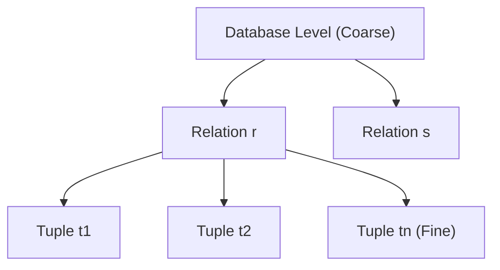
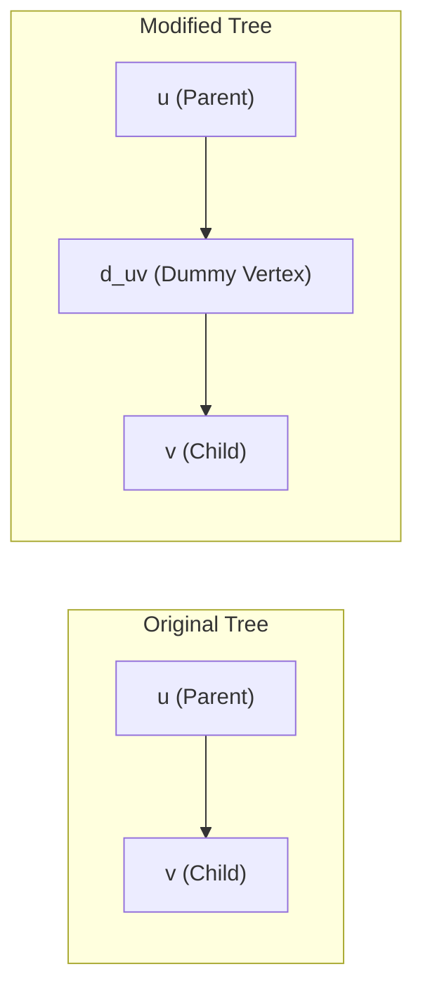
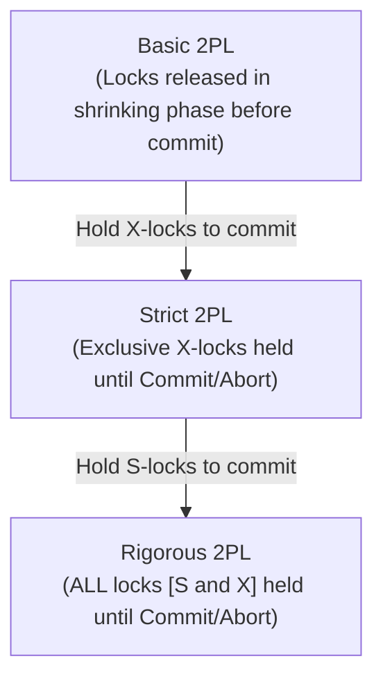

[← Prev: T11 Part 1](T11_Part1_Locking_Protocols.md) | [Exam-style T11](../Topicwise_answers_exam_style/T11_Concurrency_Control_Protocols.md) | [Next: T11 Part 3 →](T11_Part3_Deadlock_and_Timestamp_Ordering.md)

---

# T11 · Concurrency Control Protocols (Part 2 · 2PL & Lock Conversions)

> [!info] Topic Card
> **Curriculum Unit:** Unit 6 (Transactions & Concurrency Control) · **Topic ID:** T11
> **Subtopics Covered:** T11.1 (Multiple Granularity Locking), T11.2 (Two-Phase Locking, Graph Protocols & Lock Conversions), T11.3 (Strict/Rigorous 2PL, Weak Isolation & Snapshot Isolation)
> **Primary Source:** Silberschatz, Korth, and Sudarshan, *Database System Concepts* (7th Edition, 2019), Chapter 18 (pp. 835–906)
> **RUET Direct Exam Hits:** Practice Exercise 18.2 appeared verbatim (with minor arithmetic tweaks) in **RUET 2017 Q.7(a) [5 Marks]**.

---

## Table of Assigned Exercises

| Exercise ID | Type | Silberschatz 7e Page | Primary Subtopic | Core Concept | RUET Exam Relevance |
| :--- | :--- | :--- | :--- | :--- | :--- |
| **PE 18.2** | Practice | p. 899 | T11.2 | 2PL lock insertion & deadlock detection | ⚠️ **Direct Hit: 2017 Q.7(a)** |
| **PE 18.3** | Practice | p. 899 | T11.3 | Rigorous 2PL vs Basic / Strict 2PL | High (Expected theory question) |
| **PE 18.4** | Practice | p. 899 | T11.2 | Tree protocol with dummy vertices | High (Graph concurrency protocol) |
| **PE 18.5** | Practice | p. 899 | T11.2 | Tree protocol schedules vs 2PL schedules | High (Comparative proof) |
| **EX 18.23** | Exercise | p. 902 | T11.1 | Multiple granularity: uselessness of XIS mode | Medium (Hierarchical locking semantics) |
| **EX 18.24** | Exercise | pp. 902–903 | T11.1 | Multiple granularity: parent lock rules for S / IS | Medium (Protocol consistency) |
| **EX 18.25** | Exercise | p. 903 | T11.1 | Lock hierarchy, fine-grained updates & escalation | High (Practical DB engine internals) |
| **EX 18.29** | Exercise | p. 903 | T11.3 | Snapshot isolation vs MVTO (Write-skew anomaly) | High (Modern isolation anomalies) |
| **EX 18.33** | Exercise | p. 904 | T11.3 | Degree-two consistency (Read Committed) trade-offs | High (Commercial SQL default) |
| **EX 18.34** | Exercise | p. 904 | T11.2 | Key-value locking & next-key locking for phantoms | High (Index concurrency control) |
| **EX 18.35** | Exercise | p. 904 | T11.2 | Reordering operations: common hot items vs private items | High (Throughput optimization design) |

---

## T11.1 · Lock-Based Protocols and Multiple-Granularity Locking

### Exercise 18.23 · Uselessness of XIS Lock Mode in Multiple Granularity

> [!info] Exercise Metadata
> - **Source:** Silberschatz 7e, Chapter 18, Exercise 18.23, Page 902
> - **Subtopic:** T11.1 (Multiple-Granularity Locking)
> - **Key Concepts:** Lock modes (S, X, IS, IX, SIX), Intentional locking, Subtree inheritance, Redundancy elimination

**Question (Silberschatz 7e Exercise 18.23).**  
Although SIX mode is useful in multiple-granularity locking, an exclusive and intention-shared (XIS) mode is of no use. Why is it useless?

#### 1. Core Principles & Concept Overview

In multiple-granularity locking (MGL), the database system organizes data items into a tree hierarchy (Database $\to$ Area $\to$ Relation $\to$ Tuple). To allow both coarse-grained and fine-grained transactions to run concurrently without scanning child nodes, intentional lock modes are used:

- **Shared lock ($S$):** Grants explicit read access to the node and *implicitly* grants shared read access to all its descendants.
- **Exclusive lock ($X$):** Grants explicit read and write access to the node and *implicitly* grants exclusive read and write access to all its descendants.
- **Intention-shared ($IS$):** Indicates the intention to lock descendant nodes in shared ($S$) mode.
- **Intention-exclusive ($IX$):** Indicates the intention to lock descendant nodes in exclusive ($X$) or shared ($S$) mode.
- **Shared and intention-exclusive ($SIX$):** Locks the current node explicitly in $S$ mode (allowing read access to the entire subtree) while simultaneously registering an $IX$ lock to allow explicit $X$ locks on specific individual descendants.

#### 2. Detailed Step-by-Step Solution

To evaluate why an hypothetical **XIS** (Exclusive and Intention-Shared) mode is useless, examine what the two components would represent:

1. **The Exclusive ($X$) component:**
   - Holding an $X$ lock on node $Q$ gives the transaction full exclusive access to read and write node $Q$.
   - By the definition of hierarchical locking, an $X$ lock at node $Q$ automatically extends down the entire subtree rooted at $Q$.
   - The transaction already holds implicit exclusive access to every single descendant tuple and page of $Q$.
   - No other concurrent transaction can obtain any lock ($S, X, IS, IX, SIX$) on node $Q$ or on any of its descendants.

2. **The Intention-Shared ($IS$) component:**
   - The $IS$ lock exists solely to signal that the transaction plans to acquire explicit $S$ locks on lower-level descendants.
   - But because the transaction already holds an $X$ lock on node $Q$, it already possesses full, unrestricted rights to read every descendant in the subtree!
   - Acquiring explicit $S$ locks on lower-level descendants would be entirely redundant. The transaction can read those descendants immediately without requesting any further locks.

3. **Comparison with SIX mode:**
   - In **SIX** mode, the $S$ lock on the root only gives *read* permission to the subtree. If the transaction wants to update a few specific child records, it cannot do so under pure $S$. It needs the $IX$ component to explicitly acquire $X$ locks on those specific children, while other concurrent transactions can still read the rest of the subtree.
   - For **XIS**, the transaction already has write permission on the entire subtree. It does not need to declare an intention to read specific children.
   - Therefore, an $XIS$ lock would provide exactly the same capabilities as a standard $X$ lock, while adding unnecessary overhead to the lock manager. It is completely useless.

#### 3. RUET Exam Insights & Examiner Notes

- **Examiner Expectation:** Define both parts of the hypothetical lock ($X$ and $IS$). State clearly that an $X$ lock on a node implicitly grants exclusive read/write rights over all descendants. Contrast this directly with $SIX$ mode.
- **Common Mistake:** Confusing $SIX$ and $XIS$. In $SIX$, the base lock is $S$ (read-only), so $IX$ is necessary for writing descendants. In $XIS$, the base lock is already $X$ (full write), which subsumes all read requirements.

---

### Exercise 18.24 · Parent Locking Constraints for S and IS Locks

> [!info] Exercise Metadata
> - **Source:** Silberschatz 7e, Chapter 18, Exercise 18.24, Pages 902–903
> - **Subtopic:** T11.1 (Multiple-Granularity Locking Protocol Rules)
> - **Key Concepts:** Hierarchical locking rules, Implicit vs explicit locks, Lock table overhead, Protocol correctness

**Question (Silberschatz 7e Exercise 18.24).**  
The multiple-granularity protocol rules specify that a transaction $T_i$ can lock a node $Q$ in S or IS mode only if $T_i$ currently has the parent of $Q$ locked in either IX or IS mode. Given that SIX and S locks are stronger than IX or IS locks, why does the protocol not allow locking a node in S or IS mode if the parent is locked in either SIX or S mode?

#### 1. Core Principles & Concept Overview

The multiple-granularity locking protocol enforces strict tree traversal rules to guarantee conflict serializability:

1. The lock compatibility matrix must be observed.
2. The root of the tree must be locked first and can be locked in any mode.
3. A node $Q$ can be locked by $T_i$ in $S$ or $IS$ mode only if the parent of $Q$ is currently locked by $T_i$ in $IX$ or $IS$ mode.
4. A node $Q$ can be locked by $T_i$ in $X, SIX,$ or $IX$ mode only if the parent of $Q$ is currently locked by $T_i$ in $SIX$ or $IX$ mode.
5. Locks can be released only if none of the children of the node are currently locked by $T_i$.

#### 2. Detailed Step-by-Step Solution

Why disallow locking node $Q$ in $S$ or $IS$ mode when the parent $P$ is already locked in $S$ or $SIX$ mode?

1. **The child is already implicitly locked in S mode:**
   - When transaction $T_i$ locks parent node $P$ in **$S$ mode**, the protocol specifies that all descendants of $P$ (including node $Q$) are *implicitly locked in $S$ mode*.
   - When transaction $T_i$ locks parent node $P$ in **$SIX$ mode**, $T_i$ holds an explicit $S$ lock on $P$. This also *implicitly locks all descendants of $P$ in $S$ mode*.
   - Because $T_i$ already has implicit shared read privileges on $Q$ and all nodes below $Q$, requesting an explicit $S$ lock on $Q$ does not grant any new access rights.

2. **An explicit IS lock on Q is completely meaningless:**
   - An $IS$ lock on $Q$ serves only to signal that $T_i$ plans to read descendants of $Q$.
   - But $T_i$ already holds implicit $S$ access over the entire subtree rooted at $P$. It can read any descendant of $Q$ without asking for further permission.

3. **Preventing lock table bloat:**
   - If transactions were allowed to acquire explicit locks on descendants when the parent is already locked in $S$ or $SIX$, the lock manager would have to insert redundant lock records into the lock table.
   - This wastes memory and increases lock lookup time.

4. **Preventing lock release protocol violations:**
   - Under multiple-granularity locking, unlocks must proceed strictly bottom-up (a parent cannot be unlocked while its child is still locked).
   - If redundant child locks were created, a transaction could not release the parent lock until it explicitly unlocked all redundant child locks, complicating transaction management.

#### 3. RUET Exam Insights & Examiner Notes

- **Key Takeaway:** If a transaction holds an $S$ or $SIX$ lock on a node, it already holds an implicit $S$ lock on every single descendant. An explicit $S$ or $IS$ lock on a child is completely redundant.
- **Examiner Scoring Tip:** Always mention both aspects: semantic redundancy (implicit access already granted) and operational overhead (lock table bloat and bottom-up unlock ordering).

---

### Exercise 18.25 · Lock Hierarchies, Fine-Grained Updates, and Lock Escalation

> [!info] Exercise Metadata
> - **Source:** Silberschatz 7e, Chapter 18, Exercise 18.25, Page 903
> - **Subtopic:** T11.1 (Multiple Granularity & Lock Manager Internals)
> - **Key Concepts:** Coarse vs fine-grained locking, SIX mode, Lock escalation, Lock table memory limits

**Question (Silberschatz 7e Exercise 18.25).**  
Suppose the lock hierarchy for a database consists of database, relations, and tuples.  
a. If a transaction needs to read a lot of tuples from a relation $r$, what locks should it acquire?  
b. Now suppose the transaction wants to update a few of the tuples in $r$ after reading a lot of tuples. What locks should it acquire?  
c. If at run-time the transaction finds that it needs to actually update a very large number of tuples (after acquiring locks assuming only a few tuples would be updated), what problems would this cause to the lock table, and what could the database do to avoid the problem?

#### 1. Core Principles & Concept Overview

Granularity trade-offs balance concurrency against locking overhead:
- **Fine granularity (tuple-level):** High concurrency, but high lock table space and CPU overhead.
- **Coarse granularity (relation-level or database-level):** Low locking overhead, but reduced concurrency because entire tables are locked against other transactions.



#### 2. Detailed Step-by-Step Solution

##### Part (a): Reading a lot of tuples from relation $r$
- If the transaction needs to read a very large number of tuples (e.g., a table scan or bulk analytics query), acquiring individual tuple-level shared locks would flood the lock table with thousands or millions of lock entries.
- The transaction should acquire coarse-grained locks:
  1. Acquire an **$IS$ lock** on the **Database**.
  2. Acquire an **$S$ lock** on the **Relation $r$**.
- **Result:** The $S$ lock on relation $r$ implicitly grants shared read access to every tuple in $r$. The transaction acquires zero individual tuple locks, minimizing lock manager overhead.

##### Part (b): Reading a lot of tuples and updating a few tuples in relation $r$
- The transaction needs broad read access across the relation, but only writes to a small number of specific tuples.
- The ideal lock configuration is:
  1. Acquire an **$IX$ lock** on the **Database**.
  2. Acquire a **$SIX$ lock** on the **Relation $r$**.
  3. Acquire explicit **$X$ locks** only on the few specific **Tuples** that will be updated.
- **Why this is optimal:**
  - The $S$ component of $SIX$ allows the transaction to read any tuple in $r$ without acquiring tuple-level locks.
  - The $IX$ component of $SIX$ permits the transaction to acquire fine-grained $X$ locks on just the target tuples.
  - Concurrent transactions can still acquire $IS$ locks on relation $r$ and read other tuples, keeping concurrency high.

##### Part (c): Problems caused by unexpected bulk updates & database remedy

**Problems caused to the lock table:**
1. **Lock Table Memory Exhaustion:** The database lock table is maintained in main memory. Each tuple lock requires a distinct lock head record and transaction lock request node. Acquiring millions of tuple $X$ locks can consume all allocated lock memory, causing memory allocation failures or system crashes.
2. **High CPU & Search Overhead:** Managing, searching, and checking compatibility against huge linked lists of tuple locks increases CPU consumption and query latency.
3. **Deadlock Vulnerability:** Requesting a large volume of individual tuple locks incrementally at runtime dramatically increases the probability of entering a circular wait (deadlock).

**What the database engine does: Lock Escalation:**
- The DBMS lock manager monitors the number of fine-grained locks held by each transaction.
- When the number of tuple locks held on relation $r$ exceeds a configured threshold (or when lock table memory reaches a critical limit), the database performs **Lock Escalation**:
  1. The DBMS upgrades the transaction's lock on relation $r$ from $SIX$ (or $IX$) to an **exclusive ($X$) lock on the entire relation $r$**.
  2. Once the relation-level $X$ lock is successfully granted, the DBMS **releases and frees all individual tuple locks** held by that transaction on $r$.
- **Trade-off:** Lock escalation frees up lock table memory and eliminates per-tuple lock management costs. However, it temporarily reduces concurrency because no other transaction can access relation $r$ until the escalating transaction commits.

#### 3. RUET Exam Insights & Examiner Notes

- **Common Question Variant:** "What is lock escalation? Explain with an example." Part (c) provides the textbook answer for this concept.
- **Examiner Tip:** In part (b), students often incorrectly write "Acquire $X$ lock on Relation $r$". Emphasize that acquiring an $X$ lock on the whole table would destroy concurrency. $SIX$ mode is designed specifically for this "read many, update few" workload.

---

## T11.2 · Two-Phase Locking, Tree Protocols, and Concurrency Optimizations

### Exercise 18.2 · Inserting 2PL Lock/Unlock Instructions and Deadlock Detection

> [!info] Exercise Metadata
> - **Source:** Silberschatz 7e, Chapter 18, Practice Exercise 18.2, Page 899
> - **Subtopic:** T11.2 (Two-Phase Locking & Deadlock)
> - **Past Exam Direct Hit:** ⚠️ **RUET 2017 Q.7(a) [5 Marks]** (recycled verbatim with $B := B + 15\%$ and $A := A + 20\%$)
> - **Key Concepts:** Growing phase, Shrinking phase, Shared vs Exclusive locks, Deadlock circular wait, Wait-for graph

**Question (Silberschatz 7e Practice Exercise 18.2).**  
Consider the following two transactions:

$$
\begin{aligned}
T_{34}\text{:} &\quad \text{read}(A); \\
&\quad \text{read}(B); \\
&\quad \textbf{if } A = 0 \textbf{ then } B := B + 1; \\
&\quad \text{write}(B). \\
T_{35}\text{:} &\quad \text{read}(B); \\
&\quad \text{read}(A); \\
&\quad \textbf{if } B = 0 \textbf{ then } A := A + 1; \\
&\quad \text{write}(A).
\end{aligned}
$$

Add lock and unlock instructions to transactions $T_{34}$ and $T_{35}$ so that they observe the two-phase locking protocol. Can the execution of these transactions result in a deadlock?

*(Note: Silberschatz 7e prints the transaction labels as $T_{34}$ and $T_{35}$ in the code, but refers to them as $T_{31}$ and $T_{32}$ in the problem text. In RUET 2017 Q.7a, they are labelled $T_1$ and $T_2$.)*

#### 1. Core Principles & Concept Overview

The Two-Phase Locking (2PL) protocol guarantees conflict serializability by requiring each transaction to execute in two distinct phases:

1. **Growing Phase:** The transaction may obtain new locks (or upgrade shared locks to exclusive locks). It cannot release any locks.
2. **Shrinking Phase:** The transaction may release locks (or downgrade exclusive locks to shared locks). It cannot obtain any new locks.

The point where the transaction acquires its final lock is its **lock point**. While 2PL ensures conflict serializability, it **does not prevent deadlocks**.

#### 2. Detailed Step-by-Step Solution

##### Step 1: Determine Required Lock Modes
- Transaction $T_{34}$:
  - Reads data item $A \implies$ requires `lock-S(A)`.
  - Reads and conditionally updates data item $B \implies$ requires `lock-X(B)`.
- Transaction $T_{35}$:
  - Reads data item $B \implies$ requires `lock-S(B)`.
  - Reads and conditionally updates data item $A \implies$ requires `lock-X(A)`.

##### Step 2: Insert Lock and Unlock Instructions under 2PL
Under basic 2PL, all locks must be acquired before any lock is released. Unlocks can occur as soon as the respective data item is no longer needed, provided no subsequent lock request follows.

**Transaction $T_{34}$ under 2PL:**
```text
lock-S(A);
read(A);
lock-X(B);                  -- Lock point: all locks acquired
read(B);
if A = 0 then B := B + 1;
write(B);
unlock(A);                  -- Shrinking phase begins: no further locks permitted
unlock(B);
```

**Transaction $T_{35}$ under 2PL:**
```text
lock-S(B);
read(B);
lock-X(A);                  -- Lock point: all locks acquired
read(A);
if B = 0 then A := A + 1;
write(A);
unlock(B);                  -- Shrinking phase begins: no further locks permitted
unlock(A);
```

> [!tip] Alternative Valid Lock-Conversion Variation
> A transaction can start with a shared lock and upgrade it during the growing phase:
> For $T_{34}$: `lock-S(A); read(A); lock-S(B); read(B); upgrade(B); write(B); unlock(A); unlock(B);`.
> Both formulations satisfy the two-phase rule. The direct `lock-X(B)` formulation is standard in textbook solutions.

##### Step 3: Deadlock Analysis and Justification

**Yes, the execution of these transactions can result in a deadlock.**

**Justification:**  
Consider the following concurrent interleaving of operations:

1. $T_{34}$ executes `lock-S(A)` and `read(A)`. $T_{34}$ holds a shared lock on $A$.
2. $T_{35}$ executes `lock-S(B)` and `read(B)`. $T_{35}$ holds a shared lock on $B$.
3. $T_{34}$ executes `lock-X(B)`. Because $T_{35}$ holds a shared lock on $B$, and mode $X$ conflicts with mode $S$, the lock request is denied. $T_{34}$ enters a wait state, waiting for $T_{35}$ to release $B$.
4. $T_{35}$ executes `lock-X(A)`. Because $T_{34}$ holds a shared lock on $A$, and mode $X$ conflicts with mode $S$, the lock request is denied. $T_{35}$ enters a wait state, waiting for $T_{34}$ to release $A$.

Now, $T_{34}$ is waiting for $T_{35}$, and $T_{35}$ is waiting for $T_{34}$. Because both transactions follow 2PL, neither can release any lock before completing its lock acquisitions. A circular wait exists:

$$
T_{34} \longrightarrow T_{35} \longrightarrow T_{34}
$$

Neither transaction can make progress. A system deadlock has occurred.

  
*Figure: Deadlock cycle between the two transactions under 2PL (Source: Topicwise Answers Exam-Style, T11)*

#### 3. RUET Exam Insights & Examiner Notes

- **Past Exam Appearance:** In **RUET 2017 Q.7(a)**, the question asked:  
  *"What is starvation? Consider the following two transactions: T1: read(A); read(B); if A=0 then B:=B+15% of B; write(B); T2: read(B); read(A); if B=0 then A:=A+20% of A; write(A); Add lock and unlock instructions so that they observe 2PL. Can the execution result in a deadlock? Justify."*
- **Mark Allocation in RUET:**
  - Starvation definition: 1 Mark
  - Correct 2PL lock/unlock code for both transactions: 2 Marks
  - Deadlock identification, interleaved schedule trace, and wait-for graph: 2 Marks
- **Cross-Reference:** See `Topicwise_answers_exam_style/T11_Concurrency_Control_Protocols.md` under `2017 Q.7(a)` for the direct exam answer.

---

### Exercise 18.4 · Tree Protocol Concurrency with Dummy Vertices

> [!info] Exercise Metadata
> - **Source:** Silberschatz 7e, Chapter 18, Practice Exercise 18.4, Page 899
> - **Subtopic:** T11.2 (Graph-Based Protocols / Tree Locking)
> - **Key Concepts:** Tree protocol rules, Early lock release, Lock holding duration, Concurrency improvement

**Question (Silberschatz 7e Practice Exercise 18.4).**  
Consider a database organized in the form of a rooted tree. Suppose that we insert a dummy vertex between each pair of vertices. Show that, if we follow the tree protocol on the new tree, we get better concurrency than if we follow the tree protocol on the original tree.

#### 1. Core Principles & Concept Overview

The **Tree Protocol** is a graph-based concurrency control protocol applied to data items organized as a rooted directed tree:

1. Only exclusive locks ($X$) are allowed.
2. The first lock by transaction $T_i$ may be placed on any data item.
3. Subsequently, an item $Q$ can be locked by $T_i$ only if the parent of $Q$ is *currently locked* by $T_i$.
4. Data items may be unlocked at any time.
5. A data item that has been locked and unlocked by $T_i$ can never be relocked by $T_i$.

Key properties of the tree protocol:
- It guarantees **conflict serializability**.
- It is **deadlock-free** (no cycles can form in wait-for graphs).
- It is **not two-phase** (locks can be released before all locks are obtained).

#### 2. Detailed Step-by-Step Solution

Let $u$ and $v$ be two vertices in the original tree such that $u$ is the parent of $v$ ($u \to v$).



##### 1. Locking Dynamics in the Original Tree
- In the original tree, if transaction $T$ needs to access node $u$ and subsequently child node $v$, rule 3 requires that $T$ can lock $v$ **only if $u$ is currently locked by $T$**.
- Therefore, $T$ cannot release its lock on $u$ until it has successfully acquired its lock on $v$.
- Node $u$ must remain locked during the entire time $T$ processes $u$, waits for $v$, and acquires $v$.
- While $u$ is locked by $T$, no other transaction can lock $u$ or any other child of $u$.

##### 2. Locking Dynamics in the Modified Tree with Dummy Vertex $d_{uv}$
- Edge $(u, v)$ is replaced by two edges: $u \to d_{uv}$ and $d_{uv} \to v$.
- The dummy vertex $d_{uv}$ holds no actual database data; it serves purely as a synchronization anchor.
- Under the tree protocol on the new tree:
  1. Transaction $T$ locks $u$ and accesses $u$.
  2. Transaction $T$ locks dummy vertex $d_{uv}$. This is allowed because $u$ (the parent of $d_{uv}$) is currently locked by $T$.
  3. **Immediate unlock of $u$:** Because $T$ now holds the lock on $d_{uv}$, it can **immediately unlock $u$**!
  4. Later, when $T$ is ready to access $v$, it can lock $v$ because its parent ($d_{uv}$) is currently locked by $T$.
  5. Once $v$ is locked, $T$ unlocks dummy vertex $d_{uv}$.

##### 3. Concurrency Comparison
- In the original tree, node $u$ must be held until node $v$ is locked.
- In the modified tree, node $u$ is unlocked as soon as dummy node $d_{uv}$ is locked.
- While $T$ holds dummy node $d_{uv}$, node $u$ is already free! Another transaction $T'$ that needs to access $u$ (or other subtrees rooted at $u$) can acquire $u$ immediately.
- Holding the lock on dummy vertex $d_{uv}$ only blocks transactions that want to traverse the specific edge from $u$ to $v$. It does not block transactions accessing $u$ itself or sibling nodes of $v$.
- Because real data items are held for substantially shorter durations, lock contention on real data items decreases, and overall concurrency increases.

#### 3. RUET Exam Insights & Examiner Notes

- **Examiner Expectation:** Explain the rule that forces parent retention (Rule 3: child can only be locked while parent is held). Show the step-by-step trace of locking the dummy node and releasing the parent early.
- **Common Mistake:** Forgetting that dummy nodes do not contain data. They exist only to satisfy Rule 3 while allowing the real parent to be freed early.

---

### Exercise 18.5 · Incomparability of Schedules: Tree Protocol vs Two-Phase Locking

> [!info] Exercise Metadata
> - **Source:** Silberschatz 7e, Chapter 18, Practice Exercise 18.5, Page 899
> - **Subtopic:** T11.2 (Tree Protocol vs 2PL Comparison)
> - **Key Concepts:** Set incomparability, Non-two-phase lock release, Arbitrary access order, Lock modes

**Question (Silberschatz 7e Practice Exercise 18.5).**  
Show by example that there are schedules possible under the tree protocol that are not possible under the two-phase locking protocol, and vice versa.

#### 1. Core Principles & Concept Overview

Two concurrency control protocols $P_1$ and $P_2$ are **incomparable** if:
1. There exists a valid schedule permitted under $P_1$ that cannot be generated under $P_2$.
2. There exists a valid schedule permitted under $P_2$ that cannot be generated under $P_1$.

- **Two-Phase Locking (2PL):** Once a transaction unlocks any item, it enters the shrinking phase and can never request another lock. However, data items may be accessed in any arbitrary order.
- **Tree Protocol:** Transactions may unlock an item and later lock other items down the tree path. However, items must be locked strictly following the tree edges from parent to child.

#### 2. Detailed Step-by-Step Solution

##### Part 1: Schedule possible under Tree Protocol, but NOT possible under 2PL

Consider a tree database structured as $A \to B \to C$.


Let transaction $T_1$ access $A, B,$ and $C$. Under the tree protocol, $T_1$ releases locks early as it moves down the tree:

```text
T1: lock-X(A); write(A); lock-X(B); unlock(A); lock-X(C); unlock(B); write(C); unlock(C);
```

Now consider concurrent transaction $T_2$ that accesses only $A$:

```text
T2: lock-X(A); write(A); unlock(A);
```

Consider the interleaved execution schedule $S_1$:
1. $T_1$ locks $A$, writes $A$, locks $B$, and **unlocks $A$**.
2. $T_2$ locks $A$, writes $A$, and unlocks $A$.
3. $T_1$ locks $C$, unlocks $B$, writes $C$, and unlocks $C$.

- **Under the Tree Protocol:** $S_1$ is completely valid. $T_1$ locked $B$ while holding $A$, unlocked $A$, locked $C$ while holding $B$, and unlocked $B$ and $C$.
- **Under 2PL:** $S_1$ is **strictly impossible**. Notice that $T_1$ unlocked $A$ in step 1, and subsequently requested a lock on $C$ in step 3. Under 2PL, unlocking $A$ starts the shrinking phase. Requesting a lock on $C$ violates the 2PL rule. Therefore, 2PL cannot generate this schedule.

##### Part 2: Schedule possible under 2PL, but NOT possible under Tree Protocol

Consider two data items $A$ and $B$. Let the tree hierarchy be $A \to B$ ($A$ is parent, $B$ is child).

Consider transaction $T_3$ that accesses $B$ first, and then accesses $A$ (bottom-up access order):

```text
T3: lock-X(B); write(B); lock-X(A); write(A); unlock(B); unlock(A);
```

- **Under 2PL:** This execution is completely valid. $T_3$ acquires all locks in its growing phase (`lock-X(B)`, then `lock-X(A)`), performs its operations, and releases locks in its shrinking phase. 2PL imposes no constraints on the topological order in which data items are locked.
- **Under the Tree Protocol:** This execution is **impossible**. Under the tree protocol:
  - If $T_3$ locks $B$ as its first lock, $B$ has no child $A$. Rule 3 states that subsequent locks can only be placed on children of currently locked nodes. Since $A$ is the parent of $B$, $T_3$ can never acquire a lock on $A$ after locking $B$.
  - To access $A$, $T_3$ would have been forced to lock $A$ *before* locking $B$.
  - Therefore, the tree protocol cannot generate any schedule where a transaction accesses a child before its parent.

##### Conclusion
The set of schedules allowed by the Tree Protocol and the set of schedules allowed by Two-Phase Locking are mutually incomparable:

$$
\text{Schedules}(\text{Tree}) \not\subseteq \text{Schedules}(\text{2PL}) \quad \text{and} \quad \text{Schedules}(\text{2PL}) \not\subseteq \text{Schedules}(\text{Tree})
$$

#### 3. RUET Exam Insights & Examiner Notes

- **Examiner Expectation:** Provide clear, concrete counter-examples for both directions. Clearly identify the specific rule violated in each case (shrinking-phase lock request in 2PL; parent-to-child traversal order in Tree protocol).
- **Common Mistake:** Giving abstract arguments without writing down the sequence of lock, unlock, and read/write operations. Always write out the step-by-step schedule.

---

### Exercise 18.34 · Key-Value Locking and Next-Key Locking for Phantom Prevention

> [!info] Exercise Metadata
> - **Source:** Silberschatz 7e, Chapter 18, Exercise 18.34, Page 904
> - **Subtopic:** T11.2 (Index Locking & Phantom Problem)
> - **Key Concepts:** Phantom phenomenon, Key-value locking (KVL), Next-key locking, Gap locking

**Question (Silberschatz 7e Exercise 18.34).**  
Give example schedules to show that with key-value locking, if lookup, insert, or delete does not lock the next-key value, the phantom phenomenon could go undetected.

#### 1. Core Principles & Concept Overview

The **Phantom Phenomenon** occurs when a transaction queries a range of data items satisfying a predicate (e.g., `WHERE age > 30`), and a concurrent transaction inserts, deletes, or updates a tuple that satisfies the predicate, leading to non-serializable executions.

- **Naive Key-Value Locking (KVL):** Locks only the specific index keys that currently exist in the database.
- **Next-Key Locking:** Locks an existing index key value **and the open gap immediately preceding it** (or between it and the next key). This prevents concurrent transactions from inserting new records into the range.


#### 2. Detailed Step-by-Step Solution

##### Setup
Suppose an index on attribute `balance` contains the following sorted key values:

$$
\{10, 20, 30\}
$$

##### Example Schedule: Range Lookup with Missing Next-Key Lock

Transaction $T_1$ runs a range scan to calculate the total balance for accounts between 15 and 25:
```sql
-- T1: Range Query
SELECT SUM(balance) FROM account WHERE balance BETWEEN 15 AND 25;
```

Transaction $T_2$ inserts a new account with a balance of 22:
```sql
-- T2: Insertion
INSERT INTO account VALUES ('A-99', 22);
```

##### Trace under Naive Key-Value Locking (No Next-Key Lock)

| Step | Transaction $T_1$ | Transaction $T_2$ | State & Index Locks |
| :---: | :--- | :--- | :--- |
| 1 | Scans index for keys in $[15, 25]$. Finds existing key `20`. | | $T_1$ acquires `lock-S(20)`. |
| 2 | Reads record for key `20`. Calculates sum = 20. | | No gap locks held. Key `22` does not exist yet. |
| 3 | | Executes `INSERT (22)`. | $T_2$ checks if key `22` is locked. It is not locked. |
| 4 | | Inserts key `22` into index. Commits. | Key `22` added to index. |
| 5 | Repeats query: `SELECT SUM(balance) WHERE balance BETWEEN 15 AND 25;` | | Scans index, now finds keys `20` and `22`. |
| 6 | Calculates sum = $20 + 22 = 42$. Commits. | | $T_1$ commits. |

##### Serializability Failure Analysis
- Within transaction $T_1$, reading the identical range twice returned two different results ($20$ then $42$).
- In any serial execution:
  - If $T_1$ executes before $T_2$, $T_1$ must see sum = 20 in both queries.
  - If $T_2$ executes before $T_1$, $T_1$ must see sum = 42 in both queries.
- Seeing 20 on the first read and 42 on the second read is non-serializable. The phantom record `22` went undetected because $T_1$ only locked the existing key `20` and did not lock the gap between 20 and 30.

##### How Next-Key Locking Prevents the Phantom
- In step 1, when $T_1$ scans up to key `20` and continues to the upper bound 25, it encounters the next key in the index: `30`.
- Under next-key locking, $T_1$ acquires a shared lock on `30` as well (`lock-S(30)`). In next-key locking semantics, locking key 30 locks the interval $(20, 30]$.
- When $T_2$ attempts to insert `22`, it must acquire an exclusive lock on the next existing key (`30`).
- Because $T_1$ holds a shared lock on `30`, $T_2$'s insert is blocked until $T_1$ commits. The phantom is completely prevented.

#### 3. RUET Exam Insights & Examiner Notes

- **Real-World Connection:** Next-key locking is the exact concurrency control mechanism used by MySQL InnoDB at the `REPEATABLE READ` isolation level to eliminate phantom reads.
- **Examiner Scoring Tip:** Draw the sorted key array ($\dots, 10, 20, 30, \dots$) and explicitly show the gap where the insert occurs. This makes the answer clear and easy to award full marks.

---

### Exercise 18.35 · Concurrency Optimization via Operation Reordering on Hot Items

> [!info] Exercise Metadata
> - **Source:** Silberschatz 7e, Chapter 18, Exercise 18.35, Page 904
> - **Subtopic:** T11.2 (Concurrency Optimization & Lock Hold Duration)
> - **Key Concepts:** Hot spots, Lock holding time, Strict 2PL commit-time release, Operation reordering

**Question (Silberschatz 7e Exercise 18.35).**  
Many transactions update a common item (e.g., the cash balance at a branch) and private items (e.g., individual account balances). Explain how you can increase concurrency (and throughput) by ordering the operations of the transaction.

#### 1. Core Principles & Concept Overview

In transaction processing systems, data items fall into two categories:
1. **Private items:** Accessed by only one or a few transactions (e.g., a specific customer's savings account). Contention is very low.
2. **Common (hot-spot) items:** Accessed and modified by almost every transaction in the system (e.g., branch cash total, central inventory counter, global sequence generator). Contention is extremely high.

Under standard commercial locking protocols (such as Strict or Rigorous 2PL), **all exclusive locks ($X$) must be held until the transaction commits or aborts**.


#### 2. Detailed Step-by-Step Solution

##### 1. The Bottleneck of Naive Operation Ordering
Suppose a banking transaction transfers money by updating the common branch cash balance first, and then updating the individual customer account:

```text
-- Naive Ordering
lock-X(Branch_Cash);           -- Common hot item locked early
Branch_Cash := Branch_Cash - amount;
write(Branch_Cash);
... [perform complex business logic, disk I/O, user validation] ...
lock-X(Customer_Account);      -- Private item
Customer_Account := Customer_Account + amount;
write(Customer_Account);
COMMIT;                        -- Branch_Cash lock held throughout!
unlock(Branch_Cash);
unlock(Customer_Account);
```

- **Problem:** The exclusive lock on `Branch_Cash` is acquired at the start. It is held while the transaction performs disk I/O, network communication, and private account updates.
- **Consequence:** Every other concurrent transaction attempting to access `Branch_Cash` is blocked. All transactions are serialized through this single lock, creating a severe convoy bottleneck and plummeting system throughput.

##### 2. The Optimized Ordering Strategy: Deferring Hot-Spot Updates
To maximize concurrency, reorder the operations inside each transaction:
1. Perform all computations, validation checks, and operations on **private items first**.
2. **Defer the update on the common item to the very end of the transaction**, immediately before the `COMMIT` statement.

```text
-- Optimized Ordering
lock-X(Customer_Account);      -- Private item locked first
Customer_Account := Customer_Account + amount;
write(Customer_Account);
... [perform complex business logic, disk I/O, user validation] ...
lock-X(Branch_Cash);           -- Common hot item locked at the very last moment
Branch_Cash := Branch_Cash - amount;
write(Branch_Cash);
COMMIT;                        -- Locks released immediately after!
unlock(Customer_Account);
unlock(Branch_Cash);
```

##### 3. Quantitative Impact on Throughput
- Let $T_{total}$ be the total execution time of the transaction (e.g., 50 milliseconds).
- Let $T_{write}$ be the time required to update the in-memory branch cash item and flush the commit log (e.g., 0.5 milliseconds).
- Under early locking, the hot lock is held for $50\text{ ms} \implies$ maximum throughput is:

$$
\frac{1}{0.050\text{ s}} = 20 \text{ transactions per second (TPS)}
$$

- Under deferred locking, the hot lock is held for only $0.5\text{ ms} \implies$ theoretical throughput rises to:

$$
\frac{1}{0.0005\text{ s}} = 2000 \text{ transactions per second (TPS)}
$$

- Holding the lock for $1\%$ of the original duration reduces lock contention by nearly two orders of magnitude.

#### 3. RUET Exam Insights & Examiner Notes

- **Examiner Expectation:** Explain the interaction between Strict 2PL (holding $X$ locks until commit) and lock hold duration. State clearly that operations on common items must be deferred until immediately before commit.
- **Real-World Application:** High-volume transaction engines (e.g., banking, e-commerce checkouts) use this exact technique to prevent hot-spot serialization.

---

## T11.3 · Strict and Rigorous 2PL, Weak Consistency, and Snapshot Isolation

### Exercise 18.3 · Benefits of Rigorous Two-Phase Locking vs Other 2PL Variants

> [!info] Exercise Metadata
> - **Source:** Silberschatz 7e, Chapter 18, Practice Exercise 18.3, Page 899
> - **Subtopic:** T11.3 (Variants of Two-Phase Locking)
> - **Key Concepts:** Basic 2PL, Strict 2PL, Rigorous 2PL, Commit-order serializability, Cascading aborts

**Question (Silberschatz 7e Practice Exercise 18.3).**  
What benefit does rigorous two-phase locking provide? How does it compare with other forms of two-phase locking?

#### 1. Core Principles & Concept Overview

Two-phase locking has three primary variants that trade concurrency against recovery simplicity and serialization guarantees:



#### 2. Detailed Step-by-Step Solution

##### 1. Defining the Three Forms of 2PL
1. **Basic 2PL:**
   - A transaction cannot acquire any new lock once it releases its first lock.
   - Locks can be released in the shrinking phase at any time before commit.
2. **Strict 2PL:**
   - Requires that all **exclusive ($X$) locks** held by a transaction be retained until the transaction commits or aborts.
   - Shared ($S$) locks may be released during the shrinking phase prior to commit.
3. **Rigorous 2PL:**
   - Requires that **all locks (both shared $S$ and exclusive $X$)** held by a transaction be retained until the transaction commits or aborts.
   - The transaction has no shrinking phase during active execution; all locks are released simultaneously upon commit or abort.

##### 2. Benefits Provided by Rigorous Two-Phase Locking
Rigorous 2PL provides two decisive technical benefits:

1. **Commit-Order Serializability:**
   - Under Rigorous 2PL, transactions can be serialized in the **exact order in which they commit**!
   - If transaction $T_1$ commits before transaction $T_2$, then $T_1$ precedes $T_2$ in the conflict serialization order ($T_1 \to T_2$).
   - This property does not hold under Basic 2PL or Strict 2PL.
     - *Why Strict 2PL fails this:* Under Strict 2PL, $T_1$ can release an $S$ lock on $A$ before committing. Then $T_2$ can acquire an $X$ lock on $A$ and commit *before* $T_1$ commits. In the serialization graph, $T_1 \to T_2$ (because $T_1$ read $A$ before $T_2$ wrote $A$), yet $T_2$ committed before $T_1$!
   - In distributed database systems and replication engines, commit-order serializability makes it straightforward to maintain identical replica states without distributed cycle detection.

2. **Guaranteed Cascadelessness and Strict Schedules:**
   - Because no data item written by $T_1$ can be read by $T_2$ until $T_1$ commits, dirty reads are impossible.
   - If a transaction aborts, no other active transaction has read its uncommitted updates. Cascading aborts are completely prevented.
   - Restoring a data item during an abort requires only writing its before-image, without risk of overwriting concurrent updates.

##### 3. Comprehensive Comparison Table

| Feature / Metric | Basic 2PL | Strict 2PL | Rigorous 2PL |
| :--- | :--- | :--- | :--- |
| **Lock Release Rule** | Any lock released after lock point | $X$-locks held to commit; $S$-locks released early | ALL locks ($S$ and $X$) held to commit |
| **Conflict Serializability** | Yes | Yes | Yes |
| **Serialization Order** | Order of lock points | Order of lock points | **Exact order of transaction commits** |
| **Cascading Aborts Possible?** | Yes (Cascading rollbacks can occur) | **No** (Cascadeless) | **No** (Cascadeless) |
| **Strict Schedules Guaranteed?** | No | Yes | Yes |
| **Concurrency Level** | Highest among 2PL variants | Intermediate | Lowest (readers hold locks until commit) |
| **Deadlock Freedom?** | No (Deadlocks possible) | No (Deadlocks possible) | No (Deadlocks possible) |

#### 3. RUET Exam Insights & Examiner Notes

- **Examiner Expectation:** Clearly define the lock retention rules for all three protocols. Emphasize that Rigorous 2PL serializes transactions according to their commit order, which makes it ideal for distributed transaction managers.
- **Common Mistake:** Stating that Strict 2PL holds all locks until commit. Strict 2PL holds only *exclusive* locks until commit. Rigorous 2PL holds *both shared and exclusive* locks until commit.

---

### Exercise 18.29 · Snapshot Isolation vs Multiversion Timestamp Ordering (Write Skew)

> [!info] Exercise Metadata
> - **Source:** Silberschatz 7e, Chapter 18, Exercise 18.29, Page 903
> - **Subtopic:** T11.3 (Snapshot Isolation vs Serializability)
> - **Key Concepts:** Snapshot isolation (SI), Multiversion timestamp ordering (MVTO), Write skew, Anti-dependency cycles

**Question (Silberschatz 7e Exercise 18.29).**  
As discussed in Exercise 18.15, snapshot isolation can be implemented using a form of timestamp validation. However, unlike the multiversion timestamp-ordering scheme, which guarantees serializability, snapshot isolation does not guarantee serializability. Explain the key difference between the protocols that results in this difference.

#### 1. Core Principles & Concept Overview

Both Multiversion Timestamp Ordering (MVTO) and Snapshot Isolation (SI) maintain multiple physical versions of data items to allow read operations to proceed without acquiring locks:

- **Multiversion Timestamp Ordering (MVTO):** Enforces serializability by tracking both read timestamps ($\text{R-timestamp}$) and write timestamps ($\text{W-timestamp}$) on data versions. Conflicting read-write orders are validated and enforced.
- **Snapshot Isolation (SI):** Each transaction reads from a private snapshot of the database taken at its start timestamp ($T_{start}$). It validates updates at commit time using the **First-Committer-Wins** rule (disjoint update sets).

#### 2. Detailed Step-by-Step Solution

##### 1. The Key Algorithmic Difference
The fundamental difference between the two protocols lies in **which types of conflicts they detect and prevent**:

- **Snapshot Isolation checks ONLY Write-Write ($W-W$) conflicts:**
  - When transaction $T_i$ attempts to commit, SI checks whether any concurrent transaction $T_j$ that committed after $T_{start}(T_i)$ has updated any item in $T_i$'s write set ($\text{writeset}(T_i) \cap \text{writeset}(T_j) = \emptyset$).
  - If their write sets are disjoint, **both transactions are allowed to commit**.
  - SI completely ignores **Read-Write ($R-W$) anti-dependency conflicts** between concurrent transactions!

- **MVTO checks and enforces both $W-W$, $W-R$, and $R-W$ conflicts:**
  - In MVTO, when a transaction reads a version, the system records that read by updating the version's $\text{R-timestamp}$.
  - When another transaction attempts to overwrite that data item with an older or conflicting timestamp, MVTO rejects the write and aborts the transaction.
  - This ensures that no circular serialization dependencies can ever form.

##### 2. Concrete Counter-Example: The Write-Skew Anomaly under SI
Consider an on-call medical database with two doctors, Alice ($A$) and Bob ($B$).  
Integrity Constraint: **At least one doctor must remain on call at all times** ($A + B \ge 1$). Currently, both are on call ($A = 1, B = 1$).

Two concurrent transactions execute under Snapshot Isolation:
- **Transaction $T_1$ (Dr. Alice wants to go off call):**
  1. Reads $A$ and $B$ from snapshot: $A = 1, B = 1$.
  2. Because $B = 1$, Alice can safely go off call. Sets $A := 0$.
  3. Writeset($T_1$) = $\{A\}$.
- **Transaction $T_2$ (Dr. Bob wants to go off call):**
  1. Reads $A$ and $B$ from snapshot: $A = 1, B = 1$.
  2. Because $A = 1$, Bob can safely go off call. Sets $B := 0$.
  3. Writeset($T_2$) = $\{B\}$.


**Validation and Outcome under SI:**
- When $T_1$ commits: $\text{writeset}(T_1) \cap \text{writeset}(T_2) = \{A\} \cap \{B\} = \emptyset$. Validated and committed!
- When $T_2$ commits: $\text{writeset}(T_2) \cap \text{writeset}(T_1) = \{B\} \cap \{A\} = \emptyset$. Validated and committed!
- **Final database state:** $A = 0$ and $B = 0$. The integrity constraint $A + B \ge 1$ is violated!
- In the serialization graph:
  - $T_1$ read $B$ before $T_2$ wrote $B \implies T_1 \xrightarrow{rw} T_2$.
  - $T_2$ read $A$ before $T_1$ wrote $A \implies T_2 \xrightarrow{rw} T_1$.
  - A cycle exists ($T_1 \to T_2 \to T_1$). The execution is non-serializable.

**Outcome under MVTO:**
- In MVTO, $T_1$'s read of $B$ updates $\text{R-timestamp}(B)$. When $T_2$ attempts to write $B$, MVTO detects that $T_1$ has already read an older version. One of the transactions is aborted, preventing the cycle and preserving database consistency.

#### 3. RUET Exam Insights & Examiner Notes

- **Examiner Expectation:** State that SI detects only write-write conflicts, whereas MVTO detects both write-write and read-write conflicts. Illustrate with the standard Write Skew example ($A+B \ge 1$).
- **Modern Database Context:** Mention that PostgreSQL and Oracle use Snapshot Isolation for their "Serializable" or "Repeatable Read" modes. PostgreSQL uses **Serializable Snapshot Isolation (SSI)**, which tracks anti-dependency cycles to restore full serializability.

---

### Exercise 18.33 · Degree-Two Consistency (Cursor Stability / Read Committed) Trade-offs

> [!info] Exercise Metadata
> - **Source:** Silberschatz 7e, Chapter 18, Exercise 18.33, Page 904
> - **Subtopic:** T11.3 (Weak Consistency Degrees & ANSI SQL Isolation Levels)
> - **Key Concepts:** Degree-two consistency, Cursor stability, Read Committed, Dirty reads, Non-repeatable reads

**Question (Silberschatz 7e Exercise 18.33).**  
Explain the reason for the use of degree-two consistency. What disadvantages does this approach have?

#### 1. Core Principles & Concept Overview

Gray et al. (1975) introduced degrees of consistency to describe locking protocols that trade serializability for performance:
- **Degree 3 consistency (Serializable / Rigorous 2PL):** Both shared and exclusive locks are held until transaction commit. Full serializability is guaranteed.
- **Degree 2 consistency (Read Committed / Cursor Stability):**
  - **Exclusive ($X$) locks** are held until transaction commit/abort (long-duration locks).
  - **Shared ($S$) locks** are released immediately after the data item is read or when the cursor moves to the next tuple (short-duration locks).
- **Degree 1 consistency (Read Uncommitted):** Only $X$-locks are held until commit; no $S$-locks are acquired. Prevents lost updates, but permits dirty reads.

#### 2. Detailed Step-by-Step Solution

##### 1. Reasons for Using Degree-Two Consistency (Advantages)
1. **Substantially Increased Concurrency and Throughput:**
   - Because shared locks are released immediately after reading, readers do not block concurrent writers for the duration of the transaction.
   - Long-running reporting queries or table scans can read millions of rows without locking out updates to those rows.
2. **Elimination of Dirty Reads:**
   - Because transactions must obtain a shared lock before reading, and because writers hold exclusive locks until commit, a reader cannot access uncommitted modifications made by another transaction.
   - Recoverability is maintained; cascading aborts caused by reading uncommitted data are completely eliminated.
3. **Drastically Reduced Deadlock Frequency:**
   - Holding shared locks for only microseconds instead of throughout the entire transaction life cycle significantly reduces lock holding duration.
   - This breaks potential circular waiting conditions before a cycle can form in the wait-for graph.
4. **Industry Standard Default:**
   - Because the performance advantages are so substantial, major commercial database engines (Oracle, Microsoft SQL Server, PostgreSQL) configure Degree-2 consistency (`READ COMMITTED`) as their default isolation level.

##### 2. Disadvantages of Degree-Two Consistency
1. **Non-Repeatable (Fuzzy) Reads:**
   - If transaction $T_1$ reads data item $A$ and releases its $S$ lock, concurrent transaction $T_2$ can acquire an $X$ lock on $A$, modify $A$, and commit.
   - If $T_1$ reads $A$ a second time within the same transaction, it observes a different value.
2. **Inconsistent Summaries and Inconsistent Analysis:**
   - If transaction $T_1$ computes an aggregate (e.g., total bank balance across accounts $A$ and $B$), and transaction $T_2$ transfers money from $B$ to $A$ in between $T_1$'s reads:
     - $T_1$ reads updated $A$ (reflecting the transfer).
     - $T_2$ commits.
     - $T_1$ reads old $B$ (reflecting the state before the transfer).
   - $T_1$'s sum is incorrect because it witnessed a state that never existed in any serial schedule.
3. **Phantom Phenomenon:**
   - A transaction querying a set of records satisfying a predicate may find new rows inserted by concurrent committed transactions upon repeating the query.
4. **Non-Serializable Executions:**
   - The execution schedules permitted under degree-two consistency are not conflict serializable. Application programmers must manually guard sensitive logic with explicit table locks or `SELECT ... FOR UPDATE` constructs.

#### 3. RUET Exam Insights & Examiner Notes

- **Examiner Expectation:** Contrast short-duration $S$-locks with long-duration $X$-locks. Clearly explain that it prevents dirty reads (cascadeless) while allowing non-repeatable reads and inconsistent analysis.
- **Mapping to ANSI SQL:** Connect Degree 2 directly to the SQL `READ COMMITTED` isolation level. This demonstrates thorough understanding of database systems theory and practice.

---

## Pedagogical Summary & Verification Checklist

To verify complete technical accuracy across this exercise set, consult the quick-reference decision table below:

| Exercise | Primary Protocol Rule | Guarantees Provided | Limitations / Vulnerabilities |
| :--- | :--- | :--- | :--- |
| **PE 18.2** | 2PL (Grow then Shrink) | Conflict Serializability | Deadlocks possible; Cascading aborts possible |
| **PE 18.3** | Rigorous 2PL (Hold all locks to Commit) | Commit-order serializability, Cascadeless, Strict | Lower concurrency than Basic/Strict 2PL |
| **PE 18.4** | Tree Protocol with Dummy Nodes | Conflict Serializability, Deadlock-free | Only $X$-locks; must follow tree topology |
| **PE 18.5** | Tree Protocol vs 2PL | Incomparable schedule spaces | 2PL requires shrinking; Tree requires topological paths |
| **EX 18.23** | Multiple Granularity ($XIS$) | Redundant (subsumed by $X$) | Adds overhead with zero benefit |
| **EX 18.24** | Parent Locks for $S/IS$ | Implicit inheritance prevents bloat | Explicit lock request rejected if parent has $S/SIX$ |
| **EX 18.25** | Lock Escalation ($SIX \to X$) | Prevents lock table memory exhaustion | Coarse locking temporarily reduces concurrency |
| **EX 18.29** | Snapshot Isolation vs MVTO | SI detects $W-W$; MVTO detects $W-W$ & $R-W$ | SI permits Write-Skew anomaly |
| **EX 18.33** | Degree-2 Consistency (Read Committed) | High concurrency; No dirty reads | Non-repeatable reads; Non-serializable schedules |
| **EX 18.34** | Next-Key Index Locking | Eliminates phantom phenomenon | Locks gaps; slightly restricts concurrent inserts |
| **EX 18.35** | Deferring Hot-Spot Locks | Orders-of-magnitude throughput boost | Requires careful application transaction design |

---
*End of T11 Part 2 Exercise Solutions. Next: [[T11_Part3_Deadlock_and_Timestamp_Ordering|T11 Part 3 · Deadlock Detection and Timestamp Ordering →]]*
