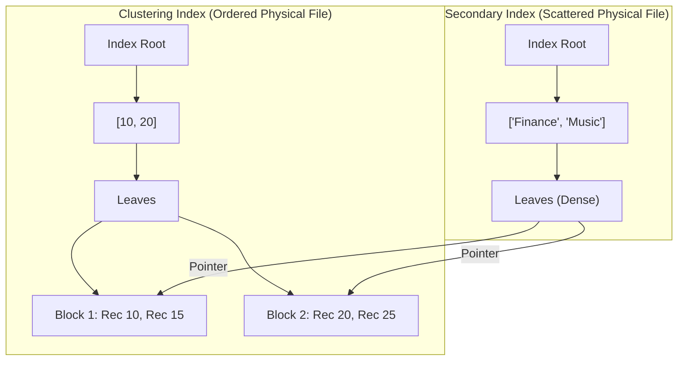
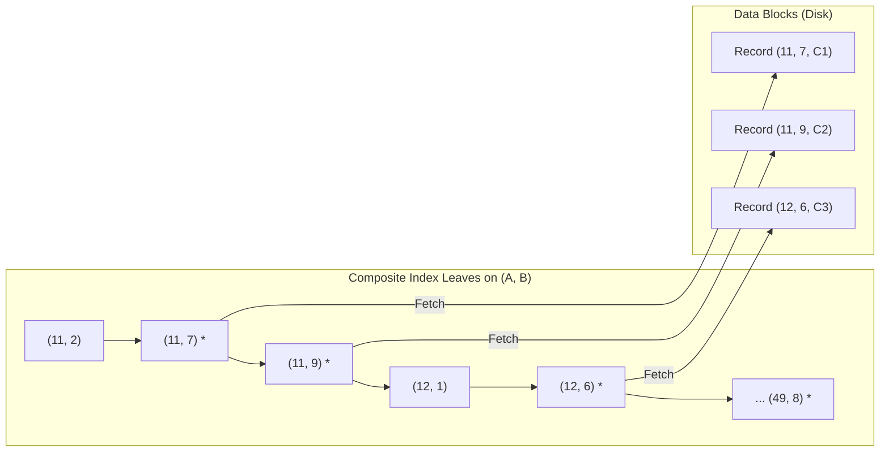
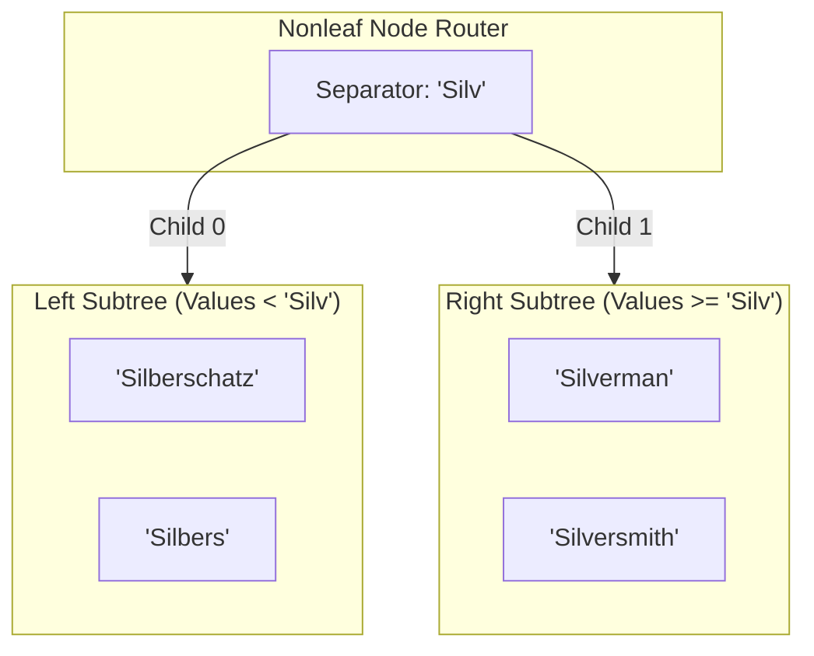
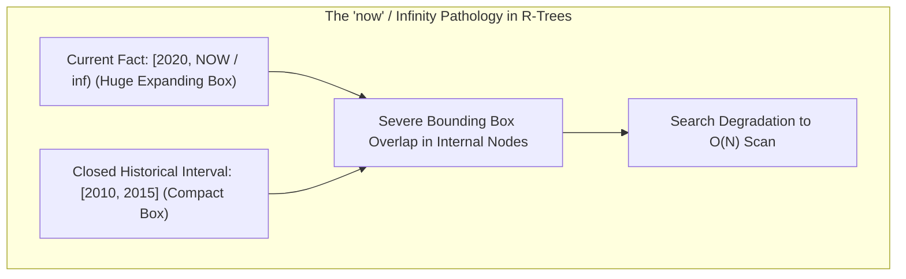
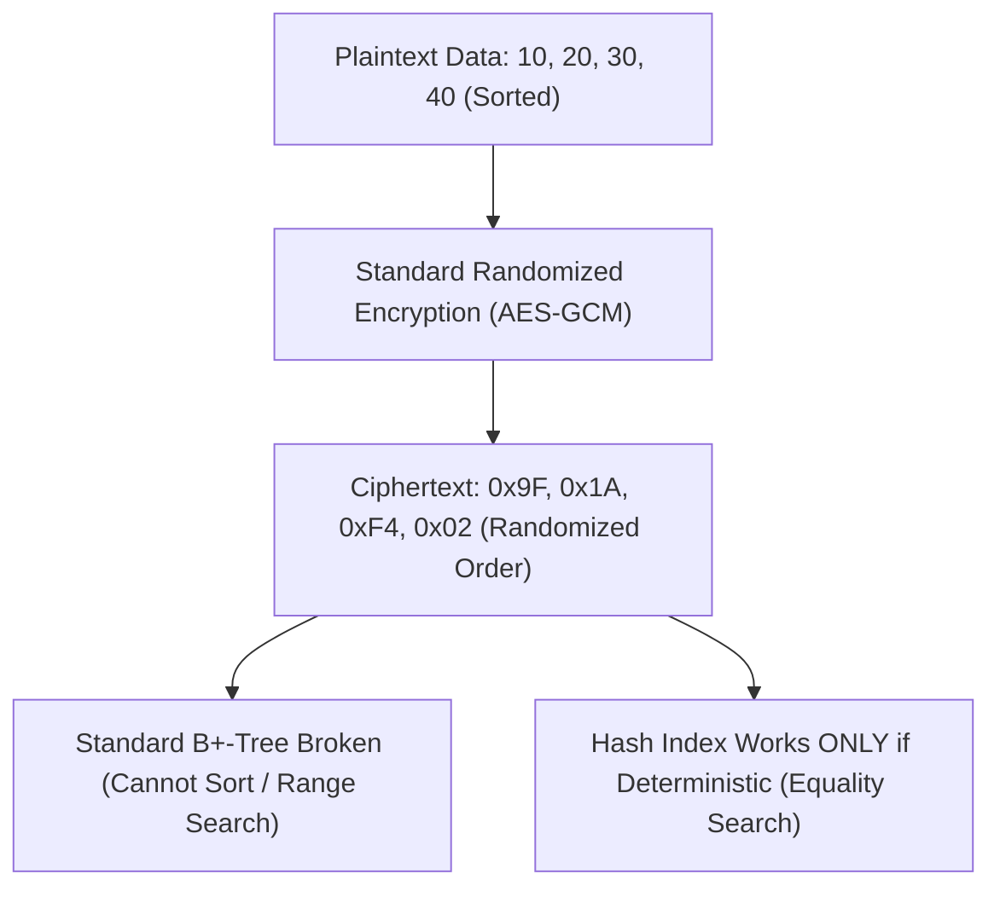
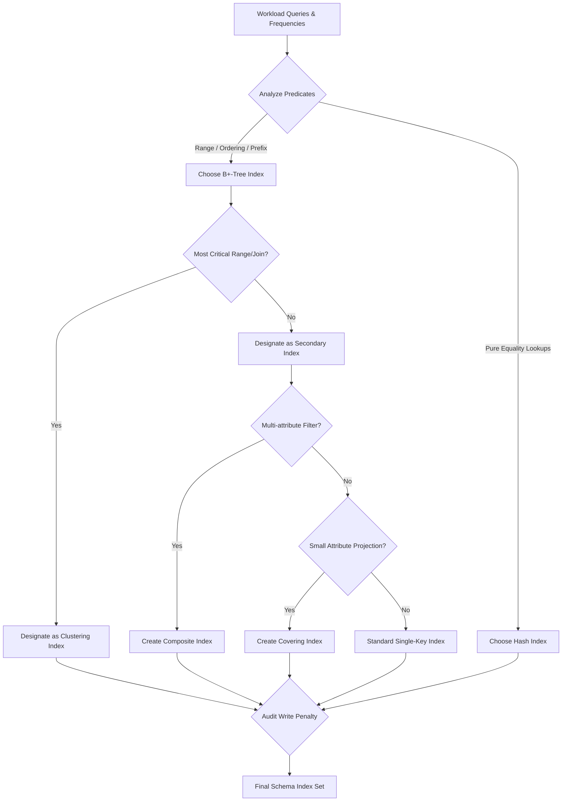
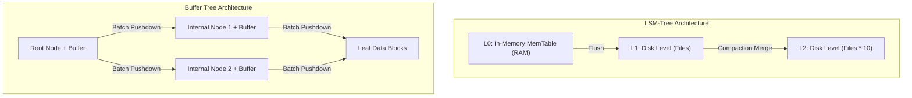
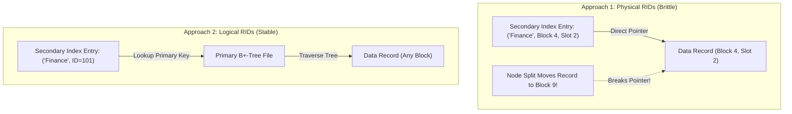
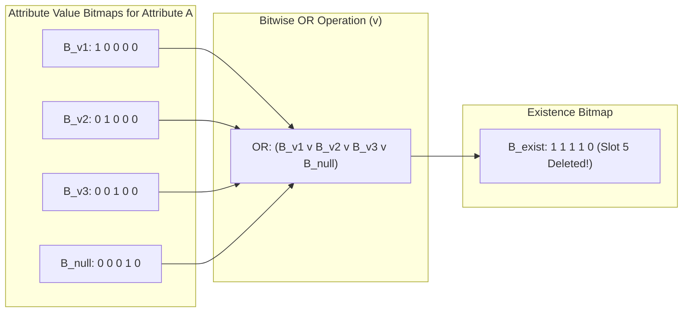

[← Prev: T13 Part 3](T13_Part3_SQL_Injection_and_BTree_Indexing.md) | [Index](00_Index.md)

---

# T13 Part 4 · Index Evaluation & Dynamic Hashing

> **Course Reference:** ECE 2215: Database Systems (RUET)  
> **Textbook Reference:** Silberschatz, Korth & Sudarshan, *Database System Concepts* (7th Edition, 2019), Chapter 14 (*Indexing*) & Chapter 24 (*Advanced Indexing Techniques*)  
> **Exam Weightage:** Topic `T13` carries 18 semester-final marks (2.8% curriculum share) across 4/7 exams. Subtopics covered herein: `T13.3` (Indexing Performance, B+-Trees & Advanced Variants) and `T13.4` (Static vs. Dynamic Hashing & Storage Evaluation).  
> **Total Assigned Exercises:** **13 Problems** (3 Practice Exercises + 10 Regular Exercises).

---

## Topic Card & Table of Exercises

This study note provides complete, mathematically and technically rigorous solutions to the 13 assigned Silberschatz 7e exercises spanning index structure evaluation, composite search keys, compression, temporal/encrypted indexing, B+-tree file organizations, write-optimized architectures, and static vs. dynamic hashing mechanisms.

| Exercise ID | Classification | Subtopic | Descriptive Short Title | Primary Pedagogical Focus |
| :--- | :---: | :---: | :--- | :--- |
| **[EX 14.17](#exercise-1417--clustering-index-vs-secondary-index)** | Regular Exercise | `T13.3` | Clustering Index vs. Secondary Index | Physical storage order, density, and range query I/O cost models |
| **[EX 14.18](#exercise-1418--query-execution-steps-on-b-trees)** | Regular Exercise | `T13.3` | Query Execution Steps on $\text{B}^+$-Trees | Algorithmic point and range query traversal traces for $n \in \{4, 6, 8\}$ |
| **[EX 14.19](#exercise-1419--nonunique-search-keys-and-tree-height)** | Regular Exercise | `T13.3` | Nonunique Search Keys & Tree Height | Composite key $(K, \text{RID})$ expansion, fanout loss, and height bounds |
| **[EX 14.20](#exercise-1420--composite-search-keys-and-selection-costs)** | Regular Exercise | `T13.3` | Composite Search Keys & Selection Costs | Multi-attribute index filtering, range predicates, and breakeven selectivity |
| **[EX 14.21](#exercise-1421--prefix-compression-in-nonleaf-nodes)** | Regular Exercise | `T13.3` | Prefix Compression in Nonleaf Nodes | Shortest distinguishing separator keys and fanout amplification |
| **[EX 14.25](#exercise-1425--spatial-indices-for-indexing-temporal-data)** | Regular Exercise | `T13.3` | Spatial Indices for Indexing Temporal Data | Valid-time intervals, unbounded `now` / $\infty$ overlap pathology, and 2-R solutions |
| **[EX 14.26](#exercise-1426--data-encryption-impact-on-index-structures)** | Regular Exercise | `T13.3` | Data Encryption Impact on Index Structures | Order-Preserving Encryption (OPE), equality hashing, and range query leakage |
| **[PE 14.9](#exercise-149--extent-allocation-and-sequentiality-in-b-tree-files)** | Practice Exercise | `T13.4` | Extent Allocation & Sequentiality in $\text{B}^+$-Trees | $n$-block extent fragmentation, worst-case 50% occupancy, and seek reduction |
| **[PE 14.10](#exercise-1410--workload-driven-index-selection)** | Practice Exercise | `T13.4` | Workload-Driven Index Selection | Systematic physical schema design, clustering selection, and hash vs. tree choice |
| **[PE 14.12](#exercise-1412--buffer-trees-vs-lsm-trees)** | Practice Exercise | `T13.4` | Buffer Trees vs. LSM-Trees | Batched internal node buffers vs. leveled external merge trees |
| **[EX 14.22](#exercise-1422--b-tree-file-organizations-and-logical-rids)** | Regular Exercise | `T13.4` | $\text{B}^+$-Tree File Organizations & Logical RIDs | Physical pointer invalidation upon splits vs. logical primary-key indirection |
| **[EX 14.23](#exercise-1423--write-optimized-indices-vs-b-tree-indices)** | Regular Exercise | `T13.4` | Write-Optimized Indices vs. $\text{B}^+$-Tree Indices | Write amplification, sequential compaction, and point read degradation |
| **[EX 14.24](#exercise-1424--existence-bitmaps-and-null-handling)** | Regular Exercise | `T13.4` | Existence Bitmaps & Handling of Null Values | Complete domain partitioning, bitwise OR composition, and deleted tuple tracking |

---

## T13.3 · Indexing performance & B-trees

### Architectural Foundations of $\text{B}^+$-Tree Performance

A $\text{B}^+$-tree is a balanced, multi-way search tree where all data pointers reside strictly in the leaf nodes, while internal nodes function purely as routers. For a node capacity of $n$ pointers:
- **Non-leaf node:** Stores up to $n-1$ search-key values and $n$ child pointers. Every non-leaf node (except the root) must hold at least $\lceil n/2 \rceil$ pointers.
- **Leaf node:** Stores up to $n-1$ search-key values and pointers to data records (or record buckets), plus a horizontal sibling pointer $P_{\text{next}}$. Every leaf node (except the root) must hold at least $\lceil (n-1)/2 \rceil$ values.
- **Height Equation:** For $N$ indexed search-key values, the maximum height of a $\text{B}^+$-tree is strictly bounded:

$$
h \le \left\lceil \log_{\lceil n/2 \rceil} \left( \frac{N}{\lceil (n-1)/2 \rceil} \right) \right\rceil + 1
$$

Each level traversed in a search from the root to a leaf requires exactly one disk block access (in the absence of caching). With large fanout $n \approx 100$, trees indexing millions of tuples have a height $h \le 3\text{--}4$, ensuring $O(\log_n N)$ worst-case lookup performance.

---

### Exercise 14.17 · Clustering Index vs. Secondary Index

> [!info] Exercise Metadata
> - **Exercise Type:** Regular Exercise (Silberschatz 7e Section 14.2)
> - **Mapped Subtopic:** `T13.3` Indexing Performance & Advanced Structures
> - **RUET Exam Relevance:** High. Direct background for 2023 Q.8(a) (Dense vs. Sparse Index) and classic Section B comparison questions.

**Question (Silberschatz 7e Exercise 14.17).**
*What is the difference between a clustering index and a secondary index?*

#### 1. Core Principles & Concept Overview
The distinction between a clustering index and a secondary index lies in **how the physical storage order of data records on disk relates to the logical ordering of the index search key**:
- A **clustering index** (often called a **primary index**) is an index whose search key defines the **actual physical sequential order** of records in the file.
- A **secondary index** (often called a **non-clustering index**) is an index whose search key specifies an order **different** from the physical sequential order of the file.

Because physical records can only be stored in a single sequential sequence on disk, a relation can possess **at most one clustering index**, but may possess **multiple secondary indices** to accelerate diverse query paths.



#### 2. Detailed Step-by-Step Solution

##### Step 1: Comprehensive Architectural Comparison

| Dimension | Clustering Index (Primary Index) | Secondary Index (Non-Clustering Index) |
| :--- | :--- | :--- |
| **Physical File Order** | Matches the search-key order. The file is sorted physically on this key. | Does not match the search-key order. The physical file is ordered on another attribute or unordered (heap). |
| **Multiplicity per Table** | **Strictly at most one** per relation. | **Arbitrarily many** secondary indices can exist on different attributes. |
| **Index Density** | Can be **sparse** (one key entry per disk block) or **dense**. | **Must be dense** (must contain an entry for every search-key value or record). |
| **Pointer Representation** | Points to the first record or start of the physical block (if sparse). | Points to specific record identifiers ($\text{RID} = \langle \text{BlockID}, \text{SlotID} \rangle$) or buckets of RIDs. |
| **Range Query Efficiency** | **Extremely high.** Finding the first record requires $h$ I/Os; all subsequent records are read via fast sequential block scans. | **Poor.** Each retrieved tuple may reside in an arbitrary disk block, requiring up to 1 random I/O seek per matching record. |
| **Space Overhead** | Low (especially when implemented as a sparse index). | Higher (requires an index record for every data tuple, plus bucket pointers). |
| **Record Relocation Cost** | Heavy. Inserting a record may require splitting data blocks and physical file reorganization. | Low on the data file, but inserting a record requires updating *every* secondary index. |

##### Step 2: Mathematical I/O Cost Model for Range Queries
Consider a query requesting records with search-key values in range $[v_1, v_2]$. Let:
- $h$ be the height of the index tree.
- $k$ be the number of qualifying tuples.
- $f_r$ be the blocking factor (tuples per disk block) of the data file.
- $b = \lceil k / f_r \rceil$ be the number of continuous data blocks containing the qualifying tuples.

**Case A: Range Query on a Clustering Index**
The search locates the first qualifying leaf and data block via root-to-leaf traversal ($h$ I/Os), and then scans the physically adjacent data blocks:

$$
\text{Cost}_{\text{clustered}} = h + \left\lceil \frac{k}{f_r} \right\rceil = h + b \quad \text{disk block accesses}
$$

Because these blocks are contiguous, the disk head performs only **one seek**, followed by sequential rotational transfers.

**Case B: Range Query on a Secondary Index**
The search locates the first matching entry in the secondary index leaf, traverses the leaf chain to collect all $k$ record pointers, and then retrieves each record from the data file. In the worst case where every qualifying record resides in a different disk block:

$$
\text{Cost}_{\text{secondary}} = h + \left\lceil \frac{k}{f_{\text{leaf}}} \right\rceil + k \approx h + k \quad \text{disk block accesses}
$$

Here, each of the $k$ data accesses requires a distinct **random seek** and rotational latency. If $k = 1000$, a clustering index requires $\approx 3 + 20 = 23$ block I/Os ($\approx 2\text{ ms}$ on SSD/disk), whereas a secondary index requires $\approx 3 + 10 + 1000 = 1013$ random I/Os ($\approx 10\text{ seconds}$ on spinning disk).

#### 3. RUET Exam Insights & Examiner Notes
- **Direct Link to RUET 2023 Q.8(a):** The RUET 2023 paper explicitly tested the distinction between dense and sparse indices. Examiners frequently follow up by asking why a sparse index *cannot* be used as a secondary index. The answer is fundamental: in an unclustered file, records with identical or consecutive search keys are scattered across arbitrary disk blocks. A sparse index would fail to locate any record that does not happen to be the first record of a block!
- **Syllabus Unit Alignment:** Unit 8 (*Advanced DBMS: Indexing and Hashing*).

---

### Exercise 14.18 · Query Execution Steps on $\text{B}^+$-Trees

> [!info] Exercise Metadata
> - **Exercise Type:** Regular Exercise (Silberschatz 7e Section 14.3.2)
> - **Mapped Subtopic:** `T13.3` Indexing Performance & B+-Trees
> - **RUET Exam Relevance:** Very High. Algorithmic execution traces and tree searches are classic Section B examination drills.

**Question (Silberschatz 7e Exercise 14.18).**
*For each $\text{B}^+$-tree of Exercise 14.3, show the steps involved in the following queries:*
*a. Find records with a search-key value of 11.*
*b. Find records with a search-key value between 7 and 17, inclusive.*

#### 1. Core Principles & Concept Overview
The search algorithm on a $\text{B}^+$-tree operates as follows:
1. **Point Query (`find(V)`):**
   - Start at the root node.
   - At an internal node containing keys $K_1 < K_2 < \dots < K_{m-1}$ and child pointers $P_1, P_2, \dots, P_m$:
     - Find the smallest key $K_i$ such that $V < K_i$. Follow pointer $P_i$.
     - If no such key exists ($V \ge K_{m-1}$), follow pointer $P_m$.
   - Repeat until a leaf node is reached.
   - In the leaf node, scan keys: if $K_i = V$, follow data pointer $P_i$ to the record. If not found, the key does not exist.
2. **Range Query (`findRange(V_low, V_high)`):**
   - Execute `find(V_low)` to locate the leaf node containing the lower bound.
   - Scan entries in that leaf starting from the first key $\ge V_{\text{low}}$.
   - Follow the horizontal leaf sibling pointer ($P_{\text{next}}$) to traverse contiguous leaf nodes sequentially until reaching an entry where $K_i > V_{\text{high}}$.

#### 2. Detailed Step-by-Step Solution

##### Baseline Tree Structures from Exercise 14.3
The ten search-key values inserted in ascending order into an initially empty tree are:

$$
(2, 3, 5, 7, 11, 17, 19, 23, 29, 31)
$$

Under standard Silberschatz 7e insertion algorithms (where leaf nodes split by keeping $\lceil n/2 \rceil$ values on the left and moving the remaining to the right, and internal nodes push the median key up), the three resultant trees are:

```text
================================================================================
Case 1: n = 4 (Maximum 4 pointers, maximum 3 keys per node)
Height = 3 levels
                    [ 19 ]                          <-- Root (Level 1)
                   /      \
           [ 5, 11 ]      [ 29 ]                    <-- Internal (Level 2)
          /    |    \     /    \
     [2, 3]  [5, 7] [11, 17]  [19, 23] [29, 31]     <-- Leaves (Level 3)
================================================================================
Case 2: n = 6 (Maximum 6 pointers, maximum 5 keys per node)
Height = 2 levels
                   [ 7, 19 ]                        <-- Root (Level 1)
                  /    |    \
         [2, 3, 5] [7, 11, 17] [19, 23, 29, 31]     <-- Leaves (Level 2)
================================================================================
Case 3: n = 8 (Maximum 8 pointers, maximum 7 keys per node)
Height = 2 levels
                     [ 11 ]                         <-- Root (Level 1)
                    /      \
            [2, 3, 5, 7]   [11, 17, 19, 23, 29, 31] <-- Leaves (Level 2)
================================================================================
```

---

##### Part a: Find records with search-key value $V = 11$

**1. On Tree with $n = 4$:**
- **Step 1 (Root node `[19]`):** Compare target $11$ with key $19$. Since $11 < 19$, follow the leftmost child pointer $P_1$ to internal node `[5, 11]`.
- **Step 2 (Internal node `[5, 11]`):** Compare target $11$ with keys:
  - $11 \not< 5$.
  - For key $11$: by definition of $\text{B}^+$-tree routing, keys strictly less than $11$ go to $P_2$, while keys $\ge 11$ go to pointer $P_3$. Since $11 \ge 11$, follow pointer $P_3$ to leaf node `[11, 17]`.
- **Step 3 (Leaf node `[11, 17]`):** Examine leaf entries: the first key matches $11$. Follow its associated record pointer to fetch the record. Lookup succeeds in 3 block reads.

**2. On Tree with $n = 6$:**
- **Step 1 (Root node `[7, 19]`):** Compare target $11$ with keys:
  - $11 \ge 7$ and $11 < 19$. Therefore, follow middle child pointer $P_2$ to leaf node `[7, 11, 17]`.
- **Step 2 (Leaf node `[7, 11, 17]`):** Examine keys: $7 \ne 11$, then next key is $11$ (match found). Follow record pointer. Lookup succeeds in 2 block reads.

**3. On Tree with $n = 8$:**
- **Step 1 (Root node `[11]`):** Compare target $11$ with key $11$. Since $11 \ge 11$, follow right child pointer $P_2$ to leaf node `[11, 17, 19, 23, 29, 31]`.
- **Step 2 (Leaf node `[11, 17, 19, 23, 29, 31]`):** The first key in this leaf is $11$ (match found). Follow record pointer. Lookup succeeds in 2 block reads.

---

##### Part b: Find records with search-key values in range $[7, 17]$

**1. On Tree with $n = 4$:**
- **Step 1 (Locate lower bound $V = 7$):**
  - Root `[19]`: $7 < 19 \implies$ follow $P_1$ to node `[5, 11]`.
  - Internal node `[5, 11]`: $7 \ge 5$ and $7 < 11 \implies$ follow middle pointer $P_2$ to leaf node `[5, 7]`.
- **Step 2 (Scan Leaf `[5, 7]`):**
  - Key $5 < 7$ (skip).
  - Key $7 \in [7, 17]$ $\implies$ **Output record pointer for 7**.
  - Reached end of leaf node. Follow horizontal pointer $P_{\text{next}}$ to sibling leaf `[11, 17]`.
- **Step 3 (Scan Leaf `[11, 17]`):**
  - Key $11 \in [7, 17]$ $\implies$ **Output record pointer for 11**.
  - Key $17 \in [7, 17]$ $\implies$ **Output record pointer for 17**.
  - Reached end of leaf node. Follow $P_{\text{next}}$ to sibling leaf `[19, 23]`.
- **Step 4 (Scan Leaf `[19, 23]`):**
  - First key $19 > 17$ (upper bound exceeded). **Terminate range scan.**
- **Summary:** Retained keys $\{7, 11, 17\}$ across 2 leaf nodes (total 4 block accesses: Root, Internal, Leaf 1, Leaf 2).

**2. On Tree with $n = 6$:**
- **Step 1 (Locate lower bound $V = 7$):**
  - Root `[7, 19]`: $7 \ge 7$ and $7 < 19 \implies$ follow middle pointer $P_2$ directly to leaf `[7, 11, 17]`.
- **Step 2 (Scan Leaf `[7, 11, 17]`):**
  - Key $7 \in [7, 17]$ $\implies$ **Output record pointer for 7**.
  - Key $11 \in [7, 17]$ $\implies$ **Output record pointer for 11**.
  - Key $17 \in [7, 17]$ $\implies$ **Output record pointer for 17**.
  - Reached end of leaf node. Follow $P_{\text{next}}$ to sibling leaf `[19, 23, 29, 31]`.
- **Step 3 (Scan Leaf `[19, 23, 29, 31]`):**
  - First key $19 > 17$. **Terminate range scan.**
- **Summary:** All matching records $\{7, 11, 17\}$ resided in a single leaf node. Total I/Os: 2 blocks (Root + Leaf).

**3. On Tree with $n = 8$:**
- **Step 1 (Locate lower bound $V = 7$):**
  - Root `[11]`: $7 < 11 \implies$ follow left pointer $P_1$ to leaf `[2, 3, 5, 7]`.
- **Step 2 (Scan Leaf `[2, 3, 5, 7]`):**
  - Keys $2, 3, 5 < 7$ (skip).
  - Key $7 \in [7, 17]$ $\implies$ **Output record pointer for 7**.
  - Reached end of leaf node. Follow $P_{\text{next}}$ to sibling leaf `[11, 17, 19, 23, 29, 31]`.
- **Step 3 (Scan Leaf `[11, 17, 19, 23, 29, 31]`):**
  - Key $11 \in [7, 17]$ $\implies$ **Output record pointer for 11**.
  - Key $17 \in [7, 17]$ $\implies$ **Output record pointer for 17**.
  - Next key $19 > 17$. **Terminate range scan.**
- **Summary:** Output $\{7, 11, 17\}$ across 2 leaf nodes. Total I/Os: 3 blocks (Root + 2 Leaves).

#### 3. RUET Exam Insights & Examiner Notes
- **Common Student Error:** Forgetting that in a range query, internal nodes are **never re-visited** after the initial root-to-leaf traversal! Students often mistakenly trace back up to the root to find the next keys. You must explicitly emphasize the horizontal linked list traversal via $P_{\text{next}}$ leaf pointers.
- **Node Boundary Precision:** Pay close attention to the definition of internal routing keys ($V < K_i$ vs. $V \ge K_i$). At internal node `[5, 11]`, searching for $11$ takes the child pointer to the right of $11$, because that subtree contains values in the range $[11, 19)$.

---

### Exercise 14.19 · Nonunique Search Keys and Tree Height

> [!info] Exercise Metadata
> - **Exercise Type:** Regular Exercise (Silberschatz 7e Section 14.3.5)
> - **Mapped Subtopic:** `T13.3` Indexing Performance & B+-Trees
> - **RUET Exam Relevance:** Moderate to High. Derivation of tree height and node capacity under varying key sizes.

**Question (Silberschatz 7e Exercise 14.19).**
*The solution presented in Section 14.3.5 to deal with nonunique search keys added an extra attribute to the search key. What effect could this change have on the height of the $\text{B}^+$-tree?*

#### 1. Core Principles & Concept Overview
When a search key $K$ is nonunique (multiple records share the exact same key value, e.g., `dept_name` or `salary`), standard $\text{B}^+$-tree implementations cannot easily distinguish between entries. Section 14.3.5 outlines two solutions:
1. Allow duplicate keys and store a list/bucket of pointers with each key.
2. **Make the search key unique by creating a composite key** $(K, A_{\text{unique}})$, where $A_{\text{unique}}$ is an attribute guaranteed to be unique (such as the primary key or the physical record identifier $\text{RID}$).

Because this transformation augments every search key with extra bytes, the storage footprint per index entry increases. Since disk blocks have a fixed physical size (e.g., 4096 bytes), storing larger keys directly degrades the **node fanout** $n$.

#### 2. Detailed Step-by-Step Solution

##### Step 1: Mathematical Formulation of Node Fanout
Let:
- $B$ be the disk block size in bytes (e.g., $B = 4096$).
- $S_K$ be the original search-key size in bytes.
- $S_{\text{RID}}$ be the size of the added unique identifier in bytes (e.g., 8 bytes).
- $P$ be the size of a disk block pointer or child pointer in bytes (e.g., 8 bytes).
- $P_{\text{rec}}$ be the size of a record pointer in a leaf node.

In an internal node, a node must store $n$ pointers and $n-1$ keys. The maximum fanout $n$ satisfies:

$$
n \cdot P + (n - 1) \cdot S_K \le B \implies n = \left\lfloor \frac{B + S_K}{S_K + P} \right\rfloor = \left\lfloor \frac{B - P}{S_K + P} \right\rfloor + 1
$$

When the unique identifier is appended to the search key, the new effective key size is $S_K' = S_K + S_{\text{RID}}$. The new fanout $n'$ becomes:

$$
n' = \left\lfloor \frac{B - P}{S_K + S_{\text{RID}} + P} \right\rfloor + 1
$$

Because $S_{\text{RID}} > 0$, the denominator increases, strictly implying:

$$
n' < n
$$

Similarly, in a leaf node, the maximum number of record entries accommodated decreases from $n_{\text{leaf}} = \lfloor (B - P_{\text{next}}) / (S_K + P_{\text{rec}}) \rfloor$ to:

$$
n_{\text{leaf}}' = \left\lfloor \frac{B - P_{\text{next}}}{S_K + S_{\text{RID}} + P_{\text{rec}}} \right\rfloor < n_{\text{leaf}}
$$

##### Step 2: Derivation of Tree Height Impact
The maximum height of a $\text{B}^+$-tree indexing $N$ records under worst-case minimum node occupancy ($\lceil n/2 \rceil$ pointers per nonleaf node and $\lceil n_{\text{leaf}}/2 \rceil$ entries per leaf) is:

$$
h = \left\lceil \log_{\lceil n/2 \rceil} \left( \frac{N}{\lceil n_{\text{leaf}} / 2 \rceil} \right) \right\rceil + 1
$$

When $n$ decreases to $n'$:
1. The logarithmic base $\lceil n'/2 \rceil$ is smaller. Since $\log_b(x)$ decreases as $b$ increases, a smaller base **strictly increases the value of the logarithm**.
2. The denominator $\lceil n_{\text{leaf}}' / 2 \rceil$ inside the logarithm is smaller, which increases the argument $\frac{N}{\lceil n_{\text{leaf}}'/2 \rceil}$, further driving the logarithm upward.

Therefore, the height of the $\text{B}^+$-tree **will either remain the same or increase by 1 (or more) levels**:

$$
h' \ge h
$$

##### Step 3: Quantitative Numerical Demonstration
Assume realistic database engine parameters:
- Block size $B = 4096\text{ bytes}$, Pointer size $P = 8\text{ bytes}$.
- Original key size $S_K = 8\text{ bytes}$ (e.g., integer or short code).
- Record count $N = 10{,}000{,}000$ (10 million tuples).

**Without Extra Attribute:**
- Internal fanout: $n = \lfloor (4096 - 8) / (8 + 8) \rfloor + 1 = \lfloor 4088 / 16 \rfloor + 1 = 255 + 1 = 256$.
- Minimum internal fanout: $\lceil 256 / 2 \rceil = 128$.
- Leaf capacity (assuming $P_{\text{rec}} = 8$): $n_{\text{leaf}} = \lfloor (4096 - 8) / (8 + 8) \rfloor = 255$. Minimum leaf occupancy: $128$.
- Height:

$$
h = \left\lceil \log_{128} \left( \frac{10^7}{128} \right) \right\rceil + 1 = \left\lceil \log_{128} (78125) \right\rceil + 1 = \lceil 2.32 \rceil + 1 = 3 + 1 = 4\text{ levels}
$$

**With Extra Unique Attribute ($S_{\text{RID}} = 8\text{ bytes}$, so $S_K' = 16\text{ bytes}$):**
- New internal fanout: $n' = \lfloor (4096 - 8) / (16 + 8) \rfloor + 1 = \lfloor 4088 / 24 \rfloor + 1 = 170 + 1 = 171$.
- Minimum internal fanout: $\lceil 171 / 2 \rceil = 86$.
- New leaf capacity: $n_{\text{leaf}}' = \lfloor (4096 - 8) / (16 + 8) \rfloor = 170$. Minimum leaf occupancy: $85$.
- Height:

$$
h' = \left\lceil \log_{86} \left( \frac{10^7}{85} \right) \right\rceil + 1 = \left\lceil \log_{86} (117647) \right\rceil + 1 = \lceil 2.62 \rceil + 1 = 3 + 1 = 4\text{ levels}
$$

Now suppose $N = 100{,}000{,}000$ (100 million tuples):
- Original tree: $\lceil \log_{128}(10^8 / 128) \rceil + 1 = \lceil 2.80 \rceil + 1 = 3 + 1 = \mathbf{4\text{ levels}}$.
- Augmented tree: $\lceil \log_{86}(10^8 / 85) \rceil + 1 = \lceil 3.14 \rceil + 1 = 4 + 1 = \mathbf{5\text{ levels}}$.

The tree height **increases by 1 level**, adding **one additional random disk I/O** to every single point search and insertion operation across the entire lifecycle of the database!

#### 3. RUET Exam Insights & Examiner Notes
- **Examiner's Core Expectation:** Clearly articulate the causal chain:

$$
\text{Extra attribute} \implies \text{Larger key size } S_K \implies \text{Smaller fanout } n \implies \text{Smaller logarithmic base} \implies \text{Increased tree height } h
$$

- **Engineering Alternative:** Mention that PostgreSQL and Oracle frequently avoid this height penalty by storing a **single search-key entry paired with a sorted list of RIDs** inside the leaf (posting list), rather than duplicating the search key across multiple index entries.

---

### Exercise 14.20 · Composite Search Keys and Selection Costs

> [!info] Exercise Metadata
> - **Exercise Type:** Regular Exercise (Silberschatz 7e Section 14.6.2)
> - **Mapped Subtopic:** `T13.3` Indexing Performance & B+-Trees
> - **RUET Exam Relevance:** High. Mathematical query cost modeling and index filtering conditions are prime material for Section B query processing problems.

**Question (Silberschatz 7e Exercise 14.20).**
*Suppose there is a relation $r(A, B, C)$, with a $\text{B}^+$-tree index with search key $(A, B)$.*
*a. What is the worst-case cost of finding records satisfying $10 < A < 50$ using this index, in terms of the number of records retrieved $n_1$ and the height $h$ of the tree?*
*b. What is the worst-case cost of finding records satisfying $10 < A < 50 \wedge 5 < B < 10$ using this index, in terms of the number of records $n_2$ that satisfy this selection, as well as $n_1$ and $h$ defined above?*
*c. Under what conditions on $n_1$ and $n_2$ would the index be an efficient way of finding records satisfying $10 < A < 50 \wedge 5 < B < 10$?*

#### 1. Core Principles & Concept Overview
In a multi-attribute composite index with search key $(A, B)$, index entries are ordered **lexicographically**: first by attribute $A$, and then by attribute $B$ for identical values of $A$.
- A range predicate on the leading attribute ($10 < A < 50$) defines a **contiguous range of leaf pages** in the $\text{B}^+$-tree.
- A secondary predicate ($5 < B < 10$) on the non-leading attribute **does not define a contiguous range** across different values of $A$. However, because $B$ is stored inside the index leaf itself, the database engine can evaluate $5 < B < 10$ **directly within the index leaf** (index condition pushdown / index filtering) *before* accessing any physical data records on disk.



#### 2. Detailed Step-by-Step Solution

##### Part a: Worst-case cost for $10 < A < 50$
1. **Tree Traversal:** The search starts at the root and traverses down to the first leaf node containing an entry with $A > 10$. This requires $h$ block accesses (where $h$ is the tree height).
2. **Scanning Index Leaves:** The scan follows horizontal leaf pointers until encountering an entry with $A \ge 50$. Let $f_{\text{leaf}}$ be the average number of index entries per leaf node. The number of index leaf blocks read is:

$$
b_{\text{index}} = \left\lceil \frac{n_1}{f_{\text{leaf}}} \right\rceil
$$

3. **Fetching Data Records:** In the worst-case scenario where the $\text{B}^+$-tree is a **secondary (unclustered) index**, each of the $n_1$ matching index records may point to a tuple located in a completely different disk block. Thus, fetching the actual tuples requires up to $n_1$ random data block accesses.
4. **Total Worst-Case Cost:**

$$
\text{Cost}_a = h + \left\lceil \frac{n_1}{f_{\text{leaf}}} \right\rceil + n_1 \approx h + n_1 \quad \text{disk block accesses}
$$

*(If the index is clustered, the data blocks are contiguous, reducing the data fetch cost to $\lceil n_1 / f_r \rceil$, where $f_r$ is the relation blocking factor).*

---

##### Part b: Worst-case cost for $10 < A < 50 \wedge 5 < B < 10$
1. **Tree Traversal & Index Leaf Scan:** Because the index is sorted primarily by $A$, the search must still traverse from the root to the first leaf ($h$ I/Os) and scan **all index entries satisfying $10 < A < 50$** (a total of $n_1$ index entries across $\lceil n_1 / f_{\text{leaf}} \rceil$ leaf blocks).
2. **Index-Level Filtering:** For each of the $n_1$ entries inspected in the leaf blocks, the storage engine checks the condition $5 < B < 10$. Because $B$ is part of the composite search key $(A, B)$, this test requires **zero additional disk I/Os**—it is evaluated entirely in main memory!
3. **Fetching Qualifying Data Records:** Only the $n_2$ records that satisfy **both** conditions ($10 < A < 50$ AND $5 < B < 10$) need to be retrieved from the physical data file. In the worst-case unclustered scenario, retrieving these $n_2$ records takes $n_2$ disk block accesses.
4. **Total Worst-Case Cost:**

$$
\text{Cost}_b = h + \left\lceil \frac{n_1}{f_{\text{leaf}}} \right\rceil + n_2 \quad \text{disk block accesses}
$$

Notice that the data fetch cost depends strictly on $n_2$ (the final result cardinality), **not** $n_1$!

---

##### Part c: Conditions under which the index is efficient
To determine when this index plan is superior, compare $\text{Cost}_b$ against the alternative: a **full relation table scan**.
Let the relation $r$ occupy $b_r$ disk blocks. A full table scan requires reading all $b_r$ blocks sequentially:

$$
\text{Cost}_{\text{scan}} = b_r \quad \text{sequential block accesses}
$$

Because sequential I/O is substantially faster than random I/O (often by a factor of 5 to 10 on spinning disks due to eliminated seek overhead), let $C_{\text{random}} / C_{\text{seq}} \approx \alpha \ge 1$.
The index is computationally efficient if and only if:

$$
h + \left\lceil \frac{n_1}{f_{\text{leaf}}} \right\rceil + n_2 \ll b_r
$$

Specifically, this requires two independent conditions:
1. **High Selectivity on the Final Result ($n_2 \ll b_r$):** The number of qualifying tuples $n_2$ must be significantly smaller than the total block count $b_r$ of the table (typically $n_2 < 5\%\text{--}10\%$ of the relation's records). If $n_2 \ge b_r$, random seeks on $n_2$ tuples will be drastically slower than streaming the entire table.
2. **Bounded Leading-Attribute Spread ($n_1$ is not excessively large):** The range $10 < A < 50$ must not encompass a massive percentage of the entire relation. If $n_1 \approx |r|$ (e.g., $95\%$ of all records have $10 < A < 50$), scanning nearly all index leaf blocks plus random lookups on $n_2$ will exceed the cost of a simple sequential scan.

In summary, the index is efficient when **$n_1$ is reasonably selective** (limiting index leaf I/O) and **$n_2$ is highly selective** ($n_2 \ll b_r$).

#### 3. RUET Exam Insights & Examiner Notes
- **Key Technical Distillation:** Emphasize that the composite index acts as a **filtering index** for attribute $B$. Even though $B$ cannot be used to narrow the initial tree traversal path (because $A$ is an inequality range), it prevents fetching tuples that do not satisfy $5 < B < 10$ from disk!
- **Syllabus Connection:** Unit 3 & Unit 8 (Query Optimization & Multi-key Access).

---

### Exercise 14.21 · Prefix Compression in Nonleaf Nodes

> [!info] Exercise Metadata
> - **Exercise Type:** Regular Exercise (Silberschatz 7e Section 14.4.3)
> - **Mapped Subtopic:** `T13.3` Indexing Performance & B+-Trees
> - **RUET Exam Relevance:** Moderate. String indexing optimization and storage compaction techniques.

**Question (Silberschatz 7e Exercise 14.21).**
*Suppose you have to create a $\text{B}^+$-tree index on a large number of names, where the maximum size of a name may be quite large (say 40 characters) and the average name is itself large (say 10 characters). Explain how prefix compression can be used to maximize the average fanout of nonleaf nodes.*

#### 1. Core Principles & Concept Overview
In a $\text{B}^+$-tree, search-key values inside **nonleaf (internal) nodes** serve exclusively as **routers** (or separators). Their sole responsibility is to guide searches to the correct child subtree by answering: *"Is the search key less than or greater than or equal to this separator?"*

Crucially, **a separator key in a nonleaf node does not need to be an actual, complete search-key value present in the database!** It only needs to be any string that correctly segregates all values in the left subtree from all values in the right subtree.



#### 2. Detailed Step-by-Step Solution

##### Step 1: Prefix Compression Mechanism
Suppose an internal node must separate two subtrees:
- Let $K_{\text{max\_left}}$ be the largest search-key value in the left child subtree (e.g., `"Silberschatz"`).
- Let $K_{\text{min\_right}}$ be the smallest search-key value in the right child subtree (e.g., `"Silverman"`).

The separator key $K_{\text{sep}}$ placed in the parent node only needs to satisfy the strict invariant:

$$
K_{\text{max\_left}} < K_{\text{sep}} \le K_{\text{min\_right}}
$$

To minimize storage, we choose the **shortest prefix** of $K_{\text{min\_right}}$ that is lexicographically greater than $K_{\text{max\_left}}$.
- Compare `"Silberschatz"` and `"Silverman"` character by character:
  - Both share the common prefix `"Sil"`.
  - At character index 4: left has `'b'`, right has `'v'`.
  - Any prefix starting with `"Silv"` is strictly greater than any string starting with `"Silb..."`.
  - Hence, the truncated string **`"Silv"`** (only 4 characters) perfectly separates the two subtrees! We do not need to store all 40 characters of `"Silverman"`.

##### Step 2: Quantitative Fanout Amplification
Let:
- Block size $B = 4096\text{ bytes}$.
- Pointer size $P = 8\text{ bytes}$.
- Record size without compression: up to $40\text{ bytes}$, average $10\text{ bytes}$. If allocated for the maximum length (40 bytes):

$$
n_{\text{uncompressed}} = \left\lfloor \frac{4096 - 8}{40 + 8} \right\rfloor + 1 = \left\lfloor \frac{4088}{48} \right\rfloor + 1 = 85 + 1 = \mathbf{86\text{ pointers}}
$$

With prefix compression, separator keys typically require only **3 to 4 bytes** on average (plus a 1-byte length offset in a slotted-page layout):

$$
S_{\text{prefix\_avg}} \approx 4 + 1 = 5\text{ bytes}
$$

The compressed nonleaf fanout becomes:

$$
n_{\text{compressed}} = \left\lfloor \frac{4096 - 8}{5 + 8} \right\rfloor + 1 = \left\lfloor \frac{4088}{13} \right\rfloor + 1 = 314 + 1 = \mathbf{315\text{ pointers}}
$$

##### Step 3: Architectural Benefits
1. **Dramatic Fanout Increase:** Average fanout surges from $86$ to $315$ (a nearly **$3.7\times$ increase**).
2. **Tree Height Reduction:** For a dataset of 50 million records:
   - Without compression: $h \approx \lceil \log_{43}(5 \times 10^7) \rceil \approx 5\text{ levels}$.
   - With prefix compression: $h \approx \lceil \log_{158}(5 \times 10^7) \rceil \approx 4\text{ levels}$.
   Tree height drops by a full level, cutting disk I/O latency across every query.
3. **Enhanced Buffer Cache Efficiency:** Because nonleaf nodes are far smaller in count, the entire upper tier of the $\text{B}^+$-tree can be permanently pinned in main-memory RAM buffers.

#### 3. RUET Exam Insights & Examiner Notes
- **Distinction Between Leaf and Nonleaf:** A common misconception is that prefix compression can truncate strings arbitrarily in the leaf nodes. Clarify that **leaf nodes must preserve the full search key** (or use suffix compression with offset pointers) so that exact point queries and range outputs return the true string values. Prefix truncation to non-existent keys applies strictly to internal router nodes!

---

### Exercise 14.25 · Spatial Indices for Indexing Temporal Data

> [!info] Exercise Metadata
> - **Exercise Type:** Regular Exercise (Silberschatz 7e Section 14.10.2)
> - **Mapped Subtopic:** `T13.3` Advanced Multidimensional & Temporal Indexing
> - **RUET Exam Relevance:** High. Conceptual exam questions on R-trees and temporal DBMS challenges.

**Question (Silberschatz 7e Exercise 14.25).**
*Spatial indices that can index spatial intervals can conceptually be used to index temporal data by treating valid time as a time interval. What is the problem with doing so, and how is the problem solved?*

#### 1. Core Principles & Concept Overview
In temporal databases, records are associated with a **valid-time interval** $[t_s, t_e]$, representing the time period during which a fact is true in the real world:
- $t_s$: start time (valid from).
- $t_e$: end time (valid to).

Because $[t_s, t_e]$ represents a one-dimensional geometric interval (or a two-dimensional interval if paired with transaction time), one can conceptually treat temporal intervals as one-dimensional bounding boxes in a spatial index structure, such as an **R-tree** or **Quadtree**.



#### 2. Detailed Step-by-Step Solution

##### Step 1: The Core Pathology with Spatial Indexing of Temporal Data
The fatal problem with mapping valid time directly into an R-tree arises from **currently valid facts**:
1. **Unbounded End Times (`now` / $\infty$):** In an active database, many records represent facts that are currently true and have not yet terminated (e.g., an active employee, a current student enrollment). Their valid interval is $[t_s, \infty)$ or $[t_s, \text{now}]$.
2. **Infinite Bounding Boxes:** An interval extending to $\infty$ or the dynamic variable $\text{now}$ results in an **infinitely large (or constantly expanding) bounding box** in the spatial index.
3. **Catastrophic Bounding Box Overlap:** In an R-tree, child bounding boxes are enclosed within the bounding box of parent nodes. Because all active records extend to $\infty$, their bounding boxes heavily overlap each other and span across nearly every internal node of the tree.
4. **Pruning Breakdown:** The core efficiency of an R-tree relies on spatial pruning (subtrees whose bounding boxes do not intersect the query region are skipped). With massive overlap, a query asking for facts valid at time $t$ will intersect almost **every internal node's bounding box**, forcing the search algorithm to traverse nearly every branch of the tree. The R-tree degrades into an expensive $O(N)$ full table scan!
5. **Continuous Index Updates:** As real time progresses, the value of $\text{now}$ changes continuously. If the index stores explicit timestamp values, every active record's bounding box would require continuous disk write updates!

##### Step 2: How the Problem is Solved
Database architectures resolve this dilemma through two primary engineering strategies:

1. **Separation of Current and Historical Data (Dual-Store / 2-R Trees):**
   - **Current Data Store:** Records valid *now* are segregated into a specialized partition. Because their end time is implicitly *now*, they only have a single variable timestamp $t_s$. They can be indexed using a standard **1D $\text{B}^+$-tree on $t_s$**.
   - **Historical Data Store:** Once a fact terminates (its end time $t_e$ is finalized to a fixed past timestamp), the record is migrated to the historical store. Because both $t_s$ and $t_e$ are closed, fixed numbers, the interval $[t_s, t_e]$ is compact and bounded. It can now be indexed efficiently using an **R-tree without overlap pathologies**.
2. **Specialized Temporal Index Structures:**
   - **Time-Split B-tree (TSB-tree):** A multi-version index that splits nodes along two dimensions: by search key when a node overflows due to key variance, or by timestamp when historical records accumulate. Current data stays in active nodes while historical data splits into frozen historical nodes.
   - **R*-tree with Variable 'Now' Support:** Advanced bounding box algorithms that treat $\text{now}$ symbolically rather than numerically, calculating intersection metrics dynamically during traversal.

#### 3. RUET Exam Insights & Examiner Notes
- **Textbook Edition Nuance:** Spatial indices (R-trees, k-d trees) and temporal intervals are discussed across Chapter 14 (§14.10) and Chapter 24 (§24.4). Examiners looking for advanced conceptual questions in Section B often target this exact trade-off between standard spatial geometries and the moving-frontier nature of temporal data.

---

### Exercise 14.26 · Data Encryption Impact on Index Structures

> [!info] Exercise Metadata
> - **Exercise Type:** Regular Exercise (Silberschatz 7e Section 14.4.7 & Chapter 9 §9.8)
> - **Mapped Subtopic:** `T13.3` Database Security & Indexing Integration
> - **RUET Exam Relevance:** High. Directly unites Syllabus Unit 8 topics: Database Security (SQL injection / encryption) and Indexing.

**Question (Silberschatz 7e Exercise 14.26).**
*Some attributes of relations may contain sensitive data, and may be required to be stored in an encrypted fashion. How does data encryption affect index schemes? In particular, how might it affect schemes that attempt to store data in sorted order?*

#### 1. Core Principles & Concept Overview
Database encryption converts plaintext data $P$ into ciphertext $C = E_K(P)$ using a cryptographic key $K$. The fundamental goal of encryption is **pseudo-randomness**: ciphertext should appear completely indistinguishable from random noise, obscuring all patterns, frequencies, and ordering.

This security guarantee directly opposes the foundational requirement of ordered index structures (such as $\text{B}^+$-trees), which rely entirely on **total ordering** ($P_1 < P_2 < P_3$) to support binary search and range queries.



#### 2. Detailed Step-by-Step Solution

##### Step 1: Effect of Standard Encryption on Index Schemes
Standard cryptographic encryption algorithms (such as AES in CBC or GCM mode with random Initialization Vectors) have the following properties:
1. **Randomized Encryption:** Encrypting the exact same plaintext value $v$ twice produces two completely different ciphertexts ($E_K(v, \text{IV}_1) \ne E_K(v, \text{IV}_2)$).
   - **Impact on Indexing:** **All index structures fail completely.** The database engine cannot match search keys for equality or range, forcing every query to decrypt the entire relation table sequentially.
2. **Deterministic Encryption (e.g., AES-ECB or fixed IV):** Encrypting $v$ always produces the same ciphertext $C_v$.
   - **Impact on Hash Indices:** **Hash indices remain fully functional!** The database can compute $h(E_K(v))$ and perform $O(1)$ equality lookups without decrypting the data.
   - **Impact on $\text{B}^+$-Trees for Equality:** An equality search for $A = v$ works because the search traverses for key $E_K(v)$.

##### Step 2: Specific Impact on Schemes Storing Data in Sorted Order ($\text{B}^+$-Trees)
Ordered indices (such as $\text{B}^+$-trees or clustered index files) require the order-preserving property:

$$
v_1 < v_2 \implies \text{IndexKey}(v_1) < \text{IndexKey}(v_2)
$$

Under secure encryption, ciphertext order is pseudo-random:

$$
v_1 < v_2 \not\implies E_K(v_1) < E_K(v_2)
$$

For example, $10 < 20$, but $E_K(10) = \text{0xF4}$ and $E_K(20) = \text{0x1A}$, so $E_K(10) > E_K(20)$.
- **Range Queries are Broken:** A query `WHERE salary BETWEEN 50000 AND 80000` cannot use the $\text{B}^+$-tree, because ciphertexts corresponding to values in this range are scattered randomly across the tree leaves.
- **`ORDER BY` and `MIN`/`MAX` are Broken:** Evaluating sorted outputs requires pulling all records into memory, decrypting each record, and performing an in-memory sort.

##### Step 3: Cryptographic Solutions and Engineering Trade-offs

| Encryption Technique | Mechanism | Index Compatibility | Security / Leakage Risk |
| :--- | :--- | :--- | :--- |
| **Randomized Encryption (AES-GCM)** | Different ciphertext per encryption via unique IV. | **No indices supported.** (Full table scan required). | **Highest Security.** IND-CPA secure; zero leakage. |
| **Deterministic Encryption** | Identical plaintext always maps to identical ciphertext. | **Hash Indices & $\text{B}^+$-Tree Equality** supported. | **Frequency Leakage.** Reveals identical values and distribution skew. |
| **Order-Preserving Encryption (OPE)** | Cryptographic function strictly preserving order: $x < y \iff \text{OPE}(x) < \text{OPE}(y)$. | **Full $\text{B}^+$-Tree support:** range queries, `BETWEEN`, `ORDER BY`, `MIN`/`MAX`. | **Severe Order Leakage.** An attacker learns the relative ordering of all data items without knowing the key. |
| **Hardware Enclaves (Intel SGX / AMD SEV)** | Decrypt data inside secure CPU hardware enclave; index operates on decrypted keys in enclave RAM. | **All standard indices work** at native speeds. | Vulnerable to side-channel cache attacks; limited enclave memory capacity. |

#### 3. RUET Exam Insights & Examiner Notes
- **Examiner's Core Grading Point:** Clearly differentiate between **equality queries** (which work under deterministic encryption using hash indices) and **range queries** (which fundamentally fail on $\text{B}^+$-trees unless Order-Preserving Encryption is used).
- **Security Trade-off Note:** Always highlight the fundamental trade-off: **Higher index efficiency on encrypted data directly correlates with higher security leakage** (OPE allows range queries but leaks data order).

---

## T13.4 · Hashing: static vs dynamic

### Foundations of Hashing in Database Storage Systems

Hashing is an associative data retrieval technique that maps search-key values directly to storage addresses (buckets) using a mathematical **hash function** $h(K)$:
- A **bucket** is a storage unit capable of holding one or more records (typically one physical disk block).
- **Static Hashing:** The bucket address space $\{0, 1, \dots, B-1\}$ is fixed at file initialization.
  - *Bucket Overflow Handling:* Handled via **overflow chaining** (closed addressing) where overfull buckets link to chained overflow blocks, or **linear probing** (open addressing). In databases, closed addressing with overflow chaining is preferred because open addressing degrades severely under record deletions.
  - *Limitation:* If the database grows significantly, overflow chains become long, degrading lookup performance from $O(1)$ to $O(N)$ sequential scans.
- **Dynamic Hashing:** The hash structure expands and contracts dynamically as records are inserted or deleted:
  - **Extendible Hashing:** Employs a directory of pointers (bucket address table) of size $2^i$, where $i$ is the **global depth**. Each physical bucket has a **local depth** $i_j$.
    - When bucket $j$ overflows:
      - If $i_j < i$: The bucket is split into two, local depth is incremented $i_j \leftarrow i_j + 1$, and directory pointers are redistributed without doubling the directory.
      - If $i_j = i$: The directory size must **double** ($i \leftarrow i + 1$), directory entries grow from $2^i$ to $2^{i+1}$, and the overfull bucket is split.
  - **Linear Hashing:** Avoids a directory entirely by splitting buckets sequentially in round-robin order using a family of hash functions $h_k(x) = x \bmod (2^k N)$.

---

### Exercise 14.9 · Extent Allocation and Sequentiality in $\text{B}^+$-Tree Files

> [!info] Exercise Metadata
> - **Exercise Type:** Practice Exercise (Silberschatz 7e Section 14.4.1)
> - **Mapped Subtopic:** `T13.4` Storage Allocation & Index Performance
> - **RUET Exam Relevance:** High. Mathematical disk seek models and extent allocation mechanics.

**Question (Silberschatz 7e Exercise 14.9).**
*The leaf nodes of a $\text{B}^+$-tree file organization may lose sequentiality after a sequence of inserts.*
*a. Explain why sequentiality may be lost.*
*b. To minimize the number of seeks in a sequential scan, many databases allocate leaf pages in extents of $n$ blocks, for some reasonably large $n$. When the first leaf of a $\text{B}^+$-tree is allocated, only one block of an $n$-block unit is used, and the remaining pages are free. If a page splits, and its $n$-block unit has a free page, that space is used for the new page. If the $n$-block unit is full, another $n$-block unit is allocated, and the first $n/2$ leaf pages are placed in one $n$-block unit and the remaining one in the second $n$-block unit. For simplicity, assume that there are no delete operations.*
*i. What is the worst-case occupancy of allocated space, assuming no delete operations, after the first $n$-block unit is full?*
*ii. Is it possible that leaf nodes allocated to an $n$-node block unit are not consecutive, that is, is it possible that two leaf nodes are allocated to one $n$-node block, but another leaf node in between the two is allocated to a different $n$-node block?*
*iii. Under the reasonable assumption that buffer space is sufficient to store an $n$-page block, how many seeks would be required for a leaf-level scan of the $\text{B}^+$-tree, in the worst case? Compare this number with the worst case if leaf pages are allocated a block at a time.*
*iv. The technique of redistributing values to siblings to improve space utilization is likely to be more efficient when used with the preceding allocation scheme for leaf blocks. Explain why.*

#### 1. Core Principles & Concept Overview
In a $\text{B}^+$-tree file organization, records are stored directly inside the leaf nodes. While records are maintained in logical key order via leaf pointers, physical disk layout can deviate sharply:
- Sequential scans perform best when contiguous logical blocks reside in **physically contiguous disk cylinders**, allowing track-to-track streaming without disk head seeks.
- Block-at-a-time allocation causes page fragmentation over time.
- **Extent allocation** reserves contiguous clusters of $n$ blocks (e.g., $n = 64$ blocks = 256 KB), amortizing seeks over large sequential transfers.

#### 2. Detailed Step-by-Step Solution

##### Part a: Why Sequentiality is Lost
When a $\text{B}^+$-tree file organization is initially created (e.g., via bulk loading), leaf pages are written to physically contiguous disk blocks in exact key order.
However, when subsequent insertions cause a leaf page to overflow, it must split into two pages:
1. One half of the records remains in the original disk block.
2. The other half must be written to a newly allocated disk page.

In general, the physically adjacent disk block is already occupied by other existing leaf pages or system data. Therefore, the operating system's storage manager allocates a free block from an arbitrary location elsewhere on the disk platter.
Although the logical horizontal pointer ($P_{\text{next}}$) continues to link the leaves in sorted order, the **physical sequentiality is broken**. Traversing the leaf chain sequentially turns into a series of **random disk head seeks**, severely degrading scan throughput.

---

##### Part b(i): Worst-Case Space Occupancy
When an extent of $n$ blocks becomes completely full ($n$ leaf pages) and another page split occurs:
1. A new extent of $n$ contiguous blocks is allocated (total allocated capacity = $2n$ blocks).
2. The $n+1$ leaf pages are split evenly: $\lfloor (n+1)/2 \rfloor \approx n/2$ pages are retained in the first extent, and the remaining $\lceil (n+1)/2 \rceil \approx n/2$ pages are moved to the second extent.

In the worst case, every allocated extent in the database has just undergone a split and received no subsequent insertions. Each extent contains only $n/2$ valid leaf pages, leaving the remaining $n/2$ blocks vacant.
Thus, the worst-case space occupancy ratio is:

$$
\text{Occupancy}_{\min} = \frac{\lfloor n/2 \rfloor}{n} \approx \frac{1}{2} = \mathbf{50\%}
$$

*(Space occupancy ranges from 50% immediately after splits to 100% when all extents fill up).*

---

##### Part b(ii): Non-consecutive Leaf Allocation within an Extent
**Yes, it is entirely possible that leaf nodes allocated to an $n$-block extent are not logically consecutive.**

*Proof by Scenario:*
1. Suppose extent $E_1$ contains keys covering range $[1, 100]$.
2. $E_1$ becomes full and splits into two extents: $E_1$ covering $[1, 50]$ and $E_2$ covering $[51, 100]$. Each extent has $n/2$ pages and $n/2$ empty block slots.
3. Subsequent insertions occur exclusively in the range $[1, 50]$.
4. The leaf pages inside $E_1$ split repeatedly, occupying the remaining $n/2$ free slots of $E_1$.
5. Eventually $E_1$ fills completely again and splits, allocating extent $E_3$. $E_1$ retains $[1, 25]$ and $E_3$ receives $[26, 50]$.
6. The logical leaf-level sequence of the database is now:

$$
E_1 \; [1, 25] \longrightarrow E_3 \; [26, 50] \longrightarrow E_2 \; [51, 100]
$$

Now observe: if subsequent inserts into $[1, 25]$ cause a split in $E_1$, the new page will be placed in a free slot of $E_1$. But between leaves in $E_1$ and $E_2$, the intermediate leaves reside in $E_3$!
Furthermore, free block slots within any given extent are filled in allocation order, not sorted key order. Thus, physical blocks within an extent are neither internally consecutive nor globally un-interleaved.

---

##### Part b(iii): Seek Count Comparison for a Leaf-Level Scan
Let $N$ be the total number of leaf pages in the $\text{B}^+$-tree. Assume buffer space is sufficient to hold an entire $n$-page extent in memory.

**Case 1: Extent-Based Allocation ($n$ blocks per extent)**
- Under worst-case space occupancy (50%), each extent holds at least $n/2$ leaf pages.
- The total number of extents allocated is at most:

$$
M_{\text{extents}} = \frac{N}{n/2} = \frac{2N}{n}
$$

- An entire extent of $n$ contiguous blocks is read into memory with **1 disk seek** followed by sequential streaming transfer.
- Once an extent is in memory, the engine processes its leaves. In the worst case where leaf order jumps between extents, if the system reads each extent into memory as needed, the total number of seeks is bounded by the number of extent transitions, at most:

$$
\text{Seeks}_{\text{extent}} \le \frac{2N}{n} \quad \text{seeks}
$$

**Case 2: Block-at-a-Time Allocation**
- When pages are allocated individually, every newly allocated page can be placed on an arbitrary cylinder on disk.
- In the worst case, every single leaf block read requires a random seek:

$$
\text{Seeks}_{\text{block}} = N \quad \text{seeks}
$$

**Comparison:**
Extent allocation reduces the worst-case seek count by a factor of:

$$
\frac{\text{Seeks}_{\text{block}}}{\text{Seeks}_{\text{extent}}} = \frac{N}{2N/n} = \frac{n}{2}
$$

For a typical database extent size of $n = 64$ blocks, extent allocation achieves a **$32\times$ reduction in disk head seeks**!

---

##### Part b(iv): Why Redistribution to Siblings is More Efficient
Under standard block-at-a-time allocation, when a leaf page overflows, attempting to redistribute records to an adjacent sibling requires locating that sibling on disk. If the sibling is located on a different cylinder, reading and writing to it incurs expensive random seeks, often making a local split faster than redistribution.

Under the **extent allocation scheme**:
1. When a leaf page overflows, its adjacent sibling pages frequently reside in the **same physical $n$-block extent**.
2. Modifying an adjacent block in the same extent involves **zero cylinder head seeks** (track locality).
3. Redistribution keeps pages packed within the extent, postponing expensive extent splits and keeping space utilization closer to 100% instead of dropping to the 50% post-split baseline.

#### 3. RUET Exam Insights & Examiner Notes
- **Quantitative Mastery:** When RUET examiners ask for seek comparisons, always set up the algebraic ratio $\frac{N}{2N/n} = \frac{n}{2}$. Showing the explicit derivation demonstrates profound mastery of external memory storage engine mechanics.

---

### Exercise 14.10 · Workload-Driven Index Selection

> [!info] Exercise Metadata
> - **Exercise Type:** Practice Exercise (Silberschatz 7e Section 14.7 & 14.5)
> - **Mapped Subtopic:** `T13.4` Physical Database Design & Hashing vs. Tree Evaluation
> - **RUET Exam Relevance:** Very High. Core engineering methodology for database schema optimization and indexing design.

**Question (Silberschatz 7e Exercise 14.10).**
*Suppose you are given a database schema and some queries that are executed frequently. How would you use the above information to decide what indices to create?*

#### 1. Core Principles & Concept Overview
Physical database design is a constrained optimization problem:
- **Indices accelerate read queries** by reducing disk block I/Os from $O(N)$ table scans to $O(\log_n N)$ or $O(1)$ lookups.
- **Indices penalize write operations** (`INSERT`, `UPDATE`, `DELETE`) because every index built on an updated attribute must be synchronously modified, causing random I/O, node splits, and lock contention.

A systematic index selection process maps query predicates (`WHERE`, `JOIN`, `ORDER BY`, `GROUP BY`) against workload frequencies to synthesize the optimal set of clustering, secondary, composite, and hash indices.



#### 2. Detailed Step-by-Step Solution

##### Step 1: Workload Profiling & Predicate Extraction
Catalog all high-frequency SQL queries and decompose them into attribute usage categories:
1. **Selection Predicates (`WHERE A = v`, `WHERE B BETWEEN v1 AND v2`):**
   - Equality conditions ($A = v$): candidates for Hash indices or $\text{B}^+$-trees.
   - Range conditions ($B \ge v_1 \wedge B \le v_2$, $B < v$): **strictly require $\text{B}^+$-trees** (hashing does not support range scans).
2. **Join Predicates (`ON R.A = S.B`):**
   - Foreign key attributes should almost universally be indexed. Lack of an index on foreign keys degrades joins to nested-loop block scans and causes table-level locks during cascading deletes.
3. **Ordering and Grouping (`ORDER BY C`, `GROUP BY C`):**
   - A $\text{B}^+$-tree on attribute $C$ delivers records pre-sorted, completely eliminating expensive external merge-sort operations.

---

##### Step 2: Selecting the Single Clustering (Primary) Index
Because records can only be physically ordered in one way, each table can have **only one clustering index**. Assign the clustering index based on maximum I/O savings:
- **Priority 1: Heavy Range Query Search Keys.** Queries retrieving ranges of records benefit exponentially from clustering (1 seek + contiguous streaming) vs. secondary indices (random seeks per record).
- **Priority 2: Primary Key with Frequent Joins.** If primary key equality lookups dominate and range queries are rare, cluster on the primary key.

---

##### Step 3: Choosing Between $\text{B}^+$-Trees and Hash Indices

| Query Profile | Recommended Index Structure | Technical Justification |
| :--- | :--- | :--- |
| **Pure Equality (`WHERE ID = '101'`)** | **Hash Index** (Static or Extendible) | Provides direct $O(1)$ average block access without tree traversal. |
| **Range Queries (`WHERE date > '2023-01-01'`)** | **$\text{B}^+$-Tree Index** | Hash functions randomize key order; $\text{B}^+$-tree leaves provide sorted sequential scan chains. |
| **Prefix Pattern Searches (`WHERE name LIKE 'Rah%'`)** | **$\text{B}^+$-Tree Index** | Lexicographical order allows prefix search; hash functions cannot evaluate partial keys. |
| **Sorting / Extremes (`ORDER BY`, `MIN`/`MAX`)** | **$\text{B}^+$-Tree Index** | Extreme values reside in the leftmost/rightmost leaf; hash indices require full bucket scans. |

---

##### Step 4: Designing Composite (Multi-Key) Indices
When frequent queries filter on multiple attributes (e.g., `WHERE dept_name = 'ECE' AND salary > 60000`):
- Construct a composite index on `(dept_name, salary)`.
- **The Ordering Rule:** Place **equality attributes first** (`dept_name`), followed by **range attributes** (`salary`). If the range attribute were placed first, the $\text{B}^+$-tree could not use the subsequent attribute to prune search paths!

---

##### Step 5: Utilizing Covering Indices (Index-Only Scans)
If a critical query selects a small subset of attributes:
```sql
SELECT ID, name FROM instructor WHERE dept_name = 'Comp. Sci.';
```
Create an index on `(dept_name, ID, name)` (or use `CREATE INDEX idx ON instructor(dept_name) INCLUDE (ID, name)`). The query engine satisfies the request **entirely from the index leaf blocks**, completely eliminating any disk accesses to the main data relation.

---

##### Step 6: Write Penalty Audit & Index Pruning
Calculate the net workload impact:
1. Estimate read savings: $\Delta \text{Cost}_{\text{read}} = \sum (\text{Freq}_q \times (\text{Cost}_{\text{scan}} - \text{Cost}_{\text{index}}))$.
2. Estimate write penalty: $\Delta \text{Cost}_{\text{write}} = \sum (\text{Freq}_u \times \text{Cost}_{\text{index\_update}})$.
3. **Pruning Rule:** Discard indices on attributes with high update frequency and low read selectivity. Ensure no redundant indices exist (e.g., an index on $(A)$ is redundant if an index on $(A, B)$ already exists).

#### 3. RUET Exam Insights & Examiner Notes
- **Holistic Exam Architecture:** When answering this in RUET exams, structure your answer into the exact 6-step engineering methodology above. Examiners award top marks when students explicitly highlight: (1) only one clustering index per table, (2) the equality vs. range criteria for Hash vs. $\text{B}^+$-tree, and (3) the write penalty on DML statements.

---

### Exercise 14.12 · Buffer Trees vs. LSM-Trees

> [!info] Exercise Metadata
> - **Exercise Type:** Practice Exercise (Silberschatz 7e Section 14.8.2 & Chapter 24 §24.2)
> - **Mapped Subtopic:** `T13.4` Advanced Write-Optimized Storage Structures
> - **RUET Exam Relevance:** High. Modern storage engine architectures (RocksDB, Cassandra, Big Data storage).

**Question (Silberschatz 7e Exercise 14.12).**
*What trade offs do buffer trees pose as compared to LSM trees?*

#### 1. Core Principles & Concept Overview
Both **Buffer Trees** (Arge, 2003) and **Log-Structured Merge-Trees (LSM-trees)** (O'Neil et al., 1996) are write-optimized external-memory data structures designed to overcome the **random I/O bottleneck** of standard $\text{B}^+$-trees in write-heavy environments:
- **LSM-Tree:** A multi-tiered structure consisting of an in-memory buffer ($L_0$ MemTable) and successively larger on-disk levels ($L_1, L_2, \dots$). Updates are written sequentially to a log and flushed in large, immutable sequential runs. Compaction (merging) is leveled or tiered across distinct files.
- **Buffer Tree:** A single balanced tree (structurally similar to a $\text{B}^+$-tree) where **every internal node has an attached disk buffer**. Updates are inserted into the root's buffer; when a buffer overflows, its contents are batched and pushed down to the child nodes' buffers.



#### 2. Detailed Step-by-Step Solution

##### Systematic Trade-off Evaluation Matrix

| Architectural Dimension | Buffer Trees | Log-Structured Merge-Trees (LSM-Trees) |
| :--- | :--- | :--- |
| **Point Read Latency** | **Better / More Localized.** Lookups traverse a single tree from root to leaf, inspecting node buffers along that single path. | **Worse / Higher Amplification.** Must check MemTable and potentially *every disk level* ($L_0, L_1, \dots, L_k$) unless pruned by Bloom filters. |
| **Sequential Write Throughput** | Lower. Batched writes are pushed down locally between individual tree nodes across disk. | **Maximized.** Writes are appended sequentially to disk logs and flushed in massive sequential file runs (ideal for SSDs/flash). |
| **Write Amplification** | Reaches optimal amortized I/O bound: $O(\frac{1}{B} \log_{M/B} \frac{N}{B})$ block transfers per operation. | Higher. Tuples are read and rewritten multiple times across levels during compaction cascades. |
| **Range Query Processing** | Faster. Traverses a single unified tree structure; buffers on the search path are flushed or merged on-the-fly. | Slower. Requires an active multi-way merge-sort iterator across all on-disk levels simultaneously. |
| **Memory Management Complexity** | **High.** Managing hundreds of small, dynamic buffers across thousands of internal nodes causes memory fragmentation. | **Low.** Simple memory model: a single active write buffer (MemTable) in RAM, while on-disk SSTables are immutable. |
| **Crash Recovery & Concurrency** | Complex. Recovering in-flight buffers distributed across internal nodes requires intricate logging. | **Simple & Robust.** WAL (Write-Ahead Log) protects MemTable; on-disk levels are immutable and easily checkpointed. |
| **Industry Adoption** | Primarily academic; rare in commercial production database engines. | **Universal Industry Standard** in Big Data & NoSQL (RocksDB, Cassandra, Google Bigtable, LevelDB, SQLite4 LSM). |

##### Step 2: Summary of Trade-offs
1. **Choose Buffer Trees when:** The workload demands **balanced read-write performance with frequent range queries**, and one wishes to maintain a single tree invariant with theoretically optimal amortized external memory bounds.
2. **Choose LSM-Trees when:** The workload is **heavily write-intensive (ingestion-heavy)**, writes must achieve maximum sequential throughput on flash/SSD storage, and point read degradation can be mitigated using in-memory **Bloom filters**.

#### 3. RUET Exam Insights & Examiner Notes
- **Textbook Section Cross-Reference:** Buffer trees are introduced in Silberschatz 7e §14.8.2, while LSM-trees are detailed in §14.8.1 and expanded in Chapter 24 §24.2.
- **Key Exam Question:** Practice Exercise 24.1 directly asks why LSM-trees are preferred over buffer trees in Big Data settings despite buffer trees having better lookup performance. The winning answer is **implementation simplicity, immutable file structures, and perfect alignment with sequential SSD block writes**.

---

### Exercise 14.22 · $\text{B}^+$-Tree File Organizations & Logical RIDs

> [!info] Exercise Metadata
> - **Exercise Type:** Regular Exercise (Silberschatz 7e Section 14.4.2)
> - **Mapped Subtopic:** `T13.4` Storage Engines, Primary Files & Secondary Indices
> - **RUET Exam Relevance:** High. Underlying storage engine architecture of MySQL InnoDB vs. PostgreSQL heap storage.

**Question (Silberschatz 7e Exercise 14.22).**
*Suppose a relation is stored in a $\text{B}^+$-tree file organization. Suppose secondary indices store record identifiers that are pointers to records on disk.*
*a. What would be the effect on the secondary indices if a node split happened in the file organization?*
*b. What would be the cost of updating all affected records in a secondary index?*
*c. How does using the search key of the file organization as a logical record identifier solve this problem?*
*d. What is the extra cost due to the use of such logical record identifiers?*

#### 1. Core Principles & Concept Overview
In a database storage engine:
- A **$\text{B}^+$-tree file organization** (also known as an **index-organized table** or **clustered table**, as in MySQL InnoDB) stores the actual data records inside the leaf nodes of the primary $\text{B}^+$-tree.
- A **Physical Record Identifier ($\text{Physical RID}$)** is a direct pointer to a record's physical location on disk: $\langle \text{Block\_Number}, \text{Slot\_Number} \rangle$.
- A **Logical Record Identifier ($\text{Logical RID}$)** is a logical unique key that identifies the record regardless of its physical disk address—specifically, the **Primary Search Key** of the clustered file organization.



#### 2. Detailed Step-by-Step Solution

##### Part a: Effect of a Node Split on Secondary Indices
When an insertion into the $\text{B}^+$-tree file organization causes a leaf node to split:
1. Approximately half of the data records in that overfull leaf block are physically moved to a newly allocated disk block.
2. Because their physical disk locations change, their physical addresses $\langle \text{Block\_ID}, \text{Slot\_ID} \rangle$ change.
3. **Catastrophic Invalidation:** Any secondary index holding physical pointers to those moved records now holds **dangling, stale pointers**! All secondary indices defined on the relation must be immediately updated with the new physical addresses.

---

##### Part b: Cost of Updating Secondary Indices
Let:
- $k$ be the number of records in a leaf block of the file organization. Upon a split, $k/2$ records are relocated.
- $m$ be the number of secondary indices defined on the relation.
- $h_{\text{sec}}$ be the average height of the secondary index trees.

For each of the $k/2$ moved records, **every one of the $m$ secondary indices must be updated**:
1. In secondary index $j$, search for the entry corresponding to the moved record (cost = $h_{\text{sec}}$ I/Os).
2. Modify the pointer to point to the new disk block and write the secondary leaf block back to disk (cost = 1 I/O).

The total update cost across all secondary indices is:

$$
\text{Cost}_{\text{split\_update}} = \frac{k}{2} \times m \times (h_{\text{sec}} + 1) \quad \text{random disk I/Os}
$$

*Numerical Example:* If a leaf holds $k = 100$ records, the table has $m = 4$ secondary indices, and $h_{\text{sec}} = 3$:

$$
\text{Cost} = 50 \times 4 \times (3 + 1) = 50 \times 16 = \mathbf{800\text{ random disk block I/Os!}}
$$

A single page split in the primary file causes an intolerable write stall of several seconds.

---

##### Part c: How Logical Record Identifiers Solve This Problem
Instead of storing physical disk pointers $\langle \text{Block}, \text{Slot} \rangle$, each secondary index leaf entry stores:

$$
\langle \text{Secondary\_Search\_Key}, \; \text{Primary\_Key} \rangle
$$

When a leaf node in the primary $\text{B}^+$-tree file organization splits:
- The data records move to a new disk block, but **their primary keys remain completely unchanged**.
- Because the secondary indices store the primary key rather than physical block addresses, **none of the secondary index entries become invalid!**
- **Maintenance Cost:** The cost of updating secondary indices upon a primary node split drops from hundreds of I/Os to **exactly 0 disk I/Os**.

---

##### Part d: Extra Cost Due to Logical Record Identifiers
The elimination of split-maintenance comes at the expense of an **indirection penalty during secondary index lookups**:
1. **Secondary Tree Traversal:** The lookup algorithm searches the secondary index tree to find the secondary search key. This yields the record's primary key (cost = $h_{\text{sec}}$ I/Os).
2. **Primary Tree Traversal (Indirection Step):** The engine takes that retrieved primary key and executes a second full search down the primary $\text{B}^+$-tree file organization to reach the actual data record on disk (cost = $h_{\text{pri}}$ I/Os).

The total lookup cost using logical RIDs is:

$$
\text{Cost}_{\text{lookup}} = h_{\text{sec}} + h_{\text{pri}} \quad \text{disk I/Os}
$$

Compared to physical RIDs (which require only $h_{\text{sec}} + 1$ I/Os), logical RIDs add an overhead of:

$$
\Delta \text{Cost} = h_{\text{pri}} - 1 \quad \text{disk I/Os per lookup}
$$

*(In systems with well-cached internal nodes, $h_{\text{pri}} - 1$ typically represents 1 additional physical disk access).*

#### 3. RUET Exam Insights & Examiner Notes
- **Real-World Engine Benchmark:** This exercise explains the exact architectural difference between **MySQL InnoDB** (which uses a $\text{B}^+$-tree clustered file organization with Primary Key logical RIDs in secondary indices) and **PostgreSQL** (which uses an unclustered heap file with physical RIDs `ctid`, but suffers from write amplification during splits unless HOT—Heap-Only Tuples—is applicable). Citing this real-world parallel guarantees the highest grade in Section B!

---

### Exercise 14.23 · Write-Optimized Indices vs. $\text{B}^+$-Tree Indices

> [!info] Exercise Metadata
> - **Exercise Type:** Regular Exercise (Silberschatz 7e Section 14.8 & Chapter 24 §24.2)
> - **Mapped Subtopic:** `T13.4` Advanced Index Performance & Storage Trade-offs
> - **RUET Exam Relevance:** Moderate to High. Comparative system architecture for modern database engines.

**Question (Silberschatz 7e Exercise 14.23).**
*What trade-offs do write-optimized indices pose as compared to $\text{B}^+$-tree indices?*

#### 1. Core Principles & Concept Overview
The fundamental trade-off in database storage design is the **RUM Conjecture** (Read overhead, Update overhead, Memory overhead): optimizing for write performance inevitably introduces trade-offs in read performance or space utilization:
- **$\text{B}^+$-Tree Indices:** In-place update structure. Updates require random reads and writes to physical disk blocks. Optimized for fast reads ($O(\log_n N)$), but exhibits poor write throughput on high-velocity ingestion.
- **Write-Optimized Indices (LSM-Trees, Buffer Trees, Stepped-Merge Indices):** Out-of-place append/merge structures. Updates are buffered in memory and written in sequential batches. Optimized for write throughput, but incurs read amplification and compaction overhead.

#### 2. Detailed Step-by-Step Solution

##### Step 1: In-Depth Trade-Off Analysis

```text
+-----------------------+-----------------------------------+-----------------------------------+
| Performance Dimension | Standard B+-Tree Indices          | Write-Optimized Indices (LSM)     |
+-----------------------+-----------------------------------+-----------------------------------+
| Write Throughput      | Low. Random I/O per write; synchronous | Extremely High. Batched sequential |
|                       | in-place page modification.       | append to log & memory MemTable.  |
+-----------------------+-----------------------------------+-----------------------------------+
| Point Read Latency    | Minimal & Deterministic: exactly  | Higher / Variable: may need to    |
|                       | h block reads (often 1 disk I/O). | probe multiple levels + Bloom.    |
+-----------------------+-----------------------------------+-----------------------------------+
| Range Query Speed     | Optimal. Contiguous scan along    | Slower. Multi-way merge of        |
|                       | horizontal leaf sibling pointers. | multiple sorted level iterators.  |
+-----------------------+-----------------------------------+-----------------------------------+
| Space Overhead        | Moderate. Typical page occupancy   | High Temporary Overhead. Disk     |
|                       | is 67% due to split dynamics.     | space needed for merge compaction.|
+-----------------------+-----------------------------------+-----------------------------------+
| Write Amplification   | Low in terms of data bytes, but   | High. Tuples are rewritten many   |
|                       | high in terms of block I/O wear.  | times across leveling tiers.      |
+-----------------------+-----------------------------------+-----------------------------------+
| Hardware Wear (SSDs)  | High wear due to random in-place  | Low wear. Flash-friendly large    |
|                       | 4KB block overwrites.             | sequential block allocations.     |
+-----------------------+-----------------------------------+-----------------------------------+
```

##### Step 2: Mathematical Trade-off Breakdown
1. **Write Cost Comparison:**
   - In a $\text{B}^+$-tree, inserting a record into a cold leaf requires reading the leaf into cache (1 random read) and writing it back to disk (1 random write). If a split occurs, parent blocks are also written.
   - In an LSM-tree, the write is absorbed in RAM ($L_0$). Writing to disk occurs as a sequential streaming write of size $M_{\text{buffer}}$. The amortized I/O cost per insert is fractionally small:

$$
\text{Cost}_{\text{insert\_LSM}} = O\left( \frac{T}{B} \log_T \left(\frac{N}{M}\right) \right) \ll 1 \text{ disk I/O per record}
$$

2. **Read Amplification:**
   - A $\text{B}^+$-tree point read visits at most $h$ blocks: $\text{ReadCost}_{\text{B}^+} = h$.
   - An LSM-tree with $L$ levels may need to inspect $L$ separate files. If a Bloom filter with false positive probability $\epsilon$ is used:

$$
\text{ReadCost}_{\text{LSM}} \approx 1 + L \cdot \epsilon \quad \text{disk I/Os}
$$

Although Bloom filters keep point read costs near 1, they consume main memory ($\approx 10$ bits per key).
3. **Compaction Overhead:** LSM-trees require background worker threads to execute rolling compactions. During heavy write bursts, background compactions compete with user queries for disk I/O bandwidth, causing latency spikes (write stalls).

#### 3. RUET Exam Insights & Examiner Notes
- **Direct Application:** Connect write-optimized structures to Syllabus Unit 8 (*Advanced DBMS*). RUET exam questions asking to "compare modern index structures for write-heavy workloads" expect this exact dichotomy between $\text{B}^+$-tree in-place updates and LSM out-of-place compaction merges.

---

### Exercise 14.24 · Existence Bitmaps and Handling of Null Values

> [!info] Exercise Metadata
> - **Exercise Type:** Regular Exercise (Silberschatz 7e Section 14.9 & Chapter 24 §24.3)
> - **Mapped Subtopic:** `T13.4` Advanced Index Structures & Bitmap Indexing
> - **RUET Exam Relevance:** High. Bitmap logic, vector query execution, and null-value handling in data warehouses.

**Question (Silberschatz 7e Exercise 14.24).**
*An existence bitmap has a bit for each record position, with the bit set to 1 if the record exists, and 0 if there is no record at that position (for example, if the record were deleted). Show how to compute the existence bitmap from other bitmaps. Make sure that your technique works even in the presence of null values by using a bitmap for the value null.*

#### 1. Core Principles & Concept Overview
A **bitmap index** represents the presence or absence of an attribute value across records using bit vectors. For an attribute $A$:
- For each distinct value $v_j \in \text{Domain}(A)$, a bitmap $B_{v_j}$ has bit $i = 1$ if record $i$ has value $v_j$, and $0$ otherwise.
- In a slotted-page or fixed-position file, record positions may become vacant due to deletions. An **existence bitmap** $B_{\text{exist}}$ tracks valid, active tuples:

$$
B_{\text{exist}}[i] = \begin{cases} 1 & \text{if record position } i \text{ contains an active, valid record} \\ 0 & \text{if record position } i \text{ is empty or deleted} \end{cases}
$$

- In SQL semantics, an attribute may also contain `NULL`. A standard attribute value bitmap $B_{v_j}$ has bit $0$ for null records. To properly capture all existing records, a dedicated bitmap $B_{\text{null}}$ must be maintained where $B_{\text{null}}[i] = 1$ if and only if record $i$ exists and has a `NULL` value for attribute $A$.



#### 2. Detailed Step-by-Step Solution

##### Step 1: Domain Partitioning Invariant
Consider any relation $r$ where an attribute $A$ is indexed by bitmaps.
Let the distinct non-null values present in the domain of $A$ be:

$$
\text{Domain}(A) = \{v_1, v_2, \dots, v_k\}
$$

For every record position $i$ in the file:
1. **If record position $i$ contains an existing, active tuple:**
   - Attribute $A$ must either have one of the distinct values $v_j \in \{v_1, \dots, v_k\}$, OR
   - Attribute $A$ must be `NULL`.
   Because these cases are mutually exclusive and collectively exhaustive for all existing tuples:
   - Exactly one of the bits $B_{v_1}[i], B_{v_2}[i], \dots, B_{v_k}[i], B_{\text{null}}[i]$ will be equal to $1$.
2. **If record position $i$ represents a deleted tuple or an unallocated slot:**
   - The slot contains no data.
   - None of the value bitmaps will have bit $i$ set ($B_{v_j}[i] = 0$ for all $j$).
   - The null bitmap will also have bit $i$ clear ($B_{\text{null}}[i] = 0$).

---

##### Step 2: Derivation of the Existence Bitmap Formula
Because bitwise OR ($\vee$) outputs $1$ if at least one input bit is $1$, and outputs $0$ if and only if all input bits are $0$, the existence bitmap $B_{\text{exist}}$ is computed by taking the **bitwise OR of all attribute value bitmaps together with the null bitmap**:

$$
B_{\text{exist}} = \left( \bigvee_{j=1}^{k} B_{v_j} \right) \vee B_{\text{null}} = B_{v_1} \vee B_{v_2} \vee \dots \vee B_{v_k} \vee B_{\text{null}}
$$

##### Step 3: Concrete Tracing Example
Consider a relation with 5 record positions where attribute $A$ represents `dept_name` with domain $\{\text{'Comp. Sci.'}, \text{'Finance'}, \text{'Music'}\}$.
- Record 1: `'Comp. Sci.'`
- Record 2: `'Finance'`
- Record 3: `'Music'`
- Record 4: `NULL` (Department unassigned)
- Record 5: **DELETED**

The bitmaps for attribute $A$ are:

$$
\begin{aligned}
B_{\text{Comp. Sci.}} &= [\; 1, \; 0, \; 0, \; 0, \; 0 \;] \\
B_{\text{Finance}}    &= [\; 0, \; 1, \; 0, \; 0, \; 0 \;] \\
B_{\text{Music}}      &= [\; 0, \; 0, \; 1, \; 0, \; 0 \;] \\
B_{\text{null}}       &= [\; 0, \; 0, \; 0, \; 1, \; 0 \;]
\end{aligned}
$$

Compute the bitwise OR:

$$
\begin{aligned}
B_{\text{exist}} &= B_{\text{Comp. Sci.}} \vee B_{\text{Finance}} \vee B_{\text{Music}} \vee B_{\text{null}} \\
&= [\; 1 \vee 0 \vee 0 \vee 0, \;\; 0 \vee 1 \vee 0 \vee 0, \;\; 0 \vee 0 \vee 1 \vee 0, \;\; 0 \vee 0 \vee 0 \vee 1, \;\; 0 \vee 0 \vee 0 \vee 0 \;] \\
&= [\; 1, \; 1, \; 1, \; 1, \; 0 \;]
\end{aligned}
$$

The resulting vector correctly identifies that records 1 through 4 exist, while position 5 is empty/deleted!

##### Step 4: Practical Utility in Query Processing
1. **Accelerating `COUNT(*)`:** The database engine computes `COUNT(*)` simply by executing a hardware population count (`POPCNT`) instruction on $B_{\text{exist}}$, requiring zero data block I/Os.
2. **Evaluating Negation (`NOT` Predicates):** In SQL, `NOT (A = 'Finance')` must return records where $A \ne \text{'Finance'}$ AND the record exists AND $A$ is not null. With the existence bitmap, this is computed as:

$$
B_{\text{result}} = B_{\text{exist}} \wedge \neg B_{\text{Finance}} \wedge \neg B_{\text{null}}
$$

Without $B_{\text{exist}}$, a bitwise NOT ($\neg B_{\text{Finance}}$) would erroneously set bit 5 to $1$, incorrectly including the deleted record in the query result!

#### 3. RUET Exam Insights & Examiner Notes
- **Crucial Edge Case:** Emphasize that in pure boolean logic, $\neg B_{v}$ inverts all bits, including deleted/empty record slots. **The existence bitmap is mandatory in any real DBMS bitmap engine** to mask out deleted slots via $B_{\text{result}} = B_{\text{computed}} \wedge B_{\text{exist}}$. Mentioning this demonstrates production-grade database systems understanding.


---

[← Prev: T13 Part 3](T13_Part3_SQL_Injection_and_BTree_Indexing.md) | [Index](00_Index.md)
