# ECE 2215: Database Systems — Class Handnotes

**Author:** Fahim (Roll: 2310002)  
**Course:** ECE 2215: Database Systems (3.00 Credits)  
**Department:** Department of Electrical and Computer Engineering (ECE), RUET  
**Source:** Complete Class Handwritten Notes (`Handnote_2310002.pdf`, 62 pages)  

---

<!-- Page 1 -->

## DBMS

### Definitions:
- **Data**: Raw, unprocessed facts without meaning.
  - **Ex:** 23, shishir, chuadanga
- **Information**: Processed data.
  - **Ex:** The age of shishir is 23
- **Database**: Collection of related data.
  - **Ex:** Library management system
- **Meta-data**: The database definition.
  - It is a complete description of a database or it defines the database. Information like the storage format or the type of the data that we are going to store in the database or the constraints on the data all these information is called as metadata.

---

<!-- Page 2 -->

## DBMS Definition:
Database management system is a system to manage the database and here managing could be either storing of data or retrieval of data from the database.
- Collection of programs that enables users to create and maintain the database.

### Functionalities:
1. **Define**: Specifying the data type, structures and constraints for the data to be stored.
   - **Constraints**: $\rightarrow$ limits on the data.
     $$\downarrow$$
     For example if I have age as the data to be stored then I can have a constraint, say age greater than 18 so only if age is greater than 18 then only the data can be stored in the database.
2. **Construct**: Process of storing data on some storage medium.

---

<!-- Page 3 -->

3. **Manipulate**: Querying the database to retrieve specific data, updating database and generating reports.
4. **Share**: Allows multiple users and programs to access the database concurrently or simultaneously.
5. **Protection of database**: From unauthorized access or from hardware or software failures and also maintenance of the database for a long period of time.

### Properties of Database:
1. A database represents some aspects of the real world (miniworld).
2. A database is a logically coherent collection of data with some inherent meaning.
3. A database is designed, built and populated with data for a specific purpose.

---

<!-- Page 4 -->

## DB System Environment

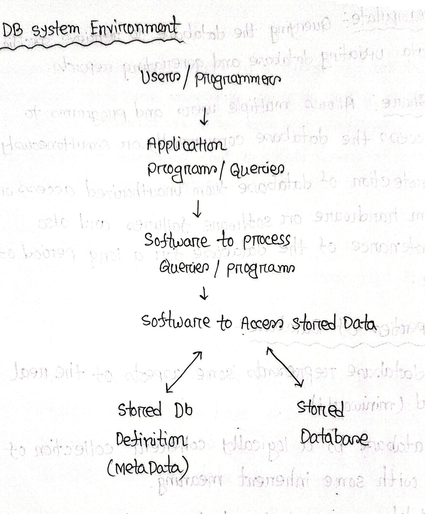
*Figure 1 — Database System Environment (Page 4)*

```text
                  Users / Programmers
                           │
                           ▼
              Application Programs / Queries
                           │
                           ▼
           Software to process Queries / programs
                           │
                           ▼
             Software to Access Stored Data
                    │               │
                    ▼               ▼
           Stored Db Definition     Stored Database
               (MetaData)
```

---

<!-- Page 5 -->

## Characteristics of DBMS

### File System Approach (traditional)


*Figure 1 — Traditional File System Approach with Departmental Data Duplication (Page 5)*

```text
       Account Dept                           Exam Dept
  ┌───────┬──────────┬──────────┐        ┌───────┬──────────┬────────┬────────┐
Roll_No  Name    Fees paid   fees      Roll_no  Name     Course   Grades
                               due
```

File system approach এ যদি আমরা ২ টা Dept চিন্তা করি যে একটি Account আর একটি Exam. এদের কিন্তু interest আলাদা তাই Data maintain করতে ২ Branch এ আলাদা file লাগবে। কিন্তু ২ জায়গায় Roll এবং Name আছে যা Redundancy create করে এবং space বেশি লাগে।

### DBMS Approach:
The entire data is stored in a single repository and multiple users can access the data based on their interests.

---

<!-- Page 6 -->

## Characteristics of DBMS Approach:
1. Self-describing Nature of a Database system.
2. Insulation between Programs and Data, and Data Abstraction.
3. Support of multiple views of the data.
4. Sharing of Data and multiuser Transaction processing.

### 1. Self-describing Nature of a Database system

- $\text{Database system} \rightarrow \text{Database} + \text{Meta-data (DB definition)}$
  $$\downarrow$$
  - **Stored in**: DBMS catalog.
  - **Used by**: DBMS software & Database user

- DBMS software must work equally well with any number of database applications.
- In traditional file processing, $\text{data definition} \rightarrow \text{part of application programs} \rightarrow \text{work with only one specific DB}$.

---

<!-- Page 7 -->

### 2. Insulation between Programs and Data, and Data Abstraction

- In traditional file processing $\rightarrow$ structure of data file is embedded in the application programs.
- In database approach $\rightarrow$ structure of data files is stored in the DBMS catalog $\rightarrow$ separate from access programs (**program-data independence**).
- The characteristic that allows program-data independence is called **data abstraction**.
- DBMS provides users with conceptual representation of data. It hides the behind the scene details or the complicated details that are not of interest to the database user.
- **Data model** is a type of data abstraction that provides conceptual representation to the database users in a way that most users can understand and the data model hides the storage and implementation details from the users.

---

<!-- Page 8 -->

### Program-data independence:
The ability to modify the data structure or storage characteristics without affecting the application program that access that data.

In traditional file-processing systems, the data structures and the application programs were tightly coupled. If we changed the format of a file, we had to rewrite every single program that used that file. DBMS solves this problem by separating the two.

### 3. Support of multiple views of the Data
- A database has many users, each of whom may require a different view of database.
- A view which is a subset of database that is derived from a main database table. It contains virtual data or the data which is not physically stored or that is not explicitly stored derived from database.

---

<!-- Page 9 -->

### 4. Sharing of Data and Multiuser Transaction Processing
- A multiuser DBMS allows multiple users to access the database at the same time.
- DBMS must include **concurrency control**.
  $$\downarrow$$
  When multiple users are sharing the same database at the same time, it should prevent two users from editing the same data at the same time.
- **OLTP** (Online Transaction Processing) $\rightarrow$ major part of database application.
- DBMS must enforce several transaction properties:
  $$\downarrow$$
  *Transaction: program under execution*

#### Two different transaction properties:
1. **Isolation**:
   > যখন কোনো agent seat book করে তখন ঐ seat block হয়ে যায় এবং অন্য agent রা access করতে পারবে না।
2. **Atomicity**:
   > Transaction যদি complete না হয় বা অর্ধেক হয়ে থেমে যায় তাহলে ঐ seat কে release করতে হবে।

---

<!-- Page 10 -->

## Database Users

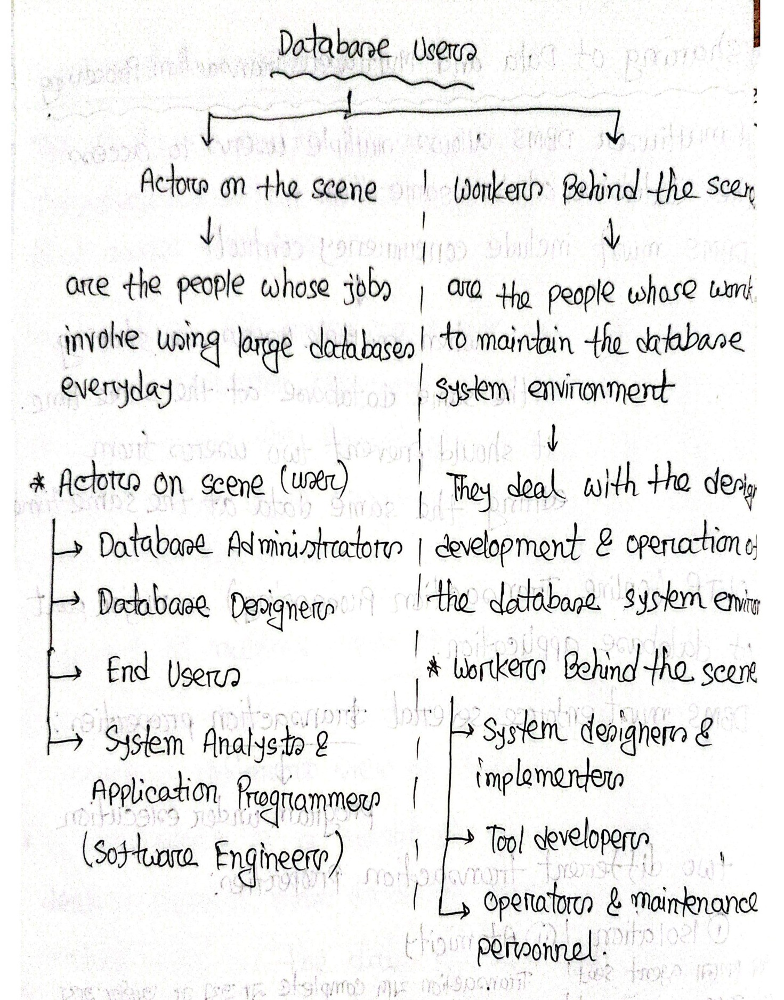
*Figure 1 — Classification of Database Users: Actors on the Scene vs. Workers Behind the Scene (Page 10)*

| Actors on the scene | Workers Behind the scene |
| :--- | :-- |
| $\downarrow$<br>are the people whose jobs involve using large databases everyday | $\downarrow$<br>are the people whose work to maintain the database system environment<br>$\downarrow$<br>They deal with the design, development & operation of the database system environment |
| **Actors on scene (user):**<br>$\rightarrow$ Database Administrators<br>$\rightarrow$ Database Designers<br>$\rightarrow$ End Users<br>$\rightarrow$ System Analysts & Application Programmers (Software Engineers) | **Workers Behind the scene:**<br>$\rightarrow$ System designers & implementers<br>$\rightarrow$ Tool developers<br>$\rightarrow$ Operators & maintenance personnel |

---

<!-- Page 11 -->

## Details $\rightarrow$ Actors on the scene

### Database Administrators:
In any large organization, we might have many resources and we always need a main person or a chief person or a manager to manage these resources.

$\rightarrow$ In database environment,
- **Primary resource** $\rightarrow$ database
- **Secondary resource** $\rightarrow$ DBMS & related software.

$\rightarrow$ **Database Administrator (DBA) responsibility:**
1. Administering primary / secondary resources.
2. Authorizing access to the database.
3. Co-ordinating & monitoring use of database.
4. Acquiring Hardware & software resources as needed.

---

<!-- Page 12 -->

### Database Designers:
1. Identifying the data to be stored in the database.
2. Choosing appropriate structures to represent and store data.
3. Communicating with database users to understand their requirements and based on their requirements a database designer designs the database.
4. A designer interact with users and develop views for each of these group of users based on their requirements. So database designer develop views for each group of users then each view is linked with the views of other group of users and that final database design should fulfil the requirements of all the user groups.

> [!NOTE] View Definition
> A view is the subset of the database. It is derived from the main database and it only contains data that is required by a particular user.

---

<!-- Page 13 -->

### End Users:
$\rightarrow$ End users are the people whose jobs require access to the database for querying, updating, generating reports.

$\rightarrow$ **Several categories of end users:**
1. **Casual end users**: Accesses database occasionally
   - Typically middle or high-level managers or occasional browsers.
2. **Naive or parametric end users**:
   - Constantly querying and updating database using canned transactions.
3. **Sophisticated end users**:
   - Engineers, scientists, business analysts or any other users who are familiar with the DBMS.
4. **Stand-alone users**:
   - Maintains personal databases by using ready made program packages.

---

<!-- Page 14 -->

## Database Users & Canned Transactions

### System Analysts & Application Programmers (Software Engineers)

- $\rightarrow$ **System Analysts** determine the requirements of end users especially the naive users or the parametric end users and then develop specifications for canned transaction.
- $\rightarrow$ **Application Programmers** $\rightarrow$ test, debug, document and maintain these canned transaction.

> [!NOTE] Canned Transaction
> $\hookrightarrow$ Sometimes called a predefined or packaged transaction. It is standard, highly optimized and frequently executed query or update that has been written, tested and stored in advance.

---

<!-- Page 15 -->

## Workers Behind the Scene

- $\rightarrow$ **System designers and implementers:**  
  Design and implement DBMS modules & interfaces as a package.

- $\rightarrow$ **Tool Developers:**  
  Persons who design and implement tools  
  $$\downarrow$$  
  software packages.

- $\rightarrow$ **Operators and maintenance personnel:**  
  Responsible for actual running and maintenance of hardware & software.

---

<!-- Page 16 -->

## Advantages of DBMS Approach

- $\rightarrow$ Controlling Redundancy
- $\rightarrow$ Restricting Unauthorized Access
- $\rightarrow$ Providing Persistent storage for program objects
- $\rightarrow$ Providing storage structures for efficient query processing.
- $\rightarrow$ Providing Backup & recovery
- $\rightarrow$ Providing multiple user interfaces.
- $\rightarrow$ Representing complex relationships among Data
- $\rightarrow$ Enforcing Integrity constraints.

---

<!-- Page 17 -->

## Data Models

- $\rightarrow$ Data model is used to describe the structure of the database $\rightarrow$ helps to achieve data abstraction.
- $\rightarrow$ Includes a set of basic operations for specifying retrievals or updates on the database.
- $\rightarrow$ Also includes concepts to specify the behaviour of a database application.

### Categories of Data Model

#### High-level or conceptual Data Model:
- Provides concepts that are close to the way many users see/perceive data.
- Use concepts such as entities, attributes and relationships.
  - **Entities** $\rightarrow$ Represent real world object or concept.
  - **Attributes** $\rightarrow$ further describe an entity.
  - **Relationships** $\rightarrow$ association among 2 or more entities.

---

<!-- Page 18 -->

## Data Models & Schema Concepts

#### Low-level or physical Data Model:
- Describes how data is stored in the computer.
- Access path $\rightarrow$ structure for efficient search of database records.

#### Representational (or implementation) Data Model:
- Represent data using record structures — that's why it is called record-based data models.

### Terminologies

- $\rightarrow$ **Database Schema:** Description of a database. It is just a plan or a layout or a blueprint of the database.
- $\rightarrow$ **Schema Diagram:** Displayed schema.

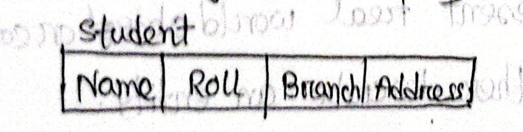
*Figure 18.1 — Schema diagram for Student relation (Page 18)*

- $\rightarrow$ **Schema Construct:** Each object within the schema. Ex. Student, Course etc.

---

<!-- Page 19 -->

- $\rightarrow$ **Database state (or instance or snapshot):** The data in the database at a particular moment.

## Database Design

### Overview of the Design Process

- Designing a database application is complex.
- Interaction of the application with the database.
- The needs of the users play a central role in the design process.
- Design phases are also crucial.
- Conceptual, logical and database design.
- Ensures integrity, efficiency and security.

### Design Phases

- The initial phase is to characterize the data need and DB users.
- The next phase pertains to data model.

---

<!-- Page 20 -->

- Followed by a fully developed conceptual schema.
- The final phase is the process of implementation.

### Design Issues

- Redundancy
- Incompleteness

## Introduction to E-R Model

### The E-R Model

- **E-R Model** = Entity Relationship Model
- Facilitates database design by allowing specification of an enterprise schema.
- Represents the overall logical structure of a database.
- It is a high level data base <!-- note: data model -->
- Develops a conceptual design for databases.
- Portrayed as diagrams.

---

<!-- Page 21 -->

## E-R Model: Basic Components

### Basic Components

- Entity sets
- Attributes
- Relationship sets

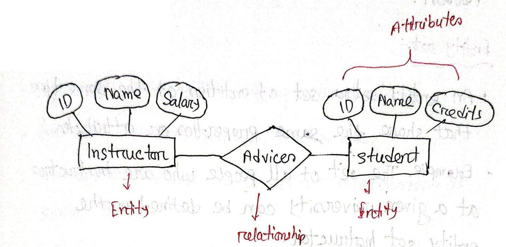
*Figure 21.1 — Basic components of an E-R diagram: Entity sets (Instructor, Student), Relationship set (Advices), and Attributes (Page 21)*

### Entity

- An entity is a thing or object in the real world.
- Distinguishable from all other objects.
- **Example:** Each person in an university is an entity.
- It has a set of properties, and the values for some set of properties may uniquely identify an entity.

---

<!-- Page 22 -->

- For instance, a person may have a `person-id` property whose value uniquely identifies that person.

### Entity Sets

- An entity set is a set of entities of the same type that share the same properties or attributes.
- **Example:** The set of all people who are instructors at a given university can be defined as the entity set instructor.
- It does not need to be disjoint.

### Attributes

- Each entity has a value for each of its attributes.
  - *I have a name, my sister has a name. Here name is attribute.*
- For instance, a particular instructor entity may have:
  - the value `12121` for `ID`
  - the value `Shishir` for `Name`,

---

<!-- Page 23 -->

- the value `ECE` for `Dept_name`, and
- the value `100000` for `Salary`.

### Relationship Sets

- It is an association among several entities.
- **Example:** adviser, borrows, teaches etc.
- A relationship set is a set of relationships of same type.
- $R \subseteq \{(e_1, e_2, \dots, e_n) \mid e_1 \in E_1, e_2 \in E_2, \dots, e_n \in E_n\}$ is a relationship.
- The part an entity plays in a relationship is the entity's **role**.

---

<!-- Page 24 -->

### Relationship Sets & Descriptive Attributes

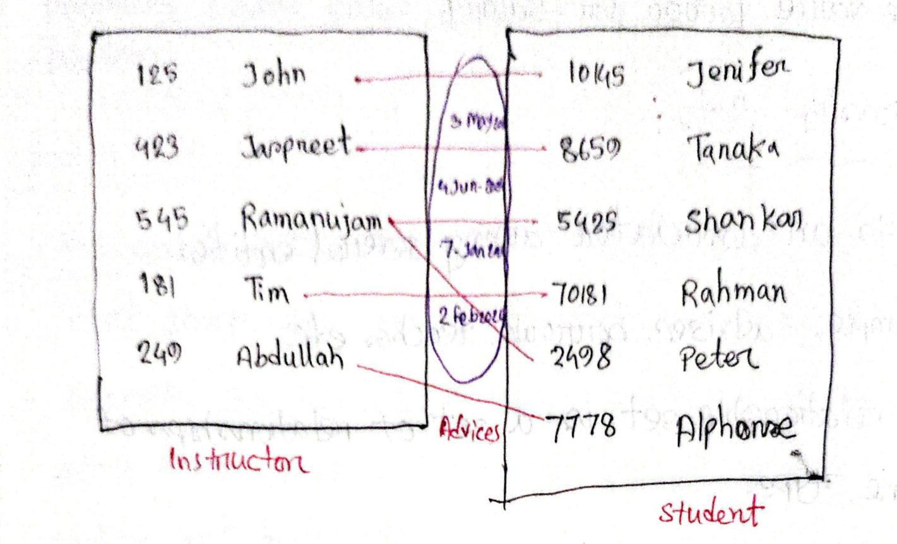
*Figure 24.1 — Relationship set Advices between Instructor and Student entity sets with descriptive date attribute (Page 24)*

This advices relationship is going to contain an attribute so that it can handle this Association even better. This advices relationship may contain an attribute which is date where these dates helping us in providing more information where this date attribute is going to be a descriptive attribute on the advices relationship. This is a binary relation because it exists in two relations instructor and student.

---

<!-- Page 25 -->

### Cardinality Ratio & Degree of Relationship Sets

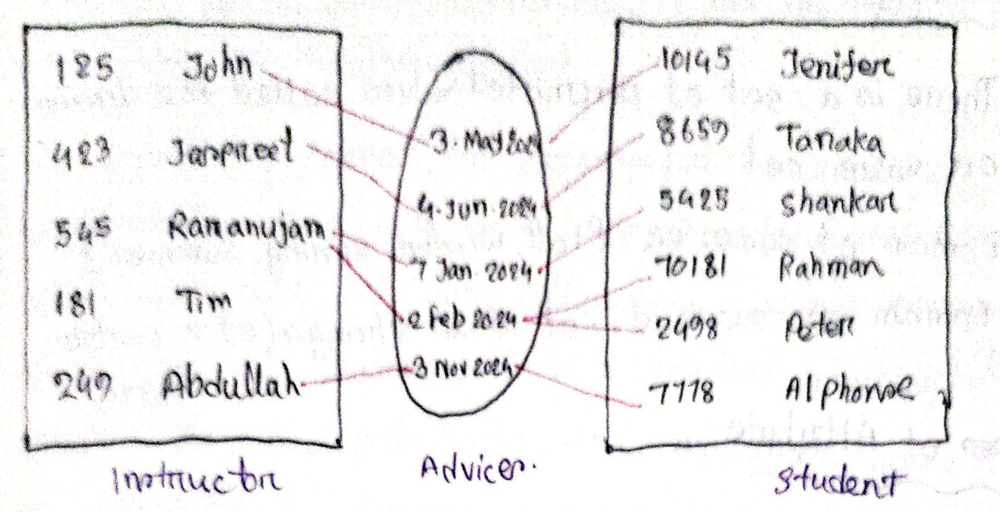
*Figure 25.1 — Relationship set showing cardinality ratio: Instructor Ramanujam participating in two associations (Page 25)*

Ramanujam entity participating in the advices relationship with the association two. This is cardinality ratio.

- $\ast$ The number of entity sets that participate in a relationship set is the **degree of the relationship**, here the advices relationship set has participation from two entity sets one is instructor another one is student so the **degree of participation** here is two because two entity sets are related or participating in the advices relationship set.

---

<!-- Page 26 -->

## Attributes

* There is a set of permitted values called the **domain** or **value set**.
* $\text{Domain of } \text{semester} = \{\text{Fall}, \text{winter}, \text{spring}, \text{summer}\}$
* $\text{Domain of } \text{course\_id} = \text{set of all strings (of a certain length)}$

### Types of Attribute

| Attribute | Type |
| :--- | :--- |
| **Name** | Composite Attribute |
| **DOB** | Simple / Single-valued |
| **Address** | Complex Attribute |
| **Age** | Derived Attribute |
| **Phone** | Multi-Valued Attribute |

#### Composite Attribute Decomposition Breakdown

* **Address:**
  * $\to$ `street`
    * $\to$ `street-number`
    * $\to$ `streetname`
    * $\to$ `apartment_number`
  * $\to$ `city`
  * $\to$ `state`
  * $\to$ `Postal-code`
* **Name:**
  * $\to$ `Firstname`
  * $\to$ `Middlename`
  * $\to$ `Lastname`

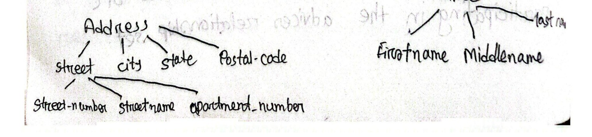
*Figure 1 — Composite Attribute Breakdown for Address and Name (Page 26)*

---

<!-- Page 27 -->

## Attribute Characteristics & Types

* **Name** is not a simple attribute, it has multiple attributes which can be further divided.
* If something cannot be decomposed into smaller components that will be a **simple attribute**. Since name attribute is non-atomic in nature because they can be decomposed into smaller meaningful components or attributes, the attribute name is an example of **composite attribute**.
* A **phone number** can be many, so it needs to store multiple values (**multi-valued attribute**).
* **Age** is a **derived attribute** because age has to be updated according to the DOB (Date of Birth).

### ER Diagram Notations for Attributes

* **Simple / Single-valued:** Represented by an oval (ellipse) $\to$ $\bigcirc$
* **Composite:** Represented by an oval connected to its component ovals
* **Multi-Valued:** Represented by a double oval (concentric ellipses) $\to$ $\large\boldsymbol{\odot}$
* **Derived:** Represented by a dashed oval (dashed ellipse)
* **Null:** Null value attribute representation

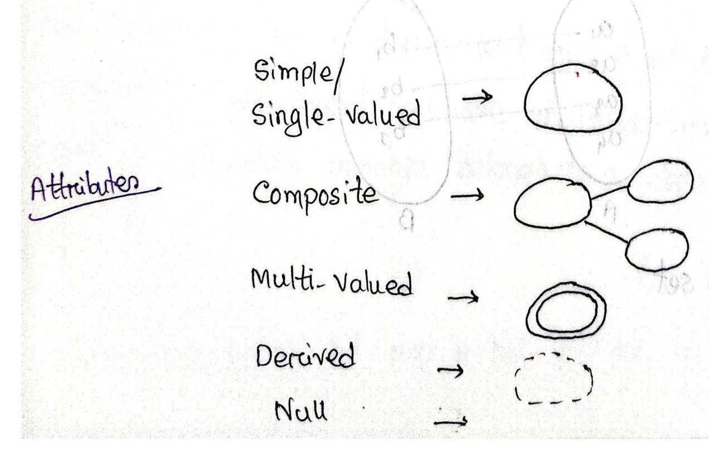
*Figure 2 — ER Diagram Notations for Different Attribute Types (Page 27)*

---

<!-- Page 28 -->

## Mapping Cardinalities

* One-to-One cardinality
* One-to-Many cardinality
* Many-to-One cardinality
* Many-to-Many cardinality

* Also known as **Cardinality Ratio**.
* Used to express the number of entities to which another entity can be associated via a relationship set.
* Most useful in describing **binary relationship sets**.

### One-to-One Cardinality

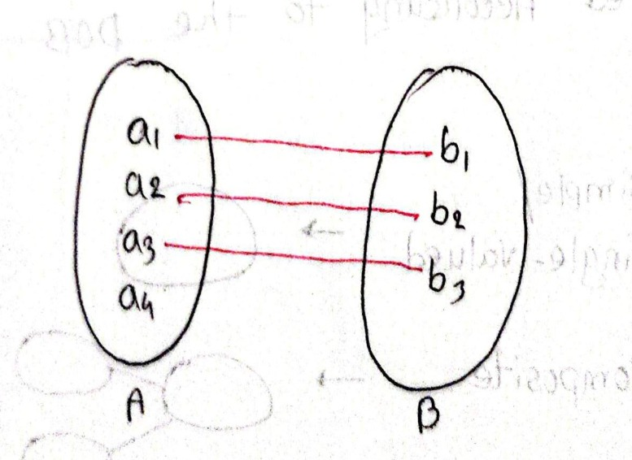
*Figure 3 — One-to-One Mapping Cardinality (Page 28)*

$A, B$ are entity sets:
* $A = \{a_1, a_2, a_3, a_4\}$
* $B = \{b_1, b_2, b_3\}$
* Mappings:
  * $a_1 \to b_1$
  * $a_2 \to b_2$
  * $a_3 \to b_3$

---

<!-- Page 29 -->

An entity in entity set $A$ is associated with at most one entity in the other entity set, which is $B$.

### One-to-Many Cardinality

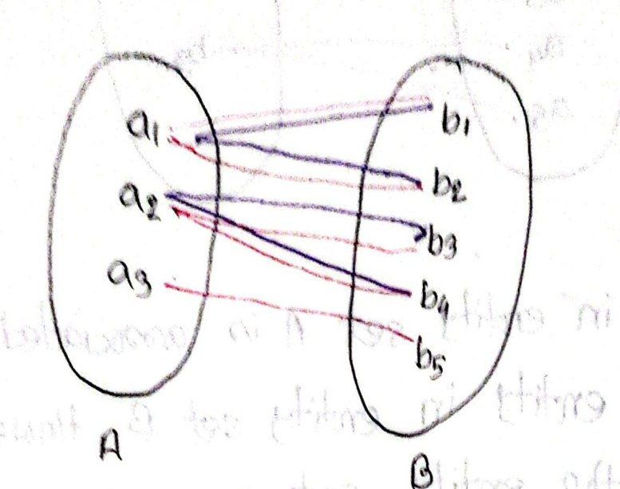
*Figure 4 — One-to-Many Mapping Cardinality (Page 29)*

* Mappings:
  * $a_1 \to b_1, b_2, b_3$
  * $a_2 \to b_4, b_5$
  * $a_3$ (unassociated)

An entity in entity set $A$ is actually associated with any number of entities in entity set $B$. This is called as **one-to-many**.

**Example:**
* Let assume entity set $A$ is **department** and entity set $B$ is **faculty members**.
* A department can have multiple faculty members, but a faculty member belongs to a department.

---

<!-- Page 30 -->

### Many-to-One Cardinality

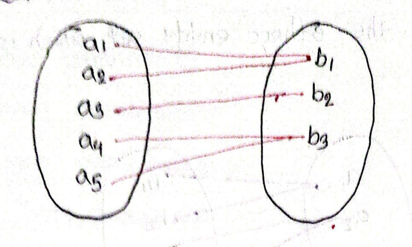
*Figure 5 — Many-to-One Mapping Cardinality (Page 30)*

* Mappings:
  * $a_1 \to b_1$
  * $a_2 \to b_1$
  * $a_3 \to b_2$
  * $a_4 \to b_3$
  * $a_5 \to b_3$

An entity in entity set $A$ is associated with at most one entity in entity set $B$. However, an entity in entity set $B$ can be associated with any number of entities in entity set $A$.

### Many-to-Many Cardinality

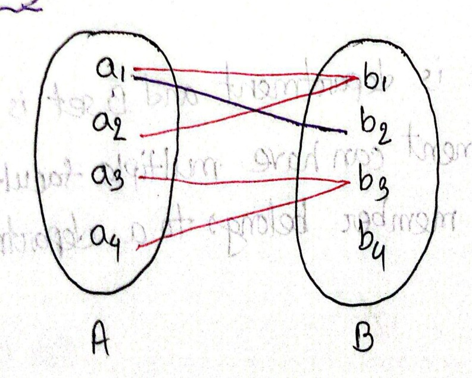
*Figure 6 — Many-to-Many Mapping Cardinality (Page 30)*

* Mappings:
  * $a_1 \to b_1, b_2$
  * $a_2 \to b_1$
  * $a_3 \to b_3$
  * $a_4 \to b_3, b_4$

An entity in entity set $A$ can be associated with any number of entities in entity set $B$, and an entity in entity set $B$ can be associated with any number of entities in entity set $A$.

---

<!-- Page 31 -->

## SQL

### Database

* A **Database** is a collection of data in a format that can be easily accessed (Digital).
* A software application used to manage our DB is called **DBMS** (Database Management System).

### Types of Databases

| Relational | Non-relational (NoSQL) |
| :--- | :--- |
| Data stored in tables | Data not stored in tables |
| Examples: MySQL, ORACLE etc. | Examples: MongoDB |

### What is SQL?

* **Structured Query Language**.
* SQL is a programming language used to interact with relational databases.
* It is used to perform **CRUD** operations:
  * **C**reate
  * **R**ead
  * **U**pdate
  * **D**elete

---

<!-- Page 32 -->

### SEQUEL vs. SQL

| SEQUEL | SQL |
| :--- | :--- |
| **S**tructured | **S**tructured |
| **E**nglish | **Q**uery |
| **Q**uery | **L**anguage |
| **E**nglish / **L**anguage | |

*(Historical note: SQL originally developed as SEQUEL — Structured English Query Language)*

### Database Structure

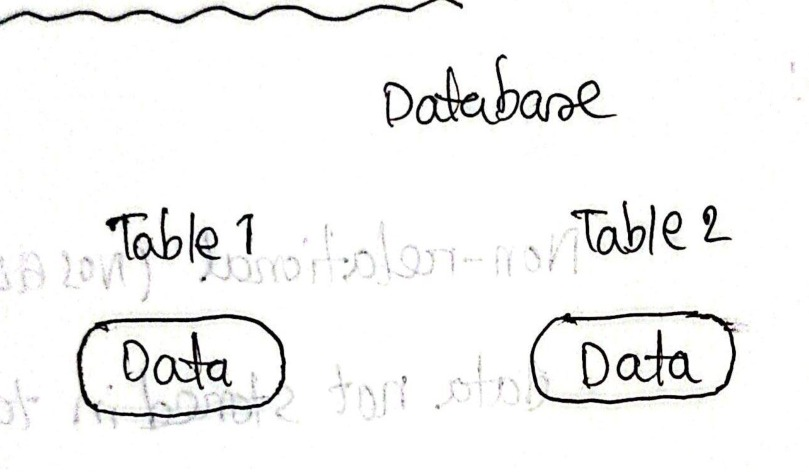
*Figure 7 — Database Structure (Page 32)*

* Hierarchy:
  $$\text{Database} \longrightarrow \begin{cases} \text{Table 1} \longrightarrow [\text{Data}] \\ \text{Table 2} \longrightarrow [\text{Data}] \end{cases}$$

### Creating Our First Database

```sql
CREATE DATABASE db_name;

DROP DATABASE db_name;
-- ↓
-- delete
```

---

<!-- Page 33 -->

### Creating Our First Table

```sql
USE db_name;

CREATE TABLE table_name (
    column_name1 datatype constraint,
    column_name2 datatype constraints,
    column_name3 datatype constraint
);
```

#### Example: Student Table

```sql
CREATE TABLE student (
    id INT PRIMARY KEY,       -- not null, unique
    name VARCHAR(50),
    age INT NOT NULL
);

INSERT INTO student VALUES (1, "Fahim", 23);
```

### SQL Datatypes

* `TINYINT UNSIGNED` ($0$ to $255$)
* `TINYINT` ($-128$ to $127$)
* `CHAR` $\to$ string ($0$–$255$), can store characters of fixed length.
* `VARCHAR` $\to$ string ($0$–$255$), can store characters up to given length.
* `BLOB` $\to$ string ($0$–$65535$), can store binary large object.

---

<!-- Page 34 -->

### SQL Datatypes (Continued)

* `INT` $\to$ integer
* `BIGINT` $\to$ large integer
* `BIT` $\to$ can store $M$-bit values, $M$ can range from $1$ to $64$.
* `BOOLEAN` $\to$ Boolean values $0$ or $1$
* `DATE` $\to$ date in format of `YYYY-MM-DD`
* `YEAR` $\to$ Year in 4 digits format ranging from $1901$ to $2155$

### Types of SQL Commands

* **DDL (Data Definition Language):**
  * `CREATE`, `ALTER`, `RENAME`, `TRUNCATE`, `DROP`
* **DQL (Data Query Language):**
  * `SELECT`
* **DML (Data Manipulation Language):**
  * `INSERT`, `UPDATE`, `DELETE`
* **DCL (Data Control Language):**
  * `GRANT`, `REVOKE` (permission to user)
* **TCL (Transaction Control Language):**
  * `START TRANSACTION`, `COMMIT`, `ROLLBACK`

---

<!-- Page 35 -->

### Database-Related Queries

```sql
CREATE DATABASE db_name;

CREATE DATABASE IF NOT EXISTS db_name;

DROP DATABASE db_name;

DROP DATABASE IF EXISTS db_name;

SHOW DATABASES;

SHOW TABLES;
```

### Table-Related Queries

#### Select & View All Columns

```sql
SELECT * FROM table_name;
--     ↑
--    all
```

### Insert Query

**Syntax:**
```sql
INSERT INTO table_name
(colname1, colname2)
VALUES
(col1_v1, col2_v1),
(col1_v2, col2_v2);
```

**Example:**
```sql
INSERT INTO student
(rollno, name)
VALUES
(101, "fahim"),
(102, "shishir");
```

---

<!-- Page 36 -->

## Keys

### Primary Key

* It is a column (or set of columns) in a table that uniquely identifies each row (a unique id).
* There is only 1 primary key & it should be **NOT NULL**.

### Foreign Key

* A foreign key is a column (or set of columns) in a table that refers to the primary key.
* There can be multiple foreign keys.
* Foreign keys can have duplicate & null values.

### Table Relationship Example


*Figure 8 — Primary Key and Foreign Key Relationship (Page 36)*

#### Table 1 — Student

| id (PK) | name | cityId (FK) | city |
| :---: | :--- | :---: | :--- |
| 101 | Fahim | 1 | Dhaka |
| 102 | Shishir | 2 | Jashore |
| 103 | Sneha | 3 | Khulna |
| 104 | Shikta | 1 | Dhaka |

#### Table 2 — City

| id (PK) | city_name |
| :---: | :--- |
| 1 | Dhaka |
| 2 | Jashore |
| 3 | Khulna |

> [!NOTE] বাংলা ব্যাখ্যা (Bengali Explanation)
> Foreign key হলো অন্য একটা table এর Primary key যদি একটা Table এ use হয় সেটা। FK এর value unique হওয়ার প্রয়োজনীয়তা নাই।

---

<!-- Page 37 -->

## Constraints

SQL constraints are used to specify rules for data in a table.

* **NOT NULL:** Columns cannot have a null value $\to$ `col1 INT NOT NULL`
* **UNIQUE:** All values in column are different $\to$ `col2 INT UNIQUE`
* **PRIMARY KEY:** Makes a column unique & not null, but used only for one.
* **FOREIGN KEY:** Prevent actions that would destroy links between tables.

### Foreign Key Constraint Syntax

```sql
CREATE TABLE temp (
    cust_id INT,
    FOREIGN KEY (cust_id) REFERENCES customer(id)
    --            ↓                           ↓
    --        new column                  old column
);
```

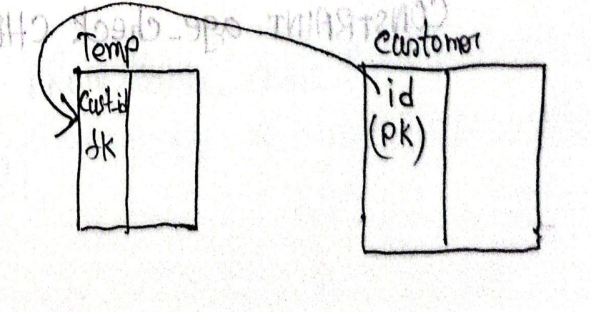
*Figure 9 — Foreign Key Constraint Relationship (Page 37)*

---

<!-- Page 38 -->

## SQL Constraints (Continued)

### DEFAULT Constraint

* Sets the default value of a column.

```sql
salary INT DEFAULT 25000
--                  ↓
--               def value
```

**Example:**
```sql
CREATE TABLE emp (
    id INT,
    salary INT DEFAULT 25000
);

INSERT INTO emp (id) VALUES (101);
-- salary will automatically be assigned 25000
```

### CHECK Constraint

* It can limit the values allowed in a column.

```sql
CREATE TABLE city (
    id INT PRIMARY KEY,
    city VARCHAR(50),
    age INT,
    CONSTRAINT age_check CHECK (age >= 18 AND city = "Delhi")
);
```

*(Note: In the `CHECK` condition above, `age >= 18 AND city = "Delhi"` specifies that rows are only valid if age is at least 18 and the city is "Delhi".)*

---

<!-- Page 39 -->

Another $\rightarrow$

```sql
CREATE TABLE newTab (
    age INT CHECK (age >= 18)
);
```

## Select in Detail

Used to select any data from the database.

### Basic Syntax
```sql
SELECT col1, col2 FROM table_name;
```

### To Select ALL
```sql
SELECT * FROM table_name;
```

### DISTINCT
Unique value দেয়।

### WHERE Clause
To define some conditions.

```sql
SELECT col1, col2 FROM table_name
WHERE conditions;
```

---

<!-- Page 40 -->

```sql
SELECT * FROM student WHERE marks > 80;

SELECT * FROM student WHERE city = "Dhaka";
```

### Using Operators in WHERE $\rightarrow$

- **Arithmetic Operators:** `+` (addition), `-` (subtraction), `*` (multiplication), `/` (division), `%` (modulus)
- **Comparison Operators:** `=` (equal to), `!=` (not equal to), `>`, `>=`, `<`, `<=`
- **Logical Operators:** `AND`, `OR`, `NOT`, `IN`, `BETWEEN`, `ALL`, `LIKE`, `ANY`
- **Bitwise Operators:** `&` (Bitwise AND), `|` (Bitwise OR)

### Operators

#### AND
*(to check for both conditions to be true)*

```sql
SELECT * FROM student WHERE marks > 80 AND city = "Dhaka";
```

#### OR
*(to check for one of the conditions to be true)*

```sql
SELECT * FROM student WHERE marks > 90 OR city = "DHAKA";
```

---

<!-- Page 41 -->

#### BETWEEN
*(selects for a given range)*

```sql
SELECT * FROM student WHERE marks BETWEEN 80 AND 90;
```

#### IN
*(matches any value in the list)*

```sql
SELECT * FROM student WHERE city IN ("Dhaka", "Khulna");
```

#### NOT
*(to negate the given condition)*

```sql
SELECT * FROM student WHERE city NOT IN ("Dhaka", "Khulna");
```

### LIMIT
Sets an upper limit on number of (tuples) rows to be returned.

```sql
SELECT * FROM student LIMIT 3;
```

> **Syntax:**
> ```sql
> SELECT col1, col2 FROM table_name
> LIMIT number;
> ```

### ORDER BY
To sort in ascending (`ASC`) or descending order (`DESC`).

```sql
SELECT * FROM student
ORDER BY city ASC;
```

---

<!-- Page 42 -->

```sql
SELECT col1, col2 FROM table_name
ORDER BY col_name(s) ASC;
```

### Aggregate Functions

Aggregate functions perform a calculation on a set of values, and return a single value.

- `COUNT()`
- `MAX()`
- `MIN()`
- `SUM()`
- `AVG()`

#### Examples:

- **Get maximum marks:**
  ```sql
  SELECT max(marks)
  FROM student;
  ```

- **Get average marks:**
  ```sql
  SELECT avg(marks)
  FROM student;
  ```

---

<!-- Page 43 -->

## GROUP BY

Groups rows that have the same values into summary rows.  
It collects data from multiple records and groups the result by one or more column.  
* Generally we use group by with some aggregation function.

### Count number of students in each city
```sql
SELECT city, count(name)
FROM student
GROUP BY city;
```

### Count number of students according to grades
```sql
SELECT grade, count(rollno)
FROM student
GROUP BY grade
ORDER BY grade;
```

---

<!-- Page 44 -->

### HAVING Clause
*(Group এ condition দেওয়া)*

Similar to `WHERE` i.e. applies some condition on rows.  
Used when we want to apply any condition after grouping.

- **Count number of students in each city where max marks cross 90:**
  ```sql
  SELECT city, count(rollno)
  FROM student
  GROUP BY city
  HAVING MAX(marks) > 90;
  ```

### General Order

```sql
SELECT column(s)
FROM table_name
WHERE condition
GROUP BY column(s)
HAVING condition
ORDER BY column(s) ASC;
```

> **Comparison:**
> - `WHERE` condition $\rightarrow$ applies to **rows**
> - `HAVING` condition $\rightarrow$ applies to **columns** (aggregated groups)

---

<!-- Page 45 -->

## Table Related Queries

### UPDATE
*(to update existing rows)*

> **Syntax:**
> ```sql
> UPDATE table_name
> SET col1 = val1, col2 = val2
> WHERE condition;
> ```

**Example:**
```sql
UPDATE student
SET grade = "O"
WHERE grade = "A";
```

> [!NOTE]
> এইভাবে Update করলে Error আসতে পারে Safe mode এর জন্য, তাই safe mode off করা লাগবে, তার জন্য command $\rightarrow$
> ```sql
> SET SQL_SAFE_UPDATES = 0;
> ```

---

<!-- Page 46 -->

### DELETE
*(To delete existing rows)*

> **Syntax:**
> ```sql
> DELETE FROM table_name
> WHERE condition;
> ```

**Example:**
```sql
DELETE FROM student
WHERE marks < 33;
```

### Foreign Key

```sql
CREATE TABLE dept (
    id INT PRIMARY KEY,
    name VARCHAR(50)
);

CREATE TABLE teacher (
    id INT PRIMARY KEY,
    name VARCHAR(50),
    dept_id INT,
    FOREIGN KEY (dept_id) REFERENCES dept(id)
);
```

---

<!-- Page 47 -->

### Cascading for FK

#### ON DELETE CASCADE
When we create a foreign key using this option, it deletes the referencing rows in the child table when the referenced row is deleted in the parent table which has a primary key.

#### ON UPDATE CASCADE
When we create a foreign key using UPDATE CASCADE the referencing rows are updated in the child table when the referenced row is updated in the parent table which has a primary key.

#### Code:
```sql
CREATE TABLE student (
    id INT PRIMARY KEY,
    courseID INT,
    FOREIGN KEY (courseID) REFERENCES course(id)
    ON DELETE CASCADE
    ON UPDATE CASCADE
);
```

---

<!-- Page 48 -->

## Table Related Queries

### ALTER (to change the schema)

1. **ADD column:**
   ```sql
   ALTER TABLE table_name
   ADD COLUMN column_name datatype constraint;
   ```

2. **DROP COLUMN:**
   ```sql
   ALTER TABLE table_name
   DROP COLUMN column_name;
   ```

3. **RENAME table:**
   ```sql
   ALTER TABLE table_name
   RENAME TO new_table_name;
   ```

4. **CHANGE Column (rename):**
   ```sql
   ALTER TABLE table_name
   CHANGE COLUMN old_name new_name new_datatype new_constraint;
   ```

5. **MODIFY Column (modify datatype/constraint):**
   ```sql
   ALTER TABLE table_name
   MODIFY col_name new_datatype new_constraint;
   ```

---

<!-- Page 49 -->

### Examples of ALTER TABLE

- **ADD column:**
  ```sql
  ALTER TABLE student
  ADD COLUMN age INT NOT NULL DEFAULT 19;
  ```

- **DROP column:**
  ```sql
  ALTER TABLE student
  DROP COLUMN stu_age;
  ```

- **MODIFY Column:**
  ```sql
  ALTER TABLE student
  MODIFY age VARCHAR(2);
  ```

- **RENAME Table:**
  ```sql
  ALTER TABLE student
  RENAME TO stu;
  ```

- **CHANGE Column (rename):**
  ```sql
  ALTER TABLE student
  CHANGE age stu_age INT;
  ```

---

<!-- Page 50 -->

### TRUNCATE
*(To delete table's data)*

```sql
TRUNCATE TABLE table_name;
```

#### DROP vs. TRUNCATE

| Command | Action |
| :--- | :--- |
| **DROP** $\swarrow$ | Deletes Table (schema + data) |
| **Truncate** $\downarrow$ | Deletes table data (retains schema structure) |

## Joins in SQL

Join is used to combine rows from two or more tables, based on a related column between them.

### Types of Joins

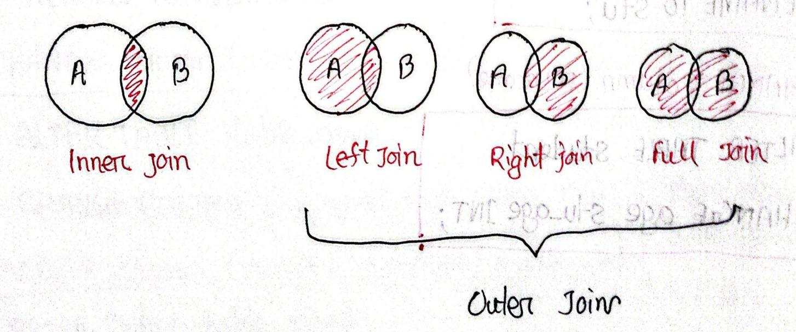
*Figure 1 — SQL Join Types: Inner Join, Left Join, Right Join, Full Join (Page 50)*

- **Inner Join:** Returns records that have matching values in both tables.
- **Outer Joins:**
  - **Left Join:** Returns all records from the left table, and the matched records from the right table.
  - **Right Join:** Returns all records from the right table, and the matched records from the left table.
  - **Full Join:** Returns all records when there is a match in either left or right table.

---

<!-- Page 51 -->

## Inner Join

Returns records that have matching values in both tables.

### Syntax

```sql
SELECT column(s)
FROM tableA
INNER JOIN tableB
ON tableA.col_name = tableB.col_name;
```

### Example

#### Given Tables

**`student`**

| student_id | name |
| :--- | :--- |
| 101 | adam |
| 102 | bob |
| 103 | casey |

**`course`**

| student_id | course |
| :--- | :--- |
| 102 | english |
| 105 | math |
| 103 | science |
| 107 | computer science |

#### Query

```sql
SELECT *
FROM student
INNER JOIN course
ON student.student_id = course.student_id;
```

#### Output

| student_id | name | course |
| :--- | :--- | :--- |
| 102 | bob | english |
| 103 | casey | science |

---
<!-- Page 52 -->

## Left Join

Returns all records from the left table, and the matched records from the right table.

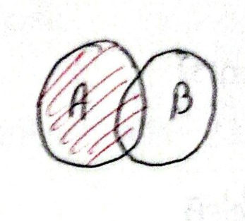
*Figure 1 — Left Join Venn Diagram (Page 52)*

### Syntax

```sql
SELECT column(s)
FROM tableA
LEFT JOIN tableB
ON tableA.col_name = tableB.col_name;
```

---

## Right Join

Returns all records from the right table and the matched records from the left table.

### Syntax

```sql
SELECT column(s)
FROM tableA
RIGHT JOIN tableB
ON tableA.col_name = tableB.col_name;
```

### Example Query

```sql
SELECT *
FROM student AS s
RIGHT JOIN course AS c
ON s.student_id = c.student_id;
```

---
<!-- Page 53 -->

## Full Join

Returns all records when there is a match in either left or right table.

### Syntax in MySQL

> [!NOTE]
> MySQL does not support direct `FULL OUTER JOIN`, so it is emulated using `UNION` of `LEFT JOIN` and `RIGHT JOIN`.

```sql
SELECT * FROM student AS a
LEFT JOIN course AS b
ON a.id = b.id
UNION
SELECT * FROM student AS a
RIGHT JOIN course AS b
ON a.id = b.id;
```

---

## Left Exclusive Join (Set Difference: $A - B$)

Returns only records present in the left table that have no match in the right table.

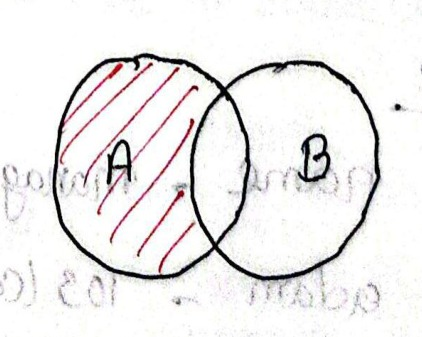
*Figure 2 — Left Exclusive Join / Set Difference (Page 53)*

### Query

```sql
SELECT *
FROM student AS a
LEFT JOIN course AS b
ON a.id = b.id
WHERE b.id IS NULL;
```

---
<!-- Page 54 -->

## Right Exclusive Join

Returns only records present in the right table that have no match in the left table.

### Query

```sql
SELECT *
FROM student AS a
RIGHT JOIN course AS b
ON a.id = b.id
WHERE a.id IS NULL;
```

---

## Self Join

A regular join, but the table is joined with itself.

### Query

```sql
SELECT a.name AS manager_name, b.name
FROM employee AS a
JOIN employee AS b
ON a.id = b.manager_id;
```

### Example

**`Employee` Table**

| id | name | manager_id |
| :--- | :--- | :--- |
| 101 | adam | 103 (casey) |
| 102 | bob | 104 (donald) |
| 103 | casey | NULL |
| 104 | donald | 103 (casey) |

---
<!-- Page 55 -->

### Result (Self Join Output)

| manager_name | name |
| :--- | :--- |
| casey | adam |
| donald | bob |
| casey | donald |

---

## Union

It is used to combine the result-set of two or more `SELECT` statements. Gives **UNIQUE** records.

### To use it:

- Every `SELECT` should have same no. of columns.
- Columns must have similar data types.
- Columns in every `SELECT` should be in same order.

### Syntax

```sql
SELECT column(s) FROM tableA
UNION
SELECT column(s) FROM tableB;
```

> [!NOTE] UNION vs UNION ALL
> - **UNION** $\to$ Duplicate রাখে না (eliminates duplicates)
> - **UNION ALL** $\to$ Duplicate রাখে (retains duplicates)

---
<!-- Page 56 -->

## SQL Sub Queries

A subquery, inner query, or nested query is a query within another SQL query.
It involves 2 select statements.

> [!NOTE] Subquery লেখার ৩টি সাধারণ স্থান:
> 1. `SELECT`
> 2. `FROM`
> 3. `WHERE` (Popular / basic)

### Syntax

```sql
SELECT column(s)
FROM table_name
WHERE col_name operator (subquery);
```

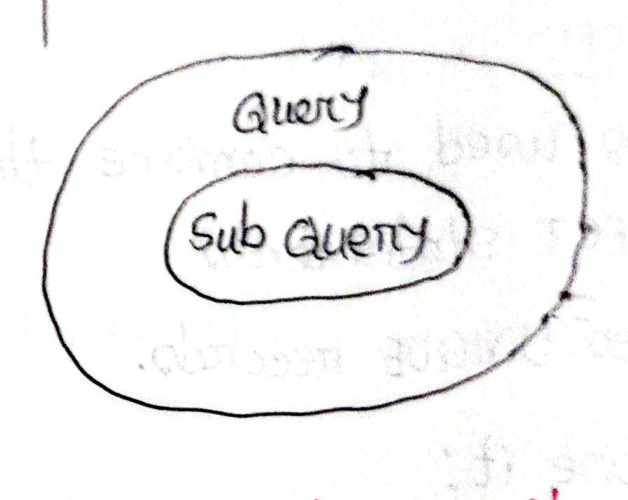
*Figure 3 — Nested Query Structure (Page 56)*

### Example

**Question:** Get names of all students who scored more than class average.

- **Step 1:** Find the average of class
- **Step 2:** Find the names of students with marks > average

```sql
SELECT name, marks
FROM student
WHERE marks > (SELECT AVG(marks) FROM student);
```

---
<!-- Page 57 -->

### Example: Find the names of all students with even roll numbers

- **Step 1:** Find the even roll number
- **Step 2:** Find the names of students with even roll no.

#### Stepwise (Manual / Static Approach)

```sql
SELECT rollno
FROM student
WHERE rollno % 2 = 0;

SELECT name, rollno
FROM student
WHERE rollno IN (102, 104, 106);
```

> [!WARNING]
> This is **not a dynamic process** because values are hardcoded manually.

#### Using Subquery (Dynamic Approach)

```sql
SELECT rollno, name
FROM student
WHERE rollno IN (
    SELECT rollno
    FROM student
    WHERE rollno % 2 = 0
);
```

---
<!-- Page 58 -->

### Example with FROM Clause Subquery

**Problem:** Find the max marks from the students of Delhi.

- **Step 1:** Find the students of Delhi
- **Step 2:** Find their max marks using the sublist in step 1

```sql
SELECT MAX(marks)
FROM (SELECT * FROM student WHERE city = "Delhi") AS temp;
```

---

## MySQL Views

A view is a virtual table based on the result-set of an SQL statement.

### Creating and Querying a View

```sql
CREATE VIEW view1 AS
SELECT roll_no, name FROM student;

SELECT * FROM view1;
```

> [!NOTE] View এর বৈশিষ্ট্য ও ব্যবহার
> view হলো virtual table। এখানে আসল table এর যতটুকু প্রয়োজন দেখা যায় এবং multiple operation যেগুলো table এ Apply হয় ঐগুলো view তেও Apply করা যায়।
>
> view delete করলেও overall database এ কোনো effect পড়ে না।

---
<!-- Page 59 -->

## MySQL Views (Overview & Use Cases)

A view in MySQL is a virtual table based on the result of a `SELECT` query. It does not store data itself — it always reflects the current data in the base tables.

### Views are useful when:

- You want to simplify complex queries
- You want to reuse logic
- You want to hide certain columns from users (security/privacy)
- You want a live snapshot of filtered data

---

## Triggers

Trigger is a special kind of stored program that is automatically executed (triggered) when a specific event occurs in a table — such as `INSERT`, `UPDATE`, or `DELETE`.

### Triggers are commonly used for:

- Logging changes (audit trail)
- Enforcing additional business rules / integrity constraints
- Automatically updating related data

---
<!-- Page 60 -->

## Trigger Syntax

```sql
CREATE TRIGGER trigger_name
AFTER INSERT ON table_name
FOR EACH ROW
BEGIN
    statements to execute
END;
```

### Triggers can be fired:

- **BEFORE** or **AFTER** an event
- On **INSERT**, **UPDATE**, or **DELETE**

> [!NOTE] বাস্তব জীবনের উদাহরণ
> এইটা এমন যে employee এর salary বাড়লে hourly pay বাড়ে বা hourly pay বাড়লে salary বাড়বে automatically।

---
<!-- Page 61 -->

## LIKE Command (Pattern Matching)

### Given Table: `Emp`

| ID | Name |
| :--- | :--- |
| 1 | Varun |
| 2 | Arun |
| 3 | Karina |
| 4 | Amrit |
| 5 | Ranjeet |
| 6 | Ajeet |

### Queries

#### 1) Find Employee detail whose name starting with 'A'

```sql
SELECT * FROM Emp WHERE name LIKE 'A%';
```

#### 2) Find Emp detail whose name ending with 'n'

```sql
SELECT * FROM Emp WHERE name LIKE '%n';
```

#### 3) Whose name contains 'ee'

```sql
SELECT * FROM Emp WHERE name LIKE '%ee%';
```

#### 4) Whose name contains 'a' in second place

```sql
SELECT * FROM Emp WHERE name LIKE '_a%';
```

#### 5) Whose name contains 'a' in second place and name should contain total five characters

```sql
SELECT * FROM Emp WHERE name LIKE '_a___';
```

---
<!-- Page 62 -->

## Trigger (Overview & Structure)

- টেবিলের DML operation (`INSERT`, `UPDATE`, `DELETE`) এর উপর depend করে কাজ করে।
- কিছু command execute করে।
- একটি trigger always একটা table এই কাজ করে।

### Basic Structure

```sql
CREATE TRIGGER [trigger_name]
ON [table_name]
[AFTER / FOR / INSTEAD OF]
[INSERT / UPDATE / DELETE]
AS
{ trigger_body }
```
