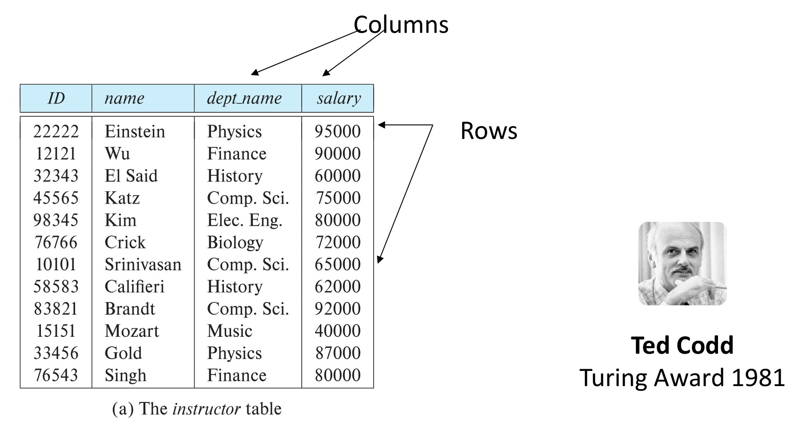
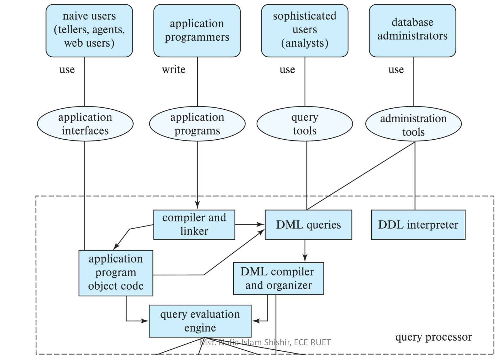
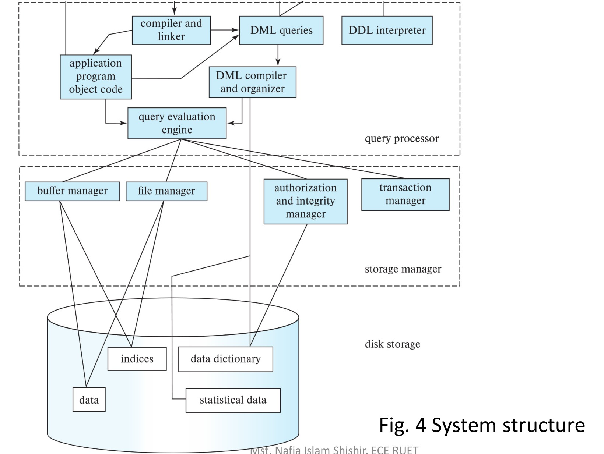

# Course Code: ECE 2215: Data Base Systems

<!-- Slide 1 -->
## Course Title: Data Base Systems
### Topic: Introduction to Database and DBMS

**Dept. of Electrical & Computer Engineering (ECE), Rajshahi University of Engineering & Technology**

**Instructed by:**  
**Mst. Nafia Islam Shishir**  
Lecturer, ECE, RUET

---

<!-- Slide 2 -->
## Database

**Database:** An organized collection of data stored and accessed electronically.

Mainly two types of database – 
1. **Structured database**
   - in table format
2. **Unstructured database**
   - document or key-value based


*Figure 1.1 — Structured and Unstructured data (Source: Slide 2)*

---

<!-- Slide 3 -->
## Data and Information

| Data | Information |
| :--- | :--- |
| Data is unorganized and unrefined facts | Information comprises processed, organized data presented in a meaningful context |
| Data is an individual unit that contains raw materials which do not carry any specific meaning. | Information is a group of data that collectively carries a logical meaning. |
| Data doesn’t depend on information. | Information depends on data. |
| Raw data alone is insufficient for decision making | Information is sufficient for decision making |
| An example of data is a student’s test score | The average score of a class is the information derived from the given data. |

---

<!-- Slide 4 -->
## Database Management System

- A database-management system (DBMS) is a set of programs to access the collection of interrelated data.
- DBMS contains information about a particular enterprise
  - Collection of interrelated data
  - Set of programs to access the data 
  - An environment that is both convenient and efficient to use


*Figure 1.2 — DBMS and users (Source: Slide 4)*

---

<!-- Slide 5 -->
## Database Application Examples

- **Enterprise Information**
  - **Sales:** customers, products, purchases
  - **Accounting:** payments, receipts, assets
  - **Human Resources:** Information about employees, salaries, payroll taxes.
- **Manufacturing:** management of production, inventory, orders, supply chain.
- **Banking and finance**
  - customer information, accounts, loans, and banking transactions.
  - Credit card transactions
  - **Finance:** sales and purchases of financial instruments (e.g., stocks and bonds; storing real-time market data
- **Universities:** registration, grades

---

<!-- Slide 6 -->
## Purpose of Database Systems

One way to keep the information on a computer is to store it in operating-system files, like - .txt, .docx, .xlsx etc.

Keeping organizational information in a file-processing system has a number of major disadvantages:
- **Data redundancy:** data is stored in multiple file formats resulting in duplication of information in different files.
- **Data inconsistency:** The various copies of the same data may no longer agree.
- **Difficulty in accessing data:** Need to write a new program to carry out each new task
- **Data isolation:** Multiple files and formats.
- **Integrity problems:** When new constraints are added, it is difficult to change the programs to enforce them.

---

<!-- Slide 7 -->
## Purpose of Database Systems (Cont.)

- **Atomicity of updates**
  - Failures may leave the database in an inconsistent state with partial updates carried out
  - Example: Transfer of funds from one account to another should either be completed or not happen at all
- **Concurrent access by multiple users**
  - Concurrent access needed for performance
  - Uncontrolled concurrent accesses can lead to inconsistencies
    - Ex: Two people reading a balance (say 100) and updating it by withdrawing money (say 50 each) at the same time
- **Security problems**
  - Hard to provide user access to some, but not all, data.

**Database systems offer solutions to all the above problems.**

---

<!-- Slide 8 -->
## Components of DBMS

- **Data:** 
  - User data
  - Metadata
- **Software**
  - Actual DBMS software like MySQL, Oracle, PostgreSQL.
- **Hardware**
  - Physical devices like servers, disks, input-output devices (keyboard, monitor, printer).
- **Procedure**
  - Instructions and rules for using DBMS effectively
- **Database Access Language**
  - Used to interact with the database (create, read, update, delete data).
  - Examples: SQL, MyAccess, Oracle PL/SQL.

---

<!-- Slide 9 -->
## Components of DBMS

- **Users:** 
  - **Naïve Users:** The unsophisticated users who interact with the system by using predefined user interfaces, such as web or mobile applications. 
  - **Application programmers** are computer professionals who write application programs. Application programmers can choose from many tools to develop user interfaces.
  - **Sophisticated users** interact with the system without writing programs. Instead, they form their requests either using a database query language or by using tools such as data analysis software.

---

<!-- Slide 10 -->
## Components of DBMS

### Database Administrator:

A person who has central control over the system is called a **database administrator (DBA)**. Functions of a DBA include:

- Schema definition
- Storage structure and access-method definition
- Schema and physical-organization modification
- Granting of authorization for data access
- Routine maintenance
- Periodically backing up the database
- Ensuring that enough free disk space is available for normal operations, and upgrading disk space as required
- Monitoring jobs running on the database

---

<!-- Slide 11 -->
## Data Models

- Data models are a collection of tools for describing data, data relationships, data semantics and data constraints
  - Relational model
  - Entity-Relationship data model (mainly for database design) 
  - Object-based data models (Object-oriented and Object-relational)
  - Semi-structured data model (XML)
  - Other older models:
    - Network model 
    - Hierarchical model

---

<!-- Slide 12 -->
## Relational Models

- All the data is stored in various tables.
- Example of tabular data in the relational model


*Figure 1.3 — Relational model: Tabular data with attributes (columns) and tuples (rows), and Edgar F. Codd (Source: Slide 12)*

#### (a) The *instructor* table

| ID | name | dept_name | salary |
| :--- | :--- | :--- | :--- |
| 22222 | Einstein | Physics | 95000 |
| 12121 | Wu | Finance | 90000 |
| 32343 | El Said | History | 60000 |
| 45565 | Katz | Comp. Sci. | 75000 |
| 98345 | Kim | Elec. Eng. | 80000 |
| 76766 | Crick | Biology | 72000 |
| 10101 | Srinivasan | Comp. Sci. | 65000 |
| 58583 | Califieri | History | 62000 |
| 83821 | Brandt | Comp. Sci. | 92000 |
| 15151 | Mozart | Music | 40000 |
| 33456 | Gold | Physics | 87000 |
| 76543 | Singh | Finance | 80000 |

> **Ted Codd**  
> Turing Award 1981

---

<!-- Slide 13 -->
## Levels of Abstraction

- A major purpose of a database system is to provide users with an abstract view of the data.

**Data abstraction:** Since many database-system users are not computer-trained, developers hide the complexity from users to simplify users’ interactions with the system. 

There are different levels of abstractions – 
- **Physical level:** describes how a record (e.g., instructor) is stored.
- **Logical level:** describes data stored in database, and the relationships among the data.

```pascal
type instructor = record
    ID : string; 
    name : string;
    dept_name : string;
    salary : integer;
end;
```

- **View level:** application programs hide details of data types. Views can also hide information (such as an employee’s salary) for security purposes.

---

<!-- Slide 14 -->
## View of Data

An architecture for a database system 


*Figure 1.4 — An architecture for a database system: Levels of Data Abstraction (Source: Slide 14)*

---

<!-- Slide 15 -->
## Instances and Schemas

- Similar to types and variables in programming languages
- **Logical Schema** – the overall logical structure of the database 
  - **Example:** The database consists of information about a set of customers and accounts in a bank and the relationship between them
  - Analogous to type information of a variable in a program
- **Physical schema** – the overall physical structure of the database 
- **Instance** – the actual content of the database at a particular point in time 
  - Analogous to the value of a variable

---

<!-- Slide 16 -->
## Database Languages - DDL

- Database languages are specialized sets of commands and instructions used to define, manipulate and control data within a database.
- Specification notation for defining the database schema
- **Example:** 

```sql
create table instructor (
    ID          char(5),
    name        varchar(20),
    dept_name   varchar(20),
    salary      numeric(8,2))
```

- DDL compiler generates a set of table templates stored in a data dictionary.

---

<!-- Slide 17 -->
## Database Languages - DDL

- Database languages are specialized sets of commands and instructions used to define, manipulate and control data within a database.
- Specification notation for defining the database schema – CREATE, DROP ALTER, RENAME etc.
- **Example:** 

```sql
create table instructor (
    ID          char(5),
    name        varchar(20),
    dept_name   varchar(20),
    salary      numeric(8,2))
```

- DDL compiler generates a set of table templates stored in a data dictionary.

---

<!-- Slide 18 -->
## Database Languages - DML

- Language for accessing and updating the data organized by the appropriate data model. DML, also known as query language
- There are basically two types of data-manipulation language
  - **Procedural DML** requires a user to specify what data are needed and how to get that data. Example - Query: "Open a cursor, fetch the first employee record, check if their salary is $>50000$, if so, print the name, fetch the next record, and repeat until done."
  - **Declarative DML** requires a user to specify what data is needed without specifying how to get that data. Example - Query: "Find the names of all employees who earn more than $\$50,000$."
- Declarative DMLs are usually easier to learn and use than are procedural DMLs.  
- Declarative DMLs are also referred to as non-procedural DMLs

---

<!-- Slide 19 -->
## Database Languages - DQL

- The portion of a DML that involves information retrieval is called a query language. 
- SQL query language is nonprocedural. A query takes as input several tables (possibly only one) and always returns a single table.
- Example to find all instructors in Comp. Sci. dept

```sql
select name
from instructor
where dept_name = 'Comp. Sci.'
```

---

<!-- Slide 20 -->
## Database Access from Application Program

- Non-procedural query languages such as SQL are not as powerful as a universal Turing machine.    
- SQL does not support actions such as input from users, output to displays, or communication over the network.  
- Such computations and actions must be written in a host language, such as C/C++, Java or Python, with embedded SQL queries that access the data in the database.
- Application programs are programs that are used to interact with the database in this fashion. 

---

<!-- Slide 21 -->
## Database Design

The process of designing the general structure of the database:
- **Logical Design** – Deciding on the database schema. Database design requires that we find a “good” collection of relation schemas.
  - **Business decision** – What attributes should we record in the database?
  - **Computer Science decision** – What relation schemas should we have and how should the attributes be distributed among the various relation schemas?
- **Physical Design** – Deciding on the physical layout of the database 

---

<!-- Slide 22 -->
## Database Engine

- A 'Database Engine' is the main component of a database management system (DBMS) that is responsible for enforcing security policies and controlling access to the database.
- A database system is partitioned into modules that deal with each of the responsibilities of the overall system.  
- The functional components of a database system can be divided into
  - The storage manager,
  - The query processor component, 
  - The transaction management component.

---

<!-- Slide 23 -->
## Storage Manager

- A program module that provides the interface between the low-level data stored in the database and the application programs and queries submitted to the system.
- The storage manager is responsible to the following tasks: 
  - Interaction with the OS file manager 
  - Efficient storing, retrieving and updating of data
- The storage manager components include:
  - Authorization and integrity manager
  - Transaction manager
  - File manager
  - Buffer manager

---

<!-- Slide 24 -->
## Query Processor

- The query processor components include:
  - **DDL interpreter** - interprets DDL statements and records the definitions in the data dictionary.
  - **DML compiler** - translates DML statements in a query language into an evaluation plan consisting of low-level instructions that the query evaluation engine understands.
  - The DML compiler performs **query optimization**; that is, it picks the lowest-cost evaluation plan from among the various alternatives.
  - **Query evaluation engine** - executes low-level instructions generated by the DML compiler.

---

<!-- Slide 25 -->
## Query Processor

1. Parsing and translation
2. Optimization
3. Evaluation


*Figure 1.5 — Query processing (Source: Slide 25)*

---

<!-- Slide 26 -->
## Transaction Management

- A transaction is a collection of operations that performs a single logical function in a database application
- Transaction-management component ensures that the database remains in a consistent (correct) state despite system failures (e.g., power failures and operating system crashes) and transaction failures.
- Concurrency-control manager controls the interaction among the concurrent transactions, to ensure the consistency of the database

---

<!-- Slide 27 -->
## Database Architecture

- **Centralized databases**
  - One to a few cores, shared memory
- **Client-server,** 
  - One server machine executes work on behalf of multiple client machines.
- **Parallel databases**
  - Many core shared memory
  - Shared disk
- **Distributed databases**
  - Geographical distribution
  - Schema/data heterogeneity

---

<!-- Slide 28 -->
## Database Architecture(Centralized/Shared-Memory)


*Figure 1.6 — System structure (Source: Slide 28)*

---

<!-- Slide 29 -->
## Database Applications Architecture

- Database applications are usually partitioned into two or three parts
- **Two-tier architecture** -- the application resides at the client machine, where it invokes database system functionality at the server machine
- **Three-tier architecture** -- the client machine acts as a front end and does not contain any direct database calls.  
  - The client end communicates with an application server, usually through a forms interface.  
  - The application server in turn communicates with a database system to access data. 

---

<!-- Slide 30 -->
## Database Applications Architecture


*Figure 1.7 — (a) Two-tier architecture and (b) Three-tier architecture (Source: Slide 30)*

---

<!-- Slide 31 -->
## Database Applications Architecture


*Figure 1.8 — User roles and Database Application Architecture (Source: Slide 31)*

---

<!-- Slide 32 -->
## Database Applications Architecture


*Figure 1.9 — System structure (Source: Slide 32)*

---

<!-- Slide 33 -->
## Thank You

If you have any queries, you can ask.
