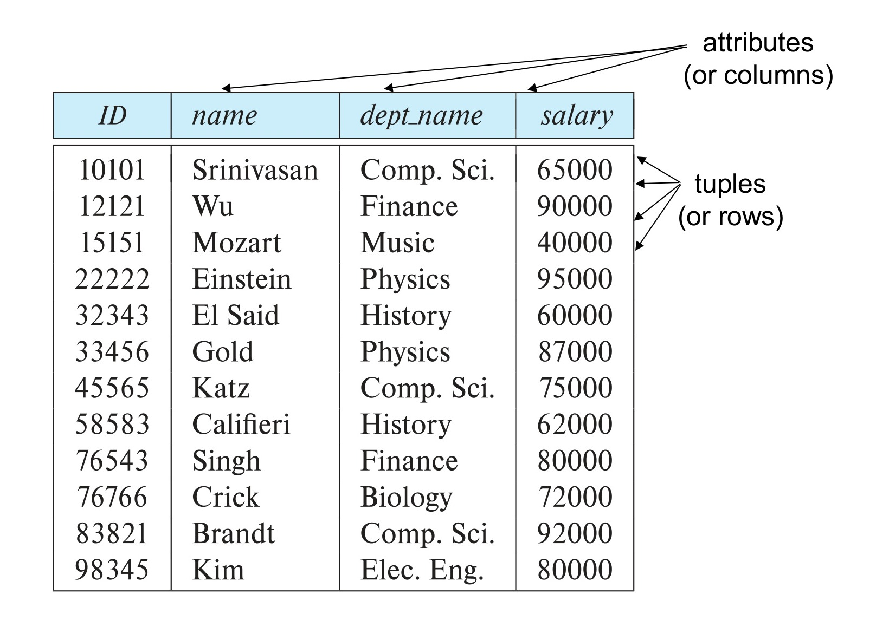
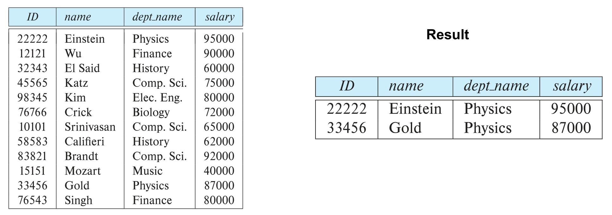
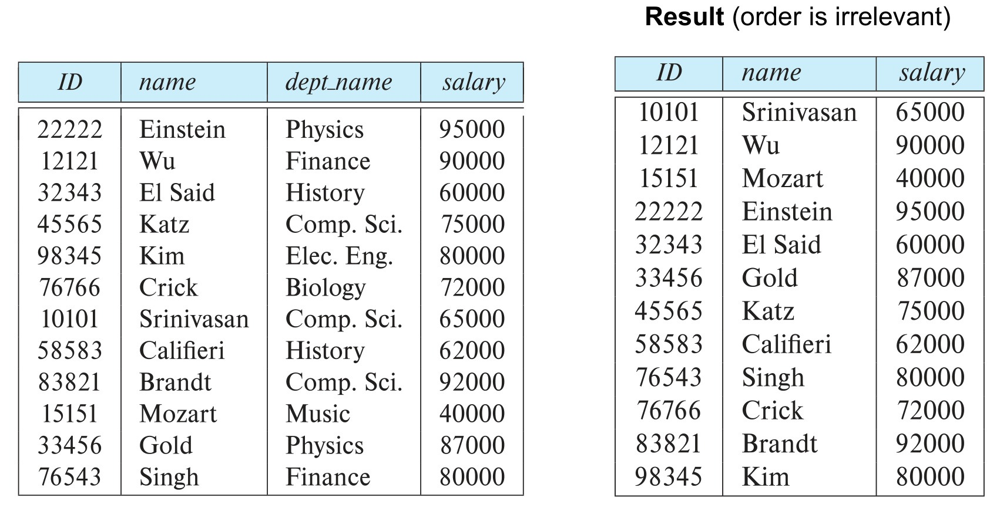
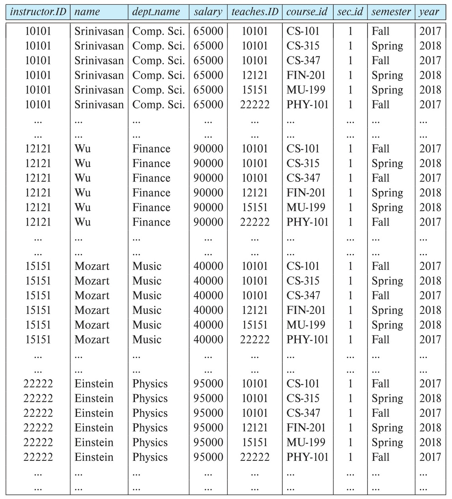
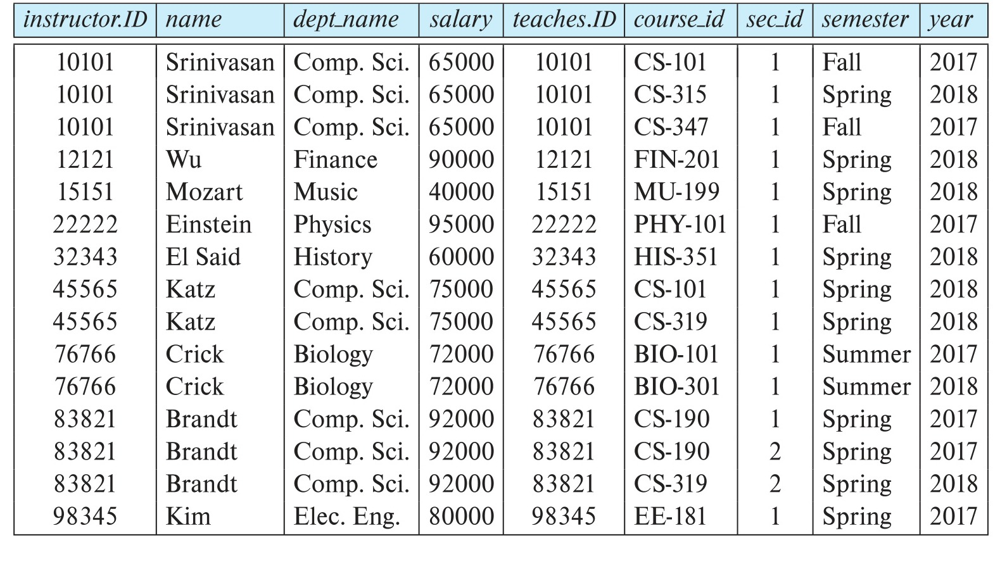
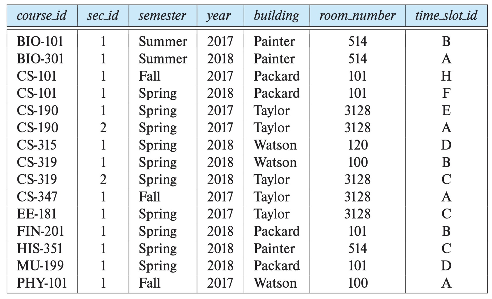
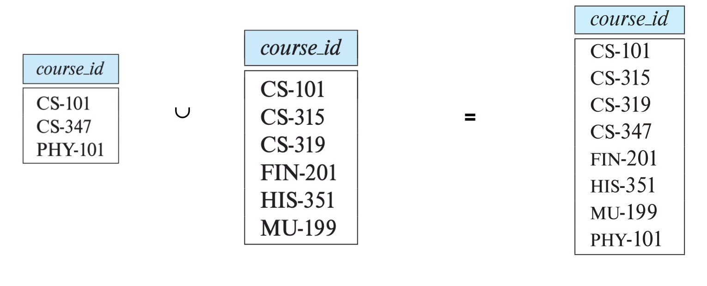

# ECE 2215: Database Systems — Relational Model

<!-- Slide 1 -->
## Chapter 2: Intro to Relational Model

**Database System Concepts, 7th Ed.**  
©Silberschatz, Korth and Sudarshan  
See [www.db-book.com](https://www.db-book.com) for conditions on re-use

---

<!-- Slide 2 -->
## Outline

- Structure of Relational Databases
- Database Schema
- Keys
- Schema Diagrams
- Relational Query Languages
- The Relational Algebra

---

<!-- Slide 3 -->
## Example of an *Instructor* Relation

*Figure 2.1 — Example of an Instructor Relation with Attributes and Tuples (Source: Slide 3)*

| ID | name | dept_name | salary |
| :--- | :--- | :--- | :--- |
| 10101 | Srinivasan | Comp. Sci. | 65000 |
| 12121 | Wu | Finance | 90000 |
| 15151 | Mozart | Music | 40000 |
| 22222 | Einstein | Physics | 95000 |
| 32343 | El Said | History | 60000 |
| 33456 | Gold | Physics | 87000 |
| 45565 | Katz | Comp. Sci. | 75000 |
| 58583 | Califieri | History | 62000 |
| 76543 | Singh | Finance | 80000 |
| 76766 | Crick | Biology | 72000 |
| 83821 | Brandt | Comp. Sci. | 92000 |
| 98345 | Kim | Elec. Eng. | 80000 |

---

<!-- Slide 4 -->
## Attributes

- The set of allowed values for each attribute is called the **domain** of the attribute
- Attribute values are (normally) required to be **atomic**; that is, indivisible
- The special value ***null*** is a member of every domain. Indicated that the value is “unknown”
- The null value causes complications in the definition of many operations

---

<!-- Slide 5 -->
## Relations are Unordered

- Order of tuples is irrelevant (tuples may be stored in an arbitrary order)
- Example: *instructor* relation with unordered tuples

| ID | name | dept_name | salary |
| :--- | :--- | :--- | :--- |
| 22222 | Einstein | Physics | 95000 |
| 12121 | Wu | Finance | 90000 |
| 32343 | El Said | History | 60000 |
| 45565 | Katz | Comp. Sci. | 75000 |
| 98345 | Kim | Elec. Eng. | 80000 |
| 76766 | Crick | Biology | 72000 |
| 10101 | Srinivasan | Comp. Sci. | 65000 |
| 58583 | Califieri | History | 62000 |
| 83821 | Brandt | Comp. Sci. | 92000 |
| 15151 | Mozart | Music | 40000 |
| 33456 | Gold | Physics | 87000 |
| 76543 | Singh | Finance | 80000 |

---

<!-- Slide 6 -->
## Database Schema

- **Database schema** -- is the logical structure of the database.
- **Database instance** -- is a snapshot of the data in the database at a given instant in time.
- Example:
  - schema: *instructor (ID, name, dept_name, salary)*
  - Instance:

| ID | name | dept_name | salary |
| :--- | :--- | :--- | :--- |
| 22222 | Einstein | Physics | 95000 |
| 12121 | Wu | Finance | 90000 |
| 32343 | El Said | History | 60000 |
| 45565 | Katz | Comp. Sci. | 75000 |
| 98345 | Kim | Elec. Eng. | 80000 |
| 76766 | Crick | Biology | 72000 |
| 10101 | Srinivasan | Comp. Sci. | 65000 |
| 58583 | Califieri | History | 62000 |
| 83821 | Brandt | Comp. Sci. | 92000 |
| 15151 | Mozart | Music | 40000 |
| 33456 | Gold | Physics | 87000 |
| 76543 | Singh | Finance | 80000 |

---

<!-- Slide 7 -->
## Keys

- Let $K \subseteq R$
- $K$ is a **superkey** of $R$ if values for $K$ are sufficient to identify a unique tuple of each possible relation $r(R)$
  - Example: $\{ID\}$ and $\{ID, name\}$ are both superkeys of *instructor*.
- Superkey $K$ is a **candidate key** if $K$ is minimal
  - Example: $\{ID\}$ is a candidate key for *Instructor*
- One of the candidate keys is selected to be the **primary key**.
  - Which one?
- **Foreign key** constraint: Value in one relation must appear in another
  - **Referencing** relation
  - **Referenced** relation
  - Example: *dept_name* in *instructor* is a foreign key from *instructor* referencing *department*

---

<!-- Slide 8 -->
## Schema Diagram for University Database

*Figure 2.2 — Schema Diagram for University Database (Source: Slide 8)*

### Relational Schemas:
- **`classroom`** ($\underline{\text{building}}, \underline{\text{room\_number}}, \text{capacity}$)
- **`department`** ($\underline{\text{dept\_name}}, \text{building}, \text{budget}$)
- **`course`** ($\underline{\text{course\_id}}, \text{title}, \text{dept\_name}, \text{credits}$)
  - $\text{dept\_name} \rightarrow \text{department}(\text{dept\_name})$
- **`instructor`** ($\underline{\text{ID}}, \text{name}, \text{dept\_name}, \text{salary}$)
  - $\text{dept\_name} \rightarrow \text{department}(\text{dept\_name})$
- **`section`** ($\underline{\text{course\_id}}, \underline{\text{sec\_id}}, \underline{\text{semester}}, \underline{\text{year}}, \text{building}, \text{room\_number}, \text{time\_slot\_id}$)
  - $\text{course\_id} \rightarrow \text{course}(\text{course\_id})$
  - $(\text{building}, \text{room\_number}) \rightarrow \text{classroom}(\text{building}, \text{room\_number})$
- **`teaches`** ($\underline{\text{ID}}, \underline{\text{course\_id}}, \underline{\text{sec\_id}}, \underline{\text{semester}}, \underline{\text{year}}$)
  - $\text{ID} \rightarrow \text{instructor}(\text{ID})$
  - $(\text{course\_id}, \text{sec\_id}, \text{semester}, \text{year}) \rightarrow \text{section}(\text{course\_id}, \text{sec\_id}, \text{semester}, \text{year})$
- **`student`** ($\underline{\text{ID}}, \text{name}, \text{dept\_name}, \text{tot\_cred}$)
  - $\text{dept\_name} \rightarrow \text{department}(\text{dept\_name})$
- **`takes`** ($\underline{\text{ID}}, \underline{\text{course\_id}}, \underline{\text{sec\_id}}, \underline{\text{semester}}, \underline{\text{year}}, \text{grade}$)
  - $\text{ID} \rightarrow \text{student}(\text{ID})$
  - $(\text{course\_id}, \text{sec\_id}, \text{semester}, \text{year}) \rightarrow \text{section}(\text{course\_id}, \text{sec\_id}, \text{semester}, \text{year})$
- **`advisor`** ($\underline{\text{s\_id}}, \text{i\_id}$)
  - $\text{s\_id} \rightarrow \text{student}(\text{ID})$
  - $\text{i\_id} \rightarrow \text{instructor}(\text{ID})$
- **`time\_slot`** ($\underline{\text{time\_slot\_id}}, \underline{\text{day}}, \underline{\text{start\_time}}, \text{end\_time}$)
  - $\text{section}(\text{time\_slot\_id}) \rightarrow \text{time\_slot}(\text{time\_slot\_id})$
- **`prereq`** ($\underline{\text{course\_id}}, \underline{\text{prereq\_id}}$)
  - $\text{course\_id} \rightarrow \text{course}(\text{course\_id})$
  - $\text{prereq\_id} \rightarrow \text{course}(\text{course\_id})$

---

<!-- Slide 9 -->
## Relational Query Languages

- Procedural versus non-procedural, or declarative
- “Pure” languages:
  - Relational algebra
  - Tuple relational calculus
  - Domain relational calculus
- The above 3 pure languages are equivalent in computing power
- We will concentrate in this chapter on relational algebra

---

<!-- Slide 10 -->
## Relational Algebra

- An algebraic language consisting of a set of operations that take one or two relations as input and produce a new relation as their result.
- Six basic operators
  - select: $\sigma$
  - project: $\Pi$
  - union: $\cup$
  - set difference: $-$
  - Cartesian product: $\text{x}$
  - rename: $\rho$

---

<!-- Slide 11 -->
## Select Operation

- The **select** operation selects tuples that satisfy a given predicate.
- Notation: $\sigma_p(r)$
- $p$ is called the **selection predicate**
- Example: select those tuples of the *instructor* relation where the instructor is in the “Physics” department.
  - Query:
    $$\sigma_{dept\_name = \text{"Physics"}}(instructor)$$

*Figure 2.3 — Selection Operation Example on the Instructor Relation (Source: Slide 11)*

#### instructor
| ID | name | dept_name | salary |
| :--- | :--- | :--- | :--- |
| 22222 | Einstein | Physics | 95000 |
| 12121 | Wu | Finance | 90000 |
| 32343 | El Said | History | 60000 |
| 45565 | Katz | Comp. Sci. | 75000 |
| 98345 | Kim | Elec. Eng. | 80000 |
| 76766 | Crick | Biology | 72000 |
| 10101 | Srinivasan | Comp. Sci. | 65000 |
| 58583 | Califieri | History | 62000 |
| 83821 | Brandt | Comp. Sci. | 92000 |
| 15151 | Mozart | Music | 40000 |
| 33456 | Gold | Physics | 87000 |
| 76543 | Singh | Finance | 80000 |

#### Result
| ID | name | dept_name | salary |
| :--- | :--- | :--- | :--- |
| 22222 | Einstein | Physics | 95000 |
| 33456 | Gold | Physics | 87000 |

---

<!-- Slide 12 -->
## Select Operation (Cont.)

- We allow comparisons using
  $$=, \neq, >, \ge, <, \le$$
  in the selection predicate.
- We can combine several predicates into a larger predicate by using the connectives:
  $$\wedge \textbf{ (and)}, \vee \textbf{ (or)}, \neg \textbf{ (not)}$$
- Example: Find the instructors in Physics with a salary greater \$90,000, we write:
  $$\sigma_{dept\_name = \text{"Physics"} \wedge salary > 90{,}000}(instructor)$$
- The select predicate may include comparisons between two attributes.
  - Example, find all departments whose name is the same as their building name:
  - $\sigma_{dept\_name = building}(department)$

---

<!-- Slide 13 -->
## Project Operation Example

- Example: eliminate the *dept_name* attribute of *instructor*
- Query:
  $$\Pi_{ID, name, salary}(instructor)$$

*Figure 2.4 — Projection Operation Example Eliminating dept_name (Source: Slide 13)*

#### instructor
| ID | name | dept_name | salary |
| :--- | :--- | :--- | :--- |
| 22222 | Einstein | Physics | 95000 |
| 12121 | Wu | Finance | 90000 |
| 32343 | El Said | History | 60000 |
| 45565 | Katz | Comp. Sci. | 75000 |
| 98345 | Kim | Elec. Eng. | 80000 |
| 76766 | Crick | Biology | 72000 |
| 10101 | Srinivasan | Comp. Sci. | 65000 |
| 58583 | Califieri | History | 62000 |
| 83821 | Brandt | Comp. Sci. | 92000 |
| 15151 | Mozart | Music | 40000 |
| 33456 | Gold | Physics | 87000 |
| 76543 | Singh | Finance | 80000 |

#### Result (order is irrelevant)
| ID | name | salary |
| :--- | :--- | :--- |
| 10101 | Srinivasan | 65000 |
| 12121 | Wu | 90000 |
| 15151 | Mozart | 40000 |
| 22222 | Einstein | 95000 |
| 32343 | El Said | 60000 |
| 33456 | Gold | 87000 |
| 45565 | Katz | 75000 |
| 58583 | Califieri | 62000 |
| 76543 | Singh | 80000 |
| 76766 | Crick | 72000 |
| 83821 | Brandt | 92000 |
| 98345 | Kim | 80000 |

---

<!-- Slide 14 -->
## Project Operation

- A unary operation that returns its argument relation, with certain attributes left out.
- Notation:
  $$\Pi_{A_1, A_2, A_3 \dots A_k}(r)$$
  where $A_1, A_2, \dots, A_k$ are attribute names and $r$ is a relation name.
- The result is defined as the relation of $k$ columns obtained by erasing the columns that are not listed
- **Duplicate rows removed from result**, since relations are sets

---

<!-- Slide 15 -->
## Composition of Relational Operations

- The result of a relational-algebra operation is relation and therefore of relational-algebra operations can be composed together into a **relational-algebra expression**.
- Consider the query -- Find the names of all instructors in the Physics department.
  $$\Pi_{name}(\sigma_{dept\_name = \text{"Physics"}}(instructor))$$
- Instead of giving the name of a relation as the argument of the projection operation, we give an expression that evaluates to a relation.

---

<!-- Slide 16 -->
## Cartesian-Product Operation

- The Cartesian-product operation (denoted by X) allows us to combine information from any two relations.
- Example: the Cartesian product of the relations *instructor* and *teaches* is written as:
  $$instructor \text{ X } teaches$$
- We construct a tuple of the result out of each possible pair of tuples: one from the *instructor* relation and one from the *teaches* relation (see next slide)
- Since the instructor *ID* appears in both relations we distinguish between these attribute by attaching to the attribute the name of the relation from which the attribute originally came.
  - *instructor.ID*
  - *teaches.ID*

---

<!-- Slide 17 -->
## The *instructor* X *teaches* table

*Figure 2.5 — The Cartesian Product Table instructor X teaches (Source: Slide 17)*

| instructor.ID | name | dept_name | salary | teaches.ID | course_id | sec_id | semester | year |
| :--- | :--- | :--- | :--- | :--- | :--- | :--- | :--- | :--- |
| 10101 | Srinivasan | Comp. Sci. | 65000 | 10101 | CS-101 | 1 | Fall | 2017 |
| 10101 | Srinivasan | Comp. Sci. | 65000 | 10101 | CS-315 | 1 | Spring | 2018 |
| 10101 | Srinivasan | Comp. Sci. | 65000 | 10101 | CS-347 | 1 | Fall | 2017 |
| 10101 | Srinivasan | Comp. Sci. | 65000 | 12121 | FIN-201 | 1 | Spring | 2018 |
| 10101 | Srinivasan | Comp. Sci. | 65000 | 15151 | MU-199 | 1 | Spring | 2018 |
| 10101 | Srinivasan | Comp. Sci. | 65000 | 22222 | PHY-101 | 1 | Fall | 2017 |
| $\dots$ | $\dots$ | $\dots$ | $\dots$ | $\dots$ | $\dots$ | $\dots$ | $\dots$ | $\dots$ |
| $\dots$ | $\dots$ | $\dots$ | $\dots$ | $\dots$ | $\dots$ | $\dots$ | $\dots$ | $\dots$ |
| 12121 | Wu | Finance | 90000 | 10101 | CS-101 | 1 | Fall | 2017 |
| 12121 | Wu | Finance | 90000 | 10101 | CS-315 | 1 | Spring | 2018 |
| 12121 | Wu | Finance | 90000 | 10101 | CS-347 | 1 | Fall | 2017 |
| 12121 | Wu | Finance | 90000 | 12121 | FIN-201 | 1 | Spring | 2018 |
| 12121 | Wu | Finance | 90000 | 15151 | MU-199 | 1 | Spring | 2018 |
| 12121 | Wu | Finance | 90000 | 22222 | PHY-101 | 1 | Fall | 2017 |
| $\dots$ | $\dots$ | $\dots$ | $\dots$ | $\dots$ | $\dots$ | $\dots$ | $\dots$ | $\dots$ |
| $\dots$ | $\dots$ | $\dots$ | $\dots$ | $\dots$ | $\dots$ | $\dots$ | $\dots$ | $\dots$ |
| 15151 | Mozart | Music | 40000 | 10101 | CS-101 | 1 | Fall | 2017 |
| 15151 | Mozart | Music | 40000 | 10101 | CS-315 | 1 | Spring | 2018 |
| 15151 | Mozart | Music | 40000 | 10101 | CS-347 | 1 | Fall | 2017 |
| 15151 | Mozart | Music | 40000 | 12121 | FIN-201 | 1 | Spring | 2018 |
| 15151 | Mozart | Music | 40000 | 15151 | MU-199 | 1 | Spring | 2018 |
| 15151 | Mozart | Music | 40000 | 22222 | PHY-101 | 1 | Fall | 2017 |
| $\dots$ | $\dots$ | $\dots$ | $\dots$ | $\dots$ | $\dots$ | $\dots$ | $\dots$ | $\dots$ |
| $\dots$ | $\dots$ | $\dots$ | $\dots$ | $\dots$ | $\dots$ | $\dots$ | $\dots$ | $\dots$ |
| 22222 | Einstein | Physics | 95000 | 10101 | CS-101 | 1 | Fall | 2017 |
| 22222 | Einstein | Physics | 95000 | 10101 | CS-315 | 1 | Spring | 2018 |
| 22222 | Einstein | Physics | 95000 | 10101 | CS-347 | 1 | Fall | 2017 |
| 22222 | Einstein | Physics | 95000 | 12121 | FIN-201 | 1 | Spring | 2018 |
| 22222 | Einstein | Physics | 95000 | 15151 | MU-199 | 1 | Spring | 2018 |
| 22222 | Einstein | Physics | 95000 | 22222 | PHY-101 | 1 | Fall | 2017 |
| $\dots$ | $\dots$ | $\dots$ | $\dots$ | $\dots$ | $\dots$ | $\dots$ | $\dots$ | $\dots$ |
| $\dots$ | $\dots$ | $\dots$ | $\dots$ | $\dots$ | $\dots$ | $\dots$ | $\dots$ | $\dots$ |

---

<!-- Slide 18 -->
## Join Operation (Cont.)

- The table corresponding to:
  $$\sigma_{instructor.id = teaches.id}(instructor \times teaches))$$

*Figure 2.6 — Selection on Cartesian Product (Theta-Join Table) (Source: Slide 18)*

| instructor.ID | name | dept_name | salary | teaches.ID | course_id | sec_id | semester | year |
| :--- | :--- | :--- | :--- | :--- | :--- | :--- | :--- | :--- |
| 10101 | Srinivasan | Comp. Sci. | 65000 | 10101 | CS-101 | 1 | Fall | 2017 |
| 10101 | Srinivasan | Comp. Sci. | 65000 | 10101 | CS-315 | 1 | Spring | 2018 |
| 10101 | Srinivasan | Comp. Sci. | 65000 | 10101 | CS-347 | 1 | Fall | 2017 |
| 12121 | Wu | Finance | 90000 | 12121 | FIN-201 | 1 | Spring | 2018 |
| 15151 | Mozart | Music | 40000 | 15151 | MU-199 | 1 | Spring | 2018 |
| 22222 | Einstein | Physics | 95000 | 22222 | PHY-101 | 1 | Fall | 2017 |
| 32343 | El Said | History | 60000 | 32343 | HIS-351 | 1 | Spring | 2018 |
| 45565 | Katz | Comp. Sci. | 75000 | 45565 | CS-101 | 1 | Spring | 2018 |
| 45565 | Katz | Comp. Sci. | 75000 | 45565 | CS-319 | 1 | Spring | 2018 |
| 76766 | Crick | Biology | 72000 | 76766 | BIO-101 | 1 | Summer | 2017 |
| 76766 | Crick | Biology | 72000 | 76766 | BIO-301 | 1 | Summer | 2018 |
| 83821 | Brandt | Comp. Sci. | 92000 | 83821 | CS-190 | 1 | Spring | 2017 |
| 83821 | Brandt | Comp. Sci. | 92000 | 83821 | CS-190 | 2 | Spring | 2017 |
| 83821 | Brandt | Comp. Sci. | 92000 | 83821 | CS-319 | 2 | Spring | 2018 |
| 98345 | Kim | Elec. Eng. | 80000 | 98345 | EE-181 | 1 | Spring | 2017 |

---

<!-- Slide 19 -->
## Join Operation (Cont.)

- The **join** operation allows us to combine a select operation and a Cartesian-Product operation into a single operation.
- Consider relations $r(R)$ and $s(S)$
- Let “theta” be a predicate on attributes in the schema $R$ “union” $S$. The join operation $r \bowtie_\theta s$ is defined as follows:
  $$r \bowtie_\theta s = \sigma_\theta(r \times s)$$
- Thus
  $$\sigma_{instructor.id = teaches.id}(instructor \times teaches))$$
- Can equivalently be written as
  $$instructor \bowtie_{instructor.id = teaches.id} teaches.$$

---

<!-- Slide 20 -->
## Union Operation

- The union operation allows us to combine two relations
- Notation: $r \cup s$
- For $r \cup s$ to be valid.
  1. $r, s$ must have the *same* **arity** (same number of attributes)
  2. The attribute domains must be **compatible** (example: $2^{\text{nd}}$ column of $r$ deals with the same type of values as does the $2^{\text{nd}}$ column of $s$)
- Example: to find all courses taught in the Fall 2017 semester, or in the Spring 2018 semester, or in both
  $$\Pi_{course\_id}(\sigma_{semester = \text{"Fall"} \wedge year = 2017}(section)) \cup \Pi_{course\_id}(\sigma_{semester = \text{"Spring"} \wedge year = 2018}(section))$$

---

<!-- Slide 21 -->
## section table

*Figure 2.7 — The section Relation (Source: Slide 21)*

| course_id | sec_id | semester | year | building | room_number | time_slot_id |
| :--- | :--- | :--- | :--- | :--- | :--- | :--- |
| BIO-101 | 1 | Summer | 2017 | Painter | 514 | B |
| BIO-301 | 1 | Summer | 2018 | Painter | 514 | A |
| CS-101 | 1 | Fall | 2017 | Packard | 101 | H |
| CS-101 | 1 | Spring | 2018 | Packard | 101 | F |
| CS-190 | 1 | Spring | 2017 | Taylor | 3128 | E |
| CS-190 | 2 | Spring | 2017 | Taylor | 3128 | A |
| CS-315 | 1 | Spring | 2018 | Watson | 120 | D |
| CS-319 | 1 | Spring | 2018 | Watson | 100 | B |
| CS-319 | 2 | Spring | 2018 | Taylor | 3128 | C |
| CS-347 | 1 | Fall | 2017 | Taylor | 3128 | A |
| EE-181 | 1 | Spring | 2017 | Taylor | 3128 | C |
| FIN-201 | 1 | Spring | 2018 | Packard | 101 | B |
| HIS-351 | 1 | Spring | 2018 | Painter | 514 | C |
| MU-199 | 1 | Spring | 2018 | Packard | 101 | D |
| PHY-101 | 1 | Fall | 2017 | Watson | 100 | A |

---

<!-- Slide 22 -->
## Union Operation (Cont.)

- Result of:
  $$\Pi_{course\_id}(\sigma_{semester = \text{"Fall"} \wedge year = 2017}(section)) \cup \Pi_{course\_id}(\sigma_{semester = \text{"Spring"} \wedge year = 2018}(section))$$

*Figure 2.8 — Relational Union Operation Visual Equation (Source: Slide 22)*

#### $\Pi_{course\_id}(\sigma_{semester = \text{"Fall"} \wedge year = 2017}(section))$
| course_id |
| :--- |
| CS-101 |
| CS-347 |
| PHY-101 |

$$\cup$$

#### $\Pi_{course\_id}(\sigma_{semester = \text{"Spring"} \wedge year = 2018}(section))$
| course_id |
| :--- |
| CS-101 |
| CS-315 |
| CS-319 |
| FIN-201 |
| HIS-351 |
| MU-199 |

$$=$$

#### Result Relation
| course_id |
| :--- |
| CS-101 |
| CS-315 |
| CS-319 |
| CS-347 |
| FIN-201 |
| HIS-351 |
| MU-199 |
| PHY-101 |

---

<!-- Slide 23 -->
## Set-Intersection Operation

- The **set-intersection** operation allows us to find tuples that are in both the input relations.
- Notation: $r \cap s$
- Assume:
  - $r, s$ have the *same arity*
  - attributes of $r$ and $s$ are compatible
- Example: Find the set of all courses taught in both the Fall 2017 and the Spring 2018 semesters.
  $$\Pi_{course\_id}(\sigma_{semester = \text{"Fall"} \wedge year = 2017}(section)) \cap \Pi_{course\_id}(\sigma_{semester = \text{"Spring"} \wedge year = 2018}(section))$$
- Result

| course_id |
| :--- |
| CS-101 |

---

<!-- Slide 24 -->
## Set Difference Operation

- The set-difference operation allows us to find tuples that are in one relation but are not in another.
- Notation: $r - s$
- Set differences must be taken between **compatible** relations.
  - $r$ and $s$ must have the *same* arity
  - Attribute domains of $r$ and $s$ must be compatible
- Example: to find all courses taught in the Fall 2017 semester, but not in the Spring 2018 semester
  $$\Pi_{course\_id}(\sigma_{semester = \text{"Fall"} \wedge year = 2017}(section)) - \Pi_{course\_id}(\sigma_{semester = \text{"Spring"} \wedge year = 2018}(section))$$

| course_id |
| :--- |
| CS-347 |
| PHY-101 |

---

<!-- Slide 25 -->
## The Assignment Operation

- It is convenient at times to write a relational-algebra expression by assigning parts of it to temporary relation variables.
- The assignment operation is denoted by $\leftarrow$ and works like assignment in a programming language.
- Example: Find all instructor in the “Physics” and Music department.
  $$Physics \leftarrow \sigma_{dept\_name = \text{"Physics"}}(instructor)$$
  $$Music \leftarrow \sigma_{dept\_name = \text{"Music"}}(instructor)$$
  $$Physics \cup Music$$
- With the assignment operation, a query can be written as a sequential program consisting of a series of assignments followed by an expression whose value is displayed as the result of the query.

---

<!-- Slide 26 -->
## The Rename Operation

- The results of relational-algebra expressions do not have a name that we can use to refer to them. The rename operator, $\rho$, is provided for that purpose
- The expression:
  $$\rho_x(E)$$
  returns the result of expression $E$ under the name $x$
- Another form of the rename operation:
  $$\rho_{x(A_1, A_2, \dots A_n)}(E)$$

---

<!-- Slide 27 -->
## Aggregate Functions

- These functions operate on the multiset (set with duplicates) of values of a column of a relation, and return a value

  **avg**: average value

  **min**: minimum value

  **max**: maximum value

  **sum**: sum of values

  **count**: number of values

---

<!-- Slide 28 -->
## Aggregate Functions Examples

- Find the average salary of instructors
  - $\gamma_{avg(salary)}(instructor)$
- Find the total number of courses in 2018
  - $\gamma_{count(course\_id)}(\sigma_{year = 2018}(section))$

---

<!-- Slide 29 -->
## Aggregate Functions – Group By

- Find the average salary of instructors in each department
  - $_{dept\_name}\gamma_{avg(salary)}(instructor)$

*Figure 2.9 — Aggregate Function with Group By Operation (Source: Slide 29)*

#### instructor
| ID | name | dept_name | salary |
| :--- | :--- | :--- | :--- |
| 76766 | Crick | Biology | 72000 |
| 45565 | Katz | Comp. Sci. | 75000 |
| 10101 | Srinivasan | Comp. Sci. | 65000 |
| 83821 | Brandt | Comp. Sci. | 92000 |
| 98345 | Kim | Elec. Eng. | 80000 |
| 12121 | Wu | Finance | 90000 |
| 76543 | Singh | Finance | 80000 |
| 32343 | El Said | History | 60000 |
| 58583 | Califieri | History | 62000 |
| 15151 | Mozart | Music | 40000 |
| 33456 | Gold | Physics | 87000 |
| 22222 | Einstein | Physics | 95000 |

#### dept_name / avg_salary
| dept_name | avg_salary |
| :--- | :--- |
| Biology | 72000 |
| Comp. Sci. | 77333 |
| Elec. Eng. | 80000 |
| Finance | 85000 |
| History | 61000 |
| Music | 40000 |
| Physics | 91000 |

---

<!-- Slide 30 -->
## Equivalent Queries

- There is more than one way to write a query in relational algebra.
- Example: Find information about courses taught by instructors in the Physics department with salary greater than 90,000
- Query 1
  $$\sigma_{dept\_name = \text{"Physics"} \wedge salary > 90{,}000}(instructor)$$
- Query 2
  $$\sigma_{dept\_name = \text{"Physics"}}(\sigma_{salary > 90{,}000}(instructor))$$
- The two queries are not identical; they are, however, equivalent -- they give the same result on any database.

---

<!-- Slide 31 -->
## Equivalent Queries

- There is more than one way to write a query in relational algebra.
- Example: Find information about courses taught by instructors in the Physics department
- Query 1
  $$\sigma_{dept\_name = \text{"Physics"}}(instructor \bowtie_{instructor.ID = teaches.ID} teaches)$$
- Query 2
  $$(\sigma_{dept\_name = \text{"Physics"}}(instructor)) \bowtie_{instructor.ID = teaches.ID} teaches$$
- The two queries are not identical; they are, however, equivalent -- they give the same result on any database.

---

<!-- Slide 32 -->
## Pitfalls in relational database design

- Data Redundancy and Operational Anomalies
  - Insertion Anomaly
  - Deletion Anomaly
  - Update Anomaly
- Poor Normalization Choices
  - Under-Normalization (Data Redundancy)
  - Over-Normalization
- Misusing or Ignoring Indexes
  - Missing Essential Indexes
  - Over-Indexing
- Weak Referential Integrity
  - Skipping Foreign Keys
  - Using God Tables

---

<!-- Slide 33 -->
## Pitfalls in relational database design

- Poor Primary Key Selection
  - Using Volatile Natural Keys
  - Using Inappropriate Data Types
- Lacking Data Constraints
  - Allowing Too Many NULLs
  - Ignoring CHECK Constraints
- Designing for the Present, Not the Future
  - Hardcoded Column Enums
  - Ignoring Scalability

---

<!-- Slide 34 -->
## Thank You
