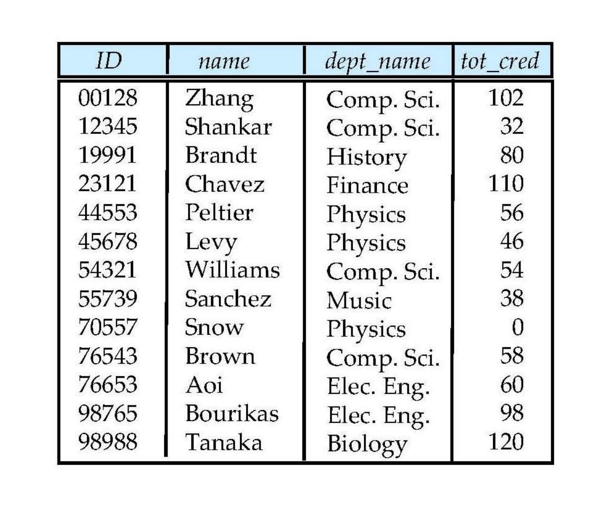
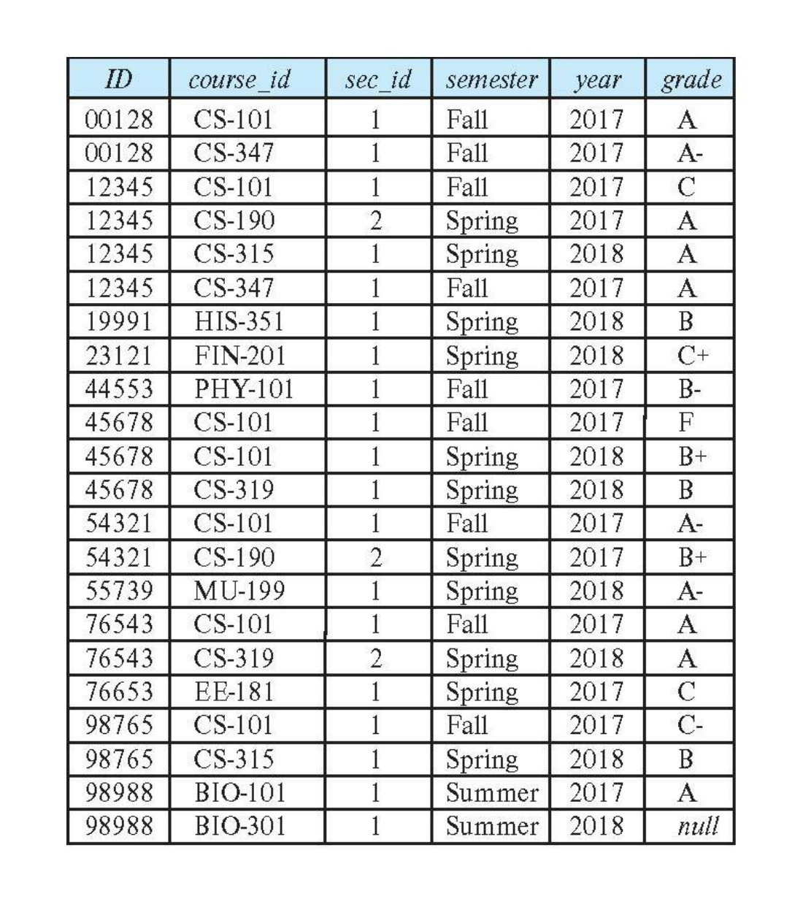
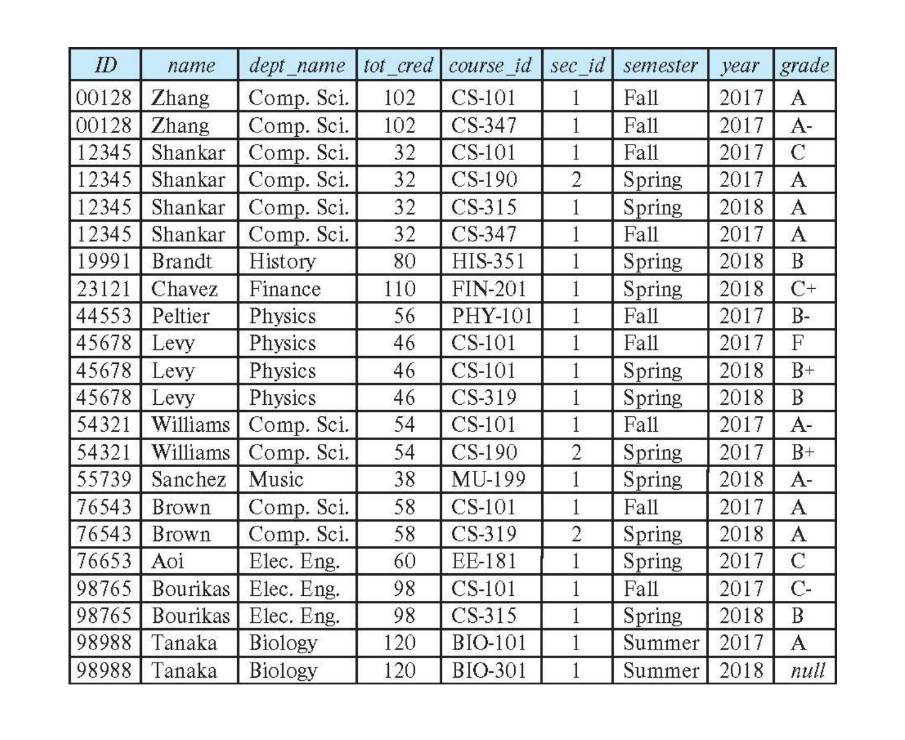
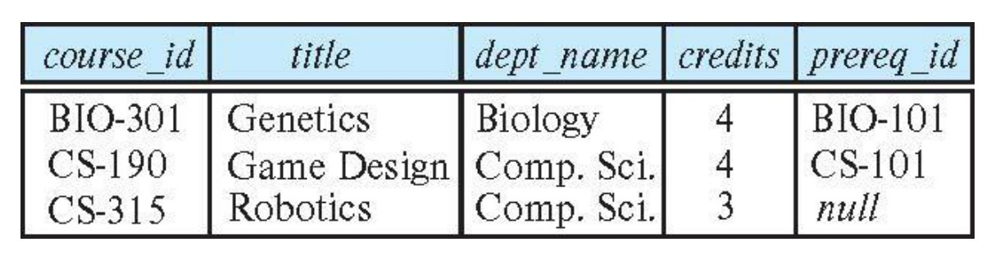
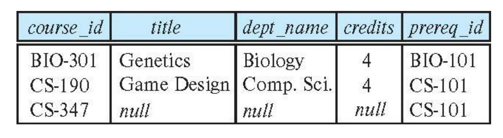
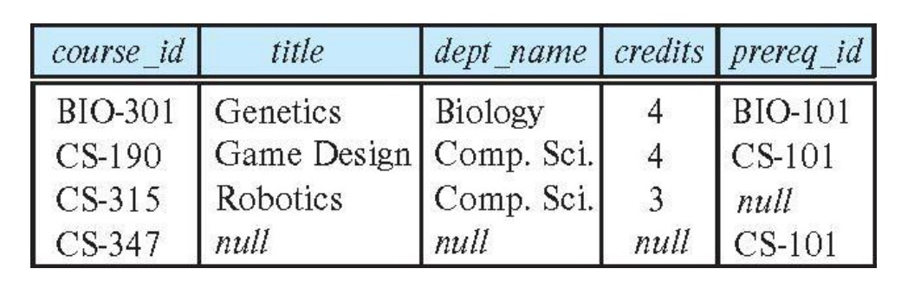
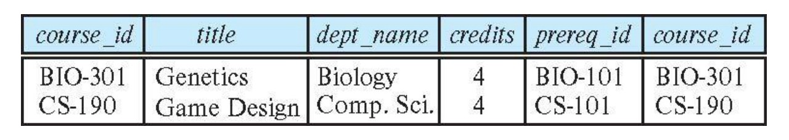
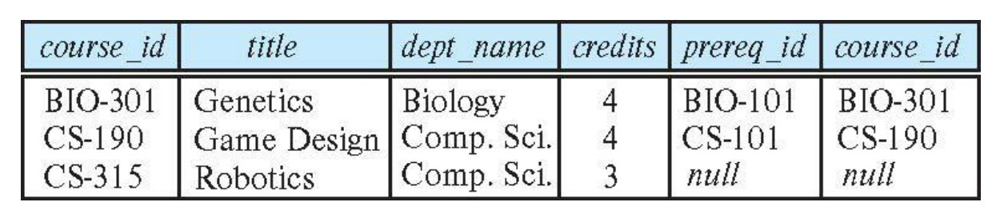
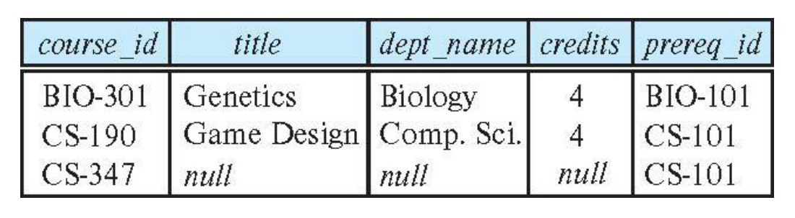
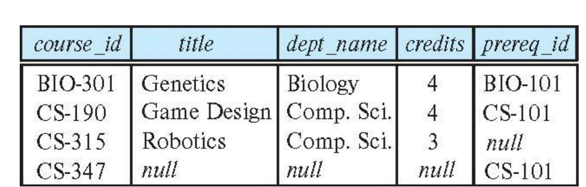

# Chapter 4: Intermediate SQL — Joining & Views

<!-- Slide 1 -->
## Chapter 4 : Intermediate SQL

Database System Concepts, 7th Ed.  
©Silberschatz, Korth and Sudarshan  
See www.db-book.com for conditions on re-use  

---

<!-- Slide 2 -->
## Outline

- Join Expressions
- Views

---

<!-- Slide 3 -->
## Joined Relations

- **Join operations** take two relations and return as a result another relation.
- A join operation is a Cartesian product which requires that tuples in the two relations match (under some condition). It also specifies the attributes that are present in the result of the join
- The join operations are typically used as subquery expressions in the **from** clause
- Three types of joins:
  - Inner join
  - Outer join
  - Natural join

---

<!-- Slide 4 -->
## Joined Types and Conditions

- **Join operations** take two relations and return as a result another relation.
- These additional operations are typically used as subquery expressions in the **from** clause
- **Join condition** – defines which tuples in the two relations match.
- **Join type** – defines how tuples in each relation that do not match any tuple in the other relation (based on the join condition) are treated.


*Figure 4.1 — Join Types and Join Conditions (Source: Slide 4)*

| Join types |
| :--- |
| inner join |
| left outer join |
| right outer join |
| full outer join |

| Join conditions |
| :--- |
| natural |
| on $\text{<predicate>}$ |
| using $(A_1, A_2, \dots, A_n)$ |

---

<!-- Slide 5 -->
## Outer Join

- An extension of the join operation that avoids loss of information.
- Computes the join and then adds tuples form one relation that does not match tuples in the other relation to the result of the join.
- Uses *null* values.
- Three forms of outer join:
  - left outer join
  - right outer join
  - full outer join

---

<!-- Slide 6 -->
## Left Outer Join

- LEFT JOIN is used to retrieve all rows from the left table and matching rows from the right table. It helps in:
  - Returning all records from the left table.
  - Showing matching data from the right table.
  - Displaying NULL values where no match exists in the right table.
  - Performing outer joins, also known as LEFT OUTER JOIN.

Syntax:

```sql
SELECT * FROM table1 
LEFT JOIN table2
ON table1.matching_column = table2.matching_column;
```

---

<!-- Slide 7 -->
## Left Outer Join Examples

- Display the names of all students along with their department names. If a student does not belong to any department, the student should still appear in the result.
- In relational algebra: $Student \mathbin{⟕} Department$

Query:

```sql
SELECT Student_Name, Department_Name
FROM Student
LEFT JOIN Department
ON Student.Dept_ID = Department.Dept_ID;
```

| Student_Name | Department_Name |
| :--- | :--- |
| Alice | CSE |
| Bob | EEE |
| Carol | CSE |
| David | BBA |
| Emma | NULL |

---

<!-- Slide 8 -->
## Right Outer Join

RIGHT JOIN is used to retrieve all rows from the right table and the matching rows from the left table. It helps in:

- Returning all records from the right-side table.
- Showing matching data from the left-side table.
- Displaying NULL values where no match exists in the left table.
- Performing outer joins, also known as RIGHT OUTER JOIN.

Syntax:

```sql
SELECT * FROM table1 
RIGHT JOIN table2
ON table1.matching_column = table2.matching_column;
```

---

<!-- Slide 9 -->
## Right Outer Join Examples

- Display the names of all departments along with the names of students enrolled in them. Departments without any students should also appear in the result.
- In relational algebra: $Student \mathbin{⟖} Department$

Query:

```sql
SELECT Student_Name, Department_Name
FROM Student RIGHT JOIN Department
ON Student.Dept_ID = Department.Dept_ID;
```

| Student_Name | Department_Name |
| :--- | :--- |
| Alice | CSE |
| Carol | CSE |
| Bob | EEE |
| David | BBA |
| NULL | Civil |

---

<!-- Slide 10 -->
## Full Outer Join

FULL JOIN is used to combine the results of both LEFT JOIN and RIGHT JOIN. It helps in:

- Returning all rows from both tables.
- Showing matching records from each table.
- Displaying NULL values where no match exists in either table.
- Providing complete data from both sides of the join.

Syntax:

```sql
SELECT * FROM table1 
FULL JOIN table2
ON table1.matching_column = table2.matching_column;
```

---

<!-- Slide 11 -->
## Full Outer Join Examples

- Display the names of all students and all departments. Include students who do not belong to any department and departments that have no students.
- In relational algebra: $Student \mathbin{⟗} Department$

Query:

```sql
SELECT Student_Name, Department_Name
FROM Student
FULL OUTER JOIN Department
ON Student.Dept_ID = Department.Dept_ID;
```

| Student_Name | Department_Name |
| :--- | :--- |
| Alice | CSE |
| Bob | EEE |
| Carol | CSE |
| David | BBA |
| Emma | NULL |
| NULL | Civil |

---

<!-- Slide 12 -->
## Cross Outer Join

CROSS JOIN is used to combine the results of both table with each other.

- Returning all rows from both tables.
- Showing all records from each table.
- Row count becomes multiplication of both tables.
- Providing complete data from both tables.

Syntax:

```sql
SELECT * FROM table1 
CROSS JOIN table2
```

---

<!-- Slide 13 -->
## Cross Join Examples

- Display every possible combination of students and departments.
- In relational algebra: $Student \times Department$

Query:

```sql
SELECT Student_Name, Department_Name
FROM Student
CROSS JOIN Department;
```

| Student_Name | Department_Name |
| :--- | :--- |
| Alice | CSE |
| Alice | EEE |
| Alice | BBA |
| Alice | Civil |
| Bob | CSE |
| Bob | EEE |
| ... | ... |

---

<!-- Slide 14 -->
## Natural Join in SQL

- Natural join matches tuples with the same values for all common attributes, and retains only one copy of each common column.
- List the names of instructors along with the course ID of the courses that they taught
  - 
    ```sql
    select name, course_id
    from students, takes
    where student.ID = takes.ID;
    ```
- Same query in SQL with “natural join” construct
  - 
    ```sql
    select name, course_id
    from student natural join takes;
    ```

---

<!-- Slide 15 -->
## Natural Join in SQL (Cont.)

- The **from** clause can have multiple relations combined using natural join:

```sql
select A1, A2, … An
from r1 natural join r2 natural join .. natural join rn
where  P ;
```

---

<!-- Slide 16 -->
## Student Relation


*Figure 4.2 — The Student Relation (Source: Slide 16)*

| ID | name | dept_name | tot_cred |
| :--- | :--- | :--- | :--- |
| 00128 | Zhang | Comp. Sci. | 102 |
| 12345 | Shankar | Comp. Sci. | 32 |
| 19991 | Brandt | History | 80 |
| 23121 | Chavez | Finance | 110 |
| 44553 | Peltier | Physics | 56 |
| 45678 | Levy | Physics | 46 |
| 54321 | Williams | Comp. Sci. | 54 |
| 55739 | Sanchez | Music | 38 |
| 70557 | Snow | Physics | 0 |
| 76543 | Brown | Comp. Sci. | 58 |
| 76653 | Aoi | Elec. Eng. | 60 |
| 98765 | Bourikas | Elec. Eng. | 98 |
| 98988 | Tanaka | Biology | 120 |

---

<!-- Slide 17 -->
## Takes Relation


*Figure 4.3 — The Takes Relation (Source: Slide 17)*

| ID | course_id | sec_id | semester | year | grade |
| :--- | :--- | :--- | :--- | :--- | :--- |
| 00128 | CS-101 | 1 | Fall | 2017 | A |
| 00128 | CS-347 | 1 | Fall | 2017 | A- |
| 12345 | CS-101 | 1 | Fall | 2017 | C |
| 12345 | CS-190 | 2 | Spring | 2017 | A |
| 12345 | CS-315 | 1 | Spring | 2018 | A |
| 12345 | CS-347 | 1 | Fall | 2017 | A |
| 19991 | HIS-351 | 1 | Spring | 2018 | B |
| 23121 | FIN-201 | 1 | Spring | 2018 | C+ |
| 44553 | PHY-101 | 1 | Fall | 2017 | B- |
| 45678 | CS-101 | 1 | Fall | 2017 | F |
| 45678 | CS-101 | 1 | Spring | 2018 | B+ |
| 45678 | CS-319 | 1 | Spring | 2018 | B |
| 54321 | CS-101 | 1 | Fall | 2017 | A- |
| 54321 | CS-190 | 2 | Spring | 2017 | B+ |
| 55739 | MU-199 | 1 | Spring | 2018 | A- |
| 76543 | CS-101 | 1 | Fall | 2017 | A |
| 76543 | CS-319 | 2 | Spring | 2018 | A |
| 76653 | EE-181 | 1 | Spring | 2017 | C |
| 98765 | CS-101 | 1 | Fall | 2017 | C- |
| 98765 | CS-315 | 1 | Spring | 2018 | B |
| 98988 | BIO-101 | 1 | Summer | 2017 | A |
| 98988 | BIO-301 | 1 | Summer | 2018 | null |

---

<!-- Slide 18 -->
## student natural join takes


*Figure 4.4 — student natural join takes (Source: Slide 18)*

| ID | name | dept_name | tot_cred | course_id | sec_id | semester | year | grade |
| :--- | :--- | :--- | :--- | :--- | :--- | :--- | :--- | :--- |
| 00128 | Zhang | Comp. Sci. | 102 | CS-101 | 1 | Fall | 2017 | A |
| 00128 | Zhang | Comp. Sci. | 102 | CS-347 | 1 | Fall | 2017 | A- |
| 12345 | Shankar | Comp. Sci. | 32 | CS-101 | 1 | Fall | 2017 | C |
| 12345 | Shankar | Comp. Sci. | 32 | CS-190 | 2 | Spring | 2017 | A |
| 12345 | Shankar | Comp. Sci. | 32 | CS-315 | 1 | Spring | 2018 | A |
| 12345 | Shankar | Comp. Sci. | 32 | CS-347 | 1 | Fall | 2017 | A |
| 19991 | Brandt | History | 80 | HIS-351 | 1 | Spring | 2018 | B |
| 23121 | Chavez | Finance | 110 | FIN-201 | 1 | Spring | 2018 | C+ |
| 44553 | Peltier | Physics | 56 | PHY-101 | 1 | Fall | 2017 | B- |
| 45678 | Levy | Physics | 46 | CS-101 | 1 | Fall | 2017 | F |
| 45678 | Levy | Physics | 46 | CS-101 | 1 | Spring | 2018 | B+ |
| 45678 | Levy | Physics | 46 | CS-319 | 1 | Spring | 2018 | B |
| 54321 | Williams | Comp. Sci. | 54 | CS-101 | 1 | Fall | 2017 | A- |
| 54321 | Williams | Comp. Sci. | 54 | CS-190 | 2 | Spring | 2017 | B+ |
| 55739 | Sanchez | Music | 38 | MU-199 | 1 | Spring | 2018 | A- |
| 76543 | Brown | Comp. Sci. | 58 | CS-101 | 1 | Fall | 2017 | A |
| 76543 | Brown | Comp. Sci. | 58 | CS-319 | 2 | Spring | 2018 | A |
| 76653 | Aoi | Elec. Eng. | 60 | EE-181 | 1 | Spring | 2017 | C |
| 98765 | Bourikas | Elec. Eng. | 98 | CS-101 | 1 | Fall | 2017 | C- |
| 98765 | Bourikas | Elec. Eng. | 98 | CS-315 | 1 | Spring | 2018 | B |
| 98988 | Tanaka | Biology | 120 | BIO-101 | 1 | Summer | 2017 | A |
| 98988 | Tanaka | Biology | 120 | BIO-301 | 1 | Summer | 2018 | null |

---

<!-- Slide 19 -->
## Dangerous in Natural Join

- Beware of unrelated attributes with same name which get equated incorrectly
- Example -- List the names of students instructors along with the titles of courses that they have taken
  - Correct version
    ```sql
    select name, title
    from student natural join takes, course
    where takes.course_id = course.course_id;
    ```
  - Incorrect version
    ```sql
    select name, title
    from student natural join takes natural join course;
    ```
- This query omits all (student name, course title) pairs where the student takes a course in a department other than the student's own department. 
- The  correct  version (above), correctly outputs such pairs.

---

<!-- Slide 20 -->
## Left Outer Join

- `course natural left outer join prereq`


*Figure 4.5 — course natural left outer join prereq (Source: Slide 20)*

| course_id | title | dept_name | credits | prereq_id |
| :--- | :--- | :--- | :--- | :--- |
| BIO-301 | Genetics | Biology | 4 | BIO-101 |
| CS-190 | Game Design | Comp. Sci. | 4 | CS-101 |
| CS-315 | Robotics | Comp. Sci. | 3 | null |

- In relational algebra:   $course \mathbin{⟕} prereq$

---

<!-- Slide 21 -->
## Joined Relations – Examples

- `course natural right outer join prereq`


*Figure 4.6 — course natural right outer join prereq (Source: Slide 21)*

| course_id | title | dept_name | credits | prereq_id |
| :--- | :--- | :--- | :--- | :--- |
| BIO-301 | Genetics | Biology | 4 | BIO-101 |
| CS-190 | Game Design | Comp. Sci. | 4 | CS-101 |
| CS-347 | null | null | null | CS-101 |

- `course full outer join prereq using (course_id)`


*Figure 4.7 — course full outer join prereq using (course_id) (Source: Slide 21)*

| course_id | title | dept_name | credits | prereq_id |
| :--- | :--- | :--- | :--- | :--- |
| BIO-301 | Genetics | Biology | 4 | BIO-101 |
| CS-190 | Game Design | Comp. Sci. | 4 | CS-101 |
| CS-315 | Robotics | Comp. Sci. | 3 | null |
| CS-347 | null | null | null | CS-101 |

---

<!-- Slide 22 -->
## Joined Relations – Examples

- `course inner join prereq on course.course_id = prereq.course_id`


*Figure 4.8 — course inner join prereq on course.course_id = prereq.course_id (Source: Slide 22)*

| course_id | title | dept_name | credits | prereq_id | course_id |
| :--- | :--- | :--- | :--- | :--- | :--- |
| BIO-301 | Genetics | Biology | 4 | BIO-101 | BIO-301 |
| CS-190 | Game Design | Comp. Sci. | 4 | CS-101 | CS-190 |

- What is the difference between the above, and a natural join? 
- `course left outer join prereq on course.course_id = prereq.course_id`


*Figure 4.9 — course left outer join prereq on course.course_id = prereq.course_id (Source: Slide 22)*

| course_id | title | dept_name | credits | prereq_id | course_id |
| :--- | :--- | :--- | :--- | :--- | :--- |
| BIO-301 | Genetics | Biology | 4 | BIO-101 | BIO-301 |
| CS-190 | Game Design | Comp. Sci. | 4 | CS-101 | CS-190 |
| CS-315 | Robotics | Comp. Sci. | 3 | null | null |

---

<!-- Slide 23 -->
## Joined Relations – Examples

- `course natural right outer join prereq`


*Figure 4.10 — course natural right outer join prereq (Source: Slide 23)*

| course_id | title | dept_name | credits | prereq_id |
| :--- | :--- | :--- | :--- | :--- |
| BIO-301 | Genetics | Biology | 4 | BIO-101 |
| CS-190 | Game Design | Comp. Sci. | 4 | CS-101 |
| CS-347 | null | null | null | CS-101 |

- `course full outer join prereq using (course_id)`


*Figure 4.11 — course full outer join prereq using (course_id) (Source: Slide 23)*

| course_id | title | dept_name | credits | prereq_id |
| :--- | :--- | :--- | :--- | :--- |
| BIO-301 | Genetics | Biology | 4 | BIO-101 |
| CS-190 | Game Design | Comp. Sci. | 4 | CS-101 |
| CS-315 | Robotics | Comp. Sci. | 3 | null |
| CS-347 | null | null | null | CS-101 |

---

<!-- Slide 24 -->
## Views

- In some cases, it is not desirable for all users to see the entire logical model (that is, all the actual relations stored in the database.)
- Consider a person who needs to know an instructor's name and department, but not the salary. This person should see a relation described, in SQL, by 

```sql
select ID, name, dept_name
from instructor
```

- A view provides a mechanism to hide certain data from the view of certain users. 
- Any relation that is not of the conceptual model but is made visible to a user as a “virtual relation” is called a view.

---

<!-- Slide 25 -->
## View Definition

- A view is defined using the create view statement which has the form

```sql
create view v as < query expression >
```

  where `<query expression>` is any legal SQL expression. The view name is represented by $v$.
- Once a view is defined, the view name can be used to refer to the virtual relation that the view generates.
- View definition is not the same as creating a new relation by evaluating the query expression  
  - Rather, a view definition causes the saving of an expression; the expression is substituted into queries using the view.

---

<!-- Slide 26 -->
## View Definition and Use

- A view of instructors without their salary

```sql
create view faculty as
select ID, name, dept_name
from instructor
```

- Find all instructors in the Biology department

```sql
select name
from faculty
where dept_name = 'Biology'
```

- Create a view of department salary totals

```sql
create view departments_total_salary(dept_name, total_salary) as
select dept_name, sum (salary)
from instructor
group by dept_name;
```

---

<!-- Slide 27 -->
## Views Defined Using Other Views

- One view may be used in the expression defining another view 
- A view relation $v_1$ is said to **depend directly** on a view relation $v_2$ if $v_2$ is used in the expression defining $v_1$
- A view relation $v_1$ is said to **depend on** view relation $v_2$ if either $v_1$ depends directly to $v_2$ or there is a path of dependencies from $v_1$ to $v_2$ 
- A view relation $v$ is said to be **recursive** if it depends on itself.

---

<!-- Slide 28 -->
## Views Defined Using Other Views

- 
  ```sql
  create view physics_fall_2017 as
     select course.course_id, sec_id, building, room_number
     from course, section
     where course.course_id = section.course_id
                and course.dept_name = 'Physics'
                and section.semester = 'Fall'
                and section.year = '2017';
  ```

- 
  ```sql
  create view physics_fall_2017_watson as
      select course_id, room_number
      from physics_fall_2017
      where building= 'Watson';
  ```

---

<!-- Slide 29 -->
## View Expansion

- Expand  the view :

```sql
create view physics_fall_2017_watson as
select course_id, room_number
from physics_fall_2017
where building= 'Watson'
```

- To:

```sql
create view physics_fall_2017_watson as
    select course_id, room_number
    from (select course.course_id, building, room_number
          from course, section
          where course.course_id = section.course_id
               and course.dept_name = 'Physics'
               and section.semester = 'Fall'
               and section.year = '2017')
     where building= 'Watson';
```

---

<!-- Slide 30 -->
## Materialized Views

- Certain database systems allow view relations to be physically stored.
  - Physical copy created when the view is defined.
  - Such views are called **Materialized view**:
- If relations used in the query are updated, the materialized view result becomes out of date
  - Need to maintain the view, by updating the view whenever the underlying relations are updated.

---

<!-- Slide 31 -->
## Update of a View

- Add a new tuple to *faculty* view which we defined earlier
 
```sql
insert into faculty 
                       values ('30765', 'Green', 'Music');
```

- This insertion must be represented by the insertion into  the *instructor* relation
  - Must have a  value for salary.
- Two approaches
  - Reject the insert
  - Insert the tuple
 
    ```sql
    ('30765', 'Green', 'Music', null)
    ```
 
    into the *instructor* relation

---

<!-- Slide 32 -->
## Some Updates Cannot be Translated Uniquely

- 
  ```sql
  create view instructor_info as
        select ID, name, building
         from instructor, department
         where instructor.dept_name = department.dept_name;
  ```

- 
  ```sql
  insert into instructor_info 
               values ('69987', 'White', 'Taylor');
  ```

- Issues
  - Which department, if multiple departments in Taylor?
  - What if no department is in Taylor?

---

<!-- Slide 33 -->
## And Some Not at All

- 
  ```sql
  create view history_instructors as
     select *
     from instructor
     where dept_name= 'History';
  ```

- What happens if we insert 

  ```sql
  ('25566', 'Brown', 'Biology', 100000)
  ```

  into *history_instructors*?

---

<!-- Slide 34 -->
## View Updates in SQL

- Most SQL implementations allow updates only on simple views 
  - The **from** clause has only one database relation.
  - The **select** clause contains only attribute names of the relation, and does not have any expressions, aggregates, or **distinct** specification.
  - Any attribute not listed in the **select** clause can be set to null
  - The query does not have a **group by** or **having** clause.

---

<!-- Slide 35 -->
## Thank You
