# ECE 2215: Database Systems — Database Design Using the E-R Model

<!-- Slide 1 -->
## Chapter 6: Database Design Using the E-R Model

**Database System Concepts, 7th Ed.**  
©Silberschatz, Korth and Sudarshan  
See [www.db-book.com](https://www.db-book.com) for conditions on re-use

---

<!-- Slide 2 -->
## Design Phases

- Initial phase -- characterize fully the data needs of the prospective database users.
- Second phase -- choosing a data model
  - Applying the concepts of the chosen data model
  - Translating these requirements into a conceptual schema of the database.
  - A fully developed conceptual schema indicates the functional requirements of the enterprise.
    - Describe the kinds of operations (or transactions) that will be performed on the data.

---

<!-- Slide 3 -->
## Design Phases (Cont.)

- Final Phase -- Moving from an abstract data model to the implementation of the database
  - **Logical Design** – Deciding on the database schema.
    - Database design requires that we find a “good” collection of relation schemas.
    - **Business decision** – What attributes should we record in the database?
    - **Computer Science decision** – What relation schemas should we have and how should the attributes be distributed among the various relation schemas?
  - **Physical Design** – Deciding on the physical layout of the database

---

<!-- Slide 4 -->
## Design Alternatives

- In designing a database schema, we must ensure that we avoid two major pitfalls:
  - **Redundancy**: a bad design may result in repeat information.
    - Redundant representation of information may lead to data inconsistency among the various copies of information
  - **Incompleteness**: a bad design may make certain aspects of the enterprise difficult or impossible to model.
- Avoiding bad designs is not enough. There may be a large number of good designs from which we must choose.

---

<!-- Slide 5 -->
## Design Approaches

- **Entity Relationship Model** (covered in this chapter)
  - Models an enterprise as a collection of entities and relationships
    - **Entity**: a “thing” or “object” in the enterprise that is distinguishable from other objects
      - Described by a set of attributes
    - **Relationship**: an association among several entities
  - Represented diagrammatically by an entity-relationship diagram:
- **Normalization Theory** (Chapter 7)
  - Formalize what designs are bad, and test for them

---

<!-- Slide 6 -->
## Outline of the ER Model

---

<!-- Slide 7 -->
## Entity Sets

- An **entity** is an object that exists and is distinguishable from other objects.
  - Example: specific person, company, event, plant
- An **entity set** is a set of entities of the same type that share the same properties.
  - Example: set of all persons, companies, trees, holidays
- An entity is represented by a set of **attributes**; i.e., descriptive properties possessed by all members of an entity set.
  - Example:
    - $\text{instructor} = (\text{ID}, \text{name}, \text{salary})$
    - $\text{course} = (\text{course\_id}, \text{title}, \text{credits})$
- A subset of the attributes form a **primary key** of the entity set; i.e., uniquely identifying each member of the set.

---

<!-- Slide 8 -->
## Representing Entity sets in ER Diagram

- Entity sets can be represented graphically as follows:
  - Rectangles represent entity sets.
  - Attributes listed inside entity rectangle
  - Underline indicates primary key attributes

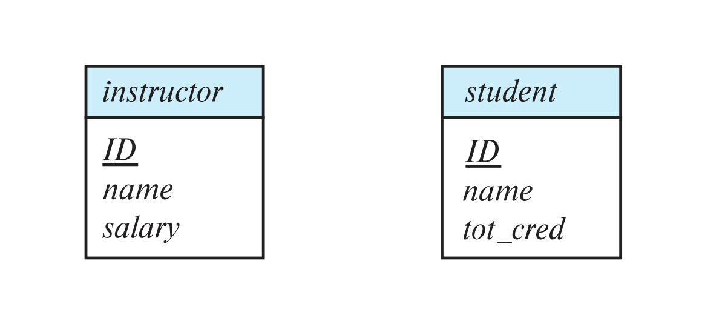
*Figure 5.1 — Representing Entity Sets in ER Diagram Notation (Source: Slide 8)*

---

<!-- Slide 9 -->
## Relationship Sets

- A **relationship** is an association among several entities

  Example:
  $$\begin{matrix} \text{44553 (Peltier)} & \text{advisor} & \text{22222 (Einstein)} \\ \text{student entity} & \text{relationship set} & \text{instructor entity} \end{matrix}$$

- A **relationship set** is a mathematical relation among $n \ge 2$ entities, each taken from entity sets
  $$\{(e_1, e_2, \dots, e_n) \mid e_1 \in E_1, e_2 \in E_2, \dots, e_n \in E_n\}$$
  where $(e_1, e_2, \dots, e_n)$ is a relationship
  - Example:
    $$(44553, 22222) \in \text{advisor}$$

---

<!-- Slide 10 -->
## Relationship Sets (Cont.)

- Example: we define the relationship set **advisor** to denote the associations between students and the instructors who act as their advisors.
- Pictorially, we draw a line between related entities.

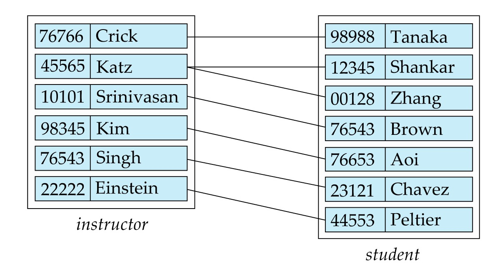
*Figure 5.2 — Relationship Set advisor Illustrated Pictorially (Source: Slide 10)*

---

<!-- Slide 11 -->
## Representing Relationship Sets via ER Diagrams

- Diamonds represent relationship sets.

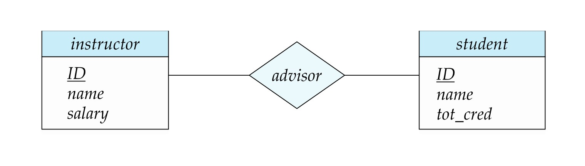
*Figure 5.3 — Representing Relationship Sets via ER Diagrams (Source: Slide 11)*

---

<!-- Slide 12 -->
## Relationship Sets (Cont.)

- An attribute can also be associated with a relationship set.
- For instance, the **advisor** relationship set between entity sets **instructor** and **student** may have the attribute **date** which tracks when the student started being associated with the advisor

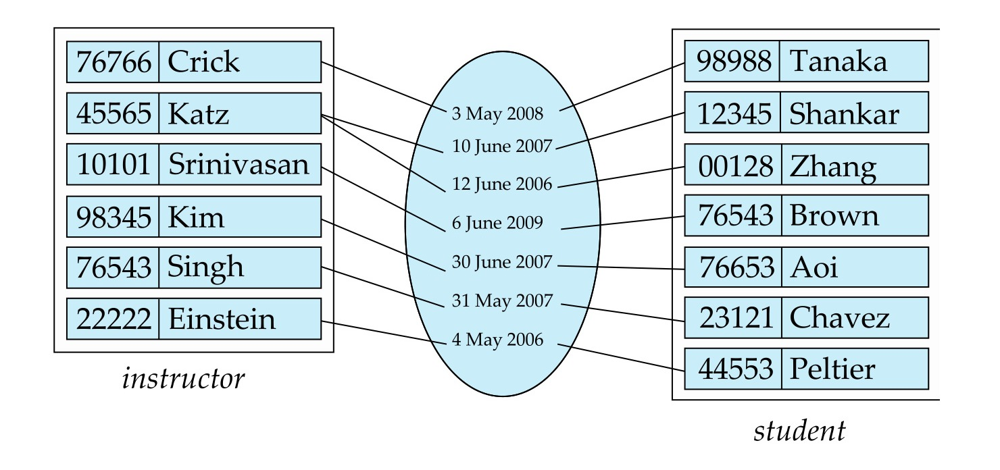
*Figure 5.4 — Relationship Set advisor with Descriptive Attribute date (Source: Slide 12)*

---

<!-- Slide 13 -->
## Relationship Sets with Attributes

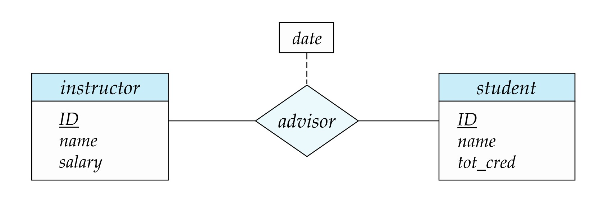
*Figure 5.5 — ER Diagram with Relationship Attribute date (Source: Slide 13)*

---

<!-- Slide 14 -->
## Roles

- Entity sets of a relationship need not be distinct
  - Each occurrence of an entity set plays a “role” in the relationship
- The labels “course_id” and “prereq_id” are called **roles**.

*Figure 5.6 — Roles in a Recursive Relationship (Source: Slide 14)*

---

<!-- Slide 15 -->
## Degree of a Relationship Set

- **Binary relationship**
  - Involves two entity sets (or degree two).
  - Most relationship sets in a database system are binary.
- Relationships between more than two entity sets are rare. Most relationships are binary.
  - Example: students work on research projects under the guidance of an instructor.
  - The relationship **proj_guide** is a ternary relationship between **instructor**, **student**, and **project**

---

<!-- Slide 16 -->
## Non-binary Relationship Sets

- Most relationship sets are binary
- There are occasions when it is more convenient to represent relationships as non-binary.
- E-R Diagram with a Ternary Relationship

*Figure 5.7 — Ternary Relationship proj_guide (Source: Slide 16)*

---

<!-- Slide 17 -->
## Complex Attributes

- Attribute types:
  - Simple and composite attributes.
  - Single-valued and multivalued attributes
    - Example: multivalued attribute: `phone_numbers`
  - Derived attributes
    - Can be computed from other attributes
    - Example: `age`, given `date_of_birth`
- **Domain** – the set of permitted values for each attribute

---

<!-- Slide 18 -->
## Composite Attributes

- Composite attributes allow us to divided attributes into subparts (other attributes).

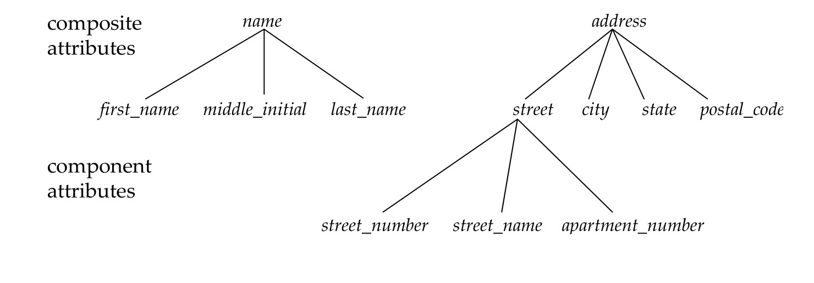
*Figure 5.8 — Composite Attributes Hierarchy for name and address (Source: Slide 18)*

---

<!-- Slide 19 -->
## Representing Complex Attributes in ER Diagram

*Figure 5.9 — Representing Complex Attributes in ER Diagram (Source: Slide 19)*

---

<!-- Slide 20 -->
## Mapping Cardinality Constraints

- Express the number of entities to which another entity can be associated via a relationship set.
- Most useful in describing binary relationship sets.
- For a binary relationship set the mapping cardinality must be one of the following types:
  - One to one
  - One to many
  - Many to one
  - Many to many

---

<!-- Slide 21 -->
## Mapping Cardinalities

- One to one
- One to many

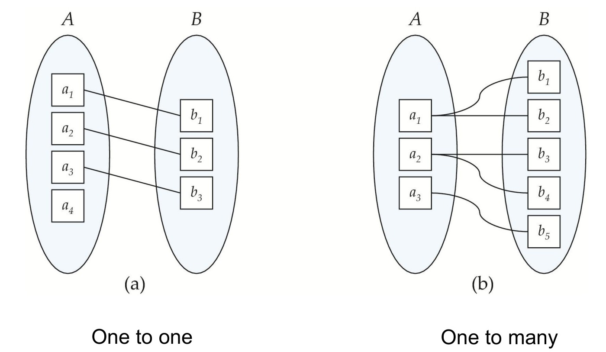
*Figure 5.10 — Mapping Cardinalities: One-to-One and One-to-Many (Source: Slide 21)*

> **Note**: Some elements in A and B may not be mapped to any elements in the other set

---

<!-- Slide 22 -->
## Mapping Cardinalities

- Many to one
- Many to many

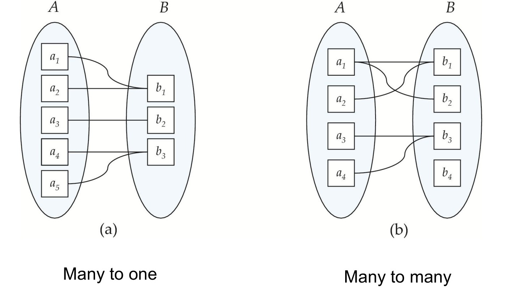
*Figure 5.11 — Mapping Cardinalities: Many-to-One and Many-to-Many (Source: Slide 22)*

> **Note**: Some elements in A and B may not be mapped to any elements in the other set

---

<!-- Slide 23 -->
## Representing Cardinality Constraints in ER Diagram

- We express cardinality constraints by drawing either a directed line ($\rightarrow$), signifying “one,” or an undirected line (—), signifying “many,” between the relationship set and the entity set.
- One-to-one relationship between an instructor and a student :
  - A student is associated with at most one instructor via the relationship advisor
  - A student is associated with at most one department via stud_dept

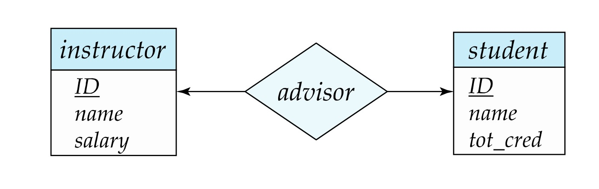
*Figure 5.12 — One-to-One Cardinality Constraint in ER Diagram (Source: Slide 23)*

---

<!-- Slide 24 -->
## One-to-Many Relationship

- one-to-many relationship between an instructor and a student
  - an instructor is associated with several (including 0) students via advisor
  - a student is associated with at most one instructor via advisor,

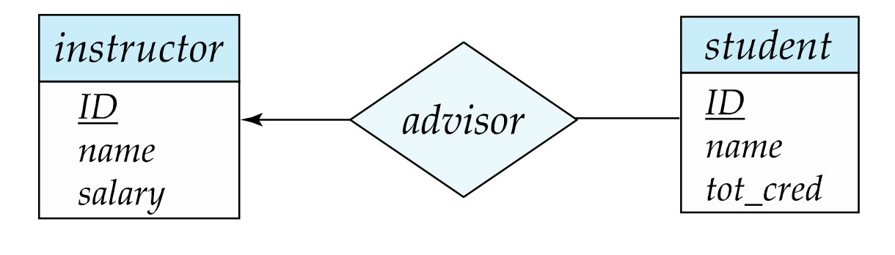
*Figure 5.13 — One-to-Many Relationship between instructor and student (Source: Slide 24)*

---

<!-- Slide 25 -->
## Many-to-One Relationships

- In a many-to-one relationship between an instructor and a student,
  - an instructor is associated with at most one student via advisor,
  - and a student is associated with several (including 0) instructors via advisor

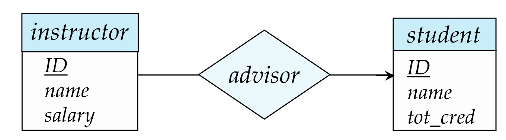
*Figure 5.14 — Many-to-One Relationship between instructor and student (Source: Slide 25)*

---

<!-- Slide 26 -->
## Many-to-Many Relationship

- An instructor is associated with several (possibly 0) students via advisor
- A student is associated with several (possibly 0) instructors via advisor

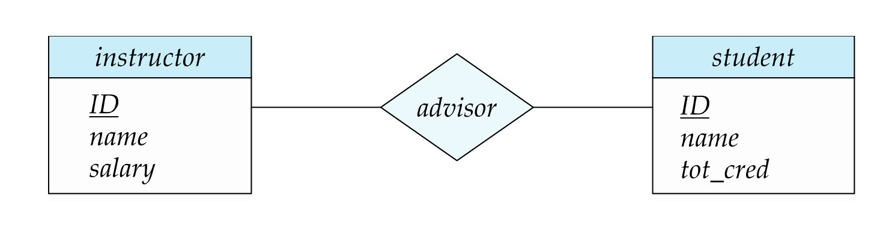
*Figure 5.15 — Many-to-Many Relationship between instructor and student (Source: Slide 26)*

---

<!-- Slide 27 -->
## Total and Partial Participation

- **Total participation** (indicated by double line): every entity in the entity set participates in at least one relationship in the relationship set
  - participation of **student** in **advisor** relation is total
    - every student must have an associated instructor
- **Partial participation**: some entities may not participate in any relationship in the relationship set
  - Example: participation of **instructor** in **advisor** is partial

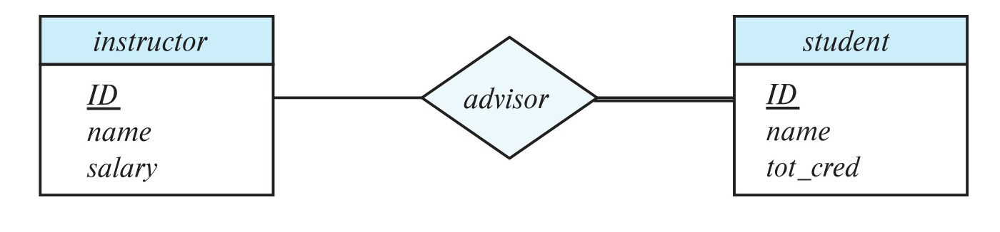
*Figure 5.16 — Total and Partial Participation in ER Diagram (Source: Slide 27)*

---

<!-- Slide 28 -->
## Notation for Expressing More Complex Constraints

- A line may have an associated minimum and maximum cardinality, shown in the form $l..h$, where $l$ is the minimum and $h$ the maximum cardinality
  - A minimum value of 1 indicates total participation.
  - A maximum value of 1 indicates that the entity participates in at most one relationship
  - A maximum value of $*$ indicates no limit.
- Example
  - Instructor can advise 0 or more students. A student must have 1 advisor; cannot have multiple advisors

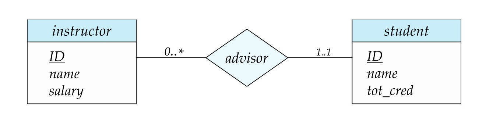
*Figure 5.17 — Complex Cardinality Constraints Notation (0..\* and 1..1) (Source: Slide 28)*

---

<!-- Slide 29 -->
## Cardinality Constraints on Ternary Relationship

- We allow at most one arrow out of a ternary (or greater degree) relationship to indicate a cardinality constraint
- For example, an arrow from **proj_guide** to **instructor** indicates each student has at most one guide for a project
- If there is more than one arrow, there are two ways of defining the meaning.
  - For example, a ternary relationship $R$ between $A$, $B$ and $C$ with arrows to $B$ and $C$ could mean
    1. Each $A$ entity is associated with a unique entity from $B$ and $C$ or
    2. Each pair of entities from $(A, B)$ is associated with a unique $C$ entity, and each pair $(A, C)$ is associated with a unique $B$
  - Each alternative has been used in different formalisms
  - To avoid confusion, we outlaw more than one arrow

---

<!-- Slide 30 -->
## Primary Key

- Primary keys provide a way to specify how entities and relations are distinguished. We will consider:
  - Entity sets
  - Relationship sets.
  - Weak entity sets

---

<!-- Slide 31 -->
## Primary key for Entity Sets

- By definition, individual entities are distinct.
- From database perspective, the differences among them must be expressed in terms of their attributes.
- The values of the attribute values of an entity must be such that they can uniquely identify the entity.
  - No two entities in an entity set are allowed to have exactly the same value for all attributes.
- A key for an entity is a set of attributes that suffice to distinguish entities from each other

---

<!-- Slide 32 -->
## Primary Key for Relationship Sets

- To distinguish among the various relationships of a relationship set we use the individual primary keys of the entities in the relationship set.
  - Let $R$ be a relationship set involving entity sets $E_1, E_2, \dots, E_n$
  - The primary key for $R$ is consists of the union of the primary keys of entity sets $E_1, E_2, \dots, E_n$
  - If the relationship set $R$ has attributes $a_1, a_2, \dots, a_m$ associated with it, then the primary key of $R$ also includes the attributes $a_1, a_2, \dots, a_m$
- Example: relationship set “advisor”.
  - The primary key consists of `instructor.ID` and `student.ID`
- The choice of the primary key for a relationship set depends on the mapping cardinality of the relationship set.

---

<!-- Slide 33 -->
## Choice of Primary key for Binary Relationship

- **Many-to-Many relationships.** The preceding union of the primary keys is a minimal superkey and is chosen as the primary key.
- **One-to-Many relationships.** The primary key of the “Many” side is a minimal superkey and is used as the primary key.
- **Many-to-one relationships.** The primary key of the “Many” side is a minimal superkey and is used as the primary key.
- **One-to-one relationships.** The primary key of either one of the participating entity sets forms a minimal superkey, and either one can be chosen as the primary key.

---

<!-- Slide 34 -->
## Weak Entity Sets

- Consider a section entity, which is uniquely identified by a `course_id`, `semester`, `year`, and `sec_id`.
- Clearly, section entities are related to course entities. Suppose we create a relationship set **sec_course** between entity sets **section** and **course**.
- Note that the information in **sec_course** is redundant, since **section** already has an attribute `course_id`, which identifies the course with which the section is related.
- One option to deal with this redundancy is to get rid of the relationship **sec_course**; however, by doing so the relationship between section and course becomes implicit in an attribute, which is not desirable.

---

<!-- Slide 35 -->
## Weak Entity Sets (Cont.)

- An alternative way to deal with this redundancy is to not store the attribute `course_id` in the section entity and to only store the remaining attributes `section_id`, `year`, and `semester`.
  - However, the entity set section then does not have enough attributes to identify a particular section entity uniquely
- To deal with this problem, we treat the relationship **sec_course** as a special relationship that provides extra information, in this case, the `course_id`, required to identify section entities uniquely.
- A **weak entity set** is one whose existence is dependent on another entity, called its **identifying entity**
- Instead of associating a primary key with a weak entity, we use the identifying entity, along with extra attributes called **discriminator** to uniquely identify a weak entity.

---

<!-- Slide 36 -->
## Weak Entity Sets (Cont.)

- An entity set that is not a weak entity set is termed a **strong entity set**.
- Every weak entity must be associated with an identifying entity; that is, the weak entity set is said to be **existence dependent** on the identifying entity set.
- The identifying entity set is said to **own** the weak entity set that it identifies.
- The relationship associating the weak entity set with the identifying entity set is called the **identifying relationship**.
- Note that the relational schema we eventually create from the entity set **section** does have the attribute `course_id`, for reasons that will become clear later, even though we have dropped the attribute `course_id` from the entity set section.

---

<!-- Slide 37 -->
## Expressing Weak Entity Sets

- In E-R diagrams, a weak entity set is depicted via a **double rectangle**.
- We underline the discriminator of a weak entity set with a **dashed line**.
- The relationship set connecting the weak entity set to the identifying strong entity set is depicted by a **double diamond**.
- Primary key for **section** – (`course_id`, `sec_id`, `semester`, `year`)

*Figure 5.18 — Expressing Weak Entity Sets (Source: Slide 37)*

---

<!-- Slide 38 -->
## Redundant Attributes

- Suppose we have entity sets:
  - **student**, with attributes: `ID`, `name`, `tot_cred`, `dept_name`
  - **department**, with attributes: `dept_name`, `building`, `budget`
- We model the fact that each student has an associated department using a relationship set **stud_dept**
- The attribute `dept_name` in student below replicates information present in the relationship and is therefore **redundant**
  - and needs to be removed.
- **BUT**: when converting back to tables, in some cases the attribute gets reintroduced, as we will see later.

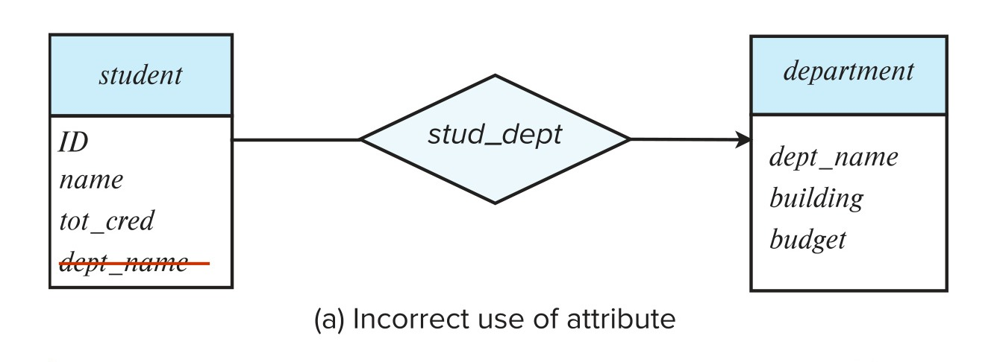
*Figure 5.19 — Redundant Attributes in Entity Sets (Source: Slide 38)*

---

<!-- Slide 39 -->
## E-R Diagram for a University Enterprise

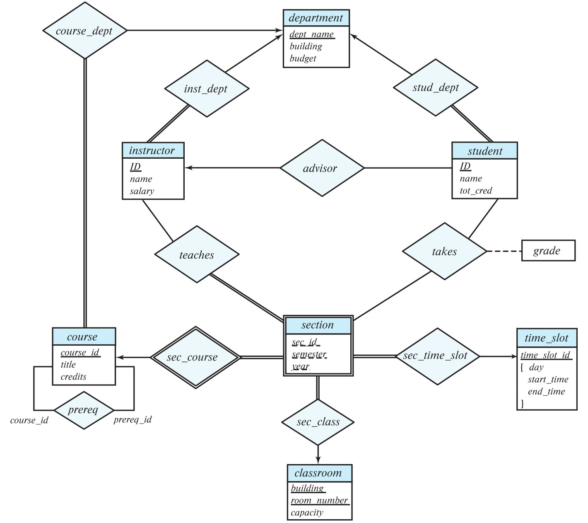
*Figure 5.20 — E-R Diagram for a University Enterprise (Source: Slide 39)*

---

<!-- Slide 40 -->
## Reduction to Relation Schemas

---

<!-- Slide 41 -->
## Reduction to Relation Schemas

- Entity sets and relationship sets can be expressed uniformly as relation schemas that represent the contents of the database.
- A database which conforms to an E-R diagram can be represented by a collection of schemas.
- For each entity set and relationship set there is a unique schema that is assigned the name of the corresponding entity set or relationship set.
- Each schema has a number of columns (generally corresponding to attributes), which have unique names.

---

<!-- Slide 42 -->
## Representing Entity Sets

- A strong entity set reduces to a schema with the same attributes
  $$\text{student}(\underline{\text{ID}}, \text{name}, \text{tot\_cred})$$
- A weak entity set becomes a table that includes a column for the primary key of the identifying strong entity set
  $$\text{section}(\underline{\text{course\_id}}, \underline{\text{sec\_id}}, \underline{\text{sem}}, \underline{\text{year}})$$
- Example

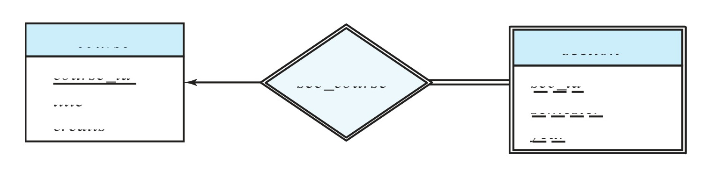
*Figure 5.21 — Representing Strong and Weak Entity Sets as Relation Schemas (Source: Slide 42)*

---

<!-- Slide 43 -->
## Representation of Entity Sets with Composite Attributes

- Composite attributes are flattened out by creating a separate attribute for each component attribute
  - Example: given entity set **instructor** with composite attribute **name** with component attributes `first_name` and `last_name` the schema corresponding to the entity set has two attributes `name_first_name` and `name_last_name`
    - Prefix omitted if there is no ambiguity (`name_first_name` could be `first_name`)
- Ignoring multivalued attributes, extended **instructor** schema is
  - $\text{instructor}(\underline{\text{ID}}, \text{first\_name}, \text{middle\_initial}, \text{last\_name}, \text{street\_number}, \text{street\_name}, \text{apt\_number}, \text{city}, \text{state}, \text{zip\_code}, \text{date\_of\_birth})$

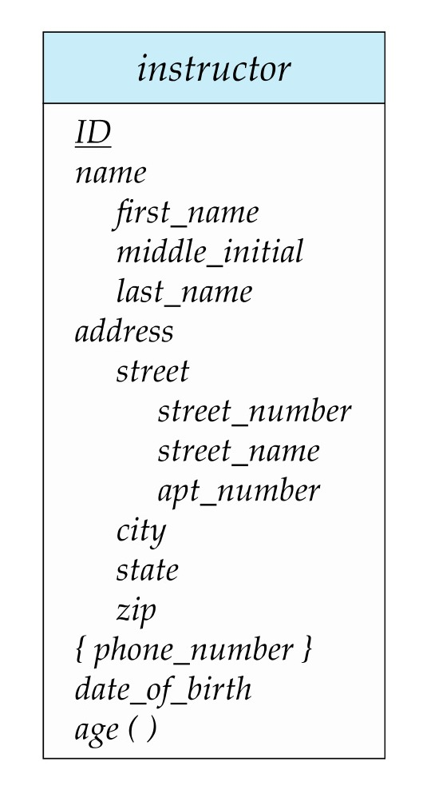
*Figure 5.22 — Representation of Entity Sets with Composite Attributes (Source: Slide 43)*

---

<!-- Slide 44 -->
## Representation of Entity Sets with Multivalued Attributes

- A multivalued attribute $M$ of an entity $E$ is represented by a separate schema $E_M$
- Schema $E_M$ has attributes corresponding to the primary key of $E$ and an attribute corresponding to multivalued attribute $M$
- Example: Multivalued attribute `phone_number` of instructor is represented by a schema:
  $$\text{inst\_phone} = (\underline{\text{ID}}, \underline{\text{phone\_number}})$$
- Each value of the multivalued attribute maps to a separate tuple of the relation on schema $E_M$
  - For example, an instructor entity with primary key 22222 and phone numbers 456-7890 and 123-4567 maps to two tuples:
    $$(22222, 456\text{-}7890) \quad \text{and} \quad (22222, 123\text{-}4567)$$

---

<!-- Slide 45 -->
## Representing Relationship Sets

- A many-to-many relationship set is represented as a schema with attributes for the primary keys of the two participating entity sets, and any descriptive attributes of the relationship set.
- Example: schema for relationship set **advisor**
  $$\text{advisor} = (\underline{\text{s\_id}}, \underline{\text{i\_id}})$$

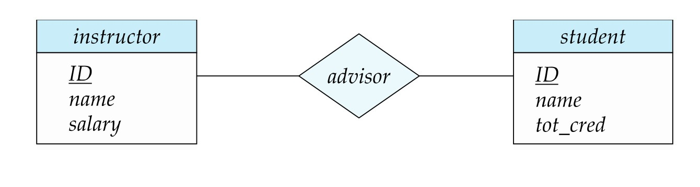
*Figure 5.23 — Representing Relationship Sets as Relation Schemas (Source: Slide 45)*

---

<!-- Slide 46 -->
## Redundancy of Schemas

- Many-to-one and one-to-many relationship sets that are total on the many-side can be represented by adding an extra attribute to the “many” side, containing the primary key of the “one” side
- Example: Instead of creating a schema for relationship set **inst_dept**, add an attribute `dept_name` to the schema arising from entity set **instructor**
- Example

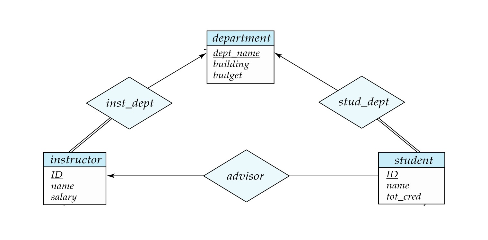
*Figure 5.24 — Redundancy of Schemas in Many-to-One Relationships (Source: Slide 46)*

---

<!-- Slide 47 -->
## Redundancy of Schemas (Cont.)

- For one-to-one relationship sets, either side can be chosen to act as the “many” side
  - That is, an extra attribute can be added to either of the tables corresponding to the two entity sets
- If participation is partial on the “many” side, replacing a schema by an extra attribute in the schema corresponding to the “many” side could result in null values

---

<!-- Slide 48 -->
## Redundancy of Schemas (Cont.)

- The schema corresponding to a relationship set linking a weak entity set to its identifying strong entity set is redundant.
- Example: The section schema already contains the attributes that would appear in the **sec_course** schema

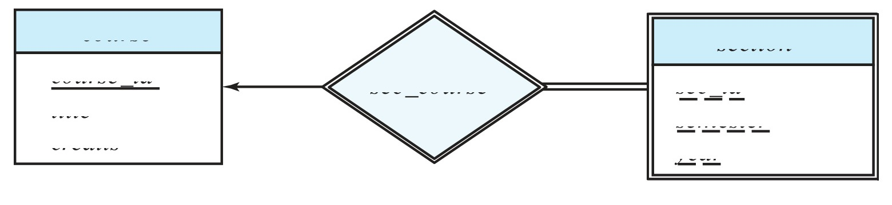
*Figure 5.25 — Redundancy of Identifying Relationship Schema sec_course (Source: Slide 48)*

---

<!-- Slide 49 -->
## Extended E-R Features

---

<!-- Slide 50 -->
## Specialization

- Top-down design process; we designate sub-groupings within an entity set that are distinctive from other entities in the set.
- These sub-groupings become lower-level entity sets that have attributes or participate in relationships that do not apply to the higher-level entity set.
- Depicted by a triangle component labeled **ISA** (e.g., instructor “is a” person).
- **Attribute inheritance** – a lower-level entity set inherits all the attributes and relationship participation of the higher-level entity set to which it is linked.

---

<!-- Slide 51 -->
## Specialization Example

- Overlapping – employee and student
- Disjoint – instructor and secretary
- Total and partial

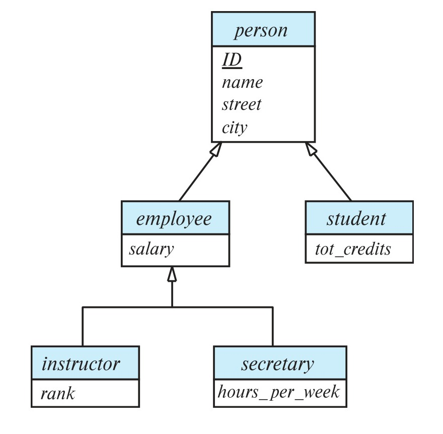
*Figure 5.26 — Specialization Hierarchy Example (Source: Slide 51)*

---

<!-- Slide 52 -->
## Representing Specialization via Schemas

- **Method 1:**
  - Form a schema for the higher-level entity
  - Form a schema for each lower-level entity set, include primary key of higher-level entity set and local attributes

| schema | attributes |
| :--- | :--- |
| person | ID, name, street, city |
| student | ID, tot_cred |
| employee | ID, salary |

  - Drawback: getting information about, an employee requires accessing two relations, the one corresponding to the low-level schema and the one corresponding to the high-level schema

---

<!-- Slide 53 -->
## Representing Specialization as Schemas (Cont.)

- **Method 2:**
  - Form a schema for each entity set with all local and inherited attributes

| schema | attributes |
| :--- | :--- |
| person | ID, name, street, city |
| student | ID, name, street, city, tot_cred |
| employee | ID, name, street, city, salary |

  - Drawback: name, street and city may be stored redundantly for people who are both students and employees

---

<!-- Slide 54 -->
## Generalization

- A bottom-up design process – combine a number of entity sets that share the same features into a higher-level entity set.
- Specialization and generalization are simple inversions of each other; they are represented in an E-R diagram in the same way.
- The terms specialization and generalization are used interchangeably.

---

<!-- Slide 55 -->
## Completeness constraint

- **Completeness constraint** -- specifies whether or not an entity in the higher-level entity set must belong to at least one of the lower-level entity sets within a generalization.
  - **total**: an entity must belong to one of the lower-level entity sets
  - **partial**: an entity need not belong to one of the lower-level entity sets

---

<!-- Slide 56 -->
## Completeness constraint (Cont.)

- Partial generalization is the default.
- We can specify total generalization in an ER diagram by adding the keyword **total** in the diagram and drawing a dashed line from the keyword to the corresponding hollow arrow-head to which it applies (for a total generalization), or to the set of hollow arrow-heads to which it applies (for an overlapping generalization).
- The student generalization is total: All student entities must be either graduate or undergraduate. Because the higher-level entity set arrived at through generalization is generally composed of only those entities in the lower-level entity sets, the completeness constraint for a generalized higher-level entity set is usually total

---

<!-- Slide 57 -->
## Aggregation

- Consider the ternary relationship **proj_guide**, which we saw earlier
- Suppose we want to record evaluations of a student by a guide on a project

*Figure 5.27 — Aggregation Motivation: Ternary Relationship and Overlapping Relationships (Source: Slide 57)*

---

<!-- Slide 58 -->
## Aggregation (Cont.)

- Relationship sets **eval_for** and **proj_guide** represent overlapping information
  - Every **eval_for** relationship corresponds to a **proj_guide** relationship
  - However, some **proj_guide** relationships may not correspond to any **eval_for** relationships
    - So we can’t discard the **proj_guide** relationship
- Eliminate this redundancy via **aggregation**
  - Treat relationship as an abstract entity
  - Allows relationships between relationships
  - Abstraction of relationship into new entity

---

<!-- Slide 59 -->
## Aggregation (Cont.)

- Eliminate this redundancy via aggregation without introducing redundancy, the following diagram represents:
  - A student is guided by a particular instructor on a particular project
  - A student, instructor, project combination may have an associated evaluation

*Figure 5.28 — Aggregation Representation in E-R Diagram (Source: Slide 59)*

---

<!-- Slide 60 -->
## Reduction to Relational Schemas

- To represent aggregation, create a schema containing
  - Primary key of the aggregated relationship,
  - The primary key of the associated entity set
  - Any descriptive attributes
- In our example:
  - The schema **eval_for** is:
    $$\text{eval\_for}(\underline{\text{s\_ID}}, \underline{\text{project\_id}}, \underline{\text{i\_ID}}, \underline{\text{evaluation\_id}})$$
  - The schema **proj_guide** is redundant.

---

<!-- Slide 61 -->
## Design Issues

---

<!-- Slide 62 -->
## Common Mistakes in E-R Diagrams

- Example of erroneous E-R diagrams

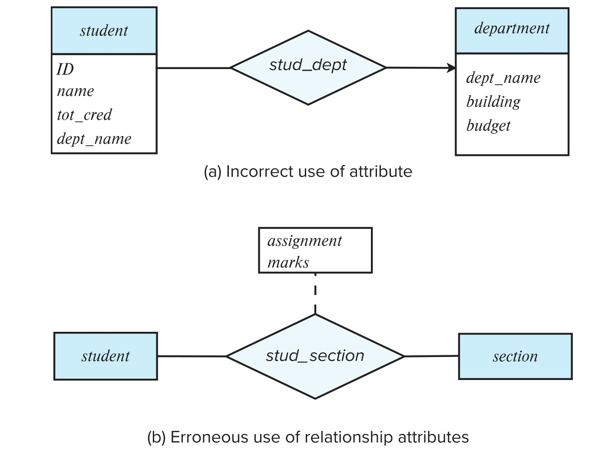
*Figure 5.29 — Common Mistakes in E-R Diagrams (Source: Slide 62)*

---

<!-- Slide 63 -->
## Common Mistakes in E-R Diagrams (Cont.)

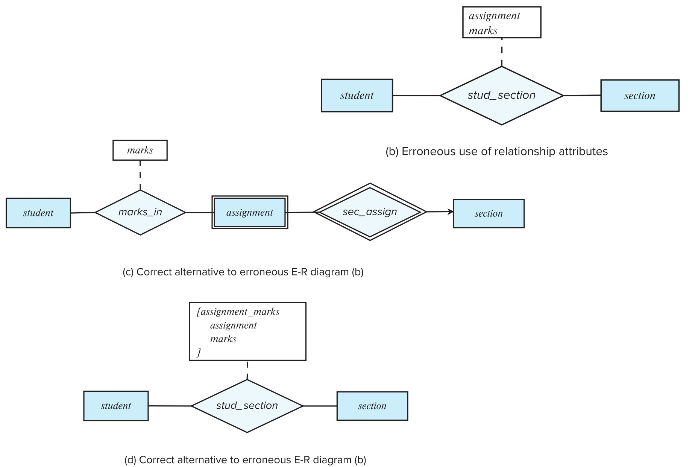
*Figure 5.30 — Common Mistakes in E-R Diagrams (Cont.): Alternatives for Modeling Assignment Marks (Source: Slide 63)*

---

<!-- Slide 64 -->
## Entities vs. Attributes

- Use of entity sets vs. attributes

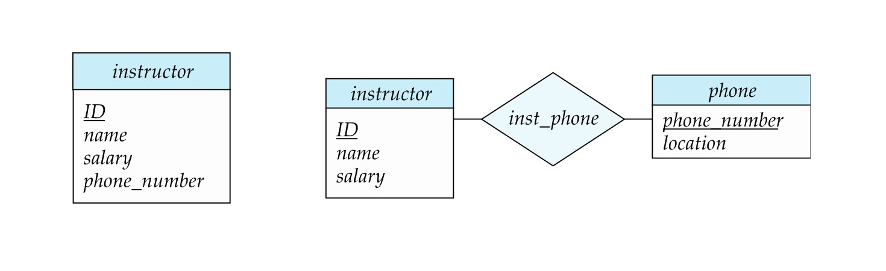
*Figure 5.31 — Entities vs. Attributes: Modeling Phone Numbers (Source: Slide 64)*

- Use of phone as an entity allows extra information about phone numbers (plus multiple phone numbers)

---

<!-- Slide 65 -->
## Entities vs. Relationship sets

- Use of entity sets vs. relationship sets
  - Possible guideline is to designate a relationship set to describe an action that occurs between entities

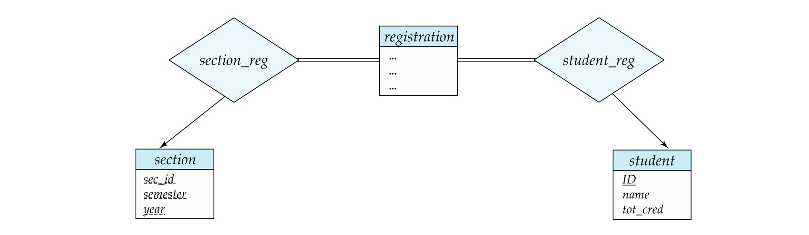
*Figure 5.32 — Entities vs. Relationship Sets: Registration Entity (Source: Slide 65)*

- Placement of relationship attributes
  - For example, attribute date as attribute of advisor or as attribute of student

---

<!-- Slide 66 -->
## Binary Vs. Non-Binary Relationships

- Although it is possible to replace any non-binary ($n$-ary, for $n > 2$) relationship set by a number of distinct binary relationship sets, a $n$-ary relationship set shows more clearly that several entities participate in a single relationship.
- Some relationships that appear to be non-binary may be better represented using binary relationships
  - For example, a ternary relationship **parents**, relating a child to his/her father and mother, is best replaced by two binary relationships, **father** and **mother**
    - Using two binary relationships allows partial information (e.g., only mother being known)
  - But there are some relationships that are naturally non-binary
    - Example: **proj_guide**

---

<!-- Slide 67 -->
## Converting Non-Binary Relationships to Binary Form

- In general, any non-binary relationship can be represented using binary relationships by creating an artificial entity set.
  - Replace $R$ between entity sets $A$, $B$ and $C$ by an entity set $E$, and three relationship sets:
    1. $R_A$, relating $E$ and $A$
    2. $R_B$, relating $E$ and $B$
    3. $R_C$, relating $E$ and $C$
  - Create an identifying attribute for $E$ and add any attributes of $R$ to $E$
  - For each relationship $(a_i, b_i, c_i)$ in $R$, create
    1. a new entity $e_i$ in the entity set $E$
    2. add $(e_i, a_i)$ to $R_A$
    3. add $(e_i, b_i)$ to $R_B$
    4. add $(e_i, c_i)$ to $R_C$

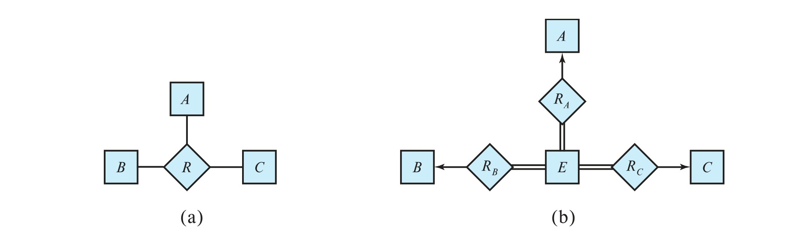
*Figure 5.33 — Converting Non-Binary Relationships to Binary Form (Source: Slide 67)*

---

<!-- Slide 68 -->
## Converting Non-Binary Relationships (Cont.)

- Also need to translate constraints
  - Translating all constraints may not be possible
  - There may be instances in the translated schema that cannot correspond to any instance of $R$
    - Exercise: add constraints to the relationships $R_A$, $R_B$ and $R_C$ to ensure that a newly created entity corresponds to exactly one entity in each of entity sets $A$, $B$ and $C$
  - We can avoid creating an identifying attribute by making $E$ a weak entity set (described shortly) identified by the three relationship sets

---

<!-- Slide 69 -->
## E-R Design Decisions

- The use of an attribute or entity set to represent an object.
- Whether a real-world concept is best expressed by an entity set or a relationship set.
- The use of a ternary relationship versus a pair of binary relationships.
- The use of a strong or weak entity set.
- The use of specialization/generalization – contributes to modularity in the design.
- The use of aggregation – can treat the aggregate entity set as a single unit without concern for the details of its internal structure.

---

<!-- Slide 70 -->
## Summary of Symbols Used in E-R Notation

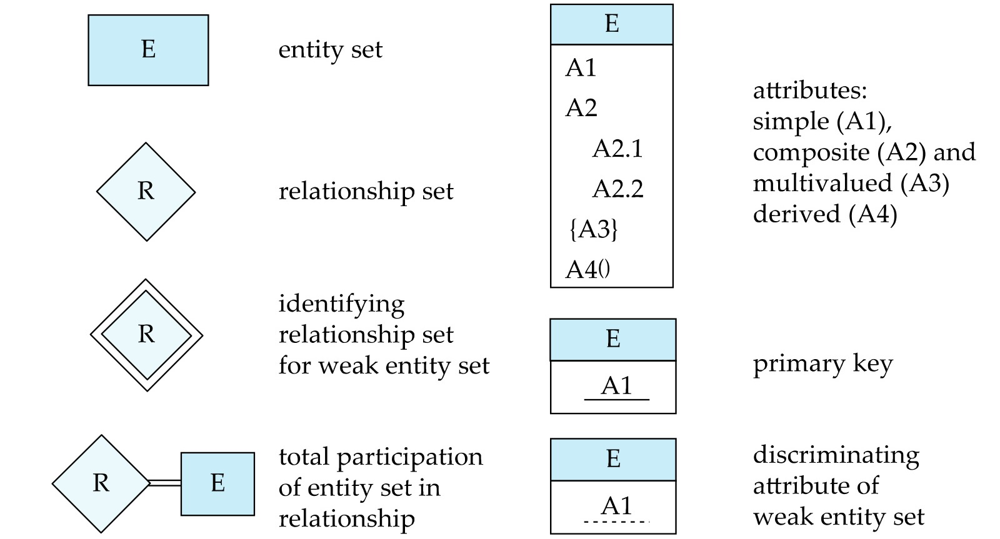
*Figure 5.34 — Summary of Symbols Used in E-R Notation (Source: Slide 70)*

---

<!-- Slide 71 -->
## Symbols Used in E-R Notation (Cont.)

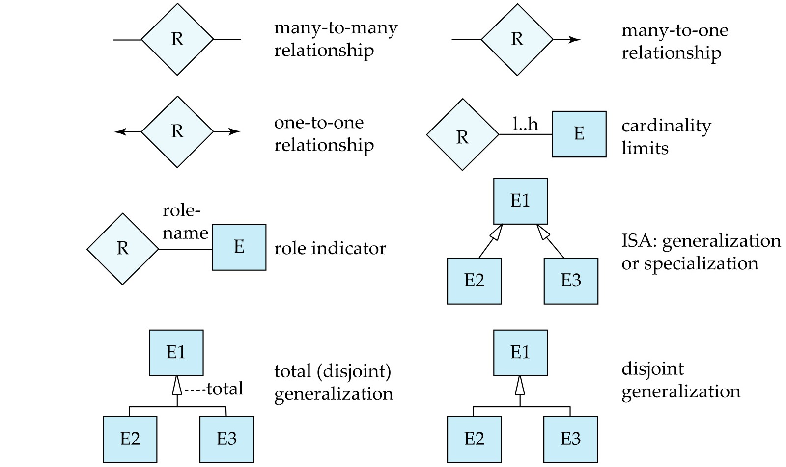
*Figure 5.35 — Symbols Used in E-R Notation (Cont.) (Source: Slide 71)*

---

<!-- Slide 72 -->
## Alternative ER Notations

- Chen, IDE1FX, …

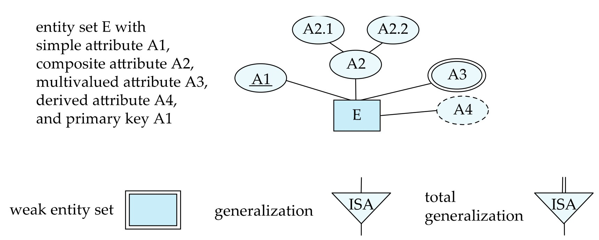
*Figure 5.36 — Alternative ER Notations Comparison (Source: Slide 72)*

---

<!-- Slide 73 -->
## Alternative ER Notations

**Chen** &emsp;&emsp;&emsp;&emsp;&emsp;&emsp;&emsp;&emsp;&emsp;&emsp;&emsp;&emsp; **IDE1FX (Crows feet notation)**

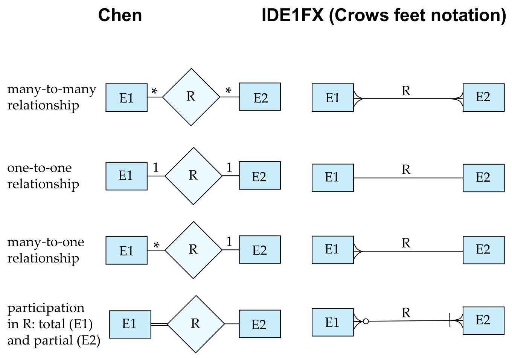
*Figure 5.37 — Chen Notation vs. IDE1FX (Crow's Foot Notation) (Source: Slide 73)*

---

<!-- Slide 74 -->
## UML

- **UML**: Unified Modeling Language
- UML has many components to graphically model different aspects of an entire software system
- UML Class Diagrams correspond to E-R Diagram, but several differences.

---

<!-- Slide 75 -->
## ER vs. UML Class Diagrams

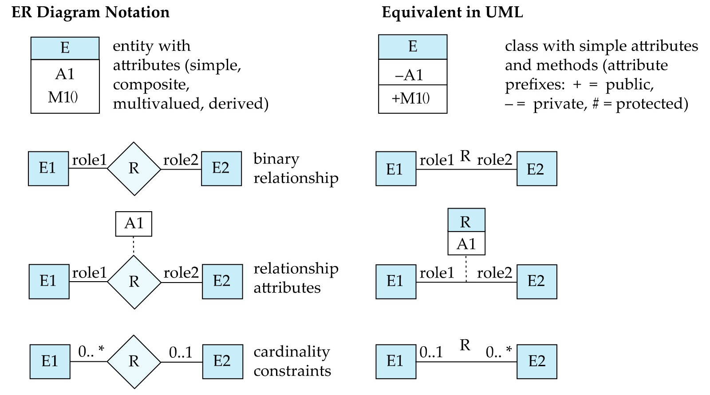
*Figure 5.38 — ER vs. UML Class Diagrams: Entities and Relationships (Source: Slide 75)*

\* Note reversal of position in cardinality constraint depiction

---

<!-- Slide 76 -->
## ER vs. UML Class Diagrams

**ER Diagram Notation** &emsp;&emsp;&emsp;&emsp;&emsp;&emsp;&emsp;&emsp; **Equivalent in UML**

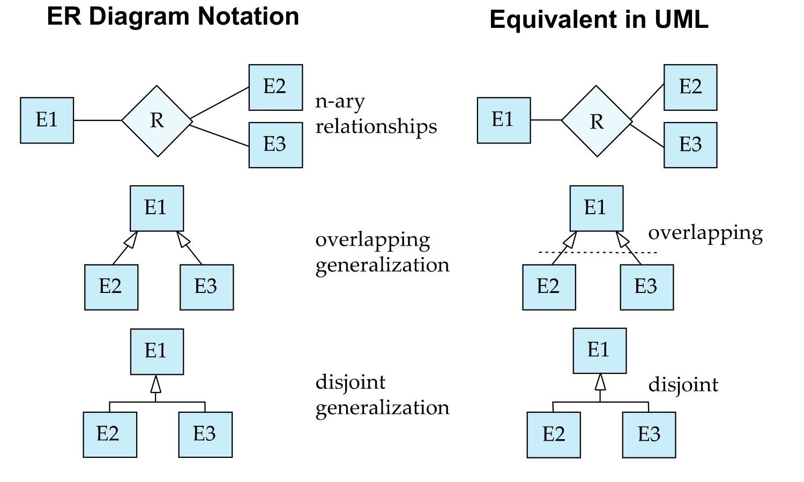
*Figure 5.39 — ER vs. UML Class Diagrams: Generalization and Aggregation (Source: Slide 76)*

\* Generalization can use merged or separate arrows independent of disjoint/overlapping

---

<!-- Slide 77 -->
## UML Class Diagrams (Cont.)

- Binary relationship sets are represented in UML by just drawing a line connecting the entity sets. The relationship set name is written adjacent to the line.
- The role played by an entity set in a relationship set may also be specified by writing the role name on the line, adjacent to the entity set.
- The relationship set name may alternatively be written in a box, along with attributes of the relationship set, and the box is connected, using a dotted line, to the line depicting the relationship set.

---

<!-- Slide 78 -->
## ER vs. UML Class Diagrams

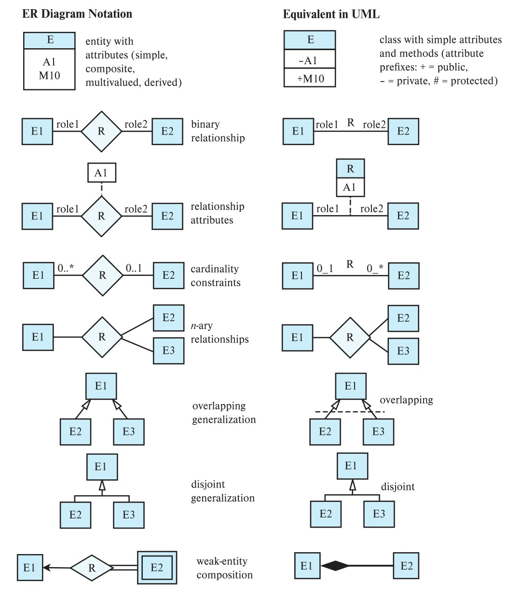
*Figure 5.40 — Comprehensive Comparison between E-R Notation and UML Class Diagrams (Source: Slide 78)*

---

<!-- Slide 79 -->
## Other Aspects of Database Design

- Functional Requirements
- Data Flow, Workflow
- Schema Evolution

---

<!-- Slide 80 -->
## End of Chapter 6
