# ECE 2215: Database Systems — Transactions

<!-- Slide 1 -->
## Course Title: Data Base Systems
### Course No.: ECE 2215

**Rajshahi University of Engineering & Technology**

### Topic: Transactions
*(Note: Banner in slide template displays "Database Normalization")*

**Md. Rakibul Islam**  
Lecturer, Dept. of ETE, RUET  

*Heaven's Light is Our Guide*

---

<!-- Slide 2 -->
## Outline

1. Transaction Concept
2. ACID Properties
3. Transaction State
4. Concurrent Executions
5. Serializability
6. Testing for Serializability
7. Problems with concurrency

---

<!-- Slide 3 -->
## Transaction Concept

- A transaction is a unit of program execution that accesses and possibly updates various data items.
- E.g., transaction to transfer \$50 from account $A$ to account $B$:
  1. $\text{read}(A)$
  2. $A := A - 50$
  3. $\text{write}(A)$
  4. $\text{read}(B)$
  5. $B := B + 50$
  6. $\text{write}(B)$
- Two main issues to deal with:
  - Failures of various kinds, such as hardware failures and system crashes
  - Concurrent execution of multiple transactions

---

<!-- Slide 4 -->
## ACID Properties

A transaction is a unit of program execution that accesses and possibly updates various data items. To preserve the integrity of data the database system must ensure:

- **Atomicity.** Either all operations of the transaction are properly reflected in the database or none are.
- **Consistency.** Execution of a transaction in isolation preserves the consistency of the database.
- **Isolation.** Although multiple transactions may execute concurrently, each transaction must be unaware of other concurrently executing transactions. Intermediate transaction results must be hidden from other concurrently executed transactions.
  - That is, for every pair of transactions $T_i$ and $T_j$, it appears to $T_i$ that either $T_j$ finished execution before $T_i$ started, or $T_j$ started execution after $T_i$ finished.
- **Durability.** After a transaction completes successfully, the changes it has made to the database persist, even if there are system failures.

---

<!-- Slide 5 -->
## Example of Fund Transfer

- Transaction to transfer \$50 from account $A$ to account $B$:
  1. $\text{read}(A)$
  2. $A := A - 50$
  3. $\text{write}(A)$
  4. $\text{read}(B)$
  5. $B := B + 50$
  6. $\text{write}(B)$

- **Atomicity requirement**
  - If the transaction fails after step 3 and before step 6, money will be "lost" leading to an inconsistent database state
    - Failure could be due to software or hardware
  - The system should ensure that updates of a partially executed transaction are not reflected in the database

- **Durability requirement** — once the user has been notified that the transaction has completed (i.e., the transfer of the \$50 has taken place), the updates to the database by the transaction must persist even if there are software or hardware failures.

---

<!-- Slide 6 -->
## Example of Fund Transfer

- Consistency requirement in above example:
  - The sum of $A$ and $B$ is unchanged by the execution of the transaction
- In general, consistency requirements include:
  - Explicitly specified integrity constraints such as primary keys and foreign keys
  - Implicit integrity constraints
    - e.g., sum of balances of all accounts, minus sum of loan amounts must equal value of cash-in-hand
  - A transaction must see a consistent database.
  - During transaction execution the database may be temporarily inconsistent.
  - When the transaction completes successfully the database must be consistent
    - Erroneous transaction logic can lead to inconsistency

---

<!-- Slide 7 -->
## Example of Fund Transfer

- Isolation requirement — if between steps 3 and 6, another transaction $T_2$ is allowed to access the partially updated database, it will see an inconsistent database (the sum $A + B$ will be less than it should be).

| $T_1$ | $T_2$ |
| :--- | :--- |
| 1. $\text{read}(A)$ | |
| 2. $A := A - 50$ | |
| 3. $\text{write}(A)$ | |
| | $\text{read}(A), \text{read}(B), \text{print}(A+B)$ |
| 4. $\text{read}(B)$ | |
| 5. $B := B + 50$ | |
| 6. $\text{write}(B)$ | |

- Isolation can be ensured trivially by running transactions serially
  - That is, one after the other.
- However, executing multiple transactions concurrently has significant benefits, as we will see later.

---

<!-- Slide 8 -->
## Transaction State

*Figure 7.1 — Transaction State Transition Diagram (Source: Slide 8)*

---

<!-- Slide 9 -->
## Transaction State

- **Active** – the initial state; the transaction stays in this state while it is executing
- **Partially committed** – after the final statement has been executed.
- **Failed** – after the discovery that normal execution can no longer proceed.
- **Aborted** – after the transaction has been rolled back and the database restored to its state prior to the start of the transaction. Two options after it has been aborted:
  - Restart the transaction
    - Can be done only if no internal logical error
  - Kill the transaction
- **Committed** – after successful completion.

---

<!-- Slide 10 -->
## Concurrent Executions

- Multiple transactions are allowed to run concurrently in the system. Advantages are:
  - Increased processor and disk utilization, leading to better transaction throughput
    - E.g., one transaction can be using the CPU while another is reading from or writing to the disk
  - Reduced average response time for transactions: short transactions need not wait behind long ones.
- **Concurrency control schemes** – mechanisms to achieve isolation
  - That is, to control the interaction among the concurrent transactions in order to prevent them from destroying the consistency of the database

---

<!-- Slide 11 -->
## Schedules

- **Schedule** – a sequences of instructions that specify the chronological order in which instructions of concurrent transactions are executed
  - A schedule for a set of transactions must consist of all instructions of those transactions
  - Must preserve the order in which the instructions appear in each individual transaction.
- A transaction that successfully completes its execution will have a commit instructions as the last statement
  - By default transaction assumed to execute commit instruction as its last step
- A transaction that fails to successfully complete its execution will have an abort instruction as the last statement

---

<!-- Slide 12 -->
## Schedules 1

- Let $T_1$ transfer \$50 from $A$ to $B$, and $T_2$ transfer 10% of the balance from $A$ to $B$.
- A serial schedule in which $T_1$ is followed by $T_2$:

| $T_1$ | $T_2$ |
| :--- | :--- |
| $\text{read}(A)$ | |
| $A := A - 50$ | |
| $\text{write}(A)$ | |
| $\text{read}(B)$ | |
| $B := B + 50$ | |
| $\text{write}(B)$ | |
| $\text{commit}$ | |
| | $\text{read}(A)$ |
| | $temp := A * 0.1$ |
| | $A := A - temp$ |
| | $\text{write}(A)$ |
| | $\text{read}(B)$ |
| | $B := B + temp$ |
| | $\text{write}(B)$ |
| | $\text{commit}$ |

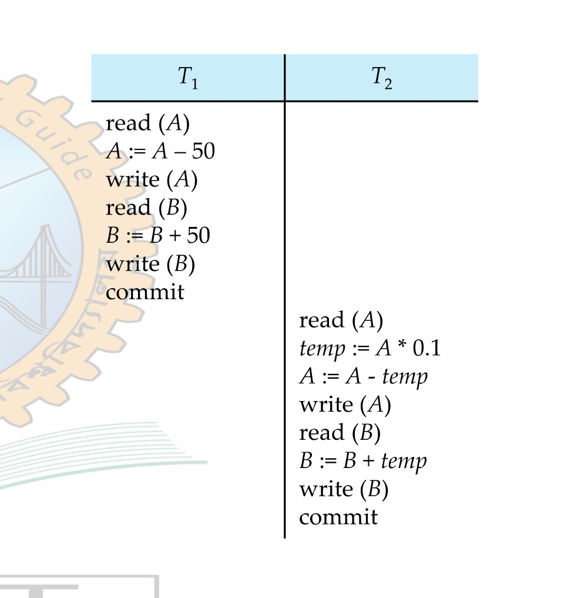
*Figure 7.2 — Schedule 1: Serial Execution of $T_1$ Followed by $T_2$ (Source: Slide 12)*

---

<!-- Slide 13 -->
## Schedules 2

- A serial schedule where $T_2$ is followed by $T_1$

| $T_1$ | $T_2$ |
| :--- | :--- |
| | $\text{read}(A)$ |
| | $temp := A * 0.1$ |
| | $A := A - temp$ |
| | $\text{write}(A)$ |
| | $\text{read}(B)$ |
| | $B := B + temp$ |
| | $\text{write}(B)$ |
| | $\text{commit}$ |
| $\text{read}(A)$ | |
| $A := A - 50$ | |
| $\text{write}(A)$ | |
| $\text{read}(B)$ | |
| $B := B + 50$ | |
| $\text{write}(B)$ | |
| $\text{commit}$ | |

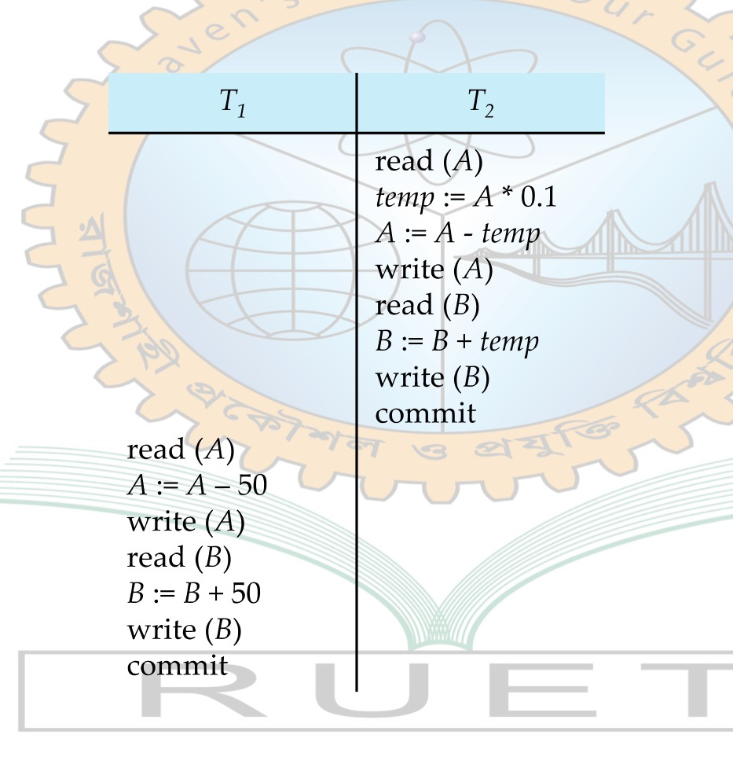
*Figure 7.3 — Schedule 2: Serial Execution of $T_2$ Followed by $T_1$ (Source: Slide 13)*

---

<!-- Slide 14 -->
## Schedules 3

- Let $T_1$ and $T_2$ be the transactions defined previously. The following schedule is not a serial schedule, but it is equivalent to Schedule 1
- In Schedules 1, 2 and 3, the sum $A + B$ is preserved.

| $T_1$ | $T_2$ |
| :--- | :--- |
| $\text{read}(A)$ | |
| $A := A - 50$ | |
| $\text{write}(A)$ | |
| | $\text{read}(A)$ |
| | $temp := A * 0.1$ |
| | $A := A - temp$ |
| | $\text{write}(A)$ |
| $\text{read}(B)$ | |
| $B := B + 50$ | |
| $\text{write}(B)$ | |
| $\text{commit}$ | |
| | $\text{read}(B)$ |
| | $B := B + temp$ |
| | $\text{write}(B)$ |
| | $\text{commit}$ |

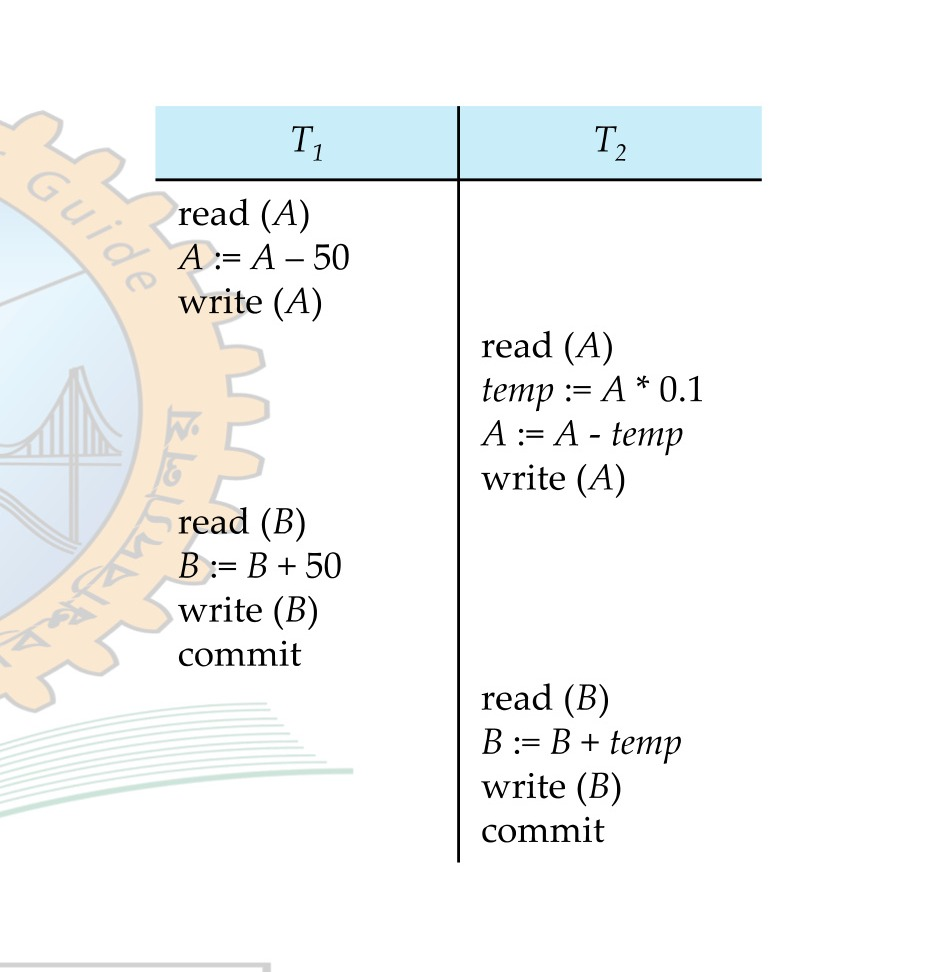
*Figure 7.4 — Schedule 3: Concurrent Schedule Equivalent to Schedule 1 (Source: Slide 14)*

---

<!-- Slide 15 -->
## Schedules 4

- The following concurrent schedule does not preserve the value of $(A + B)$.

| $T_1$ | $T_2$ |
| :--- | :--- |
| $\text{read}(A)$ | |
| $A := A - 50$ | |
| | $\text{read}(A)$ |
| | $temp := A * 0.1$ |
| | $A := A - temp$ |
| | $\text{write}(A)$ |
| | $\text{read}(B)$ |
| $\text{write}(A)$ | |
| $\text{read}(B)$ | |
| $B := B + 50$ | |
| $\text{write}(B)$ | |
| $\text{commit}$ | |
| | $B := B + temp$ |
| | $\text{write}(B)$ |
| | $\text{commit}$ |

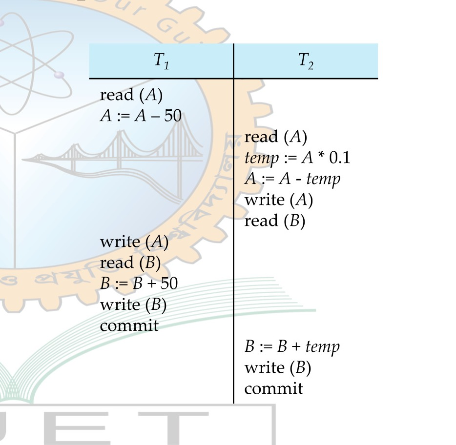
*Figure 7.5 — Schedule 4: Non-Serializable Concurrent Schedule (Source: Slide 15)*

---

<!-- Slide 16 -->
## Serializability

- **Basic Assumption** – Each transaction preserves database consistency.
- Thus, serial execution of a set of transactions preserves database consistency.
- A (possibly concurrent) schedule is serializable if it is equivalent to a serial schedule. Different forms of schedule equivalence give rise to the notions of:
  1. Conflict serializability
  2. View serializability

---

<!-- Slide 17 -->
## Simplified view of transactions

- We ignore operations other than read and write instructions
- We assume that transactions may perform arbitrary computations on data in local buffers in between reads and writes.
- Our simplified schedules consist of only read and write instructions.

---

<!-- Slide 18 -->
## Conflicting Instructions

- Instructions $l_i$ and $l_j$ of transactions $T_i$ and $T_j$ respectively, conflict if and only if there exists some item $Q$ accessed by both $l_i$ and $l_j$, and at least one of these instructions wrote $Q$.
  1. $l_i = \text{read}(Q), l_j = \text{read}(Q)$. $l_i$ and $l_j$ don't conflict.
  2. $l_i = \text{read}(Q), l_j = \text{write}(Q)$. They conflict.
  3. $l_i = \text{write}(Q), l_j = \text{read}(Q)$. They conflict.
  4. $l_i = \text{write}(Q), l_j = \text{write}(Q)$. They conflict.
- Intuitively, a conflict between $l_i$ and $l_j$ forces a (logical) temporal order between them.
- If $l_i$ and $l_j$ are consecutive in a schedule and they do not conflict, their results would remain the same even if they had been interchanged in the schedule.

---

<!-- Slide 19 -->
## Conflict Serializability

- If a schedule $S$ can be transformed into a schedule $S'$ by a series of swaps of non-conflicting instructions, we say that $S$ and $S'$ are **conflict equivalent**.
- We say that a schedule $S$ is **conflict serializable** if it is conflict equivalent to a serial schedule

---

<!-- Slide 20 -->
## Conflict Serializability

- Schedule 1 can be transformed into Schedule 2, a serial schedule where $T_2$ follows $T_1$, by series of swaps of non-conflicting instructions. Therefore Schedule 1 is conflict serializable.

### Schedule 1 vs. Schedule 2

| Schedule 1: $T_1$ | Schedule 1: $T_2$ | | Schedule 2: $T_1$ | Schedule 2: $T_2$ |
| :--- | :--- | :---: | :--- | :--- |
| $\text{read}(A)$ | | | $\text{read}(A)$ | |
| $\text{write}(A)$ | | | $\text{write}(A)$ | |
| | $\text{read}(A)$ | | $\text{read}(B)$ | |
| | $\text{write}(A)$ | | $\text{write}(B)$ | |
| $\text{read}(B)$ | | | | $\text{read}(A)$ |
| $\text{write}(B)$ | | | | $\text{write}(A)$ |
| | $\text{read}(B)$ | | | $\text{read}(B)$ |
| | $\text{write}(B)$ | | | $\text{write}(B)$ |

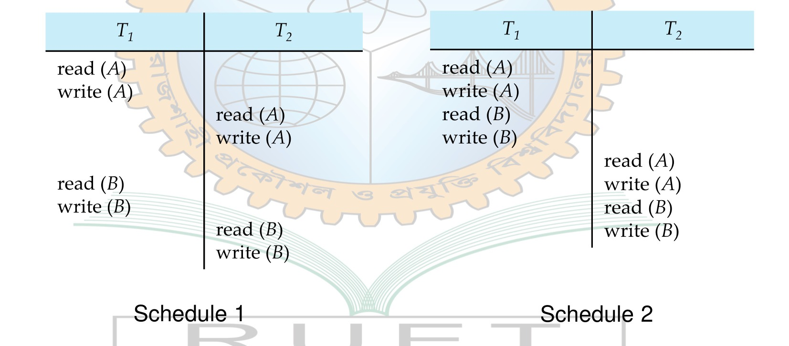
*Figure 7.6 — Conflict Serializability: Transforming Schedule 1 to Schedule 2 (Source: Slide 20)*

---

<!-- Slide 21 -->
## Conflict Serializability

- Example of a schedule that is not conflict serializable:

| $T_3$ | $T_4$ |
| :--- | :--- |
| $\text{read}(Q)$ | |
| | $\text{write}(Q)$ |
| $\text{write}(Q)$ | |

- We are unable to swap instructions in the above schedule to obtain either the serial schedule $\langle T_3, T_4 \rangle$, or the serial schedule $\langle T_4, T_3 \rangle$.

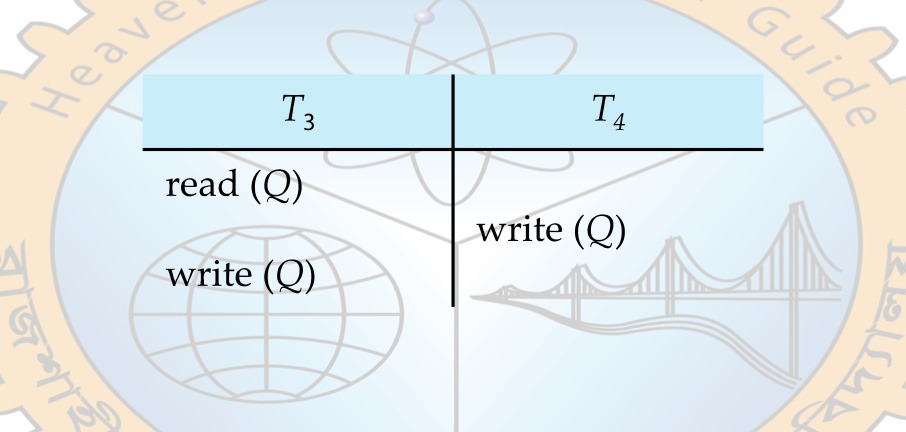
*Figure 7.7 — Example of a Schedule That is Not Conflict Serializable (Source: Slide 21)*

---

<!-- Slide 22 -->
## View Serializability

- Let $S$ and $S'$ be two schedules with the same set of transactions. $S$ and $S'$ are **view equivalent** if the following three conditions are met, for each data item $Q$,
  1. If in schedule $S$, transaction $T_i$ reads the initial value of $Q$, then in schedule $S'$ also transaction $T_i$ must read the initial value of $Q$.
  2. If in schedule $S$ transaction $T_i$ executes $\text{read}(Q)$, and that value was produced by transaction $T_j$ (if any), then in schedule $S'$ also transaction $T_i$ must read the value of $Q$ that was produced by the same $\text{write}(Q)$ operation of transaction $T_j$.
  3. The transaction (if any) that performs the final $\text{write}(Q)$ operation in schedule $S$ must also perform the final $\text{write}(Q)$ operation in schedule $S'$.
- As can be seen, view equivalence is also based purely on reads and writes alone.

---

<!-- Slide 23 -->
## View Serializability

- A schedule $S$ is view serializable if it is view equivalent to a serial schedule.
- Every conflict serializable schedule is also view serializable.
- Below is a schedule which is view-serializable but not conflict serializable.

| $T_{27}$ | $T_{28}$ | $T_{29}$ |
| :--- | :--- | :--- |
| $\text{read}(Q)$ | | |
| | $\text{write}(Q)$ | |
| $\text{write}(Q)$ | | |
| | | $\text{write}(Q)$ |

- What serial schedule is above equivalent to?
- Every view serializable schedule that is not conflict serializable has blind writes.

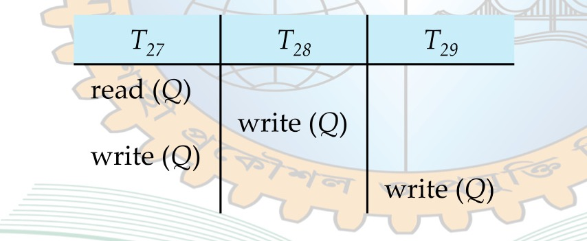
*Figure 7.8 — View Serializable Schedule with Blind Writes (Source: Slide 23)*

---

<!-- Slide 24 -->
## Other Notions of Serializability

- The schedule below produces same outcome as the serial schedule $\langle T_1, T_5 \rangle$, yet is not conflict equivalent or view equivalent to it.

| $T_1$ | $T_5$ |
| :--- | :--- |
| $\text{read}(A)$ | |
| $A := A - 50$ | |
| $\text{write}(A)$ | |
| | $\text{read}(B)$ |
| | $B := B - 10$ |
| | $\text{write}(B)$ |
| $\text{read}(B)$ | |
| $B := B + 50$ | |
| $\text{write}(B)$ | |
| | $\text{read}(A)$ |
| | $A := A + 10$ |
| | $\text{write}(A)$ |

- Determining such equivalence requires analysis of operations other than read and write.

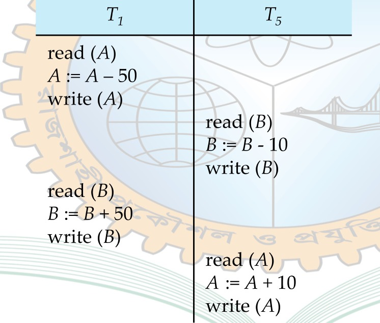
*Figure 7.9 — Schedule Producing Same Outcome as $\langle T_1, T_5 \rangle$ (Source: Slide 24)*

---

<!-- Slide 25 -->
## Testing for Serializability

- Consider some schedule of a set of transactions $T_1, T_2, \dots, T_n$
- **Precedence graph** — a direct graph where the vertices are the transactions (names).
- We draw an arc from $T_i$ to $T_j$ if the two transaction conflict, and $T_i$ accessed the data item on which the conflict arose earlier.
- We may label the arc by the item that was accessed.
- Example of a precedence graph

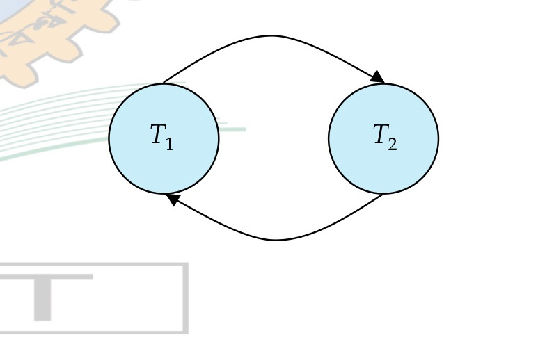
*Figure 7.10 — Example Precedence Graph with a Cycle (Source: Slide 25)*

---

<!-- Slide 26 -->
## Test for Conflict Serializability

- A schedule is conflict serializable if and only if its precedence graph is acyclic.
- Cycle-detection algorithms exist which take order $n^2$ time, where $n$ is the number of vertices in the graph.
  - (Better algorithms take order $n + e$ where $e$ is the number of edges.)
- If precedence graph is acyclic, the serializability order can be obtained by a topological sorting of the graph.
  - This is a linear order consistent with the partial order of the graph.
  - For example, a serializability order for Schedule A would be:
$$T_5 \to T_1 \to T_3 \to T_2 \to T_4$$
- Are there others?

*Figure 7.11 — Precedence Graph DAG (a) and Topological Sorts (b) and (c) (Source: Slide 26)*

---

<!-- Slide 27 -->
## Test for View Serializability

- The precedence graph test for conflict serializability cannot be used directly to test for view serializability.
  - Extension to test for view serializability has cost exponential in the size of the precedence graph.
- The problem of checking if a schedule is view serializable falls in the class of NP-complete problems.
  - Thus, existence of an efficient algorithm is extremely unlikely.
- However practical algorithms that just check some sufficient conditions for view serializability can still be used.

---

<!-- Slide 28 -->
## Problems with concurrency

1) Dirty read problem (Temporary update problem)
2) Unrepeatable read problem  
3) Lost update problem
4) Phantom read problem
5) Incorrect Summary Problem

---

<!-- Slide 29 -->
## Dirty read problem

The dirty read problem occurs when one transaction update an data item of database, and somehow the transaction fails. But before the item gets rollback, the updated database item is accessed by another transaction.

| $T_1$ | $T_2$ |
| :--- | :--- |
| $\text{Read}(A)$ | |
| $A = A + 100$ | |
| $\text{Write}(A)$ | |
| | $\text{Read}(A)$ |
| | $A = A - 200$ |
| | $\text{Write}(A)$ |
| | $\text{commit}$ |
| $\text{Failure}$ | |

Here, in above transaction
- $T_2$ reads the value of $A$ written by the uncommitted transaction $T_1$.  
- $T_2$ writes the updated value of $A$.
- $T_2$ commit
- $T_1$ fails in later stages and rollbacks.
- Thus the value of $T_2$ read now stands to be incorrect. Therefore database becomes inconsistent.

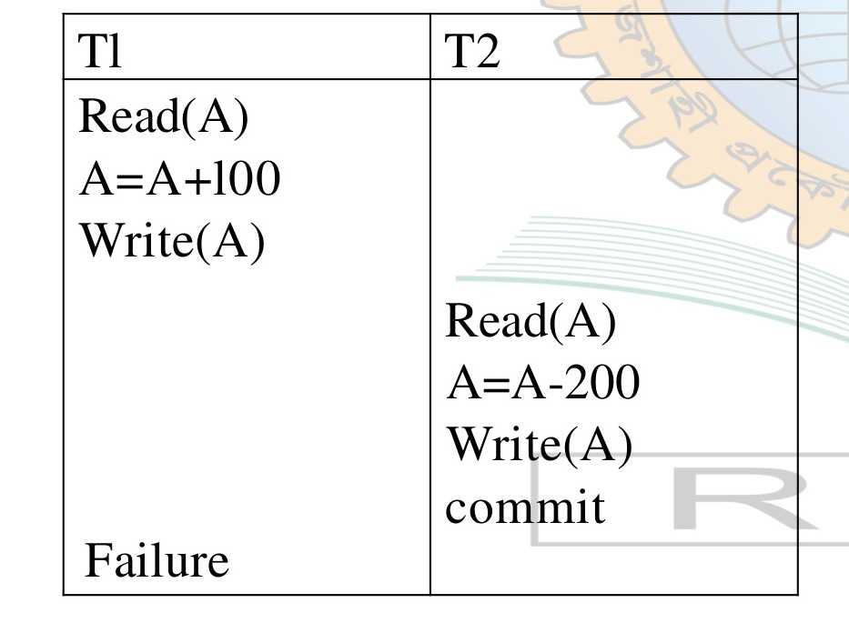
*Figure 7.12 — Dirty Read Problem (Temporary Update Problem) (Source: Slide 29)*

---

<!-- Slide 30 -->
## Unrepeatable read problem

This problem occurs when two or more read operation of the same transaction read different values of the same database item.

| $T_1$ | $T_2$ |
| :--- | :--- |
| $\text{Read}(A)$ | |
| | $\text{Read}(A)$ |
| | $A = A + 100$ |
| | $\text{Write}(A)$ |
| $\text{Read}(A)$ | |

Here,
- $T_1$ reads the value of $A$ ($= 500$ say)
- $T_2$ reads the value of $A$ ($= 500$)
- $T_2$ updates the value of $A$ from 500 to 600
- $T_1$ again reads value of $A$ (but $= 600$)
- Here, $T_1$ gets reads different value of $A$ in second reading, that was updated by $T_2$.

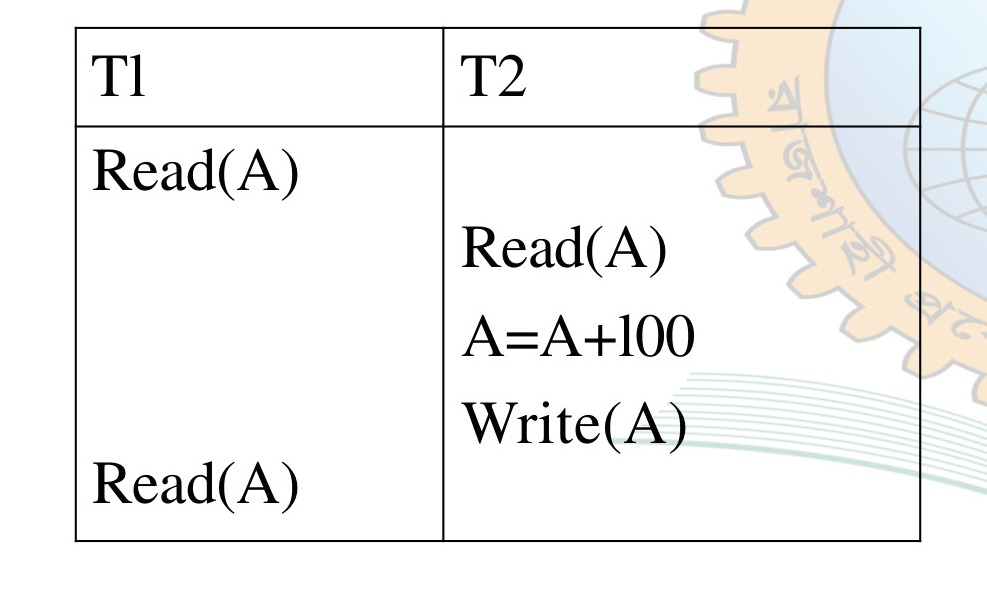
*Figure 7.13 — Unrepeatable Read Problem (Source: Slide 30)*

---

<!-- Slide 31 -->
## Lost update problem

In the lost update problem, an update done to a data item by a transaction is lost as it is overwritten by the update done by another transaction.

| $T_1$ | $T_2$ |
| :--- | :--- |
| $\text{Read}(A)$ | |
| $A = A - 50$ | |
| $\text{Write}(A)$ | |
| | $\text{Write}(A)$ |
| $\text{Commit}$ | |
| | $\text{Commit}$ |

Here,
- $T_1$ reads the value of $A$ ($= 500$ say)
- $T_1$ updates the value of $A$ ($= 450$)
- $T_2$ does blind write, say $A = 25$ (write without read)
- $T_1$ commit
- When $T_2$ commits, it writes $A = 25$ in the database

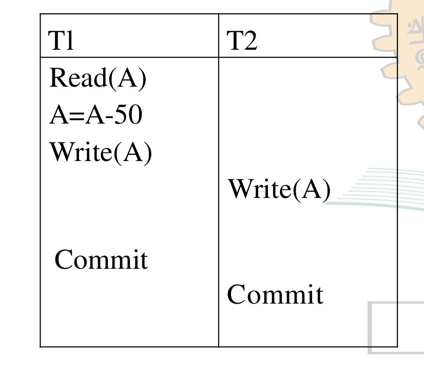
*Figure 7.14 — Lost Update Problem (Source: Slide 31)*

---

<!-- Slide 32 -->
## Phantom read problem

The phantom read problem occurs when a transaction reads a variable once but when it tries to read that same variable again, an error occurs saying that the variable does not exist.

| $T_1$ | $T_2$ |
| :--- | :--- |
| $\text{Read}(A)$ | $\text{Read}(A)$ |
| $\text{delete}(A)$ | |
| | $\text{Read}(A)$ |

Here,
- $T_1$ reads $A$
- $T_2$ reads $A$
- $T_1$ deletes $A$
- $T_2$ tries to reading $A$ but does not find it

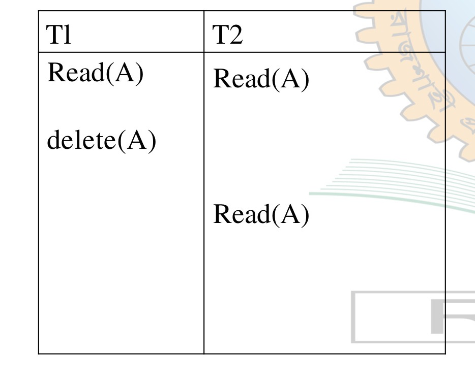
*Figure 7.15 — Phantom Read Problem (Source: Slide 32)*

---

<!-- Slide 33 -->
## Incorrect Summary Problem

| Transaction $T_1$ | Transaction $T_2$ | Database / Summary State |
| :--- | :--- | :--- |
| | | $A = 1000, B = 1000, C = 1000$ |
| $R(A);$ $A := A - 50;$ $W(A)$ | $\text{sum} = 0;$ $\text{avg} = 0;$ $R(C);$ $\text{sum} := \text{sum} + C;$ | $\text{sum} = 0;$ $T_1 \text{ reads } A = 1000; \text{avg} = 0;$ $A = 950 \text{ (local to } T_1); T_2 \text{ reads } C = 1000;$ $T_1 \text{ writes } A = 950; \text{sum} = 1000$ |
| | $R(A);$ $\text{sum} := \text{sum} + A;$ | $T_2 \text{ reads } A = 950;$ $\text{sum} = 1000 + 950 = 1950$ |
| | $R(B);$ $\text{sum} := \text{sum} + B;$ | $T_2 \text{ reads } B = 1000;$ $\text{sum} = 1950 + 1000 = 2950$ |
| | $\text{avg} := \text{sum} / 3$ | $\text{avg} = 2950 / 3 = 983.33$ |
| $R(B)$ | | $T_1 \text{ reads } B = 1000$ |
| $B := B + 50$ | | $B = 1050 \text{ (local to } T_1)$ |
| $W(B)$ | $\text{COMMIT}$ | $T_1 \text{ writes } B = 1050; T_2 \text{ commits}$ |
| $\text{COMMIT}$ | | $T_1 \text{ commits}$ |

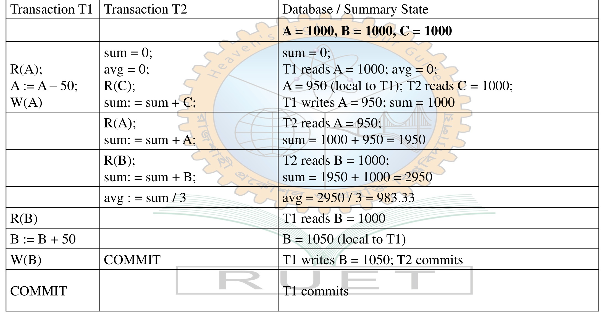
*Figure 7.16 — Incorrect Summary Problem Execution Trace (Source: Slide 33)*
