# Concurrency Control Mechanisms

<!-- Slide 1 -->
## Concurrency Control Mechanisms

**Rajshahi University of Engineering & Technology**

**Course Title:** Data Base Systems  
**Course No.:** ECE 2215  

**Md. Rakibul Islam**  
Lecturer, Dept. of ETE, RUET  
*Heaven’s Light is Our Guide*

---

<!-- Slide 2 -->
## Outline

1. Types of Schedules Based on Recoverability
2. Concurrency control
3. Simple locking protocol
4. Two phase (2-PL) locking protocol
5. Strict & Rigorous two-phase locking
6. Deadlock
7. Timestamp-Based Protocols

---

<!-- Slide 3 -->
## Types of Schedules Based on Recoverability

### Schedules Hierarchy
- **Recoverable**
- **Cascadeless**
- **Strict**

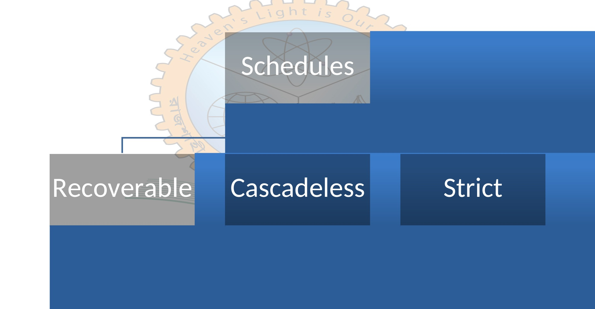
*Figure 8.1 — Types of Schedules Based on Recoverability (Source: Slide 3)*

---

<!-- Slide 4 -->
## Recoverable Schedule

A recoverable schedule ensures that the database can return to a consistent state after a transaction failure.

In this type of schedule:
- A transaction cannot use (read) data updated by another transaction until that transaction commits.
- If a transaction fails before committing, all its changes must be rolled back, and any other transactions that have used its uncommitted data must also be rolled back.

| $T_1$ | $T_2$ |
| :--- | :--- |
| $\text{R}(A) \to 5$ | |
| $\text{W}(A) \to 6$ | |
| | $\text{R}(A) \to 6$ |
| | $\text{Commit;}$ |
| $\text{Failure}$ | |

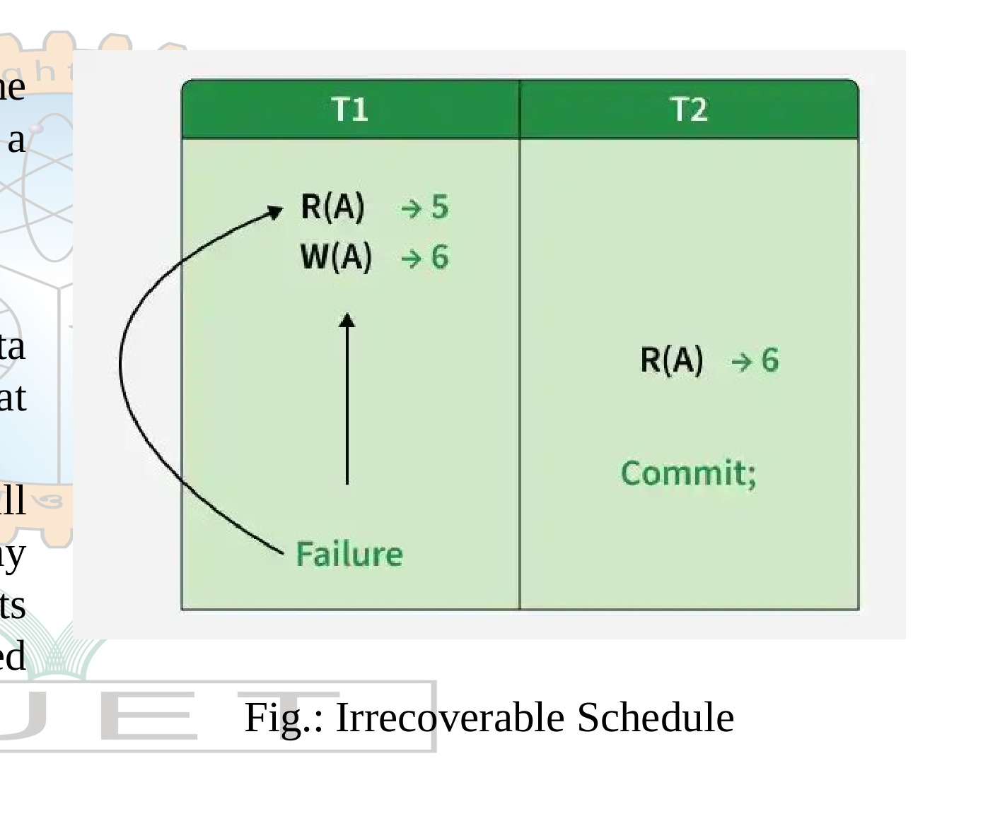
*Figure 8.2 — Irrecoverable Schedule (Source: Slide 4)*

---

<!-- Slide 5 -->
## Cascadeless Schedules

A cascade-less schedule ensures that if one transaction fails, it does not cause multiple other transactions to roll back.

| $T_1$ | $T_2$ | $T_3$ |
| :--- | :--- | :--- |
| $\text{R}(x)$ | | |
| $\text{W}(x)$ | $\leftarrow \text{Safe Read}$ | |
| $\mathbf{C}$ | $\to \text{R}(x)$ | |
| | $\text{W}(x)$ | |
| | $\mathbf{C}$ | $\to \text{R}(x)$ |
| | | $\text{W}(x)$ |
| | | $\mathbf{C}$ |

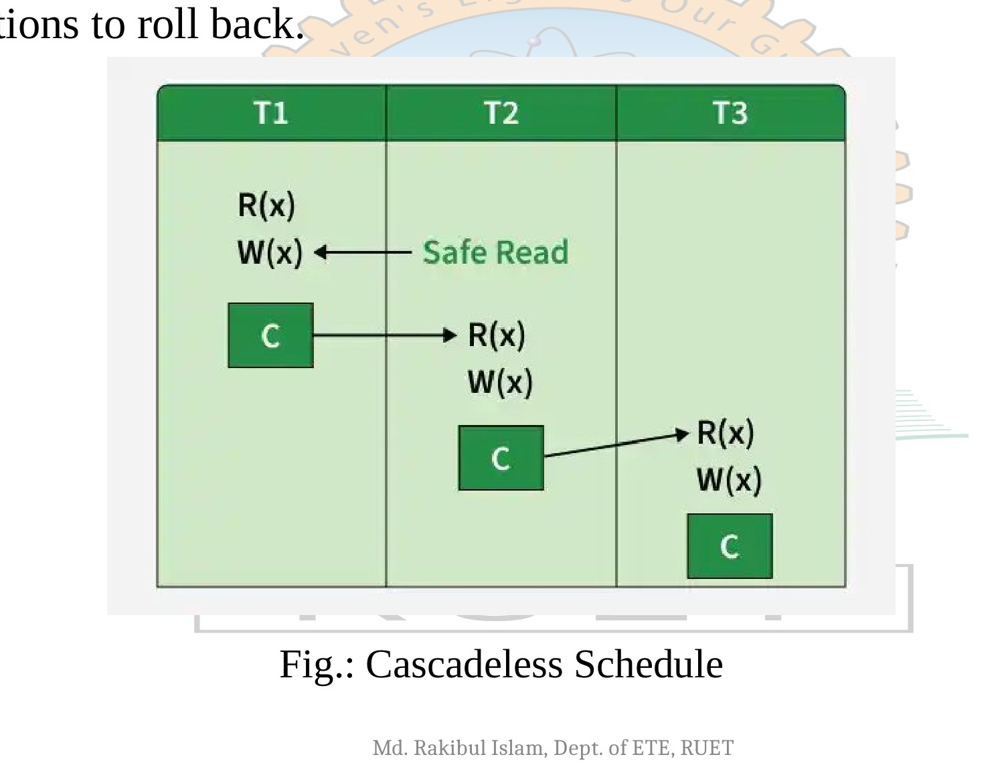
*Figure 8.3 — Cascadeless Schedule (Source: Slide 5)*

---

<!-- Slide 6 -->
## Cascading Schedules Vs Cascadeless Schedule

A **cascadeless schedule** is a type of transaction schedule that **ensures reliability by preventing cascading rollbacks**. Cascading rollbacks occur when the failure of **one transaction forces the rollback of other dependent transactions**, leading to potential data loss and system inefficiencies.

| DB | $T_1$ | $T_2$ | $T_3$ | $T_4$ |
| :---: | :--- | :--- | :--- | :--- |
| $A = 100$ | $\text{R}(A)$ | | | |
| | $A = A - 50$ | | | |
| | $\text{W}(A)$ $A = 50$ | | | |
| | | $\text{R}(A)$ $A = 50$ | | |
| | | | $\text{R}(A)$ $A = 50$ | |
| | | | | $\text{R}(A)$ $A = 50$ |
| $\text{Rollback}$ | $\text{Fail}$ | | | |
| | $\text{Commit}$ | | | |

*Hence, this is Dirty Read Problem*

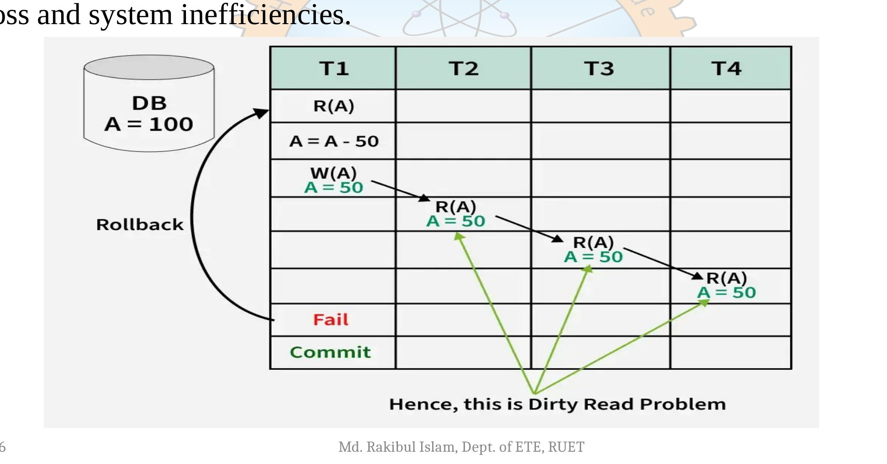
*Figure 8.4 — Cascading Rollback and Dirty Read Problem (Source: Slide 6)*

---

<!-- Slide 7 -->
## Cascading Schedules Vs Cascadeless Schedule

### Problems Due to Cascading in DBMS
- Cascading Rollbacks
- Data Inconsistency
- Loss of Progress

A cascadeless schedule is a type of transaction schedule in a database where no transaction is allowed to read data that has been modified by another transaction until that transaction has either committed or aborted.

### How a Cascadeless Schedule Works?
When a transaction modifies a data item, other transactions are restricted from accessing (reading) that data until the first transaction has finalized its changes.

This means the data is only accessible after the transaction has either:
- **Committed**: Confirmed and saved its changes permanently.
- **Aborted**: Rolled back its changes, returning the data to its previous state.

---

<!-- Slide 8 -->
## Strict Schedule

A schedule is strict if it is both recoverable and cascadeless.  
A strict schedule ensures strong data consistency by following two key rules:

1. A transaction cannot use (read) uncommitted data from another transaction until that transaction commits.
2. A transaction cannot update (write) the same data modified by another transaction until the first one commits.

*Figure 8.5 — Classification of Schedules (Source: Slide 8)*

---

<!-- Slide 9 -->
## Concurrency control

Concurrency control protocols are the set of rules which are maintained in order to solve the concurrency control problems in the database.

It ensures that the concurrent transactions can execute properly while maintaining the database consistency.

Some of the currency control protocols are as follows:
1. Lock- based protocol
2. Graph based protocol

---

<!-- Slide 10 -->
## Simple locking protocol (Shared-Exclusive Lock)

In this protocol each transaction cannot read or write the data until it acquires an appropriate lock on it.

Data items can be locked in two modes :
1. **Exclusive (X)** mode. Data item can be both read as well as written. X-lock is requested using **lock-X** instruction.
2. **Shared (S)** mode. Data item can only be read. S-lock is requested using **lock-S** instruction.

Based on these locking modes we can define Lock-compatibility matrix:
- A transaction may be granted a lock on an item if the requested lock is compatible with locks already held on the item by other transactions
- Any number of transactions can hold shared locks on an item,
- But if any transaction holds an exclusive on the item no other transaction may hold any lock on the item.

### Lock-Compatibility Matrix

| | S | X |
|:---:|:---:|:---:|
| **S** | true | false |
| **X** | false | false |

---

<!-- Slide 11 -->
## Problems with Simple locking protocol

1. The serializability cannot be always assured.
2. It may produce irrecoverable schedules.
3. May not free from starvation.
4. Deadlock can be occurs.

- Neither $T_3$ nor $T_4$ can make progress — executing **lock-S(B)** causes $T_4$ to wait for $T_3$ to release its lock on $B$, while executing **lock-X(A)** causes $T_3$ to wait for $T_4$ to release its lock on $A$.
- Such a situation is called a **deadlock**.
  - To handle a deadlock one of $T_3$ or $T_4$ must be rolled back and its locks released.

| $T_3$ | $T_4$ |
| :--- | :--- |
| $\text{lock-X}(B)$ | |
| $\text{read}(B)$ | |
| $B := B - 50$ | |
| $\text{write}(B)$ | |
| | $\text{lock-S}(A)$ |
| | $\text{read}(A)$ |
| | $\text{lock-S}(B)$ |
| $\text{lock-X}(A)$ | |

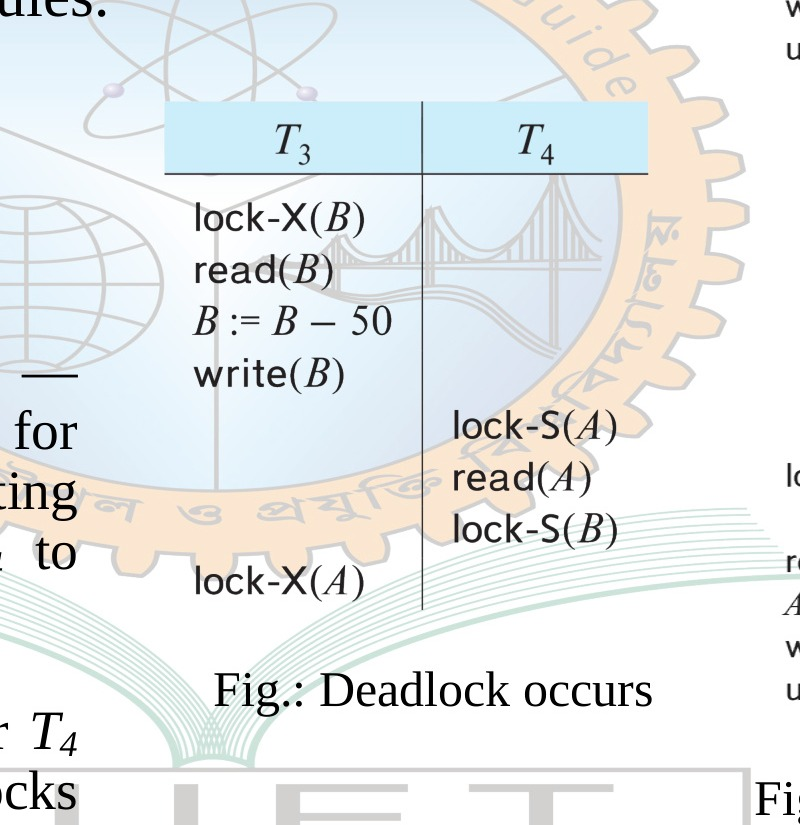
*Figure 8.6 — Deadlock Occurs in Simple Locking Protocol (Source: Slide 11)*

| $T_1$ | $T_2$ |
| :--- | :--- |
| $\text{lock-X}(B)$ | |
| $\text{read}(B)$ | |
| $B := B - 50$ | |
| $\text{write}(B)$ | |
| $\text{unlock}(B)$ | |
| | $\text{lock-S}(A)$ |
| | $\text{read}(A)$ |
| | $\text{unlock}(A)$ |
| | $\text{lock-S}(B)$ |
| | $\text{read}(B)$ |
| | $\text{unlock}(B)$ |
| | $\text{display}(A + B)$ |
| $\text{lock-X}(A)$ | |
| $\text{read}(A)$ | |
| $A := A + 50$ | |
| $\text{write}(A)$ | |
| $\text{unlock}(A)$ | |

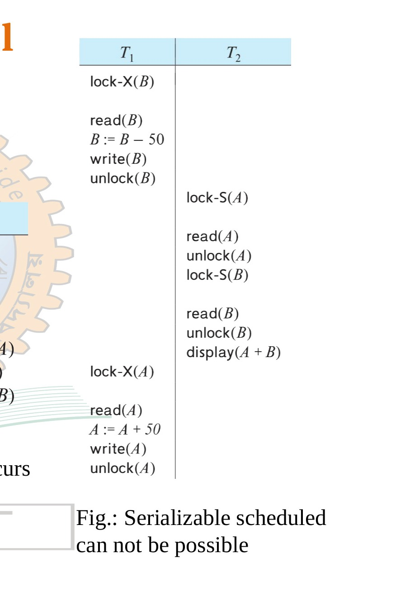
*Figure 8.7 — Serializable Schedule Cannot Be Assured (Source: Slide 11)*

---

<!-- Slide 12 -->
## Problems with Simple locking protocol

Starvation is also possible if concurrency control manager is badly designed.

For example Suppose a transaction $T_2$ has a shared-mode lock on a data item, and another transaction $T_1$ requests an exclusive-mode lock on the data item. Clearly, $T_1$ has to wait for $T_2$ to release the shared-mode lock.

Meanwhile, a transaction $T_3$ may request a shared-mode lock on the same data item. The lock request is compatible with the lock granted to $T_2$, so $T_3$ may be granted the shared mode lock. At this point $T_2$ may release the lock, but still $T_1$ has to wait for $T_3$ to finish.

But again, there may be a new transaction $T_4$ that requests a shared-mode lock on the same data item, and is granted the lock before $T_3$ releases it.

In fact, it is possible that there is a sequence of transactions that each requests a shared-mode lock on the data item, and each transaction releases the lock a short while after it is granted, but $T_1$ never gets the exclusive-mode lock on the data item. The transaction $T_1$ may never make progress, and is said to be **starved**.

| $T_1$ | $T_2$ | $T_3$ | $T_4$ |
| :---: | :---: | :---: | :---: |
| | $\text{S}(A)$ | | |
| $\text{X}(A)$ | | | |
| | | $\text{S}(A)$ | |
| | $\text{U}(A)$ | | |
| | | | $\text{S}(A)$ |
| | | $\text{U}(A)$ | |
| | | | $\text{U}(A)$ |
| $\text{G}(\text{X}(A))$ | | | |

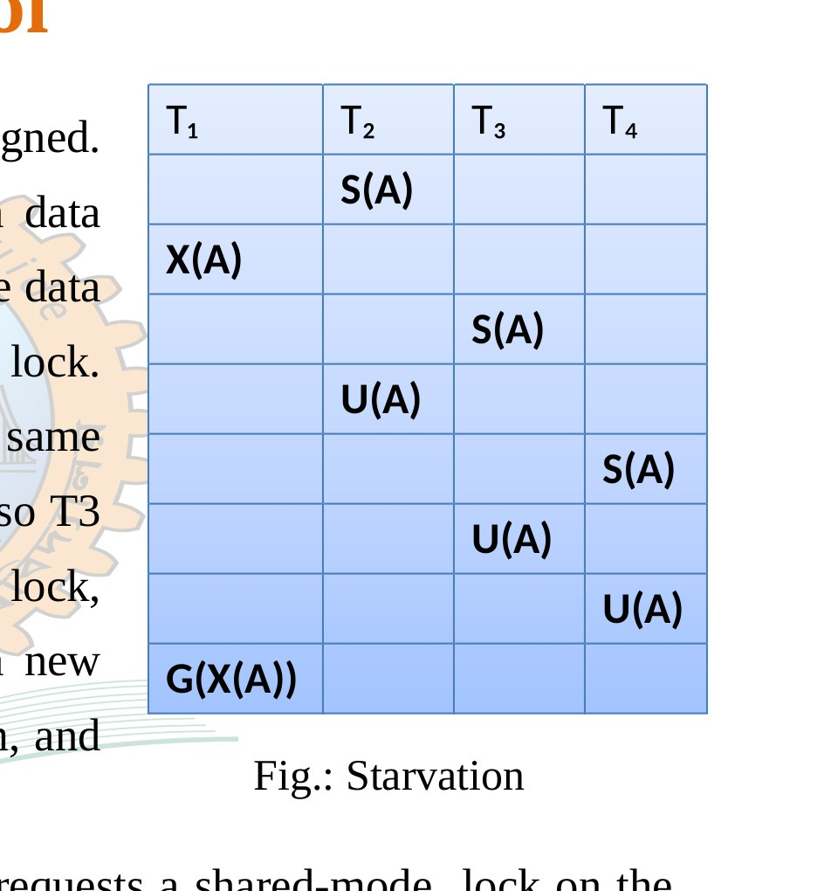
*Figure 8.8 — Starvation in Locking Protocol (Source: Slide 12)*

---

<!-- Slide 13 -->
## Two phase (2-PL) locking protocol

Simple Lock-based protocol does not guarantee Serializability. Schedules may follow the preceding rules but a non-serializable schedule may result. This is where the concept of Two-Phase Locking(2-PL) comes into the picture, 2-PL ensures serializability.

- **Phase 1: Growing Phase**
  – Transaction may obtain locks
  – Transaction may not release locks
- **Phase 2: Shrinking Phase**
  – Transaction may release locks
  – Transaction may not obtain locks

The protocol assures serializability. It can be proved that the transactions can be serialized in the order of their **lock points** (i.e., the point where a transaction acquired its final lock).

*Figure 8.9 — Two-Phase Locking Protocol (Source: Slide 13)*

---

<!-- Slide 14 -->
## Two phase (2-PL) locking protocol

Two-phase locking protocol with lock conversions:
– **Growing Phase:**
  • can acquire a lock-S on item
  • can acquire a lock-X on item
  • can **convert** a lock-S to a lock-X (**upgrade**)
– **Shrinking Phase:**
  • can release a lock-S
  • can release a lock-X
  • can convert a lock-X to a lock-S (**downgrade**)

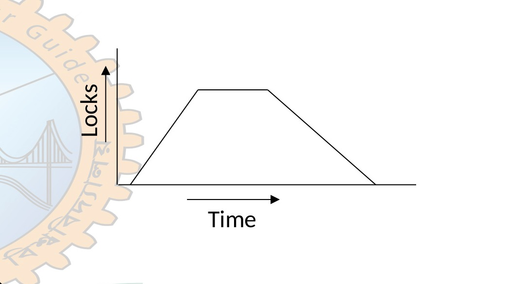
*Figure 8.10 — Two-Phase Locking Protocol with Lock Conversions (Source: Slide 14)*

---

<!-- Slide 15 -->
## Two phase (2-PL) locking protocol

### Transaction T1
- **Growing Phase:** From Time 2 to 3
- **Shrinking Phase:** From Time 5 to 7
- **Lock Point:** At time 3

### Transaction T2
- **Growing Phase:** From Time 1 to 6
- **Shrinking Phase:** From Time 8 to 9
- **Lock Point:** At Time 6

| Time | T1 | T2 |
| :---: | :--- | :--- |
| 1 | | $\text{Lock-S}(A)$ |
| 2 | $\text{Lock-S}(A)$ | |
| 3 | $\text{Lock-X}(B)$ | |
| 4 | | |
| 5 | $\text{Unlock}(A)$ | |
| 6 | | $\text{Lock-X}(C)$ |
| 7 | $\text{Unlock}(B)$ | |
| 8 | | $\text{Unlock}(A)$ |
| 9 | | $\text{Unlock}(C)$ |

As we say, 2PL will generate the serial schedule then what will be the sequence of transaction execution?  
**Answer:** If locking point of Transaction T1 comes earlier than transaction T2 then the T1 will execute first than T2.

---

<!-- Slide 16 -->
## Problem with 2-PL locking protocol

Although,2-Phase Locking ensures serializability, but there are still some drawbacks of 2-PL.They are as follows:

1. **The schedule that is produced through 2PL may be irrecoverable**

| T1 | T2 |
| :--- | :--- |
| $\text{Lock-X}(A)$ | |
| $\text{R}(A)$ | |
| $\text{Write}(A)$ | |
| $\text{Unlock}(A)$ | |
| | $\text{Lock-S}(A)$ |
| | $\text{Read}(A)$ |
| | $\text{Unlock}(A)$ |
| | $\text{Commit}$ |
| $\text{Failure}$ | |

The above schedule is a irrecoverable because of the reasons mentioned below:
- The transaction T2 is also committed before the completion of transaction T1. The transaction T1 fails later and there are rollbacks.
- The transaction T2 reads an incorrect value.
- The transaction T2 which is performing a **dirty read** operation on A.

Finally, the transaction T2 cannot recover because it is already committed.

---

<!-- Slide 17 -->
## Problem with 2-PL locking protocol

2. **The schedule that is produced through 2PL locking may still contains a deadlock problem**

| T1 | T2 |
| :--- | :--- |
| $\text{Lock-X}(A)$ | |
| | $\text{Lock-X}(B)$ |
| $\text{Lock-X}(B)$ | |
| | $\text{Lock-X}(A)$ |

Here,
- In T1 Exclusive lock on data A is granted. In T2 Exclusive lock on data B is granted
- In T1 Exclusive Lock on data B waits until T2 unlock Exclusive Lock on B
- Exclusive Lock in Data A is wait until T1 unlock the Exclusive lock on A

---

<!-- Slide 18 -->
## Problem with 2-PL locking protocol

3. **Cascading rollback problem**

| Time | T1 | T2 | T3 |
| :---: | :--- | :--- | :--- |
| 1 | $\text{Lock-X}(A)$ | | |
| 2 | $\text{Read}(A)$ | | |
| 3 | $\text{Write}(A)$ | | |
| 4 | $\text{Unlock}(A)$ | | |
| 5 | | $\text{Lock-S}(A)$ | |
| 6 | | $\text{Read}(A)$ | |
| 7 | | | $\text{Lock-S}(A)$ |
| 8 | | | $\text{Read}(A)$ |
| 9 | $\text{Failure}$ | | |

Here,
- T2 is dependent on T1, and T3 is dependent on T2
- If T1 failed, T1 must be rolled back ,similarly as T2 is dependent on T1,T2 also must be rolled back.
- Again as T3 is dependent on T2,T3 must also be rolled back.

---

<!-- Slide 19 -->
## Strict & Rigorous two-phase locking

### Strict two-phase locking
- A transaction must hold all its **exclusive locks** till it commits/aborts. Ensures recoverability and avoids cascading rollbacks.
- The only difference between 2PL and strict 2PL is that Strict-2PL does not release a lock after using it.
- Strict-2PL protocol does not have shrinking phase of lock release.
- Strict-2PL waits until the whole transaction to commit, and then it releases all the locks at a time.

### Rigorous two-phase locking:
- A transaction must hold **all locks** till commit/abort.
- Transactions can be serialized in the order in which they commit.

**Note:** The difference between Strict 2-PL and Rigorous 2-PL is that Rigorous is more restrictive, it requires both Exclusive and Shared locks to be held until after the Transaction commits and this is what makes the implementation of Rigorous 2-PL easier.

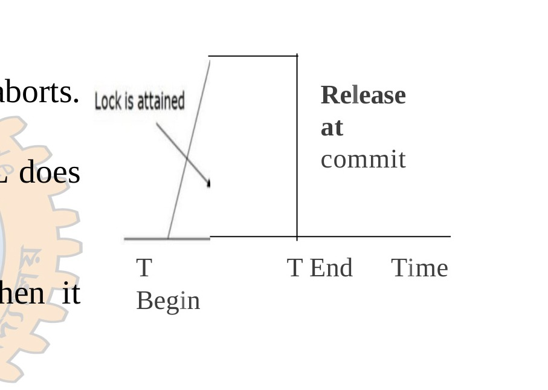
*Figure 8.11 — Lock Release at Commit in Strict/Rigorous 2PL (Source: Slide 19)*

---

<!-- Slide 20 -->
## Deadlock

System is deadlocked if there is a set of transactions such that every transaction in the set is waiting for another transaction in the set.

- Transaction T3 request resource B and received it. Transaction T4 request resource A and received it.
- Transaction T4 request resource B and is queued up waiting the release of A by transaction T3.
- Transaction T3 request resource A and is queued up waiting the release of A by transaction T4.

| $T_3$ | $T_4$ |
| :--- | :--- |
| $\text{lock-X}(B)$ | |
| $\text{read}(B)$ | |
| $B := B - 50$ | |
| $\text{write}(B)$ | |
| | $\text{lock-S}(A)$ |
| | $\text{read}(A)$ |
| | $\text{lock-S}(B)$ |
| $\text{lock-X}(A)$ | |

---

<!-- Slide 21 -->
## Deadlock

### Conditions for deadlock:
We can say a deadlock is occurred if these four conditions occur simultaneously.

1. **Mutual Exclusion:** Only one transaction at a time can use a resource.
2. **Hold and wait:** A transaction holding at least one resource is waiting to acquire additional resources held by other transactions.
3. **No preemption:** A resource can be released only voluntarily by the transaction holding it after the transaction completed its task.
4. **Circular wait:** There exist a set $\{T_1, T_2, \dots, T_N\}$ of waiting process such that $T_1$ is waiting for a resource that is held by $T_2$, $T_2$ is waiting for a resource held by $T_3$ and finally $T_N$ is waiting for resource held by $T_1$.

There are **two principal methods** for dealing with the deadlock problem. We can use a **deadlock prevention** protocol to ensure that the system will never enter a deadlock state. Alternatively, we can allow the system to enter a deadlock state, and then try to recover by using a **deadlock detection and deadlock recovery** scheme. As we shall see, both methods may result in transaction rollback

---

<!-- Slide 22 -->
## Deadlock

### Deadlock Prevention
Deadlock Prevention Protocols ensure that the system will never enter into a deadlock state. Two approach to deadlock prevention
- First approach ensures that no cyclic waits can occur by ordering the requests for locks, requiring all locks to be acquired together.
- Second approach performs transaction rolled back instead of waiting for a lock, whenever the wait could be potentially result in a deadlock.

The first approach requires that each transaction locks all its data items before execution. Moreover either all are locked in one step or none are locked.  
There are two main disadvantages.
- It is often hard to predict, before the transaction begins, what data items need to be locked.
- Data items utilization may be very low, since many of the data items may be locked but unused for it a long time.

The second approach for preventing deadlock is use preemption and transaction rollback. Two different deadlock prevention schemes using timestamps have been proposed.

---

<!-- Slide 23 -->
## Deadlock

### Deadlock Prevention
The second approach for preventing deadlock is use preemption and transaction rollback. Two different deadlock prevention schemes using timestamps have been proposed.

1. **Wait -die scheme (non-preemptive):** When transaction $T_i$ requests a data item currently head by $T_j$. $T_i$ is allowed to wait only if it has a timestamp smaller than that of $T_j$ (i.e $T_i$ older than $T_j$). Otherwise $T_i$ rolled back(dies). For example, suppose that transactions $T_1$, $T_2$ and $T_3$ have timestamp 20, 30 and 40 respectively. If $T_1$ request data item held by $T_2$, then $T_1$ will be wait. If $T_3$ requests a data item held by $T_2$, then $T_3$ will be rolled back.
2. **Wound -wait scheme(preemptive):** When transaction $T_i$ requests a data item currently held by $T_j$, $T_i$ is allowed to wait only if it has a timestamp larger than that of $T_j$ (i.e $T_i$ is younger than $T_j$) . Otherwise $T_j$ rolled back ($T_j$ is wounded by $T_i$). For example, suppose that transactions $T_1$, $T_2$ and $T_3$ have timestamp 20, 30 and 40 respectively. If $T_1$ request a data item held by $T_2$, then data item will be preempted from $T_2$ and $T_2$ will be rolled back. If $T_3$ requests a data item held by $T_2$, then $T_3$ will wait.

Both in wait-die and in wound-wait schemes, a rolled back transaction is restarted with its original timestamp. Older transaction thus have precedence over new ones, and starvation is hence avoided.

---

<!-- Slide 24 -->
## Deadlock

### Deadlock Prevention
**Timeout-Based schemes:** A transaction waits for a lock only for a specified amount of time. After that, the wait times out and the transaction is rolled back. Thus deadlock is not possible. Simple to implement; but starvation is possible. Also difficult to determine good value of the timeout interval.

### Deadlock Detection:
- **Wait-for graph**
  - Vertices: transactions
  - Edge from $T_i \to T_j$ : if $T_i$ is waiting for a lock held in conflicting mode by $T_j$
- The system is in a deadlock state if and only if the wait-for graph has a cycle.
- Invoke a deadlock-detection algorithm periodically to look for cycles.

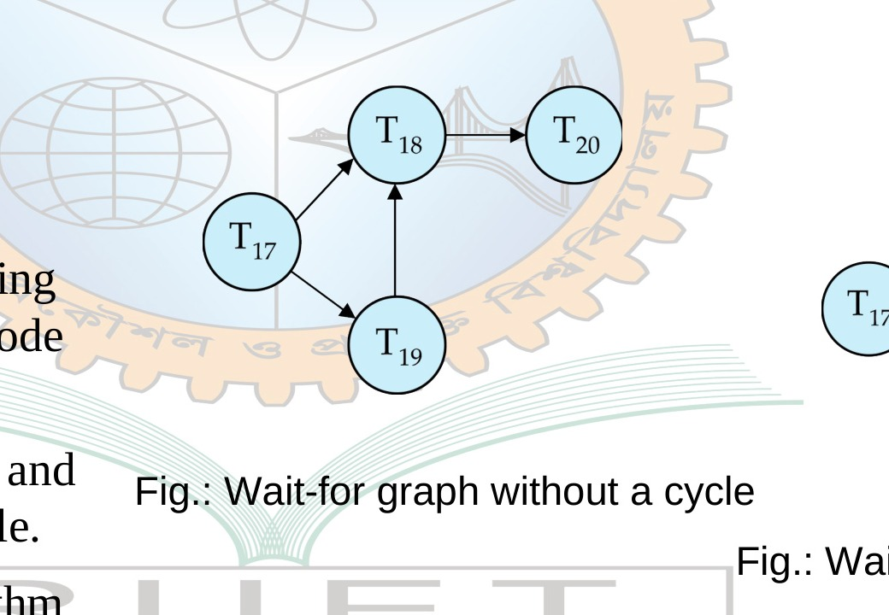
*Figure 8.12 — Wait-for Graph Without a Cycle (Source: Slide 24)*

*Figure 8.13 — Wait-for Graph With a Cycle (Deadlock) (Source: Slide 24)*

---

<!-- Slide 25 -->
## Deadlock

- When deadlock is detected :
  - Some transaction will have to rolled back (made a **victim**) to break deadlock cycle.
  - Select that transaction as victim that will incur minimum cost
  - Rollback -- determine how far to roll back transaction
    - **Total rollback:** Abort the transaction and then restart it.
    - **Partial rollback:** Roll back victim transaction only as far as necessary to release locks that another transaction in cycle is waiting for
- Starvation can happen (why?)
  - One solution: In a system where the selections of victims is based primarily on cost factors, It may happen that the same transaction is always picked as a victim. As a result this transaction never completes its designated task, thus there is a starvation. We must ensure that a transaction can be picked as a victim only a small (finite number of times). The most common solution is to include the number of rollbacks in cost factor.

---

<!-- Slide 26 -->
## Timestamp-Based Protocols

- Each transaction $T_i$ is issued a timestamp $\text{TS}(T_i)$ when it enters the system.
  - Each transaction has a *unique* timestamp
  - Newer transactions have timestamps strictly greater than earlier ones
  - Timestamp could be based on a logical counter
    - Real time may not be unique
    - Can use (wall-clock time, logical counter) to ensure
- Timestamp-based protocols manage concurrent execution such that:
  $$\textbf{time-stamp order} = \textbf{serializability order}$$
- Several alternative protocols based on timestamps

---

<!-- Slide 27 -->
## Timestamp ordering (TSO) protocol

The **timestamp ordering (TSO) protocol**
- Maintains for each data $Q$ two timestamp values:
  - **W-timestamp($Q$)** is the largest time-stamp of any transaction that executed $\text{write}(Q)$ successfully.
  - **R-timestamp($Q$)** is the largest time-stamp of any transaction that executed $\text{read}(Q)$ successfully.
- Imposes rules on read and write operations to ensure that
  - Any conflicting operations are executed in timestamp order
  - Out of order operations cause transaction rollback

---

<!-- Slide 28 -->
## Timestamp ordering (TSO) protocol

- Suppose a transaction $T_i$ issues a $\mathbf{read}(Q)$
  1. If $\text{TS}(T_i) < \textbf{W-timestamp}(Q)$, then $T_i$ needs to read a value of $Q$ that was already overwritten.
     - Hence, the **read** operation is rejected, and $T_i$ is rolled back.
  2. If $\text{TS}(T_i) \ge \textbf{W-timestamp}(Q)$, then the **read** operation is executed, and $\text{R-timestamp}(Q)$ is set to $\mathbf{\max}(\text{R-timestamp}(Q), \text{TS}(T_i))$.

> **Note:** We use this concept that, always older transaction completed first. So if a younger transaction do $\text{W}(Q)$ or $\text{R}(Q)$ after older transaction $\text{W}(Q)$ or $\text{R}(Q)$ then its no problem. But if a older transaction do $\text{W}(Q)$ or $\text{R}(Q)$ after younger transaction $\text{W}(Q)$ or $\text{R}(Q)$ then we roll back the older transaction.

---

<!-- Slide 29 -->
## Timestamp ordering (TSO) protocol

- Suppose that transaction $T_i$ issues $\mathbf{write}(Q)$.
  1. If $\text{TS}(T_i) < \text{R-timestamp}(Q)$, then the value of $Q$ that $T_i$ is producing was needed previously, and the system assumed that that value would never be produced.
     - Hence, the **write** operation is rejected, and $T_i$ is rolled back.
  2. If $\text{TS}(T_i) < \text{W-timestamp}(Q)$, then $T_i$ is attempting to write an obsolete value of $Q$.
     - Hence, this **write** operation is rejected, and $T_i$ is rolled back.
  3. Otherwise, the **write** operation is executed, and $\text{W-timestamp}(Q)$ is set to $\text{TS}(T_i)$.

---

<!-- Slide 30 -->
## Timestamp ordering (TSO) protocol

- **Is this schedule valid under TSO?**

  Assume that initially:
  $$\text{R-TS}(A) = \text{W-TS}(A) = 0$$
  $$\text{R-TS}(B) = \text{W-TS}(B) = 0$$
  Assume $\text{TS}(T_{25}) = 25$ and $\text{TS}(T_{26}) = 26$

| $T_{25}$ | $T_{26}$ |
| :--- | :--- |
| $\text{read}(B)$ | |
| | $\text{read}(B)$ |
| | $B := B - 50$ |
| | $\text{write}(B)$ |
| $\text{read}(A)$ | |
| | $\text{read}(A)$ |
| $\text{display}(A + B)$ | |
| | $A := A + 50$ |
| | $\text{write}(A)$ |
| | $\text{display}(A + B)$ |

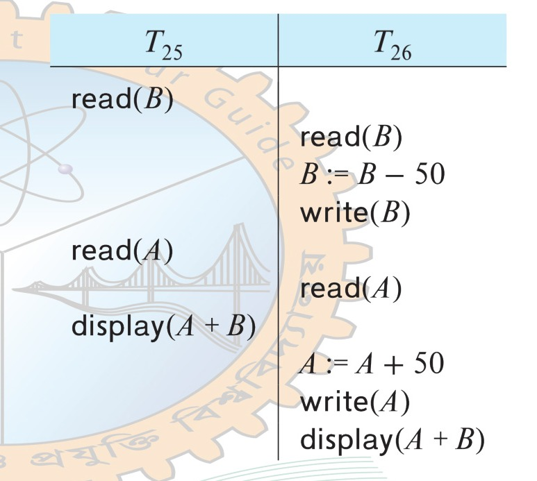
*Figure 8.14 — Schedule of $T_{25}$ and $T_{26}$ Under Timestamp Ordering Protocol (Source: Slide 30)*

- **How about this one, where initially $\text{R-TS}(Q) = \text{W-TS}(Q) = 0$**

| $T_{27}$ | $T_{28}$ |
| :--- | :--- |
| $\text{read}(Q)$ | |
| | $\text{write}(Q)$ |
| $\text{write}(Q)$ | |

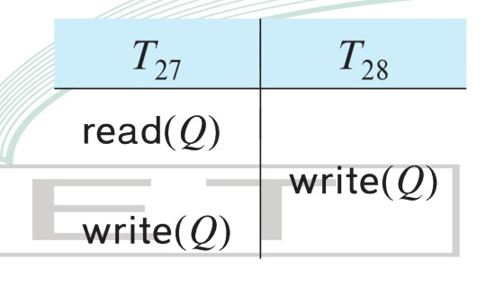
*Figure 8.15 — Schedule of $T_{27}$ and $T_{28}$ Under Timestamp Ordering Protocol (Source: Slide 30)*

---

<!-- Slide 31 -->
## Thank you
