<!-- Page 1285 -->

# Part 10

## Appendix A

Appendix A presents the full details of the university database that we have used as our running example, including an E-R diagram, SQL DDL, and sample data that we have used throughout the book. (The DDL and sample data are also available on the web site of the book, db-book.com, for use in laboratory exercises.)

<!-- Page 1286 -->
*(This page is blank in the textbook)*

<!-- Page 1287 -->

# Appendix A: Detailed University Schema

In this appendix, we present the full details of our running-example university database. In Section A.1 we present the full schema as used in the text and the E-R diagram that corresponds to that schema. In Section A.2 we present a relatively complete SQL data definition for our running university example. Besides listing a datatype for each attribute, we include a substantial number of constraints. Finally, in Section A.3, we present sample data that correspond to our schema. SQL scripts to create all the relations in the schema, and to populate them with sample data, are available on the web site of the book, db-book.com.

## A.1 Full Schema

The full schema of the university database that is used in the text follows. The corresponding schema diagram, and the one used throughout the text, is shown in Figure A.1.

$$classroom\ (\underline{building},\ \underline{room\_number},\ capacity)$$
$$department\ (\underline{dept\_name},\ building,\ budget)$$
$$course\ (\underline{course\_id},\ title,\ dept\_name,\ credits)$$
$$instructor\ (\underline{ID},\ name,\ dept\_name,\ salary)$$
$$section\ (\underline{course\_id},\ \underline{sec\_id},\ \underline{semester},\ \underline{year},\ building,\ room\_number,\ time\_slot\_id)$$
$$teaches\ (\underline{ID},\ \underline{course\_id},\ \underline{sec\_id},\ \underline{semester},\ \underline{year})$$
$$student\ (\underline{ID},\ name,\ dept\_name,\ tot\_cred)$$
$$takes\ (\underline{ID},\ \underline{course\_id},\ \underline{sec\_id},\ \underline{semester},\ \underline{year},\ grade)$$
$$advisor\ (\underline{s\_ID},\ i\_ID)$$
$$time\_slot\ (\underline{time\_slot\_id},\ \underline{day},\ \underline{start\_time},\ end\_time)$$
$$prereq\ (\underline{course\_id},\ \underline{prereq\_id})$$

<!-- Page 1288 -->

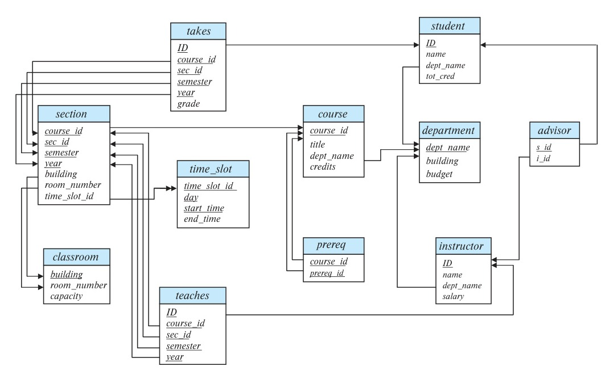
*Figure A.1 — Schema diagram for the university database.*

## A.2 DDL

In this section, we present a relatively complete SQL data definition for our example. Besides listing a datatype for each attribute, we include a substantial number of constraints.

```sql
create table classroom
	(building		varchar (15),
	 room_number	varchar (7),
	 capacity		numeric (4,0),
	 primary key (building, room_number));

create table department
	(dept_name		varchar (20),
	 building		varchar (15),
	 budget			numeric (12,2) check (budget > 0),
	 primary key (dept_name));
```

<!-- Page 1289 -->

```sql
create table course
	(course_id		varchar (7),
	 title			varchar (50),
	 dept_name		varchar (20),
	 credits		numeric (2,0) check (credits > 0),
	 primary key (course_id),
	 foreign key (dept_name) references department
		on delete set null);

create table instructor
	(ID				varchar (5),
	 name			varchar (20) not null,
	 dept_name		varchar (20),
	 salary			numeric (8,2) check (salary > 29000),
	 primary key (ID),
	 foreign key (dept_name) references department
		on delete set null);

create table section
	(course_id		varchar (8),
	 sec_id			varchar (8),
	 semester		varchar (6) check (semester in
						('Fall', 'Winter', 'Spring', 'Summer')),
	 year			numeric (4,0) check (year > 1701 and year < 2100),
	 building		varchar (15),
	 room_number	varchar (7),
	 time_slot_id	varchar (4),
	 primary key (course_id, sec_id, semester, year),
	 foreign key (course_id) references course
		on delete cascade,
	 foreign key (building, room_number) references classroom
		on delete set null);
```

In the preceding DDL, we add the **on delete cascade** specification to a foreign key constraint if the existence of the tuple depends on the referenced tuple. For example, we add the **on delete cascade** specification to the foreign key constraint from *section* (which was generated from weak entity *section*), to *course* (which was its identifying relationship). In other foreign key constraints we either specify **on delete set null**, which allows deletion of a referenced tuple by setting the referencing value to null, or we do not add any specification, which prevents the deletion of any referenced tuple. For example, if a department is deleted, we would not wish to delete associated instructors;

<!-- Page 1290 -->

the foreign key constraint from *instructor* to *department* instead sets the *dept_name* attribute to null. On the other hand, the foreign key constraint for the *prereq* relation, shown later, prevents the deletion of a course that is required as a prerequisite for another course. For the *advisor* relation, shown later, we allow *i_ID* to be set to null if an instructor is deleted but delete an advisor tuple if the referenced student is deleted.

```sql
create table teaches
	(ID				varchar (5),
	 course_id		varchar (8),
	 sec_id			varchar (8),
	 semester		varchar (6),
	 year			numeric (4,0),
	 primary key (ID, course_id, sec_id, semester, year),
	 foreign key (course_id, sec_id, semester, year) references section
		on delete cascade,
	 foreign key (ID) references instructor
		on delete cascade);

create table student
	(ID				varchar (5),
	 name			varchar (20) not null,
	 dept_name		varchar (20),
	 tot_cred		numeric (3,0) check (tot_cred >= 0),
	 primary key (ID),
	 foreign key (dept_name) references department
		on delete set null);

create table takes
	(ID				varchar (5),
	 course_id		varchar (8),
	 sec_id			varchar (8),
	 semester		varchar (6),
	 year			numeric (4,0),
	 grade			varchar (2),
	 primary key (ID, course_id, sec_id, semester, year),
	 foreign key (course_id, sec_id, semester, year) references section
		on delete cascade,
	 foreign key (ID) references student
		on delete cascade);
```

<!-- Page 1291 -->

```sql
create table advisor
	(s_ID			varchar (5),
	 i_ID			varchar (5),
	 primary key (s_ID),
	 foreign key (i_ID) references instructor (ID)
		on delete set null,
	 foreign key (s_ID) references student (ID)
		on delete cascade);

create table prereq
	(course_id		varchar (8),
	 prereq_id		varchar (8),
	 primary key (course_id, prereq_id),
	 foreign key (course_id) references course
		on delete cascade,
	 foreign key (prereq_id) references course);
```

The following **create table** statement for the table *time_slot* can be run on most database systems, but it does not work on Oracle (at least as of Oracle version 11), since Oracle does not support the SQL standard type **time**.

```sql
create table timeslot
	(time_slot_id	varchar (4),
	 day			varchar (1) check (day in ('M', 'T', 'W', 'R', 'F', 'S', 'U')),
	 start_time		time,
	 end_time		time,
	 primary key (time_slot_id, day, start_time));
```

The syntax for specifying time in SQL is illustrated by these examples: '08:30', '13:55', and '5:30 PM'. Since Oracle does not support the **time** type, for Oracle we use the following schema instead:

```sql
create table timeslot
	(time_slot_id	varchar (4),
	 day			varchar (1),
	 start_hr		numeric (2) check (start_hr >= 0 and end_hr < 24),
	 start_min		numeric (2) check (start_min >= 0 and start_min < 60),
	 end_hr			numeric (2) check (end_hr >= 0 and end_hr < 24),
	 end_min		numeric (2) check (end_min >= 0 and end_min < 60),
	 primary key (time_slot_id, day, start_hr, start_min));
```

The difference is that *start_time* has been replaced by two attributes *start_hr* and *start_min*, and similarly *end_time* has been replaced by attributes *end_hr* and *end_min*.

<!-- Page 1292 -->

These attributes also have constraints that ensure that only numbers representing valid time values appear in those attributes. This version of the schema for *time_slot* works on all databases, including Oracle. Note that although Oracle supports the **datetime** datatype, **datetime** includes a specific day, month, and year as well as a time, and is not appropriate here since we want only a time. There are two alternatives to splitting the time attributes into an hour and a minute component, but neither is desirable. The first alternative is to use a **varchar** type, but that makes it hard to enforce validity constraints on the string as well as to perform comparison on time. The second alternative is to encode time as an integer representing a number of minutes (or seconds) from midnight, but this alternative requires extra code with each query to convert values between the standard time representation and the integer encoding. We therefore choose the two-part solution.

## A.3 Sample Data

In this section we provide sample data for each of the relations defined in the previous section.

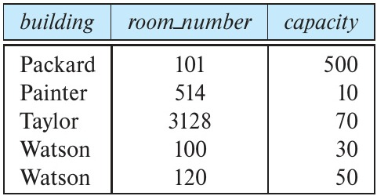
*Figure A.2 — The classroom relation.*

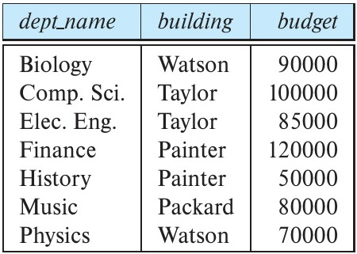
*Figure A.3 — The department relation.*

<!-- Page 1293 -->

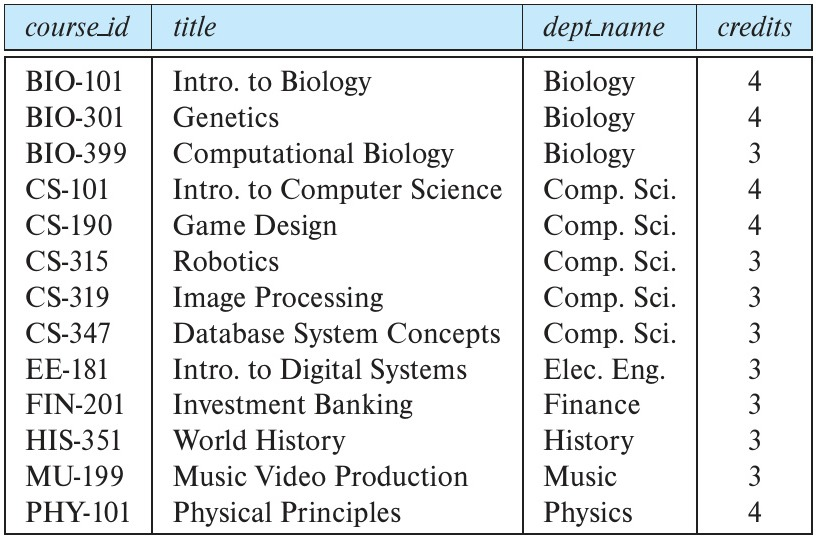
*Figure A.4 — The course relation.*

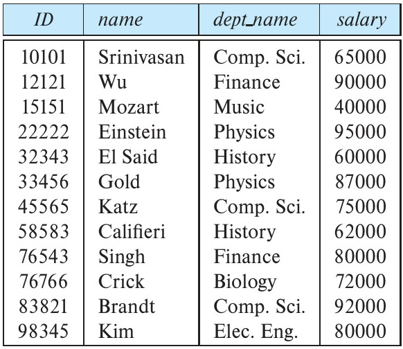
*Figure A.5 — The instructor relation.*

<!-- Page 1294 -->

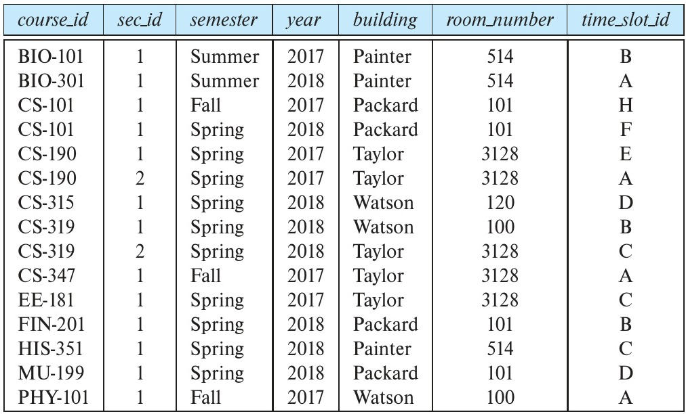
*Figure A.6 — The section relation.*

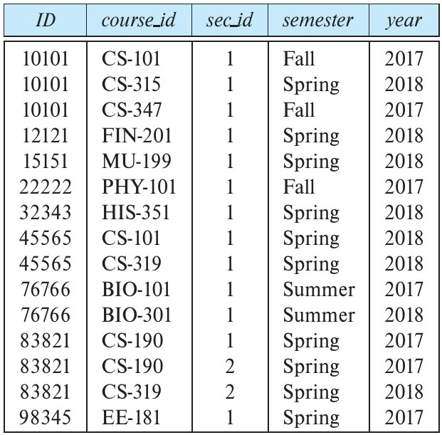
*Figure A.7 — The teaches relation.*

<!-- Page 1295 -->

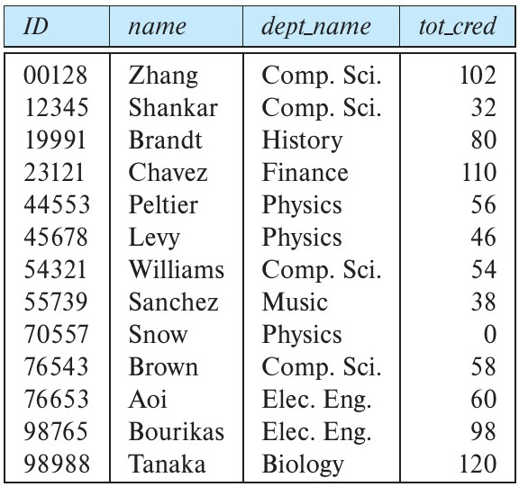
*Figure A.8 — The student relation.*

<!-- Page 1296 -->

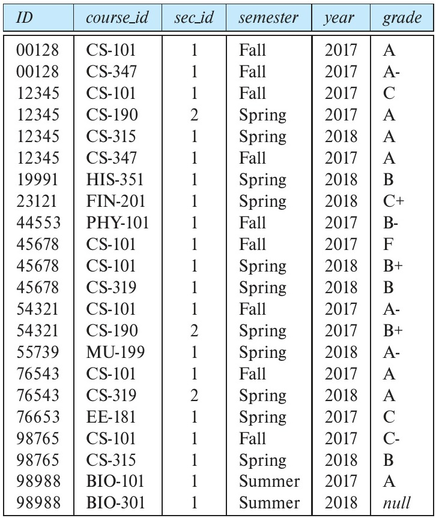
*Figure A.9 — The takes relation.*

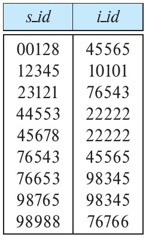
*Figure A.10 — The advisor relation.*

<!-- Page 1297 -->

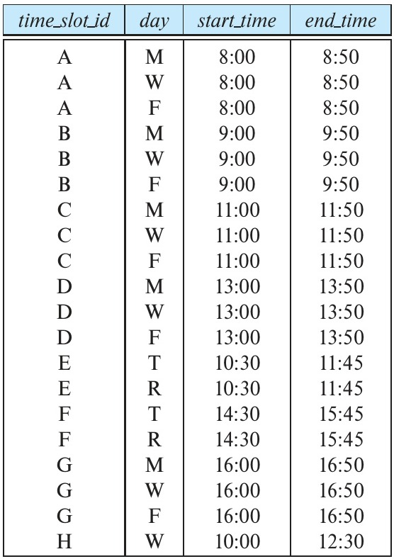
*Figure A.11 — The time slot relation.*

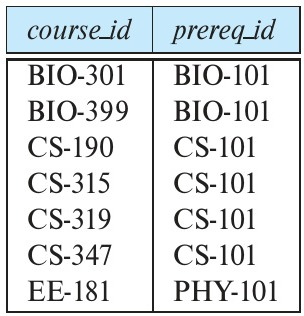
*Figure A.12 — The prereq relation.*

<!-- Page 1298 -->

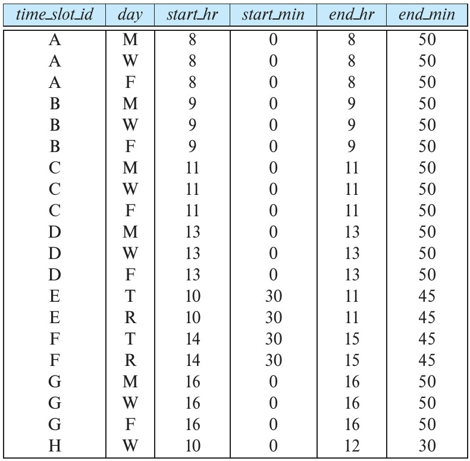
*Figure A.13 — The time slot relation with start and end times separated into hour and minute.*
