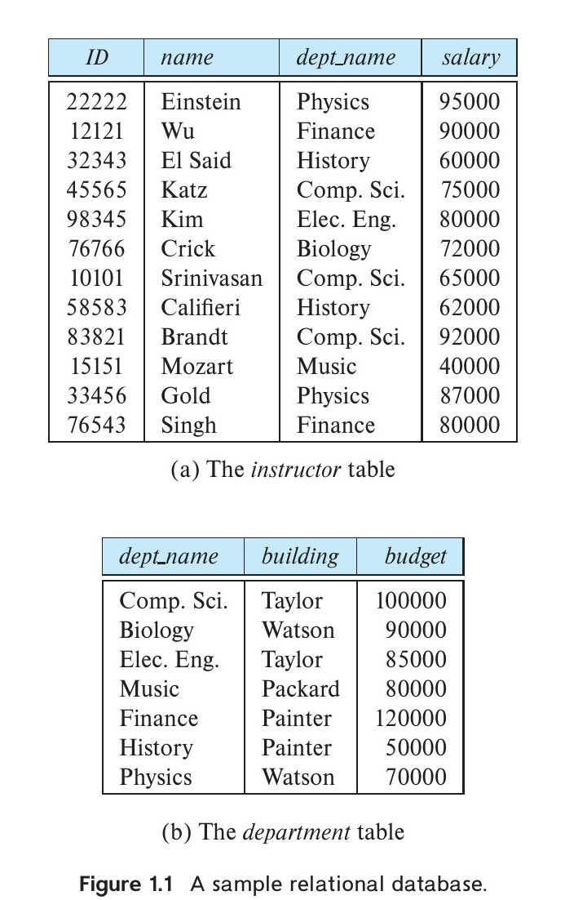
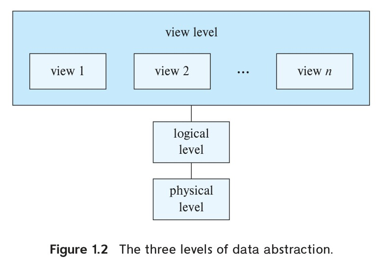
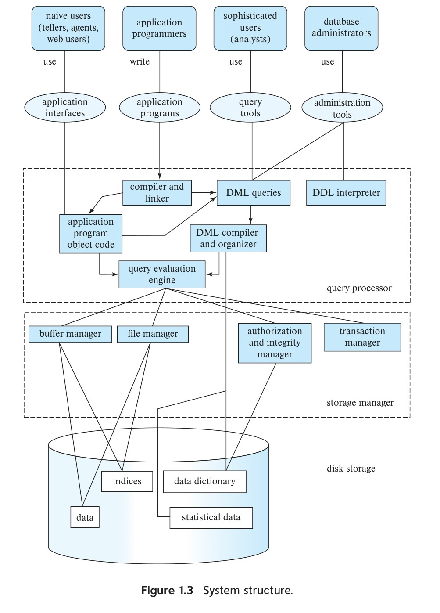

<!-- Page 1 -->

# Chapter 1: Introduction

A **database-management system** (**DBMS**) is a collection of interrelated data and a set of programs to access those data. The collection of data, usually referred to as the **database**, contains information relevant to an enterprise. The primary goal of a DBMS is to provide a way to store and retrieve database information that is both *convenient* and *efficient*.

Database systems are designed to manage large bodies of information. Management of data involves both defining structures for storage of information and providing mechanisms for the manipulation of information. In addition, the database system must ensure the safety of the information stored, despite system crashes or attempts at unauthorized access. If data are to be shared among several users, the system must avoid possible anomalous results.

Because information is so important in most organizations, computer scientists have developed a large body of concepts and techniques for managing data. These concepts and techniques form the focus of this book. This chapter briefly introduces the principles of database systems.

## 1.1 Database-System Applications

The earliest database systems arose in the 1960s in response to the computerized management of commercial data. Those earlier applications were relatively simple compared to modern database applications. Modern applications include highly sophisticated, worldwide enterprises.

All database applications, old and new, share important common elements. The central aspect of the application is not a program performing some calculation, but rather the data themselves. Today, some of the most valuable corporations are valuable not because of their physical assets, but rather because of the information they own. Imagine a bank without its data on accounts and customers or a social-network site that loses the connections among its users. Such companies’ value would be almost totally lost under such circumstances.

<!-- Page 2 -->

Database systems are used to manage collections of data that:

- are highly valuable,
- are relatively large, and
- are accessed by multiple users and applications, often at the same time.

The first database applications had only simple, precisely formatted, structured data. Today, database applications may include data with complex relationships and a more variable structure. As an example of an application with structured data, consider a university’s records regarding courses, students, and course registration. The university keeps the same type of information about each course: course-identifier, title, department, course number, etc., and similarly for students: student-identifier, name, address, phone, etc. Course registration is a collection of pairs: one course identifier and one student identifier. Information of this sort has a standard, repeating structure and is representative of the type of database applications that go back to the 1960s. Contrast this simple university database application with a social-networking site. Users of the site post varying types of information about themselves ranging from simple items such as name or date of birth, to complex posts consisting of text, images, videos, and links to other users. There is only a limited amount of common structure among these data. Both of these applications, however, share the basic features of a database.

Modern database systems exploit commonalities in the structure of data to gain efficiency but also allow for weakly structured data and for data whose formats are highly variable. As a result, a database system is a large, complex software system whose task is to manage a large, complex collection of data.

Managing complexity is challenging, not only in the management of data but in any domain. Key to the management of complexity is the concept of *abstraction*. Abstraction allows a person to use a complex device or system without having to know the details of how that device or system is constructed. A person is able, for example, to drive a car by knowing how to operate its controls. However, the driver does not need to know how the motor was built nor how it operates. All the driver needs to know is an abstraction of what the motor does. Similarly, for a large, complex collection of data, a database system provides a simpler, abstract view of the information so that users and application programmers do not need to be aware of the underlying details of how data are stored and organized. By providing a high level of abstraction, a database system makes it possible for an enterprise to combine data of various types into a unified repository of the information needed to run the enterprise.

Here are some representative applications:

- **Enterprise Information**
  - **Sales:** For customer, product, and purchase information.

<!-- Page 3 -->

  - **Accounting:** For payments, receipts, account balances, assets, and other accounting information.
  - **Human resources:** For information about employees, salaries, payroll taxes, and benefits, and for generation of paychecks.
- **Manufacturing:** For management of the supply chain and for tracking production of items in factories, inventories of items in warehouses and stores, and orders for items.
- **Banking and Finance**
  - **Banking:** For customer information, accounts, loans, and banking transactions.
  - **Credit card transactions:** For purchases on credit cards and generation of monthly statements.
  - **Finance:** For storing information about holdings, sales, and purchases of financial instruments such as stocks and bonds; also for storing real-time market data to enable online trading by customers and automated trading by the firm.
- **Universities:** For student information, course registrations, and grades (in addition to standard enterprise information such as human resources and accounting).
- **Airlines:** For reservations and schedule information. Airlines were among the first to use databases in a geographically distributed manner.
- **Telecommunication:** For keeping records of calls, texts, and data usage, generating monthly bills, maintaining balances on prepaid calling cards, and storing information about the communication networks.
- **Web-based services**
  - **Social-media:** For keeping records of users, connections between users (such as friend/follows information), posts made by users, rating/like information about posts, etc.
  - **Online retailers:** For keeping records of sales data and orders as for any retailer, but also for tracking a user’s product views, search terms, etc., for the purpose of identifying the best items to recommend to that user.
  - **Online advertisements:** For keeping records of click history to enable targeted advertisements, product suggestions, news articles, etc. People access such databases every time they do a web search, make an online purchase, or access a social-networking site.
- **Document databases:** For maintaining collections of new articles, patents, published research papers, etc.
- **Navigation systems:** For maintaining the locations of varies places of interest along with the exact routes of roads, train systems, buses, etc.

<!-- Page 4 -->

As this list illustrates, databases form an essential part not only of every enterprise but also of a large part of a person’s daily activities.

The ways in which people interact with databases has changed over time. Early databases were maintained as back-office systems with which users interacted via printed reports and paper forms for input. As database systems became more sophisticated, better languages were developed for programmers to use in interacting with the data, along with user interfaces that allowed end users within the enterprise to query and update data.

As the support for programmer interaction with databases improved, and computer hardware performance increased even as hardware costs decreased, more sophisticated applications emerged that brought database data into more direct contact not only with end users within an enterprise but also with the general public. Whereas once bank customers had to interact with a teller for every transaction, automated-teller machines (ATMs) allowed direct customer interaction. Today, virtually every enterprise employs web applications or mobile applications to allow its customers to interact directly with the enterprise’s database, and, thus, with the enterprise itself.

The user, or customer, can focus on the product or service without being aware of the details of the large database that makes the interaction possible. For instance, when you read a social-media post, or access an online bookstore and browse a book or music collection, you are accessing data stored in a database. When you enter an order online, your order is stored in a database. When you access a bank web site and retrieve your bank balance and transaction information, the information is retrieved from the bank’s database system. When you access a web site, information about you may be retrieved from a database to select which advertisements you should see. Almost every interaction with a smartphone results in some sort of database access. Furthermore, data about your web accesses may be stored in a database.

Thus, although user interfaces hide details of access to a database, and most people are not even aware they are dealing with a database, accessing databases forms an essential part of almost everyone’s life today.

Broadly speaking, there are two modes in which databases are used.

- The first mode is to support **online transaction processing**, where a large number of users use the database, with each user retrieving relatively small amounts of data, and performing small updates. This is the primary mode of use for the vast majority of users of database applications such as those that we outlined earlier.
- The second mode is to support **data analytics**, that is, the processing of data to draw conclusions, and infer rules or decision procedures, which are then used to drive business decisions.

For example, banks need to decide whether to give a loan to a loan applicant, online advertisers need to decide which advertisement to show to a particular user. These tasks are addressed in two steps. First, data-analysis techniques attempt to automatically discover rules and patterns from data and create *predictive models*. These models take as input attributes (“features”) of individuals, and output pre-

<!-- Page 5 -->

dictions such as likelihood of paying back a loan, or clicking on an advertisement, which are then used to make the business decision.

As another example, manufacturers and retailers need to make decisions on what items to manufacture or order in what quantities; these decisions are driven significantly by techniques for analyzing past data, and predicting trends. The cost of making wrong decisions can be very high, and organizations are therefore willing to invest a lot of money to gather or purchase required data, and build systems that can use the data to make accurate predictions.

The field of *data mining* combines knowledge-discovery techniques invented by artificial intelligence researchers and statistical analysts with efficient implementation techniques that enable them to be used on extremely large databases.

## 1.2 Purpose of Database Systems

To understand the purpose of database systems, consider part of a university organization that, among other data, keeps information about all instructors, students, departments, and course offerings. One way to keep the information on a computer is to store it in operating-system files. To allow users to manipulate the information, the system has a number of application programs that manipulate the files, including programs to:

- Add new students, instructors, and courses.
- Register students for courses and generate class rosters.
- Assign grades to students, compute grade point averages (GPA), and generate transcripts.

Programmers develop these application programs to meet the needs of the university.

New application programs are added to the system as the need arises. For example, suppose that a university decides to create a new major. As a result, the university creates a new department and creates new permanent files (or adds information to existing files) to record information about all the instructors in the department, students in that major, course offerings, degree requirements, and so on. The university may have to write new application programs to deal with rules specific to the new major. New application programs may also have to be written to handle new rules in the university. Thus, as time goes by, the system acquires more files and more application programs.

This typical **file-processing system** is supported by a conventional operating system. The system stores permanent records in various files, and it needs different application programs to extract records from, and add records to, the appropriate files.

Keeping organizational information in a file-processing system has a number of major disadvantages:

<!-- Page 6 -->

- **Data redundancy and inconsistency.** Since different programmers create the files and application programs over a long period, the various files are likely to have different structures, and the programs may be written in several programming languages. Moreover, the same information may be duplicated in several places (files). For example, if a student has a double major (say, music and mathematics), the address and telephone number of that student may appear in a file that consists of student records of students in the Music department and in a file that consists of student records of students in the Mathematics department. This redundancy leads to higher storage and access cost. In addition, it may lead to **data inconsistency**; that is, the various copies of the same data may no longer agree. For example, a changed student address may be reflected in the Music department records but not elsewhere in the system.
- **Difficulty in accessing data.** Suppose that one of the university clerks needs to find out the names of all students who live within a particular postal-code area. The clerk asks the data-processing department to generate such a list. Because the designers of the original system did not anticipate this request, there is no application program on hand to meet it. There is, however, an application program to generate the list of *all* students. The university clerk now has two choices: either obtain the list of all students and extract the needed information manually or ask a programmer to write the necessary application program. Both alternatives are obviously unsatisfactory. Suppose that such a program is written and that, several days later, the same clerk needs to trim that list to include only those students who have taken at least 60 credit hours. As expected, a program to generate such a list does not exist. Again, the clerk has the preceding two options, neither of which is satisfactory.

  The point here is that conventional file-processing environments do not allow needed data to be retrieved in a convenient and efficient manner. More responsive data-retrieval systems are required for general use.
- **Data isolation.** Because data are scattered in various files, and files may be in different formats, writing new application programs to retrieve the appropriate data is difficult.
- **Integrity problems.** The data values stored in the database must satisfy certain types of **consistency constraints**. Suppose the university maintains an account for each department, and records the balance amount in each account. Suppose also that the university requires that the account balance of a department may never fall below zero. Developers enforce these constraints in the system by adding appropriate code in the various application programs. However, when new constraints are added, it is difficult to change the programs to enforce them. The problem is compounded when constraints involve several data items from different files.
- **Atomicity problems.** A computer system, like any other device, is subject to failure. In many applications, it is crucial that, if a failure occurs, the data be restored to the

<!-- Page 7 -->

  consistent state that existed prior to the failure. Consider a banking system with a program to transfer \$500 from account *A* to account *B*. If a system failure occurs during the execution of the program, it is possible that the \$500 was removed from the balance of account *A* but was not credited to the balance of account *B*, resulting in an inconsistent database state. Clearly, it is essential to database consistency that either both the credit and debit occur, or that neither occur. That is, the funds transfer must be *atomic*—it must happen in its entirety or not at all. It is difficult to ensure atomicity in a conventional file-processing system.
- **Concurrent-access anomalies.** For the sake of overall performance of the system and faster response, many systems allow multiple users to update the data simultaneously. Indeed, today, the largest internet retailers may have millions of accesses per day to their data by shoppers. In such an environment, interaction of concurrent updates is possible and may result in inconsistent data. Consider account *A*, with a balance of \$10,000. If two bank clerks debit the account balance (by say \$500 and \$100, respectively) of account *A* at almost exactly the same time, the result of the concurrent executions may leave the account balance in an incorrect (or inconsistent) state. Suppose that the programs executing on behalf of each withdrawal read the old balance, reduce that value by the amount being withdrawn, and write the result back. If the two programs run concurrently, they may both read the value \$10,000, and write back \$9500 and \$9900, respectively. Depending on which one writes the value last, the balance of account *A* may contain either \$9500 or \$9900, rather than the correct value of \$9400. To guard against this possibility, the system must maintain some form of supervision. But supervision is difficult to provide because data may be accessed by many different application programs that have not been coordinated previously.

  As another example, suppose a registration program maintains a count of students registered for a course in order to enforce limits on the number of students registered. When a student registers, the program reads the current count for the courses, verifies that the count is not already at the limit, adds one to the count, and stores the count back in the database. Suppose two students register concurrently, with the count at 39. The two program executions may both read the value 39, and both would then write back 40, leading to an incorrect increase of only 1, even though two students successfully registered for the course and the count should be 41. Furthermore, suppose the course registration limit was 40; in the above case both students would be able to register, leading to a violation of the limit of 40 students.
- **Security problems.** Not every user of the database system should be able to access all the data. For example, in a university, payroll personnel need to see only that part of the database that has financial information. They do not need access to information about academic records. But since application programs are added to the file-processing system in an ad hoc manner, enforcing such security constraints is difficult.

<!-- Page 8 -->

These difficulties, among others, prompted both the initial development of database systems and the transition of file-based applications to database systems, back in the 1960s and 1970s.

In what follows, we shall see the concepts and algorithms that enable database systems to solve the problems with file-processing systems. In most of this book, we use a university organization as a running example of a typical data-processing application.

## 1.3 View of Data

A database system is a collection of interrelated data and a set of programs that allow users to access and modify these data. A major purpose of a database system is to provide users with an abstract view of the data. That is, the system hides certain details of how the data are stored and maintained.

### 1.3.1 Data Models

Underlying the structure of a database is the **data model**: a collection of conceptual tools for describing data, data relationships, data semantics, and consistency constraints.

There are a number of different data models that we shall cover in the text. The data models can be classified into four different categories:

- **Relational Model.** The relational model uses a collection of tables to represent both data and the relationships among those data. Each table has multiple columns, and each column has a unique name. Tables are also known as **relations**. The relational model is an example of a record-based model. Record-based models are so named because the database is structured in fixed-format records of several types. Each table contains records of a particular type. Each record type defines a fixed number of fields, or attributes. The columns of the table correspond to the attributes of the record type. The relational data model is the most widely used data model, and a vast majority of current database systems are based on the relational model. Chapter 2 and Chapter 7 cover the relational model in detail.
- **Entity-Relationship Model.** The entity-relationship (E-R) data model uses a collection of basic objects, called entities, and relationships among these objects. An entity is a “thing” or “object” in the real world that is distinguishable from other objects. The entity-relationship model is widely used in database design. Chapter 6 explores it in detail.
- **Semi-structured Data Model.** The semi-structured data model permits the specification of data where individual data items of the same type may have different sets of attributes. This is in contrast to the data models mentioned earlier, where every data item of a particular type must have the same set of attributes. JSON and Extensible Markup Language (XML) are widely used semi-structured data representations. Semi-structured data models are explored in detail in Chapter 8.

<!-- Page 9 -->

- **Object-Based Data Model.** Object-oriented programming (especially in Java, C++, or C#) has become the dominant software-development methodology. This led initially to the development of a distinct object-oriented data model, but today the concept of objects is well integrated into relational databases. Standards exist to store objects in relational tables. Database systems allow procedures to be stored in the database system and executed by the database system. This can be seen as extending the relational model with notions of encapsulation, methods, and object identity. Object-based data models are summarized in Chapter 8.

A large portion of this text is focused on the relational model because it serves as the foundation for most database applications.

### 1.3.2 Relational Data Model

In the relational model, data are represented in the form of tables. Each table has multiple columns, and each column has a unique name. Each row of the table represents one piece of information. Figure 1.1 presents a sample relational database comprising two tables: one shows details of university instructors and the other shows details of the various university departments.

The first table, the *instructor* table, shows, for example, that an instructor named Einstein with *ID* 22222 is a member of the Physics department and has an annual salary of \$95,000. The second table, *department*, shows, for example, that the Biology department is located in the Watson building and has a budget of \$90,000. Of course, a real-world university would have many more departments and instructors. We use small tables in the text to illustrate concepts. A larger example for the same schema is available online.

### 1.3.3 Data Abstraction

For the system to be usable, it must retrieve data efficiently. The need for efficiency has led database system developers to use complex data structures to represent data in the database. Since many database-system users are not computer trained, developers hide the complexity from users through several levels of **data abstraction**, to simplify users’ interactions with the system:

- **Physical level.** The lowest level of abstraction describes *how* the data are actually stored. The physical level describes complex low-level data structures in detail.
- **Logical level.** The next-higher level of abstraction describes *what* data are stored in the database, and what relationships exist among those data. The logical level thus describes the entire database in terms of a small number of relatively simple structures. Although implementation of the simple structures at the logical level may involve complex physical-level structures, the user of the logical level does not need to be aware of this complexity. This is referred to as **physical data indepen-**

<!-- Page 10 -->


*Figure 1.1 — A sample relational database.*

**dence**. Database administrators, who must decide what information to keep in the database, use the logical level of abstraction.
- **View level.** The highest level of abstraction describes only part of the entire database. Even though the logical level uses simpler structures, complexity remains because of the variety of information stored in a large database. Many users of the database system do not need all this information; instead, they need to access only a part of the database. The view level of abstraction exists to simplify their interaction with the system. The system may provide many views for the same database.

Figure 1.2 shows the relationship among the three levels of abstraction.

An important feature of data models, such as the relational model, is that they hide such low-level implementation details from not just database users, but even from

<!-- Page 11 -->


*Figure 1.2 — The three levels of data abstraction.*

database-application developers. The database system allows application developers to store and retrieve data using the abstractions of the data model, and converts the abstract operations into operations on the low-level implementation.

An analogy to the concept of data types in programming languages may clarify the distinction among levels of abstraction. Many high-level programming languages support the notion of a structured type. We may describe the type of a record abstractly as follows:[^1]

```pascal
type instructor = record
    ID : char (5);
    name : char (20);
    dept_name : char (20);
    salary : numeric (8,2);
end;
```

This code defines a new record type called *instructor* with four fields. Each field has a name and a type associated with it. For example, **char**(20) specifies a string with 20 characters, while **numeric**(8,2) specifies a number with 8 digits, two of which are to the right of the decimal point. A university organization may have several such record types, including:

- *department*, with fields *dept_name*, *building*, and *budget*.
- *course*, with fields *course_id*, *title*, *dept_name*, and *credits*.
- *student*, with fields *ID*, *name*, *dept_name*, and *tot_cred*.

[^1]: The actual type declaration depends on the language being used. C and C++ use **struct** declarations. Java does not have such a declaration, but a simple class can be defined to the same effect.

<!-- Page 12 -->

At the physical level, an instructor, department, or student record can be described as a block of consecutive bytes. The compiler hides this level of detail from programmers. Similarly, the database system hides many of the lowest-level storage details from database programmers. Database administrators, on the other hand, may be aware of certain details of the physical organization of the data. For example, there are many possible ways to store tables in files. One way is to store a table as a sequence of records in a file, with a special character (such as a comma) used to delimit the different attributes of a record, and another special character (such as a new-line character) may be used to delimit records. If all attributes have fixed length, the lengths of attributes may be stored separately, and delimiters may be omitted from the file. Variable length attributes could be handled by storing the length, followed by the data. Databases use a type of data structure called an index to support efficient retrieval of records; these too form part of the physical level.

At the logical level, each such record is described by a type definition, as in the previous code segment. The interrelationship of these record types is also defined at the logical level; a requirement that the *dept_name* value of an *instructor* record must appear in the *department* table is an example of such an interrelationship. Programmers using a programming language work at this level of abstraction. Similarly, database administrators usually work at this level of abstraction.

Finally, at the view level, computer users see a set of application programs that hide details of the data types. At the view level, several views of the database are defined, and a database user sees some or all of these views. In addition to hiding details of the logical level of the database, the views also provide a security mechanism to prevent users from accessing certain parts of the database. For example, clerks in the university registrar office can see only that part of the database that has information about students; they cannot access information about salaries of instructors.

### 1.3.4 Instances and Schemas

Databases change over time as information is inserted and deleted. The collection of information stored in the database at a particular moment is called an **instance** of the database. The overall design of the database is called the database **schema**. The concept of database schemas and instances can be understood by analogy to a program written in a programming language. A database schema corresponds to the variable declarations (along with associated type definitions) in a program. Each variable has a particular value at a given instant. The values of the variables in a program at a point in time correspond to an instance of a database schema.

Database systems have several schemas, partitioned according to the levels of abstraction. The **physical schema** describes the database design at the physical level, while the **logical schema** describes the database design at the logical level. A database may also have several schemas at the view level, sometimes called **subschemas**, that describe different views of the database.

Of these, the logical schema is by far the most important in terms of its effect on application programs, since programmers construct applications by using the logical

<!-- Page 13 -->

schema. The physical schema is hidden beneath the logical schema and can usually be changed easily without affecting application programs. Application programs are said to exhibit **physical data independence** if they do not depend on the physical schema and thus need not be rewritten if the physical schema changes.

We also note that it is possible to create schemas that have problems, such as unnecessarily duplicated information. For example, suppose we store the department budget as an attribute of the instructor record. Then, whenever the value of the budget for a department (say the Physics department) changes, that change must be reflected in the records of all instructors associated with the department. In Chapter 7, we shall study how to distinguish good schema designs from bad schema designs.

Traditionally, logical schemas were changed infrequently, if at all. Many newer database applications, however, require more flexible logical schemas where, for example, different records in a single relation may have different attributes.

## 1.4 Database Languages

A database system provides a **data-definition language** (**DDL**) to specify the database schema and a **data-manipulation language** (**DML**) to express database queries and updates. In practice, the data-definition and data-manipulation languages are not two separate languages; instead they simply form parts of a single database language, such as the SQL language. Almost all relational database systems employ the SQL language, which we cover in great detail in Chapter 3, Chapter 4, and Chapter 5.

### 1.4.1 Data-Definition Language

We specify a database schema by a set of definitions expressed by a special language called a **data-definition language** (**DDL**). The DDL is also used to specify additional properties of the data.

We specify the storage structure and access methods used by the database system by a set of statements in a special type of DDL called a **data storage and definition language**. These statements define the implementation details of the database schemas, which are usually hidden from the users.

The data values stored in the database must satisfy certain consistency constraints. For example, suppose the university requires that the account balance of a department must never be negative. The DDL provides facilities to specify such constraints. The database system checks these constraints every time the database is updated. In general, a constraint can be an arbitrary predicate pertaining to the database. However, arbitrary predicates may be costly to test. Thus, database systems implement only those integrity constraints that can be tested with minimal overhead:

- **Domain Constraints.** A domain of possible values must be associated with every attribute (for example, integer types, character types, date/time types). Declaring an attribute to be of a particular domain acts as a constraint on the values that it

<!-- Page 14 -->

  can take. Domain constraints are the most elementary form of integrity constraint. They are tested easily by the system whenever a new data item is entered into the database.
- **Referential Integrity.** There are cases where we wish to ensure that a value that appears in one relation for a given set of attributes also appears in a certain set of attributes in another relation (**referential integrity**). For example, the department listed for each course must be one that actually exists in the university. More precisely, the *dept_name* value in a *course* record must appear in the *dept_name* attribute of some record of the *department* relation. Database modifications can cause violations of referential integrity. When a referential-integrity constraint is violated, the normal procedure is to reject the action that caused the violation.
- **Authorization.** We may want to differentiate among the users as far as the type of access they are permitted on various data values in the database. These differentiations are expressed in terms of **authorization**, the most common being: **read authorization**, which allows reading, but not modification, of data; **insert authorization**, which allows insertion of new data, but not modification of existing data; **update authorization**, which allows modification, but not deletion, of data; and **delete authorization**, which allows deletion of data. We may assign the user all, none, or a combination of these types of authorization.

The processing of DDL statements, just like those of any other programming language, generates some output. The output of the DDL is placed in the **data dictionary**, which contains **metadata**—that is, data about data. The data dictionary is considered to be a special type of table that can be accessed and updated only by the database system itself (not a regular user). The database system consults the data dictionary before reading or modifying actual data.

### 1.4.2 The SQL Data-Definition Language

SQL provides a rich DDL that allows one to define tables with data types and integrity constraints.

For instance, the following SQL DDL statement defines the *department* table:

```sql
create table department
    (dept_name        char (20),
     building         char (15),
     budget           numeric (12,2));
```

Execution of the preceding DDL statement creates the *department* table with three columns: *dept_name*, *building*, and *budget*, each of which has a specific data type associated with it. We discuss data types in more detail in Chapter 3.

The SQL DDL also supports a number of types of integrity constraints. For example, one can specify that the *dept_name* attribute value is a **primary key**, ensuring that no

<!-- Page 15 -->

two departments can have the same department name. As another example, one can specify that the *dept_name* attribute value appearing in any instructor record must also appear in the *dept_name* attribute of some record of the *department* table. We discuss SQL support for integrity constraints and authorizations in Chapter 3 and Chapter 4.

### 1.4.3 Data-Manipulation Language

A **data-manipulation language** (**DML**) is a language that enables users to access or manipulate data as organized by the appropriate data model. The types of access are:

- Retrieval of information stored in the database.
- Insertion of new information into the database.
- Deletion of information from the database.
- Modification of information stored in the database.

There are basically two types of data-manipulation language:

- **Procedural DMLs** require a user to specify what data are needed and how to get those data.
- **Declarative DMLs** (also referred to as **nonprocedural DMLs**) require a user to specify what data are needed without specifying how to get those data.

Declarative DMLs are usually easier to learn and use than are procedural DMLs. However, since a user does not have to specify how to get the data, the database system has to figure out an efficient means of accessing data.

A **query** is a statement requesting the retrieval of information. The portion of a DML that involves information retrieval is called a **query language**. Although technically incorrect, it is common practice to use the terms *query language* and *data-manipulation language* synonymously.

There are a number of database query languages in use, either commercially or experimentally. We study the most widely used query language, SQL, in Chapter 3 through Chapter 5.

The levels of abstraction that we discussed in Section 1.3 apply not only to defining or structuring data, but also to manipulating data. At the physical level, we must define algorithms that allow efficient access to data. At higher levels of abstraction, we emphasize ease of use. The goal is to allow humans to interact efficiently with the system. The query processor component of the database system (which we study in Chapter 15 and Chapter 16) translates DML queries into sequences of actions at the physical level of the database system. In Chapter 22, we study the processing of queries in the increasingly common parallel and distributed settings.

<!-- Page 16 -->

### 1.4.4 The SQL Data-Manipulation Language

The SQL query language is nonprocedural. A query takes as input several tables (possibly only one) and always returns a single table. Here is an example of an SQL query that finds the names of all instructors in the History department:

```sql
select instructor.name
from instructor
where instructor.dept_name = 'History';
```

The query specifies that those rows from the table *instructor* where the *dept_name* is History must be retrieved, and the *name* attribute of these rows must be displayed. The result of executing this query is a table with a single column labeled *name* and a set of rows, each of which contains the name of an instructor whose *dept_name* is History. If the query is run on the table in Figure 1.1, the result consists of two rows, one with the name El Said and the other with the name Califieri.

Queries may involve information from more than one table. For instance, the following query finds the instructor ID and department name of all instructors associated with a department with a budget of more than \$95,000.

```sql
select instructor.ID, department.dept_name
from instructor, department
where instructor.dept_name = department.dept_name and
      department.budget > 95000;
```

If the preceding query were run on the tables in Figure 1.1, the system would find that there are two departments with a budget of greater than \$95,000—Computer Science and Finance; there are five instructors in these departments. Thus, the result consists of a table with two columns (*ID*, *dept_name*) and five rows: (12121, Finance), (45565, Computer Science), (10101, Computer Science), (83821, Computer Science), and (76543, Finance).

### 1.4.5 Database Access from Application Programs

Non-procedural query languages such as SQL are not as powerful as a universal Turing machine; that is, there are some computations that are possible using a general-purpose programming language but are not possible using SQL. SQL also does not support actions such as input from users, output to displays, or communication over the network. Such computations and actions must be written in a *host* language, such as C/C++, Java, or Python, with embedded SQL queries that access the data in the database. **Application programs** are programs that are used to interact with the database in this fashion. Examples in a university system are programs that allow students to register for courses, generate class rosters, calculate student GPA, generate payroll checks, and perform other tasks.

<!-- Page 17 -->

To access the database, DML statements need to be sent from the host to the database where they will be executed. This is most commonly done by using an application-program interface (set of procedures) that can be used to send DML and DDL statements to the database and retrieve the results. The Open Database Connectivity (ODBC) standard defines application program interfaces for use with C and several other languages. The Java Database Connectivity (JDBC) standard defines a corresponding interface for the Java language.

## 1.5 Database Design

Database systems are designed to manage large bodies of information. These large bodies of information do not exist in isolation. They are part of the operation of some enterprise whose end product may be information from the database or may be some device or service for which the database plays only a supporting role.

Database design mainly involves the design of the database schema. The design of a complete database application environment that meets the needs of the enterprise being modeled requires attention to a broader set of issues. In this text, we focus on the writing of database queries and the design of database schemas, but discuss application design later, in Chapter 9.

A high-level data model provides the database designer with a conceptual framework in which to specify the data requirements of the database users and how the database will be structured to fulfill these requirements. The initial phase of database design, then, is to characterize fully the data needs of the prospective database users. The database designer needs to interact extensively with domain experts and users to carry out this task. The outcome of this phase is a specification of user requirements.

Next, the designer chooses a data model, and by applying the concepts of the chosen data model, translates these requirements into a conceptual schema of the database. The schema developed at this **conceptual-design** phase provides a detailed overview of the enterprise. The designer reviews the schema to confirm that all data requirements are indeed satisfied and are not in conflict with one another. The designer can also examine the design to remove any redundant features. The focus at this point is on describing the data and their relationships, rather than on specifying physical storage details.

In terms of the relational model, the conceptual-design process involves decisions on *what* attributes we want to capture in the database and *how to group* these attributes to form the various tables. The “what” part is basically a business decision, and we shall not discuss it further in this text. The “how” part is mainly a computer-science problem. There are principally two ways to tackle the problem. The first one is to use the entity-relationship model (Chapter 6); the other is to employ a set of algorithms (collectively known as **normalization**) that takes as input the set of all attributes and generates a set of tables (Chapter 7).

A fully developed conceptual schema indicates the functional requirements of the enterprise. In a **specification of functional requirements**, users describe the kinds of oper-

<!-- Page 18 -->

ations (or transactions) that will be performed on the data. Example operations include modifying or updating data, searching for and retrieving specific data, and deleting data. At this stage of conceptual design, the designer can review the schema to ensure it meets functional requirements.

The process of moving from an abstract data model to the implementation of the database proceeds in two final design phases. In the **logical-design phase**, the designer maps the high-level conceptual schema onto the implementation data model of the database system that will be used. The designer uses the resulting system-specific database schema in the subsequent **physical-design phase**, in which the physical features of the database are specified. These features include the form of file organization and the internal storage structures; they are discussed in Chapter 13.

## 1.6 Database Engine

A database system is partitioned into modules that deal with each of the responsibilities of the overall system. The functional components of a database system can be broadly divided into the storage manager, the **query processor** components, and the transaction management component.

The storage manager is important because databases typically require a large amount of storage space. Corporate databases commonly range in size from hundreds of gigabytes to terabytes of data. A gigabyte is approximately 1 billion bytes, or 1000 megabytes (more precisely, 1024 megabytes), while a terabyte is approximately 1 trillion bytes or 1 million megabytes (more precisely, 1024 gigabytes). The largest enterprises have databases that reach into the multi-petabyte range (a petabyte is 1024 terabytes). Since the main memory of computers cannot store this much information, and since the contents of main memory are lost in a system crash, the information is stored on disks. Data are moved between disk storage and main memory as needed. Since the movement of data to and from disk is slow relative to the speed of the central processing unit, it is imperative that the database system structure the data so as to minimize the need to move data between disk and main memory. Increasingly, solid-state disks (SSDs) are being used for database storage. SSDs are faster than traditional disks but also more costly.

The query processor is important because it helps the database system to simplify and facilitate access to data. The query processor allows database users to obtain good performance while being able to work at the view level and not be burdened with understanding the physical-level details of the implementation of the system. It is the job of the database system to translate updates and queries written in a nonprocedural language, at the logical level, into an efficient sequence of operations at the physical level.

The transaction manager is important because it allows application developers to treat a sequence of database accesses as if they were a single unit that either happens in its entirety or not at all. This permits application developers to think at a higher level of

<!-- Page 19 -->

abstraction about the application without needing to be concerned with the lower-level details of managing the effects of concurrent access to the data and of system failures.

While database engines were traditionally centralized computer systems, today parallel processing is key for handling very large amounts of data efficiently. Modern database engines pay a lot of attention to parallel data storage and parallel query processing.

### 1.6.1 Storage Manager

The **storage manager** is the component of a database system that provides the interface between the low-level data stored in the database and the application programs and queries submitted to the system. The storage manager is responsible for the interaction with the file manager. The raw data are stored on the disk using the file system provided by the operating system. The storage manager translates the various DML statements into low-level file-system commands. Thus, the storage manager is responsible for storing, retrieving, and updating data in the database.

The storage manager components include:

- **Authorization and integrity manager**, which tests for the satisfaction of integrity constraints and checks the authority of users to access data.
- **Transaction manager**, which ensures that the database remains in a consistent (correct) state despite system failures, and that concurrent transaction executions proceed without conflicts.
- **File manager**, which manages the allocation of space on disk storage and the data structures used to represent information stored on disk.
- **Buffer manager**, which is responsible for fetching data from disk storage into main memory, and deciding what data to cache in main memory. The buffer manager is a critical part of the database system, since it enables the database to handle data sizes that are much larger than the size of main memory.

The storage manager implements several data structures as part of the physical system implementation:

- **Data files**, which store the database itself.
- **Data dictionary**, which stores metadata about the structure of the database, in particular the schema of the database.
- **Indices**, which can provide fast access to data items. Like the index in this textbook, a database index provides pointers to those data items that hold a particular value. For example, we could use an index to find the instructor record with a particular ID, or all instructor records with a particular name.

<!-- Page 20 -->

We discuss storage media, file structures, and buffer management in Chapter 12 and Chapter 13. Methods of accessing data efficiently are discussed in Chapter 14.

### 1.6.2 The Query Processor

The query processor components include:

- **DDL interpreter**, which interprets DDL statements and records the definitions in the data dictionary.
- **DML compiler**, which translates DML statements in a query language into an evaluation plan consisting of low-level instructions that the query-evaluation engine understands.

  A query can usually be translated into any of a number of alternative evaluation plans that all give the same result. The DML compiler also performs **query optimization**; that is, it picks the lowest cost evaluation plan from among the alternatives.
- **Query evaluation engine**, which executes low-level instructions generated by the DML compiler.

Query evaluation is covered in Chapter 15, while the methods by which the query optimizer chooses from among the possible evaluation strategies are discussed in Chapter 16.

### 1.6.3 Transaction Management

Often, several operations on the database form a single logical unit of work. An example is a funds transfer, as in Section 1.2, in which one account *A* is debited and another account *B* is credited. Clearly, it is essential that either both the credit and debit occur, or that neither occur. That is, the funds transfer must happen in its entirety or not at all. This all-or-none requirement is called **atomicity**. In addition, it is essential that the execution of the funds transfer preserves the consistency of the database. That is, the value of the sum of the balances of *A* and *B* must be preserved. This correctness requirement is called **consistency**. Finally, after the successful execution of a funds transfer, the new values of the balances of accounts *A* and *B* must persist, despite the possibility of system failure. This persistence requirement is called **durability**.

A **transaction** is a collection of operations that performs a single logical function in a database application. Each transaction is a unit of both atomicity and consistency. Thus, we require that transactions do not violate any database-consistency constraints. That is, if the database was consistent when a transaction started, the database must be consistent when the transaction successfully terminates. However, during the execution of a transaction, it may be necessary temporarily to allow inconsistency, since

<!-- Page 21 -->

either the debit of *A* or the credit of *B* must be done before the other. This temporary inconsistency, although necessary, may lead to difficulty if a failure occurs.

It is the programmer’s responsibility to properly define the various transactions so that each preserves the consistency of the database. For example, the transaction to transfer funds from account *A* to account *B* could be defined to be composed of two separate programs: one that debits account *A* and another that credits account *B*. The execution of these two programs one after the other will indeed preserve consistency. However, each program by itself does not transform the database from a consistent state to a new consistent state. Thus, those programs are not transactions.

Ensuring the atomicity and durability properties is the responsibility of the database system itself—specifically, of the **recovery manager**. In the absence of failures, all transactions complete successfully, and atomicity is achieved easily. However, because of various types of failure, a transaction may not always complete its execution successfully. If we are to ensure the atomicity property, a failed transaction must have no effect on the state of the database. Thus, the database must be restored to the state in which it was before the transaction in question started executing. The database system must therefore perform **failure recovery**, that is, it must detect system failures and restore the database to the state that existed prior to the occurrence of the failure.

Finally, when several transactions update the database concurrently, the consistency of data may no longer be preserved, even though each individual transaction is correct. It is the responsibility of the **concurrency-control manager** to control the interaction among the concurrent transactions, to ensure the consistency of the database. The **transaction manager** consists of the concurrency-control manager and the recovery manager.

The basic concepts of transaction processing are covered in Chapter 17. The management of concurrent transactions is covered in Chapter 18. Chapter 19 covers failure recovery in detail.

The concept of a transaction has been applied broadly in database systems and applications. While the initial use of transactions was in financial applications, the concept is now used in real-time applications in telecommunication, as well as in the management of long-duration activities such as product design or administrative workflows.

## 1.7 Database and Application Architecture

We are now in a position to provide a single picture of the various components of a database system and the connections among them. Figure 1.3 shows the architecture of a database system that runs on a centralized server machine. The figure summarizes how different types of users interact with a database, and how the different components of a database engine are connected to each other.

The centralized architecture shown in Figure 1.3 is applicable to *shared-memory* server architectures, which have multiple CPUs and exploit parallel processing, but all

<!-- Page 22 -->


*Figure 1.3 — System structure.*

the CPUs access a common shared memory. To scale up to even larger data volumes and even higher processing speeds, *parallel databases* are designed to run on a cluster consisting of multiple machines. Further, *distributed databases* allow data storage and query processing across multiple geographically separated machines.

<!-- Page 23 -->

In Chapter 20, we cover the general structure of modern computer systems, with a focus on parallel system architectures. Chapter 21 and Chapter 22 describe how query processing can be implemented to exploit parallel and distributed processing. Chapter 23 presents a number of issues that arise in processing transactions in a parallel or a distributed database and describes how to deal with each issue. The issues include how to store data, how to ensure atomicity of transactions that execute at multiple sites, how to perform concurrency control, and how to provide high availability in the presence of failures.

We now consider the architecture of applications that use databases as their back-end. Database applications can be partitioned into two or three parts, as shown in Figure 1.4. Earlier-generation database applications used a **two-tier architecture**, where the application resides at the client machine, and invokes database system functionality at the server machine through query language statements.

In contrast, modern database applications use a **three-tier architecture**, where the client machine acts as merely a front end and does not contain any direct database calls; web browsers and mobile applications are the most commonly used application clients today. The front end communicates with an **application server**. The application server, in turn, communicates with a database system to access data. The **business logic** of the application, which says what actions to carry out under what conditions, is embedded in the application server, instead of being distributed across multiple clients. Three-tier applications provide better security as well as better performance than two-tier applications.


*Figure 1.4 — Two-tier and three-tier architectures.*

<!-- Page 24 -->

## 1.8 Database Users and Administrators

A primary goal of a database system is to retrieve information from and store new information in the database. People who work with a database can be categorized as database users or database administrators.

### 1.8.1 Database Users and User Interfaces

There are four different types of database-system users, differentiated by the way they expect to interact with the system. Different types of user interfaces have been designed for the different types of users.

- **Naïve users** are unsophisticated users who interact with the system by using predefined user interfaces, such as web or mobile applications. The typical user interface for naïve users is a forms interface, where the user can fill in appropriate fields of the form. Naïve users may also view read *reports* generated from the database.

  As an example, consider a student, who during class registration period, wishes to register for a class by using a web interface. Such a user connects to a web application program that runs at a web server. The application first verifies the identity of the user and then allows her to access a form where she enters the desired information. The form information is sent back to the web application at the server, which then determines if there is room in the class (by retrieving information from the database) and if so adds the student information to the class roster in the database.
- **Application programmers** are computer professionals who write application programs. Application programmers can choose from many tools to develop user interfaces.
- **Sophisticated users** interact with the system without writing programs. Instead, they form their requests either using a database query language or by using tools such as data analysis software. Analysts who submit queries to explore data in the database fall in this category.

### 1.8.2 Database Administrator

One of the main reasons for using DBMSs is to have central control of both the data and the programs that access those data. A person who has such central control over the system is called a **database administrator** (**DBA**). The functions of a DBA include:

- **Schema definition.** The DBA creates the original database schema by executing a set of data definition statements in the DDL.
- **Storage structure and access-method definition.** The DBA may specify some parameters pertaining to the physical organization of the data and the indices to be created.

<!-- Page 25 -->

- **Schema and physical-organization modification.** The DBA carries out changes to the schema and physical organization to reflect the changing needs of the organization, or to alter the physical organization to improve performance.
- **Granting of authorization for data access.** By granting different types of authorization, the database administrator can regulate which parts of the database various users can access. The authorization information is kept in a special system structure that the database system consults whenever a user tries to access the data in the system.
- **Routine maintenance.** Examples of the database administrator’s routine maintenance activities are:
  - Periodically backing up the database onto remote servers, to prevent loss of data in case of disasters such as flooding.
  - Ensuring that enough free disk space is available for normal operations, and upgrading disk space as required.
  - Monitoring jobs running on the database and ensuring that performance is not degraded by very expensive tasks submitted by some users.

## 1.9 History of Database Systems

Information processing drives the growth of computers, as it has from the earliest days of commercial computers. In fact, automation of data processing tasks predates computers. Punched cards, invented by Herman Hollerith, were used at the very beginning of the twentieth century to record U.S. census data, and mechanical systems were used to process the cards and tabulate results. Punched cards were later widely used as a means of entering data into computers.

Techniques for data storage and processing have evolved over the years:

- **1950s and early 1960s:** Magnetic tapes were developed for data storage. Data-processing tasks such as payroll were automated, with data stored on tapes. Processing of data consisted of reading data from one or more tapes and writing data to a new tape. Data could also be input from punched card decks and output to printers. For example, salary raises were processed by entering the raises on punched cards and reading the punched card deck in synchronization with a tape containing the master salary details. The records had to be in the same sorted order. The salary raises would be added to the salary read from the master tape and written to a new tape; the new tape would become the new master tape.

  Tapes (and card decks) could be read only sequentially, and data sizes were much larger than main memory; thus, data-processing programs were forced to

<!-- Page 26 -->

  process data in a particular order by reading and merging data from tapes and card decks.
- **Late 1960s and early 1970s:** Widespread use of hard disks in the late 1960s changed the scenario for data processing greatly, since hard disks allowed direct access to data. The position of data on disk was immaterial, since any location on disk could be accessed in just tens of milliseconds. Data were thus freed from the tyranny of sequentiality. With the advent of disks, the network and hierarchical data models were developed, which allowed data structures such as lists and trees to be stored on disk. Programmers could construct and manipulate these data structures.

  A landmark paper by Edgar Codd in 1970 defined the relational model and nonprocedural ways of querying data in the relational model, and relational databases were born. The simplicity of the relational model and the possibility of hiding implementation details completely from the programmer were enticing indeed. Codd later won the prestigious Association of Computing Machinery Turing Award for his work.
- **Late 1970s and 1980s:** Although academically interesting, the relational model was not used in practice initially because of its perceived performance disadvantages; relational databases could not match the performance of existing network and hierarchical databases. That changed with System R, a groundbreaking project at IBM Research that developed techniques for the construction of an efficient relational database system. The fully functional System R prototype led to IBM’s first relational database product, SQL/DS. At the same time, the Ingres system was being developed at the University of California at Berkeley. It led to a commercial product of the same name. Also around this time, the first version of Oracle was released. Initial commercial relational database systems, such as IBM DB2, Oracle, Ingres, and DEC Rdb, played a major role in advancing techniques for efficient processing of declarative queries.

  By the early 1980s, relational databases had become competitive with network and hierarchical database systems even in the area of performance. Relational databases were so easy to use that they eventually replaced network and hierarchical databases. Programmers using those older models were forced to deal with many low-level implementation details, and they had to code their queries in a procedural fashion. Most importantly, they had to keep efficiency in mind when designing their programs, which involved a lot of effort. In contrast, in a relational database, almost all these low-level tasks are carried out automatically by the database system, leaving the programmer free to work at a logical level. Since attaining dominance in the 1980s, the relational model has reigned supreme among data models.

  The 1980s also saw much research on parallel and distributed databases, as well as initial work on object-oriented databases.

<!-- Page 27 -->

- **1990s:** The SQL language was designed primarily for decision support applications, which are query-intensive, yet the mainstay of databases in the 1980s was transaction-processing applications, which are update-intensive.

  In the early 1990s, decision support and querying re-emerged as a major application area for databases. Tools for analyzing large amounts of data saw a large growth in usage. Many database vendors introduced parallel database products in this period. Database vendors also began to add object-relational support to their databases.

  The major event of the 1990s was the explosive growth of the World Wide Web. Databases were deployed much more extensively than ever before. Database systems now had to support very high transaction-processing rates, as well as very high reliability and 24 $\times$ 7 availability (availability 24 hours a day, 7 days a week, meaning no downtime for scheduled maintenance activities). Database systems also had to support web interfaces to data.
- **2000s:** The types of data stored in database systems evolved rapidly during this period. Semi-structured data became increasingly important. XML emerged as a data-exchange standard. JSON, a more compact data-exchange format well suited for storing objects from JavaScript or other programming languages subsequently grew increasingly important. Increasingly, such data were stored in relational database systems as support for the XML and JSON formats was added to the major commercial systems. Spatial data (that is, data that include geographic information) saw widespread use in navigation systems and advanced applications. Database systems added support for such data.

  The 2000s also saw the growth of data-analytics systems that analyze extremely large volumes of data. Many of these systems were based on specialized database systems, such as column-oriented database systems. The growth of data-analytics systems led to a major increase in interest in **data mining** techniques, which are techniques for discovering interesting rules and patterns from very large collections of data.

  The 2000s also saw the development of computing frameworks such as Hadoop and Spark for analyzing large volumes of data. Early big data systems did not use the relational model and declarative query languages, relying instead on programming frameworks, such as map-reduce, to facilitate application programmers’ use of parallelism in analyzing data. In time, support for these features migrated into traditional database systems. Even in the late 2010s, debate continued in the database

<!-- Page 28 -->

  research community over the relative merits of a single database system serving both traditional transaction processing applications and the newer data-analysis applications versus maintaining separate systems for these roles.

  The variety of new data-intensive applications and the need for rapid development, particularly by startup firms, led to “NoSQL” systems that provide a lightweight form of data management. The name was derived from those systems’ lack of support for the ubiquitous database query language SQL, though the name is now often viewed as meaning “not only SQL.” The lack of a high-level query language based on the relational model gave programmers greater flexibility to work with new types of data. The lack of traditional database systems’ support for strict data consistency provided more flexibility in an application’s use of distributed data stores. The NoSQL model of “eventual consistency” allowed for distributed copies of data to be inconsistent as long they would eventually converge in the absence of further updates.
- **2010s:** The limitations of NoSQL systems, such as lack of support for consistency, and lack of support for declarative querying, were found acceptable by many applications (e.g., social networks), in return for the benefits they provided such as scalability and availability. However, by the early 2010s it was clear that the limitations made life significantly more complicated for programmers and database administrators. As a result, these systems evolved to provide features to support stricter notions of consistency, while continuing to support high scalability and availability. Additionally, these systems increasingly support higher levels of abstraction to avoid the need for programmers to have to reimplement features that are standard in a traditional database system.

  Enterprises are increasingly outsourcing the storage and management of their data. Rather than maintaining in-house systems and expertise, enterprises may store their data in “cloud” services that host data for various clients in multiple, widely distributed server farms. Data are delivered to users via web-based services. Other enterprises are outsourcing not only the storage of their data but also whole applications. In such cases, termed “software as a service,” the vendor not only stores the data for an enterprise but also runs (and maintains) the application software. These trends result in significant savings in costs, but they create new issues not only in responsibility for security breaches, but also in data ownership, particularly in cases where a government requests access to data.

  The huge influence of data and data analytics in daily life has made the management of data a frequent aspect of the news. There is an unresolved tradeoff between an individual’s right of privacy and society’s need to know. Various national governments have put regulations on privacy in place. High-profile security breaches have created a public awareness of the challenges in cybersecurity and the risks of storing data.

<!-- Page 29 -->

## 1.10 Summary

- A database-management system (DBMS) consists of a collection of interrelated data and a collection of programs to access those data. The data describe one particular enterprise.
- The primary goal of a DBMS is to provide an environment that is both convenient and efficient for people to use in retrieving and storing information.
- Database systems are ubiquitous today, and most people interact, either directly or indirectly, with databases many times every day.
- Database systems are designed to store large bodies of information. The management of data involves both the definition of structures for the storage of information and the provision of mechanisms for the manipulation of information. In addition, the database system must provide for the safety of the information stored in the face of system crashes or attempts at unauthorized access. If data are to be shared among several users, the system must avoid possible anomalous results.
- A major purpose of a database system is to provide users with an abstract view of the data. That is, the system hides certain details of how the data are stored and maintained.
- Underlying the structure of a database is the data model: a collection of conceptual tools for describing data, data relationships, data semantics, and data constraints.
- The relational data model is the most widely deployed model for storing data in databases. Other data models are the object-oriented model, the object-relational model, and semi-structured data models.
- A data-manipulation language (DML) is a language that enables users to access or manipulate data. Nonprocedural DMLs, which require a user to specify only what data are needed, without specifying exactly how to get those data, are widely used today.
- A data-definition language (DDL) is a language for specifying the database schema and other properties of the data.
- Database design mainly involves the design of the database schema. The entity-relationship (E-R) data model is a widely used model for database design. It provides a convenient graphical representation to view data, relationships, and constraints.
- A database system has several subsystems.
  - The storage manager subsystem provides the interface between the low-level data stored in the database and the application programs and queries submitted to the system.

<!-- Page 30 -->

  - The query processor subsystem compiles and executes DDL and DML statements.
- Transaction management ensures that the database remains in a consistent (correct) state despite system failures. The transaction manager ensures that concurrent transaction executions proceed without conflicts.
- The architecture of a database system is greatly influenced by the underlying computer system on which the database system runs. Database systems can be centralized, or parallel, involving multiple machines. Distributed databases span multiple geographically separated machines.
- Database applications are typically broken up into a front-end part that runs at client machines and a part that runs at the backend. In two-tier architectures, the front end directly communicates with a database running at the back end. In three-tier architectures, the back end part is itself broken up into an application server and a database server.
- There are four different types of database-system users, differentiated by the way they expect to interact with the system. Different types of user interfaces have been designed for the different types of users.
- Data-analysis techniques attempt to automatically discover rules and patterns from data. The field of data mining combines knowledge-discovery techniques invented by artificial intelligence researchers and statistical analysts with efficient implementation techniques that enable them to be used on extremely large databases.

## Review Terms

- Database-management system (DBMS)
- Database-system applications
- Online transaction processing
- Data analytics
- File-processing systems
- Data inconsistency
- Consistency constraints
- Data abstraction
  - Physical level
  - Logical level
  - View level
- Instance
- Schema
  - Physical schema
  - Logical schema
  - Subschema
- Physical data independence
- Data models
  - Entity-relationship model
  - Relational data model
  - Semi-structured data model
  - Object-based data model

<!-- Page 31 -->

- Database languages
  - Data-definition language
  - Data-manipulation language
    - Procedural DML
    - Declarative DML
    - nonprocedural DML
  - Query language
- Data-definition language
  - Domain Constraints
  - Referential Integrity
  - Authorization
    - Read authorization
    - Insert authorization
    - Update authorization
    - Delete authorization
- Metadata
- Application program
- Database design
  - Conceptual design
  - Normalization
  - Specification of functional requirements
  - Physical-design phase
- Database Engine
  - Storage manager
    - Authorization and integrity manager
    - Transaction manager
    - File manager
    - Buffer manager
    - Data files
    - Data dictionary
    - Indices
  - Query processor
    - DDL interpreter
    - DML compiler
    - Query optimization
    - Query evaluation engine
  - Transactions
    - Atomicity
    - Consistency
    - Durability
    - Recovery manager
    - Failure recovery
    - Concurrency-control manager
- Database Architecture
  - Centralized
  - Parallel
  - Distributed
- Database Application Architecture
  - Two-tier
  - Three-tier
  - Application server
- Database administrator (DBA)

## Practice Exercises

**1.1** This chapter has described several major advantages of a database system. What are two disadvantages?

**1.2** List five ways in which the type declaration system of a language such as Java or C++ differs from the data definition language used in a database.

<!-- Page 32 -->

**1.3** List six major steps that you would take in setting up a database for a particular enterprise.

**1.4** Suppose you want to build a video site similar to YouTube. Consider each of the points listed in Section 1.2 as disadvantages of keeping data in a file-processing system. Discuss the relevance of each of these points to the storage of actual video data, and to metadata about the video, such as title, the user who uploaded it, tags, and which users viewed it.

**1.5** Keyword queries used in web search are quite different from database queries. List key differences between the two, in terms of the way the queries are specified and in terms of what is the result of a query.

## Exercises

**1.6** List four applications you have used that most likely employed a database system to store persistent data.

**1.7** List four significant differences between a file-processing system and a DBMS.

**1.8** Explain the concept of physical data independence and its importance in database systems.

**1.9** List five responsibilities of a database-management system. For each responsibility, explain the problems that would arise if the responsibility were not discharged.

**1.10** List at least two reasons why database systems support data manipulation using a declarative query language such as SQL, instead of just providing a library of C or C++ functions to carry out data manipulation.

**1.11** Assume that two students are trying to register for a course in which there is only one open seat. What component of a database system prevents both students from being given that last seat?

**1.12** Explain the difference between two-tier and three-tier application architectures. Which is better suited for web applications? Why?

**1.13** List two features developed in the 2000s and that help database systems handle data-analytics workloads.

**1.14** Explain why NoSQL systems emerged in the 2000s, and briefly contrast their features with traditional database systems.

**1.15** Describe at least three tables that might be used to store information in a social-networking system such as Facebook.

<!-- Page 33 -->

## Tools

There are a large number of commercial database systems in use today. The major ones include: IBM DB2 ([www.ibm.com/software/data/db2](http://www.ibm.com/software/data/db2)), Oracle ([www.oracle.com](http://www.oracle.com)), Microsoft SQL Server ([www.microsoft.com/sql](http://www.microsoft.com/sql)), IBM Informix ([www.ibm.com/software/data/informix](http://www.ibm.com/software/data/informix)), SAP Adaptive Server Enterprise (formerly Sybase) ([www.sap.com/products/sybase-ase.html](http://www.sap.com/products/sybase-ase.html)), and SAP HANA ([www.sap.com/products/hana.html](http://www.sap.com/products/hana.html)). Some of these systems are available free for personal or non-commercial use, or for development, but are not free for actual deployment.

There are also a number of free/public domain database systems; widely used ones include MySQL ([www.mysql.com](http://www.mysql.com)), PostgreSQL ([www.postgresql.org](http://www.postgresql.org)), and the embedded database SQLite ([www.sqlite.org](http://www.sqlite.org)).

A more complete list of links to vendor web sites and other information is available from the home page of this book, at [db-book.com](http://db-book.com).

## Further Reading

[Codd (1970)] is the landmark paper that introduced the relational model. Textbook coverage of database systems is provided by [O’Neil and O’Neil (2000)], [Ramakrishnan and Gehrke (2002)], [Date (2003)], [Kifer et al. (2005)], [Garcia-Molina et al. (2008)], and [Elmasri and Navathe (2016)], in addition to this textbook.

A review of accomplishments in database management and an assessment of future research challenges appears in [Abadi et al. (2016)]. The home page of the ACM Special Interest Group on Management of Data ([www.acm.org/sigmod](http://www.acm.org/sigmod)) provides a wealth of information about database research. Database vendor web sites (see the Tools section above) provide details about their respective products.

## Bibliography

- **[Abadi et al. (2016)]** D. Abadi, R. Agrawal, A. Ailamaki, M. Balazinska, P. A. Bernstein, M. J. Carey, S. Chaudhuri, J. Dean, A. Doan, M. J. Franklin, J. Gehrke, L. M. Haas, A. Y. Halevy, J. M. Hellerstein, Y. E. Ioannidis, H. Jagadish, D. Kossmann, S. Madden, S. Mehrotra, T. Milo, J. F. Naughton, R. Ramakrishnan, V. Markl, C. Olston, B. C. Ooi, C. Ré, D. Suciu, M. Stonebraker, T. Walter, and J. Widom, “The Beckman Report on Database Research”, *Communications of the ACM*, Volume 59, Number 2 (2016), pages 92–99.
- **[Codd (1970)]** E. F. Codd, “A Relational Model for Large Shared Data Banks”, *Communications of the ACM*, Volume 13, Number 6 (1970), pages 377–387.
- **[Date (2003)]** C. J. Date, *An Introduction to Database Systems*, 8th edition, Addison Wesley (2003).

<!-- Page 34 -->

- **[Elmasri and Navathe (2016)]** R. Elmasri and S. B. Navathe, *Fundamentals of Database Systems*, 7th edition, Addison Wesley (2016).
- **[Garcia-Molina et al. (2008)]** H. Garcia-Molina, J. D. Ullman, and J. D. Widom, *Database Systems: The Complete Book*, 2nd edition, Prentice Hall (2008).
- **[Kifer et al. (2005)]** M. Kifer, A. Bernstein, and P. Lewis, *Database Systems: An Application Oriented Approach, Complete Version*, 2nd edition, Addison Wesley (2005).
- **[O’Neil and O’Neil (2000)]** P. O’Neil and E. O’Neil, *Database: Principles, Programming, Performance*, 2nd edition, Morgan Kaufmann (2000).
- **[Ramakrishnan and Gehrke (2002)]** R. Ramakrishnan and J. Gehrke, *Database Management Systems*, 3rd edition, McGraw Hill (2002).

## Credits

The photo of the sailboats in the beginning of the chapter is due to ©Pavel Nesvadba/Shutterstock.
