# Part 1: Relational Languages

<!-- Page 35 -->

A data model is a collection of conceptual tools for describing data, data relationships, data semantics, and consistency constraints. The relational model uses a collection of tables to represent both data and the relationships among those data. Its conceptual simplicity has led to its widespread adoption; today a vast majority of database products are based on the relational model. The relational model describes data at the logical and view levels, abstracting away low-level details of data storage.

To make data from a relational database available to users, we have to address how users specify requests for retrieving and updating data. Several query languages have been developed for this task, which are covered in this part.

Chapter 2 introduces the basic concepts underlying relational databases, including the coverage of relational algebra—a formal query language that forms the basis for SQL. The language SQL is the most widely used relational query language today and is covered in great detail in this part.

Chapter 3 provides an overview of the SQL query language, including the SQL data definition, the basic structure of SQL queries, set operations, aggregate functions, nested subqueries, and modification of the database.

Chapter 4 provides further details of SQL, including join expressions, views, transactions, integrity constraints that are enforced by the database, and authorization mechanisms that control what access and update actions can be carried out by a user.

Chapter 5 covers advanced topics related to SQL including access to SQL from programming languages, functions, procedures, triggers, recursive queries, and advanced aggregation features.

<!-- Page 36: Intentionally Blank (Verso of Part 1 divider) -->

<!-- Page 37 -->

# Chapter 2: Introduction to the Relational Model

The relational model remains the primary data model for commercial data-processing applications. It attained its primary position because of its simplicity, which eases the job of the programmer, compared to earlier data models such as the network model or the hierarchical model. It has retained this position by incorporating various new features and capabilities over its half-century of existence. Among those additions are object-relational features such as complex data types and stored procedures, support for XML data, and various tools to support semi-structured data. The relational model’s independence from any specific underlying low-level data structures has allowed it to persist despite the advent of new approaches to data storage, including modern column-stores that are designed for large-scale data mining.

In this chapter, we first study the fundamentals of the relational model. A substantial theory exists for relational databases. In Chapter 6 and Chapter 7, we shall examine aspects of database theory that help in the design of relational database schemas, while in Chapter 15 and Chapter 16 we discuss aspects of the theory dealing with efficient processing of queries. In Chapter 27, we study aspects of formal relational languages beyond our basic coverage in this chapter.

## 2.1 Structure of Relational Databases

A relational database consists of a collection of **tables**, each of which is assigned a unique name. For example, consider the *instructor* table of Figure 2.1, which stores information about instructors. The table has four column headers: *ID*, *name*, *dept_name*, and *salary*. Each row of this table records information about an instructor, consisting of the instructor’s *ID*, *name*, *dept_name*, and *salary*. Similarly, the *course* table of Figure 2.2 stores information about courses, consisting of a *course_id*, *title*, *dept_name*, and *credits*, for each course. Note that each instructor is identified by the value of the column *ID*, while each course is identified by the value of the column *course_id*.

<!-- Page 38 -->

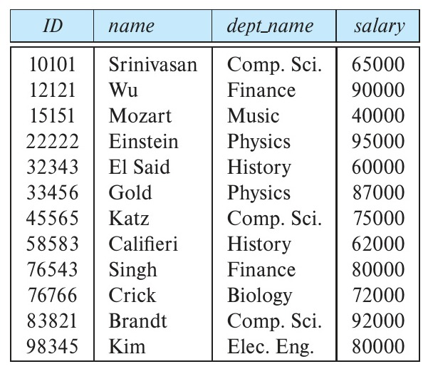
*Figure 2.1 — The instructor relation.*

Figure 2.3 shows a third table, *prereq*, which stores the prerequisite courses for each course. The table has two columns, *course_id* and *prereq_id*. Each row consists of a pair of course identifiers such that the second course is a prerequisite for the first course.

Thus, a row in the *prereq* table indicates that two courses are *related* in the sense that one course is a prerequisite for the other. As another example, when we consider the table *instructor*, a row in the table can be thought of as representing the relationship

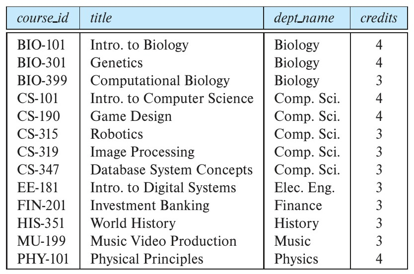
*Figure 2.2 — The course relation.*

<!-- Page 39 -->

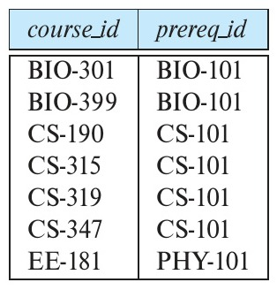
*Figure 2.3 — The prereq relation.*

between a specified *ID* and the corresponding values for *name*, *dept_name*, and *salary* values.

In general, a row in a table represents a *relationship* among a set of values. Since a table is a collection of such relationships, there is a close correspondence between the concept of *table* and the mathematical concept of *relation*, from which the relational data model takes its name. In mathematical terminology, a **tuple** is simply a sequence (or list) of values. A relationship between $n$ values is represented mathematically by an **$n$-tuple** of values, that is, a tuple with $n$ values, which corresponds to a row in a table.

Thus, in the relational model the term **relation** is used to refer to a table, while the term **tuple** is used to refer to a row. Similarly, the term **attribute** refers to a column of a table.

Examining Figure 2.1, we can see that the relation *instructor* has four attributes: *ID*, *name*, *dept_name*, and *salary*.

We use the term **relation instance** to refer to a specific instance of a relation, that is, containing a specific set of rows. The instance of *instructor* shown in Figure 2.1 has 12 tuples, corresponding to 12 instructors.

In this chapter, we shall be using a number of different relations to illustrate the various concepts underlying the relational data model. These relations represent part of a university. To simplify our presentation, we exclude much of the data an actual university database would contain. We shall discuss criteria for the appropriateness of relational structures in great detail in Chapter 6 and Chapter 7.

The order in which tuples appear in a relation is irrelevant, since a relation is a *set* of tuples. Thus, whether the tuples of a relation are listed in sorted order, as in Figure 2.1, or are unsorted, as in Figure 2.4, does not matter; the relations in the two figures are the same, since both contain the same set of tuples. For ease of exposition, we generally show the relations sorted by their first attribute.

For each attribute of a relation, there is a set of permitted values, called the **domain** of that attribute. Thus, the domain of the *salary* attribute of the *instructor* relation is the set of all possible salary values, while the domain of the *name* attribute is the set of all possible instructor names.

<!-- Page 40 -->

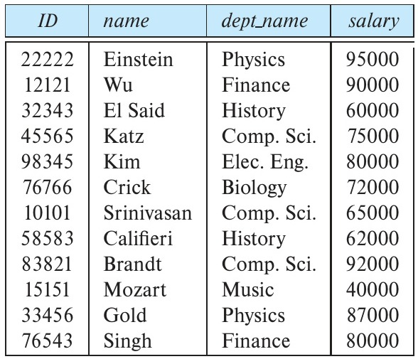
*Figure 2.4 — Unsorted display of the instructor relation.*

We require that, for all relations $r$, the domains of all attributes of $r$ be atomic. A domain is **atomic** if elements of the domain are considered to be indivisible units. For example, suppose the table *instructor* had an attribute *phone_number*, which can store a set of phone numbers corresponding to the instructor. Then the domain of *phone_number* would not be atomic, since an element of the domain is a set of phone numbers, and it has subparts, namely, the individual phone numbers in the set.

The important issue is not what the domain itself is, but rather how we use domain elements in our database. Suppose now that the *phone_number* attribute stores a single phone number. Even then, if we split the value from the phone number attribute into a country code, an area code, and a local number, we would be treating it as a non-atomic value. If we treat each phone number as a single indivisible unit, then the attribute *phone_number* would have an atomic domain.

The **null value** is a special value that signifies that the value is unknown or does not exist. For example, suppose as before that we include the attribute *phone_number* in the *instructor* relation. It may be that an instructor does not have a phone number at all, or that the telephone number is unlisted. We would then have to use the null value to signify that the value is unknown or does not exist. We shall see later that null values cause a number of difficulties when we access or update the database, and thus they should be eliminated if at all possible. We shall assume null values are absent initially, and in Section 3.6 we describe the effect of nulls on different operations.

The relatively strict structure of relations results in several important practical advantages in the storage and processing of data, as we shall see. That strict structure is suitable for well-defined and relatively static applications, but it is less suitable for applications where not only data but also the types and structure of those data change over time. A modern enterprise needs to find a good balance between the efficiencies of structured data and those situations where a predetermined structure is limiting.

<!-- Page 41 -->

## 2.2 Database Schema

When we talk about a database, we must differentiate between the **database schema**, which is the logical design of the database, and the **database instance**, which is a snapshot of the data in the database at a given instant in time.

The concept of a relation corresponds to the programming-language notion of a variable, while the concept of a **relation schema** corresponds to the programming-language notion of type definition.

In general, a relation schema consists of a list of attributes and their corresponding domains. We shall not be concerned about the precise definition of the domain of each attribute until we discuss the SQL language in Chapter 3.

The concept of a relation instance corresponds to the programming-language notion of a value of a variable. The value of a given variable may change with time; similarly the contents of a relation instance may change with time as the relation is updated. In contrast, the schema of a relation does not generally change.

Although it is important to know the difference between a relation schema and a relation instance, we often use the same name, such as *instructor*, to refer to both the schema and the instance. Where required, we explicitly refer to the schema or to the instance, for example “the *instructor* schema,” or “an instance of the *instructor* relation.” However, where it is clear whether we mean the schema or the instance, we simply use the relation name.

Consider the *department* relation of Figure 2.5. The schema for that relation is:

$$department\ (dept\_name,\ building,\ budget)$$

Note that the attribute *dept_name* appears in both the *instructor* schema and the *department* schema. This duplication is not a coincidence. Rather, using common attributes in relation schemas is one way of relating tuples of distinct relations. For example, suppose we wish to find the information about all the instructors who work in the Watson building. We look first at the *department* relation to find the *dept_name* of all the departments housed in Watson. Then, for each such department, we look in

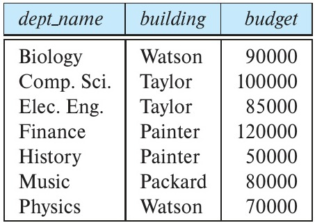
*Figure 2.5 — The department relation.*

<!-- Page 42 -->

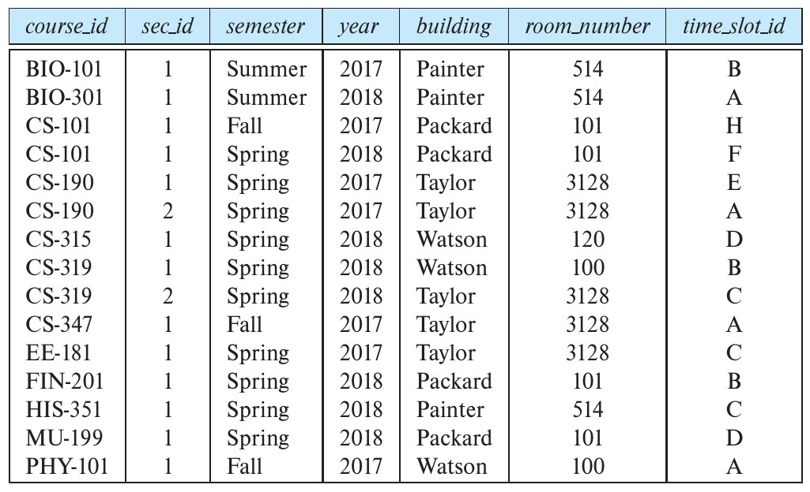
*Figure 2.6 — The section relation.*

the *instructor* relation to find the information about the instructor associated with the corresponding *dept_name*.

Each course in a university may be offered multiple times, across different semesters, or even within a semester. We need a relation to describe each individual offering, or section, of the class. The schema is:

$$section\ (course\_id,\ sec\_id,\ semester,\ year,\ building,\ room\_number,\ time\_slot\_id)$$

Figure 2.6 shows a sample instance of the *section* relation.

We need a relation to describe the association between instructors and the class sections that they teach. The relation schema to describe this association is:

$$teaches\ (ID,\ course\_id,\ sec\_id,\ semester,\ year)$$

Figure 2.7 shows a sample instance of the *teaches* relation.

As you can imagine, there are many more relations maintained in a real university database. In addition to those relations we have listed already, *instructor*, *department*, *course*, *section*, *prereq*, and *teaches*, we use the following relations in this text:

- *student* (*ID*, *name*, *dept_name*, *tot_cred*)
- *advisor* (*s_id*, *i_id*)
- *takes* (*ID*, *course_id*, *sec_id*, *semester*, *year*, *grade*)

<!-- Page 43 -->

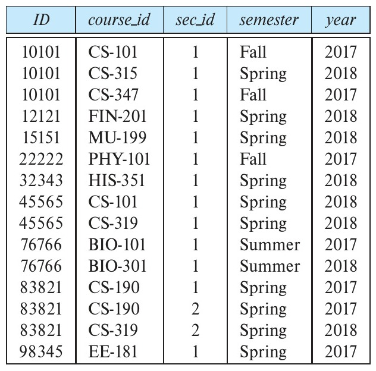
*Figure 2.7 — The teaches relation.*

- *classroom* (*building*, *room_number*, *capacity*)
- *time_slot* (*time_slot_id*, *day*, *start_time*, *end_time*)

## 2.3 Keys

We must have a way to specify how tuples within a given relation are distinguished. This is expressed in terms of their attributes. That is, the values of the attribute values of a tuple must be such that they can *uniquely identify* the tuple. In other words, no two tuples in a relation are allowed to have exactly the same value for all attributes.[^1]

A **superkey** is a set of one or more attributes that, taken collectively, allow us to identify uniquely a tuple in the relation. For example, the *ID* attribute of the relation *instructor* is sufficient to distinguish one instructor tuple from another. Thus, *ID* is a superkey. The *name* attribute of *instructor*, on the other hand, is not a superkey, because several instructors might have the same name.

Formally, let $R$ denote the set of attributes in the schema of relation $r$. If we say that a subset $K$ of $R$ is a *superkey* for $r$, we are restricting consideration to instances of relations $r$ in which no two distinct tuples have the same values on all attributes in $K$. That is, if $t_1$ and $t_2$ are in $r$ and $t_1 \neq t_2$, then $t_1.K \neq t_2.K$.

[^1]: Commercial database systems relax the requirement that a relation is a set and instead allow duplicate tuples. This is discussed further in Chapter 3.

<!-- Page 44 -->

A superkey may contain extraneous attributes. For example, the combination of *ID* and *name* is a superkey for the relation *instructor*. If $K$ is a superkey, then so is any superset of $K$. We are often interested in superkeys for which no proper subset is a superkey. Such minimal superkeys are called **candidate keys**.

It is possible that several distinct sets of attributes could serve as a candidate key. Suppose that a combination of *name* and *dept_name* is sufficient to distinguish among members of the *instructor* relation. Then, both $\{ID\}$ and $\{name, dept\_name\}$ are candidate keys. Although the attributes *ID* and *name* together can distinguish *instructor* tuples, their combination, $\{ID, name\}$, does not form a candidate key, since the attribute *ID* alone is a candidate key.

We shall use the term **primary key** to denote a candidate key that is chosen by the database designer as the principal means of identifying tuples within a relation. A key (whether primary, candidate, or super) is a property of the entire relation, rather than of the individual tuples. Any two individual tuples in the relation are prohibited from having the same value on the key attributes at the same time. The designation of a key represents a constraint in the real-world enterprise being modeled. Thus, primary keys are also referred to as **primary key constraints**.

It is customary to list the primary key attributes of a relation schema before the other attributes; for example, the *dept_name* attribute of *department* is listed first, since it is the primary key. Primary key attributes are also underlined.

Consider the *classroom* relation:

$$classroom\ (\underline{building},\ \underline{room\_number},\ capacity)$$

Here the primary key consists of two attributes, *building* and *room_number*, which are underlined to indicate they are part of the primary key. Neither attribute by itself can uniquely identify a classroom, although together they uniquely identify a classroom. Also consider the *time_slot* relation:

$$time\_slot\ (\underline{time\_slot\_id},\ \underline{day},\ \underline{start\_time},\ end\_time)$$

Each section has an associated *time_slot_id*. The *time_slot* relation provides information on which days of the week, and at what times, a particular *time_slot_id* meets. For example, *time_slot_id* 'A' may meet from 8.00 AM to 8.50 AM on Mondays, Wednesdays, and Fridays. It is possible for a time slot to have multiple sessions within a single day, at different times, so the *time_slot_id* and *day* together do not uniquely identify the tuple. The primary key of the *time_slot* relation thus consists of the attributes *time_slot_id*, *day*, and *start_time*, since these three attributes together uniquely identify a time slot for a course.

Primary keys must be chosen with care. As we noted, the name of a person is insufficient, because there may be many people with the same name. In the United States, the social security number attribute of a person would be a candidate key. Since non-U.S. residents usually do not have social security numbers, international enterprises must

<!-- Page 45 -->

generate their own unique identifiers. An alternative is to use some unique combination of other attributes as a key.

The primary key should be chosen such that its attribute values are never, or are very rarely, changed. For instance, the address field of a person should not be part of the primary key, since it is likely to change. Social security numbers, on the other hand, are guaranteed never to change. Unique identifiers generated by enterprises generally do not change, except if two enterprises merge; in such a case the same identifier may have been issued by both enterprises, and a reallocation of identifiers may be required to make sure they are unique.

Figure 2.8 shows the complete set of relations that we use in our sample university schema, with primary-key attributes underlined.

Next, we consider another type of constraint on the contents of relations, called foreign-key constraints. Consider the attribute *dept_name* of the *instructor* relation. It would not make sense for a tuple in *instructor* to have a value for *dept_name* that does not correspond to a department in the *department* relation. Thus, in any database instance, given any tuple, say $t_a$, from the *instructor* relation, there must be some tuple, say $t_b$, in the *department* relation such that the value of the *dept_name* attribute of $t_a$ is the same as the value of the primary key, *dept_name*, of $t_b$.

A **foreign-key constraint** from attribute(s) $A$ of relation $r_1$ to the primary-key $B$ of relation $r_2$ states that on any database instance, the value of $A$ for each tuple in $r_1$ must also be the value of $B$ for some tuple in $r_2$. Attribute set $A$ is called a **foreign key** from $r_1$, referencing $r_2$. The relation $r_1$ is also called the **referencing relation** of the foreign-key constraint, and $r_2$ is called the **referenced relation**.

For example, the attribute *dept_name* in *instructor* is a foreign key from *instructor*, referencing *department*; note that *dept_name* is the primary key of *department*. Similarly,

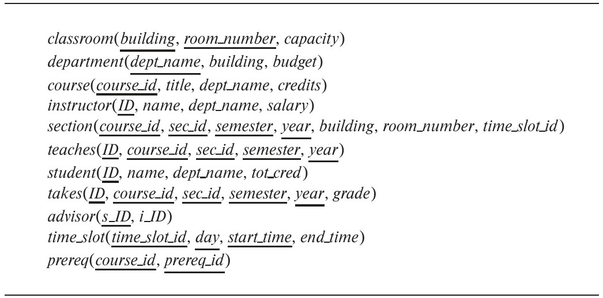
*Figure 2.8 — Schema of the university database.*

<!-- Page 46 -->

the attributes *building* and *room_number* of the *section* relation together form a foreign key referencing the *classroom* relation.

Note that in a foreign-key constraint, the referenced attribute(s) must be the primary key of the referenced relation. The more general case, a referential-integrity constraint, relaxes the requirement that the referenced attributes form the primary key of the referenced relation.

As an example, consider the values in the *time_slot_id* attribute of the *section* relation. We require that these values must exist in the *time_slot_id* attribute of the *time_slot* relation. Such a requirement is an example of a referential integrity constraint. In general, a **referential integrity constraint** requires that the values appearing in specified attributes of any tuple in the referencing relation also appear in specified attributes of at least one tuple in the referenced relation.

Note that *time_slot* does not form a primary key of the *time_slot* relation, although it is a part of the primary key; thus, we cannot use a foreign-key constraint to enforce the above constraint. In fact, foreign-key constraints are a *special case* of referential integrity constraints, where the referenced attributes form the primary key of the referenced relation. Database systems today typically support foreign-key constraints, but they do not support referential integrity constraints where the referenced attribute is not a primary key.

## 2.4 Schema Diagrams

A database schema, along with primary key and foreign-key constraints, can be depicted by **schema diagrams**. Figure 2.9 shows the schema diagram for our university organization. Each relation appears as a box, with the relation name at the top in blue and the attributes listed inside the box.

Primary-key attributes are shown underlined. Foreign-key constraints appear as arrows from the foreign-key attributes of the referencing relation to the primary key of the referenced relation. We use a two-headed arrow, instead of a single-headed arrow, to indicate a referential integrity constraint that is not a foreign-key constraints. In Figure 2.9, the line with a two-headed arrow from *time_slot_id* in the *section* relation to *time_slot_id* in the *time_slot* relation represents the referential integrity constraint from *section.time_slot_id* to *time_slot.time_slot_id*.

Many database systems provide design tools with a graphical user interface for creating schema diagrams.[^2] We shall discuss a different diagrammatic representation of schemas, called the entity-relationship diagram, at length in Chapter 6; although there are some similarities in appearance, these two notations are quite different, and should not be confused for one another.

[^2]: The two-headed arrow notation to represent referential integrity constraints has been introduced by us and is not supported by any tool as far as we know; the notations for primary and foreign keys, however, are widely used.

<!-- Page 47 -->

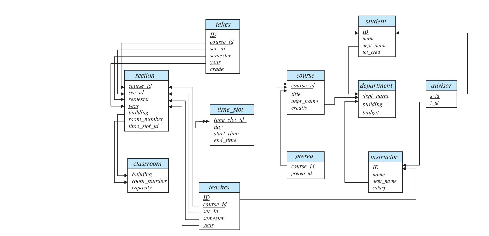
*Figure 2.9 — Schema diagram for the university database.*

## 2.5 Relational Query Languages

A **query language** is a language in which a user requests information from the database. These languages are usually on a level higher than that of a standard programming language. Query languages can be categorized as imperative, functional, or declarative. In an **imperative query language**, the user instructs the system to perform a specific sequence of operations on the database to compute the desired result; such languages usually have a notion of state variables, which are updated in the course of the computation.

In a **functional query language**, the computation is expressed as the evaluation of functions that may operate on data in the database or on the results of other functions; functions are side-effect free, and they do not update the program state.[^3] In a **declarative query language**, the user describes the desired information without giving a specific sequence of steps or function calls for obtaining that information; the desired information is typically described using some form of mathematical logic. It is the job of the database system to figure out how to obtain the desired information.

[^3]: The term *procedural language* has been used in earlier editions of the book to refer to languages based on procedure invocations, which include functional languages; however, the term is also widely used to refer to imperative languages. To avoid confusion we no longer use the term.

<!-- Page 48 -->

There are a number of “pure” query languages.

- The *relational algebra*, which we describe in Section 2.6, is a functional query language.[^4] The relational algebra forms the theoretical basis of the SQL query language.
- The tuple relational calculus and domain relational calculus, which we describe in Chapter 27 (available online) are declarative.

These query languages are terse and formal, lacking the “syntactic sugar” of commercial languages, but they illustrate the fundamental techniques for extracting data from the database.

Query languages used in practice, such as the SQL query language, include elements of the imperative, functional, and declarative approaches. We study the very widely used query language SQL in Chapter 3 through Chapter 5.

## 2.6 The Relational Algebra

The relational algebra consists of a set of operations that take one or two relations as input and produce a new relation as their result.

Some of these operations, such as the select, project, and rename operations, are called *unary* operations because they operate on one relation. The other operations, such as union, Cartesian product, and set difference, operate on pairs of relations and are, therefore, called *binary* operations.

Although the relational algebra operations form the basis for the widely used SQL query language, database systems do not allow users to write queries in relational algebra. However, there are implementations of relational algebra that have been built for students to practice relational algebra queries. The website of our book, **db-book.com**, under the link titled Laboratory Material, provides pointers to a few such implementations.

It is worth recalling at this point that since a relation is a set of tuples, relations cannot contain duplicate tuples. In practice, however, tables in database systems are permitted to contain duplicates unless a specific constraint prohibits it. But, in discussing the formal relational algebra, we require that duplicates be eliminated, as is required by the mathematical definition of a set. In Chapter 3 we discuss how relational algebra can be extended to work on multisets, which are sets that can contain duplicates.

[^4]: Unlike modern functional languages, relational algebra supports only a small number of predefined functions, which define an algebra on relations.

<!-- Page 49 -->

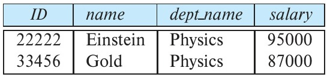
*Figure 2.10 — Result of $\sigma_{dept\_name = \text{“Physics”}}(instructor)$.*

### 2.6.1 The Select Operation

The **select** operation selects tuples that satisfy a given predicate. We use the lowercase Greek letter sigma ($\sigma$) to denote selection. The predicate appears as a subscript to $\sigma$. The argument relation is in parentheses after the $\sigma$. Thus, to select those tuples of the *instructor* relation where the instructor is in the “Physics” department, we write:

$$\sigma_{dept\_name = \text{“Physics”}}(instructor)$$

If the *instructor* relation is as shown in Figure 2.1, then the relation that results from the preceding query is as shown in Figure 2.10.

We can find all instructors with salary greater than \$90,000 by writing:

$$\sigma_{salary > 90000}(instructor)$$

In general, we allow comparisons using $=$, $\neq$, $<$, $\le$, $>$, and $\ge$ in the selection predicate. Furthermore, we can combine several predicates into a larger predicate by using the connectives *and* ($\land$), *or* ($\lor$), and *not* ($\neg$). Thus, to find the instructors in Physics with a salary greater than \$90,000, we write:

$$\sigma_{dept\_name = \text{“Physics”} \land salary > 90000}(instructor)$$

The selection predicate may include comparisons between two attributes. To illustrate, consider the relation *department*. To find all departments whose name is the same as their building name, we can write:

$$\sigma_{dept\_name = building}(department)$$

### 2.6.2 The Project Operation

Suppose we want to list all instructors’ *ID*, *name*, and *salary*, but we do not care about the *dept_name*. The **project** operation allows us to produce this relation. The project operation is a unary operation that returns its argument relation, with certain attributes left out. Since a relation is a set, any duplicate rows are eliminated. Projection is denoted by the uppercase Greek letter pi ($\Pi$). We list those attributes that we wish to appear in the result as a subscript to $\Pi$. The argument relation follows in parentheses. We write the query to produce such a list as:

$$\Pi_{ID,\ name,\ salary}(instructor)$$

Figure 2.11 shows the relation that results from this query.

<!-- Page 50 -->

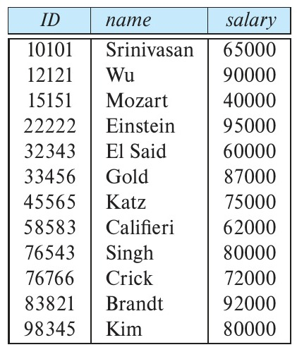
*Figure 2.11 — Result of $\Pi_{ID,\ name,\ salary}(instructor)$.*

The basic version of the project operator $\Pi_L(E)$ allows only attribute names to be present in the list $L$. A generalized version of the operator allows expressions involving attributes to appear in the list $L$. For example, we could use:

$$\Pi_{ID,\ name,\ salary / 12}(instructor)$$

to get the monthly salary of each instructor.

### 2.6.3 Composition of Relational Operations

The fact that the result of a relational operation is itself a relation is important. Consider the more complicated query “Find the names of all instructors in the Physics department.” We write:

$$\Pi_{name}\ (\sigma_{dept\_name = \text{“Physics”}}\ (instructor))$$

Notice that, instead of giving the name of a relation as the argument of the projection operation, we give an expression that evaluates to a relation.

In general, since the result of a relational-algebra operation is of the same type (relation) as its inputs, relational-algebra operations can be composed together into a **relational-algebra expression**. Composing relational-algebra operations into relational-algebra expressions is just like composing arithmetic operations (such as $+$, $-$, $*$, and $\div$) into arithmetic expressions.

### 2.6.4 The Cartesian-Product Operation

The **Cartesian-product** operation, denoted by a cross ($\times$), allows us to combine information from any two relations. We write the Cartesian product of relations $r_1$ and $r_2$ as $r_1 \times r_2$.

<!-- Page 51 -->

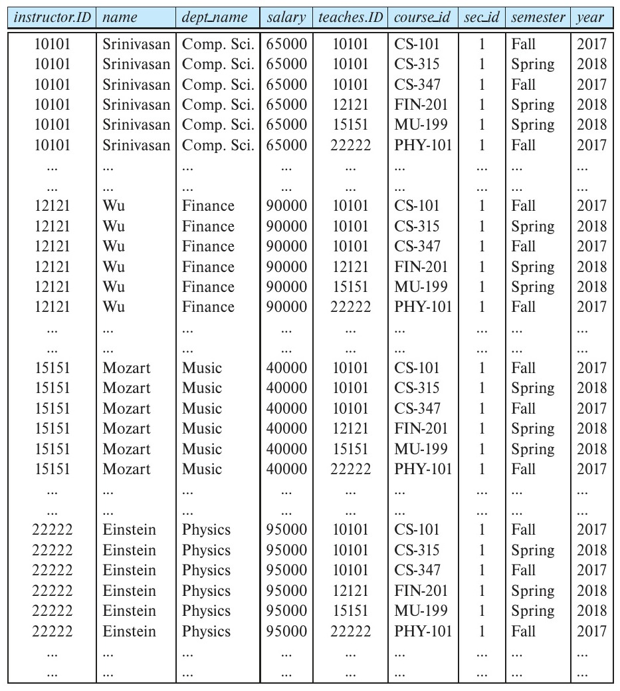
*Figure 2.12 — Result of the Cartesian product $instructor \times teaches$.*

A Cartesian product of database relations differs in its definition slightly from the mathematical definition of a Cartesian product of sets. Instead of $r_1 \times r_2$ producing pairs $(t_1, t_2)$ of tuples from $r_1$ and $r_2$, the relational algebra concatenates $t_1$ and $t_2$ into a single tuple, as shown in Figure 2.12.

Since the same attribute name may appear in the schemas of both $r_1$ and $r_2$, we need to devise a naming schema to distinguish between these attributes. We do so here by attaching to an attribute the name of the relation from which the attribute originally came. For example, the relation schema for $r = instructor \times teaches$ is:

$$(instructor.ID,\ instructor.name,\ instructor.dept\_name,\ instructor.salary,\ teaches.ID,\ teaches.course\_id,\ teaches.sec\_id,\ teaches.semester,\ teaches.year)$$

<!-- Page 52 -->

With this schema, we can distinguish *instructor.ID* from *teaches.ID*. For those attributes that appear in only one of the two schemas, we shall usually drop the relation-name prefix. This simplification does not lead to any ambiguity. We can then write the relation schema for $r$ as:

$$(instructor.ID,\ name,\ dept\_name,\ salary,\ teaches.ID,\ course\_id,\ sec\_id,\ semester,\ year)$$

This naming convention *requires* that the relations that are the arguments of the Cartesian-product operation have distinct names. This requirement causes problems in some cases, such as when the Cartesian product of a relation with itself is desired. A similar problem arises if we use the result of a relational-algebra expression in a Cartesian product, since we shall need a name for the relation so that we can refer to the relation’s attributes. In Section 2.6.8, we see how to avoid these problems by using the rename operation.

Now that we know the relation schema for $r = instructor \times teaches$, what tuples appear in $r$? As you may suspect, we construct a tuple of $r$ out of each possible pair of tuples: one from the *instructor* relation (Figure 2.1) and one from the *teaches* relation (Figure 2.7). Thus, $r$ is a large relation, as you can see from Figure 2.12, which includes only a portion of the tuples that make up $r$.

Assume that we have $n_1$ tuples in *instructor* and $n_2$ tuples in *teaches*. Then, there are $n_1 * n_2$ ways of choosing a pair of tuples—one tuple from each relation; so there are $n_1 * n_2$ tuples in $r$. In particular for our example, for some tuples $t$ in $r$, it may be that the two ID values, *instructor.ID* and *teaches.ID*, are different.

In general, if we have relations $r_1(R_1)$ and $r_2(R_2)$, then $r_1 \times r_2$ is a relation $r(R)$ whose schema $R$ is the concatenation of the schemas $R_1$ and $R_2$. Relation $r$ contains all tuples $t$ for which there is a tuple $t_1$ in $r_1$ and a tuple $t_2$ in $r_2$ for which $t$ and $t_1$ have the same value on the attributes in $R_1$ and $t$ and $t_2$ have the same value on the attributes in $R_2$.

### 2.6.5 The Join Operation

Suppose we want to find the information about all instructors together with the *course_id* of all courses they have taught. We need the information in both the *instructor* relation and the *teaches* relation to compute the required result. The Cartesian product of *instructor* and *teaches* does bring together information from both these relations, but unfortunately the Cartesian product associates every instructor with every course that was taught, regardless of whether that instructor taught that course.

Since the Cartesian-product operation associates *every* tuple of *instructor* with every tuple of *teaches*, we know that if an instructor has taught a course (as recorded in the *teaches* relation), then there is some tuple in $instructor \times teaches$ that contains her name and satisfies $instructor.ID = teaches.ID$. So, if we write:

$$\sigma_{instructor.ID = teaches.ID}(instructor \times teaches)$$

we get only those tuples of $instructor \times teaches$ that pertain to instructors and the courses that they taught.

<!-- Page 53 -->

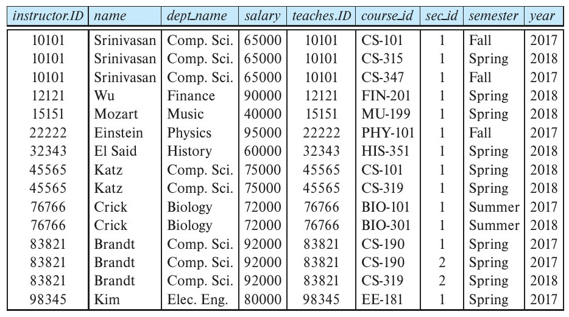
*Figure 2.13 — Result of $\sigma_{instructor.ID = teaches.ID}(instructor \times teaches)$.*

The result of this expression is shown in Figure 2.13. Observe that instructors Gold, Califieri, and Singh do not teach any course (as recorded in the *teaches* relation), and therefore do not appear in the result.

Note that this expression results in the duplication of the instructor’s ID. This can be easily handled by adding a projection to eliminate the column *teaches.ID*.

The *join* operation allows us to combine a selection and a Cartesian product into a single operation.

Consider relations $r(R)$ and $s(S)$, and let $\theta$ be a predicate on attributes in the schema $R \cup S$. The **join** operation $r \bowtie_\theta s$ is defined as follows:

$$r \bowtie_\theta s = \sigma_\theta(r \times s)$$

Thus, $\sigma_{instructor.ID = teaches.ID}(instructor \times teaches)$ can equivalently be written as $instructor \bowtie_{instructor.ID = teaches.ID} teaches$.

### 2.6.6 Set Operations

Consider a query to find the set of all courses taught in the Fall 2017 semester, the Spring 2018 semester, or both. The information is contained in the *section* relation (Figure 2.6). To find the set of all courses taught in the Fall 2017 semester, we write:

$$\Pi_{course\_id}\ (\sigma_{semester = \text{“Fall”} \land year = 2017}\ (section))$$

To find the set of all courses taught in the Spring 2018 semester, we write:

$$\Pi_{course\_id}\ (\sigma_{semester = \text{“Spring”} \land year = 2018}\ (section))$$

<!-- Page 54 -->

To answer the query, we need the **union** of these two sets; that is, we need all *course_ids* that appear in either or both of the two relations. We find these data by the binary operation union, denoted, as in set theory, by $\cup$. So the expression needed is:

$$\Pi_{course\_id}\ (\sigma_{semester = \text{“Fall”} \land year = 2017}\ (section)) \cup \Pi_{course\_id}\ (\sigma_{semester = \text{“Spring”} \land year = 2018}\ (section))$$

The result relation for this query appears in Figure 2.14. Notice that there are eight tuples in the result, even though there are three distinct courses offered in the Fall 2017 semester and six distinct courses offered in the Spring 2018 semester. Since relations are sets, duplicate values such as CS-101, which is offered in both semesters, are replaced by a single occurrence.

Observe that, in our example, we took the union of two sets, both of which consisted of *course_id* values. In general, for a union operation to make sense:

1. We must ensure that the input relations to the union operation have the same number of attributes; the number of attributes of a relation is referred to as its **arity**.
2. When the attributes have associated types, the types of the $i$th attributes of both input relations must be the same, for each $i$.

Such relations are referred to as **compatible** relations.

For example, it would not make sense to take the union of the *instructor* and *section* relations, since they have different numbers of attributes. And even though the *instructor* and the *student* relations both have arity 4, their 4th attributes, namely, *salary* and *tot_cred*, are of two different types. The union of these two attributes would not make sense in most situations.

The **intersection** operation, denoted by $\cap$, allows us to find tuples that are in both the input relations. The expression $r \cap s$ produces a relation containing those tuples in

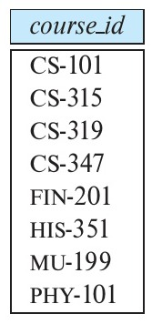
*Figure 2.14 — Courses offered in either Fall 2017, Spring 2018, or both semesters.*

<!-- Page 55 -->

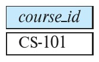
*Figure 2.15 — Courses offered in both the Fall 2017 and Spring 2018 semesters.*

$r$ as well as in $s$. As with the union operation, we must ensure that intersection is done between compatible relations.

Suppose that we wish to find the set of all courses taught in both the Fall 2017 and the Spring 2018 semesters. Using set intersection, we can write:

$$\Pi_{course\_id}\ (\sigma_{semester = \text{“Fall”} \land year = 2017}\ (section)) \cap \Pi_{course\_id}\ (\sigma_{semester = \text{“Spring”} \land year = 2018}\ (section))$$

The result relation for this query appears in Figure 2.15.

The **set-difference** operation, denoted by $-$, allows us to find tuples that are in one relation but are not in another. The expression $r - s$ produces a relation containing those tuples in $r$ but not in $s$.

We can find all the courses taught in the Fall 2017 semester but not in Spring 2018 semester by writing:

$$\Pi_{course\_id}\ (\sigma_{semester = \text{“Fall”} \land year = 2017}\ (section)) - \Pi_{course\_id}\ (\sigma_{semester = \text{“Spring”} \land year = 2018}\ (section))$$

The result relation for this query appears in Figure 2.16.

As with the union operation, we must ensure that set differences are taken between compatible relations.

### 2.6.7 The Assignment Operation

It is convenient at times to write a relational-algebra expression by assigning parts of it to temporary relation variables. The **assignment** operation, denoted by $\leftarrow$, works like assignment in a programming language. To illustrate this operation, consider the query to find courses that run in Fall 2017 as well as Spring 2018, which we saw earlier. We could write it as:

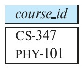
*Figure 2.16 — Courses offered in the Fall 2017 semester but not in Spring 2018 semester.*

<!-- Page 56 -->

$$courses\_fall\_2017 \leftarrow \Pi_{course\_id}(\sigma_{semester = \text{“Fall”} \land year = 2017}\ (section))$$
$$courses\_spring\_2018 \leftarrow \Pi_{course\_id}(\sigma_{semester = \text{“Spring”} \land year = 2018}\ (section))$$
$$courses\_fall\_2017\ \cap\ courses\_spring\_2018$$

The final line above displays the query result. The preceding two lines assign the query result to a temporary relation. The evaluation of an assignment does not result in any relation being displayed to the user. Rather, the result of the expression to the right of the $\leftarrow$ is assigned to the relation variable on the left of the $\leftarrow$. This relation variable may be used in subsequent expressions.

With the assignment operation, a query can be written as a sequential program consisting of a series of assignments followed by an expression whose value is displayed as the result of the query. For relational-algebra queries, assignment must always be made to a temporary relation variable. Assignments to permanent relations constitute a database modification. Note that the assignment operation does not provide any additional power to the algebra. It is, however, a convenient way to express complex queries.

### 2.6.8 The Rename Operation

Unlike relations in the database, the results of relational-algebra expressions do not have a name that we can use to refer to them. It is useful in some cases to give them names; the **rename** operator, denoted by the lowercase Greek letter rho ($\rho$), lets us do this. Given a relational-algebra expression $E$, the expression

$$\rho_x\ (E)$$

returns the result of expression $E$ under the name $x$.

A relation $r$ by itself is considered a (trivial) relational-algebra expression. Thus, we can also apply the rename operation to a relation $r$ to get the same relation under a new name. Some queries require the same relation to be used more than once in the query; in such cases, the rename operation can be used to give unique names to the different occurrences of the same relation.

A second form of the rename operation is as follows: Assume that a relational-algebra expression $E$ has arity $n$. Then, the expression

$$\rho_{x(A_1, A_2, \dots, A_n)}\ (E)$$

returns the result of expression $E$ under the name $x$, and with the attributes renamed to $A_1, A_2, \dots, A_n$. This form of the rename operation can be used to give names to attributes in the results of relational algebra operations that involve expressions on attributes.

To illustrate renaming a relation, we consider the query “Find the ID and name of those instructors who earn more than the instructor whose ID is 12121.” (That’s the instructor Wu in the example table in Figure 2.1.)

There are several strategies for writing this query, but to illustrate the rename operation, our strategy is to compare the salary of each instructor with the salary of the

<!-- Page 57 -->

> ### Note 2.1 OTHER RELATIONAL OPERATIONS
> 
> In addition to the relational algebra operations we have seen so far, there are a number of other operations that are commonly used. We summarize them below and describe them in detail later, along with equivalent SQL constructs.
> 
> The aggregation operation allows a function to be computed over the set of values returned by a query. These functions include average, sum, min, and max, among others. The operation allows also for these aggregations to be performed after splitting the set of values into groups, for example, by computing the average salary in each department. We study the aggregation operation in more detail in Section 3.7 (Note 3.2 on page 97).
> 
> The *natural join* operation replaces the predicate $\theta$ in $\bowtie_\theta$ with an implicit predicate that requires equality over those attributes that appear in the schemas of both the left and right relations. This is notationally convenient but poses risks for queries that are reused and thus might be used after a relation's schema is changed. It is covered in Section 4.1.1.
> 
> Recall that when we computed the join of *instructor* and *teaches*, instructors who have not taught any course do not appear in the join result. The *outer join* operation allows for the retention of such tuples in the result by inserting nulls for the missing values. It is covered in Section 4.1.3 (Note 4.1 on page 136).

instructor with ID 12121. The difficulty here is that we need to reference the *instructor* relation once to get the salary of each instructor and then a second time to get the salary of instructor 12121; and we want to do all this in one expression. The rename operator allows us to do this using different names for each referencing of the *instructor* relation. In this example, we shall use the name $i$ to refer to our scan of the *instructor* relation in which we are seeking those that will be part of the answer, and $w$ to refer to the scan of the *instructor* relation to obtain the salary of instructor 12121:

$$\Pi_{i.ID,\ i.name}\ ((\sigma_{i.salary > w.salary}(\rho_i(instructor) \times \sigma_{w.id = 12121}(\rho_w\ (instructor)))))$$

The rename operation is not strictly required, since it is possible to use a positional notation for attributes. We can name attributes of a relation implicitly by using a positional notation, where $\$1, \$2, \dots$ refer to the first attribute, the second attribute, and so on. The positional notation can also be used to refer to attributes of the results of relational-algebra operations. However, the positional notation is inconvenient for humans, since the position of the attribute is a number, rather than an easy-to-remember attribute name. Hence, we do not use the positional notation in this textbook.

<!-- Page 58 -->

### 2.6.9 Equivalent Queries

Note that there is often more than one way to write a query in relational algebra. Consider the following query, which finds information about courses taught by instructors in the Physics department:

$$\sigma_{dept\_name = \text{“Physics”}}(instructor \bowtie_{instructor.ID = teaches.ID} teaches)$$

Now consider an alternative query:

$$(\sigma_{dept\_name = \text{“Physics”}}(instructor)) \bowtie_{instructor.ID = teaches.ID} teaches$$

Note the subtle difference between the two queries: in the first query, the selection that restricts *dept_name* to Physics is applied after the join of *instructor* and *teaches* has been computed, whereas in the second query, the selection that restricts *dept_name* to Physics is applied to *instructor*, and the join operation is applied subsequently.

Although the two queries are not identical, they are in fact **equivalent**; that is, they give the same result on any database.

Query optimizers in database systems typically look at what result an expression computes and find an efficient way of computing that result, rather than following the exact sequence of steps specified in the query. The algebraic structure of relational algebra makes it easy to find efficient but equivalent alternative expressions, as we will see in Chapter 16.

## 2.7 Summary

- The relational data model is based on a collection of tables. The user of the database system may query these tables, insert new tuples, delete tuples, and update (modify) tuples. There are several languages for expressing these operations.
- The schema of a relation refers to its logical design, while an instance of the relation refers to its contents at a point in time. The schema of a database and an instance of a database are similarly defined. The schema of a relation includes its attributes, and optionally the types of the attributes and constraints on the relation such as primary and foreign-key constraints.
- A superkey of a relation is a set of one or more attributes whose values are guaranteed to identify tuples in the relation uniquely. A candidate key is a minimal superkey, that is, a set of attributes that forms a superkey, but none of whose subsets is a superkey. One of the candidate keys of a relation is chosen as its primary key.
- A foreign-key constraint from attribute(s) $A$ of relation $r_1$ to the primary-key $B$ of relation $r_2$ states that the value of $A$ for each tuple in $r_1$ must also be the value of $B$ for some tuple in $r_2$. The relation $r_1$ is called the referencing relation, and $r_2$ is called the referenced relation.

<!-- Page 59 -->

- A schema diagram is a pictorial depiction of the schema of a database that shows the relations in the database, their attributes, and primary keys and foreign keys.
- The relational query languages define a set of operations that operate on tables and output tables as their results. These operations can be combined to get expressions that express desired queries.
- The relational algebra provides a set of operations that take one or more relations as input and return a relation as an output. Practical query languages such as SQL are based on the relational algebra, but they add a number of useful syntactic features.
- The relational algebra defines a set of algebraic operations that operate on tables, and output tables as their results. These operations can be combined to get expressions that express desired queries. The algebra defines the basic operations used within relational query languages like SQL.

## Review Terms

- Table
- Relation
- Tuple
- Attribute
- Relation instance
- Domain
- Atomic domain
- Null value
- Database schema
- Database instance
- Relation schema
- Keys
  - Superkey
  - Candidate key
  - Primary key
  - Primary key constraints
- Foreign-key constraint
  - Referencing relation
  - Referenced relation
- Referential integrity constraint
- Schema diagram
- Query language types
  - Imperative
  - Functional
  - Declarative
- Relational algebra
- Relational-algebra expression
- Relational-algebra operations
  - Select $\sigma$
  - Project $\Pi$
  - Cartesian product $\times$
  - Join $\bowtie$
  - Union $\cup$
  - Set difference $-$
  - Set intersection $\cap$
  - Assignment $\leftarrow$
  - Rename $\rho$

<!-- Page 60 -->

*Figure 2.17 — Employee database.*

## Practice Exercises

**2.1** Consider the employee database of Figure 2.17. What are the appropriate primary keys?

**2.2** Consider the foreign-key constraint from the *dept_name* attribute of *instructor* to the *department* relation. Give examples of inserts and deletes to these relations that can cause a violation of the foreign-key constraint.

**2.3** Consider the *time_slot* relation. Given that a particular time slot can meet more than once in a week, explain why *day* and *start_time* are part of the primary key of this relation, while *end_time* is not.

**2.4** In the instance of *instructor* shown in Figure 2.1, no two instructors have the same name. From this, can we conclude that *name* can be used as a superkey (or primary key) of *instructor*?

**2.5** What is the result of first performing the Cartesian product of *student* and *advisor*, and then performing a selection operation on the result with the predicate $s\_id = \text{ID}$? (Using the symbolic notation of relational algebra, this query can be written as $\sigma_{s\_id = ID}(student \times advisor)$.)

**2.6** Consider the employee database of Figure 2.17. Give an expression in the relational algebra to express each of the following queries:
a. Find the name of each employee who lives in city “Miami”.
b. Find the name of each employee whose salary is greater than \$100,000.
c. Find the name of each employee who lives in “Miami” and whose salary is greater than \$100,000.

**2.7** Consider the bank database of Figure 2.18. Give an expression in the relational algebra for each of the following queries:
a. Find the name of each branch located in “Chicago”.
b. Find the ID of each borrower who has a loan in branch “Downtown”.

<!-- Page 61 -->

*Figure 2.18 — Bank database.*

**2.8** Consider the employee database of Figure 2.17. Give an expression in the relational algebra to express each of the following queries:
a. Find the ID and name of each employee who does not work for “BigBank”.
b. Find the ID and name of each employee who earns at least as much as every employee in the database.

**2.9** The **division operator** of relational algebra, “$\div$”, is defined as follows. Let $r(R)$ and $s(S)$ be relations, and let $S \subseteq R$; that is, every attribute of schema $S$ is also in schema $R$. Given a tuple $t$, let $t[S]$ denote the projection of tuple $t$ on the attributes in $S$. Then $r \div s$ is a relation on schema $R - S$ (that is, on the schema containing all attributes of schema $R$ that are not in schema $S$). A tuple $t$ is in $r \div s$ if and only if both of two conditions hold:
- $t$ is in $\Pi_{R - S}(r)$
- For every tuple $t_s$ in $s$, there is a tuple $t_r$ in $r$ satisfying both of the following:
  a. $t_r[S] = t_s[S]$
  b. $t_r[R - S] = t$

Given the above definition:
a. Write a relational algebra expression using the division operator to find the IDs of all students who have taken all Comp. Sci. courses. (Hint: project *takes* to just ID and *course_id*, and generate the set of all Comp. Sci. *course_ids* using a select expression, before doing the division.)
b. Show how to write the above query in relational algebra, without using division. (By doing so, you would have shown how to define the division operation using the other relational algebra operations.)

<!-- Page 62 -->

## Exercises

**2.10** Describe the differences in meaning between the terms *relation* and *relation schema*.

**2.11** Consider the *advisor* relation shown in the schema diagram in Figure 2.9, with *s_id* as the primary key of *advisor*. Suppose a student can have more than one advisor. Then, would *s_id* still be a primary key of the *advisor* relation? If not, what should the primary key of *advisor* be?

**2.12** Consider the bank database of Figure 2.18. Assume that branch names and customer names uniquely identify branches and customers, but loans and accounts can be associated with more than one customer.
a. What are the appropriate primary keys?
b. Given your choice of primary keys, identify appropriate foreign keys.

**2.13** Construct a schema diagram for the bank database of Figure 2.18.

**2.14** Consider the employee database of Figure 2.17. Give an expression in the relational algebra to express each of the following queries:
a. Find the ID and name of each employee who works for “BigBank”.
b. Find the ID, name, and city of residence of each employee who works for “BigBank”.
c. Find the ID, name, street address, and city of residence of each employee who works for “BigBank” and earns more than \$10,000.
d. Find the ID and name of each employee in this database who lives in the same city as the company for which she or he works.

**2.15** Consider the bank database of Figure 2.18. Give an expression in the relational algebra for each of the following queries:
a. Find each loan number with a loan amount greater than \$10,000.
b. Find the ID of each depositor who has an account with a balance greater than \$6,000.
c. Find the ID of each depositor who has an account with a balance greater than \$6,000 at the “Uptown” branch.

**2.16** List two reasons why null values might be introduced into a database.

**2.17** Discuss the relative merits of imperative, functional, and declarative languages.

**2.18** Write the following queries in relational algebra, using the university schema.
a. Find the ID and name of each instructor in the Physics department.

<!-- Page 63 -->

b. Find the ID and name of each instructor in a department located in the building “Watson”.
c. Find the ID and name of each student who has taken at least one course in the “Comp. Sci.” department.
d. Find the ID and name of each student who has taken at least one course section in the year 2018.
e. Find the ID and name of each student who has not taken any course section in the year 2018.

## Further Reading

E. F. Codd of the IBM San Jose Research Laboratory proposed the relational model in the late 1960s ([Codd (1970)]). In that paper, Codd also introduced the original definition of relational algebra. This work led to the prestigious ACM Turing Award to Codd in 1981 ([Codd (1982)]).

After E. F. Codd introduced the relational model, an expansive theory developed around the relational model pertaining to schema design and the expressive power of various relational languages. Several classic texts cover relational database theory, including [Maier (1983)] (which is available free, online), and [Abiteboul et al. (1995)].

Codd’s original paper inspired several research projects that were formed in the mid to late 1970s with the goal of constructing practical relational database systems, including System R at the IBM San Jose Research Laboratory, Ingres at the University of California at Berkeley, and Query-by-Example at the IBM T. J. Watson Research Center. The Oracle database was developed commercially at the same time.

Many relational database products are now commercially available. These include IBM’s DB2 and Informix, Oracle, Microsoft SQL Server, and Sybase and HANA from SAP. Popular open-source relational database systems include MySQL and PostgreSQL. Hive and Spark are widely used systems that support parallel execution of queries across large numbers of computers.

## Bibliography

- **[Abiteboul et al. (1995)]** S. Abiteboul, R. Hull, and V. Vianu, *Foundations of Databases*, Addison Wesley (1995).
- **[Codd (1970)]** E. F. Codd, “A Relational Model for Large Shared Data Banks”, *Communications of the ACM*, Volume 13, Number 6 (1970), pages 377–387.
- **[Codd (1982)]** E. F. Codd, “The 1981 ACM Turing Award Lecture: Relational Database: A Practical Foundation for Productivity”, *Communications of the ACM*, Volume 25, Number 2 (1982), pages 109–117.

<!-- Page 64 -->

- **[Maier (1983)]** D. Maier, *The Theory of Relational Databases*, Computer Science Press (1983).

## Credits

The photo of the sailboats in the beginning of the chapter is due to ©Pavel Nesvadba/Shutterstock.
