# Chapter 3: Introduction to SQL

<!-- Page 65 -->

In this chapter, as well as in Chapter 4 and Chapter 5, we study the most widely used database query language, SQL.

Although we refer to the SQL language as a “query language,” it can do much more than just query a database. It can define the structure of the data, modify data in the database, and specify security constraints.

It is not our intention to provide a complete users’ guide for SQL. Rather, we present SQL’s fundamental constructs and concepts. Individual implementations of SQL may differ in details or may support only a subset of the full language.

We strongly encourage you to try out the SQL queries that we describe here on an actual database. See the Tools section at the end of this chapter for tips on what database systems you could use, and how to create the schema, populate sample data, and execute your queries.

## 3.1 Overview of the SQL Query Language

IBM developed the original version of SQL, originally called Sequel, as part of the System R project in the early 1970s. The Sequel language has evolved since then, and its name has changed to SQL (Structured Query Language). Many products now support the SQL language. SQL has clearly established itself as the standard relational database language.

In 1986, the American National Standards Institute (ANSI) and the International Organization for Standardization (ISO) published an SQL standard, called SQL-86. ANSI published an extended standard for SQL, SQL-89, in 1989. The next version of the standard was SQL-92 standard, followed by SQL:1999, SQL:2003, SQL:2006, SQL:2008, SQL:2011, and most recently SQL:2016.

The SQL language has several parts:

- **Data-definition language (DDL).** The SQL DDL provides commands for defining relation schemas, deleting relations, and modifying relation schemas.

<!-- Page 66 -->

- **Data-manipulation language (DML).** The SQL DML provides the ability to query information from the database and to insert tuples into, delete tuples from, and modify tuples in the database.
- **Integrity.** The SQL DDL includes commands for specifying integrity constraints that the data stored in the database must satisfy. Updates that violate integrity constraints are disallowed.
- **View definition.** The SQL DDL includes commands for defining views.
- **Transaction control.** SQL includes commands for specifying the beginning and end points of transactions.
- **Embedded SQL and dynamic SQL.** Embedded and dynamic SQL define how SQL statements can be embedded within general-purpose programming languages, such as C, C++, and Java.
- **Authorization.** The SQL DDL includes commands for specifying access rights to relations and views.

In this chapter, we present a survey of basic DML and the DDL features of SQL. Features described here have been part of the SQL standard since SQL-92.

In Chapter 4, we provide a more detailed coverage of the SQL query language, including (a) various join expressions, (b) views, (c) transactions, (d) integrity constraints, (e) type system, and (f) authorization.

In Chapter 5, we cover more advanced features of the SQL language, including (a) mechanisms to allow accessing SQL from a programming language, (b) SQL functions and procedures, (c) triggers, (d) recursive queries, (e) advanced aggregation features, and (f) several features designed for data analysis.

Although most SQL implementations support the standard features we describe here, there are differences between implementations. Most implementations support some nonstandard features while omitting support for some of the more advanced and more recent features. In case you find that some language features described here do not work on the database system that you use, consult the user manuals for your database system to find exactly what features it supports.

## 3.2 SQL Data Definition

The set of relations in a database are specified using a data-definition language (DDL). The SQL DDL allows specification of not only a set of relations, but also information about each relation, including:

- The schema for each relation.
- The types of values associated with each attribute.

<!-- Page 67 -->

- The integrity constraints.
- The set of indices to be maintained for each relation.
- The security and authorization information for each relation.
- The physical storage structure of each relation on disk.

We discuss here basic schema definition and basic types; we defer discussion of the other SQL DDL features to Chapter 4 and Chapter 5.

### 3.2.1 Basic Types

The SQL standard supports a variety of built-in types, including:

- **char($n$):** A fixed-length character string with user-specified length $n$. The full form, **character**, can be used instead.
- **varchar($n$):** A variable-length character string with a user-specified maximum length $n$. The full form, **character varying**, is equivalent.
- **int:** An integer (a finite subset of the integers that is machine-dependent). The full form, **integer**, is equivalent.
- **smallint:** A small integer (a machine-dependent subset of the integer type).
- **numeric($p, d$):** A fixed-point number with user-specified precision. The number consists of $p$ digits (plus a sign), and $d$ of the $p$ digits are to the right of the decimal point. Thus, `numeric(3,1)` allows `44.5` to be stored exactly, but neither `444.5` nor `0.32` can be stored exactly in a field of this type.
- **real, double precision:** Floating-point and double-precision floating-point numbers with machine-dependent precision.
- **float($n$):** A floating-point number with precision of at least $n$ digits.

Each type may include a special value called the *null* value. A null value indicates an absent value that may exist but be unknown or that may not exist at all. In certain cases, we may wish to prohibit null values from being entered, as we will see shortly.

We will discuss other data types, such as date and time, in Section 4.5.1.

### 3.2.2 Basic Schema Definition

We define an SQL relation by using the **create table** command. The following command creates a relation `department` in the database:

```sql
create table department
   (dept_name        varchar (20),
    building         varchar (15),
    budget           numeric (12,2),
    primary key (dept_name));
```

<!-- Page 68 -->

The relation created above has three attributes: `dept_name`, which is a character string of maximum length 20; `building`, which is a character string of maximum length 15; and `budget`, which is a number with 12 digits in all, 2 of which are after the decimal point. The `create table` command also specifies that the `dept_name` attribute is the primary key of the `department` relation.

The general form of the **create table** command is:

```sql
create table r
   (A1 D1,
    A2 D2,
    ...,
    An Dn,
    <integrity-constraint1>,
    ...,
    <integrity-constraintk>);
```

where $r$ is the name of the relation, each $A_i$ is the name of an attribute in the schema of relation $r$, and $D_i$ is the domain of attribute $A_i$; that is, $D_i$ specifies the type of attribute $A_i$, along with optional constraints that restrict the set of acceptable values for $A_i$.

The semicolons at the ends of the `create table` statements in this and later examples are punctuation tokens used in SQL to separate commands when multiple SQL commands are executed in sequence; in many SQL implementations semicolons are optional when executing a single command.

SQL supports a number of different integrity constraints. In this section, we discuss only a few of them:

- **primary key** ($A_{j1}, A_{j2}, \dots, A_{jm}$): The **primary key** specification says that the attributes $A_{j1}, A_{j2}, \dots, A_{jm}$ form the primary key for the relation. The primary key attributes are required to be non-null and unique; that is, no tuple can have a null value for any primary key attribute, and no two tuples in the relation can have the same values on all the primary-key attributes. Although the primary-key specification is optional, it is generally good practice to specify a primary key for each relation.
- **foreign key** ($A_{k1}, A_{k2}, \dots, A_{kn}$) **references** $s$: The **foreign key** specification says that the values of attributes ($A_{k1}, A_{k2}, \dots, A_{kn}$) for any tuple in the relation must corre-

<!-- Page 69 -->

spond to values of the primary key attributes of some tuple in relation $s$.

Figure 3.1 presents a partial SQL DDL definition of the university database we use in the text. The definition of the `course` table has a declaration “foreign key (`dept_name`) references `department`”. This foreign-key declaration specifies that for each course tuple, the department name specified in the tuple must exist in the `dept_name` attribute of the `department` relation. Without this constraint, an entry for a course could refer to a nonexistent department name.

More complex foreign-key constraints are supported by SQL, where the referenced attributes need not be the primary key of relation $s$. We cover foreign keys in detail in Section 4.4.2.

Some database systems, such as MySQL, require an alternative syntax, “foreign key (`dept_name`) references department(`dept_name`)”, where the referenced attributes in the referenced table are listed explicitly.

- **not null:** The **not null** constraint on an attribute specifies that the null value is not allowed for that attribute; in other words, the constraint excludes the null value from the domain of that attribute. For example, in Figure 3.1, the not null constraint on the `name` attribute of the `instructor` relation ensures that the name of an instructor cannot be null.

More details on the foreign-key constraint, as well as on other integrity constraints that the `create table` command may include, are provided later, in Section 4.4.

SQL prevents any update to the database that violates an integrity constraint. For example, if a newly inserted or modified tuple in a relation has null values for any primary-key attribute, or if the tuple has the same value on the primary-key attributes as does another tuple in the relation, SQL flags an error and prevents the update. Similarly, an insertion of a `course` tuple with a `dept_name` value that does not appear in the `department` relation would violate the foreign-key constraint on `course`, and SQL prevents such an insertion from taking place.

A newly created relation is empty initially. Inserting tuples into a relation, updating them, and deleting them are done by data manipulation statements `insert`, `update`, and `delete`, which are covered in Section 3.9.

To remove a relation from an SQL database, we use the **drop table** command. The `drop table` command deletes all information about the dropped relation from the database. The command

```sql
drop table r;
```

is a more drastic action than

<!-- Page 70 -->

```sql
create table department
   (dept_name        varchar (20),
    building         varchar (15),
    budget           numeric (12,2),
    primary key (dept_name));

create table course
   (course_id        varchar (7),
    title            varchar (50),
    dept_name        varchar (20),
    credits          numeric (2,0),
    primary key (course_id),
    foreign key (dept_name) references department);

create table instructor
   (ID               varchar (5),
    name             varchar (20) not null,
    dept_name        varchar (20),
    salary           numeric (8,2),
    primary key (ID),
    foreign key (dept_name) references department);

create table section
   (course_id        varchar (8),
    sec_id           varchar (8),
    semester         varchar (6),
    year             numeric (4,0),
    building         varchar (15),
    room_number      varchar (7),
    time_slot_id     varchar (4),
    primary key (course_id, sec_id, semester, year),
    foreign key (course_id) references course);

create table teaches
   (ID               varchar (5),
    course_id        varchar (8),
    sec_id           varchar (8),
    semester         varchar (6),
    year             numeric (4,0),
    primary key (ID, course_id, sec_id, semester, year),
    foreign key (course_id, sec_id, semester, year) references section,
    foreign key (ID) references instructor);
```

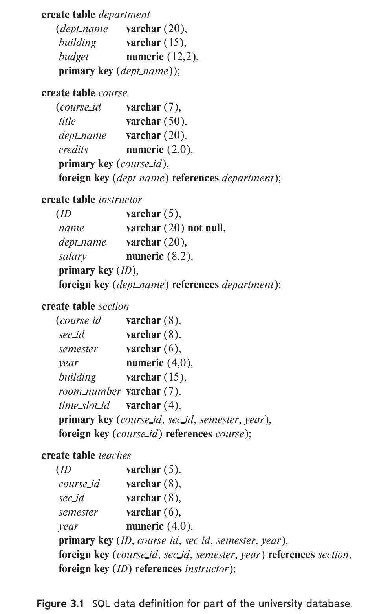
*Figure 3.1 — SQL data definition for part of the university database.*

<!-- Page 71 -->

```sql
delete from r;
```

The latter retains relation $r$, but deletes all tuples in $r$. The former deletes not only all tuples of $r$, but also the schema for $r$. After $r$ is dropped, no tuples can be inserted into $r$ unless it is re-created with the `create table` command.

We use the **alter table** command to add attributes to an existing relation. All tuples in the relation are assigned null as the value for the new attribute. The form of the `alter table` command is

```sql
alter table r add A D;
```

where $r$ is the name of an existing relation, $A$ is the name of the attribute to be added, and $D$ is the type of the added attribute. We can drop attributes from a relation by the command

```sql
alter table r drop A;
```

where $r$ is the name of an existing relation, and $A$ is the name of an attribute of the relation. Many database systems do not support dropping of attributes, although they will allow an entire table to be dropped.

## 3.3 Basic Structure of SQL Queries

The basic structure of an SQL query consists of three clauses: **select**, **from**, and **where**. A query takes as its input the relations listed in the `from` clause, operates on them as specified in the `where` and `select` clauses, and then produces a relation as the result. We introduce the SQL syntax through examples, and we describe the general structure of SQL queries later.

### 3.3.1 Queries on a Single Relation

Let us consider a simple query using our university example, “Find the names of all instructors.” Instructor names are found in the `instructor` relation, so we put that relation in the `from` clause. The instructor’s name appears in the `name` attribute, so we put that in the `select` clause.

```sql
select name
from instructor;
```

The result is a relation consisting of a single attribute with the heading `name`. If the `instructor` relation is as shown in Figure 2.1, then the relation that results from the preceding query is shown in Figure 3.2.

<!-- Page 72 -->

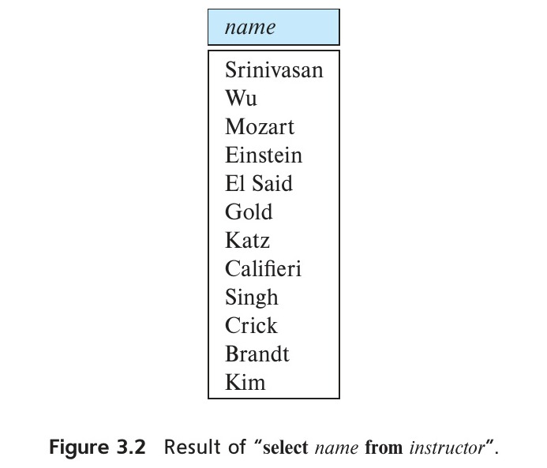
*Figure 3.2 — Result of “select name from instructor”.*

Now consider another query, “Find the department names of all instructors,” which can be written as:

```sql
select dept_name
from instructor;
```

Since more than one instructor can belong to a department, a department name could appear more than once in the `instructor` relation. The result of the above query is a relation containing the department names, shown in Figure 3.3.

In the formal, mathematical definition of the relational model, a relation is a set. Thus, duplicate tuples would never appear in relations. In practice, duplicate elimination is time-consuming. Therefore, SQL allows duplicates in database relations as well as in the results of SQL expressions.[^1] Thus, the preceding SQL query lists each department name once for every tuple in which it appears in the `instructor` relation.

In those cases where we want to force the elimination of duplicates, we insert the keyword **distinct** after `select`. We can rewrite the preceding query as:

```sql
select distinct dept_name
from instructor;
```

if we want duplicates removed. The result of the above query would contain each department name at most once.

[^1]: Any database relation whose schema includes a primary-key declaration cannot contain duplicate tuples, since they would violate the primary-key constraint.

<!-- Page 73 -->

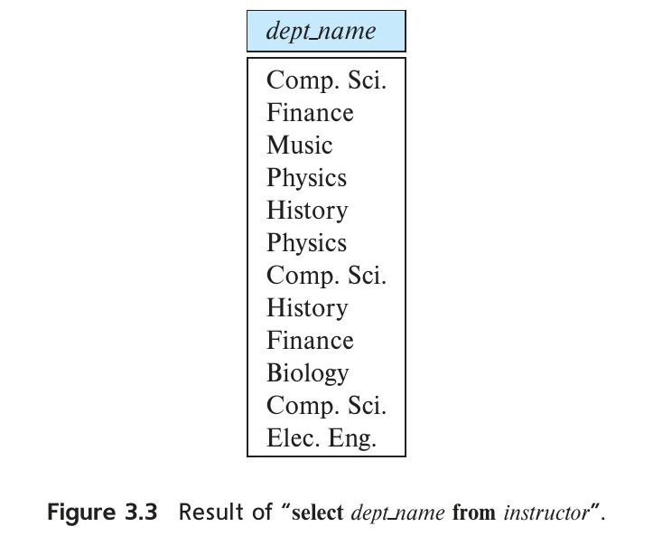
*Figure 3.3 — Result of “select dept_name from instructor”.*

SQL allows us to use the keyword **all** to specify explicitly that duplicates are not removed:

```sql
select all dept_name
from instructor;
```

Since duplicate retention is the default, we shall not use `all` in our examples. To ensure the elimination of duplicates in the results of our example queries, we shall use `distinct` whenever it is necessary.

The `select` clause may also contain arithmetic expressions involving the operators $+$, $-$, $*$, and $/$ operating on constants or attributes of tuples. For example, the query:

```sql
select ID, name, dept_name, salary * 1.1
from instructor;
```

returns a relation that is the same as the `instructor` relation, except that the attribute `salary` is multiplied by 1.1. This shows what would result if we gave a 10% raise to each instructor; note, however, that it does not result in any change to the `instructor` relation.

SQL also provides special data types, such as various forms of the date type, and allows several arithmetic functions to operate on these types. We discuss this further in Section 4.5.1.

The `where` clause allows us to select only those rows in the result relation of the `from` clause that satisfy a specified predicate. Consider the query “Find the names of all instructors in the Computer Science department who have salary greater than \$70,000.” This query can be written in SQL as:

<!-- Page 74 -->

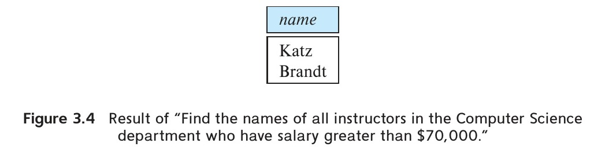
*Figure 3.4 — Result of “Find the names of all instructors in the Computer Science department who have salary greater than \$70,000.”*

```sql
select name
from instructor
where dept_name = 'Comp. Sci.' and salary > 70000;
```

If the `instructor` relation is as shown in Figure 2.1, then the relation that results from the preceding query is shown in Figure 3.4.

SQL allows the use of the logical connectives **and**, **or**, and **not** in the `where` clause. The operands of the logical connectives can be expressions involving the comparison operators `<`, `<=`, `>`, `>=`, `=`, and `<>`. SQL allows us to use the comparison operators to compare strings and arithmetic expressions, as well as special types, such as date types.

We shall explore other features of `where` clause predicates later in this chapter.

### 3.3.2 Queries on Multiple Relations

So far our example queries were on a single relation. Queries often need to access information from multiple relations. We now study how to write such queries.

As an example, suppose we want to answer the query “Retrieve the names of all instructors, along with their department names and department building name.”

Looking at the schema of the relation `instructor`, we realize that we can get the department name from the attribute `dept_name`, but the department building name is present in the attribute `building` of the relation `department`. To answer the query, each tuple in the `instructor` relation must be matched with the tuple in the `department` relation whose `dept_name` value matches the `dept_name` value of the `instructor` tuple.

In SQL, to answer the above query, we list the relations that need to be accessed in the `from` clause and specify the matching condition in the `where` clause. This query can be written in SQL as:

```sql
select name, instructor.dept_name, building
from instructor, department
where instructor.dept_name = department.dept_name;
```

<!-- Page 75 -->

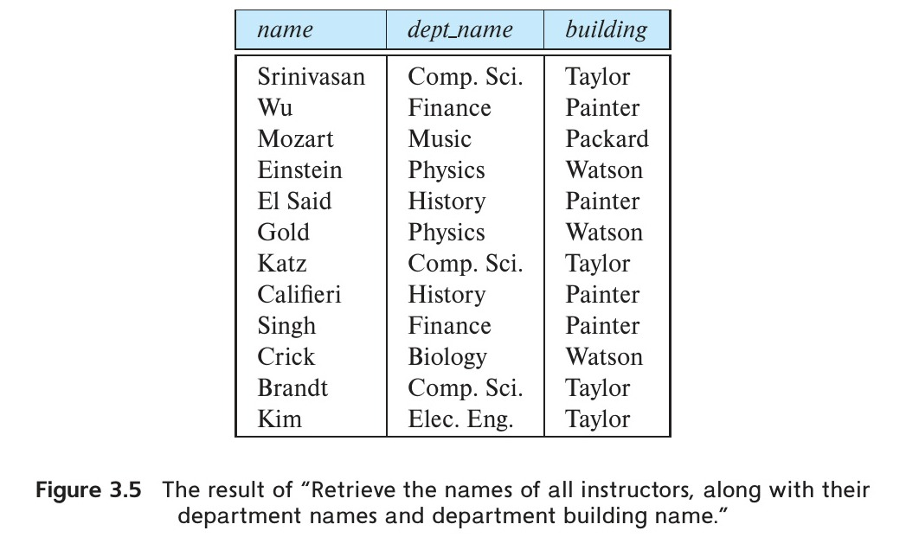
*Figure 3.5 — The result of “Retrieve the names of all instructors, along with their department names and department building name.”*

If the `instructor` relation is as shown in Figure 2.1, and the `department` relation is as shown in Figure 2.5, then the relation that results from the preceding query is shown in Figure 3.5.

Notice that the attribute `dept_name` occurs in both the relations `instructor` and `department`, and the relation name is used as a prefix (in `instructor.dept_name` and `department.dept_name`) to make clear to which attribute we are referring. In contrast, the attributes `name` and `building` appear in only one of the relations, and therefore do not need to be prefixed with the relation name.

Now consider another query, “For all instructors in the university who have taught some course, find their names and the course ID of all courses they taught.”

Looking at the schema of the database in Figure 3.1, we realize that instructor names are in the `instructor` relation, while the information about which courses an instructor teaches is in the `teaches` relation. To answer the query, each tuple in the `instructor` relation must be matched with the tuple in the `teaches` relation whose `ID` value matches the `ID` value of the `instructor` tuple.

In SQL, to answer the above query, we list the relations that need to be accessed in the `from` clause, `instructor` and `teaches`. The matching condition `instructor.ID = teaches.ID` is specified in the `where` clause. We will write this query in SQL as:

```sql
select name, course_id
from instructor, teaches
where instructor.ID = teaches.ID;
```

To understand how this query works, and how queries that access multiple relations work in general, let us understand what the `from` clause does.

<!-- Page 76 -->

The `from` clause by itself defines a Cartesian product of the relations listed in the clause. Since the relational model is based on multiset relations, the Cartesian product of multiset relations $r_1$ and $r_2$ is defined as follows:

Let tuple $t_1$ be in $r_1$ and $t_2$ be in $r_2$. The concatenation of $t_1$ and $t_2$, written $t_1.t_2$, is a tuple containing the attributes of $t_1$ followed by the attributes of $t_2$. For every tuple $t_1$ in $r_1$ and every tuple $t_2$ in $r_2$, there is a tuple $t = t_1.t_2$ in the result relation $r = r_1 \times r_2$. If a particular tuple $t_1$ appears $c_1$ times in $r_1$, and $t_2$ appears $c_2$ times in $r_2$, the tuple $t_1.t_2$ appears $c_1 * c_2$ times in $r_1 \times r_2$.

Recall that the schema for the relation `instructor` is:

$$(ID, name, dept\_name, salary)$$

and the schema for `teaches` is:

$$(ID, course\_id, sec\_id, semester, year)$$

The schema for relation $r = instructor \times teaches$ is:

$$(instructor.ID, name, dept\_name, salary, teaches.ID, course\_id, sec\_id, semester, year)$$

Note that the attribute $ID$ appears in both relations, and the relation name is used as a prefix (in $instructor.ID$ and $teaches.ID$) to make clear to which attribute we are referring.

A small subset of the relation that results from the Cartesian product of the `instructor` relation with the `teaches` relation is shown in Figure 3.6.

A query that has a `from instructor, teaches` clause could be evaluated by first generating the Cartesian product of the relations `instructor` and `teaches`, as in Figure 3.6, and then applying the `where` clause predicate on this Cartesian product.[^2]

If we look at Figure 3.6, we notice that the Cartesian product pairs every tuple in `instructor` with every tuple in `teaches`. A tuple in `instructor` is combined with every tuple in `teaches`, even those that refer to a different instructor. The result can be an extremely large relation, and it rarely makes sense to create such a Cartesian product.

[^2]: In practice, SQL may convert the expression into an equivalent form that can be processed more efficiently. However, we shall defer concerns about efficiency to Chapter 15 and Chapter 16.

<!-- Page 77 -->

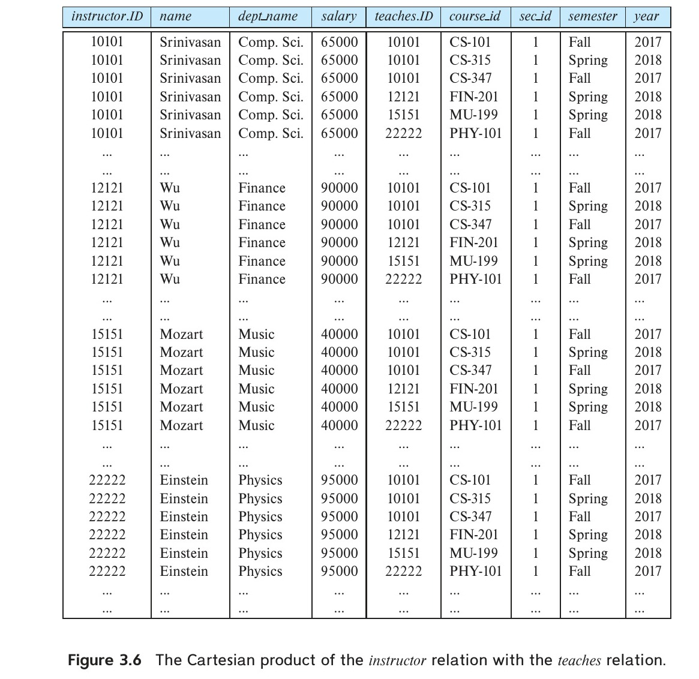
*Figure 3.6 — The Cartesian product of the instructor relation with the teaches relation.*

Instead, the predicate in the `where` clause is used to restrict the combinations created by the Cartesian product to those that are meaningful for the desired answer. We would likely want a query involving `instructor` and `teaches` to combine a particular tuple $t$ in `instructor` with only those tuples in `teaches` that refer to the same instructor to which $t$ refers. That is, we wish only to match `teaches` tuples with `instructor` tuples that have the same `ID` value. The following SQL query ensures this condition and outputs the instructor name and course identifiers from such matching tuples.

```sql
select name, course_id
from instructor, teaches
where instructor.ID = teaches.ID;
```

<!-- Page 78 -->

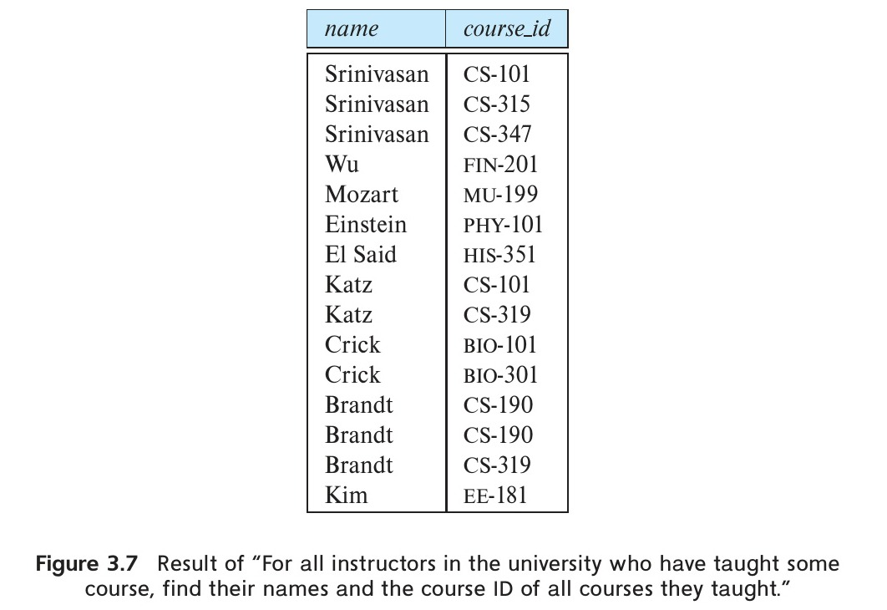
*Figure 3.7 — Result of “For all instructors in the university who have taught some course, find their names and the course ID of all courses they taught.”*

Note that the preceding query outputs only instructors who have taught some course. Instructors who have not taught any course are not output; if we wish to output such tuples, we could use an operation called the outer join, which is described in Section 4.1.3.

If the `instructor` relation is as shown in Figure 2.1 and the `teaches` relation is as shown in Figure 2.7, then the relation that results from the preceding query is shown in Figure 3.7. Observe that instructors Gold, Califieri, and Singh, who have not taught any course, do not appear in Figure 3.7.

If we wished to find only instructor names and course identifiers for instructors in the Computer Science department, we could add an extra predicate to the `where` clause, as shown below.

```sql
select name, course_id
from instructor, teaches
where instructor.ID = teaches.ID and instructor.dept_name = 'Comp. Sci.';
```

Note that since the `dept_name` attribute occurs only in the `instructor` relation, we could have used just `dept_name`, instead of `instructor.dept_name` in the above query.

In general, the meaning of an SQL query can be understood as follows:

1. Generate a Cartesian product of the relations listed in the `from` clause.
2. Apply the predicates specified in the `where` clause on the result of Step 1.

<!-- Page 79 -->

3. For each tuple in the result of Step 2, output the attributes (or results of expressions) specified in the `select` clause.

This sequence of steps helps make clear what the result of an SQL query should be, not how it should be executed. A real implementation of SQL would not execute the query in this fashion; it would instead optimize evaluation by generating (as far as possible) only elements of the Cartesian product that satisfy the `where` clause predicates. We study such implementation techniques in Chapter 15 and Chapter 16.

When writing queries, you should be careful to include appropriate `where` clause conditions. If you omit the `where` clause condition in the preceding SQL query, it will output the Cartesian product, which could be a huge relation. For the example `instructor` relation in Figure 2.1 and the example `teaches` relation in Figure 2.7, their Cartesian product has $12 * 13 = 156$ tuples—more than we can show in the text! To make matters worse, suppose we have a more realistic number of instructors than we show in our sample relations in the figures, say 200 instructors. Let’s assume each instructor teaches three courses, so we have 600 tuples in the `teaches` relation. Then the preceding iterative process generates $200 * 600 = 120,000$ tuples in the result.

## 3.4 Additional Basic Operations

A number of additional basic operations are supported in SQL.

### 3.4.1 The Rename Operation

Consider again the query that we used earlier:

```sql
select name, course_id
from instructor, teaches
where instructor.ID = teaches.ID;
```

The result of this query is a relation with the following attributes:

$$\text{name, course\_id}$$

The names of the attributes in the result are derived from the names of the attributes in the relations in the `from` clause.

We cannot, however, always derive names in this way, for several reasons: First, two relations in the `from` clause may have attributes with the same name, in which case an attribute name is duplicated in the result. Second, if we use an arithmetic expression in the `select` clause, the resultant attribute does not have a name. Third, even if an attribute name can be derived from the base relations as in the preceding example, we may want to change the attribute name in the result. Hence, SQL provides a way of renaming the attributes of a result relation. It uses the **as** clause, taking the form:

<!-- Page 80 -->

> [!note] Note 3.1: SQL and Multiset Relational Algebra - Part 1
> 
> There is a close connection between relational algebra operations and SQL operations. One key difference is that, unlike the relational algebra, SQL allows duplicates. The SQL standard defines how many copies of each tuple are there in the output of a query, which depends, in turn, on how many copies of tuples are present in the input relations.
> 
> To model this behavior of SQL, a version of relational algebra, called the *multiset relational algebra*, is defined to work on multisets: sets that may contain duplicates. The basic operations in the multiset relational algebra are defined as follows:
> 
> 1. If there are $c_1$ copies of tuple $t_1$ in $r_1$, and $t_1$ satisfies selection $\sigma_\theta$, then there are $c_1$ copies of $t_1$ in $\sigma_\theta(r_1)$.
> 2. For each copy of tuple $t_1$ in $r_1$, there is a copy of tuple $\Pi_A(t_1)$ in $\Pi_A(r_1)$, where $\Pi_A(t_1)$ denotes the projection of the single tuple $t_1$.
> 3. If there are $c_1$ copies of tuple $t_1$ in $r_1$ and $c_2$ copies of tuple $t_2$ in $r_2$, there are $c_1 * c_2$ copies of the tuple $t_1.t_2$ in $r_1 \times r_2$.
> 
> For example, suppose that relations $r_1$ with schema $(A, B)$ and $r_2$ with schema $(C)$ are the following multisets: $r_1 = \{(1, a), (2, a)\}$ and $r_2 = \{(2), (3), (3)\}$. Then $\Pi_B(r_1)$ would be $\{(a), (a)\}$, whereas $\Pi_B(r_1) \times r_2$ would be:
> 
> $$\{(a, 2), (a, 2), (a, 3), (a, 3), (a, 3), (a, 3)\}$$
> 
> Now consider a basic SQL query of the form:
> 
> ```sql
> select A1, A2, … , An
> from r1, r2, … , rm
> where P
> ```
> 
> Each $A_i$ represents an attribute, and each $r_i$ a relation. $P$ is a predicate. If the `where` clause is omitted, the predicate $P$ is true. The query is equivalent to the multiset relational-algebra expression:
> 
> $$\Pi_{A_1, A_2, \dots, A_n}(\sigma_P(r_1 \times r_2 \times \dots \times r_m))$$
> 
> The relational algebra select operation corresponds to the SQL `where` clause, not to the SQL `select` clause; the difference in meaning is an unfortunate historical fact. We discuss the representation of more complex SQL queries in Note 3.2 on page 97.
> 
> The relational-algebra representation of SQL queries helps to formally define the meaning of the SQL program. Further, database systems typically translate SQL queries into a lower-level representation based on relational algebra, and they perform query optimization and query evaluation using this representation.

<!-- Page 81 -->

```sql
old-name as new-name
```

The **as** clause can appear in both the `select` and `from` clauses.[^3]

For example, if we want the attribute name `name` to be replaced with the name `instructor_name`, we can rewrite the preceding query as:

```sql
select name as instructor_name, course_id
from instructor, teaches
where instructor.ID = teaches.ID;
```

The `as` clause is particularly useful in renaming relations. One reason to rename a relation is to replace a long relation name with a shortened version that is more convenient to use elsewhere in the query. To illustrate, we rewrite the query “For all instructors in the university who have taught some course, find their names and the course ID of all courses they taught.”

```sql
select T.name, S.course_id
from instructor as T, teaches as S
where T.ID = S.ID;
```

Another reason to rename a relation is a case where we wish to compare tuples in the same relation. We then need to take the Cartesian product of a relation with itself and, without renaming, it becomes impossible to distinguish one tuple from the other. Suppose that we want to write the query “Find the names of all instructors whose salary is greater than at least one instructor in the Biology department.” We can write the SQL expression:

```sql
select distinct T.name
from instructor as T, instructor as S
where T.salary > S.salary and S.dept_name = 'Biology';
```

Observe that we could not use the notation `instructor.salary`, since it would not be clear which reference to `instructor` is intended.

In the above query, $T$ and $S$ can be thought of as copies of the relation `instructor`, but more precisely, they are declared as aliases, that is, as alternative names, for the relation `instructor`. An identifier, such as $T$ and $S$, that is used to rename a relation is referred to as a correlation name in the SQL standard, but it is also commonly referred to as a table alias, or a correlation variable, or a tuple variable.

[^3]: Early versions of SQL did not include the keyword as. As a result, some implementations of SQL, notably Oracle, do not permit the keyword as in the from clause. In Oracle, “old-name as new-name” is written instead as “old-name new-name” in the from clause. The keyword as is permitted for renaming attributes in the select clause, but it is optional and may be omitted in Oracle.

<!-- Page 82 -->

Note that a better way to phrase the previous query in English would be “Find the names of all instructors who earn more than the lowest paid instructor in the Biology department.” Our original wording fits more closely with the SQL that we wrote, but the latter wording is more intuitive, and it can in fact be expressed directly in SQL as we shall see in Section 3.8.2.

### 3.4.2 String Operations

SQL specifies strings by enclosing them in single quotes, for example, `'Computer'`. A single quote character that is part of a string can be specified by using two single quote characters; for example, the string “It’s right” can be specified by `'It''s right'`.

The SQL standard specifies that the equality operation on strings is case sensitive; as a result, the expression “`'comp. sci.' = 'Comp. Sci.'`” evaluates to false. However, some database systems, such as MySQL and SQL Server, do not distinguish uppercase from lowercase when matching strings; as a result, “`'comp. sci.' = 'Comp. Sci.'`” would evaluate to true on these systems. This default behavior can, however, be changed, either at the database level or at the level of specific attributes.

SQL also permits a variety of functions on character strings, such as concatenating (using “$||$”), extracting substrings, finding the length of strings, converting strings to uppercase (using the function `upper(s)` where $s$ is a string) and lowercase (using the function `lower(s)`), removing spaces at the end of the string (using `trim(s)`), and so on. There are variations on the exact set of string functions supported by different database systems. See your database system’s manual for more details on exactly what string functions it supports.

Pattern matching can be performed on strings using the operator **like**. We describe patterns by using two special characters:

- **Percent (%):** The `%` character matches any substring.
- **Underscore (_):** The `_` character matches any character.

Patterns are case sensitive;[^4] that is, uppercase characters do not match lowercase characters, or vice versa. To illustrate pattern matching, we consider the following examples:

- `'Intro%'` matches any string beginning with “Intro”.
- `'%Comp%'` matches any string containing “Comp” as a substring, for example, `'Intro. to Computer Science'`, and `'Computational Biology'`.
- `'___'` matches any string of exactly three characters.
- `'___%'` matches any string of at least three characters.

[^4]: Except for MySQL, or with the ilike operator in PostgreSQL, where patterns are case insensitive.

<!-- Page 83 -->

SQL expresses patterns by using the `like` comparison operator. Consider the query “Find the names of all departments whose building name includes the substring 'Watson'.” This query can be written as:

```sql
select dept_name
from department
where building like '%Watson%';
```

For patterns to include the special pattern characters (that is, `%` and `_`), SQL allows the specification of an escape character. The escape character is used immediately before a special pattern character to indicate that the special pattern character is to be treated like a normal character. We define the escape character for a `like` comparison using the **escape** keyword. To illustrate, consider the following patterns, which use a backslash (`\`) as the escape character:

- `like 'ab\%cd%' escape '\'` matches all strings beginning with “ab%cd”.
- `like 'ab\\cd%' escape '\'` matches all strings beginning with “ab\cd”.

SQL allows us to search for mismatches instead of matches by using the **not like** comparison operator. Some implementations provide variants of the `like` operation that do not distinguish lower- and uppercase.

Some SQL implementations, notably PostgreSQL, offer a **similar to** operation that provides more powerful pattern matching than the `like` operation; the syntax for specifying patterns is similar to that used in Unix regular expressions.

### 3.4.3 Attribute Specification in the Select Clause

The asterisk symbol “ * ” can be used in the `select` clause to denote “all attributes.” Thus, the use of `instructor.*` in the `select` clause of the query:

```sql
select instructor.*
from instructor, teaches
where instructor.ID = teaches.ID;
```

indicates that all attributes of `instructor` are to be selected. A `select` clause of the form `select *` indicates that all attributes of the result relation of the `from` clause are selected.

### 3.4.4 Ordering the Display of Tuples

SQL offers the user some control over the order in which tuples in a relation are displayed. The **order by** clause causes the tuples in the result of a query to appear in sorted order. To list in alphabetic order all instructors in the Physics department, we write:

<!-- Page 84 -->

```sql
select name
from instructor
where dept_name = 'Physics'
order by name;
```

By default, the `order by` clause lists items in ascending order. To specify the sort order, we may specify **desc** for descending order or **asc** for ascending order. Furthermore, ordering can be performed on multiple attributes. Suppose that we wish to list the entire `instructor` relation in descending order of salary. If several instructors have the same salary, we order them in ascending order by name. We express this in SQL as follows:

```sql
select *
from instructor
order by salary desc, name asc;
```

The result of this query is shown in Figure 3.8.

### 3.4.5 Where-Clause Predicates

SQL includes a **between** comparison operator to simplify `where` clauses that specify that a value be less than or equal to some value and greater than or equal to some other value. If we want to find the names of all instructors with salary between \$90,000 and \$100,000, we can use the `between` comparison to write:

```sql
select name
from instructor
where salary between 90000 and 100000;
```

instead of:

```sql
select name
from instructor
where salary <= 100000 and salary >= 90000;
```

Similarly, we can use the **not between** comparison operator. The result of the preceding query is shown in Figure 3.9.

SQL allows us to compare tuples; for example, we can write the query:

```sql
select name, course_id
from instructor, teaches
where (instructor.ID, dept_name) = (teaches.ID, 'Biology');
```

<!-- Page 85 -->

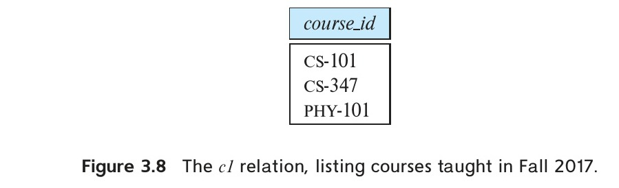
*Figure 3.8 — The c1 relation, listing courses taught in Fall 2017.*

can be rewritten as follows:[^5]

```sql
select name, course_id
from instructor, teaches
where instructor.ID = teaches.ID and dept_name = 'Biology';
```

[^5]: Although it is part of the SQL-92 standard, some SQL implementations, notably Oracle, do not support this syntax.

## 3.5 Set Operations

The SQL operations **union**, **intersect**, and **except** operate on relations, and correspond to the mathematical set-theory operations $\cup$, $\cap$, and $-$. We shall now construct queries using these operations.

To illustrate the set operations on relations, consider the two relations `c1` and `c2` shown in Figure 3.8 and Figure 3.9. Observe that `c1` contains all courses taught in the Fall 2017 semester, while `c2` contains all courses taught in the Spring 2018 semester. In SQL, these two relations can be written as follows:

```sql
/* relation c1 */
select course_id
from section
where semester = 'Fall' and year = 2017;

/* relation c2 */
select course_id
from section
where semester = 'Spring' and year = 2018;
```

<!-- Page 86 -->

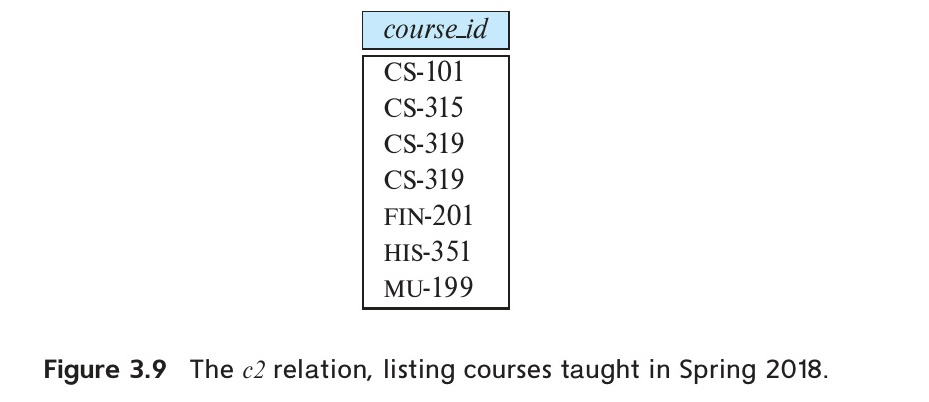
*Figure 3.9 — The c2 relation, listing courses taught in Spring 2018.*

### 3.5.1 The Union Operation

To find the set of all courses taught in the Fall 2017 semester, the Spring 2018 semester, or both, we write:

```sql
(select course_id
 from section
 where semester = 'Fall' and year = 2017)
union
(select course_id
 from section
 where semester = 'Spring' and year = 2018);
```

The result relation of this query is shown in Figure 3.10.

The `union` operation automatically eliminates duplicates, unlike the `select` clause. Thus, in our example, if course CS-101 were taught in both the Fall 2017 and Spring 2018 semesters, it would appear only once in the result.

If we want to retain all duplicates, we must write **union all** in place of `union`:

```sql
(select course_id
 from section
 where semester = 'Fall' and year = 2017)
union all
(select course_id
 from section
 where semester = 'Spring' and year = 2018);
```

The number of duplicate copies of a tuple in the result is equal to the total number of duplicate copies in `c1` and `c2`. Thus, since CS-101 is taught in both the Fall 2017 and Spring 2018 semesters, there are two tuples with CS-101 in the result. If it were the case that four sections of CS-101 were taught in the Fall 2017 semester, and two sections of CS-101 were taught in the Spring 2018 semester, then there would be six tuples with CS-101 in the result.

<!-- Page 87 -->

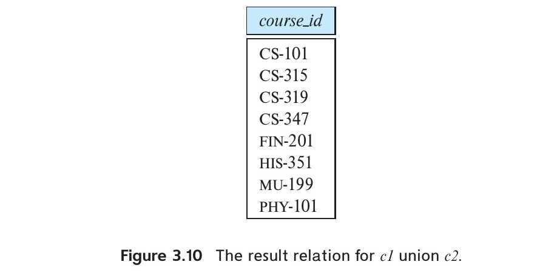
*Figure 3.10 — The result relation for c1 union c2.*

be listed twice. As a further example, if it were the case that four sections of ECE-101 were taught in the Fall 2017 semester, and two sections of ECE-101 were taught in the Spring 2018 semester, then there would be six tuples with ECE-101 in the result.

### 3.5.2 The Intersect Operation

To find the set of all courses taught in both the Fall 2017 and the Spring 2018 semesters, we write:

```sql
(select course_id
 from section
 where semester = 'Fall' and year = 2017)
intersect
(select course_id
 from section
 where semester = 'Spring' and year = 2018);
```

The result relation of this query, shown in Figure 3.11, contains only one tuple with CS-101. The `intersect` operation[^6] automatically eliminates duplicates. Thus, in our example, even if course CS-101 were offered multiple times in Fall 2017 and Spring 2018, it would appear only once in the result.

[^6]: MySQL does not implement the intersect operation; a work-around is to use subqueries as discussed in Section 3.8.1.

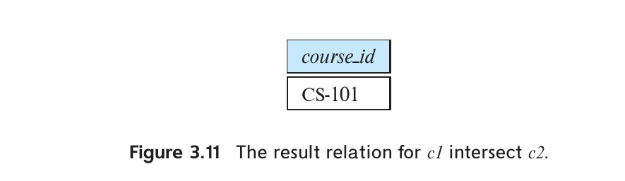
*Figure 3.11 — The result relation for c1 intersect c2.*

If we want to retain all duplicates, we must write **intersect all** in place of `intersect`:

```sql
(select course_id
 from section
 where semester = 'Fall' and year = 2017)
intersect all
(select course_id
 from section
 where semester = 'Spring' and year = 2018);
```

The number of duplicate copies of a tuple in the result is equal to the minimum number of duplicate copies in `c1` and `c2`. Thus, if four sections of ECE-101 were taught in the Fall 2017 semester and two sections of ECE-101 were taught in the Spring 2018 semester, then there are two tuples with ECE-101 in the result. If, however, there was only one section of ECE-101 taught in the Fall 2017 semester, and two sections of ECE-101 in the Spring 2018 semester, then there is only one tuple with ECE-101 in the result.

<!-- Page 88 -->

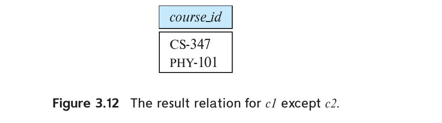
*Figure 3.12 — The result relation for c1 except c2.*

### 3.5.3 The Except Operation

To find all courses taught in the Fall 2017 semester, but not in the Spring 2018 semester, we write:

```sql
(select course_id
 from section
 where semester = 'Fall' and year = 2017)
except
(select course_id
 from section
 where semester = 'Spring' and year = 2018);
```

The result of this query is shown in Figure 3.12. Note that this is exactly relation `c1` in Figure 3.8 except that the tuple for CS-101 does not appear. The `except` operation[^7] outputs all tuples from its first input that do not occur in the second input; that is, it

[^7]: Some SQL implementations, notably Oracle, use the keyword minus in place of except, while Oracle 12c uses the keywords multiset except in place of except all. MySQL does not implement it at all; a work-around is to use subqueries as discussed in Section 3.8.1.

<!-- Page 89 -->

performs set difference. The operation automatically eliminates duplicates in the inputs before performing set difference. For example, if four sections of ECE-101 were taught in the Fall 2017 semester and two sections of ECE-101 were taught in the Spring 2018 semester, the result of the except operation would not have any copy of ECE-101.

If we want to retain duplicates, we must write **except all** in place of `except`:

```sql
(select course_id
 from section
 where semester = 'Fall' and year = 2017)
except all
(select course_id
 from section
 where semester = 'Spring' and year = 2018);
```

The number of duplicate copies of a tuple in the result is equal to the number of duplicate copies in `c1` minus the number of duplicate copies in `c2`, provided that the difference is positive. Thus, if four sections of ECE-101 were taught in the Fall 2017 semester and two sections of ECE-101 were taught in Spring 2018, then there are two tuples with ECE-101 in the result. If, however, there were two or fewer sections of ECE-101 in the Fall 2017 semester and two sections of ECE-101 in the Spring 2018 semester, there is no tuple with ECE-101 in the result.

## 3.6 Null Values

Null values present special problems in relational operations, including arithmetic operations, comparison operations, and set operations.

The result of an arithmetic expression (involving, for example, $+$, $-$, $*$, or $/$) is null if any of the input values is null. For example, if a query has an expression `r.A + 5`, and `r.A` is null for a particular tuple, then the expression result must also be null for that tuple.

Comparisons involving nulls are more of a problem. For example, consider the comparison “`1 < null`”. It would be wrong to say this is true since we do not know what the null value represents. But it would likewise be wrong to claim this expression is false; if we did, “`not (1 < null)`” would evaluate to true, which does not make sense. SQL therefore treats as **unknown** the result of any comparison involving a null value (other than predicates `is null` and `is not null`, which are described later in this section). This creates a third logical value in addition to **true** and **false**.

Since the predicate in a `where` clause can involve Boolean operations such as `and`, `or`, and `not` on the results of comparisons, the definitions of the Boolean operations are extended to deal with the value **unknown**.

<!-- Page 90 -->

- **and:** The result of *true and unknown* is *unknown*, *false and unknown* is *false*, while *unknown and unknown* is *unknown*.
- **or:** The result of *true or unknown* is *true*, *false or unknown* is *unknown*, while *unknown or unknown* is *unknown*.
- **not:** The result of *not unknown* is *unknown*.

You can verify that if `r.A` is null, then “`1 < r.A`” as well as “`not (1 < r.A)`” evaluate to *unknown*.

If the `where` clause predicate evaluates to either *false* or *unknown* for a tuple, that tuple is not added to the result.

SQL uses the special keyword **null** in a predicate to test for a null value. Thus, to find all instructors who appear in the `instructor` relation with null values for salary, we write:

```sql
select name
from instructor
where salary is null;
```

The predicate **is not null** succeeds if the value on which it is applied is not null.

SQL allows us to test whether the result of a comparison is unknown, rather than true or false, by using the clauses **is unknown** and **is not unknown**.[^8] For example,

```sql
select name
from instructor
where salary > 10000 is unknown;
```

When a query uses the `select distinct` clause, duplicate tuples must be eliminated. For this purpose, when comparing values of corresponding attributes from two tuples, the values are treated as identical if either both are non-null and equal in value, or both are null. Thus, two copies of a tuple, such as `('A', null)` and `('A', null)`, are treated as being identical, even if some of the attributes have a null value. Using the `distinct` clause then retains only one copy of such identical tuples. Note that the treatment of null above is different from the way nulls are treated in predicates, where a comparison “`null = null`” would return *unknown*, rather than *true*.

The approach of treating tuples as identical if they have the same values for all attributes, even if some of the values are null, is also used for the set operations `union`, `intersection`, and `except`.

[^8]: The is unknown and is not unknown constructs are not supported by several databases.

<!-- Page 91 -->

## 3.7 Aggregate Functions

Aggregate functions are functions that take a collection (a set or multiset) of values as input and return a single value. SQL offers five standard built-in aggregate functions:[^9]

- **Average:** `avg`
- **Minimum:** `min`
- **Maximum:** `max`
- **Total:** `sum`
- **Count:** `count`

The input to `sum` and `avg` must be a collection of numbers, but the other operators can operate on collections of nonnumeric data types, such as strings, as well.

### 3.7.1 Basic Aggregation

Consider the query “Find the average salary of instructors in the Computer Science department.” We write this query as follows:

```sql
select avg (salary)
from instructor
where dept_name = 'Comp. Sci.';
```

The result of this query is a relation with a single attribute containing a single tuple with a numerical value corresponding to the average salary of instructors in the Computer Science department. The database system may give an awkward name to the result relation attribute that is generated by aggregation, consisting of the text of the expression; however, we can give a meaningful name to the attribute by using the `as` clause as follows:

```sql
select avg (salary) as avg_salary
from instructor
where dept_name = 'Comp. Sci.';
```

In the `instructor` relation of Figure 2.1, the salaries in the Computer Science department are \$75,000, \$65,000, and \$92,000. The average salary is $\$232,000 / 3 = \$77,333.33$.

Retaining duplicates is important in computing an average. Suppose the Computer Science department adds a fourth instructor whose salary happens to be \$75,000. If duplicates were eliminated, we would obtain the wrong answer ($\$232,000 / 4 = \$58,000$) rather than the correct answer of \$76,750.

[^9]: Most implementations of SQL offer a number of additional aggregate functions.

<!-- Page 92 -->

There are cases where we must eliminate duplicates before computing an aggregate function. If we do want to eliminate duplicates, we use the keyword **distinct** in the aggregate expression. An example arises in the query “Find the total number of instructors who teach a course in the Spring 2018 semester.” In this case, an instructor counts only once, regardless of the number of course sections that the instructor teaches. The required information is contained in the relation `teaches`, and we write this query as follows:

```sql
select count (distinct ID)
from teaches
where semester = 'Spring' and year = 2018;
```

Because of the keyword `distinct` preceding `ID`, even if an instructor teaches more than one course, she is counted only once in the result.

We use the aggregate function `count` frequently to count the number of tuples in a relation. The notation for this function in SQL is `count (*)`. Thus, to find the number of tuples in the `course` relation, we write

```sql
select count (*)
from course;
```

SQL does not allow the use of `distinct` with `count (*)`. It is legal to use `distinct` with `max` and `min`, even though the result does not change. We can use the keyword `all` in place of `distinct` to specify duplicate retention, but since `all` is the default, there is no need to do so.

### 3.7.2 Aggregation with Grouping

There are circumstances where we would like to apply the aggregate function not only to a single set of tuples, but also to a group of sets of tuples; we specify this in SQL using the **group by** clause. The attribute or attributes given in the `group by` clause are used to form groups. Tuples with the same value on all attributes in the `group by` clause are placed in one group.

As an illustration, consider the query “Find the average salary in each department.” We write this query as follows:

```sql
select dept_name, avg (salary) as avg_salary
from instructor
group by dept_name;
```

<!-- Page 93 -->


*Figure 3.13 — Tuples of the instructor relation, grouped by the dept_name attribute.*

Figure 3.13 shows the tuples in the `instructor` relation grouped by the `dept_name` attribute, which is the first step in computing the query result. The specified aggregate is computed for each group, and the result of the query is shown in Figure 3.14.

In contrast, consider the query “Find the average salary of all instructors.” We write this query as follows:

```sql
select avg (salary)
from instructor;
```

In this case the `group by` clause has been omitted, so the entire relation is treated as a single group.

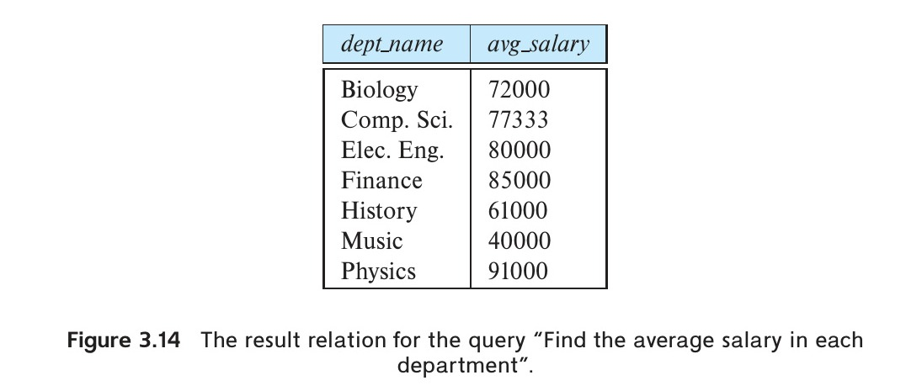
*Figure 3.14 — The result relation for the query “Find the average salary in each department”.*

When a query contains `group by`, we must ensure that the only attributes that appear in the `select` statement without being aggregated are those that are present in the `group by` clause. In other words, any attribute that is not in the `group by` clause must appear only inside an aggregate function if it appears in the `select` clause; otherwise, the query is erroneous. For example, the query:

```sql
/* erroneous query */
select dept_name, ID, avg (salary)
from instructor
group by dept_name;
```

<!-- Page 94 -->

is not a legal query, since `ID` is not in the `group by` clause, and nor is it aggregated. Each group has multiple tuples, each tuple with a different `ID`, and there is no unique value for `ID` to output for each group!

As another example, consider the query “Find the number of instructors in each department who teach a course in the Spring 2018 semester.”

```sql
select dept_name, count (distinct ID) as instr_count
from instructor natural join teaches
where semester = 'Spring' and year = 2018
group by dept_name;
```

The result is shown in Figure 3.15.

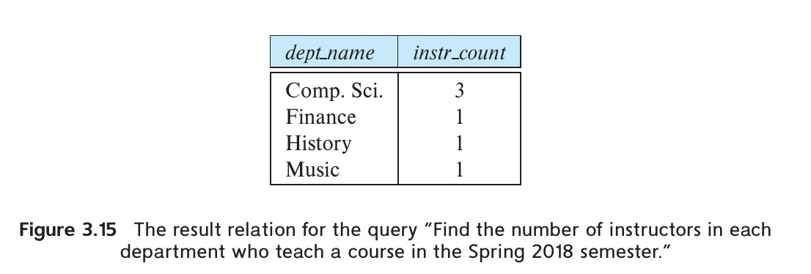
*Figure 3.15 — The result relation for the query “Find the number of instructors in each department who teach a course in the Spring 2018 semester.”*

Recall that if an instructor does not teach any course, she does not appear in the result of the join. As a result, the History and Physics departments do not appear in the result of the query since no instructor from either department taught a course in the Spring 2018 semester. (Outer joins, covered in Section 4.1.3, can be used to ensure that such departments are not omitted from the result.)

The query above can be written without using natural join, as follows:

```sql
select dept_name, count (distinct instructor.ID) as instr_count
from instructor, teaches
where instructor.ID = teaches.ID
  and semester = 'Spring' and year = 2018
group by dept_name;
```

Note that since attribute `ID` appears in both relations, it must be prefixed with the relation name `instructor.` (or `teaches.`), while `dept_name` appears in only one relation and need not be prefixed.

<!-- Page 95 -->

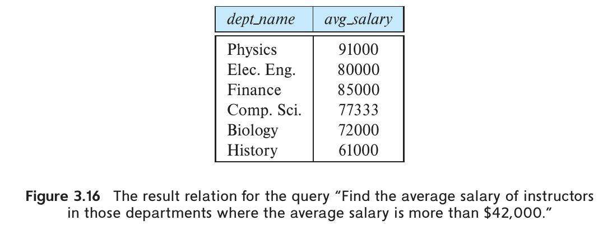
*Figure 3.16 — The result relation for the query “Find the average salary of instructors in those departments where the average salary is more than \$42,000.”*

### 3.7.3 The Having Clause

At times, it is useful to state a condition that applies to groups rather than to tuples. For example, we might be interested in only those departments where the average salary of the instructors is more than \$42,000. This condition does not apply to a single tuple; rather, it applies to each group constructed by the `group by` clause. To express such a query, we use the **having** clause of SQL. Predicates in the `having` clause are applied after the formation of groups, so aggregate functions can be used in the `having` clause. We express this query in SQL as follows:

```sql
select dept_name, avg (salary) as avg_salary
from instructor
group by dept_name
having avg (salary) > 42000;
```

The result of this query is shown in Figure 3.16.

As was the case for the `select` clause, any attribute that appears in the `having` clause without being aggregated must appear in the `group by` clause; otherwise, the query is erroneous.

The meaning of a query containing aggregation, `group by`, or `having` clauses is defined by the following sequence of operations:

1. As was the case for queries without aggregation, the `from` clause is first evaluated to get a relation.
2. If a `where` clause is present, the predicate in the `where` clause is applied to the result relation of the `from` clause.

<!-- Page 96 -->

3. Tuples that satisfy the `where` predicate are then placed into groups according to the `group by` clause if one is present. If the `group by` clause is absent, the entire set of tuples satisfying the `where` predicate is treated as being in a single group.
4. The `having` clause, if it is present, is applied to each group; the groups that do not satisfy the `having` clause predicate are removed.
5. The `select` clause uses the remaining groups to generate tuples of the result of the query, applying the aggregate functions to get a single result tuple for each group.

To illustrate the use of both a `where` clause and a `having` clause in the same query, consider the query “For each course section offered in 2017, find the average total credits (tot_cred) of all students enrolled in the section, if the section had at least 2 students.”

```sql
select course_id, semester, year, sec_id, avg (tot_cred)
from takes natural join student
where year = 2017
group by course_id, semester, year, sec_id
having count (ID) >= 2;
```

Note that the predicate in the `where` clause applies to individual tuples, and selects only course offerings in 2017. The groups are formed from the selected tuples, and the predicate in the `having` clause applies to groups, and selects only those groups with at least 2 students.

### 3.7.4 Aggregation with Null and Boolean Values

Null values complicate the processing of aggregate operators. For example, assume that some tuples in the `instructor` relation have a null value for `salary`. Consider the query to calculate the total of all salaries:

```sql
select sum (salary)
from instructor;
```

The values to be summed in this case include null values, since some tuples have a null value for `salary`. Rather than say that the total of all salaries is unknown if some salaries are not known, the SQL standard applies the following rule to handle arithmetic operations in aggregation:

- All aggregate functions except `count (*)` ignore null values in their input collection.

<!-- Page 97 -->

> [!note] Note 3.2: SQL and Multiset Relational Algebra - Part 2
> 
> As we saw earlier in Note 3.1 on page 80, the SQL `select`, `from`, and `where` clauses can be represented in the multiset relational algebra, using the multiset versions of the select, project, and Cartesian product operations.
> 
> The relational algebra union, intersection, and set difference ($\cup$, $\cap$, and $-$) operations can also be extended to the multiset relational algebra in a similar way, following the corresponding definitions of `union all`, `intersect all`, and `except all` in SQL, which we saw in Section 3.5; the SQL `union`, `intersect`, and `except` correspond to the set version of $\cup$, $\cap$, and $-$.
> 
> The extended relational algebra aggregate operation $\gamma$ permits the use of aggregate functions on relation attributes. (The symbol $\mathcal{G}$ is also used to represent the aggregate operation and was used in earlier editions of the book.) The operation ${}_{dept\_name}\gamma_{\text{average}(salary)}(instructor)$ groups the `instructor` relation on the `dept_name` attribute and computes the average salary for each group, as we saw earlier in Section 3.7.2. The subscript on the left side may be omitted, resulting in the entire input relation being in a single group. Thus, $\gamma_{\text{average}(salary)}(instructor)$ computes the average salary of all instructors. The aggregated values do not have an attribute name; they can be given a name either by using the rename operator $\rho$ or for convenience using the following syntax:
> 
> $${}_{dept\_name}\gamma_{\text{average}(salary)\text{ as }avg\_salary}(instructor)$$
> 
> More complex SQL queries can also be rewritten in relational algebra. For example, the query:
> 
> ```sql
> select A1, A2, sum(A3)
> from r1, r2, … , rm
> where P
> group by A1, A2 having count(A4) > 2
> ```
> 
> is equivalent to:
> 
> $$t1 \leftarrow \sigma_P(r_1 \times r_2 \times \dots \times r_m)$$
> 
> $$\Pi_{A_1, A_2, SumA3}(\sigma_{countA4 > 2}({}_{A_1, A_2}\gamma_{\text{sum}(A_3)\text{ as }SumA3, \text{count}(A_4)\text{ as }countA4}(t1)))$$
> 
> Join expressions in the `from` clause can be written using equivalent join expressions in relational algebra; we leave the details as an exercise for the reader. However, subqueries in the `where` or `select` clause cannot be rewritten into relational algebra in such a straightforward manner, since there is no relational algebra operation equivalent to the subquery construct. Extensions of relational algebra have been proposed for this task, but they are beyond the scope of this book.

<!-- Page 98 -->

Because null values are ignored by the aggregate operations, the sum of salaries in the above query is computed using only the non-null salary values.

As a result of this rule, if the input collection of values is empty, or contains only null values, the `count` aggregate returns `0`, and all other aggregates return `null`.

The effects of null values on `count(*)` can be slightly counterintuitive. If the `instructor` relation is empty, `count(*)` will return `0`, but `sum(salary)` will return `null`. If the `instructor` relation contains three tuples, all of which have null values for `salary`, `count(*)` will return `3`, `count(salary)` will return `0`, and `sum(salary)` will return `null`.

SQL:1999 introduced two aggregate functions, `every` and `any` (or `some`), which can be used on a collection of Boolean values to test if every value in the collection is true or, respectively, if any value in the collection is true.

## 3.8 Nested Subqueries

SQL provides a mechanism for the nesting of subqueries. A **subquery** is a `select-from-where` expression that is nested within another query. A common use of subqueries is to perform tests for set membership, make set comparisons, and determine set cardinality, by nesting a subquery in the `where` clause. We study these uses of subqueries in Section 3.8.1 through Section 3.8.4. Subqueries can also be used in the `from` clause; we study this usage in Section 3.8.5. In Section 3.8.7, we study **scalar subqueries**, which can appear wherever an expression returning a value is permitted.

### 3.8.1 Set Membership

SQL allows testing tuples for membership in a relation. The **in** connective tests for set membership, where the set is a collection of values produced by a `select` clause. The **not in** connective tests for the absence of set membership.

As an illustration, consider the query “Find all the courses taught in both the Fall 2017 and Spring 2018 semesters.” In Section 3.5.2, we wrote this query by using the `intersect` operation. We can write this query by using the `in` connective as follows:

<!-- Page 99 -->

```sql
select distinct course_id
from section
where semester = 'Fall' and year = 2017 and
      course_id in (select course_id
                    from section
                    where semester = 'Spring' and year = 2018);
```

This example shows that it is possible to write the same query in several different ways in SQL. This flexibility is beneficial, since it allows users to think about the query in the way that seems most natural to them. We shall see, however, that there is a substantial amount of redundancy in the language.

In the preceding example, we tested for membership in a relation that was generated by a subquery. We can also test for set membership in an enumerated set of values. For example, the following query finds the names of all instructors whose name is neither “Mozart” nor “Einstein”:

```sql
select distinct name
from instructor
where name not in ('Mozart', 'Einstein');
```

The `in` and `not in` operators can also be used on relations with multiple attributes. For example, we could write the query “Find the total number of (distinct) students who have taken course sections taught by the instructor with ID 10101” as follows:

```sql
select count (distinct ID)
from takes
where (course_id, sec_id, semester, year) in
      (select course_id, sec_id, semester, year
       from teaches
       where teaches.ID = '10101');
```

Note, however, that some SQL implementations do not support the row construction syntax “`(course_id, sec_id, semester, year)`” used above. We will see alternative ways of writing this query in Section 3.8.3.

### 3.8.2 Set Comparison

As an example of the ability of a nested subquery to compare sets, consider the query “Find the names of all instructors whose salary is greater than at least one instructor in the Biology department.” In Section 3.4.1, we wrote this query as follows:

<!-- Page 100 -->

```sql
select distinct T.name
from instructor as T, instructor as S
where T.salary > S.salary and S.dept_name = 'Biology';
```

SQL does, however, offer an alternative style for writing the preceding query. The phrase “greater than at least one” is represented in SQL by **> some**. This construct allows us to rewrite the query in a form that resembles closely our formulation of the query in English.

```sql
select name
from instructor
where salary > some (select salary
                     from instructor
                     where dept_name = 'Biology');
```

The subquery:

```sql
(select salary
 from instructor
 where dept_name = 'Biology')
```

generates the set of all salary values of all instructors in the Biology department. The `> some` comparison in the `where` clause of the outer `select` is true if the salary value of the tuple is greater than at least one member of the set of all salary values for instructors in Biology.

SQL also allows `< some`, `<= some`, `>= some`, `= some`, and `<> some` comparisons. As an exercise, verify that `= some` is identical to `in`, whereas `<> some` is not the same as `not in`.[^10]

Now we modify our query slightly. Let us find the names of all instructors that have a salary value greater than that of each instructor in the Biology department. The construct **> all** corresponds to the phrase “greater than all.” Using this construct, we write the query as follows:

```sql
select name
from instructor
where salary > all (select salary
                    from instructor
                    where dept_name = 'Biology');
```

As it does for `some`, SQL also allows `< all`, `<= all`, `>= all`, `= all`, and `<> all` comparisons. As an exercise, verify that `<> all` is identical to `not in`, whereas `= all` is not the same as `in`.

[^10]: The keyword any is synonymous to some in SQL. Early versions of SQL allowed only any. Later versions added the alternative some to avoid the linguistic ambiguity of the word any in English.

<!-- Page 101 -->

As another example of set comparisons, consider the query “Find the departments that have the highest average salary.” We begin by writing a query to find all average salaries, and then nest it as a subquery of a larger query that finds those departments for which the average salary is greater than or equal to all average salaries:

```sql
select dept_name
from instructor
group by dept_name
having avg (salary) >= all (select avg (salary)
                            from instructor
                            group by dept_name);
```

### 3.8.3 Test for Empty Relations

SQL includes a feature for testing whether a subquery has any tuples in its result. The **exists** construct returns the value true if the argument subquery is nonempty. Using the `exists` construct, we can write the query “Find all courses taught in both the Fall 2017 semester and in the Spring 2018 semester” in still another way:

```sql
select course_id
from section as S
where semester = 'Fall' and year = 2017 and
      exists (select *
              from section as T
              where semester = 'Spring' and year = 2018 and
                    S.course_id = T.course_id);
```

The above query also illustrates a feature of SQL where a correlation name from an outer query ($S$ in the above query), can be used in a subquery in the `where` clause. A subquery that uses a correlation name from an outer query is called a **correlated subquery**.

In queries that contain subqueries, a scoping rule applies for correlation names. In a subquery, according to the rule, it is legal to use only correlation names defined in the subquery itself or in any query that contains the subquery. If a correlation name is defined both locally in a subquery and globally in a containing query, the local definition applies. This rule is analogous to the usual scoping rules used for variables in programming languages.

We can test for the nonexistence of tuples in a subquery by using the **not exists** construct. We can use the `not exists` construct to simulate the set containment (that is, superset) operation: We can write “relation $A$ contains relation $B$” as “`not exists (B except A)`”. (Although it is not part of the current SQL standards, the `contains` operator was present in some early relational systems.) To illustrate the `not exists` operator,

<!-- Page 102 -->

consider the query “Find all students who have taken all courses offered in the Biology department.” Using the `except` construct, we can write the query as follows:

```sql
select S.ID, S.name
from student as S
where not exists ((select course_id
                   from course
                   where dept_name = 'Biology')
                  except
                  (select T.course_id
                   from takes as T
                   where S.ID = T.ID));
```

Here, the subquery:

```sql
(select course_id
 from course
 where dept_name = 'Biology')
```

finds the set of all courses offered in the Biology department. The subquery:

```sql
(select T.course_id
 from takes as T
 where S.ID = T.ID)
```

finds all the courses that student `S.ID` has taken. Thus, the outer `select` takes each student and tests whether the set of all courses that the student has taken contains the set of all courses offered in the Biology department.

We saw in Section 3.8.1, an SQL query to “find the total number of (distinct) students who have taken course sections taught by the instructor with ID 10101”. That query used a tuple constructor syntax that is not supported by some databases. An alternative way to write the query, using the `exists` construct, is as follows:

```sql
select count (distinct ID)
from takes
where exists (select course_id, sec_id, semester, year
              from teaches
              where teaches.ID = '10101'
                and takes.course_id = teaches.course_id
                and takes.sec_id = teaches.sec_id
                and takes.semester = teaches.semester
                and takes.year = teaches.year);
```

<!-- Page 103 -->

### 3.8.4 Test for the Absence of Duplicate Tuples

SQL includes a Boolean function for testing whether a subquery has duplicate tuples in its result. The **unique** construct[^11] returns the value true if the argument subquery contains no duplicate tuples. Using the `unique` construct, we can write the query “Find all courses that were offered at most once in 2017” as follows:

```sql
select T.course_id
from course as T
where unique (select R.course_id
              from section as R
              where T.course_id = R.course_id and
                    R.year = 2017);
```

Note that if a course were not offered in 2017, the subquery would return an empty result, and the `unique` predicate would evaluate to true on the empty set.

An equivalent version of this query not using the `unique` construct is:

```sql
select T.course_id
from course as T
where 1 >= (select count(R.course_id)
            from section as R
            where T.course_id = R.course_id and
                  R.year = 2017);
```

We can test for the existence of duplicate tuples in a subquery by using the **not unique** construct. To illustrate this construct, consider the query “Find all courses that were offered at least twice in 2017” as follows:

```sql
select T.course_id
from course as T
where not unique (select R.course_id
                  from section as R
                  where T.course_id = R.course_id and
                        R.year = 2017);
```

Formally, the `unique` test on a relation is defined to fail if and only if the relation contains two distinct tuples $t_1$ and $t_2$ such that $t_1 = t_2$. Since the test $t_1 = t_2$ fails if any of the fields of $t_1$ or $t_2$ are null, it is possible for `unique` to be true even if there are multiple copies of a tuple, as long as at least one of the attributes of the tuple is null.

[^11]: This construct is not yet widely implemented.

<!-- Page 104 -->

### 3.8.5 Subqueries in the From Clause

SQL allows a subquery expression to be used in the `from` clause. The key concept applied here is that any `select-from-where` expression returns a relation as a result and, therefore, can be inserted into another `select-from-where` anywhere that a relation can appear.

Consider the query “Find the average instructors’ salaries of those departments where the average salary is greater than \$42,000.” We wrote this query in Section 3.7 by using the `having` clause. We can now rewrite this query, without using the `having` clause, by using a subquery in the `from` clause, as follows:

```sql
select dept_name, avg_salary
from (select dept_name, avg (salary) as avg_salary
      from instructor
      group by dept_name)
where avg_salary > 42000;
```

The subquery generates a relation consisting of the names of all departments and their corresponding average instructors’ salaries. The attributes of the subquery result can be used in the outer query, as can be seen in the above example.

Note that we do not need to use the `having` clause, since the subquery in the `from` clause computes the average salary, and the predicate that was in the `having` clause earlier is now in the `where` clause of the outer query.

We can give the subquery result relation a name, and rename the attributes, using the `as` clause, as illustrated below.

```sql
select dept_name, avg_salary
from (select dept_name, avg (salary)
      from instructor
      group by dept_name)
      as dept_avg (dept_name, avg_salary)
where avg_salary > 42000;
```

The subquery result relation is named `dept_avg`, with the attributes `dept_name` and `avg_salary`.

As another example, suppose we want to find the maximum across all departments of the total of all instructors’ salaries in each department. The `having` clause cannot help us here, but we can write the query easily using a subquery in the `from` clause:

<!-- Page 105 -->

```sql
select max (tot_salary)
from (select dept_name, sum(salary)
      from instructor
      group by dept_name) as dept_total (dept_name, tot_salary);
```

Note that SQL does not permit scalar subqueries in the `from` clause that use variables from other relations in the `from` clause (or in containing queries). However, SQL:2003 allows a subquery in the `from` clause to be prefixed by the **lateral** clause, which permits the subquery to access attributes of preceding tables or subqueries in the `from` clause. For example, if we want to print each instructor’s name, along with their salary and the average salary in their department, we can write:

```sql
/* legal in SQL:2003, supported by only some databases */
select name, salary, avg_salary
from instructor I1, lateral (select avg(salary) as avg_salary
                             from instructor I2
                             where I2.dept_name = I1.dept_name);
```

Without the `lateral` clause, the subquery in the `from` clause would not be allowed to access the correlation variable `I1` from the outer query. The `lateral` clause is supported by only a few database systems, such as PostgreSQL.

### 3.8.6 The With Clause

The **with** clause provides a way of defining a temporary relation whose definition is available only to the query in which the `with` clause occurs. Consider the following query, which finds those departments with the maximum budget:

```sql
with max_budget (value) as
    (select max(budget)
     from department)
select department.dept_name
from department, max_budget
where department.budget = max_budget.value;
```

The `with` clause defines a temporary relation named `max_budget` that has a single attribute `value` and contains a single tuple with the maximum budget across all departments. The `with` clause can define multiple temporary relations separated by commas.

<!-- Page 106 -->

The `with` query defines the temporary relation `max_budget` containing the results of the subquery defining the relation. The relation is available for use only within later parts of the same query.[^12] The `with` clause, introduced in SQL:1999, is supported by many, but not all, database systems.

We could have written the preceding query by using a nested subquery in either the `from` clause or the `where` clause. However, using nested subqueries would have made the query harder to read and understand. The `with` clause makes the query logic clearer; it also permits this temporary relation to be used in multiple places within a query.

For example, suppose we want to find all departments where the total salary is greater than the average of the total salary at all departments. We can write the query using the `with` clause as follows.

```sql
with dept_total (dept_name, value) as
    (select dept_name, sum(salary)
     from instructor
     group by dept_name),
dept_total_avg(value) as
    (select avg(value)
     from dept_total)
select dept_name
from dept_total, dept_total_avg
where dept_total.value > dept_total_avg.value;
```

We can create an equivalent query without the `with` clause, but it would be more complicated and harder to understand. You can write the equivalent query as an exercise.

### 3.8.7 Scalar Subqueries

SQL allows subqueries to occur wherever an expression returning a value is permitted, provided the subquery returns only one tuple containing a single attribute; such subqueries are called **scalar subqueries**. For example, a subquery can be used in the `select` clause as illustrated in the following example that lists all departments along with the number of instructors in each department:

```sql
select dept_name,
       (select count(*)
        from instructor
        where department.dept_name = instructor.dept_name)
       as num_instructors
from department;
```

[^12]: The SQL evaluation engine may not physically create the relation and is free to compute the overall query result in alternative ways, as long as the result of the query is the same as if the relation had been created.

<!-- Page 107 -->

The subquery in this example is guaranteed to return only a single value since it has a `count(*)` aggregate without a `group by`. The example also illustrates the usage of correlation variables, that is, attributes of relations in the `from` clause of the outer query, such as `department.dept_name` in the above example.

Scalar subqueries can occur in `select`, `where`, and `having` clauses. Scalar subqueries may also be defined without aggregates. It is not always possible to figure out at compile time if a subquery can return more than one tuple in its result; if the result has more than one tuple when the subquery is executed, a run-time error occurs.

Note that technically the type of a scalar subquery result is still a relation, even if it contains a single tuple. However, when a scalar subquery is used in an expression where a value is expected, SQL implicitly extracts the value from the single attribute of the single tuple in the relation and returns that value.

### 3.8.8 Scalar Without a From Clause

Certain queries require a calculation but no reference to any relation. Similarly, certain queries may have subqueries that contain a `from` clause without the top-level query needing a `from` clause.

As an example, suppose we wish to find the average number of sections taught (regardless of year or semester) per instructor, with sections taught by multiple instructors counted once per instructor. We need to count the number of tuples in `teaches` to find the total number of sections taught and count the number of tuples in `instructor` to find the number of instructors. Then a simple division gives us the desired result. One might write this as:

```sql
(select count (*) from teaches) / (select count (*) from instructor);
```

While this is legal in some systems, others will report an error due to the lack of a `from` clause.[^13] In the latter case, a special dummy relation called, for example, `dual` can be created, containing a single tuple. This allows the preceding query to be written as:

```sql
select (select count (*) from teaches) / (select count (*) from instructor)
from dual;
```

Oracle provides a predefined relation called `dual`, containing a single tuple, for uses such as the above (the relation has a single attribute, which is not relevant for our purposes); you can create an equivalent relation if you use any other database.

Since the above queries divide one integer by another, the result would, on most databases, be an integer, which would result in loss of precision. If you wish to get the result as a floating point number, you could multiply one of the two subquery results by 1.0 to convert it to a floating point number, before the division operation is performed.

[^13]: This construct is legal, for example, in SQL Server, but not legal, for example, in Oracle.

<!-- Page 108 -->

> [!note] Note 3.3: SQL and Multiset Relational Algebra - Part 3
> 
> Unlike the SQL set and aggregation operations that we studied earlier in this chapter, SQL subqueries do not have directly equivalent operations in the relational algebra. Most SQL queries involving subqueries can be rewritten in a way that does not require the use of subqueries, and thus they have equivalent relational algebra expressions.
> 
> Rewriting to relational algebra can benefit from two extended relational algebra operations called *semijoin*, denoted $\ltimes$, and *antijoin*, denoted $\overline{\ltimes}$, which are supported internally by many database implementations (the symbol $\triangleright$ is sometimes used in place of $\overline{\ltimes}$ to denote antijoin). For example, given relations $r$ and $s$, $r \ltimes_{r.A = s.B} s$ outputs all tuples in $r$ that have at least one tuple in $s$ whose $s.B$ attribute value matches that tuple's $r.A$ attribute value. Conversely, $r \ \overline{\ltimes}_{r.A = s.B} \ s$ outputs all tuples in $r$ that do not have any such matching tuple in $s$. These operators can be used to rewrite many subqueries that use the **exists** and **not exists** connectives.
> 
> Semijoin and antijoin can be expressed using other relational algebra operations, so they do not add any expressive power, but they are nevertheless quite useful in practice since they can be implemented very efficiently.
> 
> However, the process of rewriting SQL queries that contain subqueries is in general not straightforward. Database system implementations therefore extend the relational algebra by allowing $\sigma$ and $\Pi$ operators to invoke subqueries in their predicates and projection lists.

## 3.9 Modification of the Database

We have restricted our attention until now to the extraction of information from the database. Now, we show how to add, remove, or change information with SQL.

### 3.9.1 Deletion

A delete request is expressed in much the same way as a query. We can delete only whole tuples; we cannot delete values on only particular attributes. SQL expresses a deletion by:

```sql
delete from r
where P;
```

where $P$ represents a predicate and $r$ represents a relation. The `delete` statement first finds all tuples $t$ in $r$ for which $P(t)$ is true, and then deletes them from $r$. The `where` clause can be omitted, in which case all tuples in $r$ are deleted.

<!-- Page 109 -->

Note that a delete command operates on only one relation. If we want to delete tuples from several relations, we must use one delete command for each relation. The predicate in the `where` clause may be as complex as a select command’s `where` clause. At the other extreme, the `where` clause may be empty. The request:

```sql
delete from instructor;
```

deletes all tuples from the `instructor` relation. The `instructor` relation itself still exists, but it is empty.

Here are examples of SQL delete requests:

- Delete all tuples in the `instructor` relation pertaining to instructors in the Finance department.

```sql
delete from instructor
where dept_name = 'Finance';
```

- Delete all instructors with a salary between \$13,000 and \$15,000.

```sql
delete from instructor
where salary between 13000 and 15000;
```

- Delete all tuples in the `instructor` relation for those instructors associated with a department located in the Watson building.

```sql
delete from instructor
where dept_name in (select dept_name
                    from department
                    where building = 'Watson');
```

This delete request first finds all departments located in Watson and then deletes all instructor tuples pertaining to those departments.

Note that, although we may delete tuples from only one relation at a time, we may reference any number of relations in a select-from-where nested in the `where` clause of a delete. The delete request can contain a nested select that references the relation from which tuples are to be deleted. For example, suppose that we want to delete the records of all instructors with salary below the average at the university. We could write:

```sql
delete from instructor
where salary < (select avg (salary)
                from instructor);
```

<!-- Page 110 -->

The delete statement first tests each tuple in the relation `instructor` to check whether the salary is less than the average salary of instructors in the university. Then, all tuples that pass the test—that is, represent an instructor with a lower-than-average salary—are deleted. Performing all the tests before performing any deletion is important—if some tuples are deleted before other tuples have been tested, the average salary may change, and the final result of the delete would depend on the order in which the tuples were processed!

### 3.9.2 Insertion

To insert data into a relation, we either specify a tuple to be inserted or write a query whose result is a set of tuples to be inserted. The attribute values for inserted tuples must be members of the attribute’s domain. Similarly, tuples inserted must satisfy all integrity constraints, such as primary-key constraints.

The simplest `insert` statement is a request to insert one tuple. Suppose that we want to insert the fact that there is a course CS-437 in the Comp. Sci. department with title “Database Systems”, and 4 credit hours. We write:

```sql
insert into course
    values ('CS-437', 'Database Systems', 'Comp. Sci.', 4);
```

In this example, the values are specified in the order in which the corresponding attributes are listed in the relation schema. For the benefit of users who may not remember the order of the attributes, SQL allows the attributes to be specified as part of the `insert` statement. For example, the following two SQL `insert` statements are identical in function to the preceding one:

```sql
insert into course (course_id, title, dept_name, credits)
    values ('CS-437', 'Database Systems', 'Comp. Sci.', 4);

insert into course (title, course_id, credits, dept_name)
    values ('Database Systems', 'CS-437', 4, 'Comp. Sci.');
```

More generally, we might want to insert tuples on the basis of the result of a query. Suppose that we want to make each student in the Music department who has earned more than 144 credit hours an instructor in the Music department, with a salary of \$18,000. We write:

<!-- Page 111 -->

```sql
insert into instructor
    select ID, name, dept_name, 18000
    from student
    where dept_name = 'Music' and tot_cred > 144;
```

Instead of specifying a tuple as we did earlier in this section, we use a `select` to specify a set of tuples. SQL first evaluates the `select` query and then inserts the resulting tuples into the `instructor` relation.

It is important that the database system evaluate the `select` statement completely before it carries out any insertions. If some insertions were carried out even as the `select` statement was being evaluated, a request such as:

```sql
insert into student
    select *
    from student;
```

might insert tuples infinitely, if the primary key constraint on `student` were not present!

### 3.9.3 Updates

In certain situations, we may wish to change a value in a tuple without changing all values in the tuple. For this purpose, the **update** statement can be used. As we could for `insert` and `delete`, we can choose the tuples to be updated by using a query.

Suppose that annual salary increases are being made, and salaries of all instructors are to be increased by 5 percent. We write:

<!-- Page 112 -->

```sql
update instructor
set salary = salary * 1.05;
```

The preceding update statement is applied once to each tuple in `instructor` relation.

If a salary increase is to be paid only to instructors with salary of less than \$70,000, we can write:

```sql
update instructor
set salary = salary * 1.05
where salary < 70000;
```

In general, the `where` clause of the `update` statement can contain any construct legal in the `where` clause of the `select` statement (including nested subqueries).

As with `insert` and `delete`, SQL first tests all tuples in the relation to see whether they should be updated, and it carries out the updates afterward. For example, we can write the request “Give a 5 percent salary raise to instructors whose salary is less than average” as follows:

```sql
update instructor
set salary = salary * 1.05
where salary < (select avg (salary)
                from instructor);
```

Let us now suppose that all instructors with salary over \$100,000 receive a 3 percent raise, whereas all others receive a 5 percent raise. We could write two update statements:

```sql
update instructor
set salary = salary * 1.03
where salary > 100000;

update instructor
set salary = salary * 1.05
where salary <= 100000;
```

Note that the order of the two update statements is important. If we changed the order of the two statements, an instructor with a salary just under \$100,000 would receive a raise of over 8 percent.

SQL provides a **case** construct that we can use to perform both updates with a single update statement, avoiding the problem with the order of updates.

<!-- Page 113 -->

```sql
update instructor
set salary = case
                when salary <= 100000 then salary * 1.05
                else salary * 1.03
             end;
```

The general form of the `case` statement is as follows:

```sql
case
    when pred1 then result1
    when pred2 then result2
    …
    when predn then resultn
    else result0
end
```

The operation returns $result_i$, where $i$ is the first of $pred_1, pred_2, \dots, pred_n$ that is satisfied; if none of the predicates is satisfied, the operation returns $result_0$. Case statements can be used in any place where a value is expected.

Scalar subqueries are useful in SQL update statements, where they can be used in the `set` clause. We illustrate this using the `student` and `takes` relations that we introduced in Chapter 2. Consider an update where we set the `tot_cred` attribute of each student tuple to the sum of the credits of courses successfully completed by the student. We assume that a course is successfully completed if the student has a grade that is neither 'F' nor null. To specify this update, we need to use a subquery in the `set` clause, as shown below:

```sql
update student
set tot_cred = (
    select sum(credits)
    from takes, course
    where student.ID = takes.ID and
          takes.course_id = course.course_id and
          takes.grade <> 'F' and
          takes.grade is not null);
```

In case a student has not successfully completed any course, the preceding statement would set the `tot_cred` attribute value to null. To set the value to 0 instead, we could use another update statement to replace null values with 0; a better alternative is to replace the clause “`select sum(credits)`” in the preceding subquery with the following select clause using a case expression:

```sql
select case
           when sum(credits) is not null then sum(credits)
           else 0
       end
```

<!-- Page 114 -->

Many systems support a `coalesce` function, which we describe in more detail later, in Section 4.5.2, which provides a concise way of replacing nulls by other values. In the above example, we could have used `coalesce(sum(credits), 0)` instead of the case expression; this expression would return the aggregate result `sum(credits)` if it is not null, and 0 otherwise.

## 3.10 Summary

- SQL is the most influential commercially marketed relational query language. The SQL language has several parts:
  - Data-definition language (DDL), which provides commands for defining relation schemas, deleting relations, and modifying relation schemas.
  - Data-manipulation language (DML), which includes a query language and commands to insert tuples into, delete tuples from, and modify tuples in the database.
- The SQL data-definition language is used to create relations with specified schemas. In addition to specifying the names and types of relation attributes, SQL also allows the specification of integrity constraints such as primary-key constraints and foreign-key constraints.
- SQL includes a variety of language constructs for queries on the database. These include the `select`, `from`, and `where` clauses.
- SQL also provides mechanisms to rename both attributes and relations, and to order query results by sorting on specified attributes.
- SQL supports basic set operations on relations, including `union`, `intersect`, and `except`, which correspond to the mathematical set operations $\cup$, $\cap$, and $-$.
- SQL handles queries on relations containing null values by adding the truth value “unknown” to the usual truth values of true and false.
- SQL supports aggregation, including the ability to divide a relation into groups, applying aggregation separately on each group. SQL also supports set operations on groups.
- SQL supports nested subqueries in the `where` and `from` clauses of an outer query. It also supports scalar subqueries wherever an expression returning a value is permitted.
- SQL provides constructs for updating, inserting, and deleting information.

<!-- Page 115 -->

## Review Terms

- Data-definition language
- Data-manipulation language
- Database schema
- Database instance
- Relation schema
- Relation instance
- Primary key
- Foreign key
  - Referencing relation
  - Referenced relation
- Null value
- Query language
- SQL query structure
  - select clause
  - from clause
  - where clause
- Multiset relational algebra
- as clause
- order by clause
- Table alias
- Correlation name (correlation variable, tuple variable)
- Set operations
  - union
  - intersect
  - except
- Aggregate functions
  - avg, min, max, sum, count
  - group by
  - having
- Nested subqueries
- Set comparisons
  - {<, <=, >, >=} { some, all }
  - exists
  - unique
- lateral clause
- with clause
- Scalar subquery
- Database modification
  - Delete
  - Insert
  - Update

## Practice Exercises

**3.1** Write the following queries in SQL, using the university schema. (We suggest you actually run these queries on a database, using the sample data that we provide on the web site of the book, db-book.com. Instructions for setting up a database, and loading sample data, are provided on the above web site.)

a. Find the titles of courses in the Comp. Sci. department that have 3 credits.
b. Find the IDs of all students who were taught by an instructor named Einstein; make sure there are no duplicates in the result.

<!-- Page 116 -->

c. Find the highest salary of any instructor.
d. Find all instructors earning the highest salary (there may be more than one with the same salary).
e. Find the enrollment of each section that was offered in Fall 2017.
f. Find the maximum enrollment, across all sections, in Fall 2017.
g. Find the sections that had the maximum enrollment in Fall 2017.

**3.2** Suppose you are given a relation `grade_points(grade, points)` that provides a conversion from letter grades in the `takes` relation to numeric scores; for example, an “A” grade could be specified to correspond to 4 points, an “A−” to 3.7 points, a “B+” to 3.3 points, a “B” to 3 points, and so on. The grade points earned by a student for a course offering (section) is defined as the number of credits for the course multiplied by the numeric points for the grade that the student received.

Given the preceding relation, and our university schema, write each of the following queries in SQL. You may assume for simplicity that no `takes` tuple has the null value for `grade`.

a. Find the total grade points earned by the student with ID '12345', across all courses taken by the student.
b. Find the grade point average (GPA) for the above student, that is, the total grade points divided by the total credits for the associated courses.
c. Find the ID and the grade-point average of each student.
d. Now reconsider your answers to the earlier parts of this exercise under the assumption that some grades might be null. Explain whether your solutions still work and, if not, provide versions that handle nulls properly.

**3.3** Write the following inserts, deletes, or updates in SQL, using the university schema.

a. Increase the salary of each instructor in the Comp. Sci. department by 10%.
b. Delete all courses that have never been offered (i.e., do not occur in the `section` relation).
c. Insert every student whose `tot_cred` attribute is greater than 100 as an instructor in the same department, with a salary of \$10,000.

**3.4** Consider the insurance database of Figure 3.17, where the primary keys are underlined. Construct the following SQL queries for this relational database.

a. Find the total number of people who owned cars that were involved in accidents in 2017.

<!-- Page 117 -->

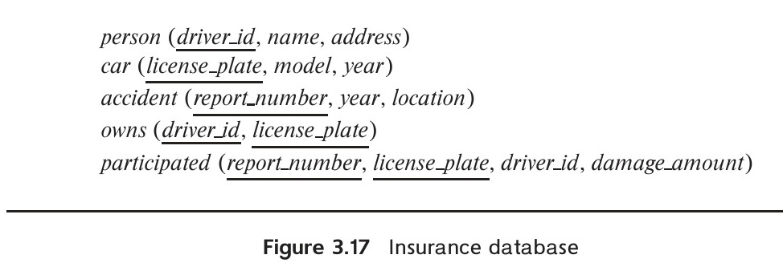
*Figure 3.17 — Insurance database.*

b. Delete all year-2010 cars belonging to the person whose ID is '12345'.

**3.5** Suppose that we have a relation `marks(ID, score)` and we wish to assign grades to students based on the score as follows: grade F if $score < 40$, grade C if $40 \le score < 60$, grade B if $60 \le score < 80$, and grade A if $80 \le score$. Write SQL queries to do the following:

a. Display the grade for each student, based on the `marks` relation.
b. Find the number of students with each grade.

**3.6** The SQL `like` operator is case sensitive (in most systems), but the `lower()` function on strings can be used to perform case-insensitive matching. To show how, write a query that finds departments whose names contain the string “sci” as a substring, regardless of the case.

**3.7** Consider the SQL query

```sql
select p.a1
from p, r1, r2
where p.a1 = r1.a1 or p.a1 = r2.a1
```

Under what conditions does the preceding query with an `or` in the `where` clause run very slowly? How can you rewrite the query using the `union` operation to make it run faster?

**3.8** Consider the bank database of Figure 3.18, where the primary keys are underlined. Construct the following SQL queries for this relational database.

a. Find all customers of the bank who have an account but not a loan.
b. Find the names of all customers who live on the same street and in the same city as “Smith”.
c. Find the names of all branches with customers who have an account in the bank and who live in “Harrison”.

**3.9** Consider the relational database of Figure 3.19, where the primary keys are underlined. Give an expression in SQL for each of the following:

a. Find the ID and name of each employee who works for “First Bank Corporation”.
b. Find the ID, name, and city of residence of each employee who works for “First Bank Corporation”.

<!-- Page 118 -->

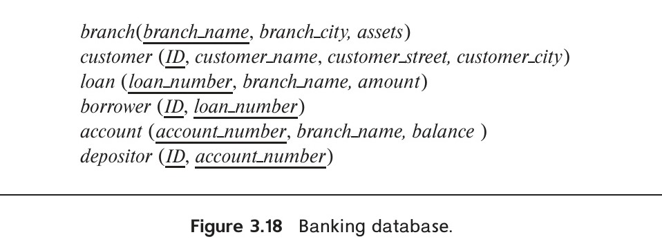
*Figure 3.18 — Banking database.*

c. Find the ID, name, and city of residence of each employee who does not work for “First Bank Corporation”.
d. Find the ID of each employee who earns more than every employee of “Small Bank Corporation”.
e. Assume that companies may be located in several cities. Find the name of each company that is located in every city in which “Small Bank Corporation” is located.
f. Find the name of the company that has the most employees (or companies, in the case where there is a tie for the most).
g. Find the name of each company whose employees earn a higher salary, on average, than the average salary at “First Bank Corporation”.

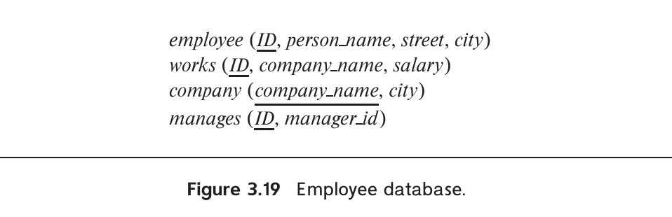
*Figure 3.19 — Employee database.*

<!-- Page 119 -->

**3.10** Consider the relational database of Figure 3.19. Give an expression in SQL for each of the following:

a. Modify the database so that the employee whose ID is '12345' now lives in “Newtown”.
b. Give each manager of “First Bank Corporation” a 10 percent raise unless the salary becomes greater than \$100,000; in such cases, give only a 3 percent raise.

## Exercises

**3.11** Write the following queries in SQL, using the university schema.

a. Find the ID and name of each student who has taken at least one Comp. Sci. course; make sure there are no duplicate names in the result.
b. Find the ID and name of each student who has not taken any course offered before 2017.
c. For each department, find the maximum salary of instructors in that department. You may assume that every department has at least one instructor.
d. Find the lowest, across all departments, of the per-department maximum salary computed by the preceding query.

**3.12** Write the SQL statements using the university schema to perform the following operations:

a. Create a new course “CS-001”, titled “Weekly Seminar”, with 0 credits.
b. Create a section of this course in Fall 2017, with `sec_id` of 1, and with the location of this section not yet specified.
c. Enroll every student in the Comp. Sci. department in the above section.
d. Delete enrollments in the above section where the student’s ID is 12345.
e. Delete the course CS-001. What will happen if you run this delete statement without first deleting offerings (sections) of this course?
f. Delete all `takes` tuples corresponding to any section of any course with the word “advanced” as a part of the title; ignore case when matching the word with the title.

**3.13** Write SQL DDL corresponding to the schema in Figure 3.17. Make any reasonable assumptions about data types, and be sure to declare primary and foreign keys.

<!-- Page 120 -->

**3.14** Consider the insurance database of Figure 3.17, where the primary keys are underlined. Construct the following SQL queries for this relational database.

a. Find the number of accidents involving a car belonging to a person named “John Smith”.
b. Update the damage amount for the car with license plate “AABB2000” in the accident with report number “AR2197” to \$3000.

**3.15** Consider the bank database of Figure 3.18, where the primary keys are underlined. Construct the following SQL queries for this relational database.

a. Find each customer who has an account at every branch located in “Brooklyn”.
b. Find the total sum of all loan amounts in the bank.
c. Find the names of all branches that have assets greater than those of at least one branch located in “Brooklyn”.

**3.16** Consider the employee database of Figure 3.19, where the primary keys are underlined. Give an expression in SQL for each of the following queries.

a. Find ID and name of each employee who lives in the same city as the location of the company for which the employee works.
b. Find ID and name of each employee who lives in the same city and on the same street as does her or his manager.
c. Find ID and name of each employee who earns more than the average salary of all employees of her or his company.
d. Find the company that has the smallest payroll.

**3.17** Consider the employee database of Figure 3.19. Give an expression in SQL for each of the following queries.

a. Give all employees of “First Bank Corporation” a 10 percent raise.
b. Give all managers of “First Bank Corporation” a 10 percent raise.
c. Delete all tuples in the `works` relation for employees of “Small Bank Corporation”.

**3.18** Give an SQL schema definition for the employee database of Figure 3.19. Choose an appropriate domain for each attribute and an appropriate primary key for each relation schema. Include any foreign-key constraints that might be appropriate.

**3.19** List two reasons why null values might be introduced into the database.

**3.20** Show that, in SQL, `<> all` is identical to `not in`.

<!-- Page 121 -->

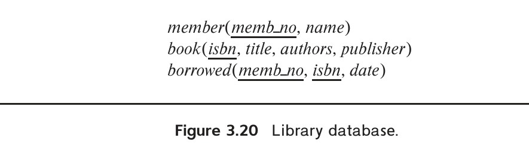
*Figure 3.20 — Library database.*

**3.21** Consider the library database of Figure 3.20. Write the following queries in SQL.

a. Find the member number and name of each member who has borrowed at least one book published by “McGraw-Hill”.
b. Find the member number and name of each member who has borrowed every book published by “McGraw-Hill”.
c. For each publisher, find the member number and name of each member who has borrowed more than five books of that publisher.
d. Find the average number of books borrowed per member. Take into account that if a member does not borrow any books, then that member does not appear in the `borrowed` relation at all, but that member still counts in the average.

**3.22** Rewrite the `where` clause

```sql
where unique (select title from course)
```

without using the `unique` construct.

**3.23** Consider the query:

```sql
with dept_total (dept_name, value) as
    (select dept_name, sum(salary)
     from instructor
     group by dept_name),
dept_total_avg(value) as
    (select avg(value)
     from dept_total)
select dept_name
from dept_total, dept_total_avg
where dept_total.value >= dept_total_avg.value;
```

Rewrite this query without using the `with` construct.

**3.24** Using the university schema, write an SQL query to find the name and ID of those Accounting students advised by an instructor in the Physics department.

<!-- Page 122 -->

**3.25** Using the university schema, write an SQL query to find the names of those departments whose budget is higher than that of Philosophy. List them in alphabetic order.

**3.26** Using the university schema, use SQL to do the following: For each student who has retaken a course at least twice (i.e., the student has taken the course at least three times), show the course ID and the student’s ID.

Please display your results in order of course ID and do not display duplicate rows.

**3.27** Using the university schema, write an SQL query to find the IDs of those students who have retaken at least three distinct courses at least once (i.e, the student has taken the course at least two times).

**3.28** Using the university schema, write an SQL query to find the names and IDs of those instructors who teach every course taught in his or her department (i.e., every course that appears in the `course` relation with the instructor’s department name). Order result by name.

**3.29** Using the university schema, write an SQL query to find the name and ID of each History student whose name begins with the letter ‘D’ and who has not taken at least five Music courses.

**3.30** Consider the following SQL query on the university schema:

```sql
select avg(salary) - (sum(salary) / count(*))
from instructor;
```

We might expect that the result of this query is zero since the average of a set of numbers is defined to be the sum of the numbers divided by the number of numbers. Indeed this is true for the example instructor relation in Figure 2.1. However, there are other possible instances of that relation for which the result would not be zero. Give one such instance, and explain why the result would not be zero.

**3.31** Using the university schema, write an SQL query to find the ID and name of each instructor who has never given an A grade in any course she or he has taught. (Instructors who have never taught a course trivially satisfy this condition.)

**3.32** Rewrite the preceding query, but also ensure that you include only instructors who have given at least one other non-null grade in some course.

**3.33** Using the university schema, write an SQL query to find the ID and title of each course in Comp. Sci. that has had at least one section with afternoon hours (i.e., ends at or after 12:00). (You should eliminate duplicates if any.)

**3.34** Using the university schema, write an SQL query to find the number of students in each section. The result columns should appear in the order “courseid, secid, year, semester, num”. You do not need to output sections with 0 students.

<!-- Page 123 -->

**3.35** Using the university schema, write an SQL query to find section(s) with maximum enrollment. The result columns should appear in the order “courseid, secid, year, semester, num”. (It may be convenient to use the `with` construct.)

## Tools

A number of relational database systems are available commercially, including IBM DB2, IBM Informix, Oracle, SAP Adaptive Server Enterprise (formerly Sybase), and Microsoft SQL Server. In addition several open-source database systems can be downloaded and used free of charge, including PostgreSQL and MySQL (free except for certain kinds of commercial use). Some commercial vendors offer free versions of their systems with certain use limitations. These include Oracle Express edition, Microsoft SQL Server Express, and IBM DB2 Express-C.

The sql.js database is version of the embedded SQL database SQLite which can be run directly in a web browser, allowing SQL commands to be executed directly in the browser. All data are temporary and vanishes when you close the browser, but it can be useful for learning SQL; be warned that the subset of SQL that is supported by sql.js and SQLite is considerably smaller than what is supported by other databases. An SQL tutorial using sql.js as the execution engine is hosted at `www.w3schools.com/sql`.

The web site of our book, db-book.com, provides a significant amount of supporting material for the book. By following the link on the site titled Laboratory Material, you can get access to the following:

- Instructions on how to set up and access some popular database systems, including sql.js (which you can run in your browser), MySQL, and PostgreSQL.
- SQL schema definitions for the University schema.
- SQL scripts for loading sample datasets.
- Tips on how to use the XData system, developed at IIT Bombay, to test queries for correctness by executing them on multiple datasets generated by the system; and, for instructors, tips on how to use XData to automate SQL query grading.
- Get tips on SQL variations across different databases.

Support for different SQL features varies by databases, and most databases also support some non-standard extensions to SQL. Read the system manuals to understand the exact SQL features that a database supports.

Most database systems provide a command line interface for submitting SQL commands. In addition, most databases also provide graphical user interfaces (GUIs), which simplify the task of browsing the database, creating and submitting queries, and administering the database. For PostgreSQL, the pgAdmin tool provides GUI functionality, while for MySQL, phpMyAdmin provides GUI functionality. Oracle provides

<!-- Page 124 -->

Oracle SQL Developer, while Microsoft SQL Server comes with the SQL Server Management Studio.

The NetBeans IDE’s SQLEditor provides a GUI front end which works with a number of different database systems, but with limited functionality, while the Eclipse IDE supports similar functionality through the Data Tools Platform (DTP). Commercial IDEs that support SQL access across multiple database platforms include Embarcadero’s RAD Studio and Aqua Data Studio.

## Further Reading

The original Sequel language that became SQL is described in [Chamberlin et al. (1976)].

The most important SQL reference is likely to be the online documentation provided by the vendor or the particular database system you are using. That documentation will identify any features that deviate from the SQL standard features presented in this chapter. Here are links to the SQL reference manuals for the current (as of 2018) versions of some of the popular databases.

- MySQL 8.0: `dev.mysql.com/doc/refman/8.0/en/`
- Oracle 12c: `docs.oracle.com/database/121/SQLRF/`
- PostgreSQL: `www.postgresql.org/docs/current/static/sql.html`
- SQLite: `www.sqlite.org/lang.html`
- SQL Server: `docs.microsoft.com/en-us/sql/t-sql`

## Bibliography

- **[Chamberlin et al. (1976)]** D. D. Chamberlin, M. M. Astrahan, K. P. Eswaran, P. P. Griffiths, R. A. Lorie, J. W. Mehl, P. Reisner, and B. W. Wade, “SEQUEL 2: A Unified Approach to Data Definition, Manipulation, and Control”, *IBM Journal of Research and Development*, Volume 20, Number 6 (1976), pages 560–575.

## Credits

The photo of the sailboats in the beginning of the chapter is due to ©Pavel Nesvadba/Shutterstock.
