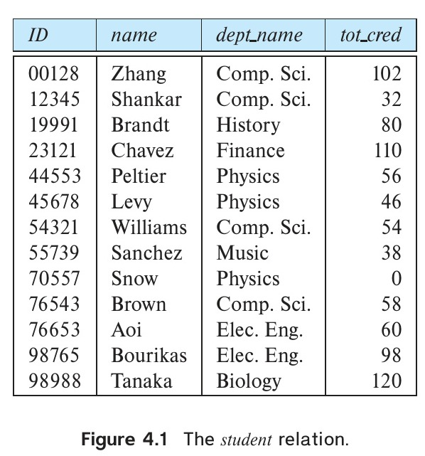
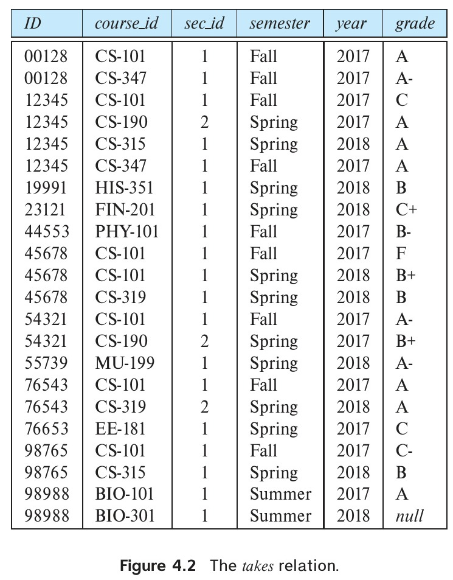
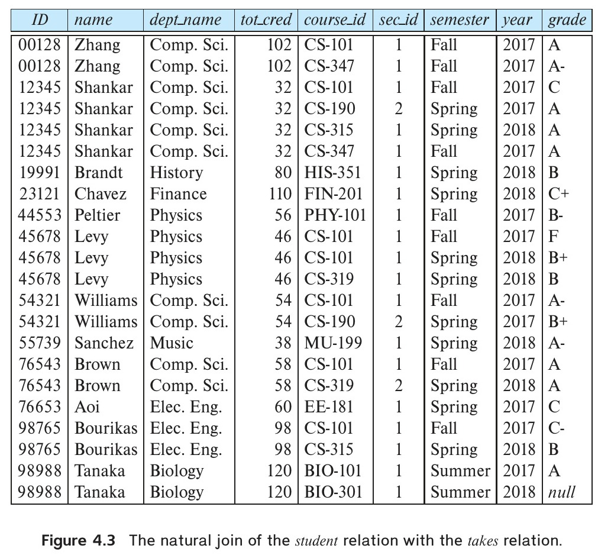
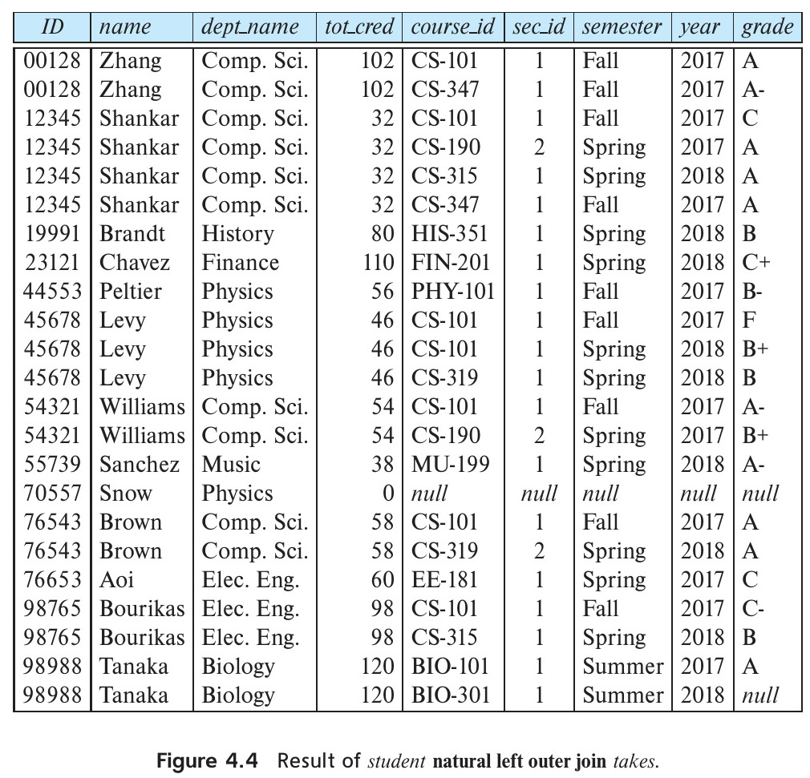
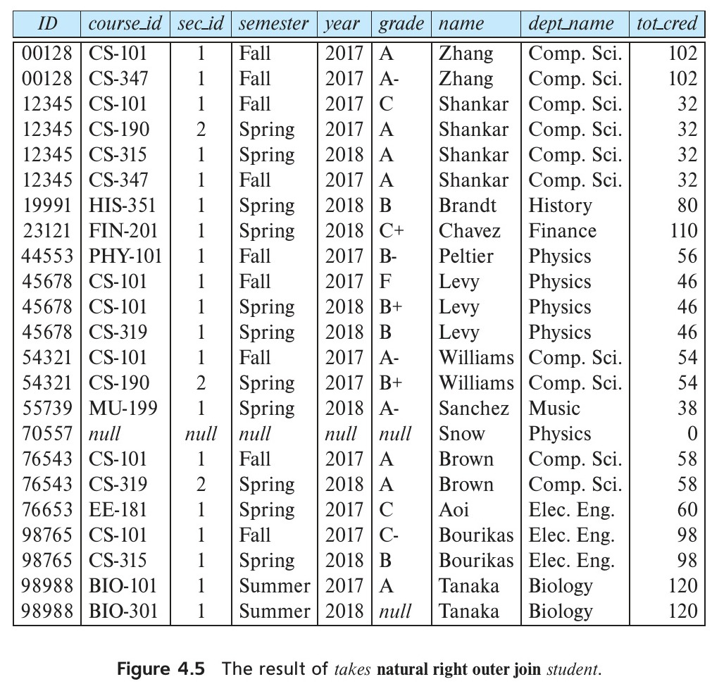
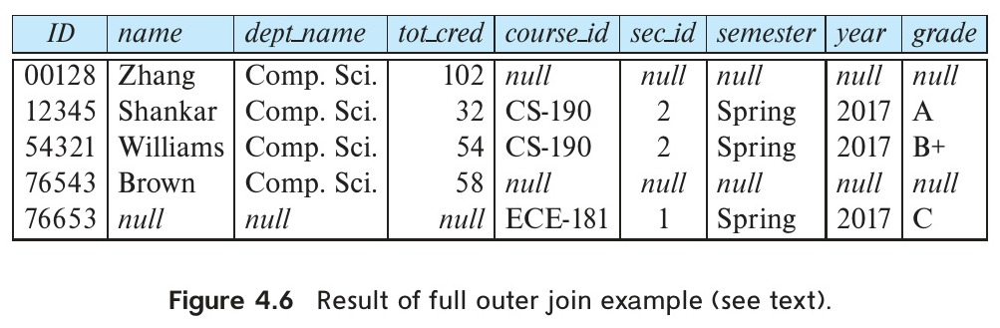
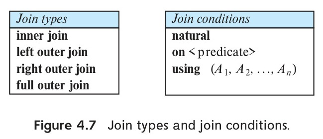
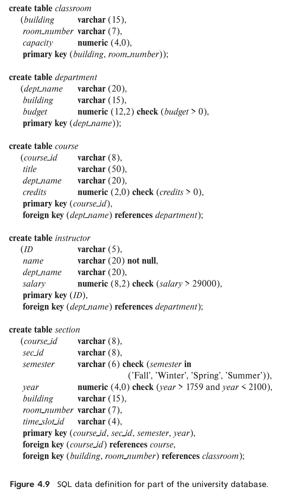
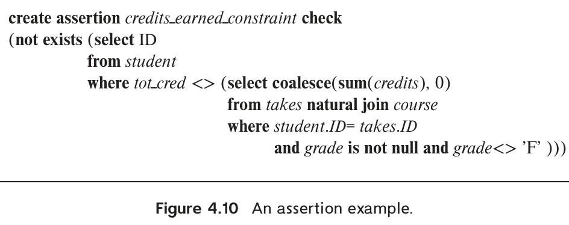
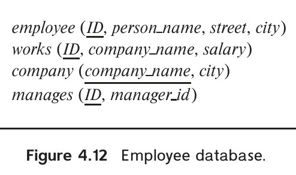

<!-- Page 125 -->

# Chapter 4: Intermediate SQL

In this chapter, we continue our study of SQL. We consider more complex forms of SQL queries, view definition, transactions, integrity constraints, more details regarding SQL data definition, and authorization.

## 4.1 Join Expressions

In all of the example queries we used in Chapter 3 (except when we used set operations), we combined information from multiple relations using the Cartesian product operator. In this section, we introduce a number of “join” operations that allow the programmer to write some queries in a more natural way and to express some queries that are difficult to do with only the Cartesian product.


*Figure 4.1 — The student relation.*

<!-- Page 126 -->


*Figure 4.2 — The takes relation.*

All the examples used in this section involve the two relations *student* and *takes*, shown in Figure 4.1 and Figure 4.2, respectively. Observe that the attribute *grade* has a value null for the student with *ID* 98988, for the course BIO-301, section 1, taken in Summer 2018. The null value indicates that the grade has not been awarded yet.

### 4.1.1 The Natural Join

Consider the following SQL query, which computes for each student the set of courses a student has taken:

```sql
select name, course_id
from student, takes
where student.ID = takes.ID;
```

Note that this query outputs only students who have taken some course. Students who have not taken any course are not output.

<!-- Page 127 -->

Note that in the *student* and *takes* table, the matching condition required *student.ID* to be equal to *takes.ID*. These are the only attributes in the two relations that have the same name. In fact, this is a common case; that is, the matching condition in the **from** clause most often requires all attributes with matching names to be equated.

To make the life of an SQL programmer easier for this common case, SQL supports an operation called the *natural join*, which we describe below. In fact, SQL supports several other ways in which information from two or more relations can be **joined** together. We have already seen how a Cartesian product along with a **where** clause predicate can be used to join information from multiple relations. Other ways of joining information from multiple relations are discussed in Section 4.1.2 through Section 4.1.4.

The **natural join** operation operates on two relations and produces a relation as the result. Unlike the Cartesian product of two relations, which concatenates each tuple of the first relation with every tuple of the second, natural join considers only those pairs of tuples with the same value on those attributes that appear in the schemas of both relations. So, going back to the example of the relations *student* and *takes*, computing:

*student* **natural join** *takes*

considers only those pairs of tuples where both the tuple from *student* and the tuple from *takes* have the same value on the common attribute, *ID*.

The resulting relation, shown in Figure 4.3, has only 22 tuples, the ones that give information about a student and a course that the student has actually taken. Notice that we do not repeat those attributes that appear in the schemas of both relations; rather they appear only once. Notice also the order in which the attributes are listed: first the attributes common to the schemas of both relations, second those attributes unique to the schema of the first relation, and finally, those attributes unique to the schema of the second relation.

Earlier we wrote the query “For all students in the university who have taken some course, find their names and the course ID of all courses they took” as:

```sql
select name, course_id
from student, takes
where student.ID = takes.ID;
```

This query can be written more concisely using the natural-join operation in SQL as:

```sql
select name, course_id
from student natural join takes;
```

Both of the above queries generate the same result.[^1]

[^1]: For notational symmetry, SQL allows the Cartesian product, which we have denoted with a comma, to be denoted by the keywords **cross join**. Thus, “**from** *student*, *takes*” could be expressed equivalently as “**from** *student* **cross join** *takes*”.

<!-- Page 128 -->


*Figure 4.3 — The natural join of the student relation with the takes relation.*

The result of the natural join operation is a relation. Conceptually, expression “*student* **natural join** *takes*” in the **from** clause is replaced by the relation obtained by evaluating the natural join.[^2] The **where** and **select** clauses are then evaluated on this relation, as we saw in Section 3.3.2.

A **from** clause in an SQL query can have multiple relations combined using natural join, as shown here:

```sql
select A1, A2, ..., An
from r1 natural join r2 natural join ... natural join rm
where P;
```

More generally, a **from** clause can be of the form

[^2]: As a consequence, it may not be possible in some systems to use attribute names containing the original relation names, for instance, *student.ID* or *takes.ID*, to refer to attributes in the natural join result. While some systems allow it, others don’t, and some allow it for all attributes except the join attributes (i.e., those that appear in both relation schemas). We can, however, use attribute names such as *name* and *course_id* without the relation names.

<!-- Page 129 -->

$$\textbf{from } E_1, E_2, \dots, E_n$$

where each $E_i$ can be a single relation or an expression involving natural joins. For example, suppose we wish to answer the query “List the names of students along with the titles of courses that they have taken.” The query can be written in SQL as follows:

```sql
select name, title
from student natural join takes, course
where takes.course_id = course.course_id;
```

The natural join of *student* and *takes* is first computed, as we saw earlier, and a Cartesian product of this result with *course* is computed, from which the **where** clause extracts only those tuples where the course identifier from the join result matches the course identifier from the *course* relation. Note that *takes.course_id* in the **where** clause refers to the *course_id* field of the natural join result, since this field, in turn, came from the *takes* relation.

In contrast, the following SQL query does *not* compute the same result:

```sql
select name, title
from student natural join takes natural join course;
```

To see why, note that the natural join of *student* and *takes* contains the attributes (*ID*, *name*, *dept_name*, *tot_cred*, *course_id*, *sec_id*), while the *course* relation contains the attributes (*course_id*, *title*, *dept_name*, *credits*). As a result, the natural join would require that the *dept_name* attribute values from the two relations be the same in addition to requiring that the *course_id* values be the same. This query would then omit all (student name, course title) pairs where the student takes a course in a department other than the student’s own department. The previous query, on the other hand, correctly outputs such pairs.

To provide the benefit of natural join while avoiding the danger of equating attributes erroneously, SQL provides a form of the natural join construct that allows you to specify exactly which columns should be equated. This feature is illustrated by the following query:

```sql
select name, title
from (student natural join takes) join course using (course_id);
```

The operation **join ... using** requires a list of attribute names to be specified. Both relations being joined must have attributes with the specified names. Consider the operation $r_1$ **join** $r_2$ **using**($A_1, A_2$). The operation is similar to $r_1$ **natural join** $r_2$, except that a pair of tuples $t_1$ from $r_1$ and $t_2$ from $r_2$ match if $t_1.A_1 = t_2.A_1$ and $t_1.A_2 = t_2.A_2$; even if $r_1$ and $r_2$ both have an attribute named $A_3$, it is *not* required that $t_1.A_3 = t_2.A_3$.

<!-- Page 130 -->

Thus, in the preceding SQL query, the **join** construct permits *student.dept_name* and *course.dept_name* to differ, and the SQL query gives the correct answer.

### 4.1.2 Join Conditions

In Section 4.1.1, we saw how to express natural joins, and we saw the **join ... using** clause, which is a form of natural join that requires values to match only on specified attributes. SQL supports another form of join, in which an arbitrary join condition can be specified.

The **on** condition allows a general predicate over the relations being joined. This predicate is written like a **where** clause predicate except for the use of the keyword **on** rather than **where**. Like the **using** condition, the **on** condition appears at the end of the join expression.

Consider the following query, which has a join expression containing the **on** condition:

```sql
select *
from student join takes on student.ID = takes.ID;
```

The **on** condition above specifies that a tuple from *student* matches a tuple from *takes* if their *ID* values are equal. The join expression in this case is almost the same as the join expression *student* **natural join** *takes*, since the natural join operation also requires that for a *student* tuple and a *takes* tuple to match. The one difference is that the result has the *ID* attribute listed twice, in the join result, once for *student* and once for *takes*, even though their *ID* values must be the same.

In fact, the preceding query is equivalent to the following query:

```sql
select *
from student, takes
where student.ID = takes.ID;
```

As we have seen earlier, the relation name is used to disambiguate the attribute name *ID*, and thus the two occurrences can be referred to as *student.ID* and *takes.ID*, respectively. A version of this query that displays the *ID* value only once is as follows:

```sql
select student.ID as ID, name, dept_name, tot_cred,
    course_id, sec_id, semester, year, grade
from student join takes on student.ID = takes.ID;
```

The result of this query is exactly the same as the result of the natural join of *student* and *takes*, which we showed in Figure 4.3.

The **on** condition can express any SQL predicate, and thus join expressions using the **on** condition can express a richer class of join conditions than **natural join**. However,

<!-- Page 131 -->

as illustrated by our preceding example, a query using a join expression with an **on** condition can be replaced by an equivalent expression without the **on** condition, with the predicate in the **on** clause moved to the **where** clause. Thus, it may appear that the **on** condition is a redundant feature of SQL.

However, there are two good reasons for introducing the **on** condition. First, we shall see shortly that for a kind of join called an outer join, **on** conditions do behave in a manner different from **where** conditions. Second, an SQL query is often more readable by humans if the join condition is specified in the **on** clause and the rest of the conditions appear in the **where** clause.

### 4.1.3 Outer Joins

Suppose we wish to display a list of all students, displaying their *ID*, and *name*, *dept_name*, and *tot_cred*, along with the courses that they have taken. The following SQL query may appear to retrieve the required information:

```sql
select *
from student natural join takes;
```

Unfortunately, the above query does not work quite as intended. Suppose that there is some student who takes no courses. Then the tuple in the *student* relation for that particular student would not satisfy the condition of a natural join with any tuple in the *takes* relation, and that student’s data would not appear in the result. We would thus not see any information about students who have not taken any courses. For example, in the *student* and *takes* relations of Figure 4.1 and Figure 4.2, note that student Snow, with ID 70557, has not taken any courses. Snow appears in *student*, but Snow’s ID number does not appear in the *ID* column of *takes*. Thus, Snow does not appear in the result of the natural join.

More generally, some tuples in either or both of the relations being joined may be “lost” in this way. The **outer-join** operation works in a manner similar to the join operations we have already studied, but it preserves those tuples that would be lost in a join by creating tuples in the result containing null values.

For example, to ensure that the student named Snow from our earlier example appears in the result, a tuple could be added to the join result with all attributes from the *student* relation set to the corresponding values for the student Snow, and all the remaining attributes which come from the *takes* relation, namely, *course_id*, *sec_id*, *semester*, and *year*, set to *null*. Thus, the tuple for the student Snow is preserved in the result of the outer join.

There are three forms of outer join:

- The **left outer join** preserves tuples only in the relation named before (to the left of) the **left outer join** operation.

<!-- Page 132 -->

- The **right outer join** preserves tuples only in the relation named after (to the right of) the **right outer join** operation.
- The **full outer join** preserves tuples in both relations.

In contrast, the join operations we studied earlier that do not preserve nonmatched tuples are called **inner-join** operations, to distinguish them from the outer-join operations.

We now explain exactly how each form of outer join operates. We can compute the left outer-join operation as follows: First, compute the result of the inner join as before. Then, for every tuple $t$ in the left-hand-side relation that does not match any tuple in the right-hand-side relation in the inner join, add a tuple $r$ to the result of the join constructed as follows:

- The attributes of tuple $r$ that are derived from the left-hand-side relation are filled in with the values from tuple $t$.
- The remaining attributes of $r$ are filled with null values.

Figure 4.4 shows the result of:

```sql
select *
from student natural left outer join takes;
```

That result includes student Snow (*ID* 70557), unlike the result of an inner join, but the tuple for Snow includes nulls for the attributes that appear only in the schema of the *takes* relation.[^3]

As another example of the use of the outer-join operation, we can write the query “Find all students who have not taken a course” as:

```sql
select ID
from student natural left outer join takes
where course_id is null;
```

The **right outer join** is symmetric to the **left outer join**. Tuples from the right-hand-side relation that do not match any tuple in the left-hand-side relation are padded with nulls and are added to the result of the right outer join. Thus, if we rewrite the preceding query using a right outer join and swapping the order in which we list the relations as follows:

```sql
select *
from takes natural right outer join student;
```

we get the same result except for the order in which the attributes appear in the result (see Figure 4.5).

[^3]: We show null values in tables using *null*, but most systems display null values as a blank field.

<!-- Page 133 -->


*Figure 4.4 — Result of student natural left outer join takes.*

The **full outer join** is a combination of the left and right outer-join types. After the operation computes the result of the inner join, it extends with nulls those tuples from the left-hand-side relation that did not match with any from the right-hand-side relation and adds them to the result. Similarly, it extends with nulls those tuples from the right-hand-side relation that did not match with any tuples from the left-hand-side relation and adds them to the result. Said differently, full outer join is the union of a left outer join and the corresponding right outer join.[^4]

As an example of the use of full outer join, consider the following query: “Display a list of all students in the Comp. Sci. department, along with the course sections, if any, that they have taken in Spring 2017; all course sections from Spring 2017 must

[^4]: In those systems, notably MySQL, that implement only left and right outer join, this is exactly how one has to write a full outer join.

<!-- Page 134 -->


*Figure 4.5 — The result of takes natural right outer join student.*

be displayed, even if no student from the Comp. Sci. department has taken the course section.” This query can be written as:

```sql
select *
from (select *
      from student
      where dept_name = 'Comp. Sci.')
    natural full outer join
    (select *
      from takes
      where semester = 'Spring' and year = 2017);
```

The result appears in Figure 4.6.

<!-- Page 135 -->


*Figure 4.6 — Result of full outer join example (see text).*

The **on** clause can be used with outer joins. The following query is identical to the first query we saw using “*student* **natural left outer join** *takes*,” except that the attribute *ID* appears twice in the result.

```sql
select *
from student left outer join takes on student.ID = takes.ID;
```

As we noted earlier, **on** and **where** behave differently for outer join. The reason for this is that outer join adds null-padded tuples only for those tuples that do not contribute to the result of the corresponding “inner” join. The **on** condition is part of the outer join specification, but a **where** clause is not. In our example, the case of the *student* tuple for student “Snow” with ID 70557, illustrates this distinction. Suppose we modify the preceding query by moving the **on** clause predicate to the **where** clause and instead using an **on** condition of *true*.[^5]

```sql
select *
from student left outer join takes on true
where student.ID = takes.ID;
```

The earlier query, using the left outer join with the **on** condition, includes a tuple (70557, Snow, Physics, 0, *null*, *null*, *null*, *null*, *null* ) because there is no tuple in *takes* with *ID* = 70557. In the latter query, however, every tuple satisfies the join condition *true*, so no null-padded tuples are generated by the outer join. The outer join actually generates the Cartesian product of the two relations. Since there is no tuple in *takes* with *ID* = 70557, every time a tuple appears in the outer join with *name* = “Snow”, the values for *student.ID* and *takes.ID* must be different, and such tuples would be eliminated by the **where** clause predicate. Thus, student Snow never appears in the result of the latter query.

[^5]: Some systems do not allow the use of the Boolean constant *true*. To test this on those systems, use a tautology (i.e., a predicate that always evaluates to true), like “1=1”.

<!-- Page 136 -->

> ### Note 4.1: SQL and Multiset Relational Algebra - Part 4
>
> The relational algebra supports the left outer-join operation, denoted by $\mathbin{⟕}_\theta$, the right outer-join operation, denoted by $\mathbin{⟖}_\theta$, and the full outer-join operation, denoted by $\mathbin{⟗}_\theta$. It also supports the natural join operation, denoted by $\bowtie$, as well as the natural join versions of the left, right and full outer-join operations, denoted by $\mathbin{⟕}$, $\mathbin{⟖}$, and $\mathbin{⟗}$. The definitions of all these operations are identical to the definitions of the corresponding operations in SQL, which we have seen in Section 4.1.

### 4.1.4 Join Types and Conditions

To distinguish normal joins from outer joins, normal joins are called **inner joins** in SQL. A join clause can thus specify **inner join** instead of **outer join** to specify that a normal join is to be used. The keyword **inner** is, however, optional. The default join type, when the **join** clause is used without the **outer** prefix, is the **inner join**. Thus,

```sql
select *
from student join takes using (ID);
```

is equivalent to:

```sql
select *
from student inner join takes using (ID);
```

Similarly, **natural join** is equivalent to **natural inner join**.

Figure 4.7 shows a full list of the various types of join that we have discussed. As can be seen from the figure, any form of join (inner, left outer, right outer, or full outer) can be combined with any join condition (natural, using, or on).


*Figure 4.7 — Join types and join conditions.*

<!-- Page 137 -->

## 4.2 Views

It is not always desirable for all users to see the entire set of relations in the database. In Section 4.7, we shall see how to use the SQL authorization mechanism to restrict access to relations, but security considerations may require that only certain data in a relation be hidden from a user. Consider a clerk who needs to know an instructor’s ID, name, and department name, but does not have authorization to see the instructor’s salary amount. This person should see a relation described in SQL by:

```sql
select ID, name, dept_name
from instructor;
```

Aside from security concerns, we may wish to create a personalized collection of relations that is better matched to a certain user’s intuition than is the full collection of database relations. For example, suppose a clerk in the Physics department needs to find out all courses offered by the department in the Fall 2017 semester, along with the building and room number of each course section. The following query computes this information:

```sql
select course.course_id, sec_id, building, room_number
from course, section
where course.course_id = section.course_id
  and course.dept_name = 'Physics'
  and section.semester = 'Fall'
  and section.year = 2017;
```

It is possible to compute and store the results of these queries and then make the stored relation available to users who need it. However, the data in the underlying relations (in this case, *instructor*, *course*, and *section*) are updated from time to time, and an explicit copy of a query result will not reflect those updates.

Instead, SQL allows a “virtual relation” to be defined by a query, and the relation conceptually contains the result of the query. The virtual relation is not precomputed and stored, but rather is computed whenever the virtual relation is used in a query.

Any such relation that is not part of the logical model, but is made visible to a user as a “virtual relation,” is called a **view**.

<!-- Page 138 -->

### 4.2.1 View Definition

We define a view in SQL by using the **create view** command. To define a view, we must give the view a name and must state the query that computes the view. The form of the **create view** command is:

```sql
create view v as <query expression>;
```

where `<query expression>` is any legal query expression. The view name is represented by $v$.

Consider again the clerk who needs to access all data in the *instructor* relation, except *salary*. The clerk should not be authorized to access the *instructor* relation (we see in Section 4.7, how authorizations can be specified). Instead, a view relation *faculty* can be made available to the clerk, with the view defined as follows:

```sql
create view faculty as
select ID, name, dept_name
from instructor;
```

As explained earlier, the view relation conceptually contains the tuples in the query result, but it is not precomputed and stored. Instead, the database system stores the query expression associated with the view relation. Whenever the view relation is accessed, its tuples are created by computing the query result. Thus, the view relation is created whenever needed, on demand.

To create a view that lists all course sections offered by the Physics department in the Fall 2017 semester with the building and room number of each section, we write:

```sql
create view physics_fall_2017 as
select course.course_id, sec_id, building, room_number
from course, section
where course.course_id = section.course_id
  and course.dept_name = 'Physics'
  and section.semester = 'Fall'
  and section.year = 2017;
```

Later, when we study the SQL authorization mechanism in Section 4.7, we shall see that users can be given access to views in place of, or in addition to, access to relations.

Views differ from the **with** statement in that views, once created, remain available until explicitly dropped. The named subquery defined by **with** is local to the query in which it is defined.

### 4.2.2 Using Views in SQL Queries

Once we have defined a view, we can use the view name to refer to the virtual relation that the view generates. Using the view *physics_fall_2017*, we can find all Physics courses offered in the Fall 2017 semester in the Watson building by writing:

<!-- Page 139 -->

```sql
select course_id
from physics_fall_2017
where building = 'Watson';
```

View names may appear in a query any place where a relation name may appear.

The attribute names of a view can be specified explicitly as follows:

```sql
create view departments_total_salary(dept_name, total_salary) as
select dept_name, sum (salary)
from instructor
group by dept_name;
```

The preceding view gives for each department the sum of the salaries of all the instructors at that department. Since the expression **sum**(*salary*) does not have a name, the attribute name is specified explicitly in the view definition.

Intuitively, at any given time, the set of tuples in the view relation is the result of evaluation of the query expression that defines the view. Thus, if a view relation is computed and stored, it may become out of date if the relations used to define it are modified. To avoid this, views are usually implemented as follows: When we define a view, the database system stores the definition of the view itself, rather than the result of evaluation of the query expression that defines the view. Wherever a view relation appears in a query, it is replaced by the stored query expression. When the query is evaluated, the view relation is computed and then deleted after the query finishes.

One view may be used in the expression defining another view. For example, we can define:

```sql
create view physics_fall_2017_watson as
select course_id, room_number
from physics_fall_2017
where building = 'Watson';
```

where *physics_fall_2017_watson* is itself a view relation. This is equivalent to:

```sql
create view physics_fall_2017_watson as
select course_id, room_number
from (select course.course_id, building, room_number
      from course, section
      where course.course_id = section.course_id
        and course.dept_name = 'Physics'
        and section.semester = 'Fall'
        and section.year = 2017)
where building = 'Watson';
```

A view relation $v_1$ is said to **depend directly on** a view relation $v_2$ if $v_2$ is used in the expression defining $v_1$. And a view relation $v_1$ is said to **depend on** view relation $v_2$ if either $v_1$ depends directly on $v_2$ or there is a path of dependencies from $v_1$ to $v_2$. For example, if $v_1$ depends directly on $v_2$, and $v_2$ depends directly on $v_3$, then $v_1$ depends on $v_3$.

A view definition $v_1$ is said to be **recursive** if it depends on itself. We study recursive view definitions in Section 5.4.

A view relation can be expanded in terms of the definitions of the views that it depends on. We examine view expansion in Section 4.2.3.

<!-- Page 140 -->

### 4.2.3 Materialized Views

Certain database systems allow view relations to be stored, but they make sure that, if the actual relations used in the view definition change, the view is kept up-to-date. Such views are called **materialized views**.

For example, consider the view *departments_total_salary*. If that view is materialized, its results would be stored in the database, allowing queries that use the view to potentially run much faster by using the precomputed view result, instead of recomputing it.

However, if an *instructor* tuple is added to or deleted from the *instructor* relation, the result of the query defining the view would change, and as a result the materialized view’s contents must be updated. Similarly, if an instructor’s salary is updated, the tuple in *departments_total_salary* corresponding to that instructor’s department must be updated.

The process of keeping the materialized view up-to-date is called **materialized view maintenance** (or often, just **view maintenance**) and is covered in Section 16.5. View maintenance can be done immediately when any of the relations on which the view is defined is updated. Some database systems, however, perform view maintenance lazily, when the view is accessed. Some systems update materialized views only periodically; in this case, the contents of the materialized view may be stale, that is, not up-to-date, when it is used, and it should not be used if the application needs up-to-date data. And some database systems permit the database administrator to control which of the preceding methods is used for each materialized view.

Applications that use a view frequently may benefit if the view is materialized. Applications that demand fast response to certain queries that compute aggregates over large relations can also benefit greatly by creating materialized views corresponding to the queries. In this case, the aggregated result is likely to be much smaller than the large relations on which the view is defined; as a result the materialized view can be used to answer the query very quickly, avoiding reading the large underlying relations. The benefits to queries from the materialization of a view must be weighed against the storage costs and the added overhead for updates.

SQL does not define a standard way of specifying that a view is materialized, but many database systems provide their own SQL extensions for this task. Some database systems always keep materialized views up-to-date when the underlying relations change, while others permit them to become out of date and periodically recompute them.

### 4.2.4 Update of a View

Although views are a useful tool for queries, they present serious problems if we express updates, insertions, or deletions with them. The difficulty is that a modification to the database expressed in terms of a view must be translated to a modification to the actual relations in the logical model of the database.

<!-- Page 141 -->

Suppose the view *faculty*, which we saw earlier, is made available to a clerk. Since we allow a view name to appear wherever a relation name is allowed, the clerk can write:

```sql
insert into faculty
values ('30765', 'Green', 'Music');
```

This insertion must be represented by an insertion into the relation *instructor*, since *instructor* is the actual relation from which the database system constructs the view *faculty*. However, to insert a tuple into *instructor*, we must have some value for *salary*. There are two reasonable approaches to dealing with this insertion:

- Reject the insertion, and return an error message to the user.
- Insert a tuple `('30765', 'Green', 'Music', null)` into the *instructor* relation.

Another problem with modification of the database through views occurs with a view such as:

```sql
create view instructor_info as
select ID, name, building
from instructor, department
where instructor.dept_name = department.dept_name;
```

This view lists the *ID*, *name*, and building-name of each instructor in the university. Consider the following insertion through this view:

```sql
insert into instructor_info
values ('69987', 'White', 'Taylor');
```

Suppose there is no instructor with *ID* 69987, and no department in the Taylor building. Then the only possible method of inserting tuples into the *instructor* and *department* relations is to insert `('69987', 'White', null, null)` into *instructor* and `(null, 'Taylor', null)` into *department*. Then we obtain the relations shown in Figure 4.8. However, this update does not have the desired effect, since the view relation *instructor_info* still does *not* include the tuple `('69987', 'White', 'Taylor')`. Thus, there is no way to update the relations *instructor* and *department* by using nulls to get the desired update on *instructor_info*.

Because of problems such as these, modifications are generally not permitted on view relations, except in limited cases. Different database systems specify different conditions under which they permit updates on view relations; see the database system manuals for details.

In general, an SQL view is said to be **updatable** (i.e., inserts, updates, or deletes can be applied on the view) if the following conditions are all satisfied by the query defining the view:

- The **from** clause has only one database relation.

<!-- Page 142 -->


*Figure 4.8 — Relations instructor and department after insertion of tuples.*

- The **select** clause contains only attribute names of the relation and does not have any expressions, aggregates, or **distinct** specification.
- Any attribute not listed in the **select** clause can be set to *null*; that is, it does not have a **not null** constraint and is not part of a primary key.
- The query does not have a **group by** or **having** clause.

Under these constraints, the **update**, **insert**, and **delete** operations would be allowed on the following view:

<!-- Page 143 -->

```sql
create view history_instructors as
select *
from instructor
where dept_name = 'History';
```

Even with the conditions on updatability, the following problem still remains. Suppose that a user tries to insert the tuple `('25566', 'Brown', 'Biology', 100000)` into the *history_instructors* view. This tuple can be inserted into the *instructor* relation, but it would not appear in the *history_instructors* view since it does not satisfy the selection imposed by the view.

By default, SQL would allow the above update to proceed. However, views can be defined with a **with check option** clause at the end of the view definition; then, if a tuple inserted into the view does not satisfy the view’s **where** clause condition, the insertion is rejected by the database system. Updates are similarly rejected if the new value does not satisfy the **where** clause conditions.

SQL:1999 has a more complex set of rules about when inserts, updates, and deletes can be executed on a view that allows updates through a larger class of views; however, the rules are too complex to be discussed here.

An alternative, and often preferable, approach to modifying the database through a view is to use the trigger mechanism discussed in Section 5.3. The **instead of** feature in declaring triggers allows one to replace the default insert, update, and delete operations on a view with actions designed especially for each particular case.

## 4.3 Transactions

A **transaction** consists of a sequence of query and/or update statements. The SQL standard specifies that a transaction begins implicitly when an SQL statement is executed. One of the following SQL statements must end the transaction:

- **Commit work** commits the current transaction; that is, it makes the updates performed by the transaction become permanent in the database. After the transaction is committed, a new transaction is automatically started.
- **Rollback work** causes the current transaction to be rolled back; that is, it undoes all the updates performed by the SQL statements in the transaction. Thus, the database state is restored to what it was before the first statement of the transaction was executed.

The keyword **work** is optional in both the statements.

Transaction rollback is useful if some error condition is detected during execution of a transaction. Commit is similar, in a sense, to saving changes to a document that is being edited, while rollback is similar to quitting the edit session without saving

<!-- Page 144 -->

changes. Once a transaction has executed **commit work**, its effects can no longer be undone by **rollback work**. The database system guarantees that in the event of some failure, such as an error in one of the SQL statements, a power outage, or a system crash, a transaction’s effects will be rolled back if it has not yet executed **commit work**. In the case of power outage or other system crash, the rollback occurs when the system restarts.

For instance, consider a banking application where we need to transfer money from one bank account to another in the same bank. To do so, we need to update two account balances, subtracting the amount transferred from one, and adding it to the other. If the system crashes after subtracting the amount from the first account but before adding it to the second account, the bank balances will be inconsistent. A similar problem occurs if the second account is credited before subtracting the amount from the first account and the system crashes just after crediting the amount.

As another example, consider our running example of a university application. We assume that the attribute *tot_cred* of each tuple in the *student* relation is kept up-to-date by modifying it whenever the student successfully completes a course. To do so, whenever the *takes* relation is updated to record successful completion of a course by a student (by assigning an appropriate grade), the corresponding *student* tuple must also be updated. If the application performing these two updates crashes after one update is performed, but before the second one is performed, the data in the database will be inconsistent.

By either committing the actions of a transaction after all its steps are completed, or rolling back all its actions in case the transaction could not complete all its actions successfully, the database provides an abstraction of a transaction as being **atomic**, that is, indivisible. Either all the effects of the transaction are reflected in the database or none are (after rollback).

Applying the notion of transactions to the above applications, the update statements should be executed as a single transaction. An error while a transaction executes one of its statements would result in undoing the effects of the earlier statements of the transaction so that the database is not left in a partially updated state.

If a program terminates without executing either of these commands, the updates are either committed or rolled back. The standard does not specify which of the two happens, and the choice is implementation dependent.

In many SQL implementations, including MySQL and PostgreSQL, by default each SQL statement is taken to be a transaction on its own, and it gets committed as soon as it is executed. Such *automatic commit* of individual SQL statements must be turned off if a transaction consisting of multiple SQL statements needs to be executed. How to turn off automatic commit depends on the specific SQL implementation, although many databases support the command **set autocommit off**.[^6]

[^6]: There is a standard way of turning autocommit on or off when using application program interfaces such as JDBC or ODBC, which we study in Section 5.1.1 and Section 5.1.3, respectively.

<!-- Page 145 -->

A better alternative, which is part of the SQL:1999 standard is to allow multiple SQL statements to be enclosed between the keywords **begin atomic … end**. All the statements between the keywords then form a single transaction, which is committed by default if execution reaches the **end** statement. Only some databases, such as SQL Server, support the above syntax. However, several other databases, such as MySQL and PostgreSQL, support a **begin** statement which starts a transaction containing all subsequent SQL statements, but do not support the **end** statement; instead, the transaction must be ended by either a **commit work** or a **rollback work** command.

If you use a database such as Oracle, where the automatic commit is not the default for DML statements, be sure to issue a **commit** command after adding or modifying data, or else when you disconnect, all your database modifications will be rolled back![^7] You should be aware that although Oracle has automatic commit turned off by default, that default may be overridden by local configuration settings.

We study further properties of transactions in Chapter 17; issues in implementing transactions are addressed in Chapter 18 and Chapter 19.

[^7]: Oracle does automatically commit DDL statements.

## 4.4 Integrity Constraints

**Integrity constraints** ensure that changes made to the database by authorized users do not result in a loss of data consistency. Thus, integrity constraints guard against accidental damage to the database. This is in contrast to *security constraints*, which guard against access to the database by unauthorized users.

Examples of integrity constraints are:

- An instructor name cannot be *null*.
- No two instructors can have the same instructor ID.
- Every department name in the *course* relation must have a matching department name in the *department* relation.
- The budget of a department must be greater than \$0.00.

In general, an integrity constraint can be an arbitrary predicate pertaining to the database. However, arbitrary predicates may be costly to test. Thus, most database systems allow one to specify only those integrity constraints that can be tested with minimal overhead.

We have already seen some forms of integrity constraints in Section 3.2.2. We study some more forms of integrity constraints in this section. In Chapter 7, we study another form of integrity constraint, called **functional dependencies**, that is used primarily in the process of schema design.

<!-- Page 146 -->

Integrity constraints are usually identified as part of the database schema design process and declared as part of the **create table** command used to create relations. However, integrity constraints can also be added to an existing relation by using the command **alter table** *table-name* **add** *constraint*, where *constraint* can be any constraint on the relation. When such a command is executed, the system first ensures that the relation satisfies the specified constraint. If it does, the constraint is added to the relation; if not, the command is rejected.

### 4.4.1 Constraints on a Single Relation

We described in Section 3.2 how to define tables using the **create table** command. The **create table** command may also include integrity-constraint statements. In addition to the primary-key constraint, there are a number of other ones that can be included in the **create table** command. The allowed integrity constraints include

- **not null**
- **unique**
- **check**($\text{<predicate>}$)

We cover each of these types of constraints in the following sections.

### 4.4.2 Not Null Constraint

As we discussed in Chapter 3, the null value is a member of all domains, and as a result it is a legal value for every attribute in SQL by default. For certain attributes, however, null values may be inappropriate. Consider a tuple in the *student* relation where *name* is *null*. Such a tuple gives student information for an unknown student; thus, it does not contain useful information. Similarly, we would not want the department budget to be *null*. In cases such as this, we wish to forbid null values, and we can do so by restricting the domain of the attributes *name* and *budget* to exclude null values, by declaring it as follows:

```sql
name varchar(20) not null
budget numeric(12,2) not null
```

The **not null** constraint prohibits the insertion of a null value for the attribute, and is an example of a **domain constraint**. Any database modification that would cause a null to be inserted in an attribute declared to be **not null** generates an error diagnostic.

There are many situations where we want to avoid null values. In particular, SQL prohibits null values in the primary key of a relation schema. Thus, in our university example, in the *department* relation, if the attribute *dept_name* is declared as the primary key for *department*, it cannot take a null value. As a result it would not need to be declared explicitly to be **not null**.

<!-- Page 147 -->

### 4.4.3 Unique Constraint

SQL also supports an integrity constraint:

$$\textbf{unique }(A_{j_1}, A_{j_2}, \dots, A_{j_m})$$

The **unique** specification says that attributes $A_{j_1}, A_{j_2}, \dots, A_{j_m}$ form a superkey; that is, no two tuples in the relation can be equal on all the listed attributes. However, attributes declared as unique are permitted to be *null* unless they have explicitly been declared to be **not null**. Recall that a null value does not equal any other value. (The treatment of nulls here is the same as that of the **unique** construct defined in Section 3.8.4.)

### 4.4.4 The Check Clause

When applied to a relation declaration, the clause **check**($P$) specifies a predicate $P$ that must be satisfied by every tuple in a relation.

A common use of the **check** clause is to ensure that attribute values satisfy specified conditions, in effect creating a powerful type system. For instance, a clause **check** ($budget > 0$) in the **create table** command for relation *department* would ensure that the value of **budget** is nonnegative.

As another example, consider the following:

```sql
create table section
    (course_id varchar (8),
     sec_id varchar (8),
     semester varchar (6),
     year numeric (4,0),
     building varchar (15),
     room_number varchar (7),
     time_slot_id varchar (4),
     primary key (course_id, sec_id, semester, year),
     check (semester in ('Fall', 'Winter', 'Spring', 'Summer')));
```

Here, we use the **check** clause to simulate an enumerated type by specifying that *semester* must be one of 'Fall', 'Winter', 'Spring', or 'Summer'. Thus, the **check** clause permits attribute domains to be restricted in powerful ways that most programming-language type systems do not permit.

Null values present an interesting special case in the evaluation of a **check** clause. A **check** clause is satisfied if it is not false, so clauses that evaluate to **unknown** are not violations. If null values are not desired, a separate **not null** constraint (see Section 4.4.2) must be specified.

A **check** clause may appear on its own, as shown above, or as part of the declaration of an attribute. In Figure 4.9, we show the **check** constraint for the *semester* attribute

<!-- Page 148 -->


*Figure 4.9 — SQL data definition for part of the university database.*

<!-- Page 149 -->

as part of the declaration of *semester*. The placement of a **check** clause is a matter of coding style. Typically, constraints on the value of a single attribute are listed with that attribute, while more complex **check** clauses are listed separately at the end of a **create table** statement.

The predicate in the **check** clause can, according to the SQL standard, be an arbitrary predicate that can include a subquery. However, currently none of the widely used database products allows the predicate to contain a subquery.

### 4.4.5 Referential Integrity

Often, we wish to ensure that a value that appears in one relation (the *referencing* relation) for a given set of attributes also appears for a certain set of attributes in another relation (the *referenced* relation). As we saw earlier, in Section 2.3, such conditions are called *referential integrity constraints*, and *foreign keys* are a form of a referential integrity constraint where the referenced attributes form a primary key of the referenced relation.

Foreign keys can be specified as part of the SQL **create table** statement by using the **foreign key** clause, as we saw in Section 3.2.2. We illustrate foreign-key declarations by using the SQL DDL definition of part of our university database, shown in Figure 4.9. The definition of the *course* table has a declaration

“**foreign key** (*dept_name*) **references** *department*”.

This foreign-key declaration specifies that for each course tuple, the department name specified in the tuple must exist in the *department* relation. Without this constraint, it is possible for a course to specify a nonexistent department name.

By default, in SQL a foreign key references the primary-key attributes of the referenced table. SQL also supports a version of the **references** clause where a list of attributes of the referenced relation can be specified explicitly.[^8] For example, the foreign key declaration for the *course* relation can be specified as:

**foreign key** (*dept_name*) **references** *department*(*dept_name*)

The specified list of attributes must, however, be declared as a superkey of the referenced relation, using either a **primary key** constraint or a **unique** constraint. A more general form of a referential-integrity constraint, where the referenced columns need not be a candidate key, cannot be directly specified in SQL. The SQL standard specifies other constructs that can be used to implement such constraints, which are described in Section 4.4.8; however, these alternative constructs are not supported by any of the widely used database systems.

Note that the foreign key must reference a compatible set of attributes, that is, the number of attributes must be the same and the data types of corresponding attributes must be compatible.

[^8]: Some systems, notably MySQL, do not support the default and require that the attributes of the referenced relations be specified.

<!-- Page 150 -->

We can use the following as part of a table definition to declare that an attribute forms a foreign key:

```sql
dept_name varchar(20) references department
```

When a referential-integrity constraint is violated, the normal procedure is to reject the action that caused the violation (i.e., the transaction performing the update action is rolled back). However, a **foreign key** clause can specify that if a delete or update action on the referenced relation violates the constraint, then, instead of rejecting the action, the system must take steps to change the tuple in the referencing relation to restore the constraint. Consider this definition of an integrity constraint on the relation *course*:

```sql
create table course
    ( ...
     foreign key (dept_name) references department
        on delete cascade
        on update cascade,
     ... );
```

Because of the clause **on delete cascade** associated with the foreign-key declaration, if a delete of a tuple in *department* results in this referential-integrity constraint being violated, the system does not reject the delete. Instead, the delete “**cascades**” to the *course* relation, deleting the tuple that refers to the department that was deleted. Similarly, the system does not reject an update to a field referenced by the constraint if it violates the constraint; instead, the system updates the field *dept_name* in the referencing tuples in *course* to the new value as well. SQL also allows the **foreign key** clause to specify actions other than **cascade**, if the constraint is violated: The referencing field (here, *dept_name*) can be set to *null* (by using **set null** in place of **cascade**), or to the default value for the domain (by using **set default**).

If there is a chain of foreign-key dependencies across multiple relations, a deletion or update at one end of the chain can propagate across the entire chain. An interesting case where the **foreign key** constraint on a relation references the same relation appears in Exercise 4.9. If a cascading update or delete causes a constraint violation that cannot be handled by a further cascading operation, the system aborts the transaction. As a result, all the changes caused by the transaction and its cascading actions are undone.

Null values complicate the semantics of referential-integrity constraints in SQL. Attributes of foreign keys are allowed to be *null*, provided that they have not otherwise been declared to be **not null**. If all the columns of a foreign key are nonnull in a given tuple, the usual definition of foreign-key constraints is used for that tuple. If any of the foreign-key columns is *null*, the tuple is defined automatically to satisfy the constraint. This definition may not always be the right choice, so SQL also provides constructs that allow you to change the behavior with null values; we do not discuss the constructs here.

<!-- Page 151 -->

### 4.4.6 Assigning Names to Constraints

It is possible for us to assign a name to integrity constraints. Such names are useful if we want to drop a constraint that was defined previously.

To name a constraint, we precede the constraint with the keyword **constraint** and the name we wish to assign it. So, for example, if we wish to assign the name *minsalary* to the **check** constraint on the *salary* attribute of *instructor* (see Figure 4.9), we would modify the declaration for *salary* to:

```sql
salary numeric(8,2), constraint minsalary check (salary > 29000),
```

Later, if we decide we no longer want this constraint, we can write:

```sql
alter table instructor drop constraint minsalary;
```

Lacking a name, we would need first to use system-specific features to identify the system-assigned name for the constraint. Not all systems support this, but, for example, in Oracle, the system table *user_constraints* contains this information.

### 4.4.7 Integrity Constraint Violation During a Transaction

Transactions may consist of several steps, and integrity constraints may be violated temporarily after one step, but a later step may remove the violation. For instance, suppose we have a relation *person* with primary key *name*, and an attribute *spouse*, and suppose that *spouse* is a foreign key on *person*. That is, the constraint says that the *spouse* attribute must contain a name that is present in the *person* table. Suppose we wish to note the fact that John and Mary are married to each other by inserting two tuples, one for John and one for Mary, in the preceding relation, with the spouse attributes set to Mary and John, respectively. The insertion of the first tuple would violate the foreign-key constraint, regardless of which of the two tuples is inserted first. After the second tuple is inserted, the foreign-key constraint would hold again.

To handle such situations, the SQL standard allows a clause **initially deferred** to be added to a constraint specification; the constraint would then be checked at the end of a transaction and not at intermediate steps. A constraint can alternatively be specified as **deferrable**, which means it is checked immediately by default but can be deferred when desired. For constraints declared as deferrable, executing a statement **set constraints** *constraint-list* **deferred** as part of a transaction causes the checking of the specified constraints to be deferred to the end of that transaction. Constraints that are to appear in a constraint list must have names assigned. The default behavior is to check constraints immediately, and many database implementations do not support deferred constraint checking.

We can work around the problem in the preceding example in another way, if the *spouse* attribute can be set to *null*: We set the spouse attributes to *null* when inserting the

<!-- Page 152 -->

tuples for John and Mary, and we update them later. However, this technique requires more programming effort, and it does not work if the attributes cannot be set to *null*.

### 4.4.8 Complex Check Conditions and Assertions

There are additional constructs in the SQL standard for specifying integrity constraints that are not currently supported by most systems. We discuss some of these in this section.

As defined by the SQL standard, the predicate in the **check** clause can be an arbitrary predicate that can include a subquery. If a database implementation supports subqueries in the **check** clause, we could specify the following referential-integrity constraint on the relation *section*:

```sql
check (time_slot_id in (select time_slot_id from time_slot))
```

The **check** condition verifies that the *time_slot_id* in each tuple in the *section* relation is actually the identifier of a time slot in the *time_slot* relation. Thus, the condition has to be checked not only when a tuple is inserted or modified in *section*, but also when the relation *time_slot* changes (in this case, when a tuple is deleted or modified in relation *time_slot*).

Another natural constraint on our university schema would be to require that every section has at least one instructor teaching the section. In an attempt to enforce this, we may try to declare that the attributes (*course_id*, *sec_id*, *semester*, *year*) of the *section* relation form a foreign key referencing the corresponding attributes of the *teaches* relation. Unfortunately, these attributes do not form a candidate key of the relation *teaches*. A check constraint similar to that for the *time_slot* attribute can be used to enforce this constraint, if check constraints with subqueries were supported by a database system.

Complex **check** conditions can be useful when we want to ensure the integrity of data, but they may be costly to test. In our example, the predicate in the **check** clause would not only have to be evaluated when a modification is made to the *section* relation, but it may have to be checked if a modification is made to the *time_slot* relation because that relation is referenced in the subquery.

An **assertion** is a predicate expressing a condition that we wish the database always to satisfy. Consider the following constraints, which can be expressed using assertions.

- For each tuple in the *student* relation, the value of the attribute *tot_cred* must equal the sum of credits of courses that the student has completed successfully.
- An instructor cannot teach in two different classrooms in a semester in the same time slot.[^9]

[^9]: We assume that lectures are not displayed remotely in a second classroom! An alternative constraint that specifies that “an instructor cannot teach two courses in a given semester in the same time slot” may not hold since courses are sometimes cross-listed; that is, the same course is given two identifiers and titles.

<!-- Page 153 -->


*Figure 4.10 — An assertion example.*

An assertion in SQL takes the form:

```sql
create assertion <assertion-name> check <predicate>;
```

In Figure 4.10, we show how the first example of constraints can be written in SQL. Since SQL does not provide a “for all $X, P(X)$” construct (where $P$ is a predicate), we are forced to implement the constraint by an equivalent construct, “not exists $X$ such that not $P(X)$”, that can be expressed in SQL.

We leave the specification of the second constraint as an exercise. Although these two constraints can be expressed using **check** predicates, using an assertion may be more natural, especially for the second constraint.

When an assertion is created, the system tests it for validity. If the assertion is valid, then any future modification to the database is allowed only if it does not cause that assertion to be violated. This testing may introduce a significant amount of overhead if complex assertions have been made. Hence, assertions should be used with great care. The high overhead of testing and maintaining assertions has led some system developers to omit support for general assertions, or to provide specialized forms of assertion that are easier to test.

Currently, none of the widely used database systems supports either subqueries in the **check** clause predicate or the **create assertion** construct. However, equivalent functionality can be implemented using triggers, which are described in Section 5.3, if they are supported by the database system. Section 5.3 also describes how the referential integrity constraint on *time_slot_id* can be implemented using triggers.

## 4.5 SQL Data Types and Schemas

In Chapter 3, we covered a number of built-in data types supported in SQL, such as integer types, real types, and character types. There are additional built-in data types supported by SQL, which we describe below. We also describe how to create basic user-defined types in SQL.

<!-- Page 154 -->

### 4.5.1 Date and Time Types in SQL

In addition to the basic data types we introduced in Section 3.2, the SQL standard supports several data types relating to dates and times:

- **date**: A calendar date containing a (four-digit) year, month, and day of the month.
- **time**: The time of day, in hours, minutes, and seconds. A variant, **time**($p$), can be used to specify the number of fractional digits for seconds (the default being 0). It is also possible to store time-zone information along with the time by specifying **time with timezone**.
- **timestamp**: A combination of **date** and **time**. A variant, **timestamp**($p$), can be used to specify the number of fractional digits for seconds (the default here being 6). Time-zone information is also stored if **with timezone** is specified.

Date and time values can be specified like this:

```sql
date '2018-04-25'
time '09:30:00'
timestamp '2018-04-25 10:29:01.45'
```

Dates must be specified in the format year followed by month followed by day, as shown.[^10] The seconds field of **time** or **timestamp** can have a fractional part, as in the timestamp above.

To extract individual fields of a **date** or **time** value $d$, we can use **extract** ($field$ **from** $d$), where $field$ can be one of **year**, **month**, **day**, **hour**, **minute**, or **second**. Time-zone information can be extracted using **timezone_hour** and **timezone_minute**.

SQL defines several functions to get the current date and time. For example, **current_date** returns the current date, **current_time** returns the current time (with time zone), and **localtime** returns the current local time (without time zone). Timestamps (date plus time) are returned by **current_timestamp** (with time zone) and **localtimestamp** (local date and time without time zone).

Some systems, including MySQL offer the **datetime** data type that represents a time that is not adjustable for time zone. In practice, specification of time has numerous special cases, including the use of standard time versus “daylight” or “summer” time. Systems vary in the range of times representable.

SQL allows comparison operations on all the types listed here, and it allows both arithmetic and comparison operations on the various numeric types. SQL also provides a data type called **interval**, and it allows computations based on dates and times and on intervals. For example, if $x$ and $y$ are of type **date**, then $x - y$ is an interval whose value is the number of days from date $x$ to date $y$. Similarly, adding or subtracting an interval from a date or time gives back a date or time, respectively.

[^10]: Many database systems offer greater flexibility in default conversions of strings to dates and timestamps.

<!-- Page 155 -->

### 4.5.2 Type Conversion and Formatting Functions

Although systems perform some data type conversions automatically, others need to be requested explicitly. We can use an expression of the form **cast** ($e$ **as** $t$) to convert an expression $e$ to the type $t$. Data-type conversions may be needed to perform certain operations or to enforce certain sort orders. For example, consider the *ID* attribute of *instructor*, which we have specified as being a string (**varchar**(5)). If we were to order output by this attribute, the ID 11111 comes before the ID 9, because the first character, '1', comes before '9'. However, if we were to write:

```sql
select cast(ID as numeric(5)) as inst_id
from instructor
order by inst_id
```

the result would be the sorted order we desire.

A different type of conversion may be required for data to be displayed as the result of a query. For example, we may wish numbers to be shown with a specific number of digits, or data to be displayed in a particular format (such as month-day-year or day-month-year). These changes in display format are not conversion of data type but rather conversion of format. Database systems offer a variety of formatting functions, and details vary among the leading systems. MySQL offers a **format** function. Oracle and PostgreSQL offer a set of functions, **to_char**, **to_number**, and **to_date**. SQL Server offers a **convert** function.

Another issue in displaying results is the handling of null values. In this text, we use *null* for clarity of reading, but the default in most systems is just to leave the field blank. We can choose how null values are output in a query result using the **coalesce** function. It takes an arbitrary number of arguments, all of which must be of the same type, and returns the first non-null argument. For example, if we wished to display instructor IDs and salaries but to show null salaries as 0, we would write:

```sql
select ID, coalesce(salary, 0) as salary
from instructor
```

A limitation of **coalesce** is the requirement that all the arguments must be of the same type. If we had wanted null salaries to appear as 'N/A' to indicate “not available”, we would not be able to use **coalesce**. System-specific functions, such as Oracle’s **decode**, do allow such conversions. The general form of **decode** is:

```sql
decode (value, match-1, replacement-1, match-2, replacement-2, ...,
        match-N, replacement-N, default-replacement);
```

It compares *value* against the match values and if a match is found, it replaces the attribute value with the corresponding replacement value. If no match succeeds, then the attribute value is replaced with the default replacement value. There are no require-

<!-- Page 156 -->

ments that datatypes match. Conveniently, the value *null* may appear as a match value and, unlike the usual case, *null* is treated as being equal to *null*. Thus, we could replace null salaries with 'N/A' as follows:

```sql
select ID, decode (salary, null, 'N/A', salary) as salary
from instructor
```

### 4.5.3 Default Values

SQL allows a default value to be specified for an attribute as illustrated by the following **create table** statement:

```sql
create table student
    (ID varchar (5),
     name varchar (20) not null,
     dept_name varchar (20),
     tot_cred numeric (3,0) default 0,
     primary key (ID));
```

The default value of the *tot_cred* attribute is declared to be 0. As a result, when a tuple is inserted into the *student* relation, if no value is provided for the *tot_cred* attribute, its value is set to 0. The following **insert** statement illustrates how an insertion can omit the value for the *tot_cred* attribute.

```sql
insert into student(ID, name, dept_name)
    values ('12789', 'Newman', 'Comp. Sci.');
```

### 4.5.4 Large-Object Types

Many database applications need to store attributes whose domain consists of large data items such as a photo, a high-resolution medical image, or a video. SQL, therefore, provides large-object data types for character data (**clob**) and binary data (**blob**). The letters “lob” in these data types stand for “Large OBject.” For example, we may declare attributes

```sql
book_review clob(10KB)
image blob(10MB)
movie blob(2GB)
```

For result tuples containing large objects (multiple megabytes to gigabytes), it is inefficient or impractical to retrieve an entire large object into memory. Instead, an application would usually use an SQL query to retrieve a “locator” for a large object and then use the locator to manipulate the object from the host language in which the application itself is written. For instance, the JDBC application program interface (described in Section 5.1.1) permits a locator to be fetched instead of the entire large

<!-- Page 157 -->

> ### Note 4.2: Temporal Validity in SQL
>
> In some situations, there is a need to include historical data, as, for example, if we wish to store not only the current salary of each instructor but also entire salary histories. It is easy enough to do this by adding two attributes to the *instructor* relation schema indicating the starting date for a given salary value and another indicating the end date. Then, an instructor may have several salary values, each corresponding to a specific pair of start and end dates. Those start and end dates are called the *valid time* values for the corresponding salary value.
>
> Observe that there may now be more than one tuple in the *instructor* relation with the same value of *ID*. Issues in specifying primary key and foreign key constraints in the context of such temporal data are discussed in Section 7.10.
>
> For a database system to support such temporal constructs, a first step is to provide syntax to specify that certain attributes define a valid time interval. We use Oracle 12’s syntax as an example. The SQL DDL for *instructor* is augmented using a **period** declaration as follows, to indicate that *start_date* and *end_date* attributes specify a valid-time interval.
>
> ```sql
> create table instructor
>     ( ...
>      start_date date,
>      end_date date,
>      period for valid_time (start_date, end_date),
>      ... );
> ```
>
> Oracle 12c also provides several DML extensions to ease querying with temporal data. The **as of period for** construct can then be used in query to fetch only those tuples whose valid time period includes a specific time. To find instructors and their salaries as of some time in the past, say January 20, 2014, we write:
>
> ```sql
> select name, salary, start_date, end_date
> from instructor as of period for valid_time '20-JAN-2014';
> ```
>
> If we wish to find tuples whose period of validity includes all or part of a period of time, say, January 20, 2014 to January 30, 2014, we write:
>
> ```sql
> select name, salary, start_date, end_date
> from instructor versions period for valid_time between '20-JAN-2014' and '30-JAN-2014';
> ```
>
> Oracle 12c also implements a feature that allows stored database procedures (covered in Chapter 5) to be run as of a specified time period.
>
> The above constructs ease the specification of the queries, although the queries can be written without using the constructs.

<!-- Page 158 -->

object; the locator can then be used to fetch the large object in small pieces, rather than all at once. Host-language interfaces can also be used to create and manipulate large objects.

### 4.5.5 User-Defined Types

SQL supports two forms of user-defined data types. The first form, which we cover here, is **distinct types**. The other form, **structured data types**, allows the creation of complex data types with attributes and methods, which we cover in Chapter 8.

It is possible for several attributes to have the same data type. For example, the attributes *name* and *dept_name* of *instructor* both have the type **varchar**(20). Or we might declare the attribute *salary* of *instructor* and the attribute *budget* of *department* to be of type **numeric**(12,2). While these attributes have the same type, they have different meanings.

More importantly, at a practical level, assigning an instructor’s name to a department name is probably a programming error; similarly, comparing a monetary value expressed in dollars directly with a monetary value expressed in pounds is also almost surely a programming error. A good type system should be able to detect such assignments or comparisons. To support such checks, SQL provides the notion of distinct types.

The **create type** clause can be used to define new types. For example, the statements:

```sql
create type Dollars as numeric(12,2) final;
create type Pounds as numeric(12,2) final;
```

define the user-defined types *Dollars* and *Pounds* to be decimal numbers with a total of 12 digits, two of which are placed after the decimal point.[^11] The newly created types can then be used, for example, as types of attributes of relations. For example, we can declare the *department* table as:

```sql
create table department
    (dept_name varchar (20),
     building varchar (15),
     budget Dollars);
```

An attempt to assign a value of type *Dollars* to a variable of type *Pounds* results in a compile-time error, although both are of the same numeric type. Such an assignment is likely to be due to a programmer error, where the programmer forgot about the

[^11]: The keyword **final** isn’t really meaningful in this context but is required by the SQL:1999 standard for reasons we won’t get into here; some implementations allow the **final** keyword to be omitted.

<!-- Page 159 -->

differences in currency. Declaring different types for different currencies helps catch such errors.

As a result of strong type checking, the expression (*department.budget* + 20) would not be accepted since the attribute and the integer constant 20 have different types. As we saw in Section 4.5.2, values of one type can be converted to another domain, as illustrated below:

```sql
cast (department.budget to numeric(12,2))
```

We could do addition on the numeric type, but to save the result back to an attribute of type *Dollars* we would have to use another cast expression to convert the type back to *Dollars*.

SQL provides **drop type** and **alter type** clauses to drop or modify types that have been created earlier.

Even before user-defined types were added to SQL (in SQL:1999), SQL had a similar but subtly different notion of **domain** (introduced in SQL-92), which can add integrity constraints to an underlying type. For example, we could define a domain *DDollars* as follows.

```sql
create domain DDollars as numeric(12,2) not null;
```

The domain *DDollars* can be used as an attribute type, just as we used the type *Dollars*. However, there are two significant differences between types and domains:

1. Domains can have constraints, such as **not null**, specified on them, and can have default values defined for variables of the domain type, whereas user-defined types cannot have constraints or default values specified on them. User-defined types are designed to be used not just for specifying attribute types, but also in procedural extensions to SQL where it may not be possible to enforce constraints.
2. Domains are not strongly typed. As a result, values of one domain type can be assigned to values of another domain type as long as the underlying types are compatible.

When applied to a domain, the **check** clause permits the schema designer to specify a predicate that must be satisfied by any attribute declared to be from this domain. For instance, a **check** clause can ensure that an instructor’s salary domain allows only values greater than a specified value:

```sql
create domain YearlySalary numeric(8,2)
    constraint salary_value_test check(value >= 29000.00);
```

The domain *YearlySalary* has a constraint that ensures that the *YearlySalary* is greater than or equal to \$29,000.00. The clause **constraint** *salary_value_test* is optional and is

<!-- Page 160 -->

> ### Note 4.3: Support for Types and Domains in SQL
>
> Although the **create type** and **create domain** constructs described in this section are part of the SQL standard, the forms of these constructs described here are not fully supported by most database implementations. PostgreSQL supports the **create domain** construct, but its **create type** construct has a different syntax and interpretation.
>
> IBM DB2 supports a version of the **create type** that uses the syntax **create distinct type**, but it does not support **create domain**. Microsoft SQL Server implements a version of **create type** construct that supports domain constraints, similar to the SQL **create domain** construct.
>
> Oracle does not support either construct as described here. Oracle, IBM DB2, PostgreSQL, and SQL Server all support object-oriented type systems using different forms of the **create type** construct.
>
> However, SQL also defines a more complex object-oriented type system, which we study in Section 8.2. Types may have structure within them, like, for example, a *Name* type consisting of *firstname* and *lastname*. Subtyping is allowed as well; for example, a *Person* type may have subtypes *Student*, *Instructor*, etc. Inheritance rules are similar to those in object-oriented programming languages. It is possible to use references to tuples that behave much like references to objects in object-oriented programming languages. SQL allows array and multiset datatypes along with ways to manipulate those types.
>
> We do not cover the details of these features here. Database systems differ in how they implement them, if they are implemented at all.

used to give the name *salary_value_test* to the constraint. The name is used by the system to indicate the constraint that an update violated.

As another example, a domain can be restricted to contain only a specified set of values by using the **in** clause:

```sql
create domain degree_level varchar(10)
    constraint degree_level_test
    check (value in ('Bachelors', 'Masters', 'Doctorate'));
```

### 4.5.6 Generating Unique Key Values

In our university example, we have seen primary-key attributes with different data types. Some, like *dept_name*, hold actual real-world information. Others, like *ID*, hold values created by the enterprise solely for identification purposes. Those latter types of primary-key domains generate the practical problem of new-value creation. Suppose

<!-- Page 161 -->

the university hires a new instructor. What ID should be assigned? How do we determine that the new ID is unique? Although it is possible to write an SQL statement to do this, such a statement would need to check all preexisting IDs, which would harm system performance. Alternatively, one could set up a special table holding the largest ID value issued so far. Then, when a new ID is needed, that value can be incremented to the next one in sequence and stored as the new largest value.

Database systems offer automatic management of unique key-value generation. The syntax differs among the most popular systems and, sometimes, between versions of systems. The syntax we show here is close to that of Oracle and DB2. Suppose that instead of declaring instructor IDs in the *instructor* relation as “ID varchar(5)”, we instead choose to let the system select a unique instructor ID value. Since this feature works only for numeric key-value data types, we change the type of *ID* to **number**, and write:

```sql
ID number(5) generated always as identity
```

When the **always** option is used, any **insert** statement must avoid specifying a value for the automatically generated key. To do this, use the syntax for **insert** in which the attribute order is specified (see Section 3.9.2). For our example of *instructor*, we need specify only the values for *name*, *dept_name*, and *salary*, as shown in the following example:

```sql
insert into instructor(name, dept_name, salary)
    values ('Green', 'Finance', 45000);
```

An alternative to **always** is **by default**. When the **generated by default as identity** clause is used, the system will generate a unique value only if the **insert** statement does not specify a value for the key. If an explicit value is specified, the system will verify uniqueness (as it would for any primary key), but will not generate a value automatically.

The **identity** option can take parameters that specify a starting value and an amount by which to increment the key each time a new one is generated. For example,

```sql
ID number(5) generated always as identity (start with 100 increment by 5)
```

would result in generated IDs being 100, 105, 110, etc.

A **sequence** is a more general mechanism for generating unique key values, supported by Oracle, PostgreSQL, and DB2. Sequences allow the automatic generation of an arbitrary sequence of numbers, but are independent of any specific table. Thus, a single sequence could be used across several tables.

### 4.5.7 Create Table Extensions

It is often useful to create a table that has the same schema as another table. SQL provides a clause to do this:

```sql
create table temp_instructor like instructor;
```

<!-- Page 162 -->

A similar syntax is supported by PostgreSQL and MySQL, but not by Oracle.

When writing a complex query, it is often useful to store the result of a query as a new table. SQL:2003 provided a way to define a table and populate it with the results of a query:[^12]

```sql
create table t1 as
    (select *
     from instructor
     where dept_name = 'Music')
with data;
```

By default, the names and data types of the columns are inferred from the query result. Explicit column names may be provided if desired.

As defined by the SQL:2003 standard, if the **with data** clause is omitted, the table schema is created, but the table is not populated with data. Most systems (including Oracle, DB2, and PostgreSQL) omit the **with data** clause, but they populate the table with the result of the query. Oracle also provides an alternative clause, **without data**, to create the table without populating it.

The above **create table ... as** statement, closely resembles the **create view** statement that we saw in Section 4.2. In both cases, the relation schema is defined using a query. In the case of **create table ... as**, the relation is created and populated when the statement is executed. In the case of **create view**, the view is only defined, and its contents are recomputed whenever it is accessed in a query.

### 4.5.8 Schemas, Catalogs, and Environments

To understand the motivation for schemas and catalogs, consider how files are named in a file system. Early file systems had a single directory for all files. When systems began to have multiple users and multiple applications, this organization became untenable because names chosen by one user or application could conflict with names chosen by others. The solution was the familiar tree-structured directory system.

[^12]: This syntax is not supported in all systems.

<!-- Page 163 -->

Like early file systems, early database systems also had a single name space for all relations. Users had to coordinate to avoid using the same name for different relations. Today’s database systems provide a three-level hierarchy for naming relations. The top level of the hierarchy consists of **catalogs**, each of which can contain **schemas**. Objects such as relations and views are contained within a schema.

In order to perform any actions on a database, a user (or a program) must first connect to the database. At the time of connection, the user provides authorization credentials (such as user identifier and password) that are verified by the database system. Each connection has a default catalog and schema, which are typically associated with the user account used to make the connection. When a relation name is used in an SQL query without any qualifications, the default catalog and schema are assumed.

To identify a relation uniquely, a three-part name may be used, for example,

```sql
catalog5.univ_schema.course
```

We may omit the catalog component, in which case the catalog part of the name is assumed to be the default catalog for the connection. For example, if the default catalog is *catalog5*, then the name *univ_schema.course* refers to the relation *catalog5.univ_schema.course*.

If a user wishes to access a relation that exists in a different schema than the default (either within the same catalog or in a different catalog), the user must explicitly qualify the relation name with the schema name (and catalog name, if needed). The user must also have authorization to access the relation, as we discuss in Section 4.7.

With multiple catalogs and schemas available, different applications and different users can use the same relation name (such as *student* or *course*) without conflict, provided they are in different schemas.

The default catalog and schema are part of an **SQL environment** that is set up for each connection. The environment also contains user identifier (also referred to as the authorization identifier) and other session-specific state.

We can create and drop schemas by means of **create schema** and **drop schema** statements. Most database systems also support creating tables directly in a specific schema by qualifying the table name with the schema name in the **create table** statement, such as **create table** *univ_schema.course* (...).

Creation and dropping of catalogs is implementation dependent and not part of the SQL standard.

<!-- Page 164 -->

## 4.6 Index Definition in SQL

Many queries reference only a small proportion of the records in a file. For example, a query like “find the instructors in the Physics department” selects only a few instructor records. It is inefficient for the system to read every tuple in the *instructor* relation to find those with department name “Physics”.

An **index** on an attribute of a relation is a data structure that allows the database system to find those tuples in the relation that have a specified value for that attribute efficiently, without scanning through all the tuples of the relation. For example, if we create an index on the attribute *dept_name* of the relation *instructor*, the database system can find the records of all instructors in the Physics department directly, by looking up the index, rather than by scanning all tuples in the relation *instructor*. Indices can also be created on an ordered list of attributes; for example, we can create an index on attributes (*name*, *dept_name*) of *instructor*.

Indices are not required for correctness, since they are redundant data structures. Indices form part of the physical schema of the database, as opposed to its logical schema.

However, indices are important for efficient processing of transactions, including both update transactions and queries. Indices are also important for efficient enforcement of integrity constraints such as primary-key and foreign-key constraints. In principle, a database system can decide automatically what indices to create. However, because of the space cost of indices, as well as the effect of indices on update processing, it is not easy to automatically make the right choices about what indices to maintain.

Therefore, most SQL implementations provide the programmer with control over the creation and removal of indices via data-definition-language commands. We illustrate the syntax of these commands next. Although the syntax that we show is widely used and supported by many database systems, it is not part of the SQL standard. The SQL standard does not support control of the physical database schema; it restricts itself to the logical database schema.

We create an index with the **create index** command, which takes the form:

```sql
create index <index-name> on <relation-name> (<attribute-list>);
```

The *attribute-list* is the list of attributes of the relations that form the search key for the index.

To define an index named *dept_index* on the *instructor* relation with *dept_name* as the search key, we write:

```sql
create index dept_index on instructor (dept_name);
```

When a user submits an SQL query that can benefit from using an index, the SQL query processor automatically uses the index. For example, given an SQL query that

<!-- Page 165 -->

selects the instructor tuple with *dept_name* “Music”, the SQL query processor would use the index *dept_index* defined above to find the required tuple without reading the whole relation.

If we wish to declare that the search key is a candidate key, we add the attribute **unique** to the index definition. Thus, the command:

```sql
create unique index dept_index on instructor (dept_name);
```

declares *dept_name* to be a candidate key for *instructor* (which is probably not what we actually would want for our university database). If, at the time we enter the **create unique index** command, *dept_name* is not a candidate key, the system will display an error message, and the attempt to create the index will fail. If the index-creation attempt succeeds, any subsequent attempt to insert a tuple that violates the key declaration will fail. Note that the **unique** feature is redundant if the database system supports the **unique** declaration of the SQL standard.

The index name we specified for an index is required to drop an index. The **drop index** command takes the form:

```sql
drop index <index-name>;
```

Many database systems also provide a way to specify the type of index to be used, such as $\text{B}^+$-tree or hash indices, which we study in Chapter 14. Some database systems also permit one of the indices on a relation to be declared to be clustered; the system then stores the relation sorted by the search key of the clustered index. We study in Chapter 14 how indices are actually implemented, as well as what indices are automatically created by databases, and how to decide on what additional indices to create.

## 4.7 Authorization

We may assign a user several forms of authorizations on parts of the database. Authorizations on data include:

- Authorization to read data.
- Authorization to insert new data.
- Authorization to update data.
- Authorization to delete data.

Each of these types of authorizations is called a **privilege**. We may authorize the user all, none, or a combination of these types of privileges on specified parts of a database, such as a relation or a view.

<!-- Page 166 -->

When a user submits a query or an update, the SQL implementation first checks if the query or update is authorized, based on the authorizations that the user has been granted. If the query or update is not authorized, it is rejected.

In addition to authorizations on data, users may also be granted authorizations on the database schema, allowing them, for example, to create, modify, or drop relations. A user who has some form of authorization may be allowed to pass on (grant) this authorization to other users, or to withdraw (revoke) an authorization that was granted earlier. In this section, we see how each of these authorizations can be specified in SQL.

The ultimate form of authority is that given to the database administrator. The database administrator may authorize new users, restructure the database, and so on. This form of authorization is analogous to that of a superuser, administrator, or operator for an operating system.

### 4.7.1 Granting and Revoking of Privileges

The SQL standard includes the privileges **select**, **insert**, **update**, and **delete**. The privilege **all privileges** can be used as a short form for all the allowable privileges. A user who creates a new relation is given all privileges on that relation automatically.

The SQL data-definition language includes commands to grant and revoke privileges. The **grant** statement is used to confer authorization. The basic form of this statement is:

```sql
grant <privilege list>
on <relation name or view name>
to <user/role list>;
```

The privilege list allows the granting of several privileges in one command. The notion of roles is covered in Section 4.7.2.

The **select** authorization on a relation is required to read tuples in the relation. The SQL query to be executed may include any of the features described in Chapter 3, such as **group by** and aggregate functions. For example, the statement:

```sql
grant select on department to Amit, Satoshi;
```

This allows those users to run queries on the *department* relation.

The **update** authorization on a relation allows a user to update any tuple in the relation. SQL permits the update authorization to be given either on all attributes of the relation or on only a specified subset of the attributes. If the **update** authorization is given on only a subset of attributes, a user cannot update other attributes of the relation. For example, the statement:

```sql
grant update (budget) on department to Amit, Satoshi;
```

This grant statement gives users Amit and Satoshi update authorization on the

<!-- Page 167 -->

*budget* attribute of the *department* relation.

The **insert** authorization on a relation allows a user to insert tuples into the relation. The **insert** authorization may also specify a list of attributes; any **insert** statement to the relation must specify only those attributes, and system assigns either default values (if defined for the attribute) or null to the remaining attributes.

The **delete** authorization on a relation allows a user to delete tuples from a relation. Note that the **delete** authorization does not specify any attributes; a user who is granted delete authorization can delete entire tuples, but cannot delete values on only specific attributes.

By default, a user/role that is granted a privilege is not authorized to grant that privilege to others. SQL allows a user/role to be granted privileges with the option to grant those privileges to other users/roles, as we explain in Section 4.7.5.

It is worth noting that the SQL authorization mechanism grants privileges on an entire relation, or on specified attributes of a relation. It does not permit privileges to be specified on only specific tuples of a relation. We will see in Section 4.7.7 how such fine-grained authorization can be supported.

To revoke an authorization, we use the **revoke** statement. It takes a form almost identical to that of **grant**:

```sql
revoke <privilege list>
on <relation name or view name>
from <user/role list>;
```

Thus, to revoke the privileges that we granted previously, we write

```sql
revoke select on department from Amit, Satoshi;
revoke update (budget) on department from Amit, Satoshi;
```

Revocation of privileges is more complex if the user from whom the privilege is being revoked has granted that privilege to other users. We discuss this situation in Section 4.7.6.

### 4.7.2 Roles

Consider the real-world roles of various people in a university. Each instructor must have the same authorizations on the database. When a new instructor is hired, she must be granted all the authorizations needed by an instructor. If the set of authorizations is large, granting all these authorizations individually to each instructor would be tedious and error prone.

A better approach would be to specify the authorizations that every instructor is allowed to have, and to assign them to all instructors. If a new instructor is hired, she would automatically get all the authorizations of an instructor.

<!-- Page 168 -->

The notion of **roles** captures this concept. A set of roles is created in the database. Authorizations can be granted to roles, in exactly the same fashion as they are granted to individual users. Each database user is granted a set of roles (which may be empty) that she is authorized to perform.

In our university database, examples of roles could include *instructor*, *teaching_assistant*, *student*, *dean*, and *department_chair*.

A less preferable alternative would be to create an *instructor* userid and permit each instructor to connect to the database using the *instructor* userid. The problem with this approach is that it would not be possible to identify exactly which instructor carried out a database update, and this could create security risks. Furthermore, if an instructor leaves the university or is moved to a non instructional role, then a new instructor password must be created and distributed in a secure manner to all instructors. The use of roles has the benefit of requiring users to connect to the database with their own userid.

Any authorization that can be granted to a user can be granted to a role. Roles are granted to users just as authorizations are.

Roles can be created in SQL as follows:

```sql
create role instructor;
```

Roles can then be granted privileges just as the users can, as illustrated in this statement:

```sql
grant select on takes
to instructor;
```

Roles can be granted to users, as well as to other roles, as these statements show:

```sql
create role dean;
grant instructor to dean;
grant dean to Satoshi;
```

Thus, the privileges of a user or a role consist of:

- All privileges directly granted to the user/role.
- All privileges granted to roles that have been granted to the user/role.

Note that there can be a chain of roles; for example, the role *teaching_assistant* may be granted to all instructors. In turn, the role *instructor* is granted to all deans. Thus, the *dean* role inherits all privileges granted to the roles *instructor* and to *teaching_assistant* in addition to privileges granted directly to *dean*.

When a user logs in to the database system, the actions executed by the user during that session have all the privileges granted directly to the user, as well as all privileges

<!-- Page 169 -->

granted to roles that are granted (directly or indirectly via other roles) to that user. Thus, if a user Amit has been granted the role *dean*, user Amit holds all privileges granted directly to Amit, as well as privileges granted to *dean*, plus privileges granted to *instructor* and *teaching_assistant* if, as above, those roles were granted (directly or indirectly) to the role *dean*.

It is worth noting that the concept of role-based authorization is not specific to SQL, and role-based authorization is used for access control in a wide variety of shared applications.

### 4.7.3 Authorization on Views

In our university example, consider a staff member who needs to know the salaries of all faculty in a particular department, say the Geology department. This staff member is not authorized to see information regarding faculty in other departments. Thus, the staff member must be denied direct access to the *instructor* relation. But if he is to have access to the information for the Geology department, he might be granted access to a view that we shall call *geo_instructor*, consisting of only those *instructor* tuples pertaining to the Geology department. This view can be defined in SQL as follows:

```sql
create view geo_instructor as
    (select *
     from instructor
     where dept_name = 'Geology');
```

Suppose that the staff member issues the following SQL query:

```sql
select *
from geo_instructor;
```

The staff member is authorized to see the result of this query. However, when the query processor translates it into a query on the actual relations in the database, it replaces uses of a view by the definition of the view, producing a query on *instructor*. Thus, the system must check authorization on the clerk’s query before it replaces views by their definitions.

A user who creates a view does not necessarily receive all privileges on that view. She receives only those privileges that provide no additional authorization beyond those that she already had. For example, a user who creates a view cannot be given update authorization on a view without having update authorization on the relations used to define the view. If a user creates a view on which no authorization can be granted, the system will deny the view creation request. In our *geo_instructor* view example, the creator of the view must have select authorization on the *instructor* relation.

As we will see in Section 5.2, SQL supports the creation of functions and procedures, which may, in turn, contain queries and updates. The **execute** privilege can be granted on a function or procedure, enabling a user to execute the function or proce-

<!-- Page 170 -->

dure. By default, just like views, functions and procedures have all the privileges that the creator of the function or procedure had. In effect, the function or procedure runs as if it were invoked by the user who created the function.

Although this behavior is appropriate in many situations, it is not always appropriate. Starting with SQL:2003, if the function definition has an extra clause **sql security invoker**, then it is executed under the privileges of the user who invokes the function, rather than the privileges of the definer of the function. This allows the creation of libraries of functions that can run under the same authorization as the invoker.

### 4.7.4 Authorizations on Schema

The SQL standard specifies a primitive authorization mechanism for the database schema: Only the owner of the schema can carry out any modification to the schema, such as creating or deleting relations, adding or dropping attributes of relations, and adding or dropping indices.

However, SQL includes a **references** privilege that permits a user to declare foreign keys when creating relations. The SQL **references** privilege is granted on specific attributes in a manner like that for the **update** privilege. The following **grant** statement allows user Mariano to create relations that reference the key *dept_name* of the *department* relation as a foreign key:

```sql
grant references (dept_name) on department to Mariano;
```

Initially, it may appear that there is no reason ever to prevent users from creating foreign keys referencing another relation. However, recall that foreign-key constraints restrict deletion and update operations on the referenced relation. Suppose Mariano creates a foreign key in a relation $r$ referencing the *dept_name* attribute of the *department* relation and then inserts a tuple into $r$ pertaining to the Geology department. It is no longer possible to delete the Geology department from the *department* relation without also modifying relation $r$. Thus, the definition of a foreign key by Mariano restricts future activity by other users; therefore, there is a need for the **references** privilege.

Continuing to use the example of the *department* relation, the **references** privilege on *department* is also required to create a **check** constraint on a relation $r$ if the constraint has a subquery referencing *department*. This is reasonable for the same reason as the one we gave for foreign-key constraints; a check constraint that references a relation limits potential updates to that relation.

### 4.7.5 Transfer of Privileges

A user who has been granted some form of authorization may be allowed to pass on this authorization to other users. By default, a user/role that is granted a privilege is not authorized to grant that privilege to another user/role. If we wish to grant a privilege and to allow the recipient to pass the privilege on to other users, we append the **with grant option** clause to the appropriate **grant** command. For example, if we wish to allow

<!-- Page 171 -->

Amit the **select** privilege on *department* and allow Amit to grant this privilege to others, we write:

```sql
grant select on department to Amit with grant option;
```

The creator of an object (relation/view/role) holds all privileges on the object, including the privilege to grant privileges to others.

Consider, as an example, the granting of update authorization on the *teaches* relation of the university database. Assume that, initially, the database administrator grants update authorization on *teaches* to users $U_1$, $U_2$, and $U_3$, who may, in turn, pass on this authorization to other users. The passing of a specific authorization from one user to another can be represented by an **authorization graph**. The nodes of this graph are the users.

Consider the graph for update authorization on *teaches*. The graph includes an edge $U_i \rightarrow U_j$ if user $U_i$ grants update authorization on *teaches* to $U_j$. The root of the graph is the database administrator. In the sample graph in Figure 4.11, observe that user $U_5$ is granted authorization by both $U_1$ and $U_2$; $U_4$ is granted authorization by only $U_1$.

A user has an authorization if and only if there is a path from the root of the authorization graph (the node representing the database administrator) down to the node representing the user.

### 4.7.6 Revoking of Privileges

Suppose that the database administrator decides to revoke the authorization of user $U_1$. Since $U_4$ has authorization from $U_1$, that authorization should be revoked as well. However, $U_5$ was granted authorization by both $U_1$ and $U_2$. Since the database administrator did not revoke update authorization on *teaches* from $U_2$, $U_5$ retains update


*Figure 4.11 — Authorization-grant graph ($U_1, U_2, \dots, U_5$ are users and DBA refers to the database administrator).*

<!-- Page 172 -->

authorization on *teaches*. If $U_2$ eventually revokes authorization from $U_5$, then $U_5$ loses the authorization.

A pair of devious users might attempt to defeat the rules for revocation of authorization by granting authorization to each other. For example, $U_2$ is initially granted an authorization by the database administrator, and $U_2$ further grants it to $U_3$. Suppose $U_3$ now grants the privilege back to $U_2$. If the database administrator revokes authorization from $U_2$, it might appear that $U_2$ retains authorization through $U_3$. However, note that once the administrator revokes authorization from $U_2$, there is no path in the authorization graph from the root either to $U_2$ or to $U_3$. Thus, SQL ensures that the authorization is revoked from both the users.

As we just saw, revocation of a privilege from a user/role may cause other users/roles also to lose that privilege. This behavior is called **cascading revocation**. In most database systems, cascading is the default behavior. However, the **revoke** statement may specify **restrict** in order to prevent cascading revocation:

```sql
revoke select on department from Amit, Satoshi restrict;
```

In this case, the system returns an error if there are any cascading revocations and does not carry out the revoke action.

The keyword **cascade** can be used instead of **restrict** to indicate that revocation should cascade; however, it can be omitted, as we have done in the preceding examples, since it is the default behavior.

The following **revoke** statement revokes only the grant option, rather than the actual **select** privilege:

```sql
revoke grant option for select on department from Amit;
```

Note that some database implementations do not support the above syntax; instead, the privilege itself can be revoked and then granted again without the grant option.

Cascading revocation is inappropriate in many situations. Suppose Satoshi has the role of dean, grants *instructor* to Amit, and later the role dean is revoked from Satoshi (perhaps because Satoshi leaves the university); Amit continues to be employed on the faculty and should retain the instructor role.

To deal with this situation, SQL permits a privilege to be granted by a role rather than by a user. SQL has a notion of the **current role** associated with a session. By default, the current role associated with a session is null (except in some special cases). The current role associated with a session can be set by executing **set role** *role_name*. The specified role must have been granted to the user, otherwise the **set role** statement fails.

To grant a privilege with the grantor set to the current role associated with a session, we can add the clause:

```sql
granted by current_role
```

to the **grant** statement, provided the current role is not null.

<!-- Page 173 -->

Suppose the granting of the role *instructor* (or other privileges) to Amit is done using the **granted by current_role** clause, with the current role set to *dean*, instead of the grantor being the user Satoshi. Then, revoking of roles/privileges (including the role dean) from Satoshi will not result in revoking of privileges that had the grantor set to the role dean, even if Satoshi was the user who executed the grant; thus, Amit would retain the instructor role even after Satoshi’s privileges are revoked.

### 4.7.7 Row-Level Authorization

The types of authorization privileges we have studied apply at the level of relations or views. Some database systems provide mechanisms for fine-grained authorization at the level of specific tuples within a relation.

Suppose, for example, that we wish to allow a student to see her or his own data in the *takes* relation but not those data of other users. We can enforce such a restriction using row-level authorization, if the database supports it. We describe row-level authorization in Oracle below; PostgreSQL and SQL Server too support row-level authorization using a conceptually similar mechanism, but using a different syntax.

The Oracle Virtual Private Database (VPD) feature supports row-level authorization as follows. It allows a system administrator to associate a function with a relation; the function returns a predicate that gets added automatically to any query that uses the relation. The predicate can use the function **sys_context**, which returns the identifier of the user on whose behalf a query is being executed. For our example of students accessing their data in the *takes* relation, we would specify the following predicate to be associated with the *takes* relation:

```sql
ID = sys_context ('USERENV', 'SESSION_USER')
```

This predicate is added by the system to the **where** clause of every query that uses the *takes* relation. As a result, each student can see only those *takes* tuples whose ID value matches her ID.

VPD provides authorization at the level of specific tuples, or rows, of a relation, and is therefore said to be a **row-level authorization** mechanism. A potential pitfall with adding a predicate as described above is that it may change the meaning of a query significantly. For example, if a user wrote a query to find the average grade over all courses, she would end up getting the average of her grades, not all grades. Although the system would give the “right” answer for the rewritten query, that answer would not correspond to the query the user may have thought she was submitting.

## 4.8 Summary

- SQL supports several types of joins including natural join, inner and outer joins, and several types of join conditions.

<!-- Page 174 -->

  - Natural join provides a simple way to write queries over multiple relations in which a **where** predicate would otherwise equate attributes with matching names from each relation. This convenience comes at the risk of query semantics changing if a new attribute is added to the schema.
  - The join-**using** construct provides a simple way to write queries over multiple relations in which equality is desired for some but not necessarily all attributes with matching names.
  - The join-**on** construct provides a way to include a join predicate in the **from** clause.
  - Outer join provides a means to retain tuples that, due to a join predicate (whether a natural join, a join-**using**, or a join-**on**), would otherwise not appear anywhere in the result relation. The retained tuples are padded with null values so as to conform to the result schema.
- View relations can be defined as relations containing the result of queries. Views are useful for hiding unneeded information and for gathering together information from more than one relation into a single view.
- Transactions are sequences of queries and updates that together carry out a task. Transactions can be committed, or rolled back; when a transaction is rolled back, the effects of all updates performed by the transaction are undone.
- Integrity constraints ensure that changes made to the database by authorized users do not result in a loss of data consistency.
- Referential-integrity constraints ensure that a value that appears in one relation for a given set of attributes also appears for a certain set of attributes in another relation.
- Domain constraints specify the set of possible values that may be associated with an attribute. Such constraints may also prohibit the use of null values for particular attributes.
- Assertions are declarative expressions that state predicates that we require always to be true.
- The SQL data-definition language provides support for defining built-in domain types such as date and time as well as user-defined domain types.
- Indices are important for efficient processing of queries, as well as for efficient enforcement of integrity constraints. Although not part of the SQL standard, SQL commands for creation of indices are supported by most database systems.
- SQL authorization mechanisms allow one to differentiate among the users of the database on the type of access they are permitted on various data values in the database.

<!-- Page 175 -->

- Roles enable us to assign a set of privileges to a user according to the role that the user plays in the organization.

### Review Terms

- Join types
  - Natural join
  - Inner join with **using** and **on**
  - Left, right and full outer join
  - Outer join with **using** and **on**
- View definition
  - Materialized views
  - View maintenance
  - View update
- Transactions
  - **commit work**
  - **rollback work**
  - Atomic transaction
- Constraints
  - Integrity constraints
  - Domain constraints
  - Unique constraint
  - Check clause
  - Referential integrity
    - Cascading deletes
    - Cascading updates
  - Assertions
- Data types
  - Date and time types
  - Default values
  - Large objects
    - **clob**
    - **blob**
  - User-defined types
  - Distinct types
  - Domains
  - Type conversions
- Catalogs
- Schemas
- Indices
- Privileges
  - Types of privileges
    - **select**
    - **insert**
    - **update**
  - Granting of privileges
  - Revoking of privileges
  - Privilege to grant privileges
  - Grant option
- Roles
- Authorization on views
- Execute authorization
- Invoker privileges
- Row-level authorization
- Virtual private database (VPD)

<!-- Page 176 -->

## Practice Exercises

**4.1** Consider the following SQL query that seeks to find a list of titles of all courses taught in Spring 2017 along with the name of the instructor.

```sql
select name, title
from instructor natural join teaches natural join section natural join course
where semester = 'Spring' and year = 2017
```

What is wrong with this query?

**4.2** Write the following queries in SQL:

a. Display a list of all instructors, showing each instructor’s ID and the number of sections taught. Make sure to show the number of sections as 0 for instructors who have not taught any section. Your query should use an outer join, and should not use subqueries.
b. Write the same query as in part a, but using a scalar subquery and not using outer join.
c. Display the list of all course sections offered in Spring 2018, along with the ID and name of each instructor teaching the section. If a section has more than one instructor, that section should appear as many times in the result as it has instructors. If a section does not have any instructor, it should still appear in the result with the instructor name set to “—”.
d. Display the list of all departments, with the total number of instructors in each department, without using subqueries. Make sure to show departments that have no instructors, and list those departments with an instructor count of zero.

**4.3** Outer join expressions can be computed in SQL without using the SQL outer join operation. To illustrate this fact, show how to rewrite each of the following SQL queries without using the outer join expression.

a.
```sql
select * from student natural left outer join takes
```
b.
```sql
select * from student natural full outer join takes
```

**4.4** Suppose we have three relations $r(A, B)$, $s(B, C)$, and $t(B, D)$, with all attributes declared as **not null**.

a. Give instances of relations $r$, $s$, and $t$ such that in the result of
```sql
(r natural left outer join s) natural left outer join t
```
attribute $C$ has a null value but attribute $D$ has a non-null value.
b. Are there instances of $r$, $s$, and $t$ such that the result of
```sql
r natural left outer join (s natural left outer join t)
```

<!-- Page 177 -->


*Figure 4.12 — Employee database.*

has a null value for $C$ but a non-null value for $D$? Explain why or why not.

## Exercises

**4.5** Testing SQL queries: To test if a query specified in English has been correctly written in SQL, the SQL query is typically executed on multiple test databases, and a human checks if the SQL query result on each test database matches the intention of the specification in English.

a. In Section 4.1.1 we saw an example of an erroneous SQL query which was intended to find which courses had been taught by each instructor; the query computed the natural join of *instructor*, *teaches*, and *course*, and as a result it unintentionally equated the *dept_name* attribute of *instructor* and *course*. Give an example of a dataset that would help catch this particular error.
b. When creating test databases, it is important to create tuples in referenced relations that do not have any matching tuple in the referencing relation for each foreign key. Explain why, using an example query on the university database.
c. When creating test databases, it is important to create tuples with null values for foreign-key attributes, provided the attribute is nullable (SQL allows foreign-key attributes to take on null values, as long as they are not part of the primary key and have not been declared as **not null**). Explain why, using an example query on the university database.

Hint: Use the queries from Exercise 4.2.

**4.6** Show how to define the view *student_grades* ($ID$, $GPA$) giving the grade-point average of each student, based on the query in Exercise 3.2; recall that we used a relation *grade_points*(*grade*, *points*) to get the numeric points associated with a letter grade. Make sure your view definition correctly handles the case of null values for the *grade* attribute of the *takes* relation.

**4.7** Consider the employee database of Figure 4.12. Give an SQL DDL definition of this database. Identify referential-integrity constraints that should hold, and include them in the DDL definition.

<!-- Page 178 -->

**4.8** As discussed in Section 4.4.8, we expect the constraint “an instructor cannot teach sections in two different classrooms in a semester in the same time slot” to hold.

a. Write an SQL query that returns all (instructor, section) combinations that violate this constraint.
b. Write an SQL assertion to enforce this constraint (as discussed in Section 4.4.8, current generation database systems do not support such assertions, although they are part of the SQL standard).

**4.9** SQL allows a foreign-key dependency to refer to the same relation, as in the following example:

```sql
create table manager
    (employee_ID char(20),
     manager_ID char(20),
     primary key employee_ID,
     foreign key (manager_ID) references manager(employee_ID)
        on delete cascade )
```

Here, *employee_ID* is a key to the table *manager*, meaning that each employee has at most one manager. The foreign-key clause requires that every manager also be an employee. Explain exactly what happens when a tuple in the relation *manager* is deleted.

**4.10** Given the relations $a(name, address, title)$ and $b(name, address, salary)$, show how to express $a$ **natural full outer join** $b$ using the **full outer-join** operation with an **on** condition rather than using the natural join syntax. This can be done using the **coalesce** operation. Make sure that the result relation does not contain two copies of the attributes *name* and *address* and that the solution is correct even if some tuples in $a$ and $b$ have null values for attributes *name* or *address*.

**4.11** Operating systems usually offer only two types of authorization control for data files: read access and write access. Why do database systems offer so many kinds of authorization?

**4.12** Suppose a user wants to grant select access on a relation to another user. Why should the user include (or not include) the clause **granted by current_role** in the grant statement?

**4.13** Consider a view $v$ whose definition references only relation $r$.

- If a user is granted select authorization on $v$, does that user need to have select authorization on $r$ as well? Why or why not?
- If a user is granted update authorization on $v$, does that user need to have update authorization on $r$ as well? Why or why not?

<!-- Page 179 -->

- Give an example of an insert operation on a view $v$ to add a tuple $t$ that is not visible in the result of **select** $*$ **from** $v$. Explain your answer.

**4.14** Consider the query

```sql
select course_id, semester, year, sec_id, avg (tot_cred)
from takes natural join student
where year = 2017
group by course_id, semester, year, sec_id
having count (ID) >= 2;
```

Explain why appending **natural join** *section* in the **from** clause would not change the result.

**4.15** Rewrite the query

```sql
select *
from section natural join classroom
```

without using a natural join but instead using an inner join with a **using** condition.

**4.16** Write an SQL query using the university schema to find the ID of each student who has never taken a course at the university. Do this using no subqueries and no set operations (use an outer join).

**4.17** Express the following query in SQL using no subqueries and no set operations.

```sql
select ID
from student
except
select s_id
from advisor
where i_ID is not null
```

**4.18** For the database of Figure 4.12, write a query to find the ID of each employee with no manager. Note that an employee may simply have no manager listed or may have a null manager. Write your query using an outer join and then write it again using no outer join at all.

**4.19** Under what circumstances would the query

<!-- Page 180 -->

```sql
select *
from student natural full outer join takes
    natural full outer join course
```

include tuples with null values for the *title* attribute?

**4.20** Show how to define a view *tot_credits* (*year*, *num_credits*), giving the total number of credits taken in each year.

**4.21** For the view of Exercise 4.18, explain why the database system would not allow a tuple to be inserted into the database through this view.

**4.22** Show how to express the **coalesce** function using the **case** construct.

**4.23** Explain why, when a manager, say Satoshi, grants an authorization, the grant should be done by the manager role, rather than by the user Satoshi.

**4.24** Suppose user A, who has all authorization privileges on a relation $r$, grants select on relation $r$ to **public** with grant option. Suppose user B then grants select on $r$ to A. Does this cause a cycle in the authorization graph? Explain why.

**4.25** Suppose a user creates a new relation $r_1$ with a foreign key referencing another relation $r_2$. What authorization privilege does the user need on $r_2$? Why should this not simply be allowed without any such authorization?

**4.26** Explain the difference between integrity constraints and authorization constraints.

## Further Reading

General SQL references were provided in Chapter 3. As noted earlier, many systems implement features in a non-standard manner, and, for that reason, a reference specific to the database system you are using is an essential guide. Most vendors also provide extensive support on the web.

The rules used by SQL to determine the updatability of a view, and how updates are reflected on the underlying database relations appeared in SQL:1999 and are summarized in [Melton and Simon (2001)].

The original SQL proposals for assertions date back to [Astrahan et al. (1976)], [Chamberlin et al. (1976)], and [Chamberlin et al. (1981)].

### Bibliography

- **[Astrahan et al. (1976)]** M. M. Astrahan, M. W. Blasgen, D. D. Chamberlin, K. P. Eswaran, J. N. Gray, P. P. Griffiths, W. F. King, R. A. Lorie, P. R. McJones, J. W. Mehl, G. R. Putzolu, I. L. Traiger, B. W. Wade, and V. Watson, “System R, A Relational Approach to Data Base

<!-- Page 181 -->

  Management”, *ACM Transactions on Database Systems*, Volume 1, Number 2 (1976), pages 97–137.
- **[Chamberlin et al. (1976)]** D. D. Chamberlin, M. M. Astrahan, K. P. Eswaran, P. P. Griffiths, R. A. Lorie, J. W. Mehl, P. Reisner, and B. W. Wade, “SEQUEL 2: A Unified Approach to Data Definition, Manipulation, and Control”, *IBM Journal of Research and Development*, Volume 20, Number 6 (1976), pages 560–575.
- **[Chamberlin et al. (1981)]** D. D. Chamberlin, M. M. Astrahan, M. W. Blasgen, J. N. Gray, W. F. King, B. G. Lindsay, R. A. Lorie, J. W. Mehl, T. G. Price, P. G. Selinger, M. Schkolnick, D. R. Slutz, I. L. Traiger, B. W. Wade, and R. A. Yost, “A History and Evaluation of System R”, *Communications of the ACM*, Volume 24, Number 10 (1981), pages 632–646.
- **[Melton and Simon (2001)]** J. Melton and A. R. Simon, *SQL:1999, Understanding Relational Language Components*, Morgan Kaufmann (2001).

## Credits

The photo of the sailboats in the beginning of the chapter is due to ©Pavel Nesvadba/Shutterstock.

<!-- Page 182 -->

*(Blank page in original print)*
