<!-- Page 183 -->

# Chapter 5: Advanced SQL

Chapter 3 and Chapter 4 provided detailed coverage of the basic structure of SQL. In this chapter, we first address the issue of how to access SQL from a general-purpose programming language, which is very important for building applications that use a database to manage data. We then cover some of the more advanced features of SQL, starting with how procedural code can be executed within the database either by extending the SQL language to support procedural actions or by allowing functions defined in procedural languages to be executed within the database. We describe triggers, which can be used to specify actions that are to be carried out automatically on certain events such as insertion, deletion, or update of tuples in a specified relation. Finally, we discuss recursive queries and advanced aggregation features supported by SQL.

## 5.1 Accessing SQL from a Programming Language

SQL provides a powerful declarative query language. Writing queries in SQL is usually much easier than coding the same queries in a general-purpose programming language. However, a database programmer must have access to a general-purpose programming language for at least two reasons:

1. Not all queries can be expressed in SQL, since SQL does not provide the full expressive power of a general-purpose language. That is, there exist queries that can be expressed in a language such as C, Java, or Python that cannot be expressed in SQL. To write such queries, we can embed SQL within a more powerful language.
2. Nondeclarative actions—such as printing a report, interacting with a user, or sending the results of a query to a graphical user interface—cannot be done from within SQL. Applications usually have several components, and querying or updating data are only one component; other components are written in general-purpose programming languages. For an integrated application, there must be a means to combine SQL with a general-purpose programming language.

There are two approaches to accessing SQL from a general-purpose programming language:

<!-- Page 184 -->

1. Dynamic SQL: A general-purpose program can connect to and communicate with a database server using a collection of functions (for procedural languages) or methods (for object-oriented languages). Dynamic SQL allows the program to construct an SQL query as a character string at runtime, submit the query, and then retrieve the result into program variables a tuple at a time. The dynamic SQL component of SQL allows programs to construct and submit SQL queries at runtime.

   In this chapter, we look at two standards for connecting to an SQL database and performing queries and updates. One, JDBC (Section 5.1.1), is an application program interface for the Java language. The other, ODBC (Section 5.1.3), is an application program interface originally developed for the C language, and subsequently extended to other languages such as C++, C#, Ruby, Go, PHP, and Visual Basic. We also illustrate how programs written in Python can connect to a database using the Python Database API (Section 5.1.2).

   The ADO.NET API, designed for the Visual Basic .NET and C# languages, provides functions to access data, which at a high level are similar to the JDBC functions, although details differ. The ADO.NET API can also be used with some kinds of non-relational data sources. Details of ADO.NET may be found in the manuals available online and are not covered further in this chapter.

2. Embedded SQL: Like dynamic SQL, embedded SQL provides a means by which a program can interact with a database server. However, under embedded SQL, the SQL statements are identified at compile time using a preprocessor, which translates requests expressed in embedded SQL into function calls. At runtime, these function calls connect to the database using an API that provides dynamic SQL facilities but may be specific to the database that is being used. Section 5.1.4 briefly covers embedded SQL.

A major challenge in mixing SQL with a general-purpose language is the mismatch in the ways these languages manipulate data. In SQL, the primary type of data are relations. SQL statements operate on relations and return relations as a result. Programming languages normally operate on a variable at a time, and those variables correspond roughly to the value of an attribute in a tuple in a relation. Thus, integrating these two types of languages into a single application requires providing a mechanism to return the result of a query in a manner that the program can handle.

Our examples in this section assume that we are accessing a database on a server that runs a database system. An alternative approach using an embedded database is discussed in Note 5.1 on page 198.

### 5.1.1 JDBC

The JDBC standard defines an application program interface (API) that Java programs can use to connect to database servers. (The word JDBC was originally an abbreviation for Java Database Connectivity, but the full form is no longer used.)

<!-- Page 185 -->

Figure 5.1 shows example Java code that uses the JDBC interface. The Java program must import `java.sql.*`, which contains the interface definitions for the functionality provided by JDBC.

#### 5.1.1.1 Connecting to the Database

The first step in accessing a database from a Java program is to open a connection to the database. This step is required to select which database to use, such as an instance of Oracle running on your machine, or a PostgreSQL database running on another machine. Only after opening a connection can a Java program execute SQL statements.

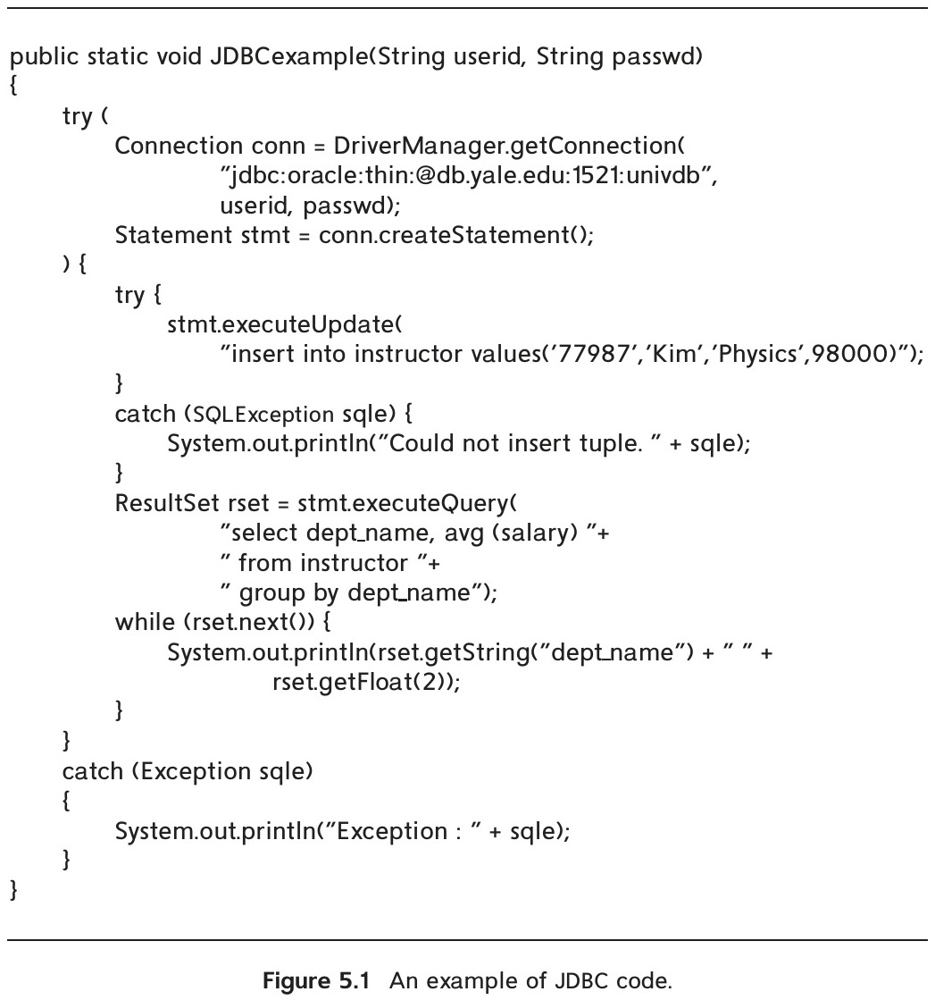
*Figure 5.1 — An example of JDBC code.*

<!-- Page 186 -->

A connection is opened using the `getConnection()` method of the `DriverManager` class (within `java.sql`). This method takes three parameters.[^1]

1. The first parameter to the `getConnection()` call is a string that specifies the URL, or machine name, where the server runs (in our example, `db.yale.edu`), along with possibly some other information such as the protocol to be used to communicate with the database (in our example, `jdbc:oracle:thin:`; we shall shortly see why this is required), the port number the database system uses for communication (in our example, 2000), and the specific database on the server to be used (in our example, `univdb`). Note that JDBC specifies only the API, not the communication protocol. A JDBC driver may support multiple protocols, and we must specify one supported by both the database and the driver. The protocol details are vendor specific.
2. The second parameter to `getConnection()` is a database user identifier, which is a string.
3. The third parameter is a password, which is also a string. (Note that the need to specify a password within the JDBC code presents a security risk if an unauthorized person accesses your Java code.)

In our example in the figure, we have created a `Connection` object whose handle is `conn`.

Each database product that supports JDBC (all the major database vendors do) provides a JDBC driver that must be dynamically loaded in order to access the database from Java. In fact, loading the driver must be done first, before connecting to the database. If the appropriate driver has been downloaded from the vendor’s web site and is in the classpath, the `getConnection()` method will locate the needed driver.[^2] The driver provides for the translation of product-independent JDBC calls into the product-specific calls needed by the specific database management system being used. The actual protocol used to exchange information with the database depends on the driver that is used, and it is not defined by the JDBC standard. Some drivers support more than one protocol, and a suitable protocol must be chosen depending on what protocol the particular database product supports. In our example, when opening a connection with the database, the string `jdbc:oracle:thin:` specifies a particular protocol supported by Oracle. The MySQL equivalent is `jdbc:mysql:`.

#### 5.1.1.2 Shipping SQL Statements to the Database System

Once a database connection is open, the program can use it to send SQL statements to the database system for execution. This is done via an instance of the class `Statement`.

[^1]: There are multiple versions of the `getConnection()` method, which differ in the parameters that they accept. We present the most commonly used version.

[^2]: Prior to version 4, locating the driver was done manually by invoking `Class.forName` with one argument specifying a concrete class implementing the `java.sql.Driver` interface, in a line of code prior to the `getConnection` call.

<!-- Page 187 -->

A `Statement` object is not the SQL statement itself, but rather an object that allows the Java program to invoke methods that ship an SQL statement given as an argument for execution by the database system. Our example creates a `Statement` handle (`stmt`) on the connection `conn`.

To execute a statement, we invoke either the `executeQuery()` method or the `executeUpdate()` method, depending on whether the SQL statement is a query (and, thus, returns a result set) or nonquery statement such as update, insert, delete, or create table. In our example, `stmt.executeUpdate()` executes an update statement that inserts into the *instructor* relation. It returns an integer giving the number of tuples inserted, updated, or deleted. For DDL statements, the return value is zero.

#### 5.1.1.3 Exceptions and Resource Management

Executing any SQL method might result in an exception being thrown. The `try { … } catch { … }` construct permits us to catch any exceptions (error conditions) that arise when JDBC calls are made and take appropriate action. In JDBC programming, it may be useful to distinguish between an `SQLException`, which is an SQL-specific exception, and the general case of an `Exception`, which could be any Java exception such as a null-pointer exception, or array-index-out-of-bounds exception. We show both in Figure 5.1. In practice, one would write more complete exception handlers than we do (for the sake of conciseness) in our example code.

Opening a connection, a statement, and other JDBC objects are all actions that consume system resources. Programmers must take care to ensure that programs close all such resources. Failure to do so may cause the database system’s resource pools to become exhausted, rendering the system inaccessible or inoperative until a time-out period expires. One way to do this is to code explicit calls to close connections and statements. This approach fails if the code exits due to an exception and, in so doing, avoids the Java statement with the close invocation. For this reason, the preferred approach is to use the try-with-resources construct in Java. In the example of Figure 5.1, the opening of the connection and statement objects is done within parentheses rather than in the main body of the try in curly braces. Resources opened in the code within parentheses are closed automatically at the end of the try block. This protects us from leaving connections or statements unclosed. Since closing a statement implicitly closes objects opened for that statement (i.e., the `ResultSet` objects we shall discuss in the next section), this coding practice protects us from leaving resources unclosed.[^3]

In the example of Figure 5.1, we could have closed the connection explicitly with the statement `conn.close()` and closed the statement explicitly with `stmt.close()`, though doing so was not necessary in our example.

#### 5.1.1.4 Retrieving the Result of a Query

The example code of Figure 5.1 executes a query by using `stmt.executeQuery()`. It retrieves the set of tuples in the result into a `ResultSet` object `rset` and fetches them one

[^3]: This Java feature, called try-with-resources, was introduced in Java 7.

<!-- Page 188 -->

tuple at a time. The `next()` method on the result set tests whether or not there remains at least one unfetched tuple in the result set and if so, fetches it. The return value of the `next()` method is a Boolean indicating whether it fetched a tuple. Attributes from the fetched tuple are retrieved using various methods whose names begin with `get`. The method `getString()` can retrieve any of the basic SQL data types (converting the value to a Java `String` object), but more restrictive methods such as `getFloat()` can be used as well. The argument to the various `get` methods can either be an attribute name specified as a string, or an integer indicating the position of the desired attribute within the tuple. Figure 5.1 shows two ways of retrieving the values of attributes in a tuple: using the name of the attribute (`dept_name`) and using the position of the attribute (2, to denote the second attribute).

#### 5.1.1.5 Prepared Statements

We can create a prepared statement in which some values are replaced by “?”, thereby specifying that actual values will be provided later. The database system compiles the query when it is prepared. Each time the query is executed (with new values to replace the “?”s), the database system can reuse the previously compiled form of the query and apply the new values as parameters. The code fragment in Figure 5.2 shows how prepared statements can be used.

The `prepareStatement()` method of the `Connection` class defines a query that may contain parameter values; some JDBC drivers may submit the query to the database for compilation as part of the method, but other drivers do not contact the database at this point. The method returns an object of class `PreparedStatement`. At this point, no SQL statement has been executed. The `executeQuery()` and `executeUpdate()` methods of `PreparedStatement` class do that. But before they can be invoked, we must use methods of class `PreparedStatement` that assign values for the “?” parameters. The `setString()` method and other similar methods such as `setInt()` for other basic SQL types allow us to specify the values for the parameters. The first argument specifies the “?” parameter for which we are assigning a value (the first parameter is 1, unlike most other Java constructs, which start with 0). The second argument specifies the value to be assigned.

In the example in Figure 5.2, we prepare an `insert` statement, set the “?” parameters, and then invoke `executeUpdate()`. The final two lines of our example show that parameter assignments remain unchanged until we specifically reassign them. Thus, the final statement, which invokes `executeUpdate()`, inserts the tuple (“88878”, “Perry”, “Finance”, 125000).

Prepared statements allow for more efficient execution in cases where the same query can be compiled once and then run multiple times with different parameter values. However, there is an even more significant advantage to prepared statements that makes them the preferred method of executing SQL queries whenever a user-entered value is used, even if the query is to be run only once. Suppose that we read in a user-entered value and then use Java string manipulation to construct the SQL statement.

<!-- Page 189 -->

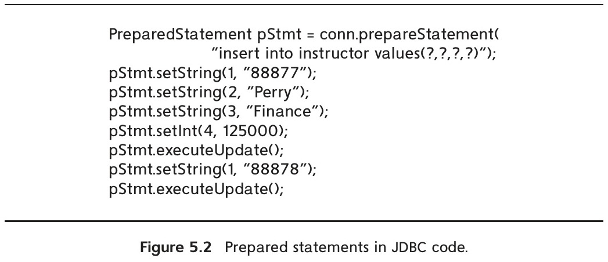
*Figure 5.2 — Prepared statements in JDBC code.*

If the user enters certain special characters, such as a single quote, the resulting SQL statement may be syntactically incorrect unless we take extraordinary care in checking the input. The `setString()` method does this for us automatically and inserts the needed escape characters to ensure syntactic correctness.

In our example, suppose that the values for the variables *ID*, *name*, *dept_name*, and *salary* have been entered by a user, and a corresponding row is to be inserted into the *instructor* relation. Suppose that, instead of using a prepared statement, a query is constructed by concatenating the strings using the following Java expression:

```java
"insert into instructor values('" + ID + "', '" + name + "', " +
" '" + dept_name + "', " + salary + ")"
```

and the query is executed directly using the `executeQuery()` method of a `Statement` object. Observe the use of single quotes in the string, which would surround the values of *ID*, *name* and *dept_name* in the generated SQL query.

Now, if the user typed a single quote in the *ID* or *name* fields, the query string would have a syntax error. It is quite possible that an instructor name may have a quotation mark in its name (for example, “O’Henry”).

While the above example might be considered an annoyance, the situation can be much worse. A technique called **SQL injection** can be used by malicious hackers to steal data or damage the database.

Suppose a Java program inputs a string `name` and constructs the query:

```java
"select * from instructor where name = '" + name + "'"
```

If the user, instead of entering a name, enters:

```text
X' or 'Y' = 'Y
```

then the resulting statement becomes:

<!-- Page 190 -->

```java
"select * from instructor where name = '" + "X' or 'Y' = 'Y" + "'"
```

which is:

```sql
select * from instructor where name = 'X' or 'Y' = 'Y'
```

In the resulting query, the **where** clause is always true and the entire *instructor* relation is returned.

More clever malicious users could arrange to output even more data, including credentials such as passwords that allow the user to connect to the database and perform any actions they want. SQL injection attacks on update statements can be used to change the values that are being stored in updated columns. In fact there have been a number of attacks in the real world using SQL injections; attacks on multiple financial sites have resulted in theft of large amounts of money by using SQL injection attacks.

Use of a prepared statement would prevent this problem because the input string would have escape characters inserted, so the resulting query becomes:

```java
"select * from instructor where name = 'X\' or \'Y\' = \'Y'"
```

which is harmless and returns the empty relation.

Programmers must pass user-input strings to the database only through parameters of prepared statements; creating SQL queries by concatenating strings with user-input values is an extremely serious security risk and should never be done in any program.

Some database systems allow multiple SQL statements to be executed in a single JDBC `execute` method, with statements separated by a semicolon. This feature has been turned off by default on some JDBC drivers because it allows malicious hackers to insert whole SQL statements using SQL injection. For instance, in our earlier SQL injection example a malicious user could enter:

```text
X'; drop table instructor; --
```

which will result in a query string with two statements separated by a semicolon being submitted to the database. Because these statements run with the privileges of the database userid used by the JDBC connection, devastating SQL statements such as **drop table**, or updates to any table of the user’s choice, could be executed. However, some databases still allow execution of multiple statements as above; it is thus very important to correctly use prepared statements to avoid the risk of SQL injection.

#### 5.1.1.6 Callable Statements

JDBC also provides a `CallableStatement` interface that allows invocation of SQL stored procedures and functions (described in Section 5.2). These play the same role for functions and procedures as `prepareStatement` does for queries.

<!-- Page 191 -->

```java
CallableStatement cStmt1 = conn.prepareCall("{? = call some_function(?)}");
CallableStatement cStmt2 = conn.prepareCall("{call some_procedure(?,?)}");
```

The data types of function return values and out parameters of procedures must be registered using the method `registerOutParameter()`, and can be retrieved using `get` methods similar to those for result sets. See a JDBC manual for more details.

#### 5.1.1.7 Metadata Features

As we noted earlier, a Java application program does not include declarations for data stored in the database. Those declarations are part of the SQL DDL statements. Therefore, a Java program that uses JDBC must either have assumptions about the database schema hard-coded into the program or determine that information directly from the database system at runtime. The latter approach is usually preferable, since it makes the application program more robust to changes in the database schema.

Recall that when we submit a query using the `executeQuery()` method, the result of the query is contained in a `ResultSet` object. The interface `ResultSet` has a method, `getMetaData()`, that returns a `ResultSetMetaData` object that contains metadata about the result set. `ResultSetMetaData`, in turn, has methods to find metadata information, such as the number of columns in the result, the name of a specified column, or the type of a specified column. In this way, we can write code to execute a query even if we have no prior knowledge of the schema of the result.

The following Java code segment uses JDBC to print out the names and types of all columns of a result set. The variable `rs` in the code is assumed to refer to a `ResultSet` instance obtained by executing a query.

```java
ResultSetMetaData rsmd = rs.getMetaData();
for(int i = 1; i <= rsmd.getColumnCount(); i++) {
    System.out.println(rsmd.getColumnName(i));
    System.out.println(rsmd.getColumnTypeName(i));
}
```

The `getColumnCount()` method returns the arity (number of attributes) of the result relation. That allows us to iterate through each attribute (note that we start at 1, as is conventional in JDBC). For each attribute, we retrieve its name and data type using the methods `getColumnName()` and `getColumnTypeName()`, respectively.

The `DatabaseMetaData` interface provides a way to find metadata about the database. The interface `Connection` has a method `getMetaData()` that returns a `DatabaseMetaData` object. The `DatabaseMetaData` interface in turn has a very large number of methods to get metadata about the database and the database system to which the application is connected.

For example, there are methods that return the product name and version number of the database system. Other methods allow the application to query the database system about its supported features.

<!-- Page 192 -->

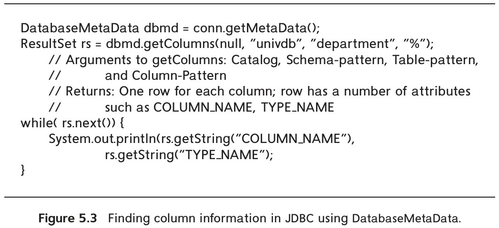
*Figure 5.3 — Finding column information in JDBC using DatabaseMetaData.*

Still other methods return information about the database itself. The code in Figure 5.3 illustrates how to find information about columns (attributes) of relations in a database. The variable `conn` is assumed to be a handle for an already opened database connection. The method `getColumns()` takes four arguments: a catalog name (`null` signifies that the catalog name is to be ignored), a schema name pattern, a table name pattern, and a column name pattern. The schema name, table name, and column name patterns can be used to specify a name or a pattern. Patterns can use the SQL string matching special characters “%” and “\_”; for instance, the pattern “%” matches all names. Only columns of tables of schemas satisfying the specified name or pattern are retrieved. Each row in the result set contains information about one column. The rows have a number of columns such as the name of the catalog, schema, table and column, the type of the column, and so on.

The `getTables()` method allows you to get a list of all tables in the database. The first three parameters to `getTables()` are the same as for `getColumns()`. The fourth parameter can be used to restrict the types of tables returned; if set to `null`, all tables, including system internal tables are returned, but the parameter can be set to restrict the tables returned to only user-created tables.

Examples of other methods provided by `DatabaseMetaData` that provide information about the database include those for primary keys (`getPrimaryKeys()`), foreign-key references (`getCrossReference()`), authorizations, database limits such as maximum number of connections, and so on.

The metadata interfaces can be used for a variety of tasks. For example, they can be used to write a database browser that allows a user to find the tables in a database, examine their schema, examine rows in a table, apply selections to see desired rows, and so on. The metadata information can be used to make code used for these tasks generic; for example, code to display the rows in a relation can be written in such a way that it would work on all possible relations regardless of their schema. Similarly, it is

<!-- Page 193 -->

possible to write code that takes a query string, executes the query, and prints out the results as a formatted table; the code can work regardless of the actual query submitted.

#### 5.1.1.8 Other Features

JDBC provides a number of other features, such as updatable result sets. It can create an updatable result set from a query that performs a selection and/or a projection on a database relation. An update to a tuple in the result set then results in an update to the corresponding tuple of the database relation.

Recall from Section 4.3 that a transaction allows multiple actions to be treated as a single atomic unit which can be committed or rolled back. By default, each SQL statement is treated as a separate transaction that is committed automatically. The method `setAutoCommit()` in the JDBC `Connection` interface allows this behavior to be turned on or off. Thus, if `conn` is an open connection, `conn.setAutoCommit(false)` turns off automatic commit. Transactions must then be committed or rolled back explicitly using either `conn.commit()` or `conn.rollback()`. `conn.setAutoCommit(true)` turns on automatic commit.

JDBC provides interfaces to deal with large objects without requiring an entire large object to be created in memory. To fetch large objects, the `ResultSet` interface provides methods `getBlob()` and `getClob()` that are similar to the `getString()` method, but return objects of type `Blob` and `Clob`, respectively. These objects do not store the entire large object, but instead store “locators” for the large objects, that is, logical pointers to the actual large object in the database. Fetching data from these objects is very much like fetching data from a file or an input stream, and it can be performed using methods such as `getBytes()` and `getSubString()`.

Conversely, to store large objects in the database, the `PreparedStatement` class permits a database column whose type is blob to be linked to an input stream (such as a file that has been opened) using the method `setBlob(int parameterIndex, InputStream inputStream)`. When the prepared statement is executed, data are read from the input stream and written to the blob in the database. Similarly, a clob column can be set using the `setClob()` method, which takes as arguments a parameter index and a character stream.

JDBC includes a row set feature that allows result sets to be collected and shipped to other applications. Row sets can be scanned both backward and forward and can be modified.

### 5.1.2 Database Access from Python

Database access can be done from Python as illustrated by the method shown in Figure 5.4. The statement containing the insert query shows how to use the Python equivalent of JDBC prepared statements, with parameters identified in the SQL query by “%s”, and parameter values provided as a list. Updates are not committed to the database automatically; the `commit()` method needs to be called to commit an update.

<!-- Page 194 -->

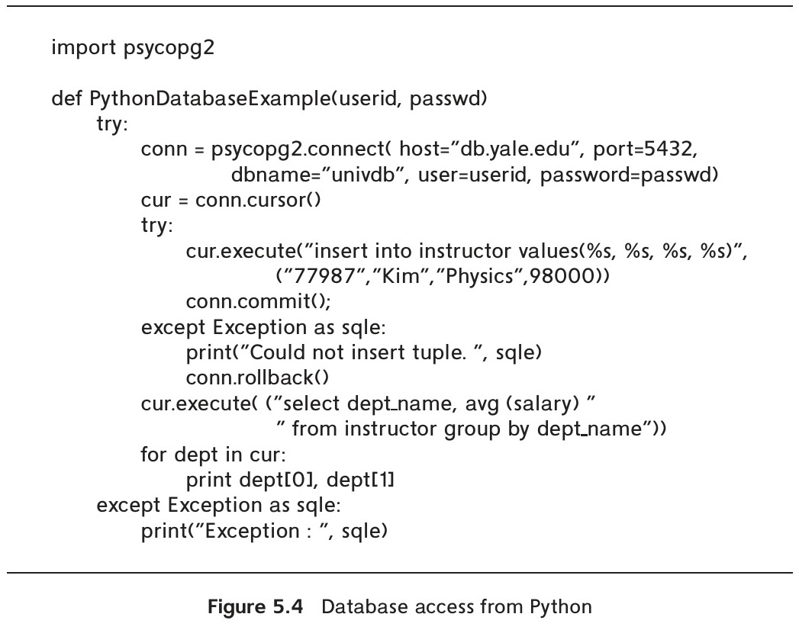
*Figure 5.4 — Database access from Python.*

The `try:`, `except …:` block shows how to catch exceptions and to print information about the exception. The `for` loop illustrates how to loop over the result of a query execution, and to access individual attributes of a particular row.

The preceding program used the `psycopg2` driver for PostgreSQL. Other database systems use other drivers, but code written using these drivers follows a similar structure, since the drivers implement the Python Database API standard. Details of the API can be found online at `www.python.org/dev/peps/pep-0249/`.

### 5.1.3 ODBC

The Open Database Connectivity (ODBC) standard defines an API that applications can use to open a connection with a database, send queries and updates, and get back results. Applications must be linked with an ODBC library. Different database products provide their own ODBC library. When the application makes an ODBC call, the code in the library communicates with the database to carry out the requested action.

<!-- Page 195 -->

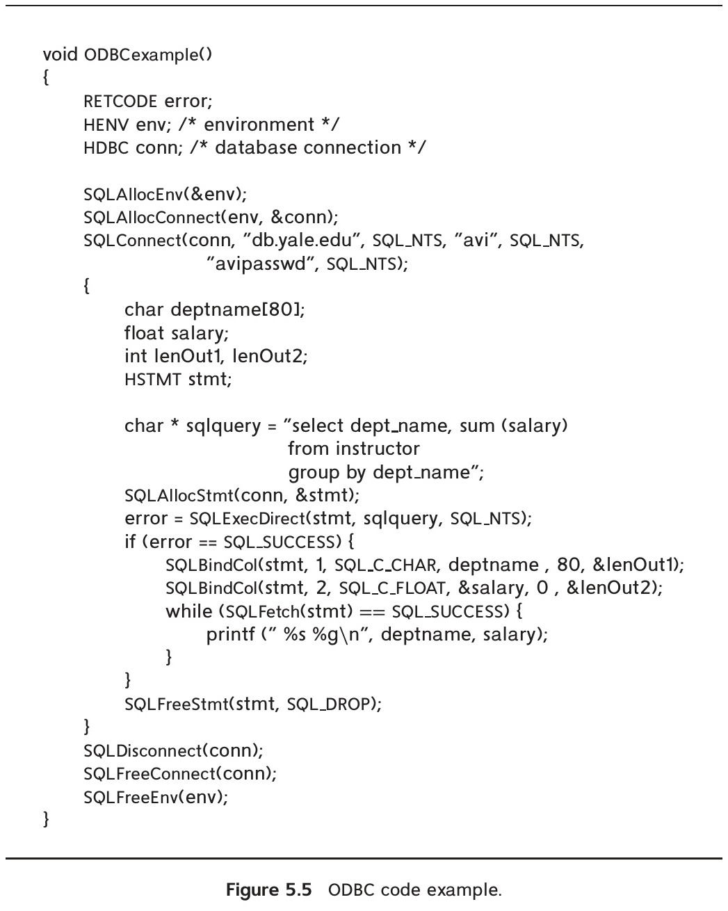
*Figure 5.5 — ODBC code example.*

Figure 5.5 shows an example of C code using the ODBC API. The first step in using ODBC to communicate with a server is to set up an environment handle and then a database connection handle. The function `SQLAllocEnv()` initializes the ODBC environment and allocates an environment handle `env`. Then `SQLAllocConnect()` allocates a connection handle `conn`, and `SQLConnect()` opens a connection to the database.

<!-- Page 196 -->

The parameters to `SQLConnect()` include the connection handle, the server to which the connection is to be opened (which must identify the database product as well as the database instance to be accessed), a user identifier, and a password. In the example of Figure 5.5, the machine is `db.yale.edu`, the user identifier is `avi`, and the password is `mypwd`.

Once the connection is open, the program can send SQL statements to the database. In our example, the program uses `SQLExecDirect()` to send an SQL query. The results are returned in a table; tuples from the table can be fetched one at a time using `SQLFetch()`.

The function `SQLBindCol()` binds C language variables to attributes of the query result. When a tuple is fetched, its attribute values are automatically stored in the corresponding C variables. An argument to `SQLBindCol()` gives the data type of the C variable, and type conversions are performed automatically if needed. In our example, the first attribute of the query result is bound to the C variable `deptname`, and the second attribute is bound to the C variable `salary`. The attributes are numbered starting from 1. If an attribute fetched has a null value, the variable `len` in our example is set to a negative value. If the value fetched is not null, `len` gives the length of the string value.

The `SQLFetch()` statement is executed in a while loop that terminates when `SQLFetch()` returns `SQL_NO_DATA`. Notice that before terminating, the code explicitly frees the statement, connection, and environment handles. In practice, code would also have error handlers to handle any errors that may occur, but we have omitted them here for brevity.

It is possible to create an SQL statement with parameters; for example, consider the statement `insert into department values(?,?,?)`. The question marks are placeholders for values which will be supplied later. The above statement can be “prepared,” that is, compiled at the database, and repeatedly executed by providing actual values for the placeholders—in this case, by providing a department name, building, and budget for the relation *department*.

ODBC defines functions for a variety of tasks, such as finding all the relations in the database and finding the names and types of columns of a query result or a relation in the database.

By default, each SQL statement is treated as a separate transaction that is committed automatically. The `SQLSetConnectOption(conn, SQL_AUTOCOMMIT, 0)` turns off automatic commit on connection `conn`, and transactions must then be committed explicitly by `SQLTransact(conn, SQL_COMMIT)` or rolled back by `SQLTransact(conn, SQL_ROLLBACK)`.

The ODBC standard defines conformance levels, which specify subsets of the functionality defined by the standard. An ODBC implementation may provide only core level features, or it may provide more advanced (level 1 or level 2) features. Level 1 requires support for fetching information about the catalog, such as information about what relations are present and the types of their attributes. Level 2 requires further fea-

<!-- Page 197 -->

tures, such as the ability to send and retrieve arrays of parameter values and to retrieve more detailed catalog information.

The SQL standard defines a call level interface (CLI) that is similar to the ODBC interface.

### 5.1.4 Embedded SQL

The SQL standard defines embeddings of SQL in a variety of programming languages, such as C, C++, Cobol, Pascal, Java, PL/I, and Fortran. A language in which SQL queries are embedded is referred to as a host language, and the SQL structures permitted in the host language constitute embedded SQL.

Programs written in the host language can use the embedded SQL syntax to access and update data stored in a database. An embedded SQL program must be processed by a special preprocessor prior to compilation. The preprocessor replaces embedded SQL requests with host-language declarations and procedure calls that allow runtime execution of the database accesses. Then the resulting program is compiled by the host-language compiler. This is the main distinction between embedded SQL and JDBC or ODBC.

To identify embedded SQL requests to the preprocessor, we use the `EXEC SQL` statement; it has the form:

```sql
EXEC SQL <embedded SQL statement >;
```

Before executing any SQL statements, the program must first connect to the database. Variables of the host language can be used within embedded SQL statements, but they must be preceded by a colon (:) to distinguish them from SQL variables.

To iterate over the results of an embedded SQL query, we must declare a cursor variable, which can then be opened, and fetch commands issued in a host language loop to fetch consecutive rows of the query result. Attributes of a row can be fetched into host language variables. Database updates can also be performed using a cursor on a relation to iterate through the rows of the relation, optionally using a **where** clause to iterate through only selected rows. Embedded SQL commands can be used to update the current row where the cursor is pointing.

The exact syntax for embedded SQL requests depends on the language in which SQL is embedded. You may refer to the manuals of the specific language embedding that you use for further details.

In JDBC, SQL statements are interpreted at runtime (even if they are created using the prepared statement feature). When embedded SQL is used, there is a potential for catching some SQL-related errors (including data-type errors) at the time of preprocessing. SQL queries in embedded SQL programs are also easier to comprehend than in programs using dynamic SQL. However, there are also some disadvantages with embedded SQL. The preprocessor creates new host language code, which may complicate debugging of the program. The constructs used by the preprocessor to identify SQL

<!-- Page 198 -->

> ### Note 5.1: EMBEDDED DATABASES
>
> Both JDBC and ODBC assume that a server is running on the database system hosting the database. Some applications use a database that exists entirely within the application. Such applications maintain the database only for internal use and offer no accessibility to the database except through the application itself. In such cases, one may use an embedded database and use one of several packages that implement an SQL database accessible from within a programming language. Popular choices include Java DB, SQLite, HSQLBD, and H˝2. There is also an embedded version of MySQL.
>
> Embedded database systems lack many of the features of full server-based database systems, but they offer advantages for applications that can benefit from the database abstractions but do not need to support very large databases or large-scale transaction processing.
>
> Do not confuse embedded databases with embedded SQL; the latter is a means of connecting to a database running on a server.

statements may clash syntactically with host language syntax introduced in subsequent versions of the host language.

As a result, most current systems use dynamic SQL, rather than embedded SQL. One exception is the Microsoft Language Integrated Query (LINQ) facility, which extends the host language to include support for queries instead of using a preprocessor to translate embedded SQL queries into the host language.

## 5.2 Functions and Procedures

We have already seen several functions that are built into the SQL language. In this section, we show how developers can write their own functions and procedures, store them in the database, and then invoke them from SQL statements. Functions are particularly useful with specialized data types such as images and geometric objects. For instance, a line-segment data type used in a map database may have an associated function that checks whether two line segments overlap, and an image data type may have associated functions to compare two images for similarity.

Procedures and functions allow “business logic” to be stored in the database and executed from SQL statements. For example, universities usually have many rules about how many courses a student can take in a given semester, the minimum number of courses a full-time instructor must teach in a year, the maximum number of majors a student can be enrolled in, and so on. While such business logic can be encoded as programming-language procedures stored entirely outside the database, defining them as stored procedures in the database has several advantages. For example, it allows

<!-- Page 199 -->

multiple applications to access the procedures, and it allows a single point of change in case the business rules change, without changing other parts of the application. Application code can then call the stored procedures instead of directly updating database relations.

SQL allows the definition of functions, procedures, and methods. These can be defined either by the procedural component of SQL or by an external programming language such as Java, C, or C++. We look at definitions in SQL first and then see how to use definitions in external languages in Section 5.2.3.

Although the syntax we present here is defined by the SQL standard, most databases implement nonstandard versions of this syntax. For example, the procedural languages supported by Oracle (PL/SQL), Microsoft SQL Server (TransactSQL), and PostgreSQL (PL/pgSQL) all differ from the standard syntax we present here. We illustrate some of the differences for the case of Oracle in Note 5.2 on page 204. See the respective system manuals for further details. Although parts of the syntax we present here may not be supported on such systems, the concepts we describe are applicable across implementations, although with a different syntax.

### 5.2.1 Declaring and Invoking SQL Functions and Procedures

Suppose that we want a function that, given the name of a department, returns the count of the number of instructors in that department. We can define the function as shown in Figure 5.6.[^4] This function can be used in a query that returns names and budgets of all departments with more than 12 instructors:

```sql
select dept_name, budget
from department
where dept_count(dept_name) > 12;
```

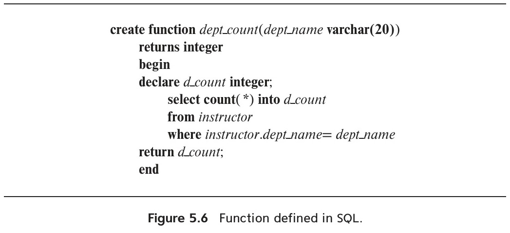
*Figure 5.6 — Function defined in SQL.*

[^4]: If you are entering your own functions or procedures, you should write “create or replace” rather than create so that it is easy to modify your code (by replacing the function) during debugging.

<!-- Page 200 -->

The SQL standard supports functions that can return tables as results; such functions are called **table functions**. For example, consider the function in Figure 5.7. The function returns a table containing all the instructors in a given department. Notice that the function’s parameter is referenced in the function’s body by prefixing the parameter name by the function name (`instructor_of.dept_name`).

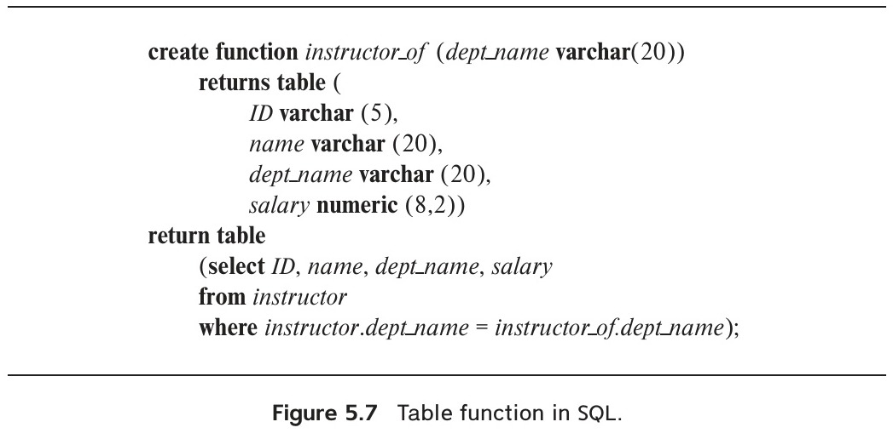
*Figure 5.7 — Table function in SQL.*

The function can be used in the **from** clause of an SQL query. For example, the query

```sql
select *
from table(instructor_of('Finance'));
```

returns all instructors in the Finance department.

In this simple case, the function could instead be written as a view whose definition has a parameter, which is ‘Finance’ in the preceding query. In general, table functions can be thought of as **parameterized views** that generalize the regular view concept by allowing parameters.

<!-- Page 201 -->

SQL also supports procedures. The `dept_count` function could instead be written as a procedure:

```sql
create procedure dept_count_proc(in dept_name varchar(20),
                                 out d_count integer)
    begin
        select count(*) into d_count
        from instructor
        where instructor.dept_name = dept_count_proc.dept_name;
    end
```

The keywords **in** and **out** before the parameter names specify whether the parameter is an input to the procedure, or whether it is used to return a value from the procedure.

Procedures can be invoked either from an SQL statement using the **call** statement or from an embedded SQL or dynamic SQL statement (using the `CallableStatement` interface we saw in Section 5.1.1.6). For example, the procedure can be invoked from an SQL statement using the **call** statement:

```sql
declare d_count integer;
call dept_count_proc('Physics', d_count);
```

Procedures and functions can be dropped using the commands **drop procedure** *procedure_name* and **drop function** *function_name*.

SQL permits more than one procedure with the same name, so long as the number of arguments of the procedures with the same name is different. The name, along with the number of arguments, is used to identify the procedure. SQL also permits more than one function with the same name, so long as the different functions with the same name either have different numbers of arguments, or for functions with the same number of arguments, they differ in the type of at least one argument.

### 5.2.2 Language Constructs for Procedures and Functions

SQL supports constructs that give it almost all the power of a general-purpose programming language. The part of the SQL standard that deals with these constructs is called the Persistent Storage Module (PSM).

Variables are declared using a **declare** statement and can have any valid SQL data type. Assignments are performed using a **set** statement.

A compound statement is of the form **begin … end**, and it may contain multiple SQL statements between the **begin** and the **end**. Local variables can be declared within a compound statement, as we have seen in Section 5.2.1. A compound statement of the form **begin atomic … end** ensures that all the statements contained within it are executed as a single transaction.

The syntax for while statements and repeat statements is:

```sql
while boolean expression do
    sequence of statements;
end while
```

```sql
repeat
    sequence of statements;
until boolean expression
end repeat
```

There is also a for loop that permits iteration over all the results of a query:

<!-- Page 202 -->

```sql
declare n integer default 0;
for r as
    select budget from department
    where dept_name = 'Music'
do
    set n = n - r.budget
end for
```

The program fetches the query results one row at a time into the for loop variable (`r`, in the above example). The statement **leave** can be used to exit the loop, while **iterate** starts on the next tuple, from the beginning of the loop, skipping the remaining statements.

The conditional statements supported by SQL include if-then-else statements by using this syntax:

```sql
if boolean expression
    then statement or compound statement
elseif boolean expression
    then statement or compound statement
else statement or compound statement
end if
```

SQL also supports a case statement similar to the C/C++ language case statement (in addition to case expressions, which we saw in Chapter 3).

Figure 5.8 provides a larger example of the use of procedural constructs in SQL. The function `registerStudent` defined in the figure registers a student in a course section after verifying that the number of students in the section does not exceed the capacity of the room allocated to the section. The function returns an error code—a value greater than or equal to 0 signifies success, and a negative value signifies an error condition—and a message indicating the reason for the failure is returned as an **out** parameter.

The SQL procedural language also supports the signaling of exception conditions and declaring of handlers that can handle the exception, as in this code:

```sql
declare out_of_classroom_seats condition
declare exit handler for out_of_classroom_seats
begin
    sequence of statements
end
```

The statements between the **begin** and the **end** can raise an exception by executing **signal** `out_of_classroom_seats`. The handler says that if the condition arises, the action to be taken is to exit the enclosing **begin end** statement. Alternative actions would be **continue**, which continues execution from the next statement following the one that raised the exception. In addition to explicitly defined conditions, there are also predefined conditions such as **sqlexception**, **sqlwarning**, and **not found**.

<!-- Page 203 -->

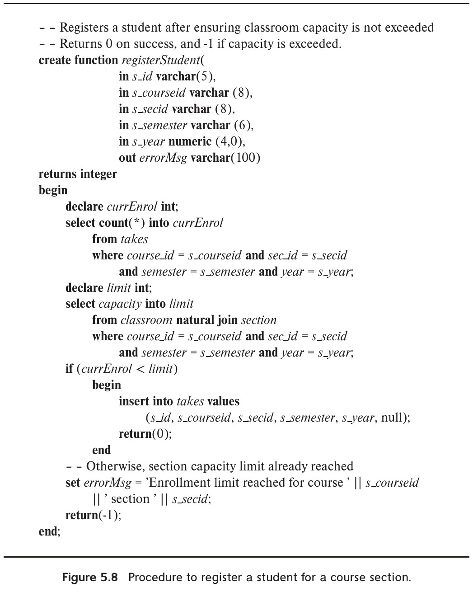
*Figure 5.8 — Procedure to register a student for a course section.*

### 5.2.3 External Language Routines

Although the procedural extensions to SQL can be very useful, they are unfortunately not supported in a standard way across databases. Even the most basic features have different syntax or semantics in different database products. As a result, programmers have to learn a new language for each database product. An alternative that is gaining

<!-- Page 204 -->

> ### Note 5.2: NONSTANDARD SYNTAX FOR PROCEDURES AND FUNCTIONS
>
> Although the SQL standard defines the syntax for procedures and functions, most databases do not follow the standard strictly, and there is considerable variation in the syntax supported. One of the reasons for this situation is that these databases typically introduced support for procedures and functions before the syntax was standardized, and they continue to support their original syntax. It is not possible to list the syntax supported by each database here, but we illustrate a few of the differences in the case of Oracle’s PL/SQL by showing below a version of the function from Figure 5.6 as it would be defined in PL/SQL.
>
> ```sql
> create function dept_count (dname in instructor.dept_name%type) return integer
> as
> d_count integer;
> begin
>     select count(*) into d_count
>     from instructor
>     where instructor.dept_name = dname;
>     return d_count;
> end;
> ```
>
> While the two versions are similar in concept, there are a number of minor syntactic differences, some of which are evident when comparing the two versions of the function. Although not shown here, the syntax for control flow in PL/SQL also has several differences from the syntax presented here.
>
> Observe that PL/SQL allows a type to be specified as the type of an attribute of a relation, by adding the suffix %type. On the other hand, PL/SQL does not directly support the ability to return a table, although there is an indirect way of implementing this functionality by creating a table type, and returning a collection of that type.

support is to define procedures in an imperative programming language, but allow them to be executed from within the database process.

SQL allows us to define functions in a programming language such as Java, C#, C, or C++. Defining functions in other languages can be useful for doing computationally intensive tasks, such as graphic manipulation, which cannot be done efficiently using the limited constructs provided by SQL. Defining functions in other languages can also be useful when the function has to access resources outside the database, such as the file system, or network sockets.

Functions defined in a programming language can be invoked in the same way as functions defined in SQL. A function defined in a programming language must be compiled and made available to the database system. We can define a function in an external language using the **create function** statement:

```sql
create function dept_count(dept_name varchar(20))
returns integer
language C
external name '/usr/avi/bin/dept_count'
```

The keyword **language** specifies the language in which the function is written, in this case C. The **external name** clause specifies where the compiled code of the function is located. Other languages such as Java or C# can also be used, with the location of the compiled code specified as an appropriate file path or package/module name.

<!-- Page 205 -->

External procedures and functions can be specified in this way (note that the exact syntax depends on the specific database system you use):

```sql
create procedure dept_count_proc(in dept_name varchar(20),
                                 out count integer)
language C
external name '/usr/avi/bin/dept_count_proc'

create function dept_count(dept_name varchar(20))
returns integer
language C
external name '/usr/avi/bin/dept_count'
```

In general, the external language procedures need to deal with null values in parameters (both in and out) and return values. They also need to communicate failure/success status and to deal with exceptions. This information can be communicated by extra parameters: an `sqlstate` value to indicate failure/success status, a parameter to store the return value of the function, and indicator variables for each parameter/function result to indicate if the value is null. Other mechanisms are possible to handle null values, for example, by passing pointers instead of values. The exact mechanisms depend on the database. However, if a function does not deal with these situations, an extra line `parameter style general` can be added to the declaration to indicate that the external procedures/functions take only the arguments shown and do not handle null values or exceptions.

Functions defined in a programming language and compiled outside the database system may be loaded and executed with the database-system code. However, doing so carries the risk that a bug in the program can corrupt the internal structures of the database and can bypass the access-control functionality of the database system. Database systems that are concerned more about efficient performance than about security may execute procedures in such a fashion. Database systems that are concerned about security may execute such code as part of a separate process, communicate the parameter values to it, and fetch results back via interprocess communication. However, the time overhead of interprocess communication is quite high; on typical CPU architectures, tens to hundreds of thousands of instructions can execute in the time taken for one interprocess communication.

If the code is written in a “safe” language such as Java or C#, there is another possibility: executing the code in a sandbox within the database query execution process itself. The sandbox allows the Java or C# code to access its own memory area, but it prevents the code from reading or updating the memory of the query execution process, or accessing files in the file system. (Creating a sandbox is not possible for a language such as C, which allows unrestricted access to memory through pointers.) Avoiding interprocess communication reduces function call overhead greatly.

<!-- Page 206 -->

Several database systems today support external language routines running in a sandbox within the query execution process. For example, Oracle and IBM DB2 allow Java functions to run as part of the database process. Microsoft SQL Server allows procedures compiled into the Common Language Runtime (CLR) to execute within the database process; such procedures could have been written, for example, in C# or Visual Basic. PostgreSQL allows functions defined in several languages, such as Perl, Python, and Tcl.

## 5.3 Triggers

A **trigger** is a statement that the system executes automatically as a side effect of a modification to the database. To design a trigger mechanism, we must:

- Specify when a trigger is to be executed. This is broken up into an **event** that causes the trigger to be checked and a **condition** that must be satisfied for trigger execution to proceed.
- Specify the **actions** to be taken when the trigger executes.

The database system stores triggers just as it stores other data, so that they are persistent and accessible to all operations on the database. Once we enter an SQL trigger into the database, the database system takes on the responsibility of executing it whenever the specified event occurs and the corresponding condition is satisfied.

### 5.3.1 Need for Triggers

Triggers can be used to implement certain integrity constraints that cannot be specified using the constraint mechanism of SQL. Triggers are also useful mechanisms for alerting humans or for starting certain tasks automatically when certain conditions are met. As an illustration, we could design a trigger that, whenever a tuple is inserted into the *takes* relation, updates the tuple in the *student* relation for the student taking the course by adding the number of credits for the course to the student’s total credits. As another example, suppose a warehouse wishes to maintain a minimum inventory of each item; when the inventory level of an item falls below the minimum level, an order can be placed automatically. On an update of the inventory level of an item, the trigger compares the current inventory level with the minimum inventory level for the item, and if the level is at or below the minimum, a new order is created.

Note that triggers cannot usually perform updates outside the database, and hence, in the inventory replenishment example, we cannot use a trigger to place an order in the external world. Instead, we add an order to a relation holding reorders. We must create a separate permanently running system process that periodically scans that relation and places orders. Some database systems provide built-in support for sending email from SQL queries and triggers using this approach.

<!-- Page 207 -->

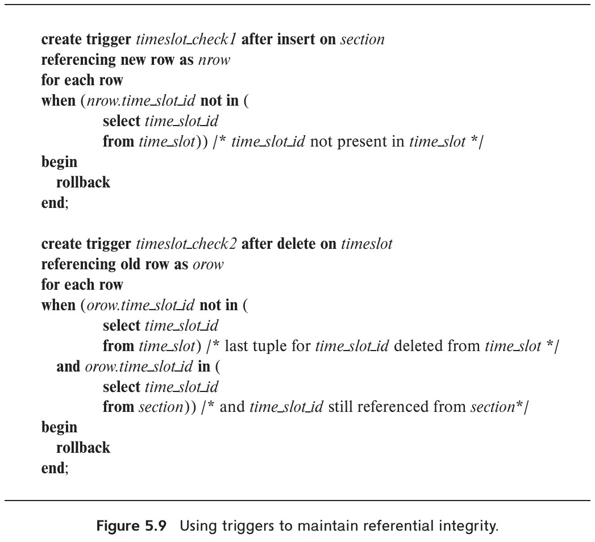
*Figure 5.9 — Using triggers to maintain referential integrity.*

### 5.3.2 Triggers in SQL

We now consider how to implement triggers in SQL. The syntax we present here is defined by the SQL standard, but most databases implement nonstandard versions of this syntax. Although the syntax we present here may not be supported on such systems, the concepts we describe are applicable across implementations. We discuss nonstandard trigger implementations in Note 5.3 on page 212. In each system, trigger syntax is based upon that system’s syntax for coding functions and procedures.

Figure 5.9 shows how triggers can be used to ensure referential integrity on the `time_slot_id` attribute of the *section* relation. The first trigger definition in the figure specifies that the trigger is initiated after any insert on the relation *section* and it ensures that the `time_slot_id` value being inserted is valid. SQL `insert` statement could insert multiple tuples of the relation, and the **for each row** clause in the trigger code would then explicitly iterate over each inserted row. The **referencing new row as** clause creates a variable `nrow` (called a **transition variable**) that stores the value of the row being inserted.

<!-- Page 208 -->

The **when** statement specifies a condition. The system executes the rest of the trigger body only for tuples that satisfy the condition. The **begin atomic … end** clause can serve to collect multiple SQL statements into a single compound statement. In our example, though, there is only one statement, which rolls back the transaction that caused the trigger to get executed. Thus, any transaction that violates the referential integrity constraint gets rolled back, ensuring the data in the database satisfies the constraint.

It is not sufficient to check referential integrity on inserts alone; we also need to consider updates of *section*, as well as deletes and updates to the referenced table *time_slot*. The second trigger definition in Figure 5.9 considers the case of deletes to *time_slot*. This trigger checks that the `time_slot_id` of the tuple being deleted is either still present in *time_slot*, or that no tuple in *section* contains that particular `time_slot_id` value; otherwise, referential integrity would be violated.

To ensure referential integrity, we would also have to create triggers to handle updates to *section* and *time_slot*; we describe next how triggers can be executed on updates, but we leave the definition of these triggers as an exercise to the reader.

For updates, the trigger can specify attributes whose update causes the trigger to execute; updates to other attributes would not cause it to be executed. For example, to specify that a trigger executes after an update to the *grade* attribute of the *takes* relation, we write:

```sql
after update of takes on grade
```

The **referencing old row as** clause can be used to create a variable storing the old value of an updated or deleted row. The **referencing new row as** clause can be used with updates in addition to inserts.

Figure 5.10 shows how a trigger can be used to keep the `tot_cred` attribute value of *student* tuples up-to-date when the *grade* attribute is updated for a tuple in the *takes* relation. The trigger is executed only when the *grade* attribute is updated from a value that is either null or ’F’ to a grade that indicates the course is successfully completed. The update statement is normal SQL syntax except for the use of the variable `nrow`.

A more realistic implementation of this example trigger would also handle grade corrections that change a successful completion grade to a failing grade and handle insertions into the *takes* relation where the grade indicates successful completion. We leave these as an exercise for the reader.

As another example of the use of a trigger, the action on delete of a student tuple could be to check if the student has any entries in the *takes* relation, and if so, to delete them.

Many database systems support a variety of other triggering events, such as when a user (application) logs on to the database (that is, opens a connection), the system shuts down, or changes are made to system settings.

Triggers can be activated before the event (insert, delete, or update) instead of after the event. Triggers that execute before an event can serve as extra constraints that can prevent invalid updates, inserts, or deletes. Instead of letting the invalid action proceed

<!-- Page 209 -->

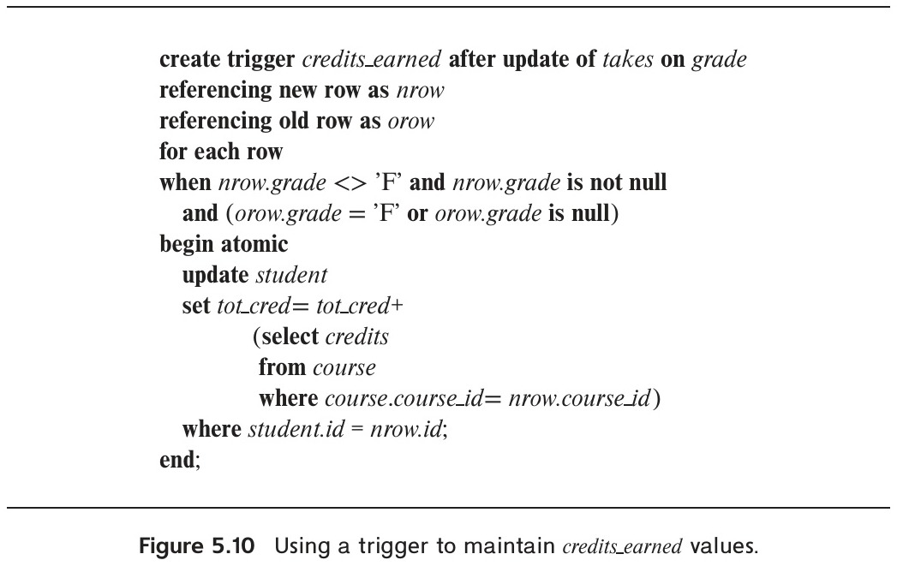
*Figure 5.10 — Using a trigger to maintain credits earned values.*

and cause an error, the trigger might take action to correct the problem so that the update becomes valid. For example, if a value being inserted is null, the trigger might set the value to a default non-null value, or to a value computed from other attributes. As another example, if a value being inserted for a string attribute has trailing spaces, the trigger might delete the trailing spaces before the tuple is inserted into the relation. As an illustration, the trigger in Figure 5.11 sets an inserted value to null if it has the value “blank”:

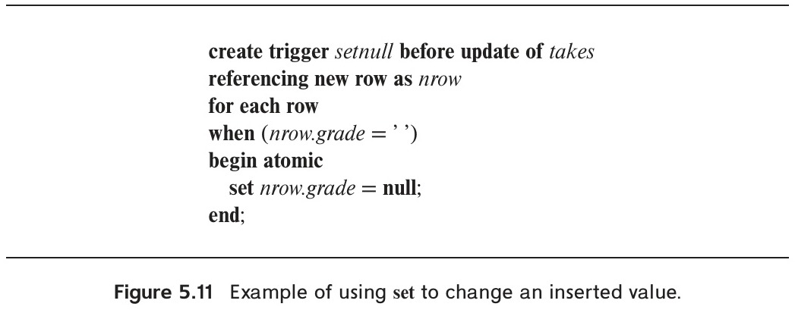
*Figure 5.11 — Example of using set to change an inserted value.*

<!-- Page 210 -->

In the example in Figure 5.11, the **set** statement changes the value of the attribute of the row to be inserted; when the tuple is actually inserted, it has the modified value.

Instead of transition variables such as `nrow` and `orow`, which represent a single row, triggers can use **transition tables** using the syntax:

```sql
referencing old table as ot
referencing new table as nt
```

referencing old table as or referencing new table as can then be used to refer to temporary tables (called transition tables) containing all the affected rows. Transition tables cannot be used with before triggers, but they can be used with after triggers, regardless of whether they are statement triggers or row triggers. A single SQL statement can then be used to carry out multiple actions on the basis of the transition tables.

Triggers can be disabled or enabled; by default they are enabled when they are created, but they can be disabled by using **alter trigger** *trigger_name* **disable** (some databases use alternative syntax such as **disable trigger** *trigger_name*). A trigger that has been disabled can be enabled again. A trigger can instead be dropped, which removes it permanently, by using the command **drop trigger** *trigger_name*.

Returning to our inventory-replenishment example from Section 5.3.1, suppose we have the following relations:

- `inventory (item, level)`, which notes the current amount of the item in the warehouse.
- `minlevel (item, level)`, which notes the minimum amount of the item to be maintained.
- `reorder (item, amount)`, which notes the amount of the item to be ordered when its level falls below the minimum.
- `orders (item, amount)`, which notes the amount of the item to be ordered.

To place a reorder when inventory falls below a specified minimum, we can use the trigger shown in Figure 5.12. Note that we have been careful to place an order only when the amount falls from above the minimum level to below the minimum level. If we check only that the new value after an update is below the minimum level, we may place an order erroneously when the item has already been reordered.

SQL-based database systems use triggers widely, although before SQL:1999 they were not part of the SQL standard. Unfortunately, as a result, each database system implemented its own syntax for triggers, leading to incompatibilities. The SQL:1999 syntax for triggers that we use here is similar, but not identical, to the syntax in the IBM DB2 and Oracle database systems. See Note 5.3 on page 212.

### 5.3.3 When Not to Use Triggers

There are many good uses for triggers, such as those we have just seen in Section 5.3.2, but some uses are best handled by alternative techniques. For example, we could implement the **on delete cascade** feature of a foreign-key constraint by using a trigger instead of using the cascade feature. Not only would this be more work to implement, but also it would be much harder for a database user to understand the set of constraints implemented in the database.

<!-- Page 211 -->

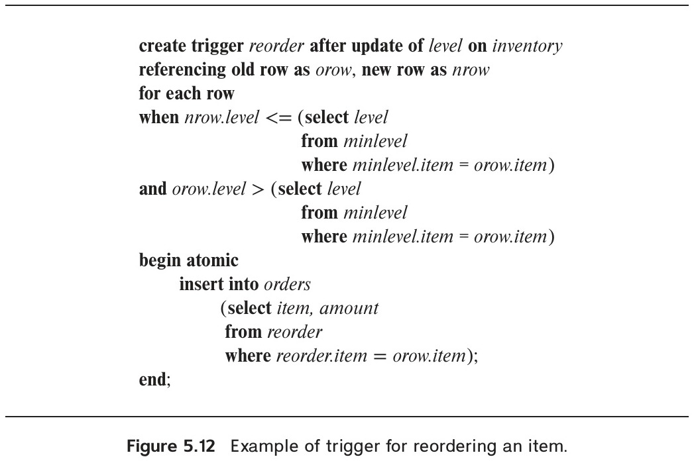
*Figure 5.12 — Example of trigger for reordering an item.*

As another example, triggers can be used to maintain materialized views. For example, suppose we have a materialized view

```sql
section_registration(course_id, sec_id, semester, year, total_students)
```

defined by the query

```sql
select course_id, sec_id, semester, year, count(ID) as total_students
from takes
group by course_id, sec_id, semester, year;
```

The value of `total_students` for each course must be maintained up-to-date by triggers on insert, delete, or update of the *takes* relation. Such maintenance may require insertion, update or deletion of tuples from *section_registration*, and triggers must be written accordingly.

However, many database systems now support materialized views, which are automatically maintained by the database system (see Section 4.2.3). As a result, there is no need to write trigger code for maintaining such materialized views.

Triggers have been used for maintaining copies, or replicas, of databases. A collection of triggers on insert, delete, or update can be created on each relation to record the changes in relations called change or delta relations. A separate process copies over the changes to the replica of the database. Modern database systems, however, provide

<!-- Page 212 -->

> ### Note 5.3: NONSTANDARD TRIGGER SYNTAX
>
> Although the trigger syntax we describe here is part of the SQL standard, and is supported by IBM DB2, most other database systems have nonstandard syntax for specifying triggers and may not implement all features in the SQL standard. We outline a few of the differences below; see the respective system manuals for further details.
>
> For example, in the Oracle syntax, unlike the SQL standard syntax, the keyword row does not appear in the referencing statement. The keyword atomic does not appear after begin. The reference to nrow in the select statement nested in the update statement must begin with a colon (:) to inform the system that the variable nrow is defined externally from the SQL statement. Further, subqueries are not allowed in the when and if clauses. It is possible to work around this problem by moving complex predicates from the when clause into a separate query that saves the result into a local variable, and then reference that variable in an if clause, and the body of the trigger then moves into the corresponding then clause. Further, in Oracle, triggers are not allowed to execute a transaction rollback directly; however, they can instead use a function called raise_application_error to not only roll back the transaction but also return an error message to the user/application that performed the update.
>
> As another example, in Microsoft SQL Server the keyword on is used instead of after. The referencing clause is omitted, and old and new rows are referenced by the tuple variables deleted and inserted. Further, the for each row clause is omitted, and when is replaced by if. The before specification is not supported, but an instead of specification is supported.
>
> In PostgreSQL, triggers do not have a body, but instead invoke a procedure for each row, which can access variables new and old containing the old and new values of the row. Instead of performing a rollback, the trigger can raise an exception with an associated error message.

built-in facilities for database replication, making triggers unnecessary for replication in most cases. Replicated databases are discussed in detail in Chapter 23.

Another problem with triggers lies in unintended execution of the triggered action when data are loaded from a backup copy,[^5] or when database updates at a site are replicated on a backup site. In such cases, the triggered action has already been executed, and typically it should not be executed again. When loading data, triggers can be disabled explicitly. For backup replica systems that may have to take over from the primary system, triggers would have to be disabled initially and enabled when the backup

[^5]: We discuss database backup and recovery from failures in detail in Chapter 19.

<!-- Page 213 -->

site takes over processing from the primary system. As an alternative, some database systems allow triggers to be specified as not for replication, which ensures that they are not executed on the backup site during database replication. Other database systems provide a system variable that denotes that the database is a replica on which database actions are being replayed; the trigger body should check this variable and exit if it is true. Both solutions remove the need for explicit disabling and enabling of triggers.

Triggers should be written with great care, since a trigger error detected at runtime causes the failure of the action statement that set off the trigger. Furthermore, the action of one trigger can set off another trigger. In the worst case, this could even lead to an infinite chain of triggering. For example, suppose an insert trigger on a relation has an action that causes another (new) insert on the same relation. The insert action then triggers yet another insert action, and so on ad infinitum. Some database systems limit the length of such chains of triggers (for example, to 16 or 32) and consider longer chains of triggering an error. Other systems flag as an error any trigger that attempts to reference the relation whose modification caused the trigger to execute in the first place.

Triggers can serve a very useful purpose, but they are best avoided when alternatives exist. Many trigger applications can be substituted by appropriate use of stored procedures, which we discussed in Section 5.2.

## 5.4 Recursive Queries

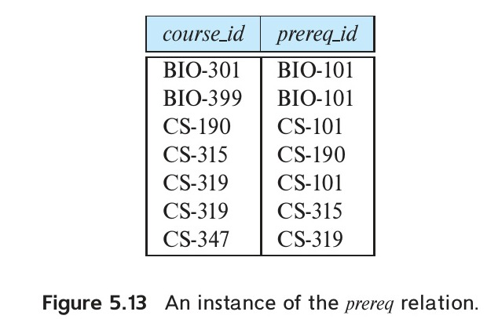
*Figure 5.13 — An instance of the prereq relation.*

Consider the instance of the relation *prereq* shown in Figure 5.13 containing information about the various courses offered at the university and the prerequisite for each course.[^6]

Suppose now that we want to find out which courses are a prerequisite whether directly or indirectly, for a specific course—say, CS-347. That is, we wish to find a course

[^6]: This instance of prereq differs from that used earlier for reasons that will become apparent as we use it to explain recursive queries.

<!-- Page 214 -->

that is a direct prerequisite for CS-347, or is a prerequisite for a course that is a prerequisite for CS-347, and so on.

Thus, since CS-319 is a prerequisite for CS-347 and CS-315 and CS-101 are prerequisites for CS-319, CS-315 and CS-101 are also prerequisites (indirectly) for CS-347. Then, since CS-190 is a prerequisite for CS-315, CS-190 is another indirect prerequisite for CS-347. Continuing, we see that CS-101 is a prerequisite for CS-190, but note that CS-101 was already added to the list of prerequisites for CS-347. In a real university, rather than our example, we would not expect such a complex prerequisite structure, but this example serves to show some of the situations that might possibly arise.

The transitive closure of the relation *prereq* is a relation that contains all pairs (*cid*, *pre*) such that *pre* is a direct or indirect prerequisite of *cid*. There are numerous applications that require computation of similar transitive closures on hierarchies. For instance, organizations typically consist of several levels of organizational units. Machines consist of parts that in turn have subparts, and so on; for example, a bicycle may have subparts such as wheels and pedals, which in turn have subparts such as tires, rims, and spokes. Transitive closure can be used on such hierarchies to find, for example, all parts in a bicycle.

### 5.4.1 Transitive Closure Using Iteration

One way to write the preceding query is to use iteration: First find those courses that are a direct prerequisite of CS-347, then those courses that are a prerequisite of all the courses under the first set, and so on. This iterative process continues until we reach an iteration where no courses are added. Figure 5.14 shows a function `findAllPrereqs(cid)` to carry out this task; the function takes the `course_id` of the course as a parameter (`cid`), computes the set of all direct and indirect prerequisites of that course, and returns the set.

The procedure uses three temporary tables:

- `c_prereq`: stores the set of tuples to be returned.
- `new_c_prereq`: stores the courses found in the previous iteration.
- `temp`: used as temporary storage while sets of courses are manipulated.

Note that SQL allows the creation of temporary tables using the command **create temporary table**; such tables are available only within the transaction executing the query and are dropped when the transaction finishes. Moreover, if two instances of `findAllPrereqs` run concurrently, each gets its own copy of the temporary tables; if they shared a copy, their result could be incorrect.

The procedure inserts all direct prerequisites of course `cid` into `new_c_prereq` before the repeat loop. The repeat loop first adds all courses in `new_c_prereq` to `c_prereq`. Next, it computes prerequisites of all those courses in `new_c_prereq`, except those that have already been found to be prerequisites of `cid`, and stores them in the temporary table

<!-- Page 215 -->

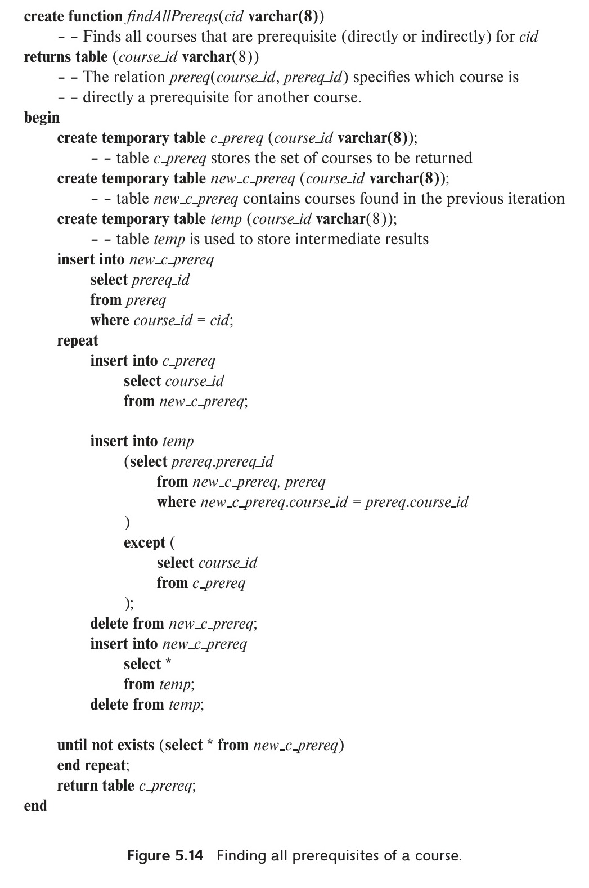
*Figure 5.14 — Finding all prerequisites of a course.*

<!-- Page 216 -->

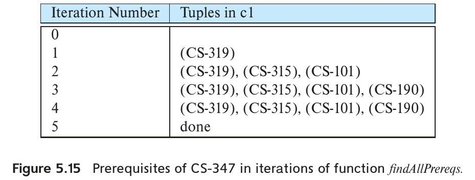
*Figure 5.15 — Prerequisites of CS-347 in iterations of function findAllPrereqs.*

`temp`. Finally, it replaces the contents of `new_c_prereq` with the contents of `temp`. The repeat loop terminates when it finds no new (indirect) prerequisites.

Figure 5.15 shows the prerequisites that are found in each iteration when the procedure is called for CS-347. While `c_prereq` could have been updated in one SQL statement, we need first to construct `new_c_prereq` so we can tell when nothing is being added in the (final) iteration.

The use of the **except** clause in the function ensures that the function works even in the (abnormal) case where there is a cycle of prerequisites. For example, if $a$ is a prerequisite for $b$, $b$ is a prerequisite for $c$, and $c$ is a prerequisite for $a$, there is a cycle.

While cycles may be unrealistic in course prerequisites, cycles are possible in other applications. For instance, suppose we have a relation `flights(to, from)` that says which cities can be reached from which other cities by a direct flight. We can write code similar to that in the `findAllPrereqs` function, to find all cities that are reachable by a sequence of one or more flights from a given city. All we have to do is to replace *prereq* with *flight* and replace attribute names correspondingly. In this situation, there can be cycles of reachability, but the function would work correctly since it would eliminate cities that have already been seen.

### 5.4.2 Recursion in SQL

It is rather inconvenient to specify transitive closure using iteration. There is an alternative approach, using recursive view definitions, that is easier to use.

We can use recursion to define the set of courses that are prerequisites of a particular course, say CS-347, as follows. The courses that are prerequisites (directly or indirectly) of CS-347 are:

- Courses that are prerequisites for CS-347.
- Courses that are prerequisites for those courses that are prerequisites (directly or indirectly) for CS-347.

Note that case 2 is recursive, since it defines the set of courses that are prerequisites of CS-347 in terms of the set of courses that are prerequisites of CS-347. Other examples

<!-- Page 217 -->

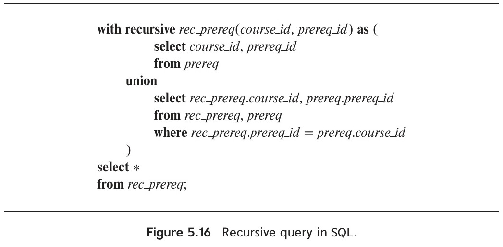
*Figure 5.16 — Recursive query in SQL.*

of transitive closure, such as finding all subparts (direct or indirect) of a given part can also be defined in a similar manner, recursively.

The SQL standard supports a limited form of recursion, using the **with recursive** clause, where a view (or temporary view) is expressed in terms of itself. Recursive queries can be used, for example, to express transitive closure concisely. Recall that the **with** clause is used to define a temporary view whose definition is available only to the query in which it is defined. The additional keyword **recursive** specifies that the view is recursive.[^7]

For example, we can find every pair (*cid*, *pre*) such that *pre* is directly or indirectly a prerequisite for course *cid*, using the recursive SQL view shown in Figure 5.16.

Any recursive view must be defined as the union[^8] of two subqueries: a **base query** that is nonrecursive and a **recursive query** that uses the recursive view. In the example in Figure 5.16, the base query is the select on *prereq* while the recursive query computes the join of *prereq* and *rec_prereq*.

The meaning of a recursive view is best understood as follows: First compute the base query and add all the resultant tuples to the recursively defined view relation *rec_prereq* (which is initially empty). Next compute the recursive query using the current contents of the view relation, and add all the resulting tuples back to the view relation. Keep repeating the above step until no new tuples are added to the view relation. The resultant view relation instance is called a **fixed point** of the recursive view definition. (The term “fixed” refers to the fact that there is no further change.) The view relation is thus defined to contain exactly the tuples in the fixed-point instance.

Applying this logic to our example, we first find all direct prerequisites of each course by executing the base query. The recursive query adds one more level of courses

[^7]: Some systems treat the recursive keyword as optional; others disallow it.

[^8]: Some systems, notably Oracle, require use of union all.

<!-- Page 218 -->

in each iteration, until the maximum depth of the course-prereq relationship is reached. At this point no new tuples are added to the view, and a fixed point is reached.

To find the prerequisites of a specific course, such as CS-347, we can modify the outer level query by adding a where clause “where `rec_prereq.course_id = 'CS-347'`”. One way to evaluate the query with the selection is to compute the full contents of *rec_prereq* using the iterative technique, and then select from this result only those tuples whose *course_id* is CS-347. However, this would result in computing (course, prerequisite) pairs for all courses, all of which are irrelevant except for those for the course CS-347. In fact the database system is not required to use this iterative technique to compute the full result of the recursive query and then perform the selection. It may get the same result using other techniques that may be more efficient, such as that used in the function `findAllPrereqs` which we saw earlier. See the bibliographic notes for references to more information on this topic.

There are some restrictions on the recursive query in a recursive view; specifically, the query must be **monotonic**, that is, its result on a view relation instance $V_1$ must be a superset of its result on a view relation instance $V_2$ if $V_1$ is a superset of $V_2$. Intuitively, if more tuples are added to the view relation, the recursive query must return at least the same set of tuples as before, and possibly return additional tuples.

In particular, recursive queries may not use any of the following constructs, since they would make the query nonmonotonic:

- Aggregation on the recursive view.
- **not exists** on a subquery that uses the recursive view.
- Set difference (**except**) whose right-hand side uses the recursive view.

For instance, if the recursive query was of the form $r - v$, where $v$ is the recursive view, if we add a tuple to $v$, the result of the query can become smaller; the query is therefore not monotonic.

The meaning of recursive views can be defined by the iterative procedure as long as the recursive query is monotonic; if the recursive query is nonmonotonic, the meaning of the view is hard to define. SQL therefore requires the queries to be monotonic. Recursive queries are discussed in more detail in the context of the Datalog query language, in Section 27.4.6.

SQL also allows creation of recursively defined permanent views by using **create recursive view** in place of **with recursive**. Some implementations support recursive queries using a different syntax. This includes the Oracle **start with / connect by prior** syntax for what it calls hierarchical queries.[^9] See the respective system manuals for further details.

[^9]: Staring with Oracle 12.c, the standard syntax is accepted in addition to the legacy hierarchical syntax, with the recursive keyword omitted and with the requirement in our example that union all be used instead of union.

<!-- Page 219 -->

## 5.5 Advanced Aggregation Features

The aggregation support in SQL is quite powerful and handles most common tasks with ease. However, there are some tasks that are hard to implement efficiently with the basic aggregation features. In this section, we study features in SQL to handle some such tasks.

### 5.5.1 Ranking

Finding the position of a value within a set is a common operation. For instance, we may wish to assign students a rank in class based on their grade-point average (GPA), with the rank 1 going to the student with the highest GPA, the rank 2 to the student with the next highest GPA, and so on. A related type of query is to find the percentile in which a value in a (multi)set belongs, for example, the bottom third, middle third, or top third. While such queries can be expressed using the SQL constructs we have seen so far, they are difficult to express and inefficient to evaluate. Programmers may resort to writing the query partly in SQL and partly in a programming language. We study SQL support for direct expression of these types of queries here.

In our university example, the *takes* relation shows the grade each student earned in each course taken. To illustrate ranking, let us assume we have a view `student_grades(ID, GPA)` giving the grade-point average of each student.[^10]

Ranking is done with an **order by** specification. The following query gives the rank of each student:

```sql
select ID, rank() over (order by (GPA) desc) as s_rank
from student_grades;
```

Note that the order of tuples in the output is not defined, so they may not be sorted by rank. An extra **order by** clause is needed to get them in sorted order, as follows:

```sql
select ID, rank() over (order by (GPA) desc) as s_rank
from student_grades
order by s_rank;
```

A basic issue with ranking is how to deal with the case of multiple tuples that are the same on the ordering attribute(s). In our example, this means deciding what to do if there are two students with the same GPA. The `rank` function gives the same rank to all tuples that are equal on the **order by** attributes. For instance, if the highest GPA is shared by two students, both would get rank 1. The next rank given would be 3, not 2, so if three students get the next highest GPA, they would all get rank 3, and the next student(s) would get rank 6, and so on. There is also a `dense_rank` function that does not create gaps in the ordering. In the preceding example, the tuples with the second highest value all get rank 2, and tuples with the third highest value get rank 3, and so on.

[^10]: The SQL statement to create the view student_grades is somewhat complex since we must convert the letter grades in the takes relation to numbers and weight the grades for each course by the number of credits for that course. The definition of this view is the goal of Exercise 4.6.

<!-- Page 220 -->

If there are null values among the values being ranked, they are treated as the highest values. That makes sense in some situations, although for our example, it would result in students with no courses being shown as having the highest GPAs. Thus, we see that care needs to be taken in writing ranking queries in cases where null values may appear. SQL permits the user to specify where they should occur by using **nulls first** or **nulls last**, for instance:

```sql
select ID, rank() over (order by GPA desc nulls last) as s_rank
from student_grades;
```

It is possible to express the preceding query with the basic SQL aggregation functions, using the following query:

```sql
select ID, (1 + (select count(*)
                 from student_grades B
                 where B.GPA > A.GPA)) as s_rank
from student_grades A
order by s_rank;
```

It should be clear that the rank of a student is merely 1 plus the number of students with a higher GPA, which is exactly what the query specifies.[^11] However, this computation of each student’s rank takes time linear in the size of the relation, leading to an overall time quadratic in the size of the relation. On large relations, the above query could take a very long time to execute. In contrast, the system’s implementation of the **rank** clause can sort the relation and compute the rank in much less time.

Ranking can be done within partitions of the data. For instance, suppose we wish to rank students by department rather than across the entire university. Assume that a view is defined like *student_grades* but including the department name: `dept_grades(ID, dept_name, GPA)`. The following query then gives the rank of students within each section:

```sql
select ID, dept_name,
    rank() over (partition by dept_name order by GPA desc) as dept_rank
from dept_grades
order by dept_name, dept_rank;
```

[^11]: There is a slight technical difference if a student has not taken any courses and therefore has a null GPA. Due to how comparisons of null values work in SQL, a student with a null GPA does not contribute to other students’ count values.

<!-- Page 221 -->

The outer **order by** clause orders the result tuples by department name, and within each department by the rank.

Multiple rank expressions can be used within a single **select** statement; thus, we can obtain the overall rank and the rank within the department by using two rank expressions in the same **select** clause. When ranking (possibly with partitioning) occurs along with a **group by** clause, the **group by** clause is applied first, and partitioning and ranking are done on the results of the **group by**. Thus, aggregate values can then be used for ranking.

It is often the case, especially for large results, that we may be interested only in the top-ranking tuples of the result rather than the entire list. For rank queries, this can be done by nesting the ranking query within a containing query whose **where** clause chooses only those tuples whose rank is lower than some specified value. For example, to find the top 5 ranking students based on GPA we could extend our earlier example by writing:

```sql
select *
from (select ID, rank() over (order by (GPA) desc) as s_rank
      from student_grades)
where s_rank <= 5;
```

This query does not necessarily give 5 students, since there could be ties. For example, if 2 students tie for fifth, the result would contain a total of 6 tuples. Note that the bottom $n$ is simply the same as the top $n$ with a reverse sorting order.

Several database systems provide nonstandard SQL syntax to specify directly that only the top $n$ results are required. In our example, this would allow us to find the top 5 students without the need to use the rank function. However, those constructs result in exactly the number of tuples specified (5 in our example), and so ties for the final position are broken arbitrarily. The exact syntax for these “top $n$” queries varies widely among systems; see Note 5.4 on page 222. Note that the top $n$ constructs do not support partitioning; so we cannot get the top $n$ within each partition without performing ranking.

Several other functions can be used in place of `rank`. For instance, `percent_rank` of a tuple gives the rank of the tuple as a fraction. If there are $n$ tuples in the partition[^12] and the rank of the tuple is $r$, then its percent rank is defined as $(r - 1)/(n - 1)$ (and as null if there is only one tuple in the partition). The function `cume_dist`, short for cumulative distribution, for a tuple is defined as $p/n$ where $p$ is the number of tuples in the partition with ordering values preceding or equal to the ordering value of the tuple and $n$ is the number of tuples in the partition. The function `row_number` sorts the rows and gives each row a unique number corresponding to its position in the sort order; different rows with the same ordering value would get different row numbers, in a nondeterministic fashion.

[^12]: The entire set is treated as a single partition if no explicit partition is used.

<!-- Page 222 -->

> ### Note 5.4: TOP-N QUERIES
>
> Often, only the first few tuples of a query result are required. This may occur in a ranking query where only top-ranked results are of interest. Another case where this may occur is in a query with an order by from which only the top values are of interest. Restricting results to the top-ranked results can be done using the rank function as we saw earlier, but that syntax is rather cumbersome. Many databases support a simpler syntax for such restriction, but the syntax varies widely among the leading database systems. We provide a few examples here.
>
> Some systems (including MySQL and PostgreSQL) allow a clause limit n to be added at the end of an SQL query to specify that only the first n tuples should be output. This clause can be used in conjunction with an order by clause to fetch the top n tuples, as illustrated by the following query, which retrieves the ID and GPA of the top 10 students in order of GPA:
>
> ```sql
> select ID, GPA
> from student_grades
> order by GPA desc
> limit 10;
> ```
>
> In IBM DB2 and the most recent versions of Oracle, the equivalent of the limit clause is fetch first 10 rows only. Microsoft SQL Server places its version of this feature in the select clause rather than adding a separate limit clause. The select clause is written as: select top 10 ID, GPA.
>
> Oracle (both current and older versions) offers the concept of a row number to provide this feature. A special, hidden attribute rownum numbers tuples of a result relation in order of retrieval. This attribute can then be used in a where clause within a containing query. However, the use of this feature is a bit tricky, since the rownum is decided before rows are sorted by an order by clause. To use it properly, a nested query should be used as follows:
>
> ```sql
> select *
> from (select ID, GPA
>       from student_grades
>       order by GPA desc)
> where rownum <= 10;
> ```
>
> The nested query ensures that the predicate on rownum is applied only after the order by is applied.
>
> Some database systems have features allowing tuple limits to be exceeded in case of ties. See your system’s documentation for details.

<!-- Page 223 -->

Finally, for a given constant $n$, the ranking function `ntile(n)` takes the tuples in each partition in the specified order and divides them into $n$ buckets with equal numbers of tuples.[^13] For each tuple, `ntile(n)` then gives the number of the bucket in which it is placed, with bucket numbers starting with 1. This function is particularly useful for constructing histograms based on percentiles. We can show the quartile into which each student falls based on GPA by the following query:

```sql
select ID, ntile(4) over (order by (GPA desc)) as quartile
from student_grades;
```

### 5.5.2 Windowing

Window queries compute an aggregate function over ranges of tuples. This is useful, for example, to compute an aggregate of a fixed range of time; the time range is called a **window**. Windows may overlap, in which case a tuple may contribute to more than one window. This is unlike the partitions we saw earlier, where a tuple could contribute to only one partition.

An example of the use of windowing is trend analysis. Consider our earlier sales example. Sales may fluctuate widely from day to day based on factors like weather (e.g., a snowstorm, flood, hurricane, or earthquake might reduce sales for a period of time). However, over a sufficiently long period of time, fluctuations might be less (continuing the example, sales may “make up” for weather-related downturns). Stock-market trend analysis is another example of the use of the windowing concept. Various “moving averages” are found on business and investment web sites.

It is relatively easy to write an SQL query using those features we have already studied to compute an aggregate over one window, for example, sales over a fixed 3-day period. However, if we want to do this for every 3-day period, the query becomes cumbersome.

SQL provides a windowing feature to support such queries. Suppose we are given a view `tot_credits(year, num_credits)` giving the total number of credits taken by students in each year.[^14] Note that this relation can contain at most one tuple for each year. Consider the following query:

```sql
select year, avg(num_credits)
    over (order by year rows 3 preceding)
    as avg_total_credits
from tot_credits;
```

[^13]: If the total number of tuples in a partition is not divisible by n, then the number of tuples in each bucket can differ by at most 1. Tuples with the same value for the ordering attribute may be assigned to different buckets, nondeterministically, in order to make the number of tuples in each bucket equal.

[^14]: We leave the definition of this view in terms of our university example as an exercise.

<!-- Page 224 -->

This query computes averages over the three preceding tuples in the specified sort order. Thus, for 2019, if tuples for years 2018 and 2017 are present in the relation `tot_credits`, since each year is represented by only one tuple, the result of the window definition is the average of the values for years 2017, 2018, and 2019. The averages each year would be computed in a similar manner. For the earliest year in the relation `tot_credits`, the average would be over only that year itself, while for the next year, the average would be over 2 years. Note that this example makes sense only because each year appears only once in `tot_credits`. Were this not the case, then there would be several possible orderings of tuples since tuples for the same year could be in any order. We shall see shortly a windowing query that uses a range of values instead of a specific number of tuples.

Suppose that instead of going back a fixed number of tuples, we want the window to consist of all prior years. That means the number of prior years considered is not fixed. To get the average total credits over all prior years, we write:

```sql
select year, avg(num_credits)
    over (order by year rows unbounded preceding)
    as avg_total_credits
from tot_credits;
```

It is possible to use the keyword **following** in place of **preceding**. If we did this in our example, the year value specifies the beginning of the window instead of the end. Similarly, we can specify a window beginning before the current tuple and ending after it:

```sql
select year, avg(num_credits)
    over (order by year rows between 3 preceding and 2 following)
    as avg_total_credits
from tot_credits;
```

In our example, all tuples pertain to the entire university. Suppose instead we have credit data for each department in a view `tot_credits_dept(dept_name, year, num_credits)` giving the total number of credits students took with the particular department in the specified year. (Again, we leave writing this view definition as an exercise.) We can write windowing queries that treat each department separately by partitioning by *dept_name*:

```sql
select dept_name, year, avg(num_credits)
    over (partition by dept_name
          order by year rows between 3 preceding and current row)
    as avg_total_credits
from tot_credits_dept;
```

<!-- Page 225 -->

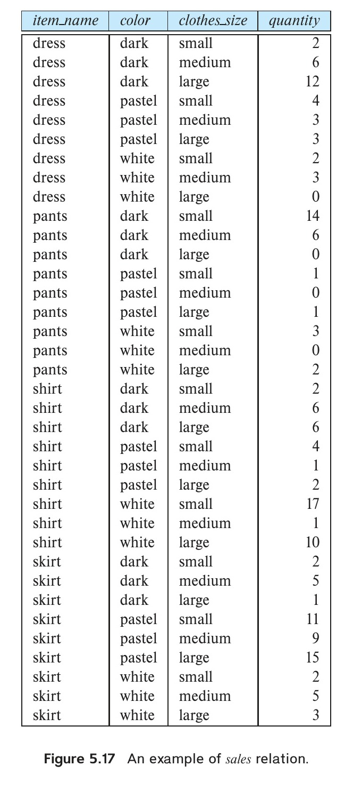
*Figure 5.17 — An example of sales relation.*

<!-- Page 226 -->

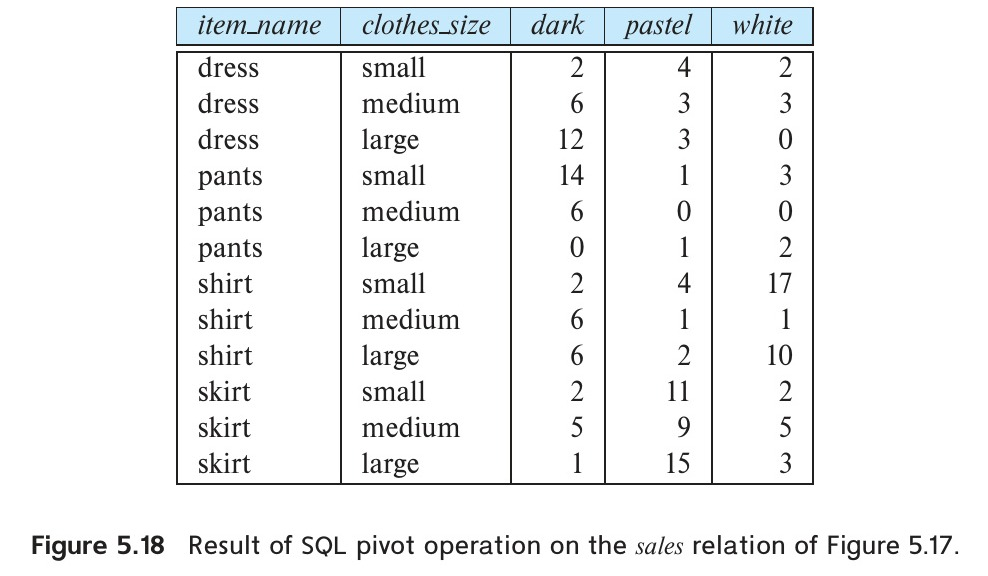
*Figure 5.18 — Result of SQL pivot operation on the sales relation of Figure 5.17.*

The use of the keyword **range** in place of **row** allows the windowing query to cover all tuples with a particular value rather than covering a specific number of tuples. Thus for example, **rows current row** refers to exactly one tuple, while **range current row** refers to all tuples whose value for the sort attribute is the same as that of the current tuple. The **range** keyword is not implemented fully in every system.[^15]

### 5.5.3 Pivoting

Consider an application where a shop wants to find out what kinds of clothes are popular. Let us suppose that clothes are characterized by their *item_name*, *color*, and *size*, and that we have a relation *sales* with the schema:

```text
sales (item_name, color, clothes_size, quantity)
```

Suppose that *item_name* can take on the values (skirt, dress, shirt, pants), *color* can take on the values (dark, pastel, white), *clothes_size* can take on values (small, medium, large), and *quantity* is an integer value representing the total number of items sold of a given (*item_name*, *color*, *clothes_size*) combination. An instance of the *sales* relation is shown in Figure 5.17.

Figure 5.18 shows an alternative way to view the data that is present in Figure 5.17; the values “dark”, “pastel”, and “white” of attribute *color* have become attribute names in Figure 5.18. The table in Figure 5.18 is an example of a **cross-tabulation** (or **cross-tab**, for short), also referred to as a **pivot-table**.

The values of the new attributes *dark*, *pastel* and *white* in our example are defined as follows. For a particular combination of *item_name*, *clothes_size* (e.g., (“dress”, “dark”))

[^15]: Some systems, such as PostgreSQL, allow range only with unbounded.

<!-- Page 227 -->

if there is a single tuple with color value “dark”, the quantity value of that attribute appears as the value for the attribute *dark*. If there are multiple such tuples, the values are aggregated using the **sum** aggregate in our example; in general other aggregate functions could be used instead. Values for the other two attributes, *pastel* and *white*, are similarly defined.

In general, a cross-tab is a table derived from a relation (say, $R$), where values for some attribute of relation $R$ (say, $A$) become attribute names in the result; the attribute $A$ is the pivot attribute. Cross-tabs are widely used for data analysis, and are discussed in more detail in Section 11.3.

Several SQL implementations, such as Microsoft SQL Server, and Oracle, support a **pivot** clause that allows creation of cross-tabs. Given the *sales* relation from Figure 5.17, the query:

```sql
select *
from sales
pivot (
    sum(quantity)
    for color in ('dark', 'pastel', 'white')
)
```

returns the result shown in Figure 5.18.

Note that the **for** clause within the **pivot** clause specifies (i) a pivot attribute (*color*, in the above query), (ii) the values of that attribute that should appear as attribute names in the pivot result (*dark*, *pastel* and *white*, in the above query), and (iii) the aggregate function that should be used to compute the value of the new attributes (aggregate function **sum**, on the attribute *quantity*, in the above query).

The attribute *color* and *quantity* do not appear in the result, but all other attributes are retained. In case more than one tuple contributes values to a given cell, the aggregate operation within the **pivot** clause specifies how the values should be combined. In the above example, the *quantity* values are aggregated using the **sum** function.

A query using **pivot** can be written using basic SQL constructs, without using the **pivot** construct, but the construct simplifies the task of writing such queries.

### 5.5.4 Rollup and Cube

SQL supports generalizations of the **group by** construct using the **rollup** and **cube** operations, which allow multiple **group by** queries to be run in a single query, with the result returned as a single relation.

Consider again our retail shop example and the relation:

```text
sales (item_name, color, clothes_size, quantity)
```

We can find the number of items sold in each item name by writing a simple **group by** query:

<!-- Page 228 -->

```sql
select item_name, sum(quantity) as quantity
from sales
group by item_name;
```

Similarly, we can find the number of items sold in each color, and each size. We can further find a breakdown of sales by item-name and color by writing:

```sql
select item_name, color, sum(quantity) as quantity
from sales
group by item_name, color;
```

Similarly, a query with `group by item_name, color, clothes_size` would allow us to see the sales breakdown by (*item_name*, *color*, *clothes_size*) combinations.

Data analysts often need to view data aggregated in multiple ways as illustrated above. The SQL **rollup** and **cube** constructs provide a concise way to get multiple such aggregates using a single query, instead of writing multiple queries.

The **rollup** construct is illustrated using the following query:

```sql
select item_name, color, sum(quantity)
from sales
group by rollup(item_name, color);
```

The result of the query is shown in Figure 5.19. The above query is equivalent to the following query using the **union** operation.

```sql
(select item_name, color, sum(quantity) as quantity
 from sales
 group by item_name, color)
union
(select item_name, null as color, sum(quantity) as quantity
 from sales
 group by item_name)
union
(select null as item_name, null as color, sum(quantity) as quantity
 from sales)
```

The construct `group by rollup(item_name, color)` generates 3 groupings:

```text
{ (item_name, color), (item_name), () }
```

where `()` denotes an empty group by list. Observe that a grouping is present for each prefix of the attributes listed in the **rollup** clause, including the empty prefix. The query result contains the union of the results by these groupings. The different groupings generate different schemas; to bring the results of the different groupings to a common

<!-- Page 229 -->

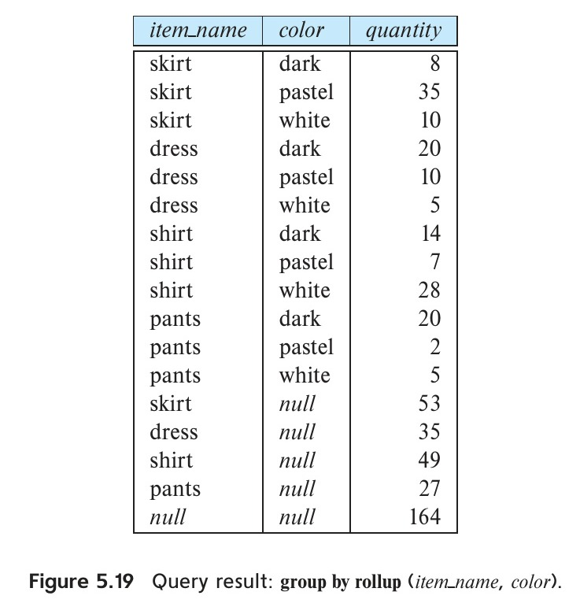
*Figure 5.19 — Query result: group by rollup (item_name, color).*

schema, tuples in the result contain null as the value of those attributes not present in a particular grouping.[^16]

The **cube** construct generates an even larger number of groupings, consisting of all subsets of the attributes listed in the **cube** construct. For example, the query:

```sql
select item_name, color, clothes_size, sum(quantity)
from sales
group by cube(item_name, color, clothes_size);
```

generates the following groupings:

```text
{ (item_name, color, clothes_size), (item_name, color), (item_name, clothes_size),
  (color, clothes_size), (item_name), (color), (clothes_size), () }
```

To bring the results of the different groupings to a common schema, as with rollup, tuples in the result contain null as the value of those attributes not present in a particular grouping.

[^16]: The SQL outer union operation can be used to perform a union of relations that may not have a common schema. The resultant schema has the union of all the attributes across the inputs; each input tuple is mapped to an output tuple by adding all the attributes missing in that tuple, with the value set to null. Our union query can be written using outer union, and in that case we do not need to explicitly generate null-value attributes using null as attribute-name constructs, as we have done in the above query.

<!-- Page 230 -->

Multiple rollups and cubes can be used in a single **group by** clause. For instance, the following query:

```sql
select item_name, color, clothes_size, sum(quantity)
from sales
group by rollup(item_name), rollup(color, clothes_size);
```

generates the groupings:

```text
{ (item_name, color, clothes_size), (item_name, color), (item_name),
  (color, clothes_size), (color), () }
```

To understand why, observe that `rollup(item_name)` generates a set of two groupings, `{(item_name), ()}`, while `rollup(color, clothes_size)` generates a set of three groupings, `{(color, clothes_size), (color), ()}`. The Cartesian product of the two sets gives us the six groupings shown.

Neither the rollup nor the cube clause gives complete control on the groupings that are generated. For instance, we cannot use them to specify that we want only groupings `{(color, clothes_size), (clothes_size, item_name)}`. Such restricted groupings can be generated by using the **grouping sets** construct, in which one can specify the specific list of groupings to be used. To obtain only groupings `{(color, clothes_size), (clothes_size, item_name)}`, we would write:

```sql
select item_name, color, clothes_size, sum(quantity)
from sales
group by grouping sets ((color, clothes_size), (clothes_size, item_name));
```

Analysts may want to distinguish those nulls generated by rollup and cube operations from “normal” nulls actually stored in the database or arising from an outer join. The `grouping()` function returns 1 if its argument is a null value generated by a rollup or cube and 0 otherwise (note that the grouping function is different from the grouping sets construct). If we wish to display the rollup query result shown in Figure 5.19, but using the value “all” in place of nulls generated by rollup, we can use the query:

```sql
select (case when grouping(item_name) = 1 then 'all'
             else item_name end) as item_name,
       (case when grouping(color) = 1 then 'all'
             else color end) as color,
       sum(quantity) as quantity
from sales
group by rollup(item_name, color);
```

One might consider using the following query using coalesce, but it would incorrectly convert null item names and colors to all:

<!-- Page 231 -->

```sql
select coalesce (item_name, 'all') as item_name,
       coalesce (color, 'all') as color,
       sum(quantity) as quantity
from sales
group by rollup(item_name, color);
```

## 5.6 Summary

- SQL queries can be invoked from host languages via embedded and dynamic SQL. The ODBC and JDBC standards define application program interfaces to access SQL databases from C and Java language programs.
- Functions and procedures can be defined using SQL procedural extensions that allow iteration and conditional (if-then-else) statements.
- Triggers define actions to be executed automatically when certain events occur and corresponding conditions are satisfied. Triggers have many uses, such as business rule implementation and audit logging. They may carry out actions outside the database system by means of external language routines.
- Some queries, such as transitive closure, can be expressed either by using iteration or by using recursive SQL queries. Recursion can be expressed using either recursive views or recursive **with** clause definitions.
- SQL supports several advanced aggregation features, including ranking and windowing queries, as well as pivot, and rollup/cube operations. These simplify the expression of some aggregates and allow more efficient evaluation.

## Review Terms

- JDBC
- Prepared statements
- SQL injection
- Metadata
- Updatable result sets
- Open Database Connectivity (ODBC)
- Embedded SQL
- Embedded database
- Stored procedures and functions
- Table functions.
- Parameterized views
- Persistent Storage Module (PSM).
- Exception conditions
- Handlers
- External language routines
- Sandbox
- Trigger
- Transitive closure
- Hierarchies

<!-- Page 232 -->

- Create temporary table
- Base query
- Recursive query
- Fixed point
- Monotonic
- Windowing
- Ranking functions
- Cross-tabulation
- Cross-tab
- Pivot-table
- Pivot
- SQL group by cube, group by rollup

## Practice Exercises

**5.1** Consider the following relations for a company database:

- `emp (ename, dname, salary)`
- `mgr (ename, mname)`

and the Java code in Figure 5.20, which uses the JDBC API. Assume that the userid, password, machine name, etc. are all okay. Describe in concise English what the Java program does. (That is, produce an English sentence like “It finds the manager of the toy department,” not a line-by-line description of what each Java statement does.)

**5.2** Write a Java method using JDBC metadata features that takes a `ResultSet` as an input parameter and prints out the result in tabular form, with appropriate names as column headings.

**5.3** Suppose that we wish to find all courses that must be taken before some given course. That means finding not only the prerequisites of that course, but prerequisites of prerequisites, and so on. Write a complete Java program using JDBC that:

- Takes a `course_id` value from the keyboard.
- Finds prerequisites of that course using an SQL query submitted via JDBC.
- For each course returned, finds its prerequisites and continues this process iteratively until no new prerequisite courses are found.
- Prints out the result.

For this exercise, do not use a recursive SQL query, but rather use the iterative approach described previously. A well-developed solution will be robust to the error case where a university has accidentally created a cycle of prerequisites (that is, for example, course A is a prerequisite for course B, course B is a prerequisite for course C, and course C is a prerequisite for course A).

<!-- Page 233 -->

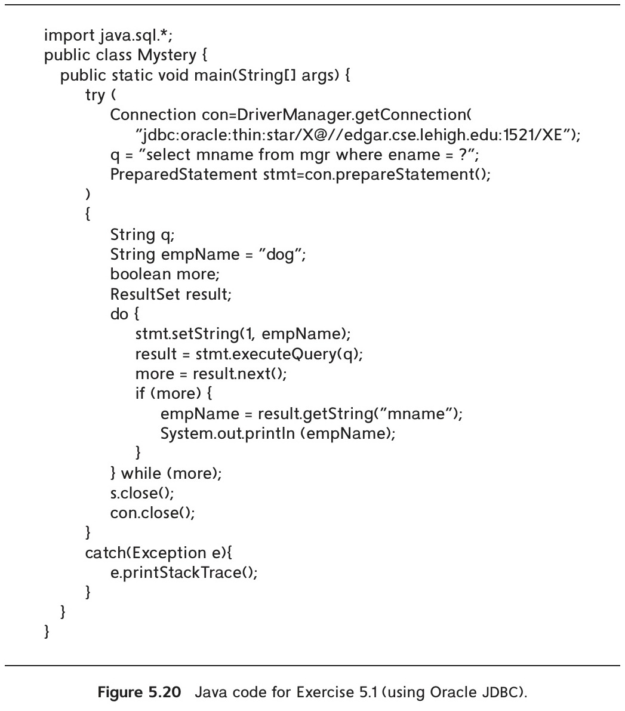
*Figure 5.20 — Java code for Exercise 5.1 (using Oracle JDBC).*

**5.4** Describe the circumstances in which you would choose to use embedded SQL rather than SQL alone or only a general-purpose programming language.

**5.5** Show how to enforce the constraint “an instructor cannot teach two different sections in a semester in the same time slot.” using a trigger (remember that the constraint can be violated by changes to the *teaches* relation as well as to the *section* relation).

<!-- Page 234 -->

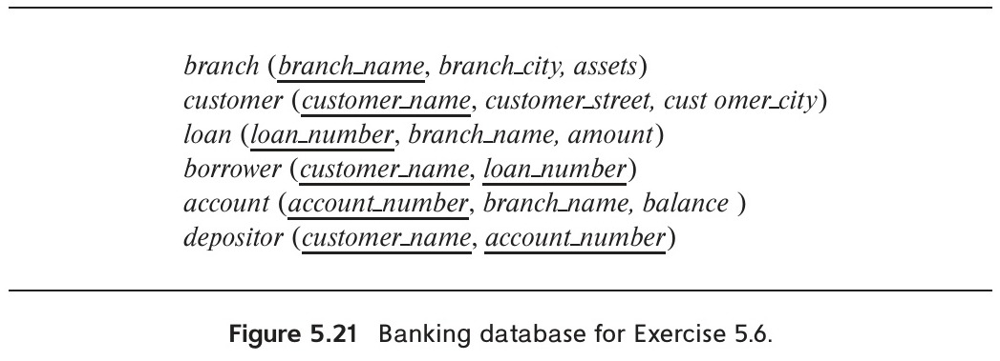
*Figure 5.21 — Banking database for Exercise 5.6.*

**5.6** Consider the bank database of Figure 5.21. Let us define a view `branch_cust` as follows:

```sql
create view branch_cust as
    select branch_name, customer_name
    from depositor, account
    where depositor.account_number = account.account_number
```

Suppose that the view is materialized; that is, the view is computed and stored. Write triggers to maintain the view, that is, to keep it up-to-date on insertions to *depositor* or *account*. It is not necessary to handle deletions or updates. Note that, for simplicity, we have not required the elimination of duplicates.

**5.7** Consider the bank database of Figure 5.21. Write an SQL trigger to carry out the following action: On delete of an account, for each customer-owner of the account, check if the owner has any remaining accounts, and if she does not, delete her from the *depositor* relation.

**5.8** Given a relation $S(\text{student}, \text{subject}, \text{marks})$, write a query to find the top 10 students by total marks, by using SQL ranking. Include all students tied for the final spot in the ranking, even if that results in more than 10 total students.

**5.9** Given a relation `nyse(year, month, day, shares_traded, dollar_volume)` with trading data from the New York Stock Exchange, list each trading day in order of number of shares traded, and show each day’s rank.

**5.10** Using the relation from Exercise 5.9, write an SQL query to generate a report showing the number of shares traded, number of trades, and total dollar volume broken down by year, each month of each year, and each trading day.

**5.11** Show how to express `group by cube(a, b, c, d)` using `rollup`; your answer should have only one **group by** clause.

<!-- Page 235 -->

## Exercises

**5.12** Write a Java program that allows university administrators to print the teaching record of an instructor.

a. Start by having the user input the login ID and password; then open the proper connection.
b. The user is asked next for a search substring and the system returns (ID, name) pairs of instructors whose names match the substring. Use the `like ('%substring%')` construct in SQL to do this. If the search comes back empty, allow continued searches until there is a nonempty result.
c. Then the user is asked to enter an ID number, which is a number between 0 and 99999. Once a valid number is entered, check if an instructor with that ID exists. If there is no instructor with the given ID, print a reasonable message and quit.
d. If the instructor has taught no courses, print a message saying that. Otherwise print the teaching record for the instructor, showing the department name, course identifier, course title, section number, semester, year, and total enrollment (and sort those by `dept_name`, `course_id`, `year`, `semester`).

Test carefully for bad input. Make sure your SQL queries won’t throw an exception. At login, exceptions may occur since the user might type a bad password, but catch those exceptions and allow the user to try again.

**5.13** Suppose you were asked to define a class `MetaDisplay` in Java, containing a method `static void printTable(String r)`; the method takes a relation name $r$ as input, executes the query “select * from r”, and prints the result out in tabular format, with the attribute names displayed in the header of the table.

a. What do you need to know about relation $r$ to be able to print the result in the specified tabular format?
b. What JDBC methods(s) can get you the required information?
c. Write the method `printTable(String r)` using the JDBC API.

**5.14** Repeat Exercise 5.13 using ODBC, defining `void printTable(char *r)` as a function instead of a method.

**5.15** Consider an employee database with two relations

```text
employee (employee_name, street, city)
works (employee_name, company_name, salary)
```

<!-- Page 236 -->

where the primary keys are underlined. Write a function `avg_salary` that takes a company name as an argument and finds the average salary of employees at that company. Then, write an SQL statement, using that function, to find companies whose employees earn a higher salary, on average, than the average salary at “First Bank”.

**5.16** Consider the relational schema

```text
part(part_id, name, cost)
subpart(part_id, subpart_id, count)
```

where the primary-key attributes are underlined. A tuple $(p_1, p_2, 3)$ in the *subpart* relation denotes that the part with *part_id* $p_2$ is a direct subpart of the part with *part_id* $p_1$, and $p_1$ has 3 copies of $p_2$. Note that $p_2$ may itself have further subparts. Write a recursive SQL query that outputs the names of all subparts of the part with part-id 'P-100'.

**5.17** Consider the relational schema from Exercise 5.16. Write a JDBC function using nonrecursive SQL to find the total cost of part “P-100”, including the costs of all its subparts. Be sure to take into account the fact that a part may have multiple occurrences of a subpart. You may use recursion in Java if you wish.

**5.18** Redo Exercise 5.12 using the language of your database system for coding stored procedures and functions. Note that you are likely to have to consult the online documentation for your system as a reference, since most systems use syntax differing from the SQL standard version followed in the text. Specifically, write a prodedure that takes an instructor ID as an argument and produces printed output in the format specified in Exercise 5.12, or an appropriate message if the instructor does not exist or has taught no courses. (For a simpler version of this exercise, rather than providing printed output, assume a relation with the appropriate schema and insert your answer there without worrying about testing for erroneous argument values.)

**5.19** Suppose there are two relations $r$ and $s$, such that the foreign key $B$ of $r$ references the primary key $A$ of $s$. Describe how the trigger mechanism can be used to implement the **on delete cascade** option when a tuple is deleted from $s$.

**5.20** The execution of a trigger can cause another action to be triggered. Most database systems place a limit on how deep the nesting can be. Explain why they might place such a limit.

**5.21** Modify the recursive query in Figure 5.16 to define a relation

```text
prereq_depth(course_id, prereq_id, depth)
```

<!-- Page 237 -->

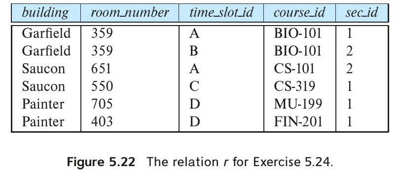
*Figure 5.22 — The relation r for Exercise 5.24.*

where the attribute depth indicates how many levels of intermediate prerequisites there are between the course and the prerequisite. Direct prerequisites have a depth of 0. Note that a prerequisite course may have multiple depths and thus may appear more than once.

**5.22** Given relation $s(a, b, c)$, write an SQL statement to generate a histogram showing the sum of $c$ values versus $a$, dividing $a$ into 20 equal-sized partitions (i.e., where each partition contains 5 percent of the tuples in $s$, sorted by $a$).

**5.23** Consider the *nyse* relation of Exercise 5.9. For each month of each year, show the total monthly dollar volume and the average monthly dollar volume for that month and the two prior months. (*Hint*: First write a query to find the total dollar volume for each month of each year. Once that is right, put that in the **from** clause of the outer query that solves the full problem. That outer query will need windowing. The subquery does not.)

**5.24** Consider the relation, $r$, shown in Figure 5.22. Give the result of the following query:

```sql
select building, room_number, time_slot_id, count(*)
from r
group by rollup (building, room_number, time_slot_id)
```

## Tools

We provide sample JDBC code on our book web site `db-book.com`.

Most database vendors, including IBM, Microsoft, and Oracle, provide OLAP tools as part of their database systems, or as add-on applications. Tools may be integrated with a larger “business intelligence” product such as IBM Cognos. Many companies also provide analysis tools for specific applications, such as customer relationship management (e.g., Oracle Siebel CRM).

<!-- Page 238 -->

## Further Reading

More details about JDBC may be found at `docs.oracle.com/javase/tutorial/jdbc`.

In order to write stored procedures, stored functions, and triggers that can be executed on a given system, you need to refer to the system documentation.

Although our discussion of recursive queries focused on SQL syntax, there are other approaches to recursion in relational databases. Datalog is a database language based on the Prolog programming language and is described in more detail in Section 27.4 (available online).

OLAP features in SQL, including rollup, and cubes were introduced in SQL:1999, and window functions with ranking and partitioning were added in SQL:2003. OLAP features, including window functions, are supported by most databases today. Although most follow the SQL standard syntax that we have presented, there are some differences; refer to the system manuals of the system that you are using for further details. Microsoft’s Multidimensional Expressions (MDX) is an SQL-like query language designed for querying OLAP cubes.

## Credits

The photo of the sailboats in the beginning of the chapter is due to ©Pavel Nesvadba/Shutterstock.
