<!-- Page 239 -->

# Part 2: Database Design

The task of creating a database application is a complex one, involving design of the database schema, design of the programs that access and update the data, and design of a security scheme to control access to data. The needs of the users play a central role in the design process. In this part, we focus primarily on the design of the database schema. We also outline some of the other design tasks.

The entity-relationship (E-R) model described in Chapter 6 is a high-level data model. Instead of representing all data in tables, it distinguishes between basic objects, called *entities*, and *relationships* among these objects. It is often used as a first step in database-schema design.

Relational database design—the design of the relational schema— was covered informally in earlier chapters. There are, however, principles that can be used to distinguish good database designs from bad ones. These are formalized by means of several “normal forms” that offer different trade-offs between the possibility of inconsistencies and the efficiency of certain queries. Chapter 7 describes the formal design of relational schemas.

<!-- Page 240 -->

<!-- Page 241 -->

# Chapter 6: Database Design Using the E-R Model

Up to this point in the text, we have assumed a given database schema and studied how queries and updates are expressed. We now consider how to design a database schema in the first place. In this chapter, we focus on the entity-relationship data model (E-R), which provides a means of identifying entities to be represented in the database and how those entities are related. Ultimately, the database design will be expressed in terms of a relational database design and an associated set of constraints. We show in this chapter how an E-R design can be transformed into a set of relation schemas and how some of the constraints can be captured in that design. Then, in Chapter 7, we consider in detail whether a set of relation schemas is a good or bad database design and study the process of creating good designs using a broader set of constraints. These two chapters cover the fundamental concepts of database design.

## 6.1 Overview of the Design Process

The task of creating a database application is a complex one, involving design of the database schema, design of the programs that access and update the data, and design of a security scheme to control access to data. The needs of the users play a central role in the design process. In this chapter, we focus on the design of the database schema, although we briefly outline some of the other design tasks later in the chapter.

### 6.1.1 Design Phases

For small applications, it may be feasible for a database designer who understands the application requirements to decide directly on the relations to be created, their attributes, and constraints on the relations. However, such a direct design process is difficult for real-world applications, since they are often highly complex. Often no one person understands the complete data needs of an application. The database designer must interact with users of the application to understand the needs of the application, represent them in a high-level fashion that can be understood by the users, and

<!-- Page 242 -->

then translate the requirements into lower levels of the design. A high-level data model serves the database designer by providing a conceptual framework in which to specify, in a systematic fashion, the data requirements of the database users, and a database structure that fulfills these requirements.

- The initial phase of database design is to characterize fully the data needs of the
prospective database users. The database designer needs to interact extensively with domain experts and users to carry out this task. The outcome of this phase is a specification of user requirements. While there are techniques for diagrammatically representing user requirements, in this chapter we restrict ourselves to textual descriptions of user requirements.
- Next, the designer chooses a data model and, by applying the concepts of the chosen data model, translates these requirements into a conceptual schema of the
database. The schema developed at this **conceptual-design** phase provides a detailed overview of the enterprise. The entity-relationship model, which we study in the rest of this chapter, is typically used to represent the conceptual design. Stated in terms of the entity-relationship model, the conceptual schema specifies the entities that are represented in the database, the attributes of the entities, the relationships among the entities, and constraints on the entities and relationships. Typically, the conceptual-design phase results in the creation of an entity-relationship diagram that provides a graphic representation of the schema.

The designer reviews the schema to confirm that all data requirements are indeed satisfied and are not in conflict with one another. She can also examine the design to remove any redundant features. Her focus at this point is on describing the data and their relationships, rather than on specifying physical storage details.
- A fully developed conceptual schema also indicates the functional requirements
of the enterprise. In a **specification of functional requirements**, users describe the kinds of operations (or transactions) that will be performed on the data. Example operations include modifying or updating data, searching for and retrieving specific data, and deleting data. At this stage of conceptual design, the designer can review the schema to ensure that it meets functional requirements.
- The process of moving from an abstract data model to the implementation of the
database proceeds in two final design phases.

- In the **logical-design phase**, the designer maps the high-level conceptual schema

onto the implementation data model of the database system that will be used. The implementation data model is typically the relational data model, and this step typically consists of mapping the conceptual schema defined using the entity-relationship model into a relation schema.

- Finally, the designer uses the resulting system-specific database schema in the

subsequent **physical-design phase**, in which the physical features of the database

<!-- Page 243 -->

are specified. These features include the form of file organization and choice of index structures, discussed in Chapter 13 and Chapter 14.

The physical schema of a database can be changed relatively easily after an application has been built. However, changes to the logical schema are usually harder to carry out, since they may affect a number of queries and updates scattered across application code. It is therefore important to carry out the database design phase with care, before building the rest of the database application.

### 6.1.2 Design Alternatives

A major part of the database design process is deciding how to represent in the design the various types of “things” such as people, places, products, and the like. We use the term *entity* to refer to any such distinctly identifiable item. In a university database, examples of entities would include instructors, students, departments, courses, and course offerings. We assume that a course may have run in multiple semesters, as well as multiple times in a semester; we refer to each such offering of a course as a section. The various entities are related to each other in a variety of ways, all of which need to be captured in the database design. For example, a student takes a course offering, while an instructor teaches a course offering; teaches and takes are examples of relationships between entities.

In designing a database schema, we must ensure that we avoid two major pitfalls:

**1.** **Redundancy:** A bad design may repeat information. For example, if we store the

course identifier and title of a course with each course offering, the title would be stored redundantly (i.e., multiple times, unnecessarily) with each course offering. It would suffice to store only the course identifier with each course offering, and to associate the title with the course identifier only once, in a course entity.

Redundancy can also occur in a relational schema. In the university example we have used so far, we have a relation with section information and a separate relation with course information. Suppose that instead we have a single relation where we repeat all of the course information (course

id, title, dept

name, credits) once for each section (offering) of the course. Information about courses would then be stored redundantly.

The biggest problem with such redundant representation of information is that the copies of a piece of information can become inconsistent if the information is updated without taking precautions to update all copies of the information. For example, different offerings of a course may have the same course identifier, but may have different titles. It would then become unclear what the correct title of the course is. Ideally, information should appear in exactly one place.

**2.** **Incompleteness:** A bad design may make certain aspects of the enterprise diffi-

cult or impossible to model. For example, suppose that, as in case (1) above, we only had entities corresponding to course offering, without having an entity

<!-- Page 244 -->

corresponding to courses. Equivalently, in terms of relations, suppose we have a single relation where we repeat all of the course information once for each section that the course is offered. It would then be impossible to represent information about a new course, unless that course is offered. We might try to make do with the problematic design by storing null values for the section information. Such a work-around is not only unattractive but may be prevented by primary-key constraints.

Avoiding bad designs is not enough. There may be a large number of good designs from which we must choose. As a simple example, consider a customer who buys a product. Is the sale of this product a relationship between the customer and the product? Alternatively, is the sale itself an entity that is related both to the customer and to the product? This choice, though simple, may make an important difference in what aspects of the enterprise can be modeled well. Considering the need to make choices such as this for the large number of entities and relationships in a real-world enterprise, it is not hard to see that database design can be a challenging problem. Indeed we shall see that it requires a combination of both science and “good taste.”

## 6.2 The Entity-Relationship Model

The **entity-relationship** (**E-R**) **data model** was developed to facilitate database design by allowing specification of an *enterprise schema* that represents the overall logical structure of a database.

The E-R model is very useful in mapping the meanings and interactions of real-world enterprises onto a conceptual schema. Because of this usefulness, many database-design tools draw on concepts from the E-R model. The E-R data model employs three basic concepts: entity sets, relationship sets, and attributes. The E-R model also has an associated diagrammatic representation, the E-R diagram. As we saw briefly in Section 1.3.1, an **E-R** **diagram** can express the overall logical structure of a database graphically. E-R diagrams are simple and clear—qualities that may well account in large part for the widespread use of the E-R model.

The Tools section at the end of the chapter provides information about several diagram editors that you can use to create E-R diagrams.

### 6.2.1 Entity Sets

An **entity** is a “thing” or “object” in the real world that is distinguishable from all other objects. For example, each person in a university is an entity. An entity has a set of properties, and the values for some set of properties must uniquely identify an entity. For instance, a person may have a *person_id* property whose value uniquely identifies that person. Thus, the value 677-89-9011 for *person_id* would uniquely identify one particular person in the university. Similarly, courses can be thought of as entities, and *course_id* uniquely identifies a course entity in the university. An entity may be concrete, such

<!-- Page 245 -->

as a person or a book, or it may be abstract, such as a course, a course offering, or a flight reservation.

An **entity** **set** is a set of entities of the same type that share the same properties, or attributes. The set of all people who are instructors at a given university, for example, can be defined as the entity set *instructor*. Similarly, the entity set *student* might represent the set of all students in the university.

In the process of modeling, we often use the term *entity set* in the abstract, without referring to a particular set of individual entities. We use the term **extension** of the entity set to refer to the actual collection of entities belonging to the entity set. Thus, the set of actual instructors in the university forms the extension of the entity set *instructor*. This distinction is similar to the difference between a relation and a relation instance, which we saw in Chapter 2.

Entity sets do not need to be disjoint. For example, it is possible to define the entity set *person* consisting of all people in a university. A *person* entity may be an *instructor* entity, a *student* entity, both, or neither.

An entity is represented by a set of **attributes**. Attributes are descriptive properties possessed by each member of an entity set. The designation of an attribute for an entity set expresses that the database stores similar information concerning each entity in the entity set; however, each entity may have its own value for each attribute. Possible attributes of the *instructor* entity set are *ID*, *name*, *dept_name*, and *salary*. In real life, there would be further attributes, such as street number, apartment number, state, postal code, and country, but we generally omit them to keep our examples simple. Possible attributes of the *course* entity set are *course_id*, *title*, *dept_name*, and *credits*. In this section we consider only attributes that are **simple**— those not divided into subparts. In Section 6.3, we discuss more complex situations where attributes can be composite and multivalued.

Each entity has a **value** for each of its attributes. For instance, a particular *instructor* entity may have the value 12121 for *ID*, the value Wu for *name*, the value Finance for *dept_name*, and the value 90000 for *salary*. The *ID* attribute is used to identify instructors uniquely, since there may be more than one instructor with the same name. Historically, many enterprises found it convenient to use a government-issued identification number as an attribute whose value uniquely identifies the person. However, that is considered bad practice for reasons of security and privacy. In general, the enterprise would have to create and assign its own unique identifier for each instructor.

A database thus includes a collection of entity sets, each of which contains any number of entities of the same type. A database for a university may include a number of other entity sets. For example, in addition to keeping track of instructors and students, the university also has information about courses, which are represented by the entity set *course* with attributes *course_id*, *title*, *dept_name* and *credits*. In a real setting, a university database may keep dozens of entity sets.

An entity set is represented in an E-R diagram by a **rectangle**, which is divided into two parts. The first part, which in this text is shaded blue, contains the name of

<!-- Page 246 -->

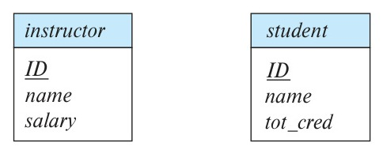
*Figure 6.1 — E-R diagram showing entity sets instructor and student.*

the entity set. The second part contains the names of all the attributes of the entity set. The E-R diagram in Figure 6.1 shows two entity sets *instructor* and *student*. The attributes associated with *instructor* are *ID*, *name*, and *salary*. The attributes associated with *student* are *ID*, *name*, and *tot_cred*. Attributes that are part of the primary key are underlined (see Section 6.5).

### 6.2.2 Relationship Sets

A **relationship** is an association among several entities. For example, we can define a relationship *advisor* that associates instructor Katz with student Shankar. This relationship specifies that Katz is an advisor to student Shankar. A **relationship set** is a set of relationships of the same type.

Consider two entity sets *instructor* and *student*. We define the relationship set *advisor* to denote the associations between students and the instructors who act as their advisors. Figure 6.2 depicts this association. To keep the figure simple, only some of the attributes of the two entity sets are shown.

A **relationship** **instance** in an E-R schema represents an association between the named entities in the real-world enterprise that is being modeled. As an illustration, the individual *instructor* entity Katz, who has instructor *ID* 45565, and the *student* entity Shankar, who has student *ID* 12345, participate in a relationship instance of *advi-*

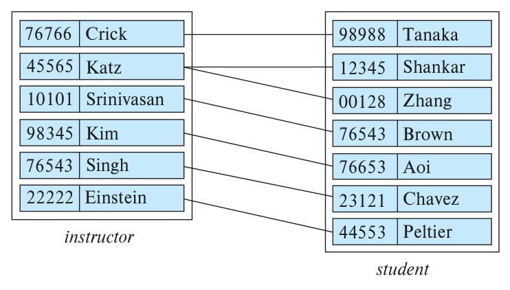
*Figure 6.2 — Relationship set advisor (only some attributes of instructor and student are shown).*

<!-- Page 247 -->

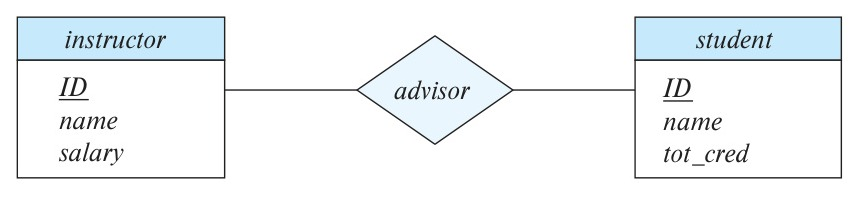
*Figure 6.3 — E-R diagram showing relationship set advisor.*

*sor*. This relationship instance represents that in the university, the instructor Katz is advising student Shankar.

A relationship set is represented in an E-R diagram by a **diamond**, which is linked via **lines** to a number of different entity sets (rectangles). The E-R diagram in Figure 6.3 shows the two entity sets *instructor* and *student*, related through a binary relationship set *advisor*.

As another example, consider the two entity sets *student* and *section*, where *section* denotes an offering of a course. We can define the relationship set *takes* to denote the association between a student and a section in which that student is enrolled.

Although in the preceding examples each relationship set was an association between two entity sets, in general a relationship set may denote the association of more than two entity sets.

Formally, a **relationship set** is a mathematical relation on *n* ≥2 (possibly nondistinct) entity sets. If $E_{1}$, $E_{2}$, … , $E_{n}$ are entity sets, then a relationship set *R* is a subset of

$$\{(e_1, e_2, \dots, e_n) \mid e_1 \in E_1, e_2 \in E_2, \dots, e_n \in E_n\}$$

where ($e_{1}$, $e_{2}$, … , $e_{n}$) is a relationship instance.

The association between entity sets is referred to as participation; i.e., the entity sets $E_{1}$, $E_{2}$, … , $E_{n}$ **participate** in relationship set *R*.

The function that an entity plays in a relationship is called that entity’s **role**. Since entity sets participating in a relationship set are generally distinct, roles are implicit and are not usually specified. However, they are useful when the meaning of a relationship needs clarification. Such is the case when the entity sets of a relationship set are not distinct; that is, the same entity set participates in a relationship set more than once, in different roles. In this type of relationship set, sometimes called a **recursive** relationship set, explicit role names are necessary to specify how an entity participates in a relationship instance. For example, consider the entity set *course* that records information about all the courses offered in the university. To depict the situation where one course (C2) is a prerequisite for another course (C1) we have relationship set *prereq* that is modeled by ordered pairs of *course* entities. The first course of a pair takes the role of course C1, whereas the second takes the role of prerequisite course C2. In this way, all relationships of *prereq* are characterized by (C1, C2) pairs; (C2, C1) pairs are excluded. We indicate roles in E-R diagrams by labeling the lines that connect diamonds

<!-- Page 248 -->

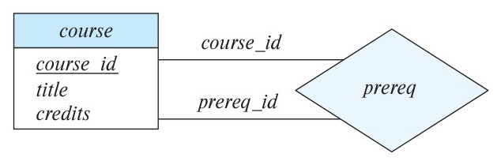
*Figure 6.4 — E-R diagram with role indicators.*

to rectangles. Figure 6.4 shows the role indicators *course_id* and *prereq_id* between the *course* entity set and the *prereq* relationship set. A relationship may also have attributes called **descriptive attributes**. As an example of descriptive attributes for relationships, consider the relationship set *takes* which relates entity sets *student* and *section*. We may wish to store a descriptive attribute *grade* with the relationship to record the grade that a student received in a course offering. An attribute of a relationship set is represented in an E-R diagram by an **undivided** **rectangle**. We link the rectangle with a dashed line to the diamond representing that relationship set. For example, Figure 6.5 shows the relationship set *takes* between the entity sets *section* and *student*. We have the descriptive attribute *grade* attached to the relationship set *takes*. A relationship set may have multiple descriptive attributes; for example, we may also store a descriptive attribute *for_credit* with the *takes* relationship set to record whether a student has taken the section for credit, or is auditing (or sitting in on) the course. Observe that the attributes of the two entity sets have been omitted from the E-R diagram in Figure 6.5, with the understanding that they are specified elsewhere in the complete E-R diagram for the university; we have already seen the attributes for *student*, and we will see the attributes of *section* later in this chapter. Complex E-R designs may need to be split into multiple diagrams that may be located in different pages. Relationship sets should be shown in only one location, but entity sets may be repeated in more than one location. The attributes of an entity set should be shown in the first occurrence. Subsequent occurrences of the entity set should be shown without attributes, to avoid repetition of information and the resultant possibility of inconsistency in the attributes shown in different occurrences.

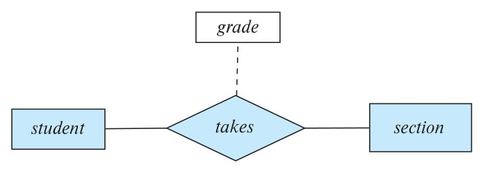
*Figure 6.5 — E-R diagram with an attribute attached to a relationship set.*

<!-- Page 249 -->

It is possible to have more than one relationship set involving the same entity sets. For example, suppose that students may be teaching assistants for a course. Then, the entity sets *section* and *student* may participate in a relationship set *teaching_assistant*, in addition to participating in the *takes* relationship set.

The formal definition of a relationship set, which we saw earlier, defines a relationship set as a set of relationship instances. Consider the *takes* relationship between *student* and *section*. Since a set cannot have duplicates, it follows that a particular student can have only one association with a particular section in the *takes* relationship. Thus, a student can have only one grade associated with a section, which makes sense in this case. However, if we wish to allow a student to have more than one grade for the same section, we need to have an attribute *grades* which stores a set of grades; such attributes are called multivalued attributes, and we shall see them later in Section 6.3.

The relationship sets *advisor* and *takes* provide examples of a **binary** **relationship** **set**—that is, one that involves two entity sets. Most of the relationship sets in a database system are binary. Occasionally, however, relationship sets involve more than two entity sets. The number of entity sets that participate in a relationship set is the **degree of the** **relationship set**. A binary relationship set is of degree 2; a **ternary relationship set** is of degree 3.

As an example, suppose that we have an entity set *project* that represents all the research projects carried out in the university. Consider the entity sets *instructor*, *student*, and *project*. Each project can have multiple associated students and multiple associated instructors. Furthermore, each student working on a project must have an associated instructor who guides the student on the project. For now, we ignore the first two relationships, between project and instructor, and between project and student. Instead, we focus on the information about which instructor is guiding which student on a particular project.

To represent this information, we relate the three entity sets through a ternary relationship set *proj_guide*, which relates entity sets *instructor*, *student*, and *project*. An instance of *proj_guide* indicates that a particular student is guided by a particular instructor on a particular project. Note that a student could have different instructors as guides for different projects, which cannot be captured by a binary relationship between students and instructors.

Nonbinary relationship sets can be specified easily in an E-R diagram. Figure 6.6 shows the E-R diagram representation of the ternary relationship set *proj_guide*.

## 6.3 Complex Attributes

For each attribute, there is a set of permitted values, called the **domain**, or **value set**, of that attribute. The domain of attribute *course_id* might be the set of all text strings of a certain length. Similarly, the domain of attribute *semester* might be strings from the set {Fall, Winter, Spring, Summer}.

<!-- Page 250 -->

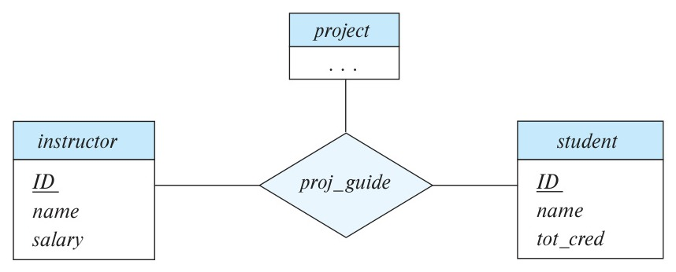
*Figure 6.6 — E-R diagram with a ternary relationship proj_guide.*

*guide*.

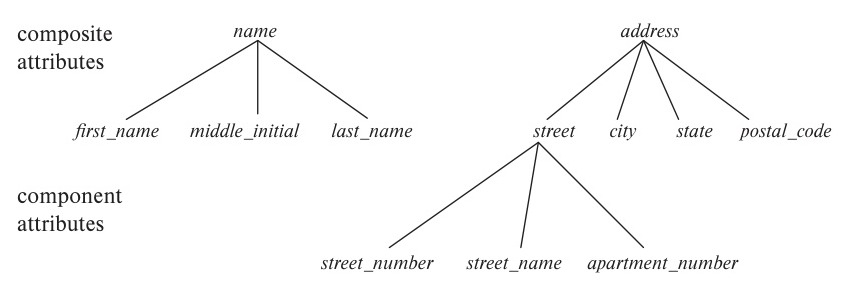
*Figure 6.7 — Composite attributes instructor_name and address.*

An attribute, as used in the E-R model, can be characterized by the following attribute types.

- **Simple** and **composite** attributes. In our examples thus far, the attributes have been
**simple**; that is, they have not been divided into subparts. **Composite** attributes, on the other hand, can be divided into subparts (i.e., other attributes). For example, an attribute *name* could be structured as a composite attribute consisting of *first_name*, *middle_initial*, and *last_name*. Using composite attributes in a design schema is a good choice if a user will wish to refer to an entire attribute on some occasions, and to only a component of the attribute on other occasions. Suppose we were to add an address to the *student* entity-set. The address can be defined as the composite attribute *address* with the attributes *street*, *city*, *state*, and *postal_code*.[^1] Composite attributes help us to group together related attributes, making the modeling cleaner.

Note also that a composite attribute may appear as a hierarchy. In the composite attribute *address*, its component attribute *street* can be further divided into *street_number*, *street_name*, and *apartment_number*. Figure 6.7 depicts these examples of composite attributes for the *instructor* entity set.

[^1]: We assume the address format used in the United States, which includes a numeric postal code called a zip code.

<!-- Page 251 -->

- **Single-valued** and **multivalued** attributes. The attributes in our examples all have
a single value for a particular entity. For instance, the *student_ID* attribute for a specific student entity refers to only one student *ID*. Such attributes are said to be **single** **valued**. There may be instances where an attribute has a set of values for a specific entity. Suppose we add to the *instructor* entity set a *phone_number* attribute. An *instructor* may have zero, one, or several phone numbers, and different instructors may have different numbers of phones. This type of attribute is said to be **multivalued**. As another example, we could add to the *instructor* entity set an attribute *dependent_name* listing all the dependents. This attribute would be multi-valued, since any particular instructor may have zero, one, or more dependents.
- **Derived attributes**. The value for this type of attribute can be derived from the values of other related attributes or entities. For instance, let us say that the *instructor*
entity set has an attribute *students_advised*, which represents how many students an instructor advises. We can derive the value for this attribute by counting the number of *student* entities associated with that instructor.

As another example, suppose that the *instructor* entity set has an attribute *age* that indicates the instructor’s age. If the *instructor* entity set also has an attribute *date_of_birth*, we can calculate *age* from *date_of_birth* and the current date. Thus, *age* is a derived attribute. In this case, *date_of_birth* may be referred to as a *base* attribute, or a *stored* attribute. The value of a derived attribute is not stored but is computed when required.

*name*, *middle_initial*, and *last_name* replaces the simple attribute *name* of *instructor*. As another example, suppose we were to add an address to the *instructor* entity set. The address can be defined as the composite attribute *address* with the attributes *street*, *city*, *state*, and *postal_code*. The attribute *street* is itself a composite attribute whose component attributes are *street_number*, *street_name*, and *apartment_number*. The figure also illustrates a multivalued attribute *phone_number*, denoted by “{*phone_number*}”, and a derived attribute *age*, depicted by “*age* ( )”.

An attribute takes a **null** value when an entity does not have a value for it. The *null* value may indicate “not applicable”—that is, the value does not exist for the entity. For example, a person who has no middle name may have the *middle_initial* attribute set to *null*. *Null* can also designate that an attribute value is unknown. An unknown value may be either *missing* (the value does exist, but we do not have that information) or *not known* (we do not know whether or not the value actually exists).

For instance, if the *name* value for a particular instructor is *null*, we assume that the value is missing, since every instructor must have a name. A null value for the *apartment_number* attribute could mean that the address does not include an apartment number (not applicable), that an apartment number exists but we do not know what

<!-- Page 252 -->

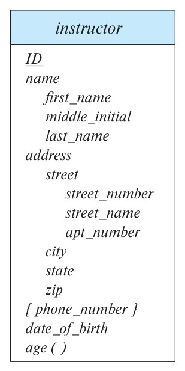
*Figure 6.8 — E-R diagram with composite, multivalued, and derived attributes.*

it is (missing), or that we do not know whether or not an apartment number is part of the instructor’s address (unknown).

## 6.4 Mapping Cardinalities

**Mapping** **cardinalities**, or cardinality ratios, express the number of entities to which another entity can be associated via a relationship set. Mapping cardinalities are most useful in describing binary relationship sets, although they can contribute to the description of relationship sets that involve more than two entity sets.

For a binary relationship set *R* between entity sets *A* and *B*, the mapping cardinality must be one of the following:

- **One-to-one**. An entity in *A* is associated with *at most* one entity in *B*, and an entity
in *B* is associated with *at most* one entity in *A*. (See Figure 6.9a.)
- **One-to-many**. An entity in *A* is associated with any number (zero or more) of entities in *B*. An entity in *B*, however, can be associated with *at most* one entity in *A*.
(See Figure 6.9b.)
- **Many-to-one**. An entity in *A* is associated with *at most* one entity in *B*. An entity
in *B*, however, can be associated with any number (zero or more) of entities in *A*. (See Figure 6.10a.)

<!-- Page 253 -->

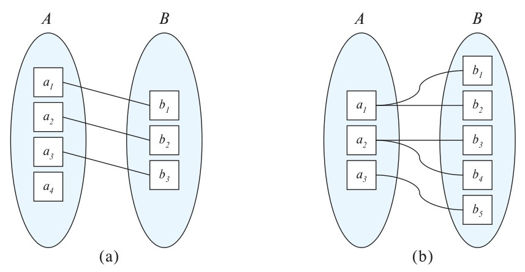
*Figure 6.9 — Mapping cardinalities. (a) One-to-one. (b) One-to-many.*

- **Many-to-many**. An entity in *A* is associated with any number (zero or more) of
entities in *B*, and an entity in *B* is associated with any number (zero or more) of entities in *A*. (See Figure 6.10b.)

The appropriate mapping cardinality for a particular relationship set obviously depends on the real-world situation that the relationship set is modeling. As an illustration, consider the *advisor* relationship set. If a student can be advised by several instructors (as in the case of students advised jointly), the relationship set is many-to-many. In contrast, if a particular university imposes a constraint that a student can be advised by only one instructor, and an instructor can advise several students, then the relationship set from *instructor* to *student* must be one-to-many. Thus, mapping

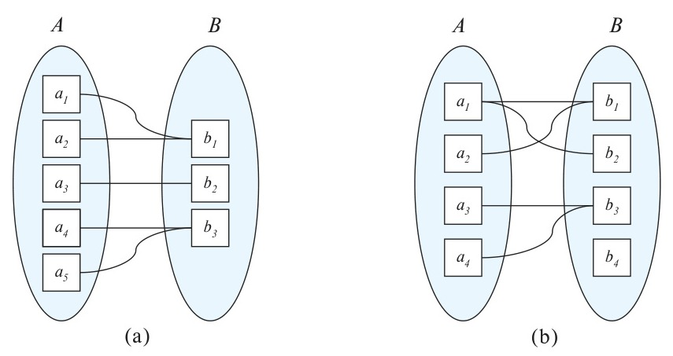
*Figure 6.10 — Mapping cardinalities. (a) Many-to-one. (b) Many-to-many.*

<!-- Page 254 -->

cardinalities can be used to specify constraints on what relationships are permitted in the real world.

In the E-R diagram notation, we indicate cardinality constraints on a relationship by drawing either a directed line ($\rightarrow$) or an undirected line (—) between the relationship set and the entity set in question. Specifically, for the university example:

- **One-to-one**. We draw a directed line from the relationship set to both entity sets.
For example, in Figure 6.11a, the directed lines to *instructor* and *student* indicate that an instructor may advise at most one student, and a student may have at most one advisor.

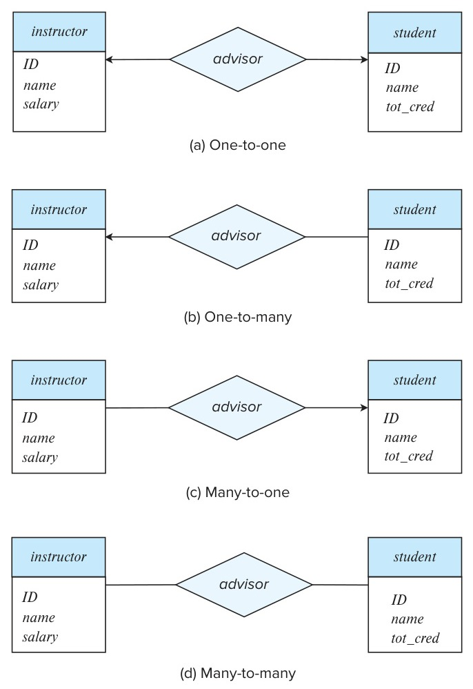
*Figure 6.11 — Relationship cardinalities.*

<!-- Page 255 -->

- **One-to-many**. We draw a directed line from the relationship set to the “one” side of
the relationship. Thus, in Figure 6.11b, there is a directed line from relationship set *advisor* to the entity set *instructor*, and an undirected line to the entity set *student*. This indicates that an instructor may advise many students, but a student may have at most one advisor.
- **Many-to-one**. We draw a directed line from the relationship set to the “one” side
of the relationship. Thus, in Figure 6.11c, there is an undirected line from the relationship set *advisor* to the entity set *instructor* and a directed line to the entity set *student*. This indicates that an instructor may advise at most one student, but a student may have many advisors.
- **Many-to-many**. We draw an undirected line from the relationship set to both entity
sets. Thus, in Figure 6.11d, there are undirected lines from the relationship set *advisor* to both entity sets *instructor* and *student*. This indicates that an instructor may advise many students, and a student may have many advisors.

The participation of an entity set *E* in a relationship set *R* is said to be **total** if every entity in *E* must participate in at least one relationship in *R*. If it is possible that some entities in *E* do not participate in relationships in *R*, the participation of entity set *E* in relationship *R* is said to be **partial**.

For example, a university may require every *student* to have at least one advisor; in the E-R model, this corresponds to requiring each entity to be related to at least one instructor through the *advisor* relationship. Therefore, the participation of *student* in the relationship set *advisor* is total. In contrast, an *instructor* need not advise any students. Hence, it is possible that only some of the *instructor* entities are related to the *student* entity set through the *advisor* relationship, and the participation of *instructor* in the *advisor* relationship set is therefore partial.

We indicate total participation of an entity in a relationship set using double lines. Figure 6.12 shows an example of the *advisor* relationship set where the double line indicates that a student must have an advisor.

E-R diagrams also provide a way to indicate more complex constraints on the number of times each entity participates in relationships in a relationship set. A line may have an associated minimum and maximum cardinality, shown in the form $l..h$, where *l*

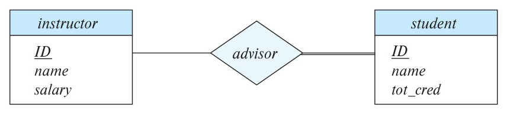
*Figure 6.12 — E-R diagram showing total participation.*

<!-- Page 256 -->

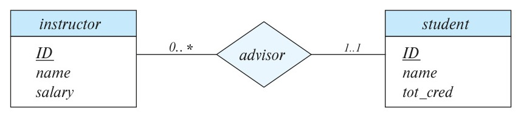
*Figure 6.13 — Cardinality limits on relationship sets.*

is the minimum and *h* the maximum cardinality. A minimum value of 1 indicates total participation of the entity set in the relationship set; that is, each entity in the entity set occurs in at least one relationship in that relationship set. A maximum value of 1 indicates that the entity participates in at most one relationship, while a maximum value ∗indicates no limit.

For example, consider Figure 6.13. The line between *advisor* and *student* has a cardinality constraint of 1*..*1, meaning the minimum and the maximum cardinality are both 1. That is, each student must have exactly one advisor. The limit 0*..* ∗on the line between *advisor* and *instructor* indicates that an instructor can have zero or more students. Thus, the relationship *advisor* is one-to-many from *instructor* to *student*, and further the participation of *student* in *advisor* is total, implying that a student must have an advisor.

It is easy to misinterpret the 0*..* ∗on the left edge and think that the relationship *advisor* is many-to-one from *instructor* to *student*—this is exactly the reverse of the correct interpretation.

If both edges have a maximum value of 1, the relationship is one-to-one. If we had specified a cardinality limit of 1*..* ∗on the left edge, we would be saying that each instructor must advise at least one student.

The E-R diagram in Figure 6.13 could alternatively have been drawn with a double line from *student* to *advisor*, and an arrow on the line from *advisor* to *instructor*, in place of the cardinality constraints shown. This alternative diagram would enforce exactly the same constraints as the constraints shown in the figure.

In the case of nonbinary relationship sets, we can specify some types of many-to-one relationships. Suppose a *student* can have at most one instructor as a guide on a project. This constraint can be specified by an arrow pointing to *instructor* on the edge from *proj_guide*. We permit at most one arrow out of a nonbinary relationship set, since an E-R diagram with two or more arrows out of a nonbinary relationship set can be interpreted in two ways. We elaborate on this issue in Section 6.5.2.

## 6.5 Primary Key

We must have a way to specify how entities within a given entity set and relationships within a given relationship set are distinguished.

<!-- Page 257 -->

### 6.5.1 Entity Sets

Conceptually, individual entities are distinct; from a database perspective, however, the differences among them must be expressed in terms of their attributes.

Therefore, the values of the attribute values of an entity must be such that they can *uniquely identify* the entity. In other words, no two entities in an entity set are allowed to have exactly the same value for all attributes.

The notion of a *key* for a relation schema, as defined in Section 2.3, applies directly to entity sets. That is, a key for an entity is a set of attributes that suffice to distinguish entities from each other. The concepts of superkey, candidate key, and primary key are applicable to entity sets just as they are applicable to relation schemas.

Keys also help to identify relationships uniquely, and thus distinguish relationships from each other. Next, we define the corresponding notions of keys for relationship sets.

### 6.5.2 Relationship Sets

We need a mechanism to distinguish among the various relationships of a relationship set.

Let *R* be a relationship set involving entity sets $E_{1}$, $E_{2}$, … , $E_{n}$. Let *primary-key*($E_{i}$) denote the set of attributes that forms the primary key for entity set $E_{i}$. Assume for now that the attribute names of all primary keys are unique. The composition of the primary key for a relationship set depends on the set of attributes associated with the relationship set *R*.

If the relationship set *R* has no attributes associated with it, then the set of attributes

$$\text{primary-key}(E_1) \cup \text{primary-key}(E_2) \cup \dots \cup \text{primary-key}(E_n)$$

describes an individual relationship in set *R*.

If the relationship set *R* has attributes $a_{1}$, $a_{2}$, … , $a_{m}$ associated with it, then the set of attributes

$$\text{primary-key}(E_1) \cup \text{primary-key}(E_2) \cup \dots \cup \text{primary-key}(E_n) \cup \{a_1, a_2, \dots, a_m\}$$

describes an individual relationship in set *R*.

If the attribute names of primary keys are not unique across entity sets, the attributes are renamed to distinguish them; the name of the entity set combined with the name of the attribute would form a unique name. If an entity set participates more than once in a relationship set (as in the *prereq* relationship in Section 6.2.2), the role name is used instead of the name of the entity set, to form a unique attribute name.

Recall that a relationship set is a set of relationship instances, and each instance is uniquely identified by the entities that participate in it. Thus, in both of the preceding cases, the set of attributes

$$\text{primary-key}(E_1) \cup \text{primary-key}(E_2) \cup \dots \cup \text{primary-key}(E_n)$$

forms a superkey for the relationship set.

<!-- Page 258 -->

The choice of the primary key for a binary relationship set depends on the mapping cardinality of the relationship set. For many-to-many relationships, the preceding union of the primary keys is a minimal superkey and is chosen as the primary key. As an illustration, consider the entity sets *instructor* and *student*, and the relationship set *advisor*, in Section 6.2.2. Suppose that the relationship set is many-to-many. Then the primary key of *advisor* consists of the union of the primary keys of *instructor* and *student*.

For one-to-many and many-to-one relationships, the primary key of the “many” side is a minimal superkey and is used as the primary key. For example, if the relationship is many-to-one from *student* to *instructor*—that is, each student can have at most one advisor—then the primary key of *advisor* is simply the primary key of *student*. However, if an instructor can advise only one student—that is, if the *advisor* relationship is many-to-one from *instructor* to *student*—then the primary key of *advisor* is simply the primary key of *instructor*.

For one-to-one relationships, the primary key of either one of the participating entity sets forms a minimal superkey, and either one can be chosen as the primary key of the relationship set. However, if an instructor can advise only one student, and each student can be advised by only one instructor—that is, if the *advisor* relationship is one-to-one—then the primary key of either *student* or *instructor* can be chosen as the primary key for *advisor*.

For nonbinary relationships, if no cardinality constraints are present, then the superkey formed as described earlier in this section is the only candidate key, and it is chosen as the primary key. The choice of the primary key is more complicated if cardinality constraints are present. As we noted in Section 6.4, we permit at most one arrow out of a relationship set. We do so because an E-R diagram with two or more arrows out of a nonbinary relationship set can be interpreted in the two ways we describe below.

Suppose there is a relationship set *R* between entity sets $E_{1}$, $E_{2}$, $E_{3}$, $E_{4}$, and the only arrows are on the edges to entity sets $E_{3}$ and $E_{4}$. Then, the two possible interpretations are:

**1.** A particular combination of entities from $E_{1}$, $E_{2}$ can be associated with at most

one combination of entities from $E_{3}$, $E_{4}$. Thus, the primary key for the relationship *R* can be constructed by the union of the primary keys of $E_{1}$ and $E_{2}$.

**2.** A particular combination of entities from $E_{1}$, $E_{2}$, $E_{3}$ can be associated with at

most one combination of entities from $E_{4}$, and further a particular combination of entities from $E_{1}$, $E_{2}$, $E_{4}$ can be associated with at most one combination of entities from $E_{3}$, Then the union of the primary keys of $E_{1}$, $E_{2}$, and $E_{3}$ forms a candidate key, as does the union of the primary keys of $E_{1}$, $E_{2}$, and $E_{4}$.

Each of these interpretations has been used in practice and both are correct for particular enterprises being modeled. Thus, to avoid confusion, we permit only one arrow out of a nonbinary relationship set, in which case the two interpretations are equivalent.

<!-- Page 259 -->

In order to represent a situation where one of the multiple-arrow situations holds, the E-R design can be modified by replacing the non-binary relationship set with an entity set. That is, we treat each instance of the non-binary relationship set as an entity. Then we can relate each of those entities to corresponding instances of $E_{1}$, $E_{2}$, $E_{4}$ via separate relationship sets. A simpler approach is to use *functional dependencies*, which we study in Chapter 7 (Section 7.4). Functional dependencies which allow either of these interpretations to be specified simply in an unambiguous manner.

The primary key for the relationship set *R* is then the union of the primary keys of those participating entity sets $E_{i}$ that do not have an incoming arrow from the relationship set *R*.

### 6.5.3 Weak Entity Sets

Consider a *section* entity, which is uniquely identified by a course identifier, semester, year, and section identifier. Section entities are related to course entities. Suppose we create a relationship set *sec_course* between entity sets *section* and *course*. Now, observe that the information in *sec_course* is redundant, since *section* already has an attribute *course_id*, which identifies the course with which the section is related. One option to deal with this redundancy is to get rid of the relationship *sec_course*; however, by doing so the relationship between *section* and *course* becomes implicit in an attribute, which is not desirable.

An alternative way to deal with this redundancy is to not store the attribute *course_id* in the *section* entity and to only store the remaining attributes *sec_id*, *year*, and *semester*.[^2] However, the entity set *section* then does not have enough attributes to identify a particular *section* entity uniquely; although each *section* entity is distinct, sections for different courses may share the same *sec_id*, *year*, and *semester*. To deal with this problem, we treat the relationship *sec_course* as a special relationship that provides extra information, in this case the *course_id*, required to identify *section* entities uniquely. The notion of *weak* *entity* *set* formalizes the above intuition. A **weak** **entity** **set** is one whose existence is dependent on another entity set, called its **identifying entity set**; instead of associating a primary key with a weak entity, we use the primary key of the identifying entity, along with extra attributes, called **discriminator attributes** to uniquely identify a weak entity. An entity set that is not a weak entity set is termed a **strong entity** **set**.

Every weak entity must be associated with an identifying entity; that is, the weak entity set is said to be **existence dependent** on the identifying entity set. The identifying entity set is said to **own** the weak entity set that it identifies. The relationship associating the weak entity set with the identifying entity set is called the **identifying relationship**.

The identifying relationship is many-to-one from the weak entity set to the identifying entity set, and the participation of the weak entity set in the relationship is total.

*id*, for reasons that will become clear later, even though we have dropped the attribute *course_id* from the entity set *section*.

[^2]: Note that the relational schema we eventually create from the entity set section does have the attribute course_id, for reasons that will become clear later, even though we have dropped the attribute course_id from the entity set section.

<!-- Page 260 -->

The identifying relationship set should not have any descriptive attributes, since any such attributes can instead be associated with the weak entity set. In our example, the identifying entity set for *section* is *course*, and the relationship *sec_course*, which associates *section* entities with their corresponding *course* entities, is the identifying relationship. The primary key of *section* is formed by the primary key of the identifying entity set (that is, *course*), plus the discriminator of the weak entity set (that is, *section*). Thus, the primary key is {*course_id*, *sec_id*, *year*, *semester*}. Note that we could have chosen to make *sec_id* globally unique across all courses offered in the university, in which case the *section* entity set would have had a primary key. However, conceptually, a *section* is still dependent on a *course* for its existence, which is made explicit by making it a weak entity set. In E-R diagrams, a weak entity set is depicted via a double rectangle with the discriminator being underlined with a dashed line. The relationship set connecting the weak entity set to the identifying strong entity set is depicted by a double diamond. In Figure 6.14, the weak entity set *section* depends on the strong entity set *course* via the relationship set *sec_course*. The figure also illustrates the use of double lines to indicate that the participation of the (weak) entity set *section* in the relationship *sec_course* is *total*, meaning that every section must be related via *sec_course* to some course. Finally, the arrow from *sec_course* to *course* indicates that each section is related to a single course. In general, a weak entity set must have a total participation in its identifying relationship set, and the relationship is many-to-one toward the identifying entity set. A weak entity set can participate in relationships other than the identifying relationship. For instance, the *section* entity could participate in a relationship with the *time_slot* entity set, identifying the time when a particular class section meets. A weak entity set may participate as owner in an identifying relationship with another weak entity set. It is also possible to have a weak entity set with more than one identifying entity set. A particular weak entity would then be identified by a combination of entities, one from each identifying entity set. The primary key of the weak entity set would consist of the union of the primary keys of the identifying entity sets, plus the discriminator of the weak entity set.

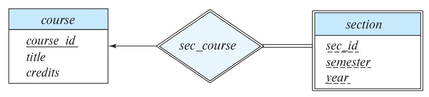
*Figure 6.14 — E-R diagram with a weak entity set.*

<!-- Page 261 -->

## 6.6 Removing Redundant Attributes in Entity Sets

When we design a database using the E-R model, we usually start by identifying those entity sets that should be included. For example, in the university organization we have discussed thus far, we decided to include such entity sets as *student* and *instructor*. Once the entity sets are decided upon, we must choose the appropriate attributes. These attributes are supposed to represent the various values we want to capture in the database. In the university organization, we decided that for the *instructor* entity set, we will include the attributes *ID*, *name*, *dept_name*, and *salary*. We could have added the attributes *phone_number*, *office_number*, *home_page*, and others. The choice of what attributes to include is up to the designer, who has a good understanding of the structure of the enterprise.

Once the entities and their corresponding attributes are chosen, the relationship sets among the various entities are formed. These relationship sets may result in a situation where attributes in the various entity sets are redundant and need to be removed from the original entity sets. To illustrate, consider the entity sets *instructor* and *department*:

- The entity set *instructor* includes the attributes *ID*, *name*, *dept_name*, and *salary*, with *ID* forming the primary key.
- The entity set *department* includes the attributes *dept_name*, *building*, and *budget*, with *dept_name* forming the primary key.

We model the fact that each instructor has an associated department using a relationship set *inst_dept* relating *instructor* and *department*. The attribute *dept_name* appears in both entity sets. Since it is the primary key for the entity set *department*, it is redundant in the entity set *instructor* and needs to be removed.

Removing the attribute *dept_name* from the *instructor* entity set may appear rather unintuitive, since the relation *instructor* that we used in the earlier chapters had an attribute *dept_name*. As we shall see later, when we create a relational schema from the E-R diagram, the attribute *dept_name* in fact gets added to the relation *instructor*, but only if each instructor has at most one associated department. If an instructor has more than one associated department, the relationship between instructors and departments is recorded in a separate relation *inst_dept*. Treating the connection between instructors and departments uniformly as a relationship, rather than as an attribute of *instructor*, makes the logical relationship explicit, and it helps avoid a premature assumption that each instructor is associated with only one department.

Similarly, the *student* entity set is related to the *department* entity set through the relationship set *student_dept* and thus there is no need for a *dept_name* attribute in *student*.

<!-- Page 262 -->

As another example, consider course offerings (sections) along with the time slots of the offerings. Each time slot is identified by a *time_slot_id*, and has associated with it a set of weekly meetings, each identified by a day of the week, start time, and end time. We decide to model the set of weekly meeting times as a multivalued composite attribute. Suppose we model entity sets *section* and *time_slot* as follows:

- The entity set *section* includes the attributes *course_id*, *sec_id*, *semester*, *year*, *building*, *room_number*, and *time_slot_id*, with (*course_id*, *sec_id*, *year*, *semester*) forming the primary key.
- The entity set *time_slot* includes the attributes *time_slot_id*, which is the primary key,[^3] and a multivalued composite attribute {(*day*, *start_time*, *end_time*)}.[^4]

These entities are related through the relationship set *sec_time_slot*. The attribute *time_slot_id* appears in both entity sets. Since it is the primary key for the entity set *time_slot*, it is redundant in the entity set *section* and needs to be removed. As a final example, suppose we have an entity set *classroom*, with attributes *building*, *room_number*, and *capacity*, with *building* and *room_number* forming the primary key. Suppose also that we have a relationship set *sec_class* that relates *section* to *classroom*. Then the attributes {*building*, *room_number*} are redundant in the entity set *section*. A good entity-relationship design does not contain redundant attributes. For our university example, we list the entity sets and their attributes below, with primary keys underlined:

- *classroom*: with attributes (*building*

, *room_number*

, *capacity*).
- *department*: with attributes (*dept_name*

, *building*, *budget*).
- *course*: with attributes (*course_id*

, *title*, *credits*).
- *instructor*: with attributes (*ID*

, *name*, *salary*).
- *section*: with attributes (*course_id*

, *sec_id*

, *semester*

, *year*

).
- *student*: with attributes (*ID*

, *name*, *tot_cred*).
- *time_slot*: with attributes (*time_slot_id*

, {(*day*, *start_time*, *end_time*) }).

The relationship sets in our design are listed below:

- *inst_dept*: relating instructors with departments.
- *stud_dept*: relating students with departments.

*slot* includes *day* and *start_time*; however, *day* and *start_time* do not form part of the primary key of the entity set *time_slot*. [^4]We could optionally give a name, such as *meeting*, for the composite attribute containing *day*, *start_time*, and *end_time*.

[^3]: We shall see later on that the primary key for the relation created from the entity set time_slot includes day and start_time; however, day and start_time do not form part of the primary key of the entity set time_slot.

[^4]: We could optionally give a name, such as meeting, for the composite attribute containing day, start_time, and end_time.

<!-- Page 263 -->

- *teaches*: relating instructors with sections.
- *takes*: relating students with sections, with a descriptive attribute *grade*.
- *course_dept*: relating courses with departments.
- *sec_course*: relating sections with courses.
- *sec_class*: relating sections with classrooms.
- *sec_time_slot*: relating sections with time slots.
- *advisor*: relating students with instructors.
- *prereq*: relating courses with prerequisite courses.

You can verify that none of the entity sets has any attribute that is made redundant by one of the relationship sets. Further, you can verify that all the information (other than constraints) in the relational schema for our university database, which we saw earlier in Figure 2.9, has been captured by the above design, but with several attributes in the relational design replaced by relationships in the E-R design.

We are finally in a position to show (Figure 6.15) the E-R diagram that corresponds to the university enterprise that we have been using thus far in the text. This E-R diagram is equivalent to the textual description of the university E-R model, but with several additional constraints.

In our university database, we have a constraint that each instructor must have exactly one associated department. As a result, there is a double line in Figure 6.15 between *instructor* and *inst_dept*, indicating total participation of *instructor* in *inst_dept*; that is, each instructor must be associated with a department. Further, there is an arrow from *inst_dept* to *department*, indicating that each instructor can have at most one associated department.

Similarly, entity set *course* has a double line to relationship set *course_dept*, indicating that every course must be in some department, and entity set *student* has a double line to relationship set *stud_dept*, indicating that every student must be majoring in some department. In each case, an arrow points to the entity set *department* to show that a course (and, respectively, a student) can be related to only one department, not several.

Similarly, entity set *course* has a double line to relationship set *course_dept*, indicating that every course must be in some department, and entity set *student* has a double line to relationship set *stud_dept*, indicating that every student must be majoring in some department. In each case, an arrow points to the entity set *department* to show that a course (and, respectively, a student) can be related to only one department, not several.

Further, Figure 6.15 shows that the relationship set *takes* has a descriptive attribute *grade*, and that each student has at most one advisor. The figure also shows that *section* is a weak entity set, with attributes *sec_id*, *semester*, and *year* forming the discriminator; *sec_course* is the identifying relationship set relating weak entity set *section* to the strong entity set *course*.

<!-- Page 264 -->

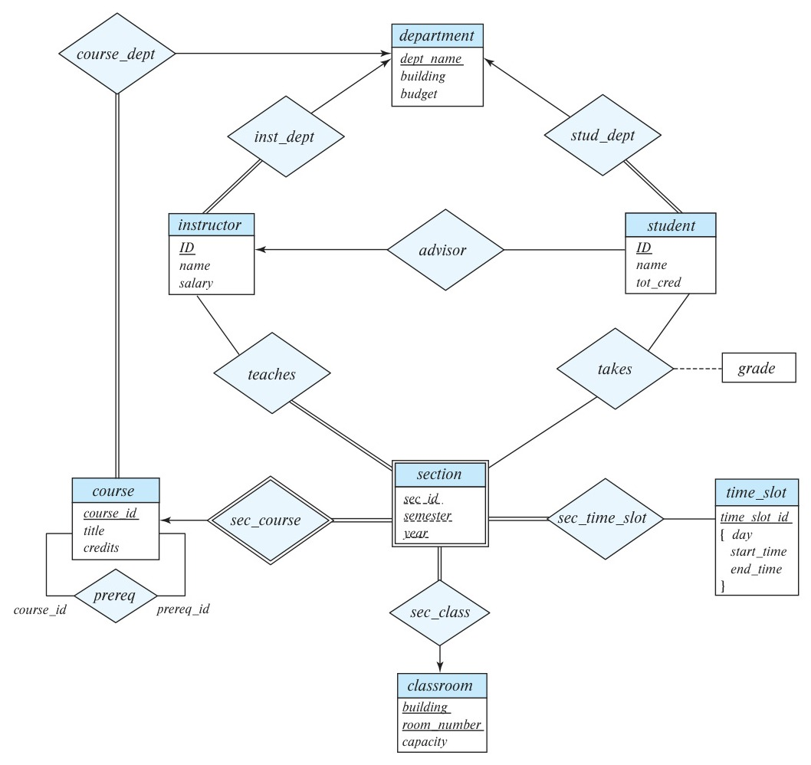
*Figure 6.15 — E-R diagram for a university enterprise.*

In Section 6.7, we show how this E-R diagram can be used to derive the various relation schemas we use.

## 6.7 Reducing E-R Diagrams to Relational Schemas

Both the E-R model and the relational database model are abstract, logical representations of real-world enterprises. Because the two models employ similar design principles, we can convert an E-R design into a relational design. For each entity set and for each relationship set in the database design, there is a unique relation schema to which we assign the name of the corresponding entity set or relationship set.

<!-- Page 265 -->

In this section, we describe how an E-R schema can be represented by relation schemas and how constraints arising from the E-R design can be mapped to constraints on relation schemas.

### 6.7.1 Representation of Strong Entity Sets

Let *E* be a strong entity set with only simple descriptive attributes $a_{1}$, $a_{2}$, … , $a_{n}$. We represent this entity with a schema called *E* with *n* distinct attributes. Each tuple in a relation on this schema corresponds to one entity of the entity set *E*.

For schemas derived from strong entity sets, the primary key of the entity set serves as the primary key of the resulting schema. This follows directly from the fact that each tuple corresponds to a specific entity in the entity set.

As an illustration, consider the entity set *student* of the E-R diagram in Figure 6.15. This entity set has three attributes: *ID*, *name*, *tot_cred*. We represent this entity set by a schema called *student* with three attributes:

*student* (*ID*

, *name*, *tot_cred*)

Note that since student *ID* is the primary key of the entity set, it is also the primary key of the relation schema.

Continuing with our example, for the E-R diagram in Figure 6.15, all the strong entity sets, except *time_slot*, have only simple attributes. The schemas derived from these strong entity sets are depicted in Figure 6.16. Note that the *instructor*, *student*, and *course* schemas are different from the schemas we have used in the previous chapters (they do not contain the attribute *dept_name*). We shall revisit this issue shortly.

### 6.7.2 Representation of Strong Entity Sets with Complex Attributes

When a strong entity set has nonsimple attributes, things are a bit more complex. We handle composite attributes by creating a separate attribute for each of the component attributes; we do not create a separate attribute for the composite attribute itself. To illustrate, consider the version of the *instructor* entity set depicted in Figure 6.8. For the composite attribute *name*, the schema generated for *instructor* contains the attributes

*Figure 6.16 — Schemas derived from the entity sets in the E-R diagram in Figure 6.15.*

<!-- Page 266 -->

*first_name*, *middle_initial*, and *last_name*; there is no separate attribute or schema for *name*. Similarly, for the composite attribute *address*, the schema generated contains the attributes *street*, *city*, *state*, and *postal_code*. Since *street* is a composite attribute it is replaced by *street_number*, *street_name*, and *apt_number*. Multivalued attributes are treated differently from other attributes. We have seen that attributes in an E-R diagram generally map directly into attributes for the appropriate relation schemas. Multivalued attributes, however, are an exception; new relation schemas are created for these attributes, as we shall see shortly.

Derived attributes are not explicitly represented in the relational data model. However, they can be represented as stored procedures, functions, or methods in other data models.

The relational schema derived from the version of entity set *instructor* with complex attributes, without including the multivalued attribute, is thus:

*instructor* (*ID*, *first_name*, *middle_initial*, *last_name*, *street_number*, *street_name*, *apt_number*, *city*, *state*, *postal_code*, *date_of_birth*)

For a multivalued attribute *M*, we create a relation schema *R* with an attribute *A* that corresponds to *M* and attributes corresponding to the primary key of the entity set or relationship set of which *M* is an attribute.

As an illustration, consider the E-R diagram in Figure 6.8 that depicts the entity set *instructor*, which includes the multivalued attribute *phone_number*. The primary key of *instructor* is *ID*. For this multivalued attribute, we create a relation schema

*instructor_phone* (*ID*

, *phone_number*

)

Each phone number of an instructor is represented as a unique tuple in the relation on this schema. Thus, if we had an instructor with *ID* 22222, and phone numbers 555-1234 and 555-4321, the relation *instructor_phone* would have two tuples (22222, 555-1234) and (22222, 555-4321).

We create a primary key of the relation schema consisting of all attributes of the schema. In the above example, the primary key consists of both attributes of the relation schema *instructor_phone*. In addition, we create a foreign-key constraint on the relation schema created from the multivalued attribute. In that newly created schema, the attribute generated from the primary key of the entity set must reference the relation generated from the entity set. In the above example, the foreign-key constraint on the *instructor_phone* relation would be that attribute *ID* references the *instructor* relation.

In the case that an entity set consists of only two attributes—a single primary-key attribute *B* and a single multivalued attribute *M* — the relation schema for the entity set would contain only one attribute, namely, the primary-key attribute *B*. We can drop

<!-- Page 267 -->

this relation, while retaining the relation schema with the attribute *B* and attribute *A* that corresponds to *M*.

To illustrate, consider the entity set *time_slot* depicted in Figure 6.15. Here, *time_slot_id* is the primary key of the *time_slot* entity set, and there is a single multivalued attribute that happens also to be composite. The entity set can be represented by just the following schema created from the multivalued composite attribute:

*time_slot* (*time_slot_id*

, *day*

, *start_time*

, *end_time*)

Although not represented as a constraint on the E-R diagram, we know that there cannot be two meetings of a class that start at the same time of the same day of the week but end at different times; based on this constraint, *end_time* has been omitted from the primary key of the *time_slot* schema. The relation created from the entity set would have only a single attribute *time_slot_id*; the optimization of dropping this relation has the benefit of simplifying the resultant database schema, although it has a drawback related to foreign keys, which we briefly discuss in Section 6.7.4.

### 6.7.3 Representation of Weak Entity Sets

Let *A* be a weak entity set with attributes $a_{1}$, $a_{2}$, … , $a_{m}$. Let *B* be the strong entity set on which *A* depends. Let the primary key of *B* consist of attributes $b_{1}$, $b_{2}$, … , $b_{n}$. We represent the entity set *A* by a relation schema called *A* with one attribute for each member of the set:

$$\{a_1, a_2, \dots, a_m\} \cup \{b_1, b_2, \dots, b_n\}$$

For schemas derived from a weak entity set, the combination of the primary key of the strong entity set and the discriminator of the weak entity set serves as the primary key of the schema. In addition to creating a primary key, we also create a foreign-key constraint on the relation *A*, specifying that the attributes $b_{1}$, $b_{2}$, … , $b_{n}$ reference the primary key of the relation *B*. The foreign-key constraint ensures that for each tuple representing a weak entity, there is a corresponding tuple representing the corresponding strong entity.

As an illustration, consider the weak entity set *section* in the E-R diagram of Figure 6.15. This entity set has the attributes: *sec_id*, *semester*, and *year*. The primary key of the *course* entity set, on which *section* depends, is *course_id*. Thus, we represent *section* by a schema with the following attributes:

*section* (*course_id*

, *sec_id*

, *semester*

, *year*

)

The primary key consists of the primary key of the entity set *course*, along with the discriminator of *section*, which is *sec_id*, *semester*, and *year*. We also create a foreign-key

<!-- Page 268 -->

constraint on the *section* schema, with the attribute *course_id* referencing the primary key of the *course* schema.[^5]

### 6.7.4 Representation of Relationship Sets

Let *R* be a relationship set, let $a_{1}$, $a_{2}$, … , $a_{m}$ be the set of attributes formed by the union of the primary keys of each of the entity sets participating in *R*, and let the descriptive attributes (if any) of *R* be $b_{1}$, $b_{2}$, … , $b_{n}$. We represent this relationship set by a relation schema called *R* with one attribute for each member of the set:

$$\{a_1, a_2, \dots, a_m\} \cup \{b_1, b_2, \dots, b_n\}$$

We described in Section 6.5, how to choose a primary key for a binary relationship set. The primary key attributes of the relationship set are also used as the primary key attributes of the relational schema *R*.

As an illustration, consider the relationship set *advisor* in the E-R diagram of Figure 6.15. This relationship set involves the following entity sets:

- *instructor*, with the primary key *ID*.
- *student*, with the primary key *ID*.

Since the relationship set has no attributes, the *advisor* schema has two attributes, the primary keys of *instructor* and *student*. Since both attributes have the same name, we rename them *i_ID* and s

*ID*. Since the *advisor* relationship set is many-to-one from *student* to *instructor* the primary key for the *advisor* relation schema is *s_ID*. We also create foreign-key constraints on the relation schema *R* as follows: For each entity set $E_{i}$ related by relationship set *R*, we create a foreign-key constraint from relation schema *R*, with the attributes of *R* that were derived from primary-key attributes of $E_{i}$ referencing the primary key of the relation schema representing $E_{i}$.

Returning to our earlier example, we thus create two foreign-key constraints on the *advisor* relation, with attribute *i_ID* referencing the primary key of *instructor* and attribute *s_ID* referencing the primary key of *student*. Applying the preceding techniques to the other relationship sets in the E-R diagram in Figure 6.15, we get the relational schemas depicted in Figure 6.17.

Observe that for the case of the relationship set *prereq*, the role indicators associated with the relationship are used as attribute names, since both roles refer to the same relation *course*.

Similar to the case of *advisor*, the primary key for each of the relations *sec_course*, *sec_time_slot*, *sec_class*, *inst_dept*, *stud_dept*, and *course_dept* consists of the primary key

[^5]: Optionally, the foreign-key constraint could have an “on delete cascade” specification, so that deletion of a course entity automatically deletes any section entities that reference the course entity. Without that specification, each section of a course would have to be deleted before the corresponding course can be deleted.

<!-- Page 269 -->

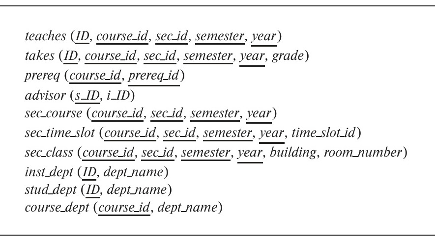
*Figure 6.17 — Schemas derived from relationship sets in the E-R diagram in Figure 6.15.*

of only one of the two related entity sets, since each of the corresponding relationships is many-to-one.

Foreign keys are not shown in Figure 6.17, but for each of the relations in the figure there are two foreign-key constraints, referencing the two relations created from the two related entity sets. Thus, for example, *sec_course* has foreign keys referencing *section* and *classroom*, *teaches* has foreign keys referencing *instructor* and *section*, and *takes* has foreign keys referencing *student* and *section*.

The optimization that allowed us to create only a single relation schema from the entity set *time_slot*, which had a multivalued attribute, prevents the creation of a foreign key from the relation schema *sec_time_slot* to the relation created from entity set *time_slot*, since we dropped the relation created from the entity set *time_slot*. We retained the relation created from the multivalued attribute and named it *time_slot*, but this relation may potentially have no tuples corresponding to a *time_slot_id*, or it may have multiple tuples corresponding to a *time_slot_id*; thus, *time_slot_id* in *sec_time_slot* cannot reference this relation.

The astute reader may wonder why we have not seen the schemas *sec_course*, *sec_time_slot*, *sec_class*, *inst_dept*, *stud_dept*, and *course_dept* in the previous chapters. The reason is that the algorithm we have presented thus far results in some schemas that can be either eliminated or combined with other schemas. We explore this issue next.

### 6.7.5 Redundancy of Schemas

A relationship set linking a weak entity set to the corresponding strong entity set is treated specially. As we noted in Section 6.5.3, these relationships are many-to-one and have no descriptive attributes. Furthermore, the of a weak entity set includes the primary key of the strong entity set. In the E-R diagram of Figure 6.14, the weak entity set *section* is dependent on the strong entity set *course* via the relationship set *sec_course*.

<!-- Page 270 -->

The primary key of *section* is {*course_id*, *sec_id*, *semester*, *year*}, and the primary key of *course* is *course_id*. Since *sec_course* has no descriptive attributes, the *sec_course* schema has attributes *course_id*, *sec_id*, *semester*, and *year*. The schema for the entity set *section* includes the attributes *course_id*, *sec_id*, *semester*, and *year* (among others). Every (*course_id*, *sec_id*, *semester*, *year*) combination in a *sec_course* relation would also be present in the relation on schema *section*, and vice versa. Thus, the *sec_course* schema is redundant.

In general, the schema for the relationship set linking a weak entity set to its corresponding strong entity set is redundant and does not need to be present in a relational database design based upon an E-R diagram.

### 6.7.6 Combination of Schemas

Consider a many-to-one relationship set *AB* from entity set *A* to entity set *B*. Using our relational-schema construction algorithm outlined previously, we get three schemas: *A*, *B*, and *AB*. Suppose further that the participation of *A* in the relationship is total; that is, every entity *a* in the entity set *A* must participate in the relationship *AB*. Then we can combine the schemas *A* and *AB* to form a single schema consisting of the union of attributes of both schemas. The primary key of the combined schema is the primary key of the entity set into whose schema the relationship set schema was merged.

To illustrate, let’s examine the various relations in the E-R diagram of Figure 6.15 that satisfy the preceding criteria:

- *inst_dept*. The schemas *instructor* and *department* correspond to the entity sets *A* and *B*, respectively. Thus, the schema *inst_dept* can be combined with the *instructor* schema. The resulting *instructor* schema consists of the attributes {*ID*, *name*, *dept_name*, *salary*}.
- *stud_dept*. The schemas *student* and *department* correspond to the entity sets *A* and *B*, respectively. Thus, the schema *stud_dept* can be combined with the *student* schema. The resulting *student* schema consists of the attributes {*ID*, *name*, *dept_name*, *tot_cred*}.
- *course_dept*. The schemas *course* and *department* correspond to the entity sets *A* and *B*, respectively. Thus, the schema *course_dept* can be combined with the *course* schema. The resulting *course* schema consists of the attributes {*course_id*, *title*, *dept_name*, *credits*}.
- *sec_class*. The schemas *section* and *classroom* correspond to the entity sets *A* and *B*, respectively. Thus, the schema *sec_class* can be combined with the *section* schema. The resulting *section* schema consists of the attributes {*course_id*, *sec_id*, *semester*, *year*, *building*, *room_number*}.
- *sec_time_slot*. The schemas *section* and *time_slot* correspond to the entity sets *A* and *B* respectively, Thus, the schema *sec_time_slot* can be combined with the *section*

<!-- Page 271 -->

schema obtained in the previous step. The resulting *section* schema consists of the attributes {*course_id*, *sec_id*, *semester*, *year*, *building*, *room_number*, *time_slot_id*}.

In the case of one-to-one relationships, the relation schema for the relationship set can be combined with the schemas for either of the entity sets.

We can combine schemas even if the participation is partial by using null values. In the preceding example, if *inst_dept* were partial, then we would store null values for the *dept_name* attribute for those instructors who have no associated department. Finally, we consider the foreign-key constraints that would have appeared in the schema representing the relationship set. There would have been foreign-key constraints referencing each of the entity sets participating in the relationship set. We drop the constraint referencing the entity set into whose schema the relationship set schema is merged, and add the other foreign-key constraints to the combined schema. For example, *inst_dept* has a foreign key constraint of the attribute *dept_name* referencing the *department* relation. This foreign constraint is enforced implicitly by the *instructor* relation when the schema for *inst_dept* is merged into *instructor*.

## 6.8 Extended E-R Features

Although the basic E-R concepts can model most database features, some aspects of a database may be more aptly expressed by certain extensions to the basic E-R model. In this section, we discuss the extended E-R features of specialization, generalization, higher- and lower-level entity sets, attribute inheritance, and aggregation.

To help with the discussions, we shall use a slightly more elaborate database schema for the university. In particular, we shall model the various people within a university by defining an entity set *person*, with attributes *ID*, *name*, *street*, and *city*.

### 6.8.1 Specialization

An entity set may include subgroupings of entities that are distinct in some way from other entities in the set. For instance, a subset of entities within an entity set may have attributes that are not shared by all the entities in the entity set. The E-R model provides a means for representing these distinctive entity groupings.

As an example, the entity set *person* may be further classified as one of the following:

- *employee*.
- *student*.

Each of these person types is described by a set of attributes that includes all the attributes of entity set *person* plus possibly additional attributes. For example, *employee* entities may be described further by the attribute *salary*, whereas *student* entities may

<!-- Page 272 -->

be described further by the attribute *tot_cred*. The process of designating subgroupings within an entity set is called **specialization**. The specialization of *person* allows us to distinguish among person entities according to whether they correspond to employees or students: in general, a person could be an employee, a student, both, or neither.

As another example, suppose the university divides students into two categories: graduate and undergraduate. Graduate students have an office assigned to them. Undergraduate students are assigned to a residential college. Each of these student types is described by a set of attributes that includes all the attributes of the entity set *student* plus additional attributes.

We can apply specialization repeatedly to refine a design. The university could create two specializations of *student*, namely *graduate* and *undergraduate*. As we saw earlier, student entities are described by the attributes *ID*, *name*, *street,* *city*, and *tot_cred*. The entity set *graduate* would have all the attributes of *student* and an additional attribute *office_number*. The entity set *undergraduate* would have all the attributes of *student*, and an additional attribute *residential_college*. As another example, university employees may be further classified as one of *instructor* or *secretary*.

Each of these employee types is described by a set of attributes that includes all the attributes of entity set *employee* plus additional attributes. For example, *instructor* entities may be described further by the attribute *rank* while *secretary* entities are described by the attribute *hours_per_week*. Further, *secretary* entities may participate in a relationship *secretary_for* between the *secretary* and *employee* entity sets, which identifies the employees who are assisted by a secretary.

An entity set may be specialized by more than one distinguishing feature. In our example, the distinguishing feature among employee entities is the job the employee performs. Another, coexistent, specialization could be based on whether the person is a temporary (limited

term) employee or a permanent employee, resulting in the entity sets *temporary_employee* and *permanent_employee*. When more than one specialization is formed on an entity set, a particular entity may belong to multiple specializations. For instance, a given employee may be a temporary employee who is a secretary.

In terms of an E-R diagram, specialization is depicted by a hollow arrow-head pointing from the specialized entity to the other entity (see Figure 6.18). We refer to this relationship as the ISA relationship, which stands for “is a” and represents, for example, that an instructor “is a” employee.

The way we depict specialization in an E-R diagram depends on whether an entity may belong to multiple specialized entity sets or if it must belong to at most one specialized entity set. The former case (multiple sets permitted) is called **overlapping** **specialization**, while the latter case (at most one permitted) is called **disjoint** **specialization**. For an overlapping specialization (as is the case for *student* and *employee* as specializations of *person*), two separate arrows are used. For a disjoint specialization (as is the case for *instructor* and *secretary* as specializations of *employee*), a single arrow is used. The specialization relationship may also be referred to as a **superclass-subclass** relationship. Higher- and lower-level entity sets are depicted as regular entity sets—that is, as rectangles containing the name of the entity set.

<!-- Page 273 -->

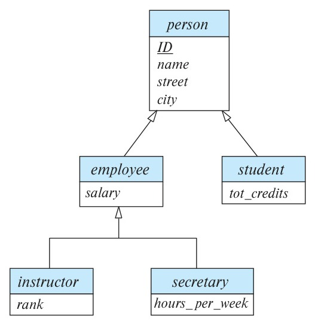
*Figure 6.18 — Specialization and generalization.*

### 6.8.2 Generalization

The refinement from an initial entity set into successive levels of entity subgroupings represents a **top-down** design process in which distinctions are made explicit. The design process may also proceed in a **bottom-up** manner, in which multiple entity sets are synthesized into a higher-level entity set on the basis of common features. The database designer may have first identified:

- *instructor* entity set with attributes *instructor_id*, *instructor_name*, *instructor_salary*, and *rank*.
- *secretary* entity set with attributes *secretary_id*, *secretary_name*, *secretary_salary*, and *hours_per_week*.

There are similarities between the *instructor* entity set and the *secretary* entity set in the sense that they have several attributes that are conceptually the same across the two entity sets: namely, the identifier, name, and salary attributes. This commonality can be expressed by **generalization**, which is a containment relationship that exists between a *higher-level* entity set and one or more *lower-level* entity sets. In our example, *employee* is the higher-level entity set and *instructor* and *secretary* are lower-level entity sets. In this case, attributes that are conceptually the same had different names in the two lower-level entity sets. To create a generalization, the attributes must be given a common name and represented with the higher-level entity *person*. We can use the attribute names *ID*, *name*, *street*, and *city*, as we saw in the example in Section 6.8.1.

<!-- Page 274 -->

Higher- and lower-level entity sets also may be designated by the terms **superclass** and **subclass**, respectively. The *person* entity set is the superclass of the *employee* and *student* subclasses.

For all practical purposes, generalization is a simple inversion of specialization. We apply both processes, in combination, in the course of designing the E-R schema for an enterprise. In terms of the E-R diagram itself, we do not distinguish between specialization and generalization. New levels of entity representation are distinguished (specialization) or synthesized (generalization) as the design schema comes to express fully the database application and the user requirements of the database. Differences in the two approaches may be characterized by their starting point and overall goal.

Specialization stems from a single entity set; it emphasizes differences among entities within the set by creating distinct lower-level entity sets. These lower-level entity sets may have attributes, or may participate in relationships, that do not apply to all the entities in the higher-level entity set. Indeed, the reason a designer applies specialization is to represent such distinctive features. If *student* and *employee* have exactly the same attributes as *person* entities, and participate in exactly the same relationships as *person* entities, there would be no need to specialize the *person* entity set.

Generalization proceeds from the recognition that a number of entity sets share some common features (namely, they are described by the same attributes and participate in the same relationship sets). On the basis of their commonalities, generalization synthesizes these entity sets into a single, higher-level entity set. Generalization is used to emphasize the similarities among lower-level entity sets and to hide the differences; it also permits an economy of representation in that shared attributes are not repeated.

### 6.8.3 Attribute Inheritance

A crucial property of the higher- and lower-level entities created by specialization and generalization is **attribute inheritance**. The attributes of the higher-level entity sets are said to be **inherited** by the lower-level entity sets. For example, *student* and *employee* inherit the attributes of *person*. Thus, *student* is described by its *ID*, *name*, *street*, and *city* attributes, and additionally a *tot_cred* attribute; *employee* is described by its *ID*, *name*, *street*, and *city* attributes, and additionally a *salary* attribute. Attribute inheritance applies through all tiers of lower-level entity sets; thus, *instructor* and *secretary*, which are subclasses of *employee*, inherit the attributes *ID*, *name*, *street,* and *city* from *person*, in addition to inheriting *salary* from *employee*.

A lower-level entity set (or subclass) also inherits participation in the relationship sets in which its higher-level entity (or superclass) participates. Like attribute inheritance, participation inheritance applies through all tiers of lower-level entity sets. For example, suppose the *person* entity set participates in a relationship *person_dept* with *department*. Then, the *student*, *employee*, *instructor* and *secretary* entity sets, which are subclasses of the *person* entity set, also implicitly participate in the *person_dept* relationship with *department*. These entity sets can participate in any relationships in which the *person* entity set participates.

<!-- Page 275 -->

Whether a given portion of an E-R model was arrived at by specialization or generalization, the outcome is basically the same:

- A higher-level entity set with attributes and relationships that apply to all of its
lower-level entity sets.
- Lower-level entity sets with distinctive features that apply only within a particular
lower-level entity set.

In what follows, although we often refer to only generalization, the properties that we discuss belong fully to both processes.

Figure 6.18 depicts a hierarchy of entity sets. In the figure, *employee* is a lower-level entity set of *person* and a higher-level entity set of the *instructor* and *secretary* entity sets. In a hierarchy, a given entity set may be involved as a lower-level entity set in only one ISA relationship; that is, entity sets in this diagram have only single inheritance. If an entity set is a lower-level entity set in more than one ISA relationship, then the entity set has multiple inheritance, and the resulting structure is said to be a lattice.

### 6.8.4 Constraints on Specializations

To model an enterprise more accurately, the database designer may choose to place certain constraints on a particular generalization/specialization.

One type of constraint on specialization which we saw earlier specifies whether a specialization is disjoint or overlapping. Another type of constraint on a specialization/generalization is a **completeness constraint**, which specifies whether or not an entity in the higher-level entity set must belong to at least one of the lower-level entity sets within the generalization/specialization. This constraint may be one of the following:

- **Total** **specialization** or **generalization**. Each higher-level entity must belong to a
lower-level entity set.
- **Partial specialization** or **generalization**. Some higher-level entities may not belong
to any lower-level entity set.

Partial specialization is the default. We can specify total specialization in an E-R diagram by adding the keyword “total” in the diagram and drawing a dashed line from the keyword to the corresponding hollow arrowhead to which it applies (for a total specialization), or to the set of hollow arrowheads to which it applies (for an overlapping specialization).

The specialization of *person* to *student* or *employee* is total if the university does not need to represent any person who is neither a *student* nor an *employee*. However, if the university needs to represent such persons, then the specialization would be partial.

The completeness and disjointness constraints, do not depend on each other. Thus, specializations may be partial-overlapping, partial-disjoint, total-overlapping, and total-disjoint.

<!-- Page 276 -->

We can see that certain insertion and deletion requirements follow from the constraints that apply to a given generalization or specialization. For instance, when a total completeness constraint is in place, an entity inserted into a higher-level entity set must also be inserted into at least one of the lower-level entity sets. An entity that is deleted from a higher-level entity set must also be deleted from all the associated lower-level entity sets to which it belongs.

### 6.8.5 Aggregation

One limitation of the E-R model is that it cannot express relationships among relationships. To illustrate the need for such a construct, consider the ternary relationship *proj_guide*, which we saw earlier, between an *instructor*, *student* and *project* (see Figure 6.6).

Now suppose that each instructor guiding a student on a project is required to file a monthly evaluation report. We model the evaluation report as an entity *evaluation*, with a primary key *evaluation_id*. One alternative for recording the (*student*, *project*, *instructor*) combination to which an *evaluation* corresponds is to create a quaternary (4-way) relationship set *eval_for* between *instructor*, *student*, *project*, and *evaluation*. (A quaternary relationship is required—a binary relationship between *student* and *evaluation*, for example, would not permit us to represent the (*project*, *instructor*) combination to which an *evaluation* corresponds.) Using the basic E-R modeling constructs, we obtain the E-R diagram of Figure 6.19. (We have omitted the attributes of the entity sets, for simplicity.)

It appears that the relationship sets *proj_guide* and *eval_for* can be combined into one single relationship set. Nevertheless, we should not combine them into a single

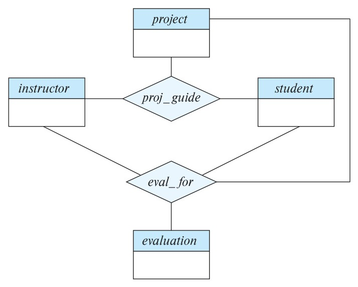
*Figure 6.19 — E-R diagram with redundant relationships.*

<!-- Page 277 -->

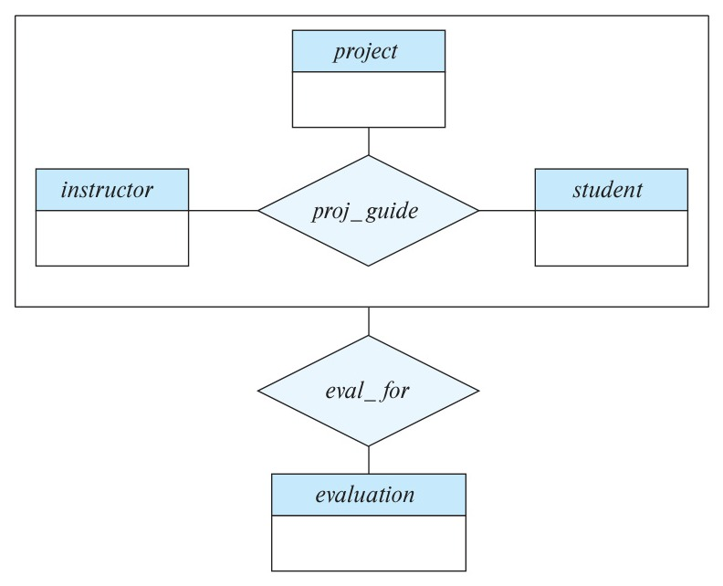
*Figure 6.20 — E-R diagram with aggregation.*

relationship, since some *instructor*, *student*, *project* combinations may not have an associated *evaluation*.

There is redundant information in the resultant figure, however, since every *instructor*, *student*, *project* combination in *eval_for* must also be in *proj_guide*. If *evaluation* was modeled as a value rather than an entity, we could instead make *evaluation* a multi-valued composite attribute of the relationship set *proj_guide*. However, this alternative may not be an option if an *evaluation* may also be related to other entities; for example, each evaluation report may be associated with a *secretary* who is responsible for further processing of the evaluation report to make scholarship payments.

The best way to model a situation such as the one just described is to use aggregation. **Aggregation** is an abstraction through which relationships are treated as higher-level entities. Thus, for our example, we regard the relationship set *proj_guide* (relating the entity sets *instructor*, *student*, and *project*) as a higher-level entity set called *proj_guide*. Such an entity set is treated in the same manner as is any other entity set. We can then create a binary relationship *eval_for* between *proj_guide* and *evaluation* to represent which (*student*, *project*, *instructor*) combination an *evaluation* is for. Figure 6.20 shows a notation for aggregation commonly used to represent this situation.

### 6.8.6 Reduction to Relation Schemas

We are in a position now to describe how the extended E-R features can be translated into relation schemas.

<!-- Page 278 -->

**6.8.6.1** **Representation of Generalization**

There are two different methods of designing relation schemas for an E-R diagram that includes generalization. Although we refer to the generalization in Figure 6.18 in this discussion, we simplify it by including only the first tier of lower-level entity sets—that is, *employee* and *student*. We assume that *ID* is the primary key of *person*.

**1.** Create a schema for the higher-level entity set. For each lower-level entity set,

create a schema that includes an attribute for each of the attributes of that entity set plus one for each attribute of the primary key of the higher-level entity set. Thus, for the E-R diagram of Figure 6.18 (ignoring the *instructor* and *secretary* entity sets) we have three schemas:

*person* (*ID*

, *name, street, city*) *employee* (*ID*

, *salary*) *student* (*ID*

, *tot_cred*)

The primary-key attributes of the higher-level entity set become primary-key attributes of the higher-level entity set as well as all lower-level entity sets. These can be seen underlined in the preceding example.

In addition, we create foreign-key constraints on the lower-level entity sets, with their primary-key attributes referencing the primary key of the relation created from the higher-level entity set. In the preceding example, the *ID* attribute of *employee* would reference the primary key of *person*, and similarly for *student*.

**2.** An alternative representation is possible, if the generalization is disjoint and com-

plete—that is, if no entity is a member of two lower-level entity sets directly below a higher-level entity set, and if every entity in the higher-level entity set is also a member of one of the lower-level entity sets. Here, we do not create a schema for the higher-level entity set. Instead, for each lower-level entity set, we create a schema that includes an attribute for each of the attributes of that entity set plus one for *each* attribute of the higher-level entity set. Then, for the E-R diagram of Figure 6.18, we have two schemas:

*employee* (*ID*

, *name*, *street*, *city*, *salary*) *student* (*ID*

, *name*, *street*, *city*, *tot_cred*)

Both these schemas have *ID*, which is the primary-key attribute of the higher-level entity set *person*, as their primary key.

One drawback of the second method lies in defining foreign-key constraints. To illustrate the problem, suppose we have a relationship set *R* involving entity set *person*. With the first method, when we create a relation schema *R* from the relationship set, we also define a foreign-key constraint on *R*, referencing the schema *person*. Unfortunately, with the second method, we do not have a single relation to which a foreign-key

<!-- Page 279 -->

constraint on *R* can refer. To avoid this problem, we need to create a relation schema *person* containing at least the primary-key attributes of the *person* entity.

If the second method were used for an overlapping generalization, some values would be stored multiple times, unnecessarily. For instance, if a person is both an employee and a student, values for *street* and *city* would be stored twice.

If the generalization were disjoint but not complete—that is, if some person is neither an employee nor a student—then an extra schema

*person* (*ID*

, *name, street, city*)

would be required to represent such people. However, the problem with foreign-key constraints mentioned above would remain. As an attempt to work around the problem, suppose employees and students are additionally represented in the *person* relation. Unfortunately, name, street, and city information would then be stored redundantly in the *person* relation and the *student* relation for students, and similarly in the *person* relation and the *employee* relation for employees. That suggests storing name, street, and city information only in the *person* relation and removing that information from *student* and *employee*. If we do that, the result is exactly the first method we presented.

**6.8.6.2** **Representation of Aggregation**

Designing schemas for an E-R diagram containing aggregation is straightforward. Consider Figure 6.20. The schema for the relationship set *eval_for* between the aggregation of *proj_guide* and the entity set *evaluation* includes an attribute for each attribute in the primary keys of the entity set *evaluation* and the relationship set *proj_guide*. It also includes an attribute for any descriptive attributes, if they exist, of the relationship set *eval_for*. We then transform the relationship sets and entity sets within the aggregated entity set following the rules we have already defined.

The rules we saw earlier for creating primary-key and foreign-key constraints on relationship sets can be applied to relationship sets involving aggregations as well, with the aggregation treated like any other entity set. The primary key of the aggregation is the primary key of its defining relationship set. No separate relation is required to represent the aggregation; the relation created from the defining relationship is used instead.

## 6.9 Entity-Relationship Design Issues

The notions of an entity set and a relationship set are not precise, and it is possible to define a set of entities and the relationships among them in a number of different ways. In this section, we examine basic issues in the design of an E-R database schema. Section 6.11 covers the design process in further detail.

<!-- Page 280 -->

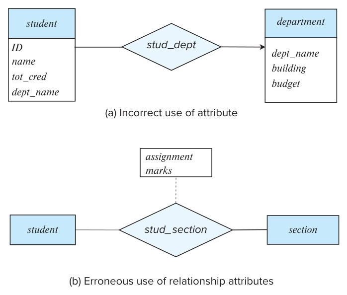
*Figure 6.21 — Example of erroneous E-R diagrams.*

### 6.9.1 Common Mistakes in E-R Diagrams

A common mistake when creating E-R models is the use of the primary key of an entity set as an attribute of another entity set, instead of using a relationship. For example, in our university E-R model, it is incorrect to have *dept_name* as an attribute of *student*, as depicted in Figure 6.21a, even though it is present as an attribute in the relation schema for *student*. The relationship *stud_dept* is the correct way to represent this information in the E-R model, since it makes the relationship between *student* and *department* explicit, rather than implicit via an attribute. Having an attribute *dept_name* as well as a relationship *stud_dept* would result in duplication of information. Another related mistake that people sometimes make is to designate the primary-key attributes of the related entity sets as attributes of the relationship set. For example, *ID* (the primary-key attributes of *student*) and *ID* (the primary key of *instructor*) should not appear as attributes of the relationship *advisor*. This should not be done since the primary-key attributes are already implicit in the relationship set.[^6]

A third common mistake is to use a relationship with a single-valued attribute in a situation that requires a multivalued attribute. For example, suppose we decided to represent the marks that a student gets in different assignments of a course offering (*section*). A wrong way of doing this would be to add two attributes *assignment* and *marks* to the relationship *takes*, as depicted in Figure 6.21b. The problem with this design is that we can only represent a single assignment for a given student-section pair,

[^6]: When we create a relation schema from the E-R schema, the attributes may appear in a schema created from the advisor relationship set, as we shall see later; however, they should not appear in the advisor relationship set.

<!-- Page 281 -->

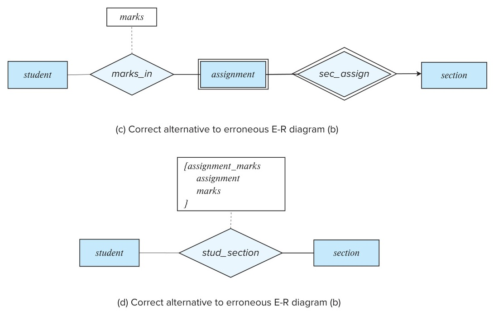
*Figure 6.22 — Correct versions of the E-R diagram of Figure 6.21.*

since relationship instances must be uniquely identified by the participating entities, *student* and *section*.

One solution to the problem depicted in Figure 6.21c, shown in Figure 6.22a, is to model *assignment* as a weak entity identified by *section*, and to add a relationship *marks_in* between *assignment* and *student*; the relationship would have an attribute *marks*. An alternative solution, shown in Figure 6.22d, is to use a multivalued composite attribute {*assignment_marks*} to *takes*, where *assignment_marks* has component attributes *assignment* and *marks*. Modeling an assignment as a weak entity is preferable in this case, since it allows recording other information about the assignment, such as maximum marks or deadlines.

When an E-R diagram becomes too big to draw in a single piece, it makes sense to break it up into pieces, each showing part of the E-R model. When doing so, you may need to depict an entity set in more than one page. As discussed in Section 6.2.2, attributes of the entity set should be shown only once, in its first occurrence. Subsequent occurrences of the entity set should be shown without any attributes, to avoid repeating the same information at multiple places, which may lead to inconsistency.

### 6.9.2 Use of Entity Sets versus Attributes

Consider the entity set *instructor* with the additional attribute *phone_number* (Figure 6.23a.) It can be argued that a phone is an entity in its own right with attributes *phone*

<!-- Page 282 -->

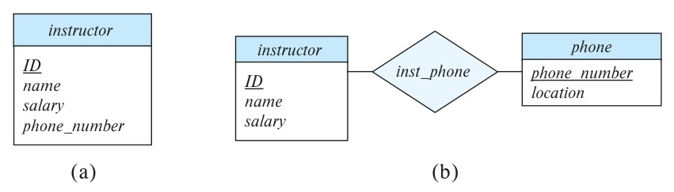
*Figure 6.23 — Alternatives for adding phone to the instructor entity set.*

*number* and *location*; the location may be the office or home where the phone is located, with mobile (cell) phones perhaps represented by the value “mobile.” If we take this point of view, we do not add the attribute *phone_number* to the *instructor*. Rather, we create:

- A *phone* entity set with attributes *phone_number* and *location*.
- A relationship set *inst_phone*, denoting the association between instructors and the phones that they have.

This alternative is shown in Figure 6.23b.

What, then, is the main difference between these two definitions of an instructor? Treating a phone as an attribute *phone_number* implies that instructors have precisely one phone number each. Treating a phone as an entity *phone* permits instructors to have several phone numbers (including zero) associated with them. However, we could instead easily define *phone_number* as a multivalued attribute to allow multiple phones per instructor.

The main difference then is that treating a phone as an entity better models a situation where one may want to keep extra information about a phone, such as its location, or its type (mobile, IP phone, or plain old phone), or all who share the phone. Thus, treating phone as an entity is more general than treating it as an attribute and is appropriate when the generality may be useful.

In contrast, it would not be appropriate to treat the attribute *name* (of an instructor) as an entity; it is difficult to argue that *name* is an entity in its own right (in contrast to the phone). Thus, it is appropriate to have *name* as an attribute of the *instructor* entity set.

Two natural questions thus arise: What constitutes an attribute, and what constitutes an entity set? Unfortunately, there are no simple answers. The distinctions mainly depend on the structure of the real-world enterprise being modeled and on the semantics associated with the attribute in question.

### 6.9.3 Use of Entity Sets versus Relationship Sets

It is not always clear whether an object is best expressed by an entity set or a relationship set. In Figure 6.15, we used the *takes* relationship set to model the situation where a

<!-- Page 283 -->

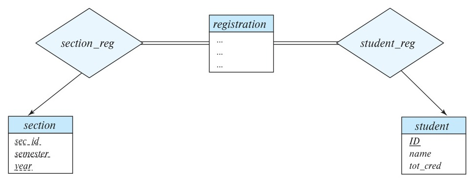
*Figure 6.24 — Replacement of takes by registration and two relationship sets.*

student takes a (section of a) course. An alternative is to imagine that there is a course-registration record for each course that each student takes. Then, we have an entity set to represent the course-registration record. Let us call that entity set *registration*. Each *registration* entity is related to exactly one student and to exactly one section, so we have two relationship sets, one to relate course-registration records to students and one to relate course-registration records to sections. In Figure 6.24, we show the entity sets *section* and *student* from Figure 6.15 with the *takes* relationship set replaced by one entity set and two relationship sets:

- *registration*, the entity set representing course-registration records.
- *section_reg*, the relationship set relating *registration* and *course*.
- *student_reg*, the relationship set relating *registration* and *student*.

Note that we use double lines to indicate total participation by *registration* entities. Both the approach of Figure 6.15 and that of Figure 6.24 accurately represent the university’s information, but the use of *takes* is more compact and probably preferable. However, if the registrar’s office associates other information with a course-registration record, it might be best to make it an entity in its own right. One possible guideline in determining whether to use an entity set or a relationship set is to designate a relationship set to describe an action that occurs between entities. This approach can also be useful in deciding whether certain attributes may be more appropriately expressed as relationships.

### 6.9.4 Binary versus n-ary Relationship Sets

Relationships in databases are often binary. Some relationships that appear to be nonbinary could actually be better represented by several binary relationships. For instance, one could create a ternary relationship *parent*, relating a child to his/her mother and father. However, such a relationship could also be represented by two binary relationships, *mother* and *father*, relating a child to his/her mother and father separately. Using

<!-- Page 284 -->

the two relationships *mother* and *father* provides us with a record of a child’s mother, even if we are not aware of the father’s identity; a null value would be required if the ternary relationship *parent* were used. Using binary relationship sets is preferable in this case.

In fact, it is always possible to replace a nonbinary (*n*-ary, for *n* *>* 2) relationship set by a number of distinct binary relationship sets. For simplicity, consider the abstract ternary (*n* = 3) relationship set *R*, relating entity sets *A*, *B*, and *C*. We replace the relationship set *R* with an entity set *E*, and we create three relationship sets as shown in Figure 6.25:

- $R_{A}$, a many-to-one relationship set from *E* to *A*.
- $R_{B}$, a many-to-one relationship set from *E* to *B*.
- $R_{C}$, a many-to-one relationship set from *E* to *C*.

*E* is required to have total participation in each of $R_{A}$, $R_{B}$, and $R_{C}$. If the relationship set *R* had any attributes, these are assigned to entity set *E*; further, a special identifying attribute is created for *E* (since it must be possible to distinguish different entities in an entity set on the basis of their attribute values). For each relationship ($a_{i}$, $b_{i}$, $c_{i}$) in the relationship set *R*, we create a new entity $e_{i}$ in the entity set *E*. Then, in each of the three new relationship sets, we insert a relationship as follows:

- ($e_{i}$, $a_{i}$) in $R_{A}$.
- ($e_{i}$, $b_{i}$) in $R_{B}$.
- ($e_{i}$, $c_{i}$) in $R_{C}$.

We can generalize this process in a straightforward manner to *n*-ary relationship sets. Thus, conceptually, we can restrict the E-R model to include only binary relationship sets. However, this restriction is not always desirable.

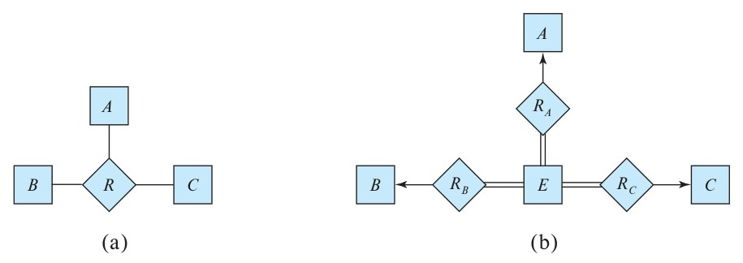
*Figure 6.25 — Ternary relationship versus three binary relationships.*

<!-- Page 285 -->

- An identifying attribute may have to be created for the entity set created to represent the relationship set. This attribute, along with the extra relationship sets
required, increases the complexity of the design and (as we shall see in Section 6.7) overall storage requirements.
- An *n*-ary relationship set shows more clearly that several entities participate in a
single relationship.
- There may not be a way to translate constraints on the ternary relationship into
constraints on the binary relationships. For example, consider a constraint that says that *R* is many-to-one from *A*, *B* to *C*; that is, each pair of entities from *A* and *B* is associated with at most one *C* entity. This constraint cannot be expressed by using cardinality constraints on the relationship sets $R_{A}$, $R_{B}$, and $R_{C}$.

Consider the relationship set *proj_guide* in Section 6.2.2, relating *instructor*, *student*, and *project*. We cannot directly split *proj_guide* into binary relationships between *instructor* and *project* and between *instructor* and *student*. If we did so, we would be able to record that instructor Katz works on projects *A* and *B* with students Shankar and Zhang; however, we would not be able to record that Katz works on project *A* with student Shankar and works on project *B* with student Zhang, but does not work on project *A* with Zhang or on project *B* with Shankar.

The relationship set *proj_guide* can be split into binary relationships by creating a new entity set as described above. However, doing so would not be very natural.

## 6.10 Alternative Notations for Modeling Data

A diagrammatic representation of the data model of an application is a very important part of designing a database schema. Creation of a database schema requires not only data modeling experts, but also domain experts who know the requirements of the application but may not be familiar with data modeling. An intuitive diagrammatic representation is particularly important since it eases communication of information between these groups of experts.

A number of alternative notations for modeling data have been proposed, of which E-R diagrams and UML class diagrams are the most widely used. There is no universal standard for E-R diagram notation, and different books and E-R diagram software use different notations.

In the rest of this section, we study some of the alternative E-R diagram notations, as well as the UML class diagram notation. To aid in comparison of our notation with these alternatives, Figure 6.26 summarizes the set of symbols we have used in our E-R diagram notation.

### 6.10.1 Alternative E-R Notations

<!-- Page 286 -->

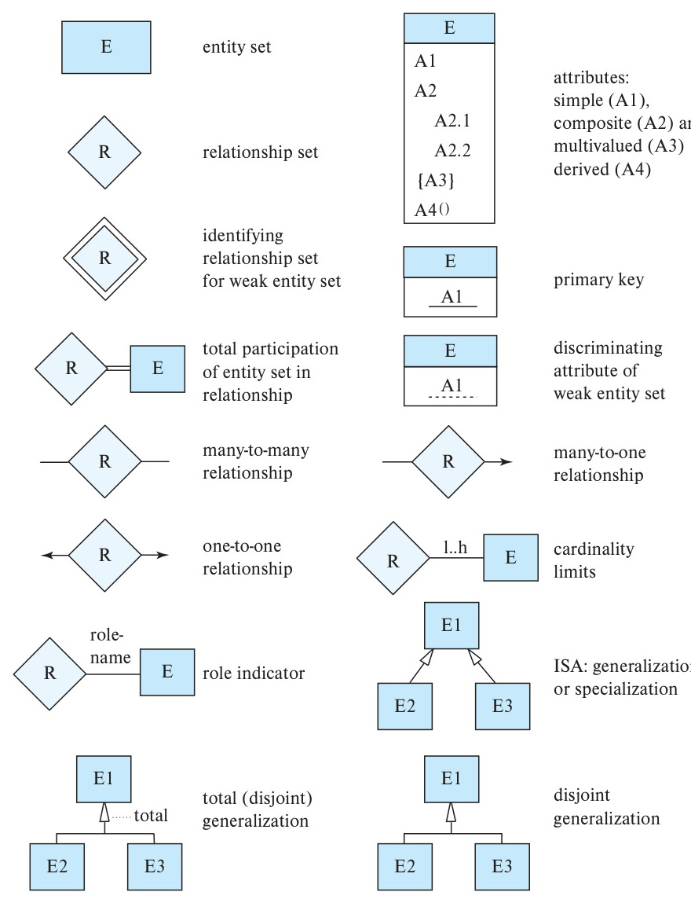
*Figure 6.26 — Symbols used in the E-R notation.*

to the box representing the entity; primary key attributes are indicated by underlining them. The above notation is shown at the top of the figure. Relationship attributes can be similarly represented, by connecting the ovals to the diamond representing the relationship.

Cardinality constraints on relationships can be indicated in several different ways, as shown in Figure 6.27. In one alternative, shown on the left side of the figure, labels ∗and 1 on the edges out of the relationship are used for depicting many-to-many, one-

<!-- Page 287 -->

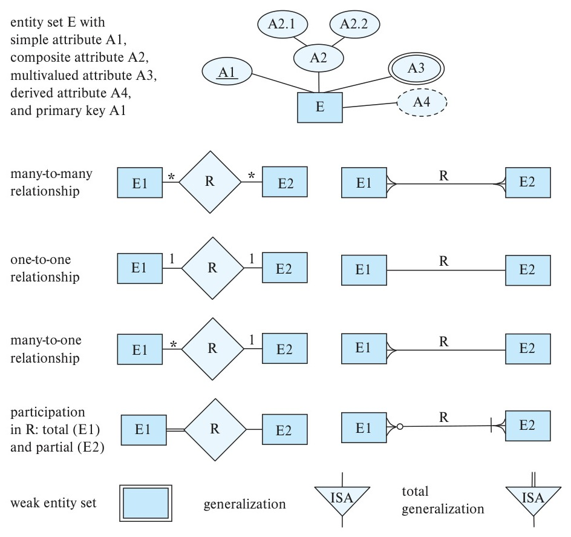
*Figure 6.27 — Alternative E-R notations.*

to-one, and many-to-one relationships. The case of one-to-many is symmetric to many-to-one and is not shown.

In another alternative notation shown on the right side of Figure 6.27, relationship sets are represented by lines between entity sets, without diamonds; only binary relationships can be modeled thus. Cardinality constraints in such a notation are shown by “crow’s-foot” notation, as in the figure. In a relationship *R* between *E*1 and *E*2, crow’s feet on both sides indicate a many-to-many relationship, while crow’s feet on just the *E*1 side indicate a many-to-one relationship from *E*1 to *E*2. Total participation is specified in this notation by a vertical bar. Note however, that in a relationship *R* between entities *E*1 and *E*2, if the participation of *E*1 in *R* is total, the vertical bar is placed on the opposite side, adjacent to entity *E*2. Similarly, partial participation is indicated by using a circle, again on the opposite side.

The bottom part of Figure 6.27 shows an alternative representation of generalization, using triangles instead of hollow arrowheads.

<!-- Page 288 -->

In prior editions of this text up to the fifth edition, we used ovals to represent attributes, with triangles representing generalization, as shown in Figure 6.27. The notation using ovals for attributes and diamonds for relationships is close to the original form of E-R diagrams used by Chen in his paper that introduced the notion of E-R modeling. That notation is now referred to as Chen’s notation.

The U.S. National Institute for Standards and Technology defined a standard called IDEF1X in 1993. IDEF1X uses the crow’s-foot notation, with vertical bars on the relationship edge to denote total participation and hollow circles to denote partial participation, and it includes other notations that we have not shown.

With the growth in the use of Unified Markup Language (UML), described in Section 6.10.2, we have chosen to update our E-R notation to make it closer to the form of UML class diagrams; the connections will become clear in Section 6.10.2. In comparison with our previous notation, our new notation provides a more compact representation of attributes, and it is also closer to the notation supported by many E-R modeling tools, in addition to being closer to the UML class diagram notation.

There are a variety of tools for constructing E-R diagrams, each of which has its own notational variants. Some of the tools even provide a choice between several E-R notation variants. See the tools section at the end of the chapter for references.

One key difference between entity sets in an E-R diagram and the relation schemas created from such entities is that attributes in the relational schema corresponding to E-R relationships, such as the *dept_name* attribute of *instructor*, are not shown in the entity set in the E-R diagram. Some data modeling tools allow designers to choose between two views of the same entity, one an entity view without such attributes, and other a relational view with such attributes.

### 6.10.2 The Unified Modeling Language UML

Entity-relationship diagrams help model the data representation component of a software system. Data representation, however, forms only one part of an overall system design. Other components include models of user interactions with the system, specification of functional modules of the system and their interaction, etc. The **Unified** **Modeling** **Language** (**UML**) is a standard developed under the auspices of the **Object** **Management Group** (**OMG**) for creating specifications of various components of a software system. Some of the parts of UML are:

- **Class diagram**. A class diagram is similar to an E-R diagram. Later in this section
we illustrate a few features of class diagrams and how they relate to E-R diagrams.
- **Use case diagram**. Use case diagrams show the interaction between users and the
system, in particular the steps of tasks that users perform (such as withdrawing money or registering for a course).
- **Activity diagram**. Activity diagrams depict the flow of tasks between various components of a system.

<!-- Page 289 -->

- **Implementation diagram**. Implementation diagrams show the system components
and their interconnections, both at the software component level and the hardware component level.

We do not attempt to provide detailed coverage of the different parts of UML here. Instead we illustrate some features of that part of UML that relates to data modeling through examples. See the Further Reading section at the end of the chapter for references on UML.

Figure 6.28 shows several E-R diagram constructs and their equivalent UML class diagram constructs. We describe these constructs below. UML actually models objects, whereas E-R models entities. Objects are like entities, and have attributes, but additionally provide a set of functions (called methods) that can be invoked to compute values on the basis of attributes of the objects, or to update the object itself. Class diagrams can depict methods in addition to attributes. We cover objects in Section 8.2. UML does not support composite or multivalued attributes, and derived attributes are equivalent to methods that take no parameters. Since classes support encapsulation, UML allows attributes and methods to be prefixed with a “+”, “-”, or “#”, which denote respectively public, private, and protected access. Private attributes can only be used in methods of the class, while protected attributes can be used only in methods of the class and its subclasses; these should be familiar to anyone who knows Java, C++, or C#.

In UML terminology, relationship sets are referred to as **associations**; we shall refer to them as relationship sets for consistency with E-R terminology. We represent binary relationship sets in UML by just drawing a line connecting the entity sets. We write the relationship set name adjacent to the line. We may also specify the role played by an entity set in a relationship set by writing the role name on the line, adjacent to the entity set. Alternatively, we may write the relationship set name in a box, along with attributes of the relationship set, and connect the box by a dotted line to the line depicting the relationship set. This box can then be treated as an entity set, in the same way as an aggregation in E-R diagrams, and can participate in relationships with other entity sets.

Since UML version 1.3, UML supports nonbinary relationships, using the same diamond notation used in E-R diagrams. Nonbinary relationships could not be directly represented in earlier versions of UML—they had to be converted to binary relationships by the technique we have seen earlier in Section 6.9.4. UML allows the diamond notation to be used even for binary relationships, but most designers use the line notation.

Cardinality constraints are specified in UML in the same way as in E-R diagrams, in the form $l..h$, where *l* denotes the minimum and *h* the maximum number of relationships an entity can participate in. However, you should be aware that the positioning of the constraints is exactly the reverse of the positioning of constraints in E-R diagrams, as shown in Figure 6.28. The constraint $0..\ast$ on the $E_2$ side and $0..1$ on the $E_1$ side means that each *E*2 entity can participate in at most one relationship, whereas each *E*1 entity can participate in many relationships; in other words, the relationship is many-to-one from *E*2 to *E*1.

<!-- Page 290 -->

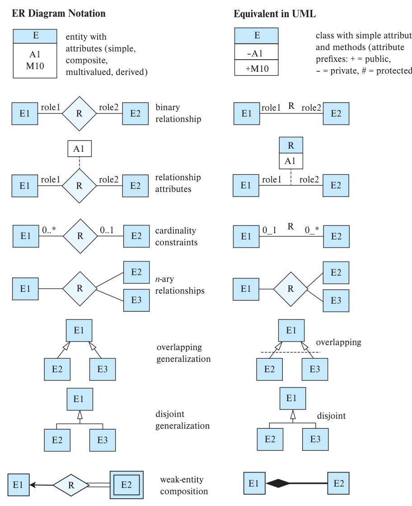
*Figure 6.28 — Symbols used in the UML class diagram notation.*

Single values such as 1 or ∗may be written on edges; the single value 1 on an edge is treated as equivalent to 1*..*1, while ∗is equivalent to 0*..* ∗. UML supports generalization; the notation is basically the same as in our E-R notation, including the representation of disjoint and overlapping generalizations.

UML class diagrams include several other notations that approximately correspond to the E-R notations we have seen. A line between two entity sets with a small shaded diamond at one end in UML specifies “composition” in UML. The composition relationship between *E*2 and *E*1 in Figure 6.28 indicates that *E*2 is existence dependent on *E*1; this is roughly equivalent to denoting *E*2 as a weak entity set that is existence

<!-- Page 291 -->

dependent on the identifying entity set *E*1. (The term *aggregation* in UML denotes a variant of composition where *E*2 is contained in *E*1 but may exist independently, and it is denoted using a small hollow diamond.)

UML class diagrams also provide notations to represent object-oriented language features such as interfaces. See the Further Reading section for more information on UML class diagrams.

## 6.11 Other Aspects of Database Design

Our extensive discussion of schema design in this chapter may create the false impression that schema design is the only component of a database design. There are indeed several other considerations that we address more fully in subsequent chapters, and survey briefly here.

### 6.11.1 Functional Requirements

All enterprises have rules on what kinds of functionality are to be supported by an enterprise application. These could include transactions that update the data, as well as queries to view data in a desired fashion. In addition to planning the functionality, designers have to plan the interfaces to be built to support the functionality.

Not all users are authorized to view all data, or to perform all transactions. An authorization mechanism is very important for any enterprise application. Such authorization could be at the level of the database, using database authorization features. But it could also be at the level of higher-level functionality or interfaces, specifying who can use which functions/interfaces.

### 6.11.2 Data Flow, Workflow

Database applications are often part of a larger enterprise application that interacts not only with the database system but also with various specialized applications. As an example, consider a travel-expense report. It is created by an employee returning from a business trip (possibly by means of a special software package) and is subsequently routed to the employee’s manager, perhaps other higher-level managers, and eventually to the accounting department for payment (at which point it interacts with the enterprise’s accounting information systems).

The term *workflow* refers to the combination of data and tasks involved in processes like those of the preceding examples. Workflows interact with the database system as they move among users and users perform their tasks on the workflow. In addition to the data on which workflows operate, the database may store data about the workflow itself, including the tasks making up a workflow and how they are to be routed among users. Workflows thus specify a series of queries and updates to the database that may be taken into account as part of the database-design process. Put in other terms, modeling the

<!-- Page 292 -->

enterprise requires us not only to understand the semantics of the data but also the business processes that use those data.

### 6.11.3 Schema Evolution

Database design is usually not a one-time activity. The needs of an organization evolve continually, and the data that it needs to store also evolve correspondingly. During the initial database-design phases, or during the development of an application, the database designer may realize that changes are required at the conceptual, logical, or physical schema levels. Changes in the schema can affect all aspects of the database application. A good database design anticipates future needs of an organization and ensures that the schema requires minimal changes as the needs evolve.

It is important to distinguish between fundamental constraints that are expected to be permanent and constraints that are anticipated to change. For example, the constraint that an instructor-id identify a unique instructor is fundamental. On the other hand, a university may have a policy that an instructor can have only one department, which may change at a later date if joint appointments are allowed. A database design that only allows one department per instructor might require major changes if joint appointments are allowed. Such joint appointments can be represented by adding an extra relationship without modifying the *instructor* relation, as long as each instructor has only one primary department affiliation; a policy change that allows more than one primary affiliation may require a larger change in the database design. A good design should account not only for current policies, but should also avoid or minimize the need for modifications due to changes that are anticipated or have a reasonable chance of happening.

Finally, it is worth noting that database design is a human-oriented activity in two senses: the end users of the system are people (even if an application sits between the database and the end users); and the database designer needs to interact extensively with experts in the application domain to understand the data requirements of the application. All of the people involved with the data have needs and preferences that should be taken into account in order for a database design and deployment to succeed within the enterprise.

## 6.12 Summary

- Database design mainly involves the design of the database schema. The entity-relationship (E-R) data model is a widely used data model for database design.
It provides a convenient graphical representation to view data, relationships, and constraints.
- The E-R model is intended primarily for the database-design process. It was developed to facilitate database design by allowing the specification of an enterprise
schema. Such a schema represents the overall logical structure of the database. This overall structure can be expressed graphically by an E-R diagram.

<!-- Page 293 -->

- An entity is an object that exists in the real world and is distinguishable from other
objects. We express the distinction by associating with each entity a set of attributes that describes the object.
- A relationship is an association among several entities. A relationship set is a collection of relationships of the same type, and an entity set is a collection of entities
of the same type.
- The terms superkey, candidate key, and primary key apply to entity and relationship sets as they do for relation schemas. Identifying the primary key of a relationship set requires some care, since it is composed of attributes from one or more of
the related entity sets.
- Mapping cardinalities express the number of entities to which another entity can
be associated via a relationship set.
- An entity set that does not have sufficient attributes to form a primary key is termed
a weak entity set. An entity set that has a primary key is termed a strong entity set.
- The various features of the E-R model offer the database designer numerous
choices in how to best represent the enterprise being modeled. Concepts and objects may, in certain cases, be represented by entities, relationships, or attributes. Aspects of the overall structure of the enterprise may be best described by using weak entity sets, generalization, specialization, or aggregation. Often, the designer must weigh the merits of a simple, compact model versus those of a more precise, but more complex one.
- A database design specified by an E-R diagram can be represented by a collection of
relation schemas. For each entity set and for each relationship set in the database, there is a unique relation schema that is assigned the name of the corresponding entity set or relationship set. This forms the basis for deriving a relational database design from an E-R diagram.
- Specialization and generalization define a containment relationship between a
higher-level entity set and one or more lower-level entity sets. Specialization is the result of taking a subset of a higher-level entity set to form a lower-level entity set. Generalization is the result of taking the union of two or more disjoint (lower-level) entity sets to produce a higher-level entity set. The attributes of higher-level entity sets are inherited by lower-level entity sets.
- Aggregation is an abstraction in which relationship sets (along with their associated entity sets) are treated as higher-level entity sets, and can participate in
relationships.
- Care must be taken in E-R design. There are a number of common mistakes to
avoid. Also, there are choices among the use of entity sets, relationship sets, and

<!-- Page 294 -->

attributes in representing aspects of the enterprise whose correctness may depend on subtle details specific to the enterprise.
- UML is a popular modeling language. UML class diagrams are widely used for
modeling classes, as well as for general-purpose data modeling.

## Review Terms

- Design Process
  - Conceptual-design
  - Logical-design
  - Physical-design
- Entity-relationship (E-R) data model
- Entity and entity set
  - Simple and composite attributes
  - Single-valued and multivalued attributes
  - Derived attribute
- Key
  - Superkey
  - Candidate key
  - Primary key
- Relationship and relationship set
  - Binary relationship set
  - Degree of relationship set
  - Descriptive attributes
  - Superkey, candidate key, and primary key
  - Role
  - Recursive relationship set
- E-R diagram
- Mapping cardinality:
  - One-to-one relationship
  - One-to-many relationship
  - Many-to-one relationship
  - Many-to-many relationship
- Total and partial participation
- Weak entity sets and strong entity sets
  - Discriminator attributes
  - Identifying relationship
- Specialization and generalization
- Aggregation
- Design choices
- United Modeling Language (UML)

## Practice Exercises

### 6.1

Construct an E-R diagram for a car insurance company whose customers own one or more cars each. Each car has associated with it zero to any number of recorded accidents. Each insurance policy covers one or more cars and has one or more premium payments associated with it. Each payment is for a particular period of time, and has an associated due date, and the date when the payment was received.

<!-- Page 295 -->

### 6.2

Consider a database that includes the entity sets *student*, *course*, and *section* from the university schema and that additionally records the marks that students receive in different exams of different sections.

a. Construct an E-R diagram that models exams as entities and uses a ternary
relationship as part of the design.

b. Construct an alternative E-R diagram that uses only a binary relationship
between *student* and *section*. Make sure that only one relationship exists between a particular *student* and *section* pair, yet you can represent the marks that a student gets in different exams.

### 6.3

Design an E-R diagram for keeping track of the scoring statistics of your favorite sports team. You should store the matches played, the scores in each match, the players in each match, and individual player scoring statistics for each match. Summary statistics should be modeled as derived attributes with an explanation as to how they are computed.

### 6.4

Consider an E-R diagram in which the same entity set appears several times, with its attributes repeated in more than one occurrence. Why is allowing this redundancy a bad practice that one should avoid?

### 6.5

An E-R diagram can be viewed as a graph. What do the following mean in terms of the structure of an enterprise schema?

a. The graph is disconnected.

b. The graph has a cycle.

### 6.6

Consider the representation of the ternary relationship of Figure 6.29a using the binary relationships illustrated in Figure 6.29b (attributes not shown).

a. Show a simple instance of *E*, *A*, *B*, *C*, $R_{A}$, $R_{B}$, and $R_{C}$ that cannot correspond to any instance of *A*, *B*, *C*, and *R*.

b. Modify the E-R diagram of Figure 6.29b to introduce constraints that will
guarantee that any instance of *E*, *A*, *B*, *C*, $R_{A}$, $R_{B}$, and $R_{C}$ that satisfies the constraints will correspond to an instance of *A*, *B*, *C*, and *R*.

c. Modify the preceding translation to handle total participation constraints
on the ternary relationship.

### 6.7

A weak entity set can always be made into a strong entity set by adding to its attributes the primary-key attributes of its identifying entity set. Outline what sort of redundancy will result if we do so.

### 6.8

Consider a relation such as *sec_course*, generated from a many-to-one relationship set *sec_course*. Do the primary and foreign key constraints created on the relation enforce the many-to-one cardinality constraint? Explain why.

<!-- Page 296 -->

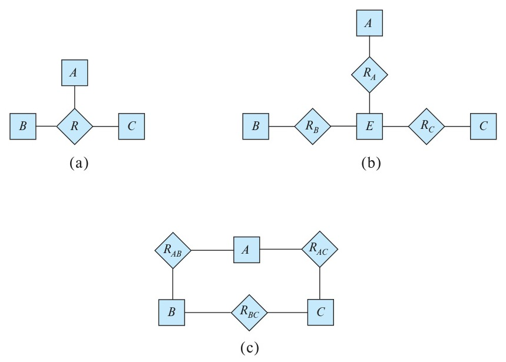
*Figure 6.29 — Representation of a ternary relationship using binary relationships.*

### 6.9

Suppose the *advisor* relationship set were one-to-one. What extra constraints are required on the relation *advisor* to ensure that the one-to-one cardinality constraint is enforced?

### 6.10

Consider a many-to-one relationship *R* between entity sets *A* and *B*. Suppose the relation created from *R* is combined with the relation created from *A*. In SQL, attributes participating in a foreign key constraint can be null. Explain how a constraint on total participation of *A* in *R* can be enforced using **not null** constraints in SQL.

### 6.11

In SQL, foreign key constraints can reference only the primary key attributes of the referenced relation or other attributes declared to be a superkey using the **unique** constraint. As a result, total participation constraints on a many-to-many relationship set (or on the “one” side of a one-to-many relationship set) cannot be enforced on the relations created from the relationship set, using primary key, foreign key, and not null constraints on the relations.

a. Explain why.

b. Explain how to enforce total participation constraints using complex
check constraints or assertions (see Section 4.4.8). (Unfortunately, these features are not supported on any widely used database currently.)

### 6.12

Consider the following lattice structure of generalization and specialization (attributes not shown).

<!-- Page 297 -->

*Exercise 6.12 — Lattice structure of generalization and specialization*

For entity sets *A*, *B*, and *C*, explain how attributes are inherited from the higher-level entity sets *X* and *Y*. Discuss how to handle a case where an attribute of *X* has the same name as some attribute of *Y*.

### 6.13

An E-R diagram usually models the state of an enterprise at a point in time. Suppose we wish to track *temporal changes*, that is, changes to data over time. For example, Zhang may have been a student between September 2015 and May 2019, while Shankar may have had instructor Einstein as advisor from May 2018 to December 2018, and again from June 2019 to January 2020. Similarly, attribute values of an entity or relationship, such as *title* and *credits* of *course*, *salary*, or even *name* of *instructor*, and *tot_cred* of *student*, can change over time. One way to model temporal changes is as follows: We define a new data type called **valid**

**time**, which is a time interval, or a set of time intervals. We then associate a *valid_time* attribute with each entity and relationship, recording the time periods during which the entity or relationship is valid. The end time of an interval can be infinity; for example, if Shankar became a student in September 2018, and is still a student, we can represent the end time of the *valid_time* interval as infinity for the Shankar entity. Similarly, we model attributes that can change over time as a set of values, each with its own *valid_time*.

a. Draw an E-R diagram with the *student* and *instructor* entities, and the *advisor* relationship, with the above extensions to track temporal changes.

b. Convert the E-R diagram discussed above into a set of relations.

It should be clear that the set of relations generated is rather complex, leading to difficulties in tasks such as writing queries in SQL. An alternative approach, which is used more widely, is to ignore temporal changes when designing the E-R model (in particular, temporal changes to attribute values), and to modify the relations generated from the E-R model to track temporal changes.

## Exercises

### 6.14

Explain the distinctions among the terms *primary* *key*, *candidate* *key*, and *superkey*.

<!-- Page 298 -->

### 6.15

Construct an E-R diagram for a hospital with a set of patients and a set of medical doctors. Associate with each patient a log of the various tests and examinations conducted.

### 6.16

Extend the E-R diagram of Exercise 6.3 to track the same information for all teams in a league.

### 6.17

Explain the difference between a weak and a strong entity set.

### 6.18

Consider two entity sets *A* and *B* that both have the attribute *X* (among others whose names are not relevant to this question).

a. If the two *X*s are completely unrelated, how should the design be improved?

b. If the two *X*s represent the same property and it is one that applies both to
*A* and to *B*, how should the design be improved? Consider three subcases:

- *X* is the primary key for *A* but not *B*
- *X* is the primary key for both *A* and *B*
- *X* is not the primary key for *A* nor for *B*

### 6.19

We can convert any weak entity set to a strong entity set by simply adding appropriate attributes. Why, then, do we have weak entity sets?

### 6.20

Construct appropriate relation schemas for each of the E-R diagrams in:

a. Exercise 6.1.

b. Exercise 6.2.

c. Exercise 6.3.

d. Exercise 6.15.

### 6.21

Consider the E-R diagram in Figure 6.30, which models an online bookstore.

a. Suppose the bookstore adds Blu-ray discs and downloadable video to its
collection. The same item may be present in one or both formats, with differing prices. Draw the part of the E-R diagram that models this addition, showing just the parts related to video.

b. Now extend the full E-R diagram to model the case where a shopping basket may contain any combination of books, Blu-ray discs, or downloadable
video.

### 6.22

Design a database for an automobile company to provide to its dealers to assist them in maintaining customer records and dealer inventory and to assist sales staffin ordering cars.

<!-- Page 299 -->

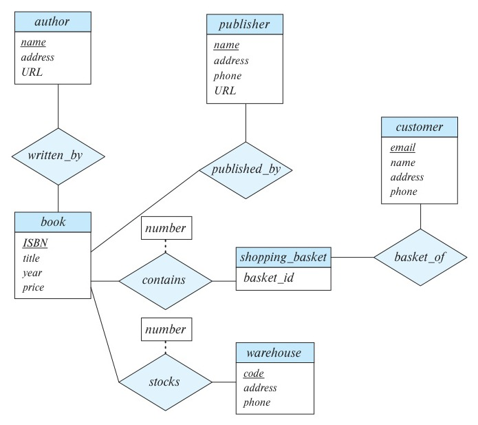
*Figure 6.30 — E-R diagram for modeling an online bookstore.*

Each vehicle is identified by a vehicle identification number (VIN). Each individual vehicle is a particular model of a particular brand offered by the company (e.g., the XF is a model of the car brand Jaguar of Tata Motors). Each model can be offered with a variety of options, but an individual car may have only some (or none) of the available options. The database needs to store information about models, brands, and options, as well as information about individual dealers, customers, and cars.

Your design should include an E-R diagram, a set of relational schemas, and a list of constraints, including primary-key and foreign-key constraints.

### 6.23

Design a database for a worldwide package delivery company (e.g., DHL or FedEx). The database must be able to keep track of customers who ship items and customers who receive items; some customers may do both. Each package must be identifiable and trackable, so the database must be able to store the location of the package and its history of locations. Locations include trucks, planes, airports, and warehouses.

Your design should include an E-R diagram, a set of relational schemas, and a list of constraints, including primary-key and foreign-key constraints.

### 6.24

Design a database for an airline. The database must keep track of customers and their reservations, flights and their status, seat assignments on individual flights, and the schedule and routing of future flights.

Your design should include an E-R diagram, a set of relational schemas, and a list of constraints, including primary-key and foreign-key constraints.

<!-- Page 300 -->

### 6.25

In Section 6.9.4, we represented a ternary relationship (repeated in Figure 6.29a) using binary relationships, as shown in Figure 6.29b. Consider the alternative shown in Figure 6.29c. Discuss the relative merits of these two alternative representations of a ternary relationship by binary relationships.

### 6.26

Design a generalization–specialization hierarchy for a motor vehicle sales company. The company sells motorcycles, passenger cars, vans, and buses. Justify your placement of attributes at each level of the hierarchy. Explain why they should not be placed at a higher or lower level.

### 6.27

Explain the distinction between disjoint and overlapping constraints.

### 6.28

Explain the distinction between total and partial constraints.

## Tools

Many database systems provide tools for database design that support E-R diagrams. These tools help a designer create E-R diagrams, and they can automatically create corresponding tables in a database. See bibliographical notes of Chapter 1 for references to database-system vendors’ web sites.

There are also several database-independent data modeling tools that support E-R diagrams and UML class diagrams.

*Dia*, which is a free diagram editor that runs on multiple platforms such as Linux and Windows, supports E-R diagrams and UML class diagrams. To represent entities with attributes, you can use either classes from the UML library or tables from the Database library provided by Dia, since the default E-R notation in Dia represents attributes as ovals. The free online diagram editor *LucidChart* allows you to create E-R diagrams with entities represented in the same ways as we do. To create relationships, we suggest you use diamonds from the Flowchart shape collection. *Draw.io* is another online diagram editor that supports E-R diagrams.

Commercial tools include IBM Rational Rose Modeler, Microsoft Visio, ERwin Data Modeler, Poseidon for UML, and SmartDraw.

## Further Reading

The E-R data model was introduced by [Chen (1976)]. The Integration Definition for Information Modeling (IDEF1X) standard [NIST (1993)] released by the United States National Institute of Standards and Technology (NIST) defined standards for E-R diagrams. However, a variety of E-R notations are in use today.

[Thalheim (2000)] provides a detailed textbook coverage of research in E-R modeling.

As of 2018, the current UML version was 2.5, which was released in June 2015. See www.uml.org for more information on UML standards and tools.

<!-- Page 301 -->

## Bibliography

**[Chen (1976)]** P. P. Chen, “The Entity-Relationship Model: Toward a Unified View of Data”, *ACM Transactions on Database Systems*, Volume 1, Number 1 (1976), pages 9–36.

**[NIST (1993)]** NIST, “Integration Definition for Information Modeling (IDEF1X)”, Technical Report Federal Information Processing Standards Publication 184, National Institute of Standards and Technology (NIST) (1993).

**[Thalheim (2000)]** B. Thalheim, *Entity-Relationship Modeling: Foundations of Database Technology*, Springer Verlag (2000).

## Credits

The photo of the sailboats in the beginning of the chapter is due to ©Pavel Nesvadba/Shutterstock.

<!-- Page 302 -->
