<!-- Page 303 -->

# Chapter 7: Relational Database Design

In this chapter, we consider the problem of designing a schema for a relational database. Many of the issues in doing so are similar to design issues we considered in Chapter 6 using the E-R model.

In general, the goal of relational database design is to generate a set of relation schemas that allows us to store information without unnecessary redundancy, yet also allows us to retrieve information easily. This is accomplished by designing schemas that are in an appropriate normal form. To determine whether a relation schema is in one of the desirable normal forms, we need information about the real-world enterprise that we are modeling with the database. Some of this information exists in a well-designed E-R diagram, but additional information about the enterprise may be needed as well.

In this chapter, we introduce a formal approach to relational database design based on the notion of functional dependencies. We then define normal forms in terms of functional dependencies and other types of data dependencies. First, however, we view the problem of relational design from the standpoint of the schemas derived from a given entity-relationship design.

## 7.1 Features of Good Relational Designs

Our study of entity-relationship design in Chapter 6 provides an excellent starting point for creating a relational database design. We saw in Section 6.7 that it is possible to generate a set of relation schemas directly from the E-R design. The goodness (or badness) of the resulting set of schemas depends on how good the E-R design was in the first place. Later in this chapter, we shall study precise ways of assessing the desirability of a collection of relation schemas. However, we can go a long way toward a good design using concepts we have already studied. For ease of reference, we repeat the schemas for the university database in Figure 7.1.

Suppose that we had started out when designing the university enterprise with the schema *in_dep*.

$$\text{in\_dep}(\text{ID}, \text{name}, \text{salary}, \text{dept\_name}, \text{building}, \text{budget})$$

<!-- Page 304 -->


*Figure 7.1 — Database schema for the university example.*

This represents the result of a natural join on the relations corresponding to *instructor* and *department*. This seems like a good idea because some queries can be expressed using fewer joins, until we think carefully about the facts about the university that led to our E-R design.

Let us consider the instance of the *in_dep* relation shown in Figure 7.2. Notice that we have to repeat the department information (“building” and “budget”) once for each instructor in the department. For example, the information about the Comp. Sci. department (Taylor, 100000) is included in the tuples of instructors Katz, Srinivasan, and Brandt.

It is important that all these tuples agree as to the budget amount since otherwise our database would be inconsistent. In our original design using *instructor* and *department*, we stored the amount of each budget exactly once. This suggests that using *in_dep* is a bad idea since it stores the budget amounts redundantly and runs the risk that some user might update the budget amount in one tuple but not all, and thus create inconsistency.

Even if we decided to live with the redundancy problem, there is still another problem with the *in_dep* schema. Suppose we are creating a new department in the university. In the alternative design above, we cannot represent directly the information concerning a department (*dept_name*, *building*, *budget*) unless that department has at least one instructor at the university. This is because tuples in the *in_dep* table require values for *ID*, *name*, and *salary*. This means that we cannot record information about the newly created department until the first instructor is hired for the new department. In the old design, the schema *department* can handle this, but under the revised design, we would have to create a tuple with a null value for *building* and *budget*. In some cases null values are troublesome, as we saw in our study of SQL. However, if we decide that

<!-- Page 305 -->

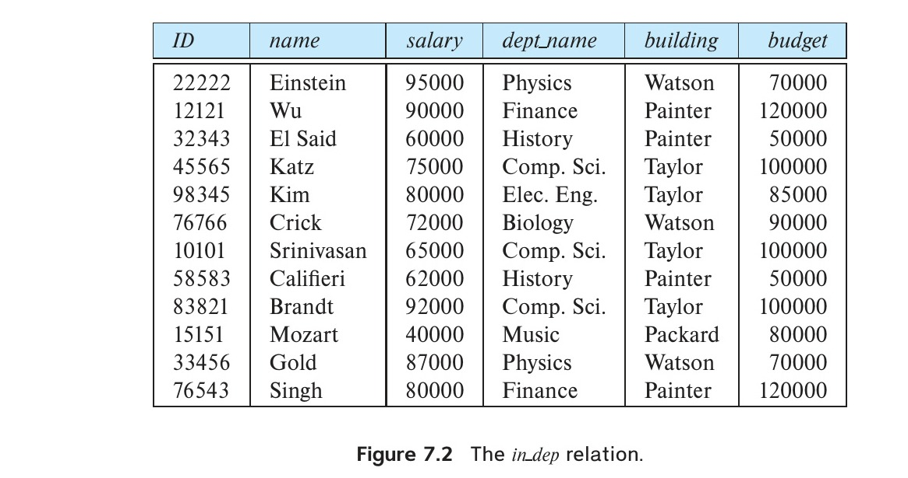
*Figure 7.2 — The in_dep relation.*

this is not a problem to us in this case, then we can proceed to use the revised design, though, as we noted, we would still have the redundancy problem.

### 7.1.1 Decomposition

The only way to avoid the repetition-of-information problem that we can have in the *in_dep* schema is to **decompose** it into two schemas: *instructor* and *department*. The schemas of these relations are:

$$\text{instructor}(\underline{\text{ID}}, \text{name}, \text{dept\_name}, \text{salary})$$
$$\text{department}(\underline{\text{dept\_name}}, \text{building}, \text{budget})$$

Not all decompositions of schemas are helpful. Consider an enterprise with the schema

$$\text{employee}(\underline{\text{ID}}, \text{name}, \text{street}, \text{city}, \text{salary})$$

into the following two schemas:

$$\text{employee}_1(\underline{\text{ID}}, \text{name})$$
$$\text{employee}_2(\text{name}, \text{street}, \text{city}, \text{salary})$$

The flaw in this decomposition arises from the possibility that the enterprise has two employees with the same name. This is not unlikely in practice, as many cultures have certain highly popular names. Each person would have a unique employee-id, which is why ID can serve as the primary key. As an example, let us assume two employees,

<!-- Page 306 -->

both named Kim, work at the university and have the following tuples in the *employee* relation:

$$\text{(57766, Kim, Main, Perryridge, 75000)}$$
$$\text{(98776, Kim, North, Hampton, 67000)}$$

Figure 7.3 shows these tuples, the resulting tuples using the schemas resulting from the decomposition, and the result if we attempted to regenerate the original tuples using a natural join. As we see in the figure, the two original tuples appear in the result along with two new tuples that incorrectly mix data values pertaining to the two employees named Kim. Although we have more tuples, we actually have less information in the following sense. We can indicate that a certain street, city, and salary pertain to someone named Kim, but we are unable to distinguish which of the Kims. Thus, our decomposition is unable to represent certain important facts about the university database.

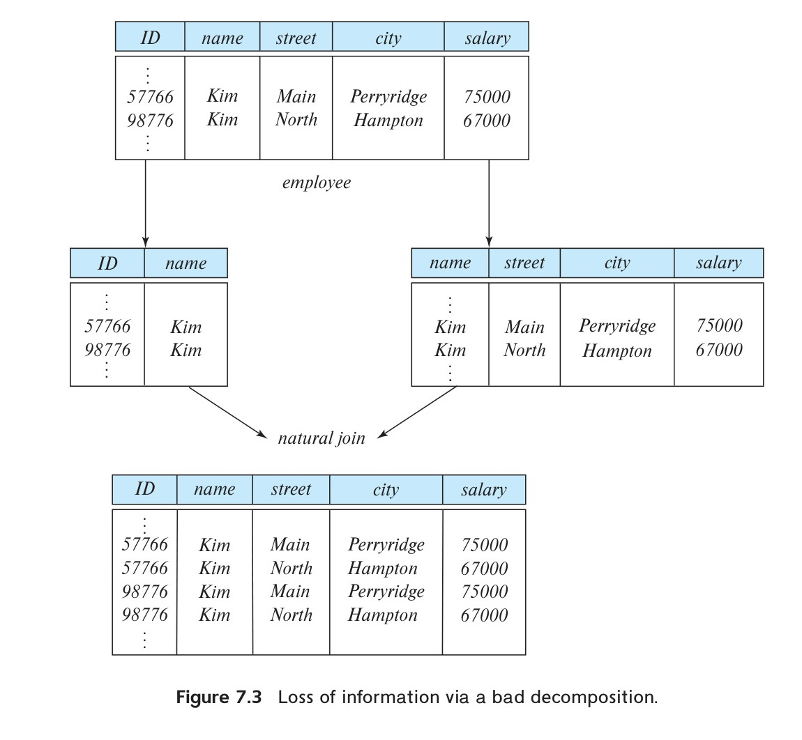
*Figure 7.3 — Loss of information via a bad decomposition.*

<!-- Page 307 -->

We would like to avoid such decompositions. We shall refer to such decompositions as being **lossy decompositions**, and, conversely, to those that are not as **lossless decompositions**.

For the remainder of the text we shall insist that all decompositions should be **lossless decompositions**.

### 7.1.2 Lossless Decomposition

Let $R$ be a relation schema and let $R_1$ and $R_2$ form a decomposition of $R$—that is, viewing $R$, $R_1$, and $R_2$ as sets of attributes, $R = R_1 \cup R_2$. We say that the decomposition is a **lossless decomposition** if there is no loss of information by replacing $R$ with two relation schemas $R_1$ and $R_2$. Loss of information occurs if it is possible to have an instance of a relation $r(R)$ that includes information that cannot be represented if instead of the instance of $r(R)$ we must use instances of $r_1(R_1)$ and $r_2(R_2)$. More precisely, we say the decomposition is lossless if, for all legal (we shall formally define “legal” in Section 7.2.2.) database instances, relation $r$ contains the same set of tuples as the result of the following SQL query:[^1]

```sql
select *
from (select R1 from r)
    natural join
    (select R2 from r)
```

This is stated more succinctly in the relational algebra as:

$$\Pi_{R_1}(r) \bowtie \Pi_{R_2}(r) = r$$

In other words, if we project $r$ onto $R_1$ and $R_2$, and compute the natural join of the projection results, we get back exactly $r$.

Conversely, a decomposition is **lossy** if when we compute the natural join of the projection results, we get a proper superset of the original relation. This is stated more succinctly in the relational algebra as:

$$r \subset \Pi_{R_1}(r) \bowtie \Pi_{R_2}(r)$$

Let us return to our decomposition of the *employee* schema into *employee1* and *employee2* (Figure 7.3) and a case where two or more employees have the same name. The result of *employee1* natural join *employee2* is a superset of the original relation *employee*, but the decomposition is lossy since the join result has lost information about which employee identifiers correspond to which addresses and salaries.

[^1]: The definition of lossless is stated assuming that no attribute that appears on the left side of a functional dependency can have a null value. This is explored further in Exercise 7.10.

<!-- Page 308 -->

It may seem counterintuitive that we have more tuples but less information, but that is indeed the case. The decomposed version is unable to represent the absence of a connection between a name and an address or salary, and absence of a connection is indeed information.

### 7.1.3 Normalization Theory

We are now in a position to define a general methodology for deriving a set of schemas each of which is in “good form”; that is, does not suffer from the repetition-of-information problem.

The method for designing a relational database is to use a process commonly known as **normalization**. The goal is to generate a set of relation schemas that allows us to store information without unnecessary redundancy, yet also allows us to retrieve information easily. The approach is:

- Decide if a given relation schema is in “good form.” There are a number of different forms (called normal forms), which we cover in Section 7.3.
- If a given relation schema is not in “good form,” then we decompose it into a number of smaller relation schemas, each of which is in an appropriate normal form. The decomposition must be a lossless decomposition.

To determine whether a relation schema is in one of the desirable normal forms, we need additional information about the real-world enterprise that we are modeling with the database. The most common approach is to use **functional dependencies**, which we cover in Section 7.2.

## 7.2 Decomposition Using Functional Dependencies

A database models a set of entities and relationships in the real world. There are usually a variety of constraints (rules) on the data in the real world. For example, some of the constraints that are expected to hold in a university database are:

1. Students and instructors are uniquely identified by their ID.
2. Each student and instructor has only one name.
3. Each instructor and student is (primarily) associated with only one department.[^2]
4. Each department has only one value for its budget, and only one associated building.

[^2]: An instructor, in most real universities, can be associated with more than one department, for example, via a joint appointment or in the case of adjunct faculty. Similarly, a student may have two (or more) majors or a minor. Our simplified university schema models only the primary department associated with each instructor or student.

<!-- Page 309 -->

An instance of a relation that satisfies all such real-world constraints is called a **legal instance** of the relation; a legal instance of a database is one where all the relation instances are legal instances.

### 7.2.1 Notational Conventions

In discussing algorithms for relational database design, we shall need to talk about arbitrary relations and their schema, rather than talking only about examples. Recalling our introduction to the relational model in Chapter 2, we summarize our notation here.

- In general, we use Greek letters for sets of attributes (e.g., $\alpha$). We use an uppercase Roman letter to refer to a relation schema. We use the notation $r(R)$ to show that the schema $R$ is for relation $r$.
  A relation schema is a set of attributes, but not all sets of attributes are schemas. When we use a lowercase Greek letter, we are referring to a set of attributes that may or may not be a schema. A Roman letter is used when we wish to indicate that the set of attributes is definitely a schema.
- When a set of attributes is a superkey, we may denote it by $K$. A superkey pertains to a specific relation schema, so we use the terminology “$K$ is a superkey for $R$.”
- We use a lowercase name for relations. In our examples, these names are intended to be realistic (e.g., *instructor*), while in our definitions and algorithms, we use single letters, like $r$.
- The notation $r(R)$ thus refers to the relation $r$ with schema $R$. When we write $r(R)$, we thus refer both to the relation and its schema.
- A relation, has a particular value at any given time; we refer to that as an instance and use the term “instance of $r$.” When it is clear that we are talking about an instance, we may use simply the relation name (e.g., $r$).

For simplicity, we assume that attribute names have only one meaning within the database schema.

### 7.2.2 Keys and Functional Dependencies

Some of the most commonly used types of real-world constraints can be represented formally as keys (superkeys, candidate keys, and primary keys), or as **functional dependencies**, which we define below.

In Section 2.3, we defined the notion of a superkey as a set of one or more attributes that, taken collectively, allows us to identify uniquely a tuple in the relation. We restate that definition here as follows: Given $r(R)$, a subset $K$ of $R$ is a **superkey** of $r(R)$ if, in any legal instance of $r(R)$, for all pairs $t_1$ and $t_2$ of tuples in the instance of $r$ if $t_1 \neq t_2$, then $t_1[K] \neq t_2[K]$. That is, no two tuples in any legal instance of relation $r(R)$ may

<!-- Page 310 -->

have the same value on attribute set $K$.[^3] If no two tuples in $r$ have the same value on $K$, then a $K$-value uniquely identifies a tuple in $r$.

Whereas a superkey is a set of attributes that uniquely identifies an entire tuple, a functional dependency allows us to express constraints that uniquely identify the values of certain attributes. Consider a relation schema $r(R)$, and let $\alpha \subseteq R$ and $\beta \subseteq R$.

- Given an instance of $r(R)$, we say that the instance **satisfies** the functional dependency $\alpha \rightarrow \beta$ if for all pairs of tuples $t_1$ and $t_2$ in the instance such that $t_1[\alpha] = t_2[\alpha]$, it is also the case that $t_1[\beta] = t_2[\beta]$.
- We say that the functional dependency $\alpha \rightarrow \beta$ **holds** on schema $r(R)$ if, every legal instance of $r(R)$ satisfies the functional dependency.

Using the functional-dependency notation, we say that $K$ is a superkey for $r(R)$ if the functional dependency $K \rightarrow R$ holds on $r(R)$. In other words, $K$ is a superkey if, for every legal instance of $r(R)$, for every pair of tuples $t_1$ and $t_2$ from the instance, whenever $t_1[K] = t_2[K]$, it is also the case that $t_1[R] = t_2[R]$ (i.e., $t_1 = t_2$).[^4]

Functional dependencies allow us to express constraints that we cannot express with superkeys. In Section 7.1, we considered the schema:

$$\text{in\_dep}(\text{ID}, \text{name}, \text{salary}, \text{dept\_name}, \text{building}, \text{budget})$$

in which the functional dependency $\text{dept\_name} \rightarrow \text{budget}$ holds because for each department (identified by *dept_name*) there is a unique budget amount.

We denote the fact that the pair of attributes $(\text{ID}, \text{dept\_name})$ forms a superkey for *in_dep* by writing:

$$\text{ID}, \text{dept\_name} \rightarrow \text{name}, \text{salary}, \text{building}, \text{budget}$$

We shall use functional dependencies in two ways:

1. To test instances of relations to see whether they satisfy a given set $F$ of functional dependencies.
2. To specify constraints on the set of legal relations. We shall thus concern ourselves with only those relation instances that satisfy a given set of functional dependencies. If we wish to constrain ourselves to relations on schema $r(R)$ that satisfy a set $F$ of functional dependencies, we say that $F$ holds on $r(R)$.

[^3]: In our discussion of functional dependencies, we use equality (=) in the normal mathematical sense, not the three-valued-logic sense of SQL. Said differently, in discussing functional dependencies, we assume no null values.
[^4]: Note that we assume here that relations are sets. SQL deals with multisets, and a primary key declaration in SQL for a set of attributes K requires not only that $t_1 = t_2$ if $t_1[K] = t_2[K]$, but also that there be no duplicate tuples. SQL also requires that attributes in the set K cannot be assigned a null value.

<!-- Page 311 -->

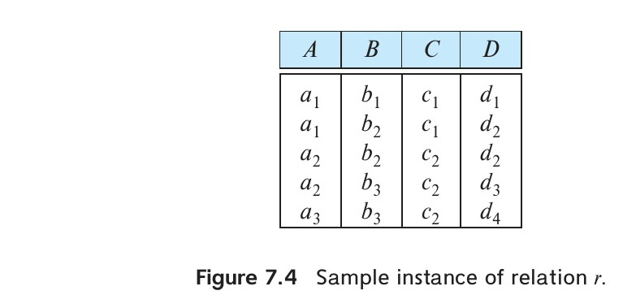
*Figure 7.4 — Sample instance of relation r.*

Let us consider the instance of relation $r$ of Figure 7.4, to see which functional dependencies are satisfied. Observe that $A \rightarrow C$ is satisfied. There are two tuples that have an $A$ value of $a_1$. These tuples have the same $C$ value—namely, $c_1$. Similarly, the two tuples with an $A$ value of $a_2$ have the same $C$ value, $c_2$. There are no other pairs of distinct tuples that have the same $A$ value. The functional dependency $C \rightarrow A$ is not satisfied, however. To see that it is not, consider the tuples $t_1 = (a_2, b_3, c_2, d_3)$ and $t_2 = (a_3, b_3, c_2, d_4)$. These two tuples have the same $C$ values, $c_2$, but they have different $A$ values, $a_2$ and $a_3$, respectively. Thus, we have found a pair of tuples $t_1$ and $t_2$ such that $t_1[C] = t_2[C]$, but $t_1[A] \neq t_2[A]$.

Some functional dependencies are said to be **trivial** because they are satisfied by all relations. For example, $A \rightarrow A$ is satisfied by all relations involving attribute $A$. Reading the definition of functional dependency literally, we see that, for all tuples $t_1$ and $t_2$ such that $t_1[A] = t_2[A]$, it is the case that $t_1[A] = t_2[A]$. Similarly, $AB \rightarrow A$ is satisfied by all relations involving attribute $A$. In general, a functional dependency of the form $\alpha \rightarrow \beta$ is trivial if $\beta \subseteq \alpha$.

It is important to realize that an instance of a relation may satisfy some functional dependencies that are not required to hold on the relation’s schema. In the instance of the *classroom* relation of Figure 7.5, we see that $\text{room\_number} \rightarrow \text{capacity}$ is satisfied. However, we believe that, in the real world, two classrooms in different buildings can have the same room number but with different room capacity. Thus, it is possible, at some time, to have an instance of the *classroom* relation in which $\text{room\_number} \rightarrow \text{capacity}$ is not satisfied. So, we would not include $\text{room\_number} \rightarrow \text{capacity}$ in the set of

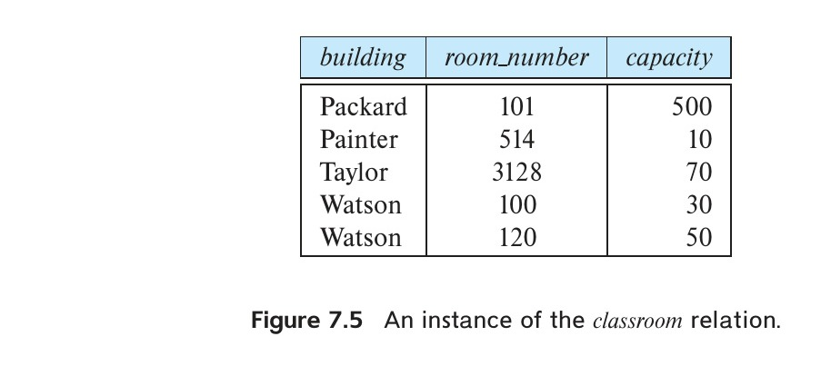
*Figure 7.5 — An instance of the classroom relation.*

<!-- Page 312 -->

functional dependencies that hold on the schema for the *classroom* relation. However, we would expect the functional dependency $\text{building}, \text{room\_number} \rightarrow \text{capacity}$ to hold on the *classroom* schema.

Because we assume that attribute names have only one meaning in the database schema, if we state that a functional dependency $\alpha \rightarrow \beta$ holds as a constraint on the database, then for any schema $R$ such that $\alpha \subseteq R$ and $\beta \subseteq R$, $\alpha \rightarrow \beta$ must hold.

Given that a set of functional dependencies $F$ holds on a relation $r(R)$, it may be possible to infer that certain other functional dependencies must also hold on the relation. For example, given a schema $r(A, B, C)$, if functional dependencies $A \rightarrow B$ and $B \rightarrow C$ hold on $r$, we can infer the functional dependency $A \rightarrow C$ must also hold on $r$. This is because, given any value of $A$, there can be only one corresponding value for $B$, and for that value of $B$, there can only be one corresponding value for $C$. We study in Section 7.4.1, how to make such inferences.

We shall use the notation $F^+$ to denote the **closure** of the set $F$, that is, the set of all functional dependencies that can be inferred given the set $F$. $F^+$ contains all of the functional dependencies in $F$.

### 7.2.3 Lossless Decomposition and Functional Dependencies

We can use functional dependencies to show when certain decompositions are lossless. Let $R, R_1, R_2$, and $F$ be as above. $R_1$ and $R_2$ form a lossless decomposition of $R$ if at least one of the following functional dependencies is in $F^+$:

- $R_1 \cap R_2 \rightarrow R_1$
- $R_1 \cap R_2 \rightarrow R_2$

In other words, if $R_1 \cap R_2$ forms a superkey for either $R_1$ or $R_2$, the decomposition of $R$ is a lossless decomposition. We can use attribute closure to test efficiently for superkeys, as we have seen earlier.

To illustrate this, consider the schema

$$\text{in\_dep}(\text{ID}, \text{name}, \text{salary}, \text{dept\_name}, \text{building}, \text{budget})$$

that we decomposed in Section 7.1 into the *instructor* and *department* schemas:

$$\text{instructor}(\underline{\text{ID}}, \text{name}, \text{dept\_name}, \text{salary})$$
$$\text{department}(\underline{\text{dept\_name}}, \text{building}, \text{budget})$$

Consider the intersection of these two schemas, which is *dept_name*. We see that because $\text{dept\_name} \rightarrow \text{dept\_name}, \text{building}, \text{budget}$, the lossless-decomposition rule is satisfied.

<!-- Page 313 -->

For the general case of decomposition of a schema into multiple schemas at once, the test for lossless decomposition is more complicated. See the Further Reading section at the end of this chapter for references on this topic.

While the test for binary decomposition is clearly a sufficient condition for lossless decomposition, it is a necessary condition only if all constraints are functional dependencies. We shall see other types of constraints later (in particular, a type of constraint called multivalued dependencies discussed in Section 7.6.1) that can ensure that a decomposition is lossless even if no functional dependencies are present.

Suppose we decompose a relation schema $r(R)$ into $r_1(R_1)$ and $r_2(R_2)$, where $R_1 \cap R_2 \rightarrow R_1$.[^5] Then the following SQL constraints must be imposed on the decomposed schema to ensure their contents are consistent with the original schema.

- $R_1 \cap R_2$ is the primary key of $r_1$. This constraint enforces the functional dependency.
- $R_1 \cap R_2$ is a foreign key from $r_2$ referencing $r_1$. This constraint ensures that each tuple in $r_2$ has a matching tuple in $r_1$, without which it would not appear in the natural join of $r_1$ and $r_2$.

If $r_1$ or $r_2$ is decomposed further, as long as the decomposition ensures that all attributes in $R_1 \cap R_2$ are in one relation, the primary or foreign-key constraint on $r_1$ or $r_2$ would be inherited by that relation.

[^5]: The case for $R_1 \cap R_2 \rightarrow R_2$ is symmetrical, and ignored.

## 7.3 Normal Forms

As stated in Section 7.1.3, there are a number of different normal forms that are used in designing relational databases. In this section, we cover two of the most common ones.

### 7.3.1 Boyce–Codd Normal Form

One of the more desirable normal forms that we can obtain is Boyce–Codd normal form (BCNF). It eliminates all redundancy that can be discovered based on functional dependencies, though, as we shall see in Section 7.6, there may be other types of redundancy remaining.

#### 7.3.1.1 Definition

A relation schema $R$ is in BCNF with respect to a set $F$ of functional dependencies if, for all functional dependencies in $F^+$ of the form $\alpha \rightarrow \beta$, where $\alpha \subseteq R$ and $\beta \subseteq R$, at least one of the following holds:

<!-- Page 314 -->

- $\alpha \rightarrow \beta$ is a trivial functional dependency (i.e., $\beta \subseteq \alpha$).
- $\alpha$ is a superkey for schema $R$.

A database design is in BCNF if each member of the set of relation schemas that constitutes the design is in BCNF.

We have already seen in Section 7.1 an example of a relational schema that is not in BCNF:

$$\text{in\_dep}(\text{ID}, \text{name}, \text{salary}, \text{dept\_name}, \text{building}, \text{budget})$$

The functional dependency $\text{dept\_name} \rightarrow \text{budget}$ holds on *in_dep*, but *dept_name* is not a superkey (because a department may have a number of different instructors). In Section 7.1 we saw that the decomposition of *in_dep* into *instructor* and *department* is a better design. The *instructor* schema is in BCNF. All of the nontrivial functional dependencies that hold, such as:

$$\text{ID} \rightarrow \text{name}, \text{dept\_name}, \text{salary}$$

include ID on the left side of the arrow, and ID is a superkey (actually, in this case, the primary key) for *instructor*. (In other words, there is no nontrivial functional dependency with any combination of *name*, *dept_name*, and *salary*, without ID, on the left side.) Thus, *instructor* is in BCNF.

Similarly, the *department* schema is in BCNF because all of the nontrivial functional dependencies that hold, such as:

$$\text{dept\_name} \rightarrow \text{building}, \text{budget}$$

include *dept_name* on the left side of the arrow, and *dept_name* is a superkey (and the primary key) for *department*. Thus, *department* is in BCNF.

We now state a general rule for decomposing schemas that are not in BCNF. Let $R$ be a schema that is not in BCNF. Then there is at least one nontrivial functional dependency $\alpha \rightarrow \beta$ such that $\alpha$ is not a superkey for $R$. We replace $R$ in our design with two schemas:

- $(\alpha \cup \beta)$
- $(R - (\beta - \alpha))$

In the case of *in_dep* above, $\alpha = \text{dept\_name}$, $\beta = \{\text{building}, \text{budget}\}$, and *in_dep* is replaced by

- $(\alpha \cup \beta) = (\text{dept\_name}, \text{building}, \text{budget})$
- $(R - (\beta - \alpha)) = (\text{ID}, \text{name}, \text{dept\_name}, \text{salary})$

<!-- Page 315 -->

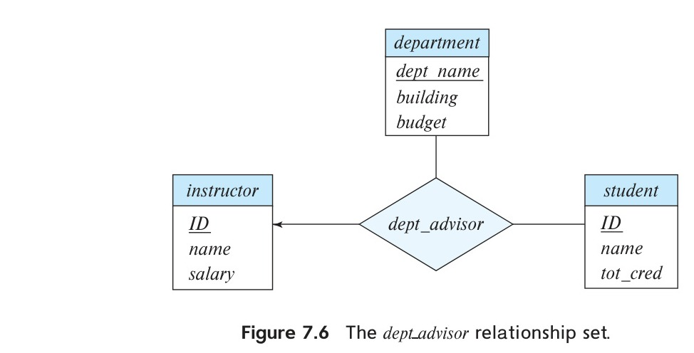
*Figure 7.6 — The dept_advisor relationship set.*

In this example, it turns out that $\beta - \alpha = \beta$. We need to state the rule as we did so as to deal correctly with functional dependencies that have attributes that appear on both sides of the arrow. The technical reasons for this are covered later in Section 7.5.1.

When we decompose a schema that is not in BCNF, it may be that one or more of the resulting schemas are not in BCNF. In such cases, further decomposition is required, the eventual result of which is a set of BCNF schemas.

### 7.3.1.2 BCNF and Dependency Preservation

We have seen several ways in which to express database consistency constraints: primary-key constraints, functional dependencies, check constraints, assertions, and triggers. Testing these constraints each time the database is updated can be costly and, therefore, it is useful to design the database in a way that constraints can be tested efficiently. In particular, if testing a functional dependency can be done by considering just one relation, then the cost of testing this constraint is low. We shall see that, in some cases, decomposition into BCNF can prevent efficient testing of certain functional dependencies.

To illustrate this, suppose that we make a small change to our university organization. In the design of Figure 6.15, a student may have only one advisor. This follows from the relationship set *advisor* being many-to-one from student to advisor. The “small” change we shall make is that an instructor can be associated with only a single department, and a student may have more than one advisor, but no more than one from a given department.[^6]

One way to implement this change using the E-R design is by replacing the *advisor* relationship set with a ternary relationship set, *dept_advisor*, involving entity sets *instructor*, *student*, and *department* that is many-to-one from the pair $\{\text{student}, \text{instructor}\}$ to *department* as shown in Figure 7.6. The E-R diagram specifies the constraint that

[^6]: Such an arrangement makes sense for students with a double major.

<!-- Page 316 -->

“a student may have more than one advisor, but at most one corresponding to a given department.”

With this new E-R diagram, the schemas for the *instructor*, *department*, and *student* relations are unchanged. However, the schema derived from the *dept_advisor* relationship set is now:

$$\text{dept\_advisor}(\underline{\text{s\_ID}, \text{i\_ID}}, \text{dept\_name})$$

Although not specified in the E-R diagram, suppose we have the additional constraint that “an instructor can act as advisor for only a single department.” Then, the following functional dependencies hold on *dept_advisor*:

$$\text{i\_ID} \rightarrow \text{dept\_name}$$
$$\text{s\_ID}, \text{dept\_name} \rightarrow \text{i\_ID}$$

The candidate keys for this schema are $(\text{s\_ID}, \text{dept\_name})$ and $(\text{s\_ID}, \text{i\_ID})$. We can see that *dept_advisor* is not in BCNF because $\text{i\_ID}$ is not a superkey.

Following our rule for decomposing a schema into BCNF, we get the following two schemas:

$$\text{advisor\_dept}(\underline{\text{i\_ID}}, \text{dept\_name})$$
$$\text{student\_advisor}(\underline{\text{s\_ID}, \text{i\_ID}})$$

Both schemas are in BCNF. However, we cannot test the functional dependency $\text{s\_ID}, \text{dept\_name} \rightarrow \text{i\_ID}$ by looking at either schema individually. To test this constraint, we would need to join relations *advisor_dept* and *student_advisor*. Because this join is potentially expensive to compute, we would like to avoid the need to compute it.

We say that a decomposition is **dependency-preserving** if all dependencies can be checked by considering individual relations in the decomposition.[^7] Our decomposition of *dept_advisor* into *advisor_dept* and *student_advisor* is not dependency-preserving.

<!-- Page 317 -->

### 7.3.2 Third Normal Form[^8]

BCNF requires that all nontrivial dependencies be of the form $\alpha \rightarrow \beta$, where $\alpha$ is a superkey. Third normal form (3NF) relaxes this constraint slightly by allowing certain dependencies that do not satisfy the BCNF condition.

A relation schema $R$ is in **third normal form** (3NF) with respect to a set $F$ of functional dependencies if, for all functional dependencies in $F^+$ of the form $\alpha \rightarrow \beta$, where $\alpha \subseteq R$ and $\beta \subseteq R$, at least one of the following holds:

- $\alpha \rightarrow \beta$ is a trivial functional dependency.
- $\alpha$ is a superkey for $R$.
- Each attribute $A$ in $\beta - \alpha$ is contained in a candidate key for $R$.

Notice that the first two conditions are the same as the BCNF conditions.

[^7]: Technically, it is possible that a dependency whose attributes do not all appear in any one schema is still implicitly enforced, because of the presence of other dependencies that imply it logically. We address that case in Section 7.4.4.
[^8]: You may have noted that we skipped second normal form. It is of historical significance only and, in practice, one of third normal form or BCNF is always a better choice. We explore second normal form in Exercise 7.19. First normal form pertains to attribute domains, not decomposition. We discuss it in Section 7.8.

Note that the third condition above does not say that a single candidate key must contain all the attributes in $\beta - \alpha$; each attribute in $\beta - \alpha$ may be contained in a different candidate key.

The third condition of 3NF represents a minimal relaxation of BCNF to ensure that every schema has a dependency-preserving decomposition into 3NF. (In Section 7.5.2, we show an algorithm to find such a decomposition.)

It is easy to see that any schema that satisfies BCNF also satisfies 3NF. This is because each functional dependency in $F^+$ must satisfy one of the first two conditions of 3NF. Thus, BCNF is a more restrictive normal form than is 3NF.

To see how 3NF differs from BCNF, let us return to the *dept_advisor* schema:

$$\text{dept\_advisor}(\text{s\_ID}, \text{i\_ID}, \text{dept\_name})$$

with functional dependencies:

$$\text{i\_ID} \rightarrow \text{dept\_name}$$
$$\text{s\_ID}, \text{dept\_name} \rightarrow \text{i\_ID}$$

We saw earlier that this schema is not in BCNF because the functional dependency $\text{i\_ID} \rightarrow \text{dept\_name}$ violates the BCNF condition: $\text{i\_ID}$ is not a superkey.

However, *dept_advisor* is in 3NF. To see this, we apply the 3NF definition to the functional dependency $\text{i\_ID} \rightarrow \text{dept\_name}$. Here, $\alpha = \text{i\_ID}$, $\beta = \text{dept\_name}$, and $\beta - \alpha = \text{dept\_name}$. Since the functional dependency $\text{s\_ID}, \text{dept\_name} \rightarrow \text{i\_ID}$ holds, the set of attributes $(\text{s\_ID}, \text{dept\_name})$ is a candidate key for *dept_advisor*. Thus, the attribute in $\beta - \alpha$ (namely, *dept_name*) is contained in a candidate key. The functional dependency $\text{i\_ID} \rightarrow \text{dept\_name}$ therefore satisfies the third condition of 3NF.[^9]

Because the other functional dependency $\text{s\_ID}, \text{dept\_name} \rightarrow \text{i\_ID}$ has a superkey on its left side, it satisfies the second condition of 3NF. Since all functional dependencies in $F^+$ that hold on *dept_advisor* satisfy the 3NF condition, *dept_advisor* is in 3NF.

If we choose to use the schema *dept_advisor*, we can test the functional dependency $\text{s\_ID}, \text{dept\_name} \rightarrow \text{i\_ID}$ simply by testing that the candidate key $(\text{s\_ID}, \text{dept\_name})$ is unique. We can test $\text{i\_ID} \rightarrow \text{dept\_name}$ by checking the relation *dept_advisor* whenever a tuple is inserted or updated. Thus, we have dependency preservation.

However, *dept_advisor* suffers from the problem of repetition of information. If an instructor advises many students, the department name must be repeated for each student that the instructor advises.

[^9]: These dependencies are examples of transitive dependencies (see Practice Exercise 7.18). The original definition of 3NF was in terms of transitive dependencies. The definition we use is equivalent but easier to understand.

<!-- Page 318 -->

### 7.3.3 Comparison of BCNF and 3NF

The example of *dept_advisor* illustrates the trade-off between BCNF and 3NF. As we shall see in Section 7.5.2, it is always possible to obtain a 3NF design without sacrificing losslessness or dependency preservation. Nevertheless, there are disadvantages to 3NF: We may have to use null values to represent some of the possible meaningful relationships among data items, and there is the problem of repetition of information.

Our goals of database design with functional dependencies are:

1. BCNF.
2. Losslessness.
3. Dependency preservation.

Since it is not always possible to satisfy all three, we may be forced to choose between BCNF and dependency preservation with 3NF.

It is worth noting that SQL does not provide a way of specifying functional dependencies, except for the special case of declaring superkeys by using the primary key or unique constraints. It is possible, although a little complicated, to write assertions that enforce a functional dependency (see Practice Exercise 7.9); unfortunately, currently no database system supports the complex assertions that are required to enforce arbitrary functional dependencies, and the assertions would be expensive to test. Thus even if we had a dependency-preserving decomposition, if we use standard SQL we can test efficiently only those functional dependencies whose left-hand side is a key.

Although testing functional dependencies may involve a join if the decomposition is not dependency preserving, if the database system supports materialized views, we could in principle reduce the cost by storing the join result as materialized view; however, this approach is feasible only if the database system supports primary key constraints or unique constraints on materialized views. On the negative side, there is a space and time overhead due to the materialized view, but on the positive side, the application programmer need not worry about writing code to keep redundant data consistent on updates; it is the job of the database system to maintain the materialized view, that is, keep it up to date when the database is updated. (In Section 16.5, we outline how a database system can perform materialized view maintenance efficiently.)

Unfortunately, most current database systems limit constraints on materialized views or do not support them at all. Even if such constraints are allowed, there is an additional requirement: the database must update the view and check the constraint

<!-- Page 319 -->

immediately (as part of the same transaction) when an underlying relation is updated. Otherwise, a constraint violation may get detected well after the update has been performed and the transaction that caused the violation has committed.

In summary, even if we are not able to get a dependency-preserving BCNF decomposition, it is still preferable to opt for BCNF, since checking functional dependencies other than primary key constraints is difficult in SQL.

### 7.3.4 Higher Normal Forms

Using functional dependencies to decompose schemas may not be sufficient to avoid unnecessary repetition of information in certain cases. Consider a slight variation in the *instructor* entity-set definition in which we record with each instructor a set of children’s names and a set of landline phone numbers that may be shared by multiple people. Thus, *phone_number* and *child_name* would be multivalued attributes and, following our rules for generating schemas from an E-R design, we would have two schemas, one for each of the multivalued attributes, *phone_number* and *child_name*:

$$(\text{ID}, \text{child\_name})$$
$$(\text{ID}, \text{phone\_number})$$

If we were to combine these schemas to get

$$(\text{ID}, \text{child\_name}, \text{phone\_number})$$

we would find the result to be in BCNF because no nontrivial functional dependencies hold. As a result we might think that such a combination is a good idea. However, such a combination is a bad idea, as we can see by considering the example of an instructor with two children and two phone numbers. For example, let the instructor with ID 99999 have two children named “David” and “William” and two phone numbers, 512-555-1234 and 512-555-4321. In the combined schema, we must repeat the phone numbers once for each dependent:

$$(99999, \text{David}, \text{512-555-1234})$$
$$(99999, \text{David}, \text{512-555-4321})$$
$$(99999, \text{William}, \text{512-555-1234})$$
$$(99999, \text{William}, \text{512-555-4321})$$

If we did not repeat the phone numbers, and we stored only the first and last tuples, we would have recorded the dependent names and the phone numbers, but the resultant tuples would imply that David corresponded to 512-555-1234, while William corresponded to 512-555-4321. This would be incorrect.

Because normal forms based on functional dependencies are not sufficient to deal with situations like this, other dependencies and normal forms have been defined. We cover these in Section 7.6 and Section 7.7.

<!-- Page 320 -->

## 7.4 Functional-Dependency Theory

We have seen in our examples that it is useful to be able to reason systematically about functional dependencies as part of a process of testing schemas for BCNF or 3NF.

### 7.4.1 Closure of a Set of Functional Dependencies

We shall see that, given a set $F$ of functional dependencies on a schema, we can prove that certain other functional dependencies also hold on the schema. We say that such functional dependencies are “logically implied” by $F$. When testing for normal forms, it is not sufficient to consider the given set of functional dependencies; rather, we need to consider all functional dependencies that hold on the schema.

More formally, given a relation schema $r(R)$, a functional dependency $f$ on $R$ is **logically implied** by a set of functional dependencies $F$ on $R$ if every instance of a relation $r(R)$ that satisfies $F$ also satisfies $f$.

Suppose we are given a relation schema $r(A, B, C, G, H, I)$ and the set of functional dependencies:

$$A \rightarrow B$$
$$A \rightarrow C$$
$$CG \rightarrow H$$
$$CG \rightarrow I$$
$$B \rightarrow H$$

The functional dependency:

$$A \rightarrow H$$

is logically implied. That is, we can show that, whenever a relation instance satisfies our given set of functional dependencies, $A \rightarrow H$ must also be satisfied by that relation instance. Suppose that $t_1$ and $t_2$ are tuples such that:

$$t_1[A] = t_2[A]$$

Since we are given that $A \rightarrow B$, it follows from the definition of functional dependency that:

$$t_1[B] = t_2[B]$$

Then, since we are given that $B \rightarrow H$, it follows from the definition of functional dependency that:

$$t_1[H] = t_2[H]$$

<!-- Page 321 -->

Therefore, we have shown that, whenever $t_1$ and $t_2$ are tuples such that $t_1[A] = t_2[A]$, it must be that $t_1[H] = t_2[H]$. But that is exactly the definition of $A \rightarrow H$.

Let $F$ be a set of functional dependencies. The **closure** of $F$, denoted by $F^+$, is the set of all functional dependencies logically implied by $F$. Given $F$, we can compute $F^+$ directly from the formal definition of functional dependency. If $F$ were large, this process would be lengthy and difficult. Such a computation of $F^+$ requires arguments of the type just used to show that $A \rightarrow H$ is in the closure of our example set of dependencies.

Axioms, or rules of inference, provide a simpler technique for reasoning about functional dependencies. In the rules that follow, we use Greek letters ($\alpha, \beta, \gamma, \ldots$) for sets of attributes and uppercase Roman letters from the beginning of the alphabet for individual attributes. We use $\alpha\beta$ to denote $\alpha \cup \beta$.

We can use the following three rules to find logically implied functional dependencies. By applying these rules repeatedly, we can find all of $F^+$, given $F$. This collection of rules is called **Armstrong’s axioms** in honor of the person who first proposed it.

- **Reflexivity rule.** If $\alpha$ is a set of attributes and $\beta \subseteq \alpha$, then $\alpha \rightarrow \beta$ holds.
- **Augmentation rule.** If $\alpha \rightarrow \beta$ holds and $\gamma$ is a set of attributes, then $\gamma\alpha \rightarrow \gamma\beta$ holds.
- **Transitivity rule.** If $\alpha \rightarrow \beta$ holds and $\beta \rightarrow \gamma$ holds, then $\alpha \rightarrow \gamma$ holds.

Armstrong’s axioms are **sound**, because they do not generate any incorrect functional dependencies. They are **complete**, because, for a given set $F$ of functional dependencies, they allow us to generate all $F^+$. The Further Reading section provides references for proofs of soundness and completeness.

Although Armstrong’s axioms are complete, it is tiresome to use them directly for the computation of $F^+$. To simplify matters further, we list additional rules. It is possible to use Armstrong’s axioms to prove that these rules are sound (see Practice Exercise 7.4, Practice Exercise 7.5, and Exercise 7.27).

- **Union rule.** If $\alpha \rightarrow \beta$ holds and $\alpha \rightarrow \gamma$ holds, then $\alpha \rightarrow \beta\gamma$ holds.
- **Decomposition rule.** If $\alpha \rightarrow \beta\gamma$ holds, then $\alpha \rightarrow \beta$ holds and $\alpha \rightarrow \gamma$ holds.
- **Pseudotransitivity rule.** If $\alpha \rightarrow \beta$ holds and $\gamma\beta \rightarrow \delta$ holds, then $\alpha\gamma \rightarrow \delta$ holds.

Let us apply our rules to the example of schema $R = (A, B, C, G, H, I)$ and the set $F$ of functional dependencies $\{A \rightarrow B, A \rightarrow C, CG \rightarrow H, CG \rightarrow I, B \rightarrow H\}$. We list several members of $F^+$ here:

- $A \rightarrow H$. Since $A \rightarrow B$ and $B \rightarrow H$ hold, we apply the transitivity rule. Observe that it was much easier to use Armstrong’s axioms to show that $A \rightarrow H$ holds than it was to argue directly from the definitions, as we did earlier in this section.
- $CG \rightarrow HI$. Since $CG \rightarrow H$ and $CG \rightarrow I$, the union rule implies that $CG \rightarrow HI$.

<!-- Page 322 -->

- $AG \rightarrow I$. Since $A \rightarrow C$ and $CG \rightarrow I$, the pseudotransitivity rule implies that $AG \rightarrow I$ holds.

Another way of finding that $AG \rightarrow I$ holds is as follows: We use the augmentation rule on $A \rightarrow C$ to infer $AG \rightarrow CG$. Then, since $CG \rightarrow I$ is a given dependency and $CG \rightarrow I$, we infer $AG \rightarrow I$.

Figure 7.7 shows a procedure that demonstrates formally how to use Armstrong’s axioms to compute $F^+$. In this procedure, when a functional dependency is added to $F^+$, it may be already present, and in that case there is no change to $F^+$. We shall see an alternative way of computing $F^+$ in Section 7.4.2.

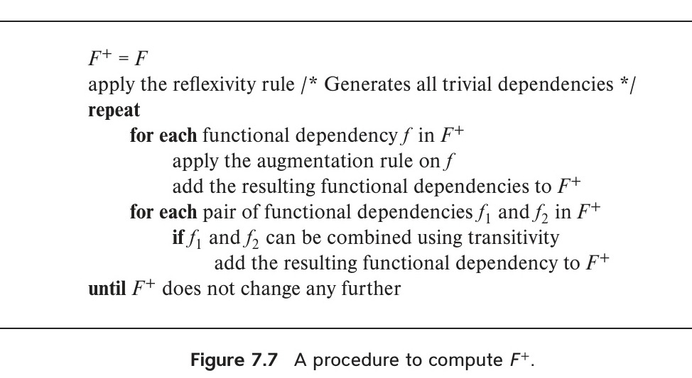
*Figure 7.7 — A procedure to compute $F^+$.*

The left-hand and right-hand sides of a functional dependency are both subsets of $R$. Since a set of size $n$ has $2^n$ subsets, there are a total of $2^n \times 2^n = 2^{2n}$ possible functional dependencies, where $n$ is the number of attributes in $R$. Each iteration of the repeat loop of the procedure, except the last iteration, adds at least one functional dependency to $F^+$. Thus, the procedure is guaranteed to terminate, though it may be very lengthy.

### 7.4.2 Closure of Attribute Sets

We say that an attribute $B$ is functionally determined by $\alpha$ if $\alpha \rightarrow B$. To test whether a set $\alpha$ is a superkey, we must devise an algorithm for computing the set of attributes functionally determined by $\alpha$. One way of doing this is to compute $F^+$, take all functional dependencies with $\alpha$ as the left-hand side, and take the union of the right-hand sides of all such dependencies. However, doing so can be expensive, since $F^+$ can be large.

An efficient algorithm for computing the set of attributes functionally determined by $\alpha$ is useful not only for testing whether $\alpha$ is a superkey, but also for several other tasks, as we shall see later in this section.

<!-- Page 323 -->

Let $\alpha$ be a set of attributes. We call the set of all attributes functionally determined by $\alpha$ under a set $F$ of functional dependencies the **closure** of $\alpha$ under $F$; we denote it by $\alpha^+$. Figure 7.8 shows an algorithm, written in pseudocode, to compute $\alpha^+$. The input is a set $\alpha$ of attributes and the set $F$ of functional dependencies. The output is stored in the variable *result*.


*Figure 7.8 — An algorithm to compute $\alpha^+$, the closure of $\alpha$ under $F$.*

To illustrate how the algorithm works, we shall use it to compute $(AG)^+$ with the functional dependencies from our earlier example:

- We start with $result = AG$.
- The functional dependency $A \rightarrow B$ causes us to include $B$ in *result*. To see this fact, we observe that $A \rightarrow B$ is in $F$, $A \subseteq result$ (which is $AG$), so $result := result \cup B$.
- The functional dependency $A \rightarrow C$ causes *result* to become $ABCG$.
- The functional dependency $CG \rightarrow H$ causes *result* to become $ABCGH$.
- The functional dependency $CG \rightarrow I$ causes *result* to become $ABCGHI$.

The algorithm terminates with $result = ABCGHI$, since all attributes of the schema are in *result*. Therefore, $(AG)^+ = ABCGHI$.

Let us see why the algorithm of Figure 7.8 is correct. The first step is correct because $\alpha \rightarrow \alpha$ by reflexivity. At each step, if $\beta \subseteq result$, since $\alpha \rightarrow result$ and $\beta \rightarrow \gamma$, by transitivity we have $\alpha \rightarrow \gamma$, and thus all attributes in $\gamma$ are in $\alpha^+$.

It is easy to see that the algorithm finds all of $\alpha^+$. Consider any attribute $B$ in $\alpha^+$. There is a proof using Armstrong’s axioms that $\alpha \rightarrow B$. We can show by induction on the length of the proof that $B$ must eventually be added to *result*.

<!-- Page 324 -->

There are several uses of the attribute closure algorithm:

- **Testing for superkey.** To test if $\alpha$ is a superkey, we compute $\alpha^+$, and check if $\alpha^+$ contains all attributes of $R$.
- **Testing functional dependencies.** To check if a functional dependency $\alpha \rightarrow \beta$ holds (or, in other words, is in $F^+$), we compute $\alpha^+$, and check if $\beta \subseteq \alpha^+$. That is, we compute the attribute closure of $\alpha$ under $F$, and then check if it includes $\beta$. This test is particularly useful: To check if a functional dependency $\alpha \rightarrow \beta$ holds on a schema $R$, we do not need to compute $F^+$; computing $\alpha^+$ suffices.
- **Computing closure of $F$.** Another use of the attribute-closure algorithm is to provide an alternative way to compute $F^+$: For each $\gamma \subseteq R$, we find the closure $\gamma^+$, and for each $S \subseteq \gamma^+$, we output a functional dependency $\gamma \rightarrow S$.

### 7.4.3 Canonical Cover

Suppose that we have a set of functional dependencies $F$ on a relation schema. Whenever a user performs an update on the relation, the database system must ensure that the update does not violate any functional dependencies, that is, all the functional dependencies in $F$ are satisfied in the new database state. The system must roll back the update if it violates any functional dependencies in the set $F$.

We can reduce the effort spent in checking for violations by testing a simplified set of functional dependencies that has the same closure as the given set. Any database that satisfies the simplified set of functional dependencies also satisfies the original set, and vice versa, since the two sets have the same closure. However, the simplified set is easier to test. We shall see how the simplified set can be constructed in a moment. First, we need some definitions.

An attribute of a functional dependency is said to be **extraneous** if we can remove it without changing the closure of the set of functional dependencies.

- **Removing an attribute from the left side** of a functional dependency could make it a stronger constraint. For example, if we have $AB \rightarrow C$ and remove $B$, we get the possibly stronger result $A \rightarrow C$. It may be stronger because $A \rightarrow C$ logically implies $AB \rightarrow C$, but $AB \rightarrow C$ does not, on its own, logically imply $A \rightarrow C$. But, depending on what our set $F$ of functional dependencies happens to be, we may be able to remove $B$ from $AB \rightarrow C$ safely. For example, suppose that the set

<!-- Page 325 -->

$F = \{AB \rightarrow C, A \rightarrow D, D \rightarrow C\}$. Then we can show that $F$ logically implies $A \rightarrow C$, making $B$ extraneous in $AB \rightarrow C$.

- **Removing an attribute from the right side** of a functional dependency could make it a weaker constraint. For example, if we have $AB \rightarrow CD$ and remove $C$, we get the possibly weaker result $AB \rightarrow D$. It may be weaker because using just $AB \rightarrow D$, we can no longer infer $AB \rightarrow C$. But, depending on what our set $F$ of functional dependencies happens to be, we may be able to remove $C$ from $AB \rightarrow CD$ safely. For example, suppose that $F = \{AB \rightarrow CD, A \rightarrow C\}$. Then we can show that even after replacing $AB \rightarrow CD$ by $AB \rightarrow D$, we can still infer $AB \rightarrow C$ and thus $AB \rightarrow CD$.

The formal definition of extraneous attributes is as follows: Consider a set $F$ of functional dependencies and the functional dependency $\alpha \rightarrow \beta$ in $F$.

- **Removal from the left side:** Attribute $A$ is extraneous in $\alpha$ if $A \in \alpha$ and $F$ logically implies $(F - \{\alpha \rightarrow \beta\}) \cup \{(\alpha - A) \rightarrow \beta\}$.
- **Removal from the right side:** Attribute $A$ is extraneous in $\beta$ if $A \in \beta$ and the set of functional dependencies $(F - \{\alpha \rightarrow \beta\}) \cup \{\alpha \rightarrow (\beta - A)\}$ logically implies $F$.

Beware of the direction of the implications when using the definition of extraneous attributes: If you reverse the statement, the implication will always hold. That is, $(F - \{\alpha \rightarrow \beta\}) \cup \{(\alpha - A) \rightarrow \beta\}$ always logically implies $F$, and also $F$ always logically implies $(F - \{\alpha \rightarrow \beta\}) \cup \{\alpha \rightarrow (\beta - A)\}$.

Here is how we can test efficiently if an attribute is extraneous. Let $R$ be the relation schema, and let $F$ be the given set of functional dependencies that hold on $R$. Consider an attribute $A$ in a dependency $\alpha \rightarrow \beta$.

- If $A \in \beta$, to check if $A$ is extraneous, consider the set
  $$F' = (F - \{\alpha \rightarrow \beta\}) \cup \{\alpha \rightarrow (\beta - A)\}$$
  and check if $\alpha \rightarrow A$ can be inferred from $F'$. To do so, compute $\alpha^+$ (the closure of $\alpha$) under $F'$; if $\alpha^+$ includes $A$, then $A$ is extraneous in $\beta$.
- If $A \in \alpha$, to check if $A$ is extraneous, let $\gamma = \alpha - \{A\}$, and check if $\gamma \rightarrow \beta$ can be inferred from $F$. To do so, compute $\gamma^+$ (the closure of $\gamma$) under $F$; if $\gamma^+$ includes all attributes in $\beta$, then $A$ is extraneous in $\alpha$.

For example, suppose $F$ contains $AB \rightarrow CD$, $A \rightarrow E$, and $E \rightarrow C$. To check if $C$ is extraneous in $AB \rightarrow CD$, we compute the attribute closure of $AB$ under $F' = \{AB \rightarrow D, A \rightarrow E, E \rightarrow C\}$. The closure is $ABCDE$, which includes $CD$, so we infer that $C$ is extraneous.

<!-- Page 326 -->

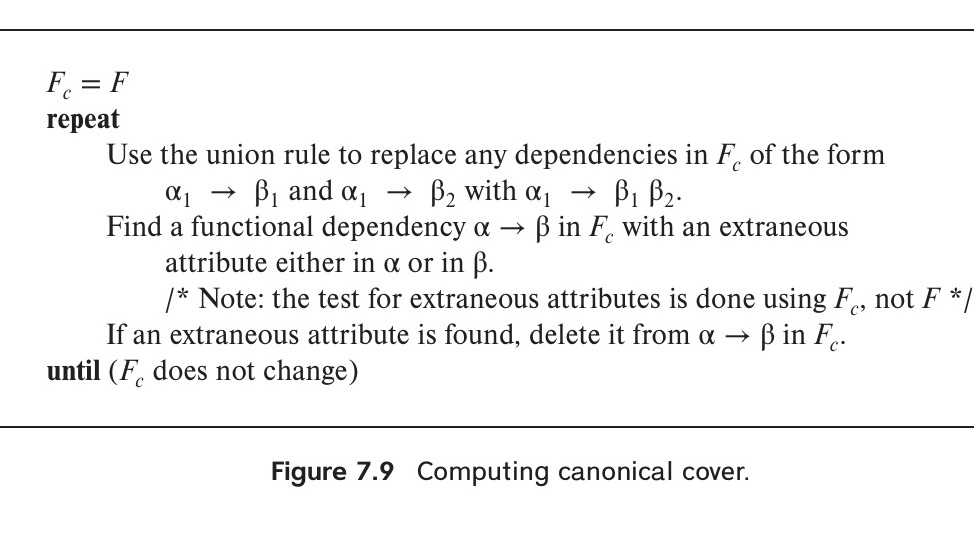
*Figure 7.9 — Computing canonical cover.*

Having defined the concept of extraneous attributes, we can explain how we can construct a simplified set of functional dependencies equivalent to a given set of functional dependencies.

A **canonical cover** $F_c$ for $F$ is a set of dependencies such that $F$ logically implies all dependencies in $F_c$, and $F_c$ logically implies all dependencies in $F$. Furthermore, $F_c$ must have the following properties:

- No functional dependency in $F_c$ contains an extraneous attribute.
- Each left side of a functional dependency in $F_c$ is unique. That is, there are no two dependencies $\alpha_1 \rightarrow \beta_1$ and $\alpha_2 \rightarrow \beta_2$ in $F_c$ such that $\alpha_1 = \alpha_2$.

A canonical cover for a set of functional dependencies $F$ can be computed as described in Figure 7.9. It is important to note that when checking if an attribute is extraneous, the check uses the dependencies in the current value of $F_c$, and not the dependencies in $F$. If a functional dependency contains only one attribute in its right-hand side, for example $A \rightarrow C$, and that attribute is found to be extraneous, we would get a functional dependency with an empty right-hand side. Such functional dependencies should be deleted.

Since the algorithm permits a choice of any extraneous attribute, it is possible that there may be several possible canonical covers for a given $F$. Any such $F_c$ is equally acceptable. Any canonical cover of $F$, $F_c$, can be shown to have the same closure as $F$; hence, testing whether $F_c$ is satisfied is equivalent to testing whether $F$ is satisfied. However, $F_c$ is minimal in a certain sense—it does not contain extraneous attributes, and it combines functional dependencies with the same left side. It is cheaper to test $F_c$ than it is to test $F$ itself.

We now consider an example. Assume we are given the following set $F$ of functional dependencies on schema $(A, B, C)$:, consider the following set $F$ of functional dependencies on schema $R = (A, B, C)$:

$$A \rightarrow BC$$
$$B \rightarrow C$$
$$A \rightarrow B$$
$$AB \rightarrow C$$

We apply the algorithm as follows:

1. We use the union rule to combine the dependencies with the same left-hand side. Specifically, we combine $A \rightarrow BC$ and $A \rightarrow B$ into $A \rightarrow BC$. The set $F_c$ is now:
   $$A \rightarrow BC$$
   $$B \rightarrow C$$
   $$AB \rightarrow C$$
2. Attribute $A$ is extraneous in $AB \rightarrow C$ because $B \rightarrow C$ logically implies $AB \rightarrow C$. To test if $A$ is extraneous, we compute $B^+$ under $F_c$. Since $B \rightarrow C$, $B^+ = BC$, which includes $C$. Thus, $A$ is extraneous, and we delete it from the left-hand side of $AB \rightarrow C$, leaving $B \rightarrow C$.
3. Since $B \rightarrow C$ is now present twice in $F_c$, we remove the duplicate. The set $F_c$ is now:
   $$A \rightarrow BC$$
   $$B \rightarrow C$$
4. Attribute $C$ is extraneous in $A \rightarrow BC$. To test this, let $F' = \{A \rightarrow B, B \rightarrow C\}$. We compute $A^+$ under $F'$. Since $A \rightarrow B$ and $B \rightarrow C$, $A^+ = ABC$, which includes $C$. Thus, $C$ is extraneous in $A \rightarrow BC$, and we delete it, leaving $A \rightarrow B$.

The resulting canonical cover is:

$$F_c = \{A \rightarrow B, B \rightarrow C\}$$

<!-- Page 327 -->

A set of functional dependencies can have more than one canonical cover. For example, consider the schema $R = (A, B, C)$ and the set of functional dependencies:

$$F = \{A \rightarrow BC, B \rightarrow AC, C \rightarrow AB\}$$

The union rule cannot be applied since all left-hand sides are already distinct. We now check for extraneous attributes:

- Consider $A \rightarrow BC$. If we test attribute $B$ for being extraneous, we find that under $F' = \{A \rightarrow C, B \rightarrow AC, C \rightarrow AB\}$, $A^+ = ABC$, so $B$ is extraneous.
- If we test attribute $C$ for being extraneous in $A \rightarrow BC$, we find that under $F'' = \{A \rightarrow B, B \rightarrow AC, C \rightarrow AB\}$, $A^+ = ABC$, so $C$ is extraneous.

Thus, both $B$ and $C$ are individually extraneous in $A \rightarrow BC$ under $F$. However, it is incorrect to delete both! The algorithm for finding the canonical cover picks one of the two and deletes it. Then,

1. If $C$ is deleted, we get the set $F' = \{A \rightarrow B, B \rightarrow AC, C \rightarrow AB\}$. Now, $B$ is not extraneous on the right side of $A \rightarrow B$ under $F'$. Continuing the algorithm, we find $A$ and $B$ are extraneous in the right side of $C \rightarrow AB$, leading to two choices of canonical cover:

<!-- Page 328 -->

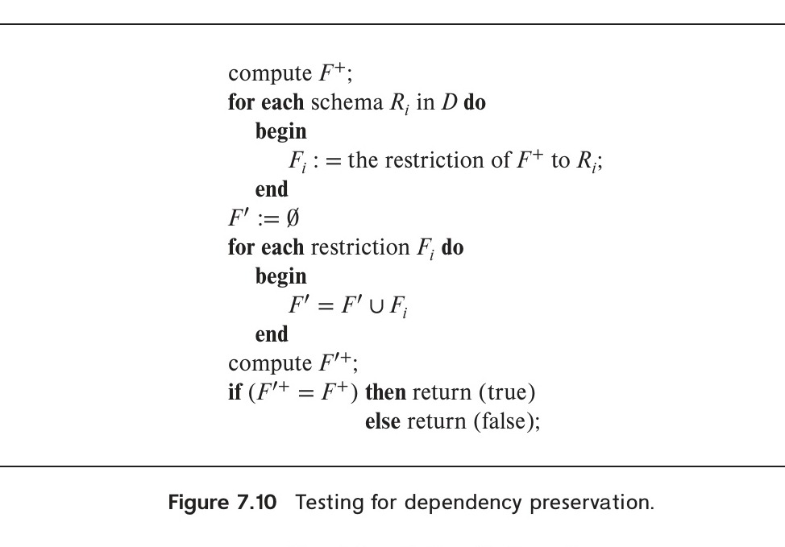
*Figure 7.10 — Testing for dependency preservation.*

$$F_c = \{A \rightarrow B, B \rightarrow C, C \rightarrow A\}$$
$$F_c = \{A \rightarrow B, B \rightarrow AC, C \rightarrow B\}$$

2. If $B$ is deleted, we get the set $\{A \rightarrow C, B \rightarrow AC, C \rightarrow AB\}$. This case is symmetrical to the previous case, leading to two more choices of canonical cover:

$$F_c = \{A \rightarrow C, C \rightarrow B, B \rightarrow A\}$$
$$F_c = \{A \rightarrow C, B \rightarrow C, C \rightarrow AB\}$$

As an exercise, can you find one more canonical cover for $F$?

### 7.4.4 Dependency Preservation

Using the theory of functional dependencies, there is a way to describe dependency preservation that is simpler than the ad hoc approach we used in Section 7.3.1.2.

Let $F$ be a set of functional dependencies on a schema $R$, and let $R_1, R_2, \ldots, R_n$ be a decomposition of $R$. The **restriction** of $F$ to $R_i$ is the set $F_i$ of all functional dependencies in $F^+$ that include only attributes of $R_i$. Since all functional dependencies in a restriction involve attributes of only one relation schema, it is possible to test such a dependency for satisfaction by checking only one relation.

Note that the definition of restriction uses all dependencies in $F^+$, not just those in $F$. For instance, suppose $F = \{A \rightarrow B, B \rightarrow C\}$, and we have a decomposition into $AC$ and $AB$. The restriction of $F$ to $AC$ includes $A \rightarrow C$, since $A \rightarrow C$ is in $F^+$, even though it is not in $F$.

<!-- Page 329 -->

The set of restrictions $F_1, F_2, \ldots, F_n$ is the set of dependencies that can be checked efficiently. We now must ask whether testing only the restrictions is sufficient. Let $F' = F_1 \cup F_2 \cup \cdots \cup F_n$. $F'$ is a set of functional dependencies on schema $R$, but, in general, $F' \neq F$. However, even if $F' \neq F$, it may be that $F'^+ = F^+$. If the latter is true, then every dependency in $F$ is logically implied by $F'$, and, if we verify that $F'$ is satisfied, we have verified that $F$ is satisfied. We say that a decomposition having the property $F'^+ = F^+$ is a **dependency-preserving decomposition**.

Figure 7.10 shows an algorithm for testing dependency preservation. The input is a set $D = \{R_1, R_2, \ldots, R_n\}$ of decomposed relation schemas, and a set $F$ of functional dependencies. This algorithm is expensive since it requires computation of $F^+$. Instead of applying the algorithm of Figure 7.10, we consider two alternatives.

First, note that if each member of $F$ can be tested on one of the relations of the decomposition, then the decomposition is dependency preserving. This is an easy way to show dependency preservation; however, it does not always work. There are cases where, even though the decomposition is dependency preserving, there is a dependency in $F$ that cannot be tested in any one relation in the decomposition. Thus, this alternative test can be used only as a sufficient condition that is easy to check; if it fails we cannot conclude that the decomposition is not dependency preserving; instead we will have to apply the general test.

We now give a second alternative test for dependency preservation that avoids computing $F^+$. We explain the intuition behind the test after presenting the test. The test applies the following procedure to each $\alpha \rightarrow \beta$ in $F$:

```pascal
result = alpha;
repeat
    for each Ri in the decomposition
        t = (result intersect Ri)+ intersect Ri;
        result = result union t;
until (result does not change);
```

The attribute closure here is under the set of functional dependencies $F$. If *result* contains all attributes in $\beta$, then the functional dependency $\alpha \rightarrow \beta$ is preserved. The decomposition is dependency preserving if and only if the procedure shows that all the dependencies in $F$ are preserved.

The two key ideas behind the preceding test are as follows:

- The first idea is to test each functional dependency $\alpha \rightarrow \beta$ in $F$ to see if it is preserved in $F'$ (where $F'$ is as defined in Figure 7.10). To do so, we compute the closure of $\alpha$ under $F'$; the dependency is preserved exactly when the closure includes $\beta$. The decomposition is dependency preserving if (and only if) all the dependencies in $F$ are found to be preserved.

<!-- Page 330 -->

- The second idea is to use a modified form of the attribute-closure algorithm to compute closure under $F'$, without actually first computing $F'$. We wish to avoid computing $F'$ since computing it is quite expensive. Note that $F'$ is the union of all $F_i$, where $F_i$ is the restriction of $F$ on $R_i$. The algorithm computes the attribute closure of $(result \cap R_i)$ with respect to $F$, intersects the closure with $R_i$, and adds the resultant set of attributes to *result*; this sequence of steps is equivalent to computing the closure of *result* under $F_i$. Repeating this step for each $i$ inside the while loop gives the closure of *result* under $F'$.

To understand why this modified attribute-closure approach works correctly, we note that for any $\gamma \subseteq R_i$, $\gamma \rightarrow \gamma^+$ is a functional dependency in $F^+$, and $\gamma \rightarrow \gamma^+ \cap R_i$ is a functional dependency that is in $F_i$, the restriction of $F^+$ to $R_i$. Conversely, if $\gamma \rightarrow \delta$ were in $F_i$, then $\delta$ would be a subset of $\gamma^+ \cap R_i$.

This test takes polynomial time, instead of the exponential time required to compute $F^+$.

## 7.5 Algorithms for Decomposition Using Functional Dependencies

Real-world database schemas are much larger than the examples that fit in the pages of a book. For this reason, we need algorithms for the generation of designs that are in appropriate normal form. In this section, we present algorithms for BCNF and 3NF.

### 7.5.1 BCNF Decomposition

The definition of BCNF can be used directly to test if a relation is in BCNF. However, computation of $F^+$ can be a tedious task. We first describe simplified tests for verifying if a relation is in BCNF. If a relation is not in BCNF, it can be decomposed to create relations that are in BCNF. Later in this section, we describe an algorithm to create a lossless decomposition of a relation, such that the decomposition is in BCNF.

#### 7.5.1.1 Testing for BCNF

Testing of a relation schema $R$ to see if it satisfies BCNF can be simplified in some cases:

- To check if a nontrivial dependency $\alpha \rightarrow \beta$ causes a violation of BCNF, compute $\alpha^+$ (the attribute closure of $\alpha$), and verify that it includes all attributes of $R$; that is, it is a superkey for $R$.
- To check if a relation schema $R$ is in BCNF, it suffices to check only the dependencies in the given set $F$ for violation of BCNF, rather than check all dependencies in $F^+$.

We can show that if none of the dependencies in $F$ causes a violation of BCNF, then none of the dependencies in $F^+$ will cause a violation of BCNF, either.

<!-- Page 331 -->

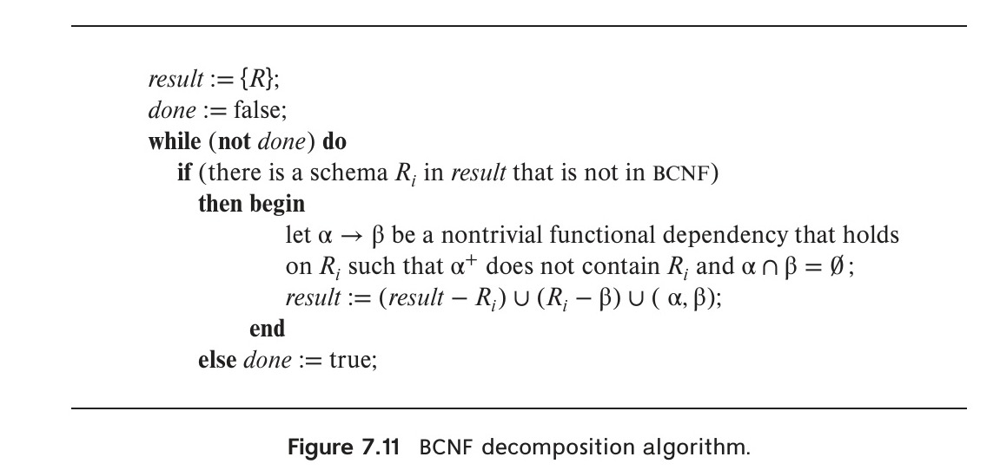
*Figure 7.11 — BCNF decomposition algorithm.*

Unfortunately, the latter procedure does not work when a relation schema is decomposed. That is, it does not suffice to use $F$ when we test a relation schema $R_i$, in a decomposition of $R$, for violation of BCNF. For example, consider relation schema $(A, B, C, D, E)$, with functional dependencies $F$ containing $A \rightarrow B$ and $BC \rightarrow D$. Suppose this were decomposed into $(A, B)$ and $(A, C, D, E)$. Now, neither of the dependencies in $F$ contains only attributes from $(A, C, D, E)$, so we might be misled into thinking that it is in BCNF. In fact, there is a dependency $AC \rightarrow D$ in $F^+$ (which can be inferred using the pseudotransitivity rule from the two dependencies in $F$) that shows that $(A, C, D, E)$ is not in BCNF. Thus, we may need a dependency that is in $F^+$, but is not in $F$, to show that a decomposed relation is not in BCNF.

An alternative BCNF test is sometimes easier than computing every dependency in $F^+$. To check if a relation schema $R_i$ in a decomposition of $R$ is in BCNF, we apply this test:

- For every subset $\alpha$ of attributes in $R_i$, check that $\alpha^+$ (the attribute closure of $\alpha$ under $F$) either includes no attribute of $R_i - \alpha$, or includes all attributes of $R_i$.

If the condition is violated by some set of attributes $\alpha$ in $R_i$, consider the following functional dependency, which can be shown to be present in $F^+$:

$$\alpha \rightarrow (\alpha^+ - \alpha) \cap R_i$$

This dependency shows that $R_i$ violates BCNF.

#### 7.5.1.2 BCNF Decomposition Algorithm

We are now able to state a general method to decompose a relation schema so as to satisfy BCNF. Figure 7.11 shows an algorithm for this task. If $R$ is not in BCNF, we can decompose $R$ into a collection of BCNF schemas $R_1, R_2, \ldots, R_n$ by the algorithm.

<!-- Page 332 -->

The algorithm uses dependencies that demonstrate violation of BCNF to perform the decomposition.

The decomposition that the algorithm generates is not only in BCNF, but is also a lossless decomposition. To see why our algorithm generates only lossless decompositions, we note that, when we replace a schema $R_i$ with $(R_i - \beta)$ and $(\alpha, \beta)$, the dependency $\alpha \rightarrow \beta$ holds, and $(R_i - \beta) \cap (\alpha, \beta) = \alpha$.

If we did not require $\alpha \cap \beta = \emptyset$, then those attributes in $\alpha \cap \beta$ would not appear in the schema $(R_i - \beta)$, and the dependency $\alpha \rightarrow \beta$ would no longer hold.

It is easy to see that our decomposition of *in_dep* in Section 7.3.1 would result from applying the algorithm. The functional dependency $\text{dept\_name} \rightarrow \text{building}, \text{budget}$ satisfies the $\alpha \cap \beta = \emptyset$ condition and would therefore be chosen to decompose the schema.

The BCNF decomposition algorithm takes time exponential to the size of the initial schema, since the algorithm for checking whether a relation in the decomposition satisfies BCNF can take exponential time. There is an algorithm that can compute a BCNF decomposition in polynomial time; however, the algorithm may “overnormalize,” that is, decompose a relation unnecessarily.

As a longer example of the use of the BCNF decomposition algorithm, suppose we have a database design using the *class* relation, whose schema is as shown below:

$$\text{class}(\text{course\_id}, \text{title}, \text{dept\_name}, \text{credits}, \text{sec\_id}, \text{semester}, \text{year}, \text{building}, \text{room\_number}, \text{capacity}, \text{time\_slot\_id})$$

The set of functional dependencies that we assume holds on this schema is:

$$\text{course\_id} \rightarrow \text{title}, \text{dept\_name}, \text{credits}$$
$$\text{building}, \text{room\_number} \rightarrow \text{capacity}$$
$$\text{course\_id}, \text{sec\_id}, \text{semester}, \text{year} \rightarrow \text{building}, \text{room\_number}, \text{time\_slot\_id}$$

A candidate key for this schema is $(\text{course\_id}, \text{sec\_id}, \text{semester}, \text{year})$.

We can apply the algorithm of Figure 7.11 to the *class* example as follows:

- The functional dependency $\text{course\_id} \rightarrow \text{title}, \text{dept\_name}, \text{credits}$ holds on *class*, but $\text{course\_id}$ is not a superkey. Thus, *class* is not in BCNF. We decompose *class* into:
  $$\text{course}(\underline{\text{course\_id}}, \text{title}, \text{dept\_name}, \text{credits})$$
  $$\text{class\_1}(\text{course\_id}, \text{sec\_id}, \text{semester}, \text{year}, \text{building}, \text{room\_number}, \text{capacity}, \text{time\_slot\_id})$$
- The schema *course* is in BCNF. The schema *class_1* is not in BCNF, because the functional dependency $\text{building}, \text{room\_number} \rightarrow \text{capacity}$ holds on *class_1*, but $(\text{building}, \text{room\_number})$ is not a superkey for *class_1*. We decompose *class_1* into:
  $$\text{classroom}(\underline{\text{building}, \text{room\_number}}, \text{capacity})$$
  $$\text{section}(\underline{\text{course\_id}, \text{sec\_id}, \text{semester}, \text{year}}, \text{building}, \text{room\_number}, \text{time\_slot\_id})$$
- Both *classroom* and *section* are in BCNF.

Thus, the algorithm generates the three schemas *course*, *classroom*, and *section*, each of which is in BCNF.

<!-- Page 333 -->

As another example of the application of the BCNF decomposition algorithm, consider the schema:

$$\text{dept\_advisor}(\text{s\_ID}, \text{i\_ID}, \text{dept\_name})$$

with functional dependencies:

$$\text{i\_ID} \rightarrow \text{dept\_name}$$
$$\text{s\_ID}, \text{dept\_name} \rightarrow \text{i\_ID}$$

The candidate keys for *dept_advisor* are $(\text{s\_ID}, \text{i\_ID})$ and $(\text{s\_ID}, \text{dept\_name})$. The functional dependency $\text{i\_ID} \rightarrow \text{dept\_name}$ violates BCNF. Applying the BCNF decomposition algorithm, we obtain the schemas:

$$\text{advisor\_dept}(\underline{\text{i\_ID}}, \text{dept\_name})$$
$$\text{student\_advisor}(\underline{\text{s\_ID}, \text{i\_ID}})$$

As we saw in Section 7.3.1.2, this decomposition is lossless, but it is not dependency preserving, because the dependency $\text{s\_ID}, \text{dept\_name} \rightarrow \text{i\_ID}$ is not preserved.

### 7.5.2 3NF Decomposition

Figure 7.12 shows an algorithm for finding a dependency-preserving, lossless decomposition into 3NF. The set of dependencies $F_c$ used in the algorithm is a canonical cover for $F$. Note that the algorithm considers the set of schemas $R_j, j = 1, 2, \ldots, i$; initially $i = 0$, and in this case the set is empty.

To illustrate how the 3NF decomposition algorithm works, consider the schema:

$$\text{dept\_advisor}(\text{s\_ID}, \text{i\_ID}, \text{dept\_name})$$

with functional dependencies:

$$\text{i\_ID} \rightarrow \text{dept\_name}$$
$$\text{s\_ID}, \text{dept\_name} \rightarrow \text{i\_ID}$$

The set of dependencies is already a canonical cover.

The algorithm creates two schemas:

$$R_1 = (\underline{\text{i\_ID}}, \text{dept\_name})$$
$$R_2 = (\underline{\text{s\_ID}, \text{dept\_name}}, \text{i\_ID})$$

The schema $R_1$ is created from the functional dependency $\text{i\_ID} \rightarrow \text{dept\_name}$, and $R_2$ is created from the schema $(\text{s\_ID}, \text{dept\_name}, \text{i\_ID})$. The algorithm then finds that $R_2$ contains a candidate key, so no further relation schema is created.

<!-- Page 334 -->

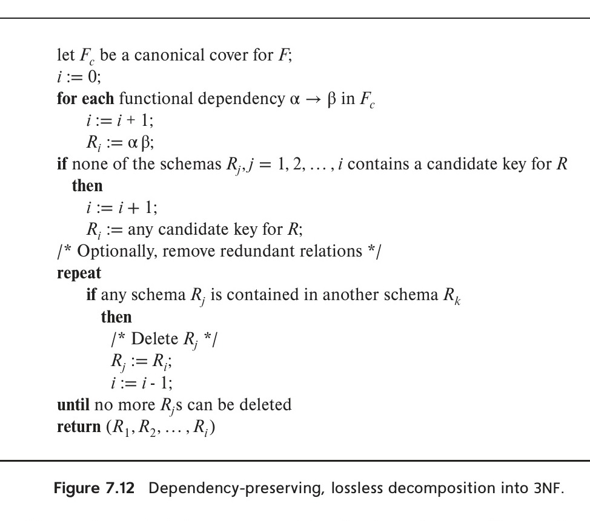
*Figure 7.12 — Dependency-preserving, lossless decomposition into 3NF.*

The resultant set of schemas can contain redundant schemas, with one schema $R_k$ containing all the attributes of another schema $R_j$. For example, $R_2$ above contains all the attributes from $R_1$. The algorithm deletes all such schemas that are contained in another schema. Any dependencies that could be tested on an $R_j$ that is deleted can also be tested on the corresponding relation $R_k$, and the decomposition is lossless even if $R_j$ is deleted.

Now let us consider again the schema of the *class* relation of Section 7.5.1.2 and apply the 3NF decomposition algorithm. The set of functional dependencies we listed there happen to be a canonical cover. As a result, the algorithm gives us the same three schemas *course*, *classroom*, and *section*.

The preceding example illustrates an interesting property of the 3NF algorithm. Sometimes, the result is not only in 3NF, but also in BCNF. This suggests an alternative method of generating a BCNF design. First use the 3NF algorithm. Then, for any schema in the 3NF design that is not in BCNF, decompose using the BCNF algorithm. If the result is not dependency-preserving, revert to the 3NF design.

### 7.5.3 Correctness of the 3NF Algorithm

The 3NF algorithm ensures the preservation of dependencies by explicitly building a schema for each dependency in a canonical cover. It ensures that the decomposition is a

<!-- Page 335 -->

lossless decomposition by guaranteeing that at least one schema contains a candidate key for the schema being decomposed. Practice Exercise 7.16 provides some insight into the proof that this suffices to guarantee a lossless decomposition.

This algorithm is also called the **3NF synthesis algorithm**, since it takes a set of dependencies and adds one schema at a time, instead of decomposing the initial schema repeatedly. The result is not uniquely defined, since a set of functional dependencies can have more than one canonical cover. The algorithm may decompose a relation even if it is already in 3NF; however, the decomposition is still guaranteed to be in 3NF.

To see that the algorithm produces a 3NF design, consider a schema $R_i$ in the decomposition. Recall that when we test for 3NF it suffices to consider functional dependencies whose right-hand side consists of a single attribute. Therefore, to see that $R_i$ is in 3NF you must convince yourself that any functional dependency $\gamma \rightarrow B$ that holds on $R_i$ satisfies the definition of 3NF. Assume that the dependency that generated $R_i$ in the synthesis algorithm is $\alpha \rightarrow \beta$. $B$ must be in $\alpha$ or $\beta$, since $B$ is in $R_i$ and $\alpha \rightarrow \beta$ generated $R_i$. Let us consider the three possible cases:

- $B$ is in both $\alpha$ and $\beta$. In this case, the dependency $\alpha \rightarrow \beta$ would not have been in $F_c$ since $B$ would be extraneous in $\beta$. Thus, this case cannot hold.
- $B$ is in $\beta$ but not $\alpha$. Consider two cases:
  - $\gamma$ is a superkey. The second condition of 3NF is satisfied.
  - $\gamma$ is not a superkey. Then $\alpha$ must contain some attribute not in $\gamma$. Now, since $\gamma \rightarrow B$ is in $F^+$, it must be derivable from $F_c$ by using the attribute closure algorithm on $\gamma$. The derivation could not have used $\alpha \rightarrow \beta$, because if it had been used, $\alpha$ must be contained in the attribute closure of $\gamma$, which is not possible, since we assumed $\gamma$ is not a superkey. Now, using $\alpha \rightarrow (\beta - \{B\})$ and $\gamma \rightarrow B$, we can derive $\alpha \rightarrow B$ (since $\gamma \subseteq \alpha\beta$, and $\gamma$ cannot contain $B$ because $\gamma \rightarrow B$ is nontrivial). This would imply that $B$ is extraneous in the right-hand side of $\alpha \rightarrow \beta$, which is not possible since $\alpha \rightarrow \beta$ is in the canonical cover $F_c$. Thus, if $B$ is in $\beta$, then $\gamma$ must be a superkey, and the second condition of 3NF must be satisfied.
- $B$ is in $\alpha$ but not $\beta$. Since $\alpha$ is a candidate key, the third alternative in the definition of 3NF is satisfied.

Interestingly, the algorithm we described for decomposition into 3NF can be implemented in polynomial time, even though testing a given schema to see if it satisfies 3NF is NP-hard (which means that it is very unlikely that a polynomial-time algorithm will ever be invented for this task).

<!-- Page 336 -->

## 7.6 Decomposition Using Multivalued Dependencies

Some relation schemas, even though they are in BCNF, do not seem to be sufficiently normalized, in the sense that they still suffer from the problem of repetition of information. Consider a variation of the university organization where an instructor may be associated with multiple departments, and we have a relation:

$$\text{inst}(\text{ID}, \text{dept\_name}, \text{name}, \text{street}, \text{city})$$

The astute reader will recognize this schema as a non-BCNF schema because of the functional dependency

$$\text{ID} \rightarrow \text{name}, \text{street}, \text{city}$$

and because ID is not a key for *inst*.

Further assume that an instructor may have several addresses (say, a winter home and a summer home). Then, we no longer wish to enforce the functional dependency “$\text{ID} \rightarrow \text{street}, \text{city}$”, though, we still want to enforce “$\text{ID} \rightarrow \text{name}$” (i.e., the university is not dealing with instructors who operate under multiple aliases!). Following the BCNF decomposition algorithm, we obtain two schemas:

$$r_1(\underline{\text{ID}}, \text{name})$$
$$r_2(\text{ID}, \text{dept\_name}, \text{street}, \text{city})$$

Both of these are in BCNF (recall that an instructor can be associated with multiple departments and a department may have several instructors, and therefore, neither “$\text{ID} \rightarrow \text{dept\_name}$” nor “$\text{dept\_name} \rightarrow \text{ID}$” hold).

Despite $r_2$ being in BCNF, there is redundancy. We repeat the address information of each residence of an instructor once for each department with which the instructor is associated. We could solve this problem by decomposing $r_2$ further into:

$$r_{21}(\text{dept\_name}, \text{ID})$$
$$r_{22}(\text{ID}, \text{street}, \text{city})$$

but there is no constraint that leads us to do this.

To deal with this problem, we must define a new form of constraint, called a **multivalued dependency**. As we did for functional dependencies, we shall use multivalued dependencies to define a normal form for relation schemas. This normal form, called **fourth normal form** (4NF), is more restrictive than BCNF. We shall see that every 4NF schema is also in BCNF but there are BCNF schemas that are not in 4NF.

<!-- Page 337 -->

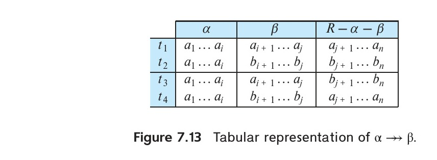
*Figure 7.13 — Tabular representation of $\alpha \twoheadrightarrow \beta$.*

### 7.6.1 Multivalued Dependencies

Functional dependencies rule out certain tuples from being in a relation. If $A \rightarrow B$, then we cannot have two tuples with the same $A$ value but different $B$ values. Multivalued dependencies, on the other hand, do not rule out the existence of certain tuples. Instead, they require that other tuples of a certain form be present in the relation. For this reason, functional dependencies sometimes are referred to as *equality-generating dependencies*, and multivalued dependencies are referred to as *tuple-generating dependencies*.

Let $r(R)$ be a relation schema and let $\alpha \subseteq R$ and $\beta \subseteq R$. The **multivalued dependency**

$$\alpha \twoheadrightarrow \beta$$

holds on $R$ if, in any legal instance of relation $r(R)$, for all pairs of tuples $t_1$ and $t_2$ in $r$ such that $t_1[\alpha] = t_2[\alpha]$, there exist tuples $t_3$ and $t_4$ in $r$ such that

$$t_1[\alpha] = t_2[\alpha] = t_3[\alpha] = t_4[\alpha]$$
$$t_3[\beta] = t_1[\beta]$$
$$t_3[R - \beta] = t_2[R - \beta]$$
$$t_4[\beta] = t_2[\beta]$$
$$t_4[R - \beta] = t_1[R - \beta]$$

This definition is less complicated than it appears to be. Figure 7.13 gives a tabular picture of $t_1, t_2, t_3$, and $t_4$. Intuitively, the multivalued dependency $\alpha \twoheadrightarrow \beta$ says that the relationship between $\alpha$ and $\beta$ is independent of the relationship between $\alpha$ and $R - \beta$.

If the multivalued dependency $\alpha \twoheadrightarrow \beta$ is satisfied by all relations on schema $R$, then $\alpha \twoheadrightarrow \beta$ is a **trivial multivalued dependency** on schema $R$. Thus, $\alpha \twoheadrightarrow \beta$ is trivial if $\beta \subseteq \alpha$ or $\beta \cup \alpha = R$. This can be seen by looking at Figure 7.13 and considering the two special cases $\beta \subseteq \alpha$ and $\beta \cup \alpha = R$. In each case, the table reduces to just two columns and we see that $t_1$ and $t_2$ are able to serve in the roles of $t_3$ and $t_4$.

To illustrate the difference between functional and multivalued dependencies, we consider the schema $r_2$ again, and an example relation on that schema is shown in Figure 7.14. We must repeat the department name once for each address that an instructor has, and we must repeat the address for each department with which an instructor is associated. This repetition is unnecessary, since the relationship between an instructor

<!-- Page 338 -->

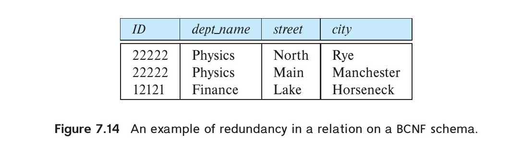
*Figure 7.14 — An example of redundancy in a relation on a BCNF schema.*

and his address is independent of the relationship between that instructor and a department. If an instructor with ID 22222 is associated with the Physics department, we must have a tuple with that department for each address of the instructor. If instructor 22222 were also associated with the Math department, we would have to add the tuples $(22222, \text{Physics}, \text{North}, \text{Rye})$ and $(22222, \text{Physics}, \text{Main}, \text{Manchester})$ to the relation. If we added only $(22222, \text{Math}, \text{Main}, \text{Manchester})$, the relation of Figure 7.15 would result.

The relation of Figure 7.15 is illegal. To make this relation legal, we need to add the tuples $(22222, \text{Physics}, \text{Main}, \text{Manchester})$ and $(22222, \text{Math}, \text{North}, \text{Rye})$ to the relation of Figure 7.15.

Comparing the preceding example with our definition of multivalued dependency, we see that we want the multivalued dependency:

$$\text{ID} \twoheadrightarrow \text{street}, \text{city}$$

to hold on $r_2$.

As we did with functional dependencies, we shall use multivalued dependencies in two ways:

1. To test relations to determine whether they are legal under a given set of functional and multivalued dependencies.
2. To specify constraints on the set of legal relations. We shall thus concern ourselves with only those relation instances that satisfy a given set of functional and multivalued dependencies. If we wish to constrain ourselves to relations on schema $r(R)$ that satisfy a set $D$ of functional and multivalued dependencies, we say that $D$ holds on $r(R)$.

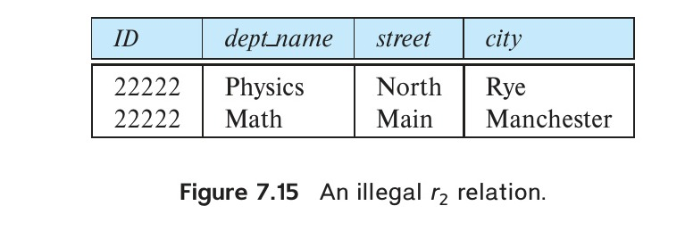
*Figure 7.15 — An illegal $r_2$ relation.*

Let $D$ be a set of functional and multivalued dependencies. The **closure** of $D$, denoted by $D^+$, is the set of all functional and multivalued dependencies logically implied by $D$. We can compute $D^+$ from the formal definitions of functional and multivalued dependencies, but to do so directly can be difficult. Section 28.1.1 presents a set of inference rules that can be used to compute $D^+$.

Every functional dependency $\alpha \rightarrow \beta$ is also a multivalued dependency $\alpha \twoheadrightarrow \beta$. To see this, suppose $\alpha \rightarrow \beta$ holds on $R$. Then if $t_1[\alpha] = t_2[\alpha]$, it must be that $t_1[\beta] = t_2[\beta]$. We can choose $t_3 = t_2$ and $t_4 = t_1$. It is easy to verify that $t_3$ and $t_4$ satisfy the definition of multivalued dependency. Thus, $\alpha \rightarrow \beta$ implies $\alpha \twoheadrightarrow \beta$.

<!-- Page 339 -->

From the definition of multivalued dependency, we can derive the following rules for $\alpha, \beta \subseteq R$:

- If $\alpha \rightarrow \beta$, then $\alpha \twoheadrightarrow \beta$. In other words, every functional dependency is also a multivalued dependency.
- If $\alpha \twoheadrightarrow \beta$, then $\alpha \twoheadrightarrow R - \alpha - \beta$.

Section 28.1.1 outlines a system of inference rules for multivalued dependencies.

### 7.6.2 Fourth Normal Form

Consider again our example of the BCNF schema:

$$r_2(\text{ID}, \text{dept\_name}, \text{street}, \text{city})$$

in which the multivalued dependency $\text{ID} \twoheadrightarrow \text{street}, \text{city}$ holds. We saw in the opening paragraphs of Section 7.6 that, although this schema is in BCNF, the design is not ideal, since we must repeat an instructor’s address information for each department. We shall see that we can use the given multivalued dependency to improve the database design by decomposing this schema into a fourth normal form decomposition.

A relation schema $R$ is in **fourth normal form** (4NF) with respect to a set $D$ of functional and multivalued dependencies if, for all multivalued dependencies in $D^+$ of the form $\alpha \twoheadrightarrow \beta$, where $\alpha \subseteq R$ and $\beta \subseteq R$, at least one of the following holds:

- $\alpha \twoheadrightarrow \beta$ is a trivial multivalued dependency.
- $\alpha$ is a superkey for $R$.

A database design is in 4NF if each member of the set of relation schemas that constitutes the design is in 4NF.

Note that the definition of 4NF differs from the definition of BCNF in only the use of multivalued dependencies. Every 4NF schema is in BCNF. To see this fact, we note that, if a schema $R$ is not in BCNF, then there is a nontrivial functional dependency $\alpha \rightarrow \beta$ holding on $R$, where $\alpha$ is not a superkey. Since $\alpha \rightarrow \beta$ implies $\alpha \twoheadrightarrow \beta$, $R$ cannot be in 4NF.

<!-- Page 340 -->

Let $R$ be a relation schema, and let $R_1, R_2, \ldots, R_n$ be a decomposition of $R$. To check if each relation schema $R_i$ in the decomposition is in 4NF, we need to find what multivalued dependencies hold on each $R_i$. Recall that, for a set $F$ of functional dependencies, the restriction $F_i$ of $F$ to $R_i$ is all functional dependencies in $F^+$ that include only attributes of $R_i$. Now consider a set $D$ of both functional and multivalued dependencies. The restriction of $D$ to $R_i$ is the set $D_i$ consisting of:

1. All functional dependencies in $D^+$ that include only attributes of $R_i$.
2. All multivalued dependencies of the form:
   $$\alpha \twoheadrightarrow \beta \cap R_i$$
   where $\alpha \subseteq R_i$ and $\alpha \twoheadrightarrow \beta$ is in $D^+$.

### 7.6.3 4NF Decomposition

The analogy between 4NF and BCNF applies to the algorithm for decomposing a schema into 4NF. Figure 7.16 shows the 4NF decomposition algorithm. It is identical to the BCNF decomposition algorithm of Figure 7.11, except that it uses multivalued dependencies and the closure of multivalued dependencies $D^+$.

<!-- Page 340 -->

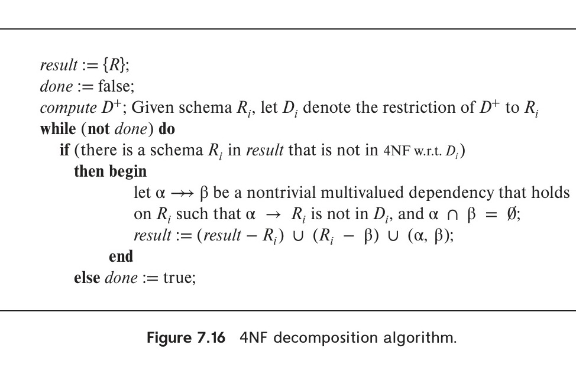
*Figure 7.16 — 4NF decomposition algorithm.*

If we apply the algorithm of Figure 7.16 to $(\text{ID}, \text{dept\_name}, \text{street}, \text{city})$, we find that $\text{ID} \twoheadrightarrow \text{street}, \text{city}$ violates 4NF. We decompose the schema into:

$$(\text{ID}, \text{street}, \text{city})$$
$$(\text{ID}, \text{dept\_name})$$

Both schemas are in 4NF.

As was the case when we were dealing solely with functional dependencies, we are interested in whether a decomposition is lossless. We can test for lossless decomposition using the following rule: Let $R, R_1$, and $R_2$ be relation schemas, such that $R = R_1 \cup R_2$. $R_1$ and $R_2$ form a lossless decomposition of $R$ if and only if at least one of the following dependencies is in $D^+$:

- $R_1 \cap R_2 \twoheadrightarrow R_1$
- $R_1 \cap R_2 \twoheadrightarrow R_2$

This rule is a generalization of the lossless decomposition rule that we saw for functional dependencies in Section 7.2.3. The rule says that a decomposition is lossless if and only if the intersection of the two schemas multivalued determines at least one of the schemas.

<!-- Page 341 -->

<!-- Page 341 -->

• Let $r(R)$ be a relation schema, and let $D$ be a set of functional and multivalued dependencies on $R$. Let $r_1(R_1)$ and $r_2(R_2)$ form a decomposition of $R$. This decomposition of $R$ is lossless if and only if at least one of the following multivalued dependencies is in $D^+$:
  $$R_1 \cap R_2 \twoheadrightarrow R_1$$
  $$R_1 \cap R_2 \twoheadrightarrow R_2$$

Recall that we stated in Section 7.2.3 that, if $R_1 \cap R_2 \rightarrow R_1$ or $R_1 \cap R_2 \rightarrow R_2$, then $r_1(R_1)$ and $r_2(R_2)$ forms a lossless decomposition of $r(R)$. The preceding fact about multivalued dependencies is a more general statement about losslessness. It says that, for every lossless decomposition of $r(R)$ into two schemas $r_1(R_1)$ and $r_2(R_2)$, one of the two dependencies $R_1 \cap R_2 \twoheadrightarrow R_1$ or $R_1 \cap R_2 \twoheadrightarrow R_2$ must hold. To see that this is true, we need to show first that if at least one of these dependencies holds, then $\Pi_{R_1}(r) \bowtie \Pi_{R_2}(r) = r$ and next we need to show that if $\Pi_{R_1}(r) \bowtie \Pi_{R_2}(r) = r$ then $r(R)$ must satisfy at least one of these dependencies. See the Further Reading section for references to a full proof.

The issue of dependency preservation when we decompose a relation schema becomes more complicated in the presence of multivalued dependencies. Section 28.1.2 pursues this topic.

A further complication arises from the fact that it is possible for a multivalued dependency to hold only on a proper subset of the given schema, with no way to express that multivalued dependency on that given schema. Such a multivalued dependency may appear as the result of a decomposition. Fortunately, such cases, called **embedded multivalued dependencies**, are rare. See the Further Reading section for details.

## 7.7 More Normal Forms

The fourth normal form is by no means the “ultimate” normal form. As we saw earlier, multivalued dependencies help us understand and eliminate some forms of repetition of information that cannot be understood in terms of functional dependencies. There are types of constraints called **join dependencies** that generalize multivalued dependencies and lead to another normal form called **project-join normal form** (PJNF). PJNF is called fifth normal form in some books. There is a class of even more general constraints that leads to a normal form called **domain-key normal form** (DKNF).

A practical problem with the use of these generalized constraints is that they are not only hard to reason with, but there is also no set of sound and complete inference rules for reasoning about the constraints. Hence PJNF and DKNF are used quite rarely. Chapter 28 provides more details about these normal forms.

Conspicuous by its absence from our discussion of normal forms is **second normal form** (2NF). We have not discussed it because it is of historical interest only. We simply define it and let you experiment with it in Practice Exercise 7.19.

First normal form deals with a different issue than the normal forms we have seen so far. It is discussed in the next section.

<!-- Page 342 -->

### 7.7.2 Multivalued Dependencies and E-R Modeling

The E-R model allows entity sets and relationship sets to have attributes with some degree of substructure. Specifically, it allows multivalued attributes such as *phone_number* in Figure 6.8 and composite attributes (such as an attribute *address* with component attributes *street*, *city*, and *state*). When we create tables from E-R designs that contain these types of attributes, we eliminate this substructure. For composite attributes, we let each component be an attribute in its own right. For multivalued attributes, we create one tuple for each item in a multivalued set.

## 7.8 Atomic Domains and First Normal Form

In our discussion of relational database design, we assumed that each attribute of a relation has an atomic domain. We now define this concept precisely.

A domain is **atomic** if elements of the domain are considered to be indivisible units. We say that a relation schema $R$ is in **first normal form** (1NF) if the domains of all attributes of $R$ are atomic.

Non-atomic values can be composite values, such as an address consisting of a street name, city, state, and zip code, or set-valued attributes, such as a set of phone numbers.

Integers are considered to have atomic domains, so the set of integers is an atomic domain; however, the set of all sets of integers is a non-atomic domain. The distinction is that we do not normally consider integers to have subparts, but we consider sets of integers to have subparts—namely, the integers making up the set. But the important issue is not what the domain itself is, but rather how we use domain elements in our database. The domain of all integers would be non-atomic if we considered each integer to be an ordered list of digits.

As a practical illustration of this point, consider an organization that assigns employees identification numbers of the following form: The first two letters specify the department and the remaining four digits are a unique number within the department for the employee. Examples of such numbers would be “CS001” and “EE1127”. Such identification numbers can be divided into smaller units and are therefore non-atomic. If a relation schema had an attribute whose domain consists of identification numbers encoded as above, the schema would not be in first normal form.

When such identification numbers are used, the department of an employee can be found by writing code that breaks up the structure of an identification number. Doing so requires extra programming, and information gets encoded in the application program rather than in the database. Further problems arise if such identification numbers are used as primary keys: When an employee changes departments, the employee’s identification number must be changed everywhere it occurs, which can be a difficult task, or the code that interprets the number would give a wrong result.

<!-- Page 343 -->

From this discussion, it may appear that our use of course identifiers such as “CS-101”, where “CS” indicates the Computer Science department, means that the domain of course identifiers is not atomic. Such a domain is not atomic as far as humans using the system are concerned. However, the database application still treats the domain as atomic, as long as it does not attempt to split the identifier and interpret parts of the identifier as a department abbreviation. The *course* schema stores the department name as a separate attribute, and the database application can use this attribute value to find the department of a course, instead of interpreting particular characters of the course identifier. Thus, our university schema can be considered to be in first normal form.

The use of set-valued attributes can lead to designs with redundant storage of data, which in turn can result in inconsistencies. For instance, instead of having the relationship between instructors and sections being represented as a separate relation *teaches*, a database designer may be tempted to store a set of course section identifiers with each instructor and a set of instructor identifiers with each section. (The primary keys of *section* and *instructor* are used as identifiers.) Whenever data pertaining to which instructor teaches which section is changed, the update has to be performed at two places: in the set of instructors for the section, and in the set of sections for the instructor. Failure to perform both updates can leave the database in an inconsistent state. Keeping only one of these sets would avoid repeated information; however keeping only one of these would complicate some queries, and it is unclear which of the two it would be better to retain.

Some types of non-atomic values can be useful, although they should be used with care. For example, composite-valued attributes are often useful, and set-valued attributes are also useful in many cases, which is why both are supported in the E-R model. In many domains where entities have a complex structure, forcing a first normal form representation represents an unnecessary burden on the application programmer, who has to write code to convert data into atomic form. There is also the runtime overhead of converting data back and forth from the atomic form. Support for non-atomic values can thus be very useful in such domains. In fact, modern database systems do support many types of non-atomic values, as we shall see in Chapter 8. However, in this chapter we restrict ourselves to relations in first normal form, and thus all domains are atomic.

## 7.9 Database-Design Process

So far we have looked at detailed issues about normal forms and normalization. In this section, we study how normalization fits into the overall database-design process.

Earlier in the chapter starting in Section 7.1.1, we assumed that a relation schema $r(R)$ is given, and we proceeded to normalize it. There are several ways in which we could have come up with the schema $r(R)$:

1. $r(R)$ could have been generated in converting an E-R diagram to a set of relation schemas.

<!-- Page 344 -->

2. $r(R)$ could have been a single relation schema containing all attributes that are of interest. The normalization process then breaks up $r(R)$ into smaller schemas.
3. $r(R)$ could have been the result of an ad hoc design of relations that we then test to verify that it satisfies a desired normal form.

In the rest of this section, we examine the implications of these approaches. We also examine some practical issues in database design, including denormalization for performance and examples of bad design that are not detected by normalization.

### 7.9.1 E-R Model and Normalization

When we define an E-R diagram carefully, identifying all entity sets correctly, the relation schemas generated from the E-R diagram should not need much further normalization. However, there can be functional dependencies among attributes of an entity set. For instance, suppose an *instructor* entity set had attributes *dept_name* and *dept_address*, and there is a functional dependency $\text{dept\_name} \rightarrow \text{dept\_address}$. We would then need to normalize the relation generated from *instructor*.

Most examples of such dependencies arise out of poor E-R diagram design. In the preceding example, if we had designed the E-R diagram correctly, we would have created a *department* entity set with attribute *dept_address* and a relationship set between *instructor* and *department*. Similarly, a relationship set involving more than two entity sets may result in a schema that may not be in a desirable normal form. Since most relationship sets are binary, such cases are relatively rare. (In fact, some E-R-diagram variants actually make it difficult or impossible to specify nonbinary relationship sets.)

Functional dependencies can help us detect poor E-R design. If the generated relation schemas are not in desired normal form, the problem can be fixed in the E-R diagram. That is, normalization can be done formally as part of data modeling. Alternatively, normalization can be left to the designer’s intuition during E-R modeling, and it can be done formally on the relation schemas generated from the E-R model.

A careful reader will have noted that in order for us to illustrate a need for multivalued dependencies and fourth normal form, we had to begin with schemas that were not derived from our E-R design. Indeed, the process of creating an E-R design tends to generate 4NF designs. If a multivalued dependency holds and is not implied by the corresponding functional dependency, it usually arises from one of the following sources:

- A many-to-many relationship set.
- A multivalued attribute of an entity set.

For a many-to-many relationship set, each related entity set has its own schema, and there is an additional schema for the relationship set. For a multivalued attribute, a separate schema is created consisting of that attribute and the primary key of the entity set (as in the case of the *phone_number* attribute of the entity set *instructor*).

<!-- Page 345 -->

The universal-relation approach to relational database design starts with an assumption that there is one single relation schema containing all attributes of interest. This single schema defines how users and applications interact with the database.

### 7.9.2 Naming of Attributes and Relationships

A desirable feature of a database design is the **unique-role assumption**, which means that each attribute name has a unique meaning in the database. This prevents us from using the same attribute to mean different things in different schemas. For example, we might otherwise consider using the attribute *number* for phone number in the *instructor* schema and for room number in the *classroom* schema. The join of a relation on schema *instructor* with one on *classroom* is meaningless. While users and application developers can work carefully to ensure use of the right *number* in each circumstance, having a different attribute name for *phone_number* and for *room_number* serves to reduce user errors.

While it is a good idea to keep names for incompatible attributes distinct, if attributes of different relations have the same meaning, it may be a good idea to use the same attribute name. For this reason we used the same attribute name “name” for both the *instructor* and the *student* entity sets. If this was not the case (i.e., if we used different naming conventions for the instructor and student names), then if we wished to generalize these entity sets by creating a *person* entity set, we would have to rename the attribute. Thus, even if we did not currently have a generalization of *student* and *instructor*, if we foresee such a possibility, it is best to use the same name in both entity sets (and relations).

Although technically, the order of attribute names in a schema does not matter, it is a convention to list primary-key attributes first. This makes reading default output (as from `select *`) easier.

In large database schemas, relationship sets (and schemas derived therefrom) are often named via a concatenation of the names of related entity sets, perhaps with an intervening hyphen or underscore. We have used a few such names, for example, *inst_sec* and *student_sec*. We used the names *teaches* and *takes* instead of using the longer concatenated names. This was acceptable since it is not hard for you to remember the associated entity sets for a few relationship sets. We cannot always create relationship-set names by simple concatenation; for example, a *manager* or *works_for* relationship between employees would not make much sense if it were called *employee_employee*! Similarly, if there are multiple relationship sets possible between a pair of entity sets, the relationship-set names must include extra parts to identify the relationship set.

Different organizations have different conventions for naming entity sets. For example, we may call an entity set of students *student* or *students*. We have chosen to use the singular form in our database designs. Using either singular or plural is acceptable, as long as the convention is used consistently across all entity sets.

<!-- Page 346 -->

As schemas grow larger, with increasing numbers of relationship sets, using consistent naming of attributes, relationships, and entities makes life much easier for the database designer and application programmers.

### 7.9.3 Denormalization for Performance

Occasionally database designers choose a schema that has redundant information; that is, it is not normalized. They use the redundancy to improve performance for specific applications. The penalty paid for not using a normalized schema is the extra work (in terms of coding time and execution time) to keep redundant data consistent.

For instance, suppose all course prerequisites have to be displayed along with the course information, every time a course is accessed. In our normalized schema, this requires a join of *course* with *prereq*.

One alternative to computing the join on the fly is to store a relation containing all the attributes of *course* and *prereq*. This makes displaying the “full” course information faster. However, the information for a course is repeated for every course prerequisite, and all copies must be updated by the application, whenever a course prerequisite is added or dropped. The process of taking a normalized schema and making it non-normalized is called **denormalization**, and designers use it to tune the performance of systems to support time-critical operations.

A better alternative, supported by many database systems today, is to use the normalized schema and additionally store the join of *course* and *prereq* as a **materialized view**. (Recall that a materialized view is a view whose result is stored in the database and brought up to date when the relations used in the view are updated.) Like denormalization, using materialized views does have space and time overhead; however, it has the advantage that keeping the view up to date is the job of the database system, not the application programmer.

### 7.9.4 Other Design Issues

There are some aspects of database design that are not addressed by normalization and can thus lead to bad database design. Data pertaining to time or to ranges of time have several such issues. We give examples here; obviously, such designs should be avoided.

Consider a university database, where we want to store the total number of instructors in each department in different years. A relation $\text{total\_inst}(\text{dept\_name}, \text{year}, \text{size})$ could be used to store the desired information. The only functional dependency on this relation is $\text{dept\_name}, \text{year} \rightarrow \text{size}$, and the relation is in BCNF.

An alternative design is to use multiple relations, each storing the size information for a different year. Let us say the years of interest are 2017, 2018, and 2019; we would then have relations of the form $\text{total\_inst\_2017}$, $\text{total\_inst\_2018}$, $\text{total\_inst\_2019}$, all of which are on the schema $(\text{dept\_name}, \text{size})$. The only functional dependency here on each relation would be $\text{dept\_name} \rightarrow \text{size}$, so these relations are also in BCNF.

However, this alternative design is clearly a bad idea—we would have to create a new relation every year, and we would also have to write new queries every year, to take

<!-- Page 347 -->

each new relation into account. Queries would also be more complicated since they may have to refer to many relations.

Yet another way of representing the same data is to have a single relation $\text{dept\_year}(\text{dept\_name}, \text{total\_inst\_2017}, \text{total\_inst\_2018}, \text{total\_inst\_2019})$. Here the only functional dependencies are from $\text{dept\_name}$ to the other attributes, and again the relation is in BCNF. This design is also a bad idea since it has problems similar to the previous design—namely, we would have to modify the relation schema and write new queries every year. Queries would also be more complicated, since they may have to refer to many attributes.

Representations such as those in the *dept_year* relation, with one column for each value of an attribute, are called **crosstabs**; they are widely used in spreadsheets and reports and in data analysis tools. While such representations are useful for display to users, for the reasons just given, they are not desirable in a database design. SQL includes features to convert data from a normal relational representation to a crosstab, for display, as we discussed in Section 11.3.1.

## 7.10 Modeling Temporal Data[^10]

Suppose we retain data in our university organization showing not only the address of each instructor, but also all former addresses of which the university is aware. We may then ask queries, such as “Find all instructors who lived in Princeton in 1981.” In this case, we may have multiple addresses for instructors. Each address has an associated start and end date, indicating when the instructor was resident at that address. A special value for the end date, for example, null, or a value well into the future, such as 9999-12-31, can be used to indicate that the instructor is still resident at that address.

In general, **temporal data** are data that have an associated time interval during which they are valid.[^10]

Modeling temporal data is a challenging problem for several reasons. For example, suppose we have an *instructor* entity set with which we wish to associate a time-varying address. To add temporal information to an address, we would then have to create a multivalued attribute, each of whose values is a composite value containing an address and a time interval. In addition to time-varying attribute values, entities may themselves have an associated valid time. For example, a student entity may have a valid time from the date the student entered the university to the date the student graduated (or left the university). Relationships too may have associated valid times. For example, the *prereq* relationship may record when a course became a prerequisite for another course. We would thus have to add valid time intervals to attribute values, entity sets, and relationship sets. Adding such detail to an E-R diagram makes it very difficult to create and to comprehend. There have been several proposals to extend the E-R notation to

<!-- Page 348 -->

specify in a simple manner that an attribute value or relationship is time varying, but there are no accepted standards.

In practice, database designers fall back to simpler approaches to designing temporal databases. One commonly used approach is to design the entire database (including E-R design and relational design) ignoring temporal changes. After this, the designer studies the various relations and decides which relations require temporal variation to be tracked.

The next step is to add valid time information to each such relation by adding start and end time as attributes. For example, consider the *course* relation. The title of the course may change over time, which can be handled by adding a valid time range; the resultant schema would be:

$$\text{course}(\text{course\_id}, \text{title}, \text{dept\_name}, \text{credits}, \text{start}, \text{end})$$

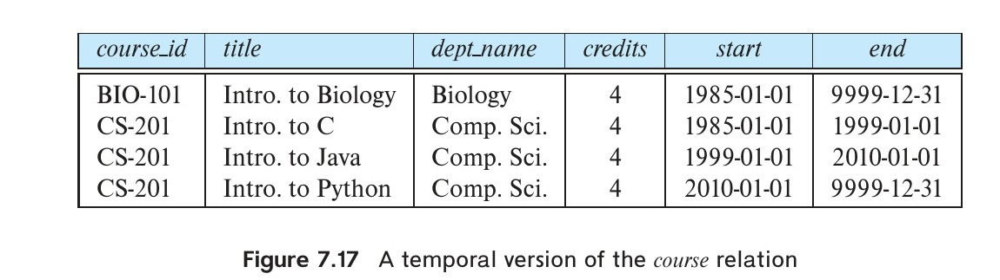
*Figure 7.17 — A temporal version of the course relation.*

An instance of the relation is shown in Figure 7.17. Each tuple has a valid interval associated with it. Note that as per the SQL:2011 standard, the interval is closed on the left-hand side, that is, the tuple is valid at time start, but is open on the right-hand side, that is, the tuple is valid until just before time end, but is invalid at time end. This allows a tuple to have the same start time as the end time of another tuple, without overlapping. In general, left and right endpoints that are closed are denoted by $[$ and $]$, while left and right endpoints that are open are denoted by $($ and $)$. Intervals in SQL:2011 are of the form $[\text{start}, \text{end})$, that is they are closed on the left and open on the right. Note that 9999-12-31 is the highest possible date as per the SQL standard.

It can be seen in Figure 7.17 that the title of the course CS-201 has changed several times. Suppose that on 2020-01-01 the title of the course is updated again to, say, “Intro. to Scala”. Then, the *end* attribute value of the tuple with title “Intro. to Python” would be updated to 2020-01-01, and a new tuple (CS-201, Intro. to Scala, Comp. Sci., 4, 2020-01-01, 9999-12-31) would be added to the relation.

When we track data values across time, functional dependencies that we assumed to hold, such as:

$$\text{course\_id} \rightarrow \text{title}, \text{dept\_name}, \text{credits}$$

may no longer hold. The following constraint (expressed in English) would hold instead: “A course *course_id* has only one title and *dept_name* value at any given time $t$.”

<!-- Page 349 -->

Functional dependencies that hold at a particular point in time are called **temporal functional dependencies**. We use the term **snapshot** of data to mean the value of the data at a particular point in time. Thus, a snapshot of *course* data gives the values of all attributes, such as title and department, of all courses at a particular point in time. Formally, a temporal functional dependency $\alpha \xrightarrow{\tau} \beta$ holds on a relation schema $r(R)$ if, for all legal instances of $r(R)$, all snapshots of $r$ satisfy the functional dependency $\alpha \rightarrow \beta$.

The original primary key for a temporal relation would no longer uniquely identify a tuple. We could try to fix the problem by adding start and end time attributes to the primary key, ensuring no two tuples have the same primary key value. However, this solution is not correct, since it is possible to store data with overlapping valid time intervals, which would not be caught by merely adding the start and end time attributes to the primary-key constraint. Instead, the temporal version of the primary key constraint must ensure that if any two tuples have the same primary key values, their valid time intervals do not overlap. Formally, if $r.A$ is a temporal primary key of relation $r$, then whenever two tuples $t_1$ and $t_2$ in $r$ are such that $t_1.A = t_2.A$, their valid time intervals of $t_1$ and $t_2$ must not overlap.

Foreign-key constraints are also more complicated when the referenced relation is a temporal relation. A temporal foreign key should ensure that not only does each tuple in the referencing relation, say $r$, have a matching tuple in the referenced relation, say $s$, but also their time intervals are accounted for. It is not required that there be a matching tuple in $s$ with exactly the same time interval, nor even that a single tuple in $s$ has a time interval containing the time interval of the $r$ tuple. Instead, we allow the time interval of the $r$ tuple to be covered by one or more $s$ tuples. Formally, a temporal foreign-key constraint from $r.A$ to $s.B$ ensures the following: for each tuple $t$ in $r$, with valid time interval $(l, u)$, there is a subset $s_t$ of one or more tuples in $s$ such that each tuple $s_i \in s_t$ has $s_i.B = t.A$, and further the union of the temporal intervals of all the $s_i$ contains $(l, u)$.

A record in a student’s transcript should refer to the course title at the time when the student took the course. Thus, the referencing relation must also record time information, to identify a particular record from the *course* relation. In our university schema, *takes.course_id* is a foreign key referencing *course*. The *year* and *semester* values of a *takes* tuple could be mapped to a representative date, such as the start date of the semester; the resulting date value could be used to identify a tuple in the temporal version of the *course* relation whose valid time interval contains the specified date. Alternatively, a *takes* tuple may be associated with a valid time interval from the start date of the semester until the end date of the semester, and course tuples with a matching *course_id* and an overlapping valid time may be retrieved; as long as course tuples are not updated during a semester, there would be only one such record.

[^10]: There are other models of temporal data that distinguish between valid time and transaction time, the latter recording when a fact was recorded in the database. We ignore such details for simplicity.

Instead of adding temporal information to each relation, some database designers create for each relation a corresponding history relation that stores the history of updates to the tuples. For example, a designer may leave the *course* relation unchanged,

<!-- Page 350 -->

but create a relation *course_history* containing all the attributes of *course*, with an additional timestamp attribute indicating when a record was added to the *course_history* table. However, such a scheme has limitations, such as an inability to associate a *takes* record with the correct course title.

The SQL:2011 standard added support for temporal data. In particular, it allows existing attributes to be declared to specify a valid time interval for a tuple. For example, for the extended *course* relation we saw above, we could declare

```sql
period for validtime (start, end)
```

to specify that the tuple is valid in the interval specified by the *start* and *end* (which are otherwise ordinary attributes).

Temporal primary keys can be declared in SQL:2011, as illustrated below, using the extended *course* schema:

```sql
primary key (course_id, validtime without overlaps)
```

SQL:2011 also supports temporal foreign-key constraints that allow a period to be specified along with the referencing relation attributes, as well as with the referenced relation attributes. Most databases, with the exception of IBM DB2, Teradata, and possibly a few others, do not support temporal primary-key constraints. To the best of our knowledge, no database system currently supports temporal foreign-key constraints (Teradata allows them to be specified, but at least as of 2018, does not enforce them).

Some databases that do not directly support temporal primary-key constraints allow workarounds to enforce such constraints. For example, although PostgreSQL does not support temporal primary-key constraints natively, such constraints can be enforced using the **exclude constraint** feature supported by PostgreSQL. For example, consider the *course* relation, whose primary key is *course_id*. In PostgreSQL, we can add an attribute *validtime*, of type `tsrange`; the `tsrange` data type of PostgreSQL stores a timestamp range with a start and end timestamp. PostgreSQL supports an `&&` operator on a pair of ranges, which returns true if two ranges overlap and false otherwise. The temporal primary key can be enforced by adding the following exclude constraint (a type of constraint supported by PostgreSQL) to the *course* relation as follows:

```sql
exclude (course_id with =, validtime with &&)
```

The above constraint ensures that if two course tuples have the same *course_id* value, then their *validtime* intervals do not overlap.

Relational algebra operations, such as select, project, or join, can be extended to take temporal relations as inputs and generate temporal relations as outputs. Selection and projection operations on temporal relations output tuples whose valid time intervals are the same as that of their corresponding input tuples. A **temporal join** is slightly different: the valid time of a tuple in the join result is defined as the intersection of the valid times of the tuples from which it is derived. If the valid times do not intersect, the tuple is discarded from the result. To the best of our knowledge, no database supports temporal joins natively, although they can be expressed by SQL queries that explicitly

<!-- Page 351 -->

handle the temporal conditions. Predicates, such as *overlaps*, *contains*, *before*, and *after* and operations such as intersection and difference on pairs of intervals are supported by several database systems.

## 7.11 Summary

- We showed pitfalls in database design and how to design a database schema systematically in a way that avoids those pitfalls. The pitfalls included repeated information and inability to represent some information.
- Chapter 6 showed the development of a relational database design from an E-R design and when schemas may be combined safely.
- Functional dependencies are consistency constraints that are used to define two widely used normal forms, Boyce–Codd normal form (BCNF) and third normal form (3NF).
- If the decomposition is dependency preserving, all functional dependencies can be inferred logically by considering only those dependencies that apply to one relation. This permits the validity of an update to be tested without the need to compute a join of relations in the decomposition.
- A canonical cover is a set of functional dependencies equivalent to a given set of functional dependencies, that is minimized in a specific manner to eliminate extraneous attributes.
- The algorithm for decomposing relations into BCNF ensures a lossless decomposition. There are relation schemas with a given set of functional dependencies for which there is no dependency-preserving BCNF decomposition.
- A canonical cover is used to decompose a relation schema into 3NF, which is a small relaxation of the BCNF condition. This algorithm produces designs that are both lossless and dependency-preserving. Relations in 3NF may have some redundancy, but that is deemed an acceptable trade-off in cases where there is no dependency-preserving decomposition into BCNF.
- Multivalued dependencies specify certain constraints that cannot be specified with functional dependencies alone. Fourth normal form (4NF) is defined using the concept of multivalued dependencies. Section 28.1.1 gives details on reasoning about multivalued dependencies.
- Other normal forms exist, including PJNF and DKNF, which eliminate more subtle forms of redundancy. However, these are hard to work with and are rarely used. Chapter 28 gives details on these normal forms. Second normal form is of only historical interest since it provides no benefit over 3NF.
- Relational designs typically are based on simple atomic domains for each attribute. This is called first normal form.

<!-- Page 352 -->

- Time plays an important role in database systems. Databases are models of the real world. Whereas most databases model the state of the real world at a point in time (at the current time), temporal databases model the states of the real world across time.
- There are possible database designs that are bad despite being lossless, dependency-preserving, and in an appropriate normal form. We showed examples of some such designs to illustrate that functional-dependency-based normalization, though highly important, is not the only aspect of good relational design.
- In order for a database to store not only current data but also historical data, the database must also store for each such tuple the time period for which the tuple is or was valid. It then becomes necessary to define temporal functional dependencies to represent the idea that the functional dependency holds at any point in time but not over the entire relation. Similarly, the join operation needs to be modified so as to appropriately join only tuples with overlapping time intervals.
- In reviewing the issues in this chapter, note that the reason we could define rigorous approaches to relational database design is that the relational data model rests on a firm mathematical foundation. That is one of the primary advantages of the relational model compared with the other data models that we have studied.

## Review Terms

- Decomposition
  - Lossy decompositions
  - Lossless decompositions
- Normalization
- Functional dependencies
- Legal instance
- Superkey
- $R$ satisfies $F$
- Functional dependency
  - Holds
  - Trivial
  - Nontrivial
- Closure of a set of functional dependencies
- Dependency preserving
- Third normal form
- Transitive dependencies
- Logically implied
- Axioms
- Armstrong’s axioms
- Sound
- Complete
- Functionally determined
- Extraneous attributes
- Canonical cover
- Restriction of $F$ to $R_i$
- Dependency-preserving decomposition
- Boyce–Codd normal form (BCNF)
- BCNF decomposition algorithm

<!-- Page 353 -->

- Third normal form (3NF)
- 3NF decomposition algorithm
- 3NF synthesis algorithm
- Multivalued dependencies
- Equality-generating dependencies
- Tuple-generating dependencies
- Trivial multivalued dependencies
- Closure of a set of functional and multivalued dependencies
- Fourth normal form (4NF)
- Restriction of $D$ to $R_i$
- 4NF decomposition algorithm
- Join dependencies
- Project-join normal form (PJNF)
- Fifth normal form (5NF)
- Domain-key normal form (DKNF)
- Atomic domains
- First normal form (1NF)
- Universal relation
- Unique-role assumption
- Denormalization
- Valid time
- Transaction time
- Temporal database
- Temporal functional dependency
- Temporal primary-key constraint
- Temporal foreign-key constraint
- Exclude constraint
- Temporal join

## Practice Exercises

**7.1** Suppose that we decompose the schema $R = (A, B, C, D, E)$ into

$$(A, B, C)$$
$$(A, D, E)$$

Show that this decomposition is a lossless decomposition if the following set $F$ of functional dependencies holds:

$$A \rightarrow BC$$
$$CD \rightarrow E$$
$$B \rightarrow D$$
$$E \rightarrow A$$

**7.2** List all nontrivial functional dependencies satisfied by the relation of Figure 7.18.

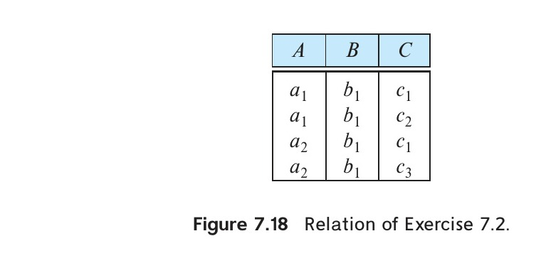
*Figure 7.18 — Relation of Exercise 7.2.*

<!-- Page 354 -->

**7.3** Explain how functional dependencies can be used to indicate the following:

- A one-to-one relationship set exists between entity sets $\text{entity\_set\_1}$ and $\text{entity\_set\_2}$.
- A many-to-one relationship set exists between entity sets $\text{entity\_set\_1}$ and $\text{entity\_set\_2}$.
- A many-to-many relationship set exists between entity sets $\text{entity\_set\_1}$ and $\text{entity\_set\_2}$.
- Total participation exists for entity set $\text{entity\_set\_1}$ in relationship set $\text{relationship\_set\_1}$.

**7.4** Use Armstrong’s axioms to prove the soundness of the union rule. (*Hint:* Use the augmentation rule on $\alpha \rightarrow \beta$ and $\alpha \rightarrow \gamma$, and then use the transitivity rule.)

**7.5** Use Armstrong’s axioms to prove the soundness of the pseudotransitivity rule.

**7.6** Compute the closure of the following set $F$ of functional dependencies for relation schema $R = (A, B, C, D, E)$:

$$A \rightarrow BC$$
$$CD \rightarrow E$$
$$B \rightarrow D$$
$$E \rightarrow A$$

List the candidate keys for $R$.

**7.7** Using the functional dependencies of Exercise 7.6, compute the canonical cover $F_c$.

**7.8** Consider the algorithm in Figure 7.19 to compute $\alpha^+$. Show that this algorithm is more efficient than the one presented in Figure 7.8 (Section 7.4.2) and that it computes $\alpha^+$ correctly.

**7.9** Given the database schema $R(A, B, C)$, and a relation $r$ on the schema $R$, write an SQL query to test whether the functional dependency $B \rightarrow C$ holds on relation $r$. Also write an SQL assertion that enforces the functional dependency. Assume that no null values are present. (Although part of the SQL standard, such assertions are not supported by any database implementation currently.)

**7.10** Our discussion of lossless decomposition implicitly assumed that attributes on the left-hand side of a functional dependency cannot take on null values. What could go wrong on decomposition, if this property is violated?

**7.11** In the BCNF decomposition algorithm, suppose you use a functional dependency $\alpha \rightarrow \beta$ to decompose a relation schema $r(\alpha, \beta, \gamma)$ into $r_1(\alpha, \beta)$ and $r_2(\alpha, \gamma)$.

a. What primary and foreign-key constraint do you expect to hold on the decomposed relations?
b. Give an example of an inconsistency that can arise due to an erroneous update, if the foreign-key constraint were not enforced on the decomposed relations above.

<!-- Page 355 -->


*Figure 7.19 — An algorithm to compute $\alpha^+$.*

<!-- Page 356 -->

c. When a relation schema is decomposed into 3NF using the algorithm in Section 7.5.2, what primary and foreign-key dependencies would you expect to hold on the decomposed schema?

## Exercises

**7.12** Let $R_1, R_2, \ldots, R_n$ be a decomposition of schema $U$. Let $u(U)$ be a relation, and let $r_i = \Pi_{R_i}(u)$. Show that

$$u \subseteq r_1 \bowtie r_2 \bowtie \cdots \bowtie r_n$$

**7.13** Show that the decomposition in Exercise 7.1 is not a dependency-preserving decomposition.

**7.14** Show that there can be more than one canonical cover for a given set of functional dependencies, using the following set of dependencies:

$$X \rightarrow YZ, \quad Y \rightarrow XZ, \quad \text{and} \quad Z \rightarrow XY$$

**7.15** The algorithm to generate a canonical cover only removes one extraneous attribute at a time. Use the functional dependencies from Exercise 7.14 to show what can go wrong if two attributes inferred to be extraneous are deleted at once.

**7.16** Show that it is possible to ensure that a dependency-preserving decomposition into 3NF is a lossless decomposition by guaranteeing that at least one schema contains a candidate key for the schema being decomposed. (*Hint:* Show that the join of all the projections onto the schemas of the decomposition cannot have more tuples than the original relation.)

**7.17** Give an example of a relation schema $R'$ and set $F'$ of functional dependencies such that there are at least three distinct lossless decompositions of $R'$ into BCNF.

**7.18** Let a prime attribute be one that appears in at least one candidate key. Let $\alpha$ and $\beta$ be sets of attributes such that $\alpha \rightarrow \beta$ holds, but $\beta \rightarrow \alpha$ does not hold. Let $A$ be an attribute that is not in $\alpha$, is not in $\beta$, and for which $\beta \rightarrow A$ holds. We say that $A$ is transitively dependent on $\alpha$. We can restate the definition of 3NF as follows: A relation schema $R$ is in 3NF with respect to a set $F$ of functional dependencies if there are no nonprime attributes $A$ in $R$ for which $A$ is transitively dependent on a key for $R$. Show that this new definition is equivalent to the original one.

**7.19** A functional dependency $\alpha \rightarrow \beta$ is called a partial dependency if there is a proper subset $\gamma$ of $\alpha$ such that $\gamma \rightarrow \beta$; we say that $\beta$ is partially dependent on $\alpha$. A relation schema $R$ is in **second normal form** (2NF) if each attribute $A$ in $R$ meets one of the following criteria:

- It appears in a candidate key.

<!-- Page 357 -->

- It is not partially dependent on a candidate key.

Show that every 3NF schema is in 2NF. (*Hint:* Show that every partial dependency is a transitive dependency.)

**7.20** Give an example of a relation schema $R$ and a set of dependencies such that $R$ is in BCNF but is not in 4NF.

## Exercises

**7.21** Give a lossless decomposition into BCNF of schema $R$ of Exercise 7.1.

**7.22** Give a lossless, dependency-preserving decomposition into 3NF of schema $R$ of Exercise 7.1.

**7.23** Explain what is meant by repetition of information and inability to represent information. Explain why each of these properties may indicate a bad relational-database design.

**7.24** Why are certain functional dependencies called trivial functional dependencies?

**7.25** Use the definition of functional dependency to argue that each of Armstrong’s axioms (reflexivity, augmentation, and transitivity) is sound.

**7.26** Consider the following proposed rule for functional dependencies: If $\alpha \rightarrow \beta$ and $\gamma \rightarrow \beta$, then $\alpha \rightarrow \gamma$. Prove that this rule is not sound by showing a relation $r$ that satisfies $\alpha \rightarrow \beta$ and $\gamma \rightarrow \beta$, but does not satisfy $\alpha \rightarrow \gamma$.

**7.27** Use Armstrong’s axioms to prove the soundness of the decomposition rule.

**7.28** Using the functional dependencies of Exercise 7.6, compute $B^+$.

**7.29** Show that the following decomposition of the schema $R$ of Exercise 7.1 is not a lossless decomposition:

$$(A, B, C)$$
$$(C, D, E)$$

*Hint:* Give an example of a relation $r(R)$ such that $\Pi_{A, B, C}(r) \bowtie \Pi_{C, D, E}(r) \neq r$.

**7.30** Consider the following set $F$ of functional dependencies on the relation schema $(A, B, C, D, E, G)$:

$$A \rightarrow BCD$$
$$BC \rightarrow DE$$
$$B \rightarrow D$$
$$D \rightarrow A$$

<!-- Page 358 -->

a. Compute $B^+$.
b. Prove (using Armstrong’s axioms) that $AG$ is a superkey.
c. Compute a canonical cover for this set of functional dependencies $F$; give each step of your derivation with an explanation.
d. Give a 3NF decomposition of the given schema based on a canonical cover.
e. Give a BCNF decomposition of the given schema using the original set $F$ of functional dependencies.

**7.31** Consider the schema $R = (A, B, C, D, E, G)$ and the set $F$ of functional dependencies:

$$AB \rightarrow CD$$
$$B \rightarrow D$$
$$DE \rightarrow B$$
$$DEG \rightarrow AB$$
$$AC \rightarrow DE$$

$R$ is not in BCNF for many reasons, one of which arises from the functional dependency $AB \rightarrow CD$. Explain why $AB \rightarrow CD$ shows that $R$ is not in BCNF and then use the BCNF decomposition algorithm starting with $AB \rightarrow CD$ to generate a BCNF decomposition of $R$. Once that is done, determine whether your result is or is not dependency preserving, and explain your reasoning.

**7.32** Consider the schema $R = (A, B, C, D, E, G)$ and the set $F$ of functional dependencies:

$$A \rightarrow BC$$
$$BD \rightarrow E$$
$$CD \rightarrow AB$$

a. Find a nontrivial functional dependency containing no extraneous attributes that is logically implied by the above three dependencies and explain how you found it.
b. Use the BCNF decomposition algorithm to find a BCNF decomposition of $R$. Start with $A \rightarrow BC$. Explain your steps.
c. For your decomposition, state whether it is lossless and explain why.
d. For your decomposition, state whether it is dependency preserving and explain why.

<!-- Page 359 -->

**7.33** Consider the schema $R = (A, B, C, D, E, G)$ and the set $F$ of functional dependencies:

$$AB \rightarrow CD$$
$$ADE \rightarrow GDE$$
$$B \rightarrow GC$$
$$G \rightarrow DE$$

Use the 3NF decomposition algorithm to generate a 3NF decomposition of $R$, and show your work. This means:

a. A list of all candidate keys
b. A canonical cover for $F$, along with an explanation of the steps you took to generate it
c. The remaining steps of the algorithm, with explanation
d. The final decomposition

**7.34** Consider the schema $R = (A, B, C, D, E, G, H)$ and the set $F$ of functional dependencies:

$$AB \rightarrow CD$$
$$D \rightarrow C$$
$$DE \rightarrow B$$
$$DEH \rightarrow AB$$
$$AC \rightarrow DC$$

Use the 3NF decomposition algorithm to generate a 3NF decomposition of $R$, and show your work. This means:

a. A list of all candidate keys
b. A canonical cover for $F$
c. The steps of the algorithm, with explanation
d. The final decomposition

**7.35** Although the BCNF algorithm ensures that the resulting decomposition is lossless, it is possible to have a schema and a decomposition that was not generated by the algorithm, that is in BCNF, and is not lossless. Give an example of such a schema and its decomposition.

**7.36** Show that every schema consisting of exactly two attributes must be in BCNF regardless of the given set $F$ of functional dependencies.

<!-- Page 360 -->

**7.37** List the three design goals for relational databases, and explain why each is desirable.

**7.38** In designing a relational database, why might we choose a non-BCNF design?

**7.39** Given the three goals of relational database design, is there any reason to design a database schema that is in 2NF, but is in no higher-order normal form? (See Exercise 7.19 for the definition of 2NF.)

**7.40** Given a relational schema $r(A, B, C, D)$, does $A \twoheadrightarrow BC$ logically imply $A \twoheadrightarrow B$ and $A \twoheadrightarrow C$? If yes prove it, or else give a counter example.

**7.41** Explain why 4NF is a normal form more desirable than BCNF.

**7.42** Normalize the following schema, with given constraints, to 4NF.

$$\text{books}(\underline{\text{accessionno}}, \text{isbn}, \text{title}, \text{author}, \text{publisher})$$
$$\text{users}(\underline{\text{userid}}, \text{name}, \text{deptid}, \text{deptname})$$

$$\text{accessionno} \rightarrow \text{isbn}$$
$$\text{isbn} \rightarrow \text{title}$$
$$\text{isbn} \rightarrow \text{publisher}$$
$$\text{isbn} \twoheadrightarrow \text{author}$$
$$\text{userid} \rightarrow \text{name}$$
$$\text{userid} \rightarrow \text{deptid}$$
$$\text{deptid} \rightarrow \text{deptname}$$

**7.43** Although SQL does not support functional dependency constraints, if the database system supports constraints on materialized views, and materialized views are maintained immediately, it is possible to enforce functional dependency constraints in SQL. Given a relation $r(A, B, C)$, explain how constraints on materialized views can be used to enforce the functional dependency $B \rightarrow C$.

**7.44** Given two relations $r(A, B, \text{validtime})$ and $s(B, C, \text{validtime})$, where *validtime* denotes the valid time interval, write an SQL query to compute the temporal natural join of the two relations. You can use the `&&` operator to check if two intervals overlap and the `*` operator to compute the intersection of two intervals.

## Further Reading

The first discussion of relational database design theory appeared in an early paper by [Codd (1970)]. In that paper, Codd also introduced functional dependencies and first, second, and third normal forms.

Armstrong’s axioms were introduced in [Armstrong (1974)]. BCNF was introduced in [Codd (1972)]. [Maier (1983)] is a classic textbook that provides detailed coverage of normalization and the theory of functional and multivalued dependencies.

<!-- Page 361 -->

## Bibliography

- **[Armstrong (1974)]** W. W. Armstrong, “Dependency Structures of Data Base Relationships”, In *Proc. of the 1974 IFIP Congress* (1974), pages 580–583.
- **[Codd (1970)]** E. F. Codd, “A Relational Model for Large Shared Data Banks”, *Communications of the ACM*, Volume 13, Number 6 (1970), pages 377–387.
- **[Codd (1972)]** E. F. Codd, “Further Normalization of the Data Base Relational Model”, In [Rustin (1972)], pages 33–64 (1972).
- **[Maier (1983)]** D. Maier, *The Theory of Relational Databases*, Computer Science Press (1983).
- **[Rustin (1972)]** R. Rustin, *Data Base Systems*, Prentice Hall (1972).

## Credits

The photo of the sailboats in the beginning of the chapter is due to ©Pavel Nesvadba/Shutterstock.

