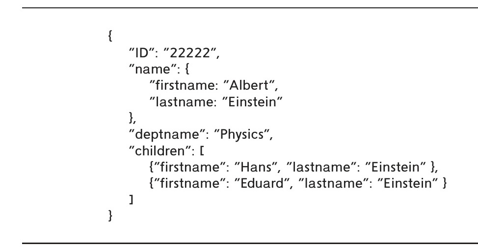
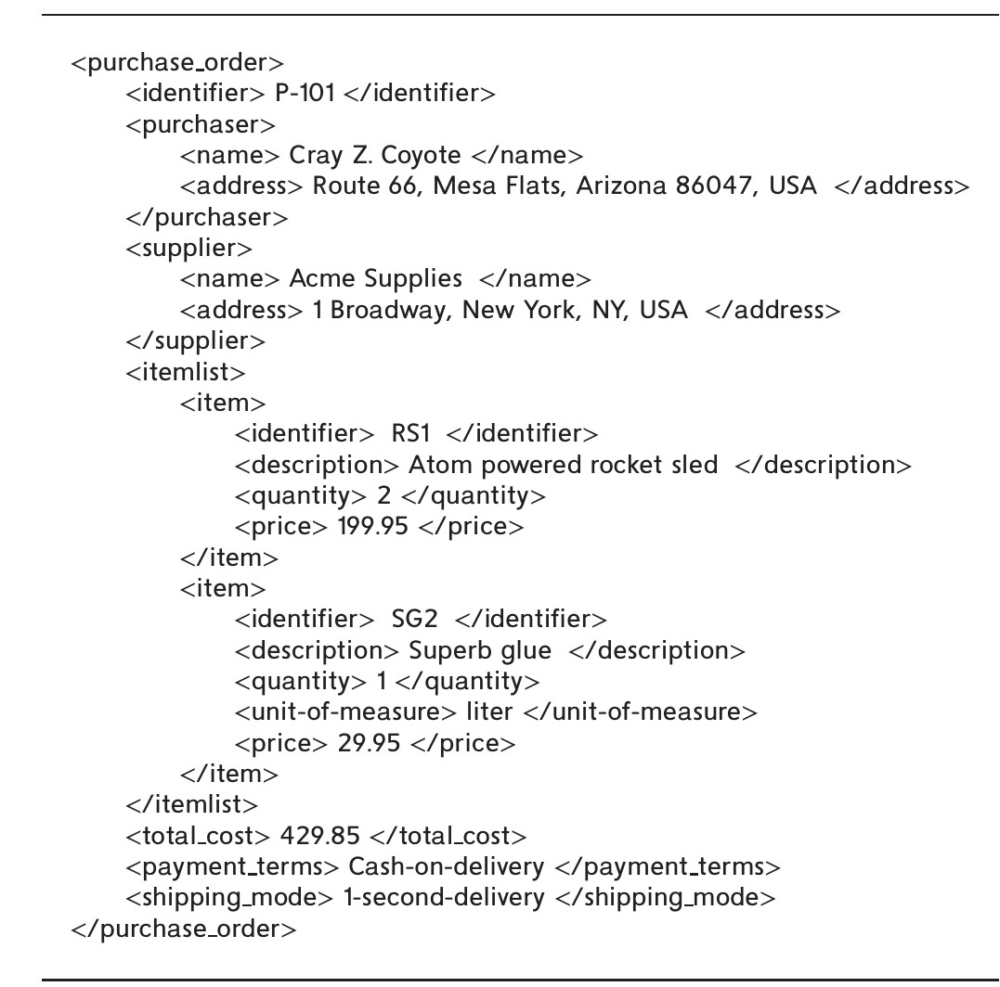
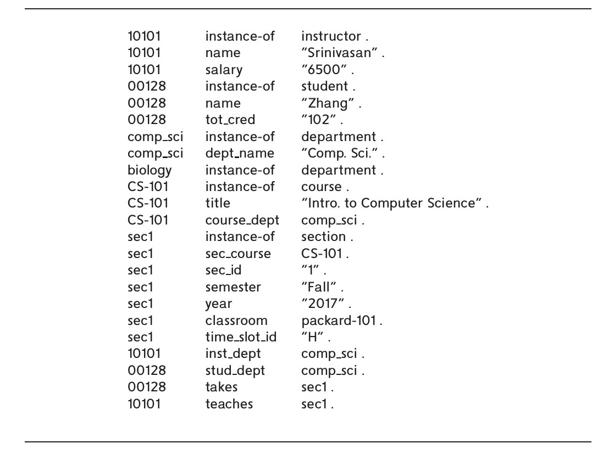
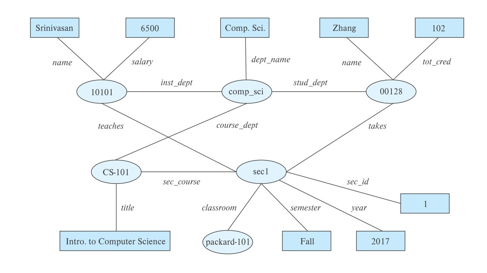
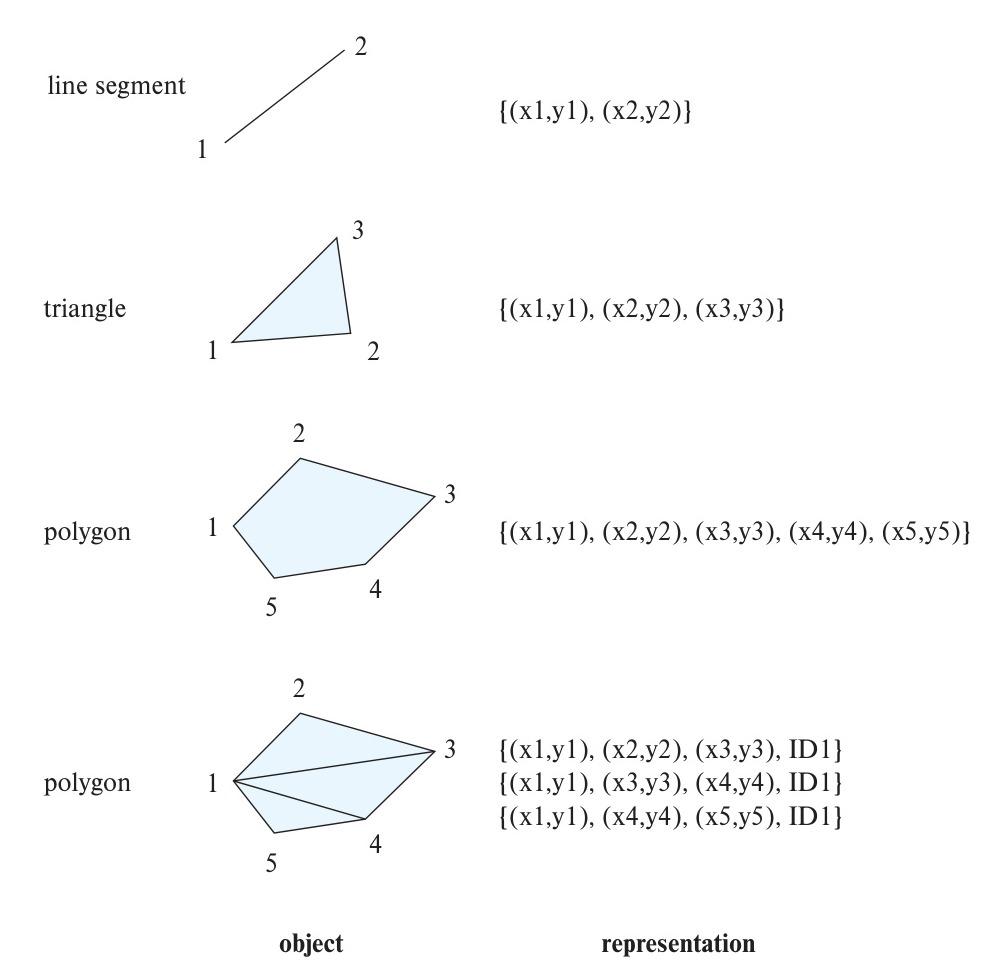
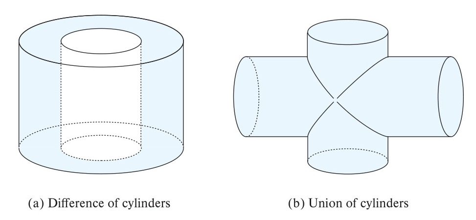
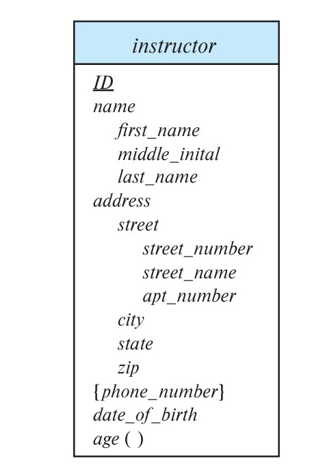
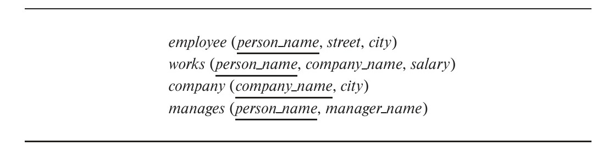
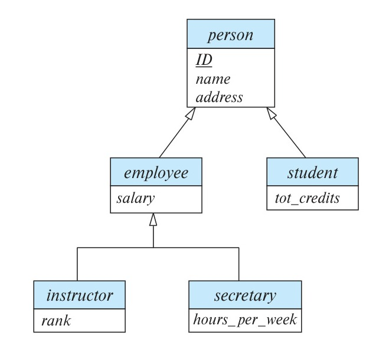

<!-- Page 363 -->

# Part 3: Application Design and Development

One of the key requirements of the relational model is that data values be atomic: multivalued, composite, and other complex data types are disallowed by the core relational model. However, there are many applications where the constraints on data types imposed by the relational model cause more problems than they solve. In Chapter 8, we discuss several *complex data types*, including semistructured data types that are widely used in building applications, object-based data, textual data, and spatial data.

Practically all use of databases occurs from within application programs. Correspondingly, almost all user interaction with databases is indirect, via application programs. Database-backed applications are ubiquitous on the web as well as on mobile platforms. In Chapter 9, we study tools and technologies that are used to build applications, focusing on interactive applications that use databases to store and retrieve data.

<!-- Page 364 -->

<!-- Page 365 -->

# Chapter 8: Complex Data Types

The relational model is very widely used for data representation for a large number of application domains. One of the key requirements of the relational model is that data values be atomic: multivalued, composite, and other complex data types are disallowed by the core relational model. However, there are many applications where the constraints on data types imposed by the relational model cause more problems than they solve. In this chapter, we discuss several *non-atomic data types* that are widely used, including semi-structured data, object-based data, textual data, and spatial data.

## 8.1 Semi-structured Data

Relational database designs have tables with a fixed number of attributes, each of which contains an atomic value. Changes to the schema, such as adding an extra attribute, are rare events, and may require changing of application code. Such a design is well suited to many organizational applications.

However, there are many application domains that need to store more complex data, whose schema changes often. Fast evolving web applications are an example of such a domain. As an example of the data management needs of such applications, consider the profile of a user which needs to be accessible to a number of different applications. The profile contains a variety of attributes, and there are frequent additions to the attributes stored in the profile. Some attributes may contain complex data; for example, an attribute may store a set of interests that can be used to show the user articles related to the set of interests. While such a set can be stored in a normalized fashion in a separate relation, a set data type allows significantly more efficient access than does a normalized representation. We study a number of data models that support representation of semi-structured data in this section.

Data exchange is another very important motivation for semi-structured data representations; it is perhaps even more important than storage for many applications. A popular architecture for building information systems today is to create a web service that allows retrieval of data and to build application code that displays the data and allows user interaction. Such application code may be developed as mobile applications,

<!-- Page 366 -->

or it may be written in JavaScript and run on the browser. In either case, the ability to run on the client’s machine allows developers to create very responsive user interfaces, unlike the early generation of web interfaces where backend servers send HTML marked-up text to browsers, which display the HTML. A key to building such applications is the ability to efficiently exchange and process complex data between backend servers and clients. We study the JSON and XML data models that have been widely adopted for this task.

### 8.1.1 Overview of Semi-structured Data Models

The relational data model has been extended in several ways to support the storage and data exchange needs of modern applications.

#### 8.1.1.1 Flexible Schema

Some database systems allow each tuple to potentially have a different set of attributes; such a representation is referred to as a **wide column** data representation. The set of attributes is not fixed in such a representation; each tuple may have a different set of attributes, and new attributes may be added as needed.

A more restricted form of this representation is to have a fixed but very large number of attributes, with each tuple using only those attributes that it needs, leaving the rest with null values; such a representation is called a **sparse column** representation.

#### 8.1.1.2 Multivalued Data Types

Many data representations allow attributes to contain non-atomic values. Many databases allow the storage of **sets**, **multisets**, or **arrays** as attribute values. For example, an application that stores topics of interest to a user, and uses the topics to target articles or advertisements to the user, may store the topics as a set. An example of such a set may be:

$$ \{ \text{basketball, La Liga, cooking, anime, Jazz} \} $$

Although a set-valued attribute can be stored in a normalized form as we saw earlier in Section 6.7.2, doing so provides no benefits in this case, since lookups are always based on the user, and normalization would significantly increase the storage and querying overhead.

Some representations allow attributes to store *key-value maps*, which store key-value pairs. A **key-value map**, often just called a **map**, is a set of (*key*, *value*) pairs, such that each key occurs in at most one element. For example, e-commerce sites often list specifications or details for each product that they sell, such as brand, model, size, color, and numerous other product-specific details. The set of specifications may be different for each product. Such specifications can be represented as a map, where

<!-- Page 367 -->

the specifications form the key, and the associated value is stored with the key. The following example illustrates such a map:

$$ \{ (\text{brand, Apple}), (\text{ID, MacBook Air}), (\text{size}, 13), (\text{color, silver}) \} $$

The **put(key, value)** method can be used to add a key-value pair, while the **get(key)** method can be used to retrieve the value associated with a key. The **delete(key)** method can be used to delete a key-value pair from the map.

Arrays are very important for scientific and monitoring applications. For example, scientific applications may need to store images, which are basically two-dimensional arrays of pixel values. Scientific experiments as well as industrial monitoring applications often use multiple sensors that provide readings at regular intervals. Such readings can be viewed as an array. In fact, treating a stream of readings as an array requires far less space than storing each reading as a separate tuple, with attributes such as (*time*, *reading*). Not only do we avoid storing the *time* attribute explicitly (it can be inferred from the offset), but we can also reduce per-tuple overhead in the database, and most importantly we can use compression techniques to reduce the space needed to store an array of readings.

Support for multivalued attribute types was proposed early in the history of databases, and the associated data model was called the *non first-normal-form*, or *NFNF*, data model. Several relational databases such as Oracle and PostgreSQL support set and array types.

An **array database** is a database that provides specialized support for arrays, including efficient compressed storage, and query language extensions to support operations on arrays. Examples include the Oracle GeoRaster, the PostGIS extension to PostgreSQL, the SciQL extension of MonetDB, and SciDB, a database tailored for scientific applications, with a number of features tailored for array data types.

#### 8.1.1.3 Nested Data Types

Many data representations allow attributes to be structured, directly modeling composite attributes in the E-R model. For example, an attribute *name* may have component attributes *firstname*, and *lastname*. These representations also support multivalued data types such as sets, arrays, and maps. All of these data types represent a hierarchy of data types, and that structure leads to the use of the term **nested data types**. Many databases support such types as part of their support for object-oriented data, which we describe in Section 8.2.

In this section, we outline two widely used data representations that allow values to have complex internal structures and that are flexible in that values are not forced to adhere to a fixed schema. These are the **JavaScript Object Notation** (**JSON**), which we describe in Section 8.1.2, and the **Extensible Markup Language** (**XML**), which we describe in Section 8.1.3.

Like the wide-table approach, the JSON and XML representations provide flexibility in the set of attributes that a record contains, as well as the types of these attributes.

<!-- Page 368 -->

However, the JSON and XML representations permit a more flexible structuring of data, where objects could have sub-objects; each object thus corresponds to a tree structure.

Since they allow multiple pieces of information about a business object to be packaged into a single structure, the JSON and XML representations have both found significant acceptance in the context of data exchange between applications.

Today, JSON is widely used today for exchanging data between the backends and the user-facing sides of applications, such as mobile apps, and Web apps. JSON has also found favor for storing complex objects in storage systems that collect different data related to a particular user into one large object (sometimes referred to as a document), allowing data to be retrieved without the need for joins. XML is an older representation and is used by many systems for storing configuration and other information, and for data exchange.

#### 8.1.1.4 Knowledge Representation

Representation of human knowledge has long been a goal of the artificial intelligence community. A variety of models were proposed for this task, with varying degrees of complexity; these could represent facts as well as rules about facts. With the growth of the web, a need arose to represent extremely large knowledge bases, with potentially billions of facts. The *Resource Description Format (RDF)* data representation is one such representation that has found very wide acceptance. The representation actually has far fewer features than earlier representations, but it was better suited to handle very large data volumes than the earlier knowledge representations.

Like the E-R model which we studied earlier, RDF models data as objects that have attributes and have relationships with other objects. RDF data can be viewed as a set of triples (3-tuples), or as a graph, with objects and attribute values modeled as nodes and relationships and attribute names as edges. We study RDF in more detail in Section 8.1.4.

### 8.1.2 JSON

The **JavaScript Object Notation** (**JSON**), is a textual representation of complex data types that is widely used to transmit data between applications and to store complex data. JSON supports the primitive data types integer, real and string, as well as arrays, and “objects,” which are a collection of (*attribute name*, *value*) pairs.

Figure 8.1 shows an example of data represented using JSON. Since objects do not have to adhere to any fixed schema, they are basically the same as key-value maps, with the attribute names as keys and the attribute values as the associated values.

The example also illustrates arrays, shown in square brackets. In JSON, an array can be thought of as a map from integer offsets to values, with the square-bracket syntax viewed as just a convenient way of creating such maps.

JSON is today *the* primary data representation used for communication between applications and web services. Many modern applications use web services to store

<!-- Page 369 -->


*Figure 8.1 — Example of JSON data.*

and retrieve data and to perform computations at a backend server; web services are described in more detail in Section 9.5.2. Applications invoke web services by sending parameters either as simple values such as strings or numbers, or by using JSON for more complex parameters. The web service then returns results using JSON. For example, an email user interface may invoke web services for each of these tasks: authenticating the user, fetching email header information to show a list of emails, fetching an email body, sending email, and so on.

The data exchanged in each of these steps are complex and have an internal structure. The ability of JSON to represent complex structures, and its ability to allow flexible structuring, make it a good fit for such applications.

A number of libraries are available that make it easy to transform data between the JSON representation and the object representation used in languages such as JavaScript, Java, Python, PHP, and other languages. The ease of interfacing between JSON and programming language data structures has played a significant role in the widespread use of JSON.

Unlike a relational representation, JSON is verbose and takes up more storage space for the same data. Further, parsing the text to retrieve required fields can be very CPU intensive. Compressed representations that also make it easier to retrieve values without parsing are therefore popular for storage of data. For example, a compressed binary format called BSON (short for Binary JSON) is used in many systems for storing JSON data.

The SQL language itself has been extended to support the JSON representation in several ways:

- JSON data can be stored as a JSON data type.
- SQL queries can generate JSON data from relational data:

<!-- Page 370 -->

  - There are SQL extensions that allow construction of JSON objects in each row of a query result. For example, PostgreSQL supports a `json_build_object()` function. As an example of its use, `json_build_object('ID', 12345, 'name', 'Einstein')` returns a JSON object `{"ID": 12345, "name", "Einstein"}`.
  - There are also SQL extensions that allow creation of a JSON object from a collection of rows by using an aggregate function. For example, the `json_agg` aggregate function in PostgreSQL allows creation of a single JSON object from a collection of JSON objects. Oracle supports a similar aggregate function `json_objectagg`, as well as an aggregate `json_arraytagg`, which creates a JSON array with objects in a specified order. SQL Server supports a `FOR JSON AUTO` clause that formats the result of an SQL query as a JSON array, with one element per row in the SQL query.
- SQL queries can extract data from a JSON object using some form of path constructs. For example, in PostgreSQL, if a value $v$ is of type JSON and has an attribute “ID”, `v->'ID'` would return the value of the “ID” attribute of $v$. Oracle supports a similar feature, using a “.” instead of “->”, while SQL Server uses a function `JSON_VALUE(value, path)` to extract values from JSON objects using a specified path.

The exact syntax and semantics of these extensions, unfortunately, depend entirely on the specific database system. You can find references to more details on these extensions in the bibliographic notes for this chapter, available online.

### 8.1.3 XML

The XML data representation adds **tags** enclosed in angle brackets, `<>`, to mark up information in a textual representation. Tags are used in pairs, with `<tag>` and `</tag>` delimiting the beginning and the end of the portion of the text to which the tag refers. For example, the title of a document might be marked up as follows:

```xml
<title>Database System Concepts</title>
```

Such tags can be used to represent relational data specifying relation names and attribute names as tags, as shown below:

```xml
<course>
    <course_id> CS-101 </course_id>
    <title> Intro. to Computer Science </title>
    <dept_name> Comp. Sci. </dept_name>
    <credits> 4 </credits>
</course>
```

<!-- Page 371 -->


*Figure 8.2 — XML representation of a purchase order.*

Unlike with a relational schema, new tags can be introduced easily, and with suitable names the data are “self-documenting” in that a human can understand or guess what a particular piece of data means based on the name.

Furthermore, tags can be used to create hierarchical structures, which is not possible with the relational model. Hierarchical structures are particularly important for representing business objects that must be exchanged between organizations; examples include bills, purchase orders, and so forth.

Figure 8.2, which shows how information about a purchase order can be represented in XML, illustrates a more realistic use of XML. Purchase orders are typically generated by one organization and sent to another. A purchase order contains a variety of information; the nested representation allows all information in a purchase order to

<!-- Page 372 -->

be represented naturally in a single document. (Real purchase orders have considerably more information than that depicted in this simplified example.) XML provides a standard way of tagging the data; the two organizations must of course agree on what tags appear in the purchase order and what they mean.

The XQuery language was developed to support querying of XML data. Further details of XML and XQuery may be found in Chapter 30. Although XQuery implementations are available from several vendors, unlike SQL, adoption of XQuery has been relatively limited.

However, the SQL language itself has been extended to support XML in several ways:

- XML data can be stored as an XML data type.
- SQL queries can generate XML data from relational data. Such extensions are very useful for packaging related pieces of data into one XML document, which can then be sent to another application.

  The extensions allow the construction of XML representations from individual rows, as well as the creation of an XML document from a collection of rows by using an XMLAGG aggregate function.
- SQL queries can extract data from an XML data type value. For example, the XPath language supports “path expressions” that allow the extraction of desired parts of data from an XML document.

You can find more details on these extensions in Chapter 30.

### 8.1.4 RDF and Knowledge Graphs

The **Resource Description Framework** (**RDF**) is a data representation standard based on the entity-relationship model. We provide an overview of RDF in this section.

#### 8.1.4.1 Triple Representation

The RDF model represents data by a set of **triples** that are in one of these two forms:

1. (*ID*, *attribute-name*, *value*)
2. (*ID1*, *relationship-name*, *ID2*)

where *ID*, *ID1* and *ID2* are identifiers of entities; entities are also referred to as **resources** in RDF. Note that unlike the E-R model, the RDF model only supports binary relationships, and it does not support more general n-ary relationships; we return to this issue later.

The first attribute of a triple is called its **subject**, the second attribute is called its **predicate**, and the last attribute is called its **object**. Thus, a triple has the structure (*subject*, *predicate*, *object*).

<!-- Page 373 -->


*Figure 8.3 — RDF representation of part of the University database.*

Figure 8.3 shows a triple representation of a small part of the University database. All attribute values are shown in quotes, while identifiers are shown without quotes. Attribute and relationship names (which form the predicate part of each triple) are also shown without quotes.

In our example, we use the ID values to identify instructors and students and *course_id* to identify courses. Each of their attributes is represented as a separate triple. The type information of objects is provided by the *instance-of* relationship; for example, 10101 is identified as an instance of *instructor*, while 00128 is an instance of *student*. To follow RDF syntax, the identifier of the Comp. Sci. department is denoted as *comp_sci*. Only one attribute of the department, *dept_name*, is shown. Since the primary key of *section* is composite, we have created new identifiers to identify sections; “sec1” identifies one such section, shown with its *semester*, *year* and *sec_id* attributes, and with a relationship *course* to CS-101.

Relationships shown in the figure include the *takes* and *teaches* relationships, which appear in the university schema. The departments of instructors, students and courses are shown as relationships *inst_dept*, *stud_dept* and *course_dept* respectively, following the E-R model; similarly, the classroom associated with a section is also shown as a *classroom* relationship with a classroom object (packard-101, in our example), and the

<!-- Page 374 -->

course associated with a section is shown as a relationship *sec_course* between the section and the course.

As we saw, entity type information is represented using *instance-of* relationships between entities and objects representing types; type-subtype relationships can also be represented as subtype edges between type objects.

In contrast to the E-R model and relational schemas, RDF allows new attributes to be easily added to an object and also to create new types of relationships.

#### 8.1.4.2 Graph Representation of RDF

The RDF representation has a very natural graph interpretation. Entities and attribute values can be considered as nodes, and attribute names and relationships can be considered as edges between the nodes. The attribute/relationship name can be viewed as the label of the corresponding edge. Figure 8.4 shows a graph representation of the data from Figure 8.3. Objects are shown as ovals, attribute values in rectangles, and relationships as edges with associated labels identifying the relationship. We have omitted the *instance-of* relationships for brevity.

A representation of information using the RDF graph model (or its variants and extensions) is referred to as a **knowledge graph**. Knowledge graphs are used for a variety of purposes. One such application is to store facts that are harvested from a variety of data sources, such as Wikipedia, Wikidata, and other sources on the web. An example of a fact is “Washington, D.C. is the capital of U.S.A.” Such a fact can be represented as an edge labeled *capital-of* connecting two nodes, one representing the entity Washington, D.C., and the other representing the entity U.S.A.


*Figure 8.4 — Graph representation of RDF data.*

<!-- Page 375 -->

Questions about entities can be answered using a knowledge graph that contains relevant information. For example, the question “Which city is the capital of the U.S.A.?” can be answered by looking for an edge labeled *capital-of*, linking an entity to the country U.S.A. (If type information is available, the query may also verify that there is an *instance-of* edge connecting Washington, D.C., to a node representing the entity type City).

#### 8.1.4.3 SPARQL

*SPARQL* is a query language designed to query RDF data. The language is based on triple patterns, which look like RDF triples but may contain variables. For example, the triple pattern:

```sparql
?cid title "Intro. to Computer Science"
```

would match all triples whose predicate is “title” and object is “Intro. to Computer Science”. Here, ?cid is a variable that can match any value.

Queries can have multiple triple patterns, with variables shared across triples. Consider the following pair of triples:

```sparql
?cid title "Intro. to Computer Science"
?sid course ?cid
```

On the university-triple dataset shown in Figure 8.3, the first triple pattern matches the triple (CS-101, title, “Intro. to Computer Science”), while the second triple pattern matches (sec1, course, CS-101). The shared variable ?cid enforces a join condition between the two triple patterns.

We can now show a complete SPARQL query. The following query retrieves names of all students who have taken a section whose course is titled “Intro. to Computer Science”.

```sparql
select ?name
where {
    ?cid title "Intro. to Computer Science" .
    ?sid course ?cid .
    ?id takes ?sid .
    ?id name ?name .
}
```

The shared variables between these triples enforce a join condition between the tuples matching each of these triples.

Note that unlike in SQL, the predicate in a triple pattern can be a variable, which can match any relationship or attribute name. SPARQL has many more features, such

<!-- Page 376 -->

as aggregation, optional joins (similar to outerjoins), and subqueries. For more information in SPARQL, see the references in Further Reading.

#### 8.1.4.4 Representing N-ary Relationships

Relationships represented as edges can model only binary relationships. Knowledge graphs have been extended to store more complex relationships. For example, knowledge graphs have been extended with temporal information to record the time period during which a fact is true; if the capital of the U.S.A. changed from Washington, DC., to say, New York, in 2050, this would be represented by two facts, one for the period ending in 2050 when Washington was the capital, and one for the period after 2050.

As we saw in Section 6.9.4, an $n$-ary relationship can be represented using binary relationships by creating an artificial entity corresponding to a tuple in an $n$-ary relationship and linking that artificial entity to each of the entities participating in the relationship. In the preceding example, we can create an artificial entity $e_1$ to represent the fact that Barack Obama was president of the U.S.A. from 2008 to 2016. We link $e_1$ to the entities representing Obama and U.S.A. by *person* and *country* relationship edges respectively, and to the values 2008 and 2016 by attribute edges *president-from* and *president-till* respectively. If we chose to represent years as entities, the edges created to the two years above would represent relationships instead of attributes.

The above idea is similar to the E-R model notion of aggregation which, as we saw in Section 6.8.5, can treat a relationship as an entity; this idea is called **reification** in RDF. Reification is used in many knowledge-graph representations, where the extra information such as time period of validity are treated as *qualifiers* of the underlying edge.

Other models add a fourth attribute, called the context, to triples; thus, instead of storing triples, they store **quads**. The basic relationship is still binary, but the fourth attribute allows a context entity to be associated with a relationship. Information such as valid time period can be treated as attributes of the context entity.

There are several knowledge bases, such as Wikidata, DBPedia, Freebase, and Yago, that provide an RDF/knowledge graph representation of a wide variety of knowledge. In addition, there are a very large number of domain-specific knowledge graphs. The **linked open data** project is aimed at making a variety of such knowledge graphs open source and further creating links between these independently created knowledge graphs. Such links allow queries to make inferences using information from multiple knowledge graphs along with links to the knowledge graphs. References to more information on this topic may be found in the bibliographic notes for this chapter, available online.

## 8.2 Object Orientation

The **object-relational data model** extends the relational data model by providing a richer type system, including complex data types and object orientation. Relational query

<!-- Page 377 -->

languages, in particular SQL, have been extended correspondingly to deal with the richer type system. Such extensions attempt to preserve the relational foundations—in particular, the declarative access to data—while extending the modeling power.

Many database applications are written using an object-oriented programming language, such as Java, Python, or C++, but they need to store and fetch data from databases. Due to the type difference between the native type system of the object-oriented programming language and the relational model supported by databases, data need to be translated between the two models whenever they are fetched or stored. Merely extending the type system supported by the database was not enough to solve this problem completely. Having to express database access using a language (SQL) that is different from the programming language again makes the job of the programmer harder. It is desirable, for many applications, to have programming language constructs or extensions that permit direct access to data in the database, without having to go through an intermediate language such as SQL.

Three approaches are used in practice for integrating object orientation with database systems:

1. Build an object-relational database system, which adds object-oriented features to a relational database system.
2. Automatically convert data from the native object-oriented type system of the programming language to a relational representation for storage, and vice versa for retrieval. Data conversion is specified using an object-relational mapping.
3. Build an object-oriented database system, that is, a database system that natively supports an object-oriented type system and allows direct access to data from an object-oriented programming language using the native type system of the language.

We provide a brief introduction to the first two approaches in this section. While the third approach, the object-oriented database approach, has some benefits over the first two approaches in terms of language integration, it has not seen much success for two reasons. First, declarative querying is very important for efficiently accessing data, and such querying is not supported by imperative programming languages. Second, direct access to objects via pointers was found to result in increased risk of database corruption due to pointer errors. We do not describe the object-oriented approach any further.

### 8.2.1 Object-Relational Database Systems

In this section, we outline how object-oriented features can be added to relational database systems.

<!-- Page 378 -->

#### 8.2.1.1 User-Defined Types

Object extensions to SQL allow creation of structured user-defined types, references to such types, and tables containing tuples of such types.[^1]

[^1]: Structured types are different from the simpler “distinct” data types that we covered in Section 4.5.5.

```sql
create type Person
    (ID varchar(20) primary key,
     name varchar(20),
     address varchar(20))
    ref from(ID);
create table people of Person;
```

We can create a new person as follows:

```sql
insert into people (ID, name, address) values
    ('12345', 'Srinivasan', '23 Coyote Run');
```

Many database systems support array and table types; attributes of relations and of user-defined types can be declared to be of such array or table types. The support for such features as well as the syntax varies widely by database system. In PostgreSQL, for example, `integer[]` denotes an array of integers whose size is not prespecified, while Oracle supports the syntax `varray(10) of integer` to specify an array of 10 integers. SQL Server allows table-valued types to be declared as shown in the following example:

```sql
create type interest as table (
    topic varchar(20),
    degree_of_interest int
);
create table users (
    ID varchar(20),
    name varchar(20),
    interests interest
);
```

User-defined types can also have methods associated with them. Only a few database systems, such as Oracle, support this feature; we omit details.

#### 8.2.1.2 Type Inheritance

Consider the earlier definition of the type Person and the table people. We may want to store extra information in the database about people who are students and about people

<!-- Page 379 -->

who are teachers. Since students and teachers are also people, we can use inheritance to define the student and teacher types in SQL:

```sql
create type Student under Person
    (degree varchar(20)) ;
create type Teacher under Person
    (salary integer);
```

Both Student and Teacher inherit the attributes of Person—namely, ID, name, and address. Student and Teacher are said to be subtypes of Person, and Person is a supertype of Student, as well as of Teacher.

Methods of a structured type are inherited by its subtypes, just as attributes are. However, a subtype can redefine the effect of a method. We omit details.

#### 8.2.1.3 Table Inheritance

Table inheritance allows a table to be declared as a subtable of another table and corresponds to the E-R notion of specialization/generalization. Several database systems support table inheritance, but in different ways.

In PostgreSQL, we could create a table people and then create tables students and teachers as subtables of people as follows:

```sql
create table students
    (degree varchar(20))
    inherits people;
create table teachers
    (salary integer)
    inherits people;
```

As a result, every attribute present in the table people is also present in the subtables students and teachers.

SQL:1999 supports table inheritance but requires table types to be specified first. Thus, in Oracle, which supports SQL:1999, we could use:

```sql
create table people of Person;
create table students of Student
    under people;
create table teachers of Teacher
    under people;
```

where the types Student and Teacher have been declared to be subtypes of Person as described earlier.

<!-- Page 380 -->

In either case, we can insert a tuple into the *student* table as follows:

```sql
insert into student values ('00128', 'Zhang', '235 Coyote Run', 'Ph.D.');
```

where we provide values for the attributes inherited from *people* as well as the local attributes of *student*.

When we declare *students* and *teachers* as subtables of *people*, every tuple present in *students* or *teachers* becomes implicitly present in *people*. Thus, if a query uses the table *people*, it will find not only tuples directly inserted into that table but also tuples inserted into its subtables, namely, *students* and *teachers*. However, only those attributes that are present in *people* can be accessed by that query. SQL permits us to find tuples that are in *people* but not in its subtables by using “**only people**” in place of *people* in a query.

#### 8.2.1.4 Reference Types in SQL

Some SQL implementations such as Oracle support reference types. For example, we could define the *Person* type as follows, with a reference-type declaration:

```sql
create type Person
    (ID varchar(20) primary key,
     name varchar(20),
     address varchar(20))
    ref from(ID);
create table people of Person;
```

By default, SQL assigns system-defined identifiers for tuples, but an existing primary-key value can be used to reference a tuple by including the **ref from** clause in the type definition as shown above.

We can define a type *Department* with a field *name* and a field *head* that is a reference to the type *Person*. We can then create a table *departments* of type *Department*, as follows:

```sql
create type Department (
    dept_name varchar(20),
    head ref(Person) scope people);
create table departments of Department;
```

Note that the **scope** clause above completes the definition of the foreign key from *departments.head* to the *people* relation.

When inserting a tuple for *departments*, we can then use:

```sql
insert into departments
    values ('CS', '12345');
```

<!-- Page 381 -->

since the ID attribute is used as a reference to *Person*. Alternatively, the definition of *Person* can specify that the reference must be generated automatically by the system when a *Person* object is created. System-generated identifiers can be retrieved using **ref**($r$) where $r$ is a table name of table alias used in a query. Thus, we could create a *Person* tuple, and, using the ID or name of the person, we could retrieve the reference to the tuple in a subquery, which is used to create the value for the *head* attribute when inserting a tuple into the *departments* table. Since most database systems do not allow subqueries in an **insert into** *departments* **values** statement, the following two queries can be used to carry out the task:

```sql
insert into departments
    values ('CS', null);
update departments
    set head = (select ref(p)
                from people as p
                where ID = '12345')
    where dept_name = 'CS';
```

References are dereferenced in SQL:1999 by the `->` symbol. Consider the *departments* table defined earlier. We can use this query to find the names and addresses of the heads of all departments:

```sql
select head->name, head->address
from departments;
```

An expression such as “`head->name`” is called a **path expression**.

Since *head* is a reference to a tuple in the *people* table, the attribute *name* in the preceding query is the *name* attribute of the tuple from the *people* table. References can be used to hide join operations; in the preceding example, without the references, the *head* field of department would be declared a foreign key of the table *people*. To find the name and address of the head of a department, we would require an explicit join of the relations *departments* and *people*. The use of references simplifies the query considerably.

We can use the operation **deref** to return the tuple pointed to by a reference and then access its attributes, as shown below:

```sql
select deref(head).name
from departments;
```

### 8.2.2 Object-Relational Mapping

**Object-relational mapping** (**ORM**) systems allow a programmer to define a mapping between tuples in database relations and objects in the programming language.

<!-- Page 382 -->

An object, or a set of objects, can be retrieved based on a selection condition on its attributes; relevant data are retrieved from the underlying database based on the selection conditions, and one or more objects are created from the retrieved data, based on the prespecified mapping between objects and relations.

The program can update retrieved objects, create new objects, or specify that an object is to be deleted, and then issue a save command; the mapping from objects to relations is then used to correspondingly update, insert, or delete tuples in the database.

The primary goal of object-relational mapping systems is to ease the job of programmers who build applications by providing them an object model while retaining the benefits of using a robust relational database underneath. As an added benefit, when operating on objects cached in memory, object-relational systems can provide significant performance gains over direct access to the underlying database.

Object-relational mapping systems also provide query languages that allow programmers to write queries directly on the object model; such queries are translated into SQL queries on the underlying relational database, and result objects are created from the SQL query results.

A fringe benefit of using an ORM is that any of a number of databases can be used to store data, with exactly the same high-level code. ORMs hide minor SQL differences between databases from the higher levels. Migration from one database to another is thus relatively straightforward when using an ORM, whereas SQL differences can make such migration significantly harder if an application uses SQL to communicate with the database.

On the negative side, object-relational mapping systems can suffer from significant performance inefficiencies for bulk database updates, as well as for complex queries that are written directly in the imperative language. It is possible to update the database directly, bypassing the object-relational mapping system, and to write complex queries directly in SQL in cases where such inefficiencies are discovered.

The benefits of object-relational models exceed the drawbacks for many applications, and object-relational mapping systems have seen widespread adoption in recent years. In particular, Hibernate has seen wide adoption with Java, while several ORMs including Django and SQLAlchemy are widely used with Python. More information on the Hibernate ORM system, which provides an object-relational mapping for Java, and the Django ORM system, which provides an object-relational mapping for Python, can be found in Section 9.6.2.

## 8.3 Textual Data

Textual data consists of unstructured text. The term information retrieval generally refers to the querying of unstructured textual data. In the traditional model used in the field of information retrieval, textual information is organized into documents. In a database, a text-valued attribute can be considered a document. In the context of the web, each web page can be considered to be a document.

<!-- Page 383 -->

### 8.3.1 Keyword Queries

Information retrieval systems support the ability to retrieve documents with some desired information. The desired documents are typically described by a set of keywords—for example, the keywords “database system” may be used to locate documents on database systems, and the keywords “stock” and “scandal” may be used to locate articles about stock-market scandals. Documents have associated with them a set of keywords; typically, all the words in the documents are considered keywords. A keyword query retrieves documents whose set of keywords contains all the keywords in the query.

In its simplest form, an information-retrieval system locates and returns all documents that contain all the keywords in the query. More-sophisticated systems estimate the relevance of documents to a query so that the documents can be shown in order of estimated relevance. They use information about keyword occurrences, as well as hyperlink information, to estimate relevance.

Keyword search was originally targeted at document repositories within organizations or domain-specific document repositories such as research publications. But information retrieval is also important for documents stored in a database.

Keyword-based information retrieval can be used not only for retrieving textual data, but also for retrieving other types of data, such as video and audio data, that have descriptive keywords associated with them. For instance, a video movie may have associated with it keywords such as its title, director, actors, and genre, while an image or video clip may have tags, which are keywords describing the image or video clip, associated with it.

Web search engines are, at core, information retrieval systems. They retrieve and store web pages by crawling the web. Users submit keyword queries, and the information retrieval part of the web search engine finds stored web pages containing the required keyword. Web search engines have today evolved beyond just retrieving web pages. Today, search engines aim to satisfy a user’s information needs by judging what topic a query is about and displaying not only web pages judged as relevant but also other kinds of information about the topic. For example, given a query term “cricket”, a search engine may display scores from ongoing or recent cricket matches, rather than just top-ranked documents related to cricket. As another example, in response to a query “New York”, a search engine may show a map of New York and images of New York in addition to web pages related to New York.

### 8.3.2 Relevance Ranking

The set of all documents that contain the keywords in a query may be very large; in particular, there are billions of documents on the web, and most keyword queries on a web search engine find hundreds of thousands of documents containing some or all of the keywords. Not all the documents are equally relevant to a keyword query. Information-retrieval systems therefore estimate relevance of documents to a query and return only highly ranked documents as answers. Relevance ranking is not an exact science, but there are some well-accepted approaches.

<!-- Page 384 -->

#### 8.3.2.1 Ranking Using TF-IDF

The word **term** refers to a keyword occurring in a document, or given as part of a query. The first question to address is, given a particular term $t$, how relevant is a particular document $d$ to the term. One approach is to use the number of occurrences of the term in the document as a measure of its relevance, on the assumption that more relevant terms are likely to be mentioned many times in a document. Just counting the number of occurrences of a term is usually not a good indicator: first, the number of occurrences depends on the length of the document, and second, a document containing 10 occurrences of a term may not be 10 times as relevant as a document containing one occurrence.

One way of measuring $TF(d, t)$, the relevance of a term $t$ to a document $d$, is:

$$TF(d, t) = \log \left( 1 + \frac{n(d, t)}{n(d)} \right)$$

where $n(d)$ denotes the number of term occurrences in the document and $n(d, t)$ denotes the number of occurrences of term $t$ in the document $d$. Observe that this metric takes the length of the document into account. The relevance grows with more occurrences of a term in the document, although it is not directly proportional to the number of occurrences.

Many systems refine the above metric by using other information. For instance, if the term occurs in the title, or the author list, or the abstract, the document would be considered more relevant to the term. Similarly, if the first occurrence of a term is late in the document, the document may be considered less relevant than if the first occurrence is early in the document. The above notions can be formalized by extensions of the formula we have shown for $TF(d, t)$. In the information retrieval community, the relevance of a document to a term is referred to as **term frequency** (**TF**), regardless of the exact formula used.

A query $Q$ may contain multiple keywords. The relevance of a document to a query with two or more keywords is estimated by combining the relevance measures of the document for each keyword. A simple way of combining the measures is to add them up. However, not all terms used as keywords are equal. Suppose a user uses two terms, one of which occurs frequently, such as “database”, and another that is less frequent, such as “Silberschatz”. A document containing “Silberschatz” but not “database” should be ranked higher than a document containing the term “database” but not “Silberschatz”.

To fix this problem, weights are assigned to terms using the **inverse document frequency** (**IDF**), defined as:

$$IDF(t) = \frac{1}{n(t)}$$

where $n(t)$ denotes the number of documents (among those indexed by the system) that contain the term $t$. The **relevance** of a document $d$ to a set of terms $Q$ is then defined as:

<!-- Page 385 -->

$$r(d, Q) = \sum_{t \in Q} TF(d, t) * IDF(t)$$

This measure can be further refined if the user is permitted to specify weights $w(t)$ for terms in the query, in which case the user-specified weights are also taken into account by multiplying $TF(t)$ by $w(t)$ in the preceding formula.

The above approach of using term frequency and inverse document frequency as a measure of the relevance of a document is called the **TF-IDF** approach.

Almost all text documents (in English) contain words such as “and,” “or,” “a,” and so on, and hence these words are useless for querying purposes since their inverse document frequency is extremely low. Information-retrieval systems define a set of words, called **stop words**, containing 100 or so of the most common words, and ignore these words when indexing a document. Such words are not used as keywords, and they are discarded if present in the keywords supplied by the user.

Another factor taken into account when a query contains multiple terms is the **proximity** of the terms in the document. If the terms occur close to each other in the document, the document will be ranked higher than if they occur far apart. The formula for $r(d, Q)$ can be modified to take proximity of the terms into account.

Given a query $Q$, the job of an information-retrieval system is to return documents in descending order of their relevance to $Q$. Since there may be a very large number of documents that are relevant, information-retrieval systems typically return only the first few documents with the highest degree of estimated relevance and permit users to interactively request further documents.

#### 8.3.2.2 Ranking Using Hyperlinks

Hyperlinks between documents can be used to decide on the overall importance of a document, independent of the keyword query; for example, documents linked from many other documents are considered more important.

The web search engine Google introduced **PageRank**, which is a measure of popularity of a page based on the popularity of pages that link to the page. Using the PageRank popularity measure to rank answers to a query gave results so much better than previously used ranking techniques that Google became the most widely used search engine in a rather short period of time.

Note that pages that are pointed to from many web pages are more likely to be visited, and thus should have a higher PageRank. Similarly, pages pointed to by web pages with a high PageRank will also have a higher probability of being visited, and thus should have a higher PageRank.

The PageRank of a document $d$ is thus defined (circularly) based on the PageRank of other documents that link to document $d$. PageRank can be defined by a set of linear equations, as follows: First, web pages are given integer identifiers. The jump probability matrix $T$ is defined with $T[i, j]$ set to the probability that a random walker who is following a link out of page $i$ follows the link to page $j$. Assuming that each link

<!-- Page 386 -->

from $i$ has an equal probability of being followed $T[i, j] = 1/N_i$, where $N_i$ is the number of links out of page $i$. Then the PageRank $P[j]$ for each page $j$ can be defined as:

$$P[j] = \delta / N + (1 - \delta) * \sum_{i=1}^{N} (T[i, j] * P[i])$$

where $\delta$ is a constant between 0 and 1, usually set to 0.15, and $N$ is the number of pages.

The set of equations generated as above are usually solved by an iterative technique, starting with each $P[i]$ set to $1/N$. Each step of the iteration computes new values for each $P[i]$ using the $P$ values from the previous iteration. Iteration stops when the maximum change in any $P[i]$ value in an iteration goes below some cutoff value.

Note that PageRank is a static measure, independent of the keyword query; given a keyword query, it is used in combination with TF-IDF scores of a document to judge its relevance of the document to the keyword query.

PageRank is not the only measure of the popularity of a site. Information about how often a site is visited is another useful measure of popularity. Further, search engines track what fraction of times users click on a page when it is returned as an answer. Keywords that occur in the anchor text associated with the hyperlink to a page are viewed as very important and are given a higher term frequency. These and a number of other factors are used to rank answers to a keyword query.

### 8.3.3 Measuring Retrieval Effectiveness

Ranking of results of a keyword query is not an exact science. Two metrics are used to measure how well an information-retrieval system is able to answer queries. The first, **precision**, measures what percentage of the retrieved documents are actually relevant to the query. The second, **recall**, measures what percentage of the documents relevant to the query were retrieved. Since search engines find a very large number of answers, and users typically stop after browsing some number (say, 10 or 20) of the answers, the precision and recall numbers are usually measured “@K”, where K is the number of answers viewed. Thus, one can talk of precision@10 or recall@20.

### 8.3.4 Keyword Querying on Structured Data and Knowledge Graphs

Although querying on structured data are typically done using query languages such as SQL, users who are not familiar with the schema or the query language find it difficult to get information from such data. Based on the success of keyword querying in the context of information retrieval from the web, techniques have been developed to support keyword queries on structured and semi-structured data.

One approach is to represent the data using graphs, and then perform keyword queries on the graphs. For example, tuples can be treated as nodes in the graph, and foreign key and other connections between tuples can be treated as edges in the graph. Keyword search is then modeled as finding tuples containing the given keywords and finding connecting paths between them in the corresponding graph.

<!-- Page 387 -->

For example, a query “Zhang Katz” on a university database may find the name “Zhang” occurring in a student tuple, and the name “Katz” in an instructor tuple, a path through the advisor relation connecting the two tuples. Other paths, such as student “Zhang” taking a course taught by “Katz” may also be found in response to this query. Such queries may be used for ad hoc browsing and querying of data when the user does not know the exact schema and does not wish to take the effort to write an SQL query defining what she is searching for. Indeed it is unreasonable to expect lay users to write queries in a structured query language, whereas keyword querying is quite natural.

Since queries are not fully defined, they may have many different types of answers, which must be ranked. A number of techniques have been proposed to rank answers in such a setting, based on the lengths of connecting paths and on techniques for assigning directions and weights to edges. Techniques have also been proposed for assigning popularity ranks to tuples based on foreign key links. More information on keyword searching of structured data may be found in the bibliographic notes for this chapter, available online.

Further, knowledge graphs can be used along with textual information to answer queries. For example, knowledge graphs can be used to provide unique identifiers to entities, which are used to annotate mentions of the entities in textual documents. Now a particular mention of a person in a document may have the phrase “Stonebraker developed PostgreSQL”; from the context, the word Stonebraker may be inferred to be the database researcher “Michael Stonebraker” and annotated by linking the word Stonebraker to the entity “Michael Stonebraker”. The knowledge graph may also record the fact that Stonebraker won the Turing award. A query asking for “turing award postgresql” can now be answered by using information from the document and the knowledge graph.[^2]

[^2]: In this case the knowledge graph may already record that Stonebraker developed PostgreSQL, but there are many other pieces of information that may exist only in documents, and not in the knowledge graphs.

Web search engines today use large knowledge graphs, in addition to crawled documents, to answer user queries.

## 8.4 Spatial Data

Spatial data support in database systems is important for efficiently storing, indexing, and querying of data on the basis of spatial locations.

Two types of spatial data are particularly important:

- Geographic data such as road maps, land-usage maps, topographic elevation maps, political maps showing boundaries, land-ownership maps, and so on. Geographic information systems are special-purpose database systems tailored for storing geographic data. Geographic data is based on a round-earth coordinate system, with latitude, longitude, and elevation.

<!-- Page 388 -->

- Geometric data, which include spatial information about how objects—such as buildings, cars, or aircraft—are constructed. Geometric data is based on a two-dimensional or three-dimensional Euclidean space, with X, Y, and Z coordinates.

Geographic and geometric data types are supported by many database systems, such as Oracle Spatial and Graph, the PostGIS extension of PostgreSQL, SQL Server, and the IBM DB2 Spatial Extender.

In this section we describe the modeling and querying of spatial data; implementation techniques such as indexing and query processing techniques are covered in Chapter 14 and in Chapter 15.

The syntax for representing geographic and geometric data varies by database, although representations based on the Open Geospatial Consortium (OGC) standard are now increasingly supported. See the manuals of the database you use to learn more about the specific syntax supported by the database.

### 8.4.1 Representation of Geometric Information

Figure 8.5 illustrates how various geometric constructs can be represented in a database, in a normalized fashion. We stress here that geometric information can be represented in several different ways, only some of which we describe.

A line segment can be represented by the coordinates of its endpoints. For example, in a map database, the two coordinates of a point would be its latitude and longitude. A polyline (also called a linestring) consists of a connected sequence of line segments and can be represented by a list containing the coordinates of the endpoints of the segments, in sequence. We can approximately represent an arbitrary curve with polylines by partitioning the curve into a sequence of segments. This representation is useful for two-dimensional features such as roads; here, the width of the road is small enough relative to the size of the full map that it can be considered to be a line. Some systems also support circular arcs as primitives, allowing curves to be represented as sequences of arcs.

We can represent a polygon by listing its vertices in order, as in Figure 8.5.[^3] The list of vertices specifies the boundary of a polygonal region. In an alternative representation, a polygon can be divided into a set of triangles, as shown in Figure 8.5. This process is called triangulation, and any polygon can be triangulated. The complex polygon can be given an identifier, and each of the triangles into which it is divided carries the identifier of the polygon. Circles and ellipses can be represented by corresponding types or approximated by polygons.

[^3]: Some references use the term *closed polygon* to refer to what we call polygons and refer to polylines as *open polygons*.

List-based representations of polylines or polygons are often convenient for query processing. Such non-first-normal-form representations are used when supported by the underlying database. So that we can use fixed-size tuples (in first normal form) for representing polylines, we can give the polyline or curve an identifier, and we can

<!-- Page 389 -->


*Figure 8.5 — Representation of geometric constructs.*

represent each segment as a separate tuple that also carries with it the identifier of the polyline or curve. Similarly, the triangulated representation of polygons allows a first normal form relational representation of polygons.

The representation of points and line segments in three-dimensional space is similar to their representation in two-dimensional space, the only difference being that points have an extra $z$ component. Similarly, the representation of planar figures—such as triangles, rectangles, and other polygons—does not change much when we move to three dimensions. Tetrahedrons and cuboids can be represented in the same way as triangles and rectangles. We can represent arbitrary polyhedra by dividing them into tetrahedrons, just as we triangulate polygons. We can also represent them by listing their faces, each of which is itself a polygon, along with an indication of which side of the face is inside the polyhedron.

<!-- Page 390 -->

For example, SQL Server and PostGIS support the geometry and geography types, each of which has subtypes such as point, linestring, curve, polygon, as well as collections of these types called multipoint, multilinestring, multicurve and multipolygon. Textual representations of these types are defined by the OGC standards, and can be converted to internal representations using conversion functions. For example, `LINESTRING(1 1, 2 3, 4 4)` defines a line that connects points $(1, 1)$, $(2, 3)$ and $(4, 4)$, while `POLYGON((1 1, 2 3, 4 4, 1 1))` defines a triangle defined by these points. Functions *ST_GeometryFromText()* and *ST_GeographyFromText()* convert the textual representations to geometry and geography objects respectively. Operations on geometry and geography types that return objects of the same type include the *ST_Union()* and *ST_Intersection()* functions which compute the union and intersection of geometric objects such as linestrings and polygons. The function names as well as syntax differ by system; see the system manuals for details.

In the context of map data, the various line segments representing the roads are actually interconnected to form a graph. Such a **spatial network** or **spatial graph** has spatial locations for vertices of the graph, along with interconnection information between the vertices, which form the edges of the graph. The edges have a variety of associated information, such as distance, number of lanes, average speed at different times of the day, and so on.

### 8.4.2 Design Databases

Computer-aided-design (CAD) systems traditionally stored data in memory during editing or other processing and wrote the data back to a file at the end of a session of editing. The drawbacks of such a scheme include the cost (programming complexity, as well as time cost) of transforming data from one form to another and the need to read in an entire file even if only parts of it are required. For large designs, such as the design of a large-scale integrated circuit or the design of an entire airplane, it may be impossible to hold the complete design in memory. Designers of object-oriented databases were motivated in large part by the database requirements of CAD systems. Object-oriented databases represent components of the design as objects, and the connections between the objects indicate how the design is structured.

The objects stored in a design database are generally geometric objects. Simple two-dimensional geometric objects include points, lines, triangles, rectangles, and, in general, polygons. Complex two-dimensional objects can be formed from simple objects by means of union, intersection, and difference operations. Similarly, complex three-dimensional objects may be formed from simpler objects such as spheres, cylinders, and cuboids by union, intersection, and difference operations, as in Figure 8.6. Three-dimensional surfaces may also be represented by **wireframe models**, which essentially model the surface as a set of simpler objects, such as line segments, triangles, and rectangles.

Design databases also store nonspatial information about objects, such as the material from which the objects are constructed. We can usually model such information

<!-- Page 391 -->


*Figure 8.6 — Complex three-dimensional objects.*

by standard data-modeling techniques. We concern ourselves here with only the spatial aspects.

Various spatial operations must be performed on a design. For instance, the designer may want to retrieve that part of the design that corresponds to a particular region of interest. Spatial-index structures, discussed in Section 14.10.1, are useful for such tasks. Spatial-index structures are multidimensional, dealing with two- and three-dimensional data, rather than dealing with just the simple one-dimensional ordering provided by the B$^+$-trees.

Spatial-integrity constraints, such as “two pipes should not be in the same location,” are important in design databases to prevent interference errors. Such errors often occur if the design is performed manually and are detected only when a prototype is being constructed. As a result, these errors can be expensive to fix. Database support for spatial-integrity constraints helps people to avoid design errors, thereby keeping the design consistent. Implementing such integrity checks again depends on the availability of efficient multidimensional index structures.

### 8.4.3 Geographic Data

Geographic data are spatial in nature but differ from design data in certain ways. Maps and satellite images are typical examples of geographic data. Maps may provide not only location information—about boundaries, rivers, and roads, for example—but also much more detailed information associated with locations, such as elevation, soil type, land usage, and annual rainfall.

#### 8.4.3.1 Applications of Geographic Data

Geographic databases have a variety of uses, including online map and navigation services, which are ubiquitous today. Other applications include distribution-network information for public-service utilities such as telephone, electric-power, and water-supply

<!-- Page 392 -->

systems, and land-usage information for ecologists and planners, land records to track land ownership, and many more.

Geographic databases for public-utility information have become very important as the network of buried cables and pipes has grown. Without detailed maps, work carried out by one utility may damage the structure of another utility, resulting in large-scale disruption of service. Geographic databases, coupled with accurate location-finding systems using GPS help avoid such problems.

#### 8.4.3.2 Representation of Geographic Data

Geographic data can be categorized into two types:

- **Raster data.** Such data consist of bitmaps or pixel maps, in two or more dimensions. A typical example of a two-dimensional raster image is a satellite image of an area. In addition to the actual image, the data include the location of the image, specified, for example, by the latitude and longitude of its corners, and the resolution, specified either by the total number of pixels, or, more commonly in the context of geographic data, by the area covered by each pixel.

  Raster data are often represented as **tiles**, each covering a fixed-size area. A larger area can be displayed by displaying all the tiles that overlap with the area. To allow the display of data at different zoom levels, a separate set of tiles is created for each zoom level. Once the zoom level is set by the user interface (e.g., a web browser), tiles at the specified zoom level that overlap the area being displayed are retrieved and displayed.

  Raster data can be three-dimensional—for example, the temperature at different altitudes at different regions, again measured with the help of a satellite. Time could form another dimension—for example, the surface temperature measurements at different points in time.

- **Vector data.** Vector data are constructed from basic geometric objects, such as points, line segments, polylines, triangles, and other polygons in two dimensions, and cylinders, spheres, cuboids, and other polyhedrons in three dimensions. In the context of geographic data, points are usually represented by latitude and longitude, and where the height is relevant, additionally by elevation.

  Map data are often represented in vector format. Roads are often represented as polylines. Geographic features, such as large lakes, or even political features such as states and countries, are represented as complex polygons. Some features, such as rivers, may be represented either as complex curves or as complex polygons, depending on whether their width is relevant.

Geographic information related to regions, such as annual rainfall, can be represented as an array—that is, in raster form. For space efficiency, the array can be stored in a compressed form. In Section 24.4.1, we study an alternative representation of such arrays by a data structure called a quadtree.

<!-- Page 393 -->

As another alternative, we can represent region information in vector form, using polygons, where each polygon is a region within which the array value is the same. The vector representation is more compact than the raster representation in some applications. It is also more accurate for some tasks, such as depicting roads, where dividing the region into pixels (which may be fairly large) leads to a loss of precision in location information. However, the vector representation is unsuitable for applications where the data are intrinsically raster based, such as satellite images.

**Topographical information**, that is information about the elevation (height) of each point on a surface, can be represented in raster form. Alternatively, it can be represented in vector form by dividing the surface into polygons covering regions of (approximately) equal elevation, with a single elevation value associated with each polygon. As another alternative, the surface can be **triangulated** (i.e., divided into triangles), with each triangle represented by the latitude, longitude, and elevation of each of its corners. The latter representation, called the **triangulated irregular network** (**TIN**) representation, is a compact representation which is particularly useful for generating three-dimensional views of an area.

Geographic information systems usually contain both raster and vector data, and they can merge the two kinds of data when displaying results to users. For example, map applications usually contain both satellite images and vector data about roads, buildings, and other landmarks. A map display usually **overlays** different kinds of information; for example, road information can be overlaid on a background satellite image to create a hybrid display. In fact, a map typically consists of multiple layers, which are displayed in bottom-to-top order; data from higher layers appear on top of data from lower layers.

It is also interesting to note that even information that is actually stored in vector form may be converted to raster form before it is sent to a user interface such as a web browser. One reason is that even web browsers in which JavaScript has been disabled can then display map data; a second reason may be to prevent end users from extracting and using the vector data.

Map services such as Google Maps and Bing Maps provide APIs that allow users to create specialized map displays, containing application-specific data overlaid on top of standard map data. For example, a web site may show a map of an area with information about restaurants overlaid on the map. The overlays can be constructed dynamically, displaying only restaurants with a specific cuisine, for example, or allowing users to change the zoom level or pan the display.

### 8.4.4 Spatial Queries

There are a number of types of queries that involve spatial locations.

- **Region queries** deal with spatial regions. Such a query can ask for objects that lie partially or fully inside a specified region. A query to find all retail shops within the geographic boundaries of a given town is an example. PostGIS supports predicates between two geometry or geography objects such as *ST_Contains()*, *ST_Overlaps()*,

<!-- Page 394 -->

*ST_Disjoint()* and *ST_Touches()*. These can be used to find objects that are contained in, or intersect, or are disjoint from a region. SQL Server supports equivalent functions with slightly different names.

Suppose we have a *shop* relation, with an attribute *location* of type *point*, and a geography object of type *polygon*. Then the *ST_Contains()* function can be used to retrieve all shops whose location is contained in the given polygon.

- **Nearness queries** request objects that lie near a specified location. A query to find all restaurants that lie within a given distance of a given point is an example of a nearness query. The **nearest-neighbor query** requests the object that is nearest to a specified point. For example, we may want to find the nearest gasoline station. Note that this query does not have to specify a limit on the distance, and hence we can ask it even if we have no idea how far the nearest gasoline station lies. The PostGIS *ST_Distance()* function gives the minimum distance between two such objects, and can be used to find objects that are within a specified distance from a point or region. Nearest neighbors can be found by finding objects with minimum distance.

- **Spatial graph queries** request information based on spatial graphs such as road maps. For example, a query may ask for the shortest path between two locations via the road network, or via a train network, each of which can be represented as a spatial graph. Such queries are ubiquitous for navigation systems.

Queries that compute intersections of regions can be thought of as computing the **spatial join** of two spatial relations—for example, one representing rainfall and the other representing population density—with the location playing the role of join attribute. In general, given two relations, each containing spatial objects, the spatial join of the two relations generates either pairs of objects that intersect or the intersection regions of such pairs. Spatial predicates such as *ST_Contains()* or *ST_Overlaps()* can be used as join predicates when performing spatial joins.

In general, queries on spatial data may have a combination of spatial and nonspatial requirements. For instance, we may want to find the nearest restaurant that has vegetarian selections and that charges less than \$10 for a meal.

## 8.5 Summary

- There are many application domains that need to store more complex data than simple tables with a fixed number of attributes.
- The SQL standard includes extensions of the SQL data-definition and query language to deal with new data types and with object orientation. These include support for collection-valued attributes, inheritance, and tuple references. Such extensions attempt to preserve the relational foundations—in particular, the declarative access to data—while extending the modeling power.

<!-- Page 395 -->

- The JavaScript Object Notation (JSON) and Extensible Markup Language (XML) data representations are widely used for data exchange between applications. These data representations allow data to be structured as trees and allow a flexible schema, where different records can have different attributes. JSON is widely used for sending data to frontends such as browsers and mobile devices. SQL has been extended to support the storage and querying of JSON and XML data.
- The Resource Description Framework (RDF) is a data representation standard based on the entity-relationship model. The RDF representation has a very natural graph interpretation. Entities and attribute values can be considered nodes, and attribute names and relationships can be considered edges between the nodes.
- SPARQL is a query language designed to query RDF data and is based on triple patterns.
- Object orientation provides inheritance with subtypes and subtables as well as object (tuple) references.
- The object-relational data model extends the relational data model by providing a richer type system, including collection types and object orientation.
- Object-relational database systems (i.e., database systems based on the object-relational model) provide a convenient migration path for users of relational databases who wish to use object-oriented features.
- Object-relational mapping systems provide an object view of data that are stored in a relational database. Objects are transient, and there is no notion of persistent object identity. Objects are created on demand from relational data, and updates to objects are implemented by updating the relational data. Object-relational mapping systems have been widely adopted, unlike the more limited adoption of persistent programming languages.

<!-- Page 396 -->

- Information-retrieval systems are used to store and query textual data such as documents. They use a simpler data model than do database systems but provide more powerful querying capabilities within the restricted model.
- Queries attempt to locate documents that are of interest by specifying, for example, sets of keywords. The query that a user has in mind usually cannot be stated precisely; hence, information-retrieval systems order answers on the basis of potential relevance.
- Relevance ranking makes use of several types of information, such as:
  - Term frequency: how important each term is to each document.
  - Inverse document frequency.
  - Popularity ranking.
- Spatial data management is important for many applications. Geometric and geographic data types are supported by many database systems, with subtypes including points, linestrings and polygons. Region queries, nearest neighbor queries, and spatial graph queries are among the commonly used types of spatial queries.

## Review Terms

- Wide column
- Sparse column
- Key-value map
- Map
- Array database
- Tags
- Triples
- Resources
- Subject
- Predicate
- Object
- Knowledge graph
- Reification
- Quads
- Linked open data
- Object-relational data model
- Object-relational database system
- Object-relational mapping
- Object-oriented database system
- Path expression
- Keywords
- Keyword query
- Term
- Relevance
- TF–IDF
- Stop words
- Proximity
- PageRank
- Precision
- Recall
- Geographic data
- Geometric data
- Geographic information system
- Computer-aided-design (CAD)
- Polyline
- Linestring

<!-- Page 397 -->

- Triangulation
- Spatial network
- Spatial graph
- Raster data
- Tiles
- Vector data
- Topographical information
- Triangulated irregular network (TIN)
- Overlays
- Nearness queries
- Nearest-neighbor query
- Region queries
- Spatial graph queries
- Spatial join

## Practice Exercises

8.1 Provide information about the student named Shankar in our sample university database, including information from the student tuple corresponding to Shankar, the takes tuples corresponding to Shankar and the course tuples corresponding to these takes tuples, in each of the following representations:
    a. Using JSON, with an appropriate nested representation.
    b. Using XML, with the same nested representation.
    c. Using RDF triples.
    d. As an RDF graph.

8.2 Consider the RDF representation of information from the university schema as shown in Figure 8.3. Write the following queries in SPARQL.
    a. Find the titles of all courses taken by any student named Zhang.
    b. Find titles of all courses such that a student named Zhang takes a section of the course that is taught by an instructor named Srinivasan.
    c. Find the attribute names and values of all attributes of the instructor named Srinivasan, without enumerating the attribute names in your query.

8.3 A car-rental company maintains a database for all vehicles in its current fleet. For all vehicles, it includes the vehicle identification number, license number, manufacturer, model, date of purchase, and color. Special data are included for certain types of vehicles:
    - Trucks: cargo capacity.
    - Sports cars: horsepower, renter age requirement.
    - Vans: number of passengers.
    - Off-road vehicles: ground clearance, drivetrain (four- or two-wheel drive).

<!-- Page 398 -->


*Figure 8.7 — E-R diagram with composite, multivalued, and derived attributes.*

Construct an SQL schema definition for this database. Use inheritance where appropriate.

8.4 Consider a database schema with a relation *Emp* whose attributes are as shown below, with types specified for multivalued attributes.

$$Emp = (ename, ChildrenSet \text{ } \mathbf{multiset}(Children), SkillSet \text{ } \mathbf{multiset}(Skills))$$
$$Children = (name, birthday)$$
$$Skills = (type, ExamSet \text{ } \mathbf{setof}(Exams))$$
$$Exams = (year, city)$$

Define the above schema in SQL, using the SQL Server table type syntax from Section 8.2.1.1 to declare multiset attributes.

8.5 Consider the E-R diagram in Figure 8.7 showing entity set instructor.
Give an SQL schema definition corresponding to the E-R diagram, treating phone_number as an array of 10 elements, using Oracle or PostgreSQL syntax.

8.6 Consider the relational schema shown in Figure 8.8.
    a. Give a schema definition in SQL corresponding to the relational schema but using references to express foreign-key relationships.
    b. Write each of the following queries on the schema, using SQL.
        i. Find the company with the most employees.

<!-- Page 399 -->


*Figure 8.8 — Relational database for Exercise 8.6.*

        ii. Find the company with the smallest payroll.
        iii. Find those companies whose employees earn a higher salary, on average, than the average salary at First Bank Corporation.

8.7 Compute the relevance (using appropriate definitions of term frequency and inverse document frequency) of each of the Practice Exercises in this chapter to the query “SQL relation”.

8.8 Show how to represent the matrices used for computing PageRank as relations. Then write an SQL query that implements one iterative step of the iterative technique for finding PageRank; the entire algorithm can then be implemented as a loop containing the query.

8.9 Suppose the *student* relation has an attribute named *location* of type *point*, and the *classroom* relation has an attribute *location* of type *polygon*. Write the following queries in SQL using the PostGIS spatial functions and predicates that we saw earlier:
    a. Find the names of all students whose location is within the classroom Packard 101.
    b. Find all classrooms that are within 100 meters or Packard 101; assume all distances are represented in units of meters.
    c. Find the ID and name of student who is geographically nearest to the student with ID 12345.
    d. Find the ID and names of all pairs of students whose locations are less than 200 meters apart.

## Exercises

8.10 Redesign the database of Exercise 8.4 into first normal form and fourth normal form. List any functional or multivalued dependencies that you assume. Also list all referential-integrity constraints that should be present in the first and fourth normal form schemas.

<!-- Page 400 -->


*Figure 8.9 — Specialization and generalization.*

8.11 Consider the schemas for the table *people*, and the tables *students* and *teachers*, which were created under *people*, in Section 8.2.1.3. Give a relational schema in third normal form that represents the same information. Recall the constraints on subtables, and give all constraints that must be imposed on the relational schema so that every database instance of the relational schema can also be represented by an instance of the schema with inheritance.

8.12 Consider the E-R diagram in Figure 8.9, which contains specializations, using subtypes and subtables.
    a. Give an SQL schema definition of the E-R diagram.
    b. Give an SQL query to find the names of all people who are not secretaries.
    c. Give an SQL query to print the names of people who are neither employees nor students.
    d. Can you create a person who is an employee and a student with the schema you created? Explain how, or explain why it is not possible.

8.13 Suppose you wish to perform keyword querying on a set of tuples in a database, where each tuple has only a few attributes, each containing only a few words. Does the concept of term frequency make sense in this context? And that of inverse document frequency? Explain your answer. Also suggest how you can define the similarity of two tuples using TF–IDF concepts.

8.14 Web sites that want to get some publicity can join a web ring, where they create links to other sites in the ring in exchange for other sites in the ring creating links

<!-- Page 401 -->

to their site. What is the effect of such rings on popularity ranking techniques such as PageRank?

8.15 The Google search engine provides a feature whereby web sites can display advertisements supplied by Google. The advertisements supplied are based on the contents of the page. Suggest how Google might choose which advertisements to supply for a page, given the page contents.

## Further Reading

A tutorial on JSON can be found at www.w3schools.com/js/js_json_intro.asp. More information about XML can be found in Chapter 30, available online. More information about RDF can be found at www.w3.org/RDF/. Apache Jena provides an RDF implementation, with support for SPARQL; a tutorial on SPARQL can be found at jena.apache.org/tutorials/sparql.html

POSTGRES ([Stonebraker and Rowe (1986)] and [Stonebraker (1986)]) was an early implementation of an object-relational system. Oracle provides a fairly complete implementation of the object-relational features of SQL, while PostgreSQL provides a smaller subset of those features. More information on support for these features may be found in their respective manuals.

[Salton (1989)] is an early textbook on information-retrieval systems, while [Manning et al. (2008)] is a modern textbook on the subject. Information about spatial database support in Oracle, PostgreSQL and SQL Server may be found in their respective manuals online.

## Bibliography

- **[Manning et al. (2008)]** C. D. Manning, P. Raghavan, and H. Schütze, *Introduction to Information Retrieval*, Cambridge University Press (2008).
- **[Salton (1989)]** G. Salton, *Automatic Text Processing*, Addison Wesley (1989).
- **[Stonebraker (1986)]** M. Stonebraker, “Inclusion of New Types in Relational Database Systems”, *In Proc. of the International Conf. on Data Engineering* (1986), pages 262–269.
- **[Stonebraker and Rowe (1986)]** M. Stonebraker and L. Rowe, “The Design of POSTGRES”, *In Proc. of the ACM SIGMOD Conf. on Management of Data* (1986), pages 340–355.

## Credits

The photo of the sailboats in the beginning of the chapter is due to ©Pavel Nesvadba/Shutterstock
