<!-- Page 403 -->

# Chapter 9: Application Development

Practically all use of databases occurs from within application programs. Correspondingly, almost all user interaction with databases is indirect, via application programs. In this chapter, we study tools and technologies that are used to build applications, focusing on interactive applications that use databases to store and retrieve data.

A key requirement for any user-centric application is a good user interface. The two most common types of user interfaces today for database-backed applications are the web and mobile app interfaces.

In the initial part of this chapter, we provide an introduction to application programs and user interfaces (Section 9.1), and to web technologies (Section 9.2). We then discuss development of web applications using the widely used Java Servlets technology at the back end (Section 9.3), and using other frameworks (Section 9.4). Client-side code implemented using JavaScript or mobile app technologies is crucial for building responsive user interfaces, and we discuss some of these technologies (Section 9.5). We then provide an overview of web application architectures (Section 9.6) and cover performance issues in building large web applications (Section 9.7). Finally, we discuss issues in application security that are key to making applications resilient to attacks (Section 9.8), and encryption and its use in applications (Section 9.9).

## 9.1 Application Programs and User Interfaces

Although many people interact with databases, very few people use a query language to interact with a database system directly. The most common way in which users interact with databases is through an **application program** that provides a user interface at the front end and interfaces with a database at the back end. Such applications take input from users, typically through a forms-based interface, and either enter data into a database or extract information from a database based on the user input, and they then generate output, which is displayed to the user.

As an example of an application, consider a university registration system. Like other such applications, the registration system first requires you to identify and authenticate yourself, typically by a user name and password. The application then uses your

<!-- Page 404 -->

identity to extract information, such as your name and the courses for which you have registered, from the database and displays the information. The application provides a number of interfaces that let you register for courses and query other information, such as course and instructor information. Organizations use such applications to automate a variety of tasks, such as sales, purchases, accounting and payroll, human-resources management, and inventory management, among many others.

Application programs may be used even when it is not apparent that they are being used. For example, a news site may provide a page that is transparently customized to individual users, even if the user does not explicitly fill any forms when interacting with the site. To do so, it actually runs an application program that generates a customized page for each user; customization can, for example, be based on the history of articles browsed by the user.

A typical application program includes a front-end component, which deals with the user interface, a backend component, which communicates with a database, and a middle layer, which contains “business logic,” that is, code that executes specific requests for information or updates, enforcing rules of business such as what actions should be carried out to execute a given task or who can carry out what task.

Applications such as airline reservations have been around since the 1960s. In the early days of computer applications, applications ran on large “mainframe” computers, and users interacted with the application through terminals, some of which even supported forms. The growth of personal computers resulted in the development of database applications with graphical user interfaces, or GUIs. These interfaces depended on code running on a personal computer that directly communicated with a shared database. Such an architecture was called a **client–server** architecture. There were two drawbacks to using such applications: first, user machines had direct access to databases, leading to security risks. Second, any change to the application or the database required all the copies of the application, located on individual computers, to be updated together.

Two approaches have evolved to avoid the above problems:

- **Web browsers** provide a universal front end, used by all kinds of information services. Browsers use a standardized syntax, the HyperText Markup Language (HTML) standard, which supports both formatted display of information and creation of forms-based interfaces. The HTML standard is independent of the operating system or browser, and pretty much every computer today has a web browser installed. Thus a web-based application can be accessed from any computer that is connected to the internet.
  
  Unlike client–server architectures, there is no need to install any application-specific software on client machines in order to use web-based applications.
  
  However, sophisticated user interfaces, supporting features well beyond what is possible using plain HTML, are now widely used, and are built with the scripting language JavaScript, which is supported by most web browsers. JavaScript programs, unlike programs written in C, can be run in a safe mode, guaranteeing

<!-- Page 405 -->

they cannot cause security problems. JavaScript programs are downloaded transparently to the browser and do not need any explicit software installation on the user’s computer.

While the web browser provides the front end for user interaction, application programs constitute the back end. Typically, requests from a browser are sent to a web server, which in turn executes an application program to process the request. A variety of technologies are available for creating application programs that run at the back end, including Java servlets, Java Server Pages (JSP), Active Server Page (ASP), or scripting languages such as PHP and Python.

- **Application programs are installed on individual devices**, which are primarily mobile devices. They communicate with backend applications through an API and do not have direct access to the database. The back end application provides services, including user authentication, and ensures that users can only access services that they are authorized to access.
  
  This approach is widely used in mobile applications. One of the motivations for building such applications was to customize the display for the small screen of mobile devices. A second was to allow application code, which can be relatively large, to be downloaded or updated when the device is connected to a high-speed network, instead of downloading such code when a web page is accessed, perhaps over a lower bandwidth or more expensive mobile network.

With the increasing use of JavaScript code as part of web front ends, the difference between the two approaches above has today significantly decreased. The back end often provides an API that can be invoked from either mobile app or JavaScript code to carry out any required task at the back end. In fact, the same back end is often used to build multiple front ends, which could include web front ends with JavaScript, and multiple mobile platforms (primarily Android and iOS, today).

## 9.2 Web Fundamentals

In this section, we review some of the fundamental technology behind the World Wide Web, for readers who are not familiar with the technology underlying the web.

### 9.2.1 Uniform Resource Locators

A **uniform resource locator** (**URL**) is a globally unique name for each document that can be accessed on the web. An example of a URL is:

`http://www.acm.org/sigmod`

The first part of the URL indicates how the document is to be accessed: “http” indicates that the document is to be accessed by the HyperText Transfer Protocol (HTTP),

<!-- Page 406 -->

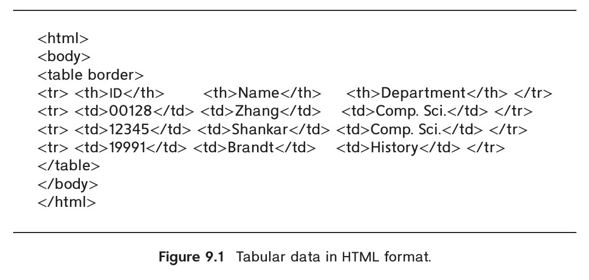
*Figure 9.1 — Tabular data in HTML format.*

which is a protocol for transferring HTML documents; “https” would indicate that the secure version of the HTTP protocol must be used, and is the preferred mode today. The second part gives the name of a machine that has a web server. The rest of the URL is the path name of the file on the machine, or other unique identifier of a document within the machine.

A URL can contain the identifier of a program located on the web server machine, as well as arguments to be given to the program. An example of such a URL is

`https://www.google.com/search?q=silberschatz`

which says that the program search on the server www.google.com should be executed with the argument q=silberschatz. On receiving a request for such a URL, the web server executes the program, using the given arguments. The program returns an HTML document to the web server, which sends it back to the front end.

### 9.2.2 HyperText Markup Language

Figure 9.1 is an example of a table represented in the HTML format, while Figure 9.2 shows the displayed image generated by a browser from the HTML representation of the table. The HTML source shows a few of the HTML tags. Every HTML page should be enclosed in an html tag, while the body of the page is enclosed in a body tag. A table


*Figure 9.2 — Display of HTML source from Figure 9.1.*

<!-- Page 407 -->

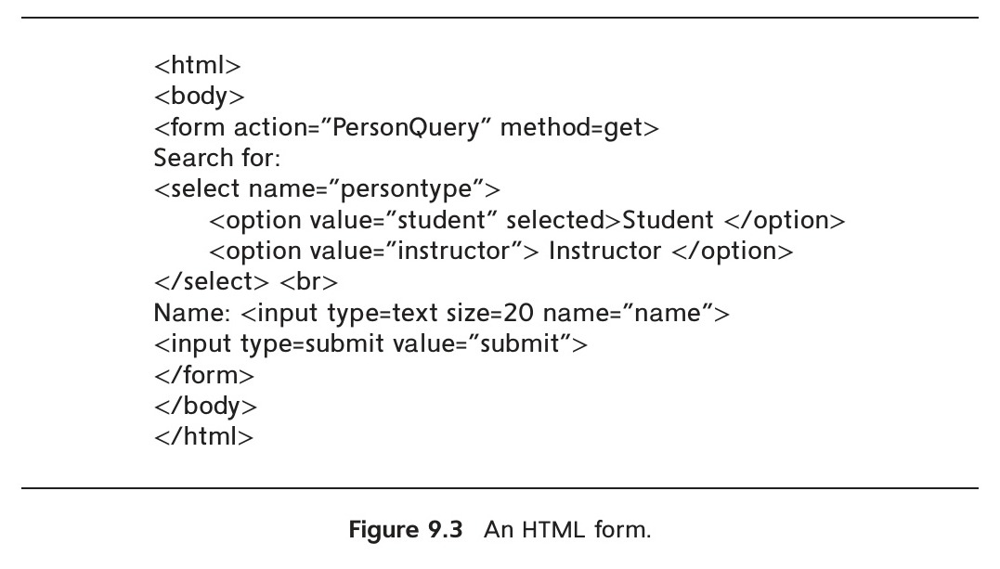
*Figure 9.3 — An HTML form.*

is specified by a table tag, which contains rows specified by a tr tag. The header row of the table has table cells specified by a th tag, while regular rows have table cells specified by a td tag. We do not go into more details about the tags here; see the bibliographical notes for references containing more detailed descriptions of HTML.

Figure 9.3 shows how to specify an HTML form that allows users to select the person type (student or instructor) from a menu and to input a number in a text box. Figure 9.4 shows how the above form is displayed in a web browser. Two methods of accepting input are illustrated in the form, but HTML also supports several other input methods. The action attribute of the form tag specifies that when the form is submitted (by clicking on the submit button), the form data should be sent to the URL PersonQuery (the URL is relative to that of the page). The web server is configured such that when this URL is accessed, a corresponding application program is invoked, with the user-provided values for the arguments persontype and name (specified in the select and input fields). The application program generates an HTML document, which is then sent back and displayed to the user; we shall see how to construct such programs later in this chapter.

HTTP defines two ways in which values entered by a user at the browser can be sent to the web server. The **get** method encodes the values as part of the URL. For example, if the Google search page used a form with an input parameter named q with the get


*Figure 9.4 — Display of HTML source from Figure 9.3.*

<!-- Page 408 -->

method, and the user typed in the string “silberschatz” and submitted the form, the browser would request the following URL from the web server:

`https://www.google.com/search?q=silberschatz`

The **post** method would instead send a request for the URL https://www.google.com, and send the parameter values as part of the HTTP protocol exchange between the web server and the browser. The form in Figure 9.3 specifies that the form uses the get method.

Although HTML code can be created using a plain text editor, there are a number of editors that permit direct creation of HTML text by using a graphical interface. Such editors allow constructs such as forms, menus, and tables to be inserted into the HTML document from a menu of choices, instead of manually typing in the code to generate the constructs.

HTML supports **stylesheets**, which can alter the default definitions of how an HTML formatting construct is displayed, as well as other display attributes such as background color of the page. The **cascading stylesheet** (**CSS**) standard allows the same stylesheet to be used for multiple HTML documents, giving a distinctive but uniform look to all the pages on a web site. You can find more information on stylesheets online, for example at www.w3schools.com/css/.

The **HTML5** standard, which was released in 2014, provides a wide variety of form input types, including the following:

- Date and time selection, using `<input type="date" name="abc">`, and `<input type="time" name="xyz">`. Browsers would typically display a graphical date or time picker for such an input field; the input value is saved in the form attributes abc and xyz. The optional attributes min and max can be used to specify minimum and maximum values that can be chosen.
- File selection, using `<input type="file" name="xyz">`, which allows a file to be chosen, and its name saved in the form attribute xyz.
- Input restrictions (constraints) on a variety of input types, including minimum, maximum, format matching a regular expression, and so on. For example,
  `<input type="number" name="start" min="0" max="55" step="5" value="0">`
  allows the user to choose one of 0, 5, 10, 15, and so on till 55, with a default value of 0.

### 9.2.3 Web Servers and Sessions

A **web server** is a program running on the server machine that accepts requests from a web browser and sends back results in the form of HTML documents. The browser and web server communicate via HTTP. Web servers provide powerful features, beyond the simple transfer of documents. The most important feature is the ability to execute

<!-- Page 409 -->

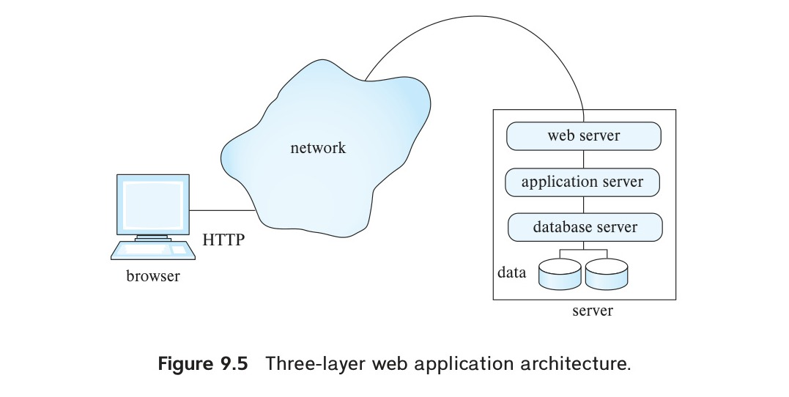
*Figure 9.5 — Three-layer web application architecture.*

programs, with arguments supplied by the user, and to deliver the results back as an HTML document.

As a result, a web server can act as an intermediary to provide access to a variety of information services. A new service can be created by creating and installing an application program that provides the service. The **common gateway interface** (**CGI**) standard defines how the web server communicates with application programs. The application program typically communicates with a database server, through ODBC, JDBC, or other protocols, in order to get or store data.

Figure 9.5 shows a web application built using a three-layer architecture, with a web server, an application server, and a database server. Using multiple levels of servers increases system overhead; the CGI interface starts a new process to service each request, which results in even greater overhead.

Most web applications today therefore use a two-layer web application architecture, where the web and application servers are combined into a single server, as shown in Figure 9.6. We study systems based on the two-layer architecture in more detail in subsequent sections.

There is no continuous connection between the client and the web server; when a web server receives a request, a connection is temporarily created to send the request and receive the response from the web server. But the connection may then be closed, and the next request could come over a new connection. In contrast, when a user logs on to a computer, or connects to a database using ODBC or JDBC, a session is created, and session information is retained at the server and the client until the session is terminated—information such as the user-identifier of the user and session options that the user has set. One important reason that HTTP is connectionless is that most computers have limits on the number of simultaneous connections they can accommodate, and if a large number of sites on the web open connections to a single server, this limit would be exceeded, denying service to further users. With a connectionless protocol, the con-

<!-- Page 410 -->

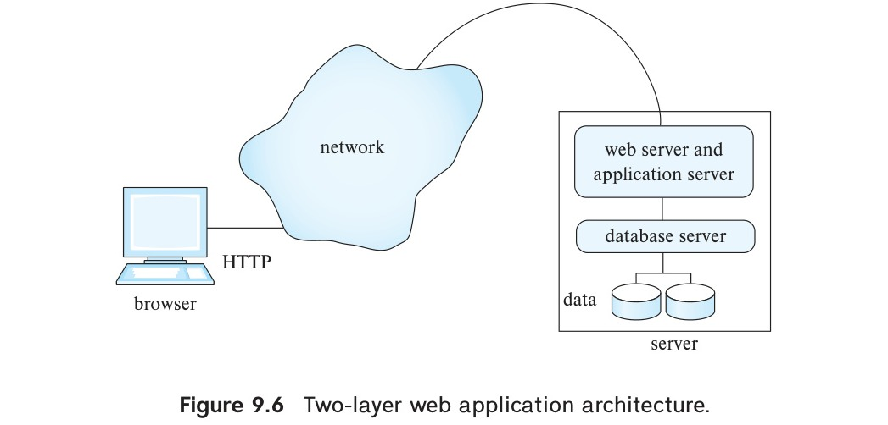
*Figure 9.6 — Two-layer web application architecture.*

nection can be broken as soon as a request is satisfied, leaving connections available for other requests.[^1]

Most web applications, however, need **session** information to allow meaningful user interaction. For instance, applications typically restrict access to information, and therefore need to authenticate users. Authentication should be done once per session, and further interactions in the session should not require reauthentication.

To implement sessions in spite of connections getting closed, extra information has to be stored at the client and returned with each request in a session; the server uses this information to identify that a request is part of a user session. Extra information about the session also has to be maintained at the server.

This extra information is usually maintained in the form of a **cookie** at the client; a cookie is simply a small piece of text containing identifying information and with an associated name. For example, google.com may set a cookie with the name prefs, which encodes preferences set by the user such as the preferred language and the number of answers displayed per page. On each search request, google.com can retrieve the cookie named prefs from the user’s browser, and display results according to the specified preferences. A domain (web site) is permitted to retrieve only cookies that it has set, not cookies set by other domains, and cookie names can be reused across domains.

For the purpose of tracking a user session, an application may generate a session identifier (usually a random number not currently in use as a session identifier), and send a cookie named (for instance) sessionid containing the session identifier. The session identifier is also stored locally at the server. When a request comes in, the application server requests the cookie named sessionid from the client. If the client

[^1]: For performance reasons, connections may be kept open for a short while, to allow subsequent requests to reuse the connection. However, there is no guarantee that the connection will be kept open, and applications must be designed assuming the connection may be closed as soon as a request is serviced.

<!-- Page 411 -->

does not have the cookie stored, or returns a value that is not currently recorded as a valid session identifier at the server, the application concludes that the request is not part of a current session. If the cookie value matches a stored session identifier, the request is identified as part of an ongoing session.

If an application needs to identify users securely, it can set the cookie only after authenticating the user; for example a user may be authenticated only when a valid user name and password are submitted.[^2]

For applications that do not require high security, such as publicly accessible news or entertainment sites, a user could be identified transparently without authentication, by using a cookie that stores a user identifier. Subsequent requests from the client return the user identifier, allowing the application to track the user’s visits to the site.

## 9.3 Servlets

The Java servlet specification defines an application programming interface (API) for communication between a web/application server and application code. The API is supported by a large number of web/application servers.

The code for a servlet is loaded into the web/application server when the server starts up or when a request to run the servlet is first made. The servlet code remains in memory, so subsequent requests do not have the overhead of starting a new process or reloading the servlet code into memory.

### 9.3.1 A Servlet Example

Servlets are commonly used to generate dynamic responses to HTTP requests.[^3] They can access inputs provided through HTML forms, apply “business logic” to decide what

[^2]: The user identifier could be stored at the client end, in a cookie named, for example, userid. Such cookies can be used for low-security applications, such as free web sites identifying their users. However, for applications that require a higher level of security, such a mechanism creates a security risk: The value of a cookie can be changed at the browser by a malicious user, who can then masquerade as a different user. Setting a cookie (named sessionid, for example) to a randomly generated session identifier (from a large space of numbers) makes it highly improbable that a user can masquerade as (i.e., pretend to be) another user. A sequentially generated session identifier, on the other hand, would be susceptible to masquerading.

[^3]: The servlet interface can also support non-HTTP requests, although our example uses only HTTP.

<!-- Page 412 -->

response to provide, and then generate HTML output to be sent back to the browser. Servlet code is executed on a web or application server.

Figure 9.7 shows an example of servlet code to implement the form in Figure 9.3. The servlet is called PersonQueryServlet, while the form specifies that “action="PersonQuery".” The web/application server must be told that this servlet is to be used to handle requests for PersonQuery, which is done by using the anno-

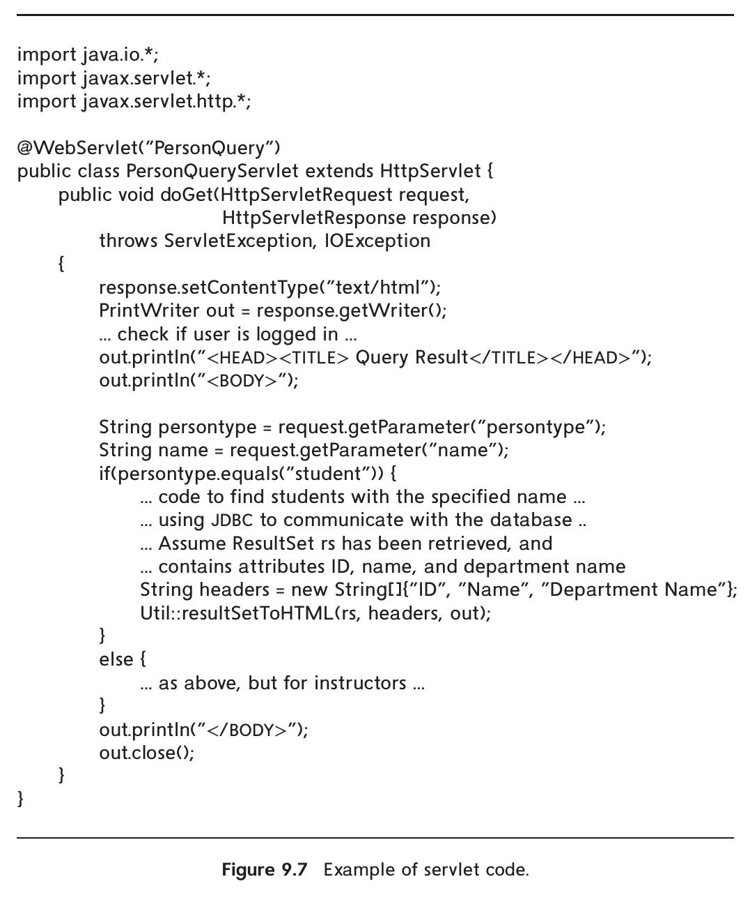
*Figure 9.7 — Example of servlet code.*

<!-- Page 413 -->

tation @WebServlet("PersonQuery") shown in the code. The form specifies that the HTTP get mechanism is used for transmitting parameters. So the doGet() method of the servlet, as defined in the code, is invoked.

Each servlet request results in a new thread within which the call is executed, so multiple requests can be handled in parallel. Any values from the form menus and input fields on the web page, as well as cookies, pass through an object of the HttpServletRequest class that is created for the request, and the reply to the request passes through an object of the HttpServletResponse class. Methods of HttpServletRequest, such as getParameter(), can be used to extract the values of parameters passed to the servlet, as shown in Figure 9.7.

The doGet() method in the example extracts values of the parameters persontype and name from the request object and then finds all students (or instructors) who have that name. It then formats the results as an HTML table and outputs the table as part of the HTML text that is returned in the response object.

The servlet code returns the results of the query to the requester by writing to a PrintWriter object, out, created by invoking the response.getWriter() method on the response object. Text written to the out object is returned to the browser by the web server. The content type of the returned document is specified by invoking response.setContentType("text/html").

The servlet code connects to the database via JDBC. We have not shown the code to connect to the database or to execute the query, since it is identical to the JDBC code we saw in Chapter 5. To print the query results as an HTML table, the servlet code in Figure 9.7 uses the utility function printTable shown in Figure 9.8.

### 9.3.2 Servlet Sessions

Recall that the interaction between a browser and a web/application server is connectionless. In Section 9.2.3, we outlined how cookies can be used to track sessions.

The servlet API provides a method of tracking a session and storing information pertaining to it. Invocation of the method getSession(false) of the class HttpServletRequest retrieves the HttpSession object corresponding to the browser that sent the request. An argument value of true would have specified that a new session object must be created if the request is a new request.

When the getSession() method is invoked, the server first asks the client to return a cookie with a specified name. If the client does not have a cookie of that name, or returns a value that does not match any ongoing session, then the request is not part of an ongoing session. In this case, getSession() would return a null value, and the servlet could direct the user to a login page.

<!-- Page 414 -->

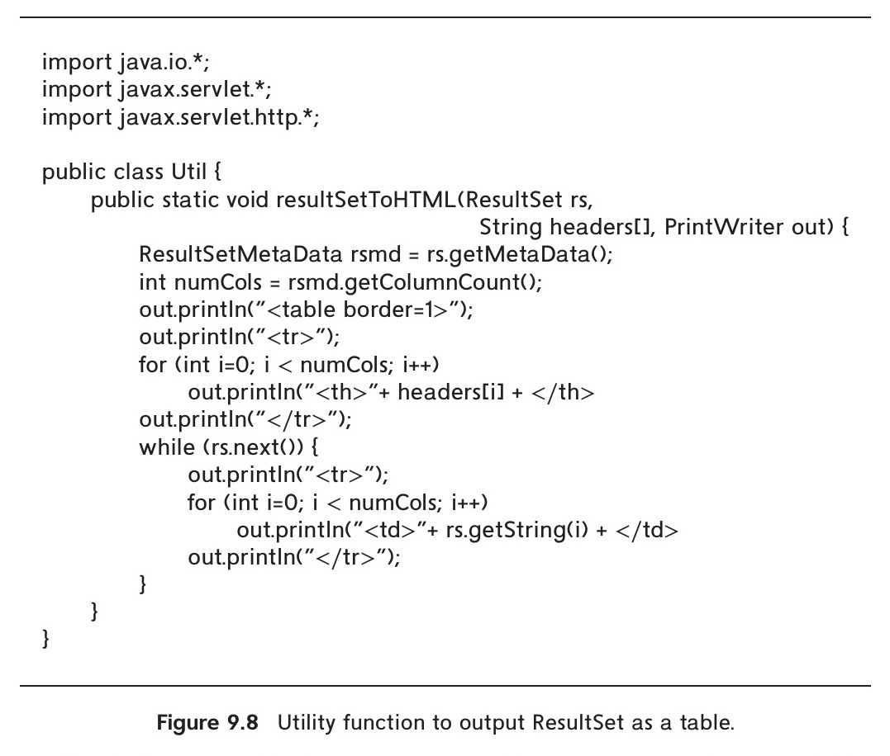
*Figure 9.8 — Utility function to output ResultSet as a table.*

The login page could allow the user to provide a user name and password. The user’s inputs would be sent to an authentication servlet, which can check if the password is valid by querying the database.[^4]

If the user is properly authenticated, the login servlet would execute request.getSession(true), which would generate a new session identifier, create a new session object, and associate the session identifier value with the session object.

[^4]: It is a bad idea to store unencrypted passwords in the database, since anyone with access to the database contents, such as a system administrator or a hacker, could steal the password. Instead, a hashing function is applied to the password, and the result is stored in the database; even if someone sees the hashing result stored in the database, it is very hard to infer what was the original password. The same hashing function is applied to the user-supplied password, and the result is compared with the stored hashing result. Further, to ensure that even if two users use the same password the hash values are different, the password system typically stores a different random string (called the salt) for each user, and it appends the random string to the password before computing the hash value. Thus, the password table has the schema user_password(user, salt, passwordhash), where passwordhash is generated by hash(append(password, salt)). Encryption is described in more detail in Section 9.9.1.

<!-- Page 415 -->

The servlet code can also store and look up (attribute-name, value) pairs associated with the session. The method call

```java
session.setAttribute("userid", userid)
```

on the session object returned by getSession(); the Java variable userid contains the user identifier. The login servlet could store the user identifier this way.

If the request was part of an ongoing session, the browser would have returned a cookie with a valid session identifier, and the getSession() method would return the session object associated with that session. Other servlets can look up attributes associated with the session, by executing

```java
session.getAttribute("userid")
```

on the session object returned above. If the attribute userid is not set, or if getSession() returned null, the user is directed to the login page.

Consider the line in the servlet code in Figure 9.7 that says “... check that user is logged in ...”. This step could be implemented by using the following code:

```java
Session session = request.getSession(false);
if (session == null || session.getAttribute("userid") == null) {
    out.println("You are not logged in.");
    response.setHeader("Refresh", "5; URL=login.html");
    return;
}
```

### 9.3.3 Servlet Life Cycle

The life cycle of a servlet is controlled by the web/application server. When a servlet is first loaded, the server executes the init() method of the servlet, which does initialization tasks, such as establishing database connections. (Such tasks are not shown in Figure 9.7.) Once initialized, the servlet is ready to handle requests.

After making sure the servlet instance does exist, the server invokes the service() method of the servlet, with a request object and a response object as parameters. By default, the server creates a new thread to execute the service method; thus, multiple

<!-- Page 416 -->

requests on a servlet can execute in parallel, without having to wait for earlier requests to complete. The service() method in turn invokes methods such as doGet() or doPost(), depending on whether the request was an HTTP get or post request.

When no longer required, a servlet can be shut down by calling the destroy() method of the servlet. The destroy() method would clean up resources, for example by closing database connections.

### 9.3.4 Application Servers

Many application servers provide built-in support for servlets. One of the widely used open-source application servers is Apache Tomcat. Another popular server is GlassFish, which is an open-source reference implementation of the Java Enterprise Edition (EE) platform, of which servlets are a component.

The best way to develop servlet applications is by using an IDE such as NetBeans or Eclipse. These IDEs allow developers to edit, compile, deploy, and debug servlets in an integrated environment, which makes the development process much easier.

Application servers usually provide a variety of useful services, in addition to basic servlet support. These include connection pooling, transaction management, and security features such as authentication and authorization. We shall study some of these features in later sections.

## 9.4 Alternative Server-Side Frameworks

There are several alternatives to Java Servlets for processing requests on the server. In this section, we study two of the alternatives: server-side scripting and web application frameworks.

### 9.4.1 Server-Side Scripting

Writing even a simple web application in a programming language such as Java, using servlets, requires a significant amount of boilerplate code to be written. For example, to generate HTML output, the servlet has to output every single HTML tag using println statements, which makes the code hard to read and modify.

In server-side scripting, before delivering a web page, the server executes a script embedded in the page, and replaces the script by the output of the script. The script can access data in the database, and dynamically format HTML code based on the data. The script can also access request parameters and session data, just like a servlet. The page looks like an ordinary HTML page, except that it has executable code in it. The executed script may also contain SQL code that is executed against a database. Many of these languages come with libraries and tools that together constitute a framework for web application development.

<!-- Page 417 -->

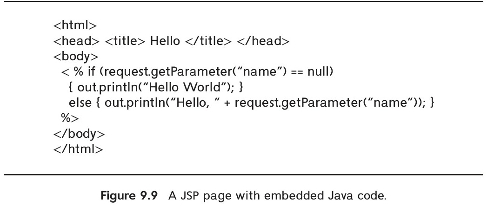
*Figure 9.9 — A JSP page with embedded Java code.*

Some of the widely used scripting frameworks include Java Server Pages (JSP), Active Server Pages (ASP), and PHP.

#### 9.4.1.1 Java Server Pages

Next we briefly describe Java Server Pages (JSP), a scripting language based on Java. When a JSP page is first requested, the application server compiles it into a Java servlet, which is then executed to service the request. Subsequent requests invoke the compiled servlet directly, avoiding the overhead of reinterpreting the page on each request. The application programmer is saved the trouble of writing much of the Java code to create the servlet.

Figure 9.9 shows the source text of a JSP page that includes embedded Java code. The Java code in the script is distinguished from the surrounding HTML code by being enclosed in `<% … %>`. The code uses request.getParameter() to get the value of the attribute name.

When a JSP page is requested by a browser, the application server generates HTML output from the page, which is sent to the browser. The HTML part of the JSP page is output as is.[^5] Wherever Java code is embedded within `<% … %>`, the code is replaced in the HTML output by the text it prints to the object out. In the JSP code in Figure 9.9,

[^5]: JSP allows a more complex embedding, where HTML code is within a Java if-else statement, and gets output conditionally depending on whether the if condition evaluates to true or not. We omit details here.

<!-- Page 418 -->

if no value was entered for the form parameter name, the script prints “Hello World”; if a value was entered, the script prints “Hello” followed by the name.

A more realistic example may perform more complex actions, such as looking up values from a database using JDBC.

JSP also supports the concept of a tag library, which allows the use of tags that look much like HTML tags but are interpreted at the server and are replaced by appropriately generated HTML code. JSP provides a standard set of tags that define variables, loops, conditional statements, and so on. For example, a tag `<c:forEach>` can be used to loop through the results of a database query and generate an HTML table row for each tuple. Programmers can also define custom tag libraries.

#### 9.4.1.2 PHP

PHP is a scripting language that is widely used for server-side scripting. Unlike JSP, which is compiled into Java bytecode, PHP is interpreted. The PHP interpreter can be integrated into the Apache web server, allowing it to execute PHP scripts efficiently.

The following example shows a PHP script that performs the same function as the JSP page in Figure 9.9:

```html
<html>
<head> <title> Hello </title> </head>
<body>
<?php if (!isset($_REQUEST['name']))
  { echo 'Hello World'; }
else { echo 'Hello, ' . $_REQUEST['name']; }
?>
```

The array `$_REQUEST` contains the request parameters. Note that the array index is the parameter name, and the `.` operator between two strings concatenates the strings.

A suitably configured web server would interpret any file whose name ends in “.php” to be a PHP file. If the file is requested, the web server processes it in a manner similar to how JSP files are processed and returns the generated HTML to the browser.

A number of libraries are available for the PHP language, including libraries for database access using ODBC (similar to JDBC in Java).

### 9.4.2 Web Application Frameworks

Web application development frameworks ease the task of constructing web applications by providing features such as these:

<!-- Page 419 -->

- A library of functions to support HTML and HTTP features, including sessions.
- A template scripting system.
- A controller that maps user interaction events such as form submits to appropriate functions that handle the event. The controller also manages authentication and sessions. Some frameworks also provide tools for managing authorizations.
- A (relatively) declarative way of specifying a form with validation constraints on user inputs, from which the system generates HTML and Javascript/Ajax code to display the form and check the constraints, along with server-side code to enforce the constraints.
- Support for object-relational mapping (Section 9.6.2), which allows database data to be accessed as programming-language objects.

Thus, these frameworks provide a variety of features that are required for building web applications, reducing the development effort significantly.

There are a large number of such frameworks, based on different languages. Some of the widely used frameworks include Ruby on Rails, Django (based on Python), and Spring (based on Java). We look at Django in the next section.

### 9.4.3 The Django Framework

The Django framework for Python is a widely used web application framework. Django provides all the features listed above.

Views in Django are functions that are equivalent to servlets in Java. Like servlets, they take an HTTP request as parameter, and return an HTTP response.

Figure 9.10 shows sample code implementing the person query task that we earlier implemented using Java servlets. The code shows a view called person_query_view. We assume that the PersonQuery URL is mapped to the view person_query_view, and is invoked from the HTML form shown earlier in Figure 9.3.

We also assume that the root of the application is mapped to a login view. We have not shown the code for login view, but we assume it displays a login form, and on submit it invokes the authenticate view. We have not shown the authenticate view,

<!-- Page 420 -->

either, but we assume that it checks the login name and password. If the password is validated, the authenticate view redirects to a person query form, which displays the HTML code that we saw earlier in Figure 9.3; if password validation fails, it redirects to the login view.

Returning to Figure 9.10, the view person_query_view() first checks if the user is logged in by checking the session variable username. If the session variable is not set, the browser is redirected to the login screen. Otherwise, the requested user informa-

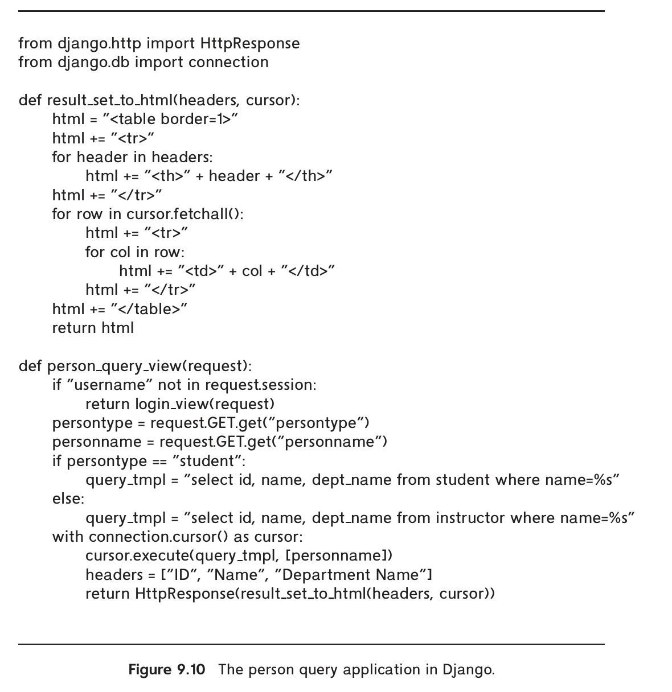
*Figure 9.10 — The person query application in Django.*

<!-- Page 421 -->

tion is fetched by connecting to the database; connection details for the database are specified in a Django configuration file settings.py and are omitted in our description. A cursor (similar to a JDBC statement) is opened on the connection, and the query is executed using the cursor. Note that the first argument of cursor.execute is the query, with parameters marked by “%s”, and the second argument is a list of values for the parameters. The result of the database query is then displayed by calling a function result_set_to_html(), which iterates over the result set fetched from the database and outputs the results in HTML format to a string; the string is then returned as an HttpResponse.

Django provides support for a number of other features, such as creating HTML forms and validating data entered in the forms, annotations to simplify checking of authentication, and templates for creating HTML pages, which are somewhat similar to JSP pages. Django also supports an object-relation mapping system, which we describe in Section 9.6.2.2.

## 9.5 Client-Side Code and Web Services

The two most widely used classes of user interfaces today are the web interfaces and mobile application interfaces.

While early generation web browsers only displayed HTML code, the need was soon felt to allow code to run on the browsers. Client-side scripting languages are languages designed to be executed on the client’s web browser. The primary motivation for such scripting languages is flexible interaction with the user, providing features beyond the limited interaction power provided by HTML and HTML forms. Further, executing programs at the client site speeds up interaction greatly compared to every interaction being sent to a server site for processing.

The JavaScript language is by far the most widely used client-side scripting language. The current generation of web interfaces uses the JavaScript scripting language extensively to construct sophisticated user interfaces.

Any client-side interface needs to store and retrieve data from the back end. Directly accessing a database is not a good idea, since it not only exposes low-level details, but it also exposes the database to attacks. Instead, back ends provide access to store and retrieve data through web services. We discuss web services in Section 9.5.2.

Mobile applications are very widely used, and user interfaces for mobile devices are very important today. Although we do not cover mobile application development in this book, we offer pointers to some mobile application development frameworks in Section 9.5.4.

### 9.5.1 JavaScript

JavaScript is used for a variety of tasks, including validation, flexible user interfaces, and interaction with web services, which we now describe.

<!-- Page 422 -->

#### 9.5.1.1 Input Validation

Functions written in JavaScript can be used to perform error checks (validation) on user input, such as a date string being properly formatted, or a value entered (such as age) being in an appropriate range. These checks are carried out on the browser as data are entered even before the data are sent to the web server.

With HTML5, many validation constraints can be specified as part of the input tag. For example, the following HTML code:

```html
<input type="number" name="credits" size="2" min="1" max="15">
```

ensures that the input for the parameter “credits” is a number between 1 and 15. More complex validations that cannot be performed using HTML5 features are best done using JavaScript.

Figure 9.11 shows an example of a form with a JavaScript function used to validate a form input. The function is declared in the head section of the HTML document. The form accepts a start and an end date. The validation function ensures that the start date

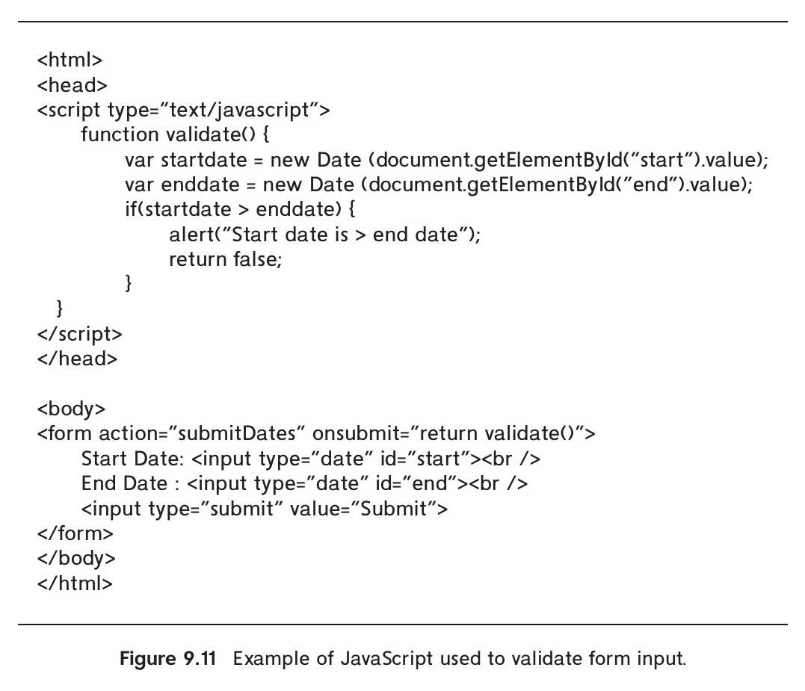
*Figure 9.11 — Example of JavaScript used to validate form input.*

<!-- Page 423 -->

is not greater than the end date. The form tag specifies that the validation function is to be invoked when the form is submitted. If the validation fails, an alert box is shown to the user, and if it succeeds, the form data are submitted.

#### 9.5.1.2 Responsive User Interfaces

The most important benefit of JavaScript is the ability to create highly responsive user interfaces. Early-generation web pages were static, and any change required downloading a new page from the server. In contrast, JavaScript code running in the browser can modify the page currently displayed in the browser. This allows user interactions, such as clicking a button or hovering over an element, to be handled immediately by modifying the current page without having to fetch an entirely new page from the server. This ability is called **Dynamic HTML** (**DHTML**).

Although the JavaScript language has been standardized, there are differences in the details of how different browsers support it. Furthermore, manipulating elements on a web page using low-level JavaScript can be tedious. A number of JavaScript libraries have been developed that provide higher-level abstractions and hide browser differences. By far the most widely used such library is jQuery (see www.jquery.com).

JavaScript libraries such as jQuery provide a number of UI elements, such as menus, accordions, tabs, date pickers, dialog boxes, and sliders, which can be easily incorporated into web pages. They also provide support for animations, such as fading in or sliding elements.

The HTML5 standard supports a number of features for rich user interaction, including audio and video playback, and drawing using the canvas and SVG elements. JavaScript code can be used to control playback, draw shapes, and handle user interactions with these elements.

#### 9.5.1.3 Interfacing with Web Services

Today, JavaScript is widely used to create dynamic web pages, using services provided by the application server. The **Asynchronous JavaScript and XML** (**Ajax**) technology allows JavaScript code running in a browser to send HTTP requests to a web server in the background, without reloading the current page, and to update the page using the data returned by the server. The data returned by the server are typically formatted as JSON (JavaScript Object Notation), although XML was used historically.

The role of the code for the above tasks, which runs at the application server, is to send data to the JavaScript code, which then renders the data on the browser.

<!-- Page 424 -->

Such backend services, which serve the role of functions which can be invoked to fetch required data, are known as **web services**. Such services can be implemented using Java Servlets, Python, or any of a number of other language frameworks.

As an example of the use of Ajax, consider the autocomplete feature implemented by many web applications. As the user types a value in a text box, the system suggests completions for the value being typed. Such autocomplete is very useful for helping a user choose a value from a large number of values where a drop-down list would not be feasible. Libraries such as jQuery provide support for autocomplete by associating a function with a text box; the function takes partial input in the box, connected to a web back end to get possible completions, and displays them as suggestions for the autocomplete.

The JavaScript code shown in Figure 9.12 uses the jQuery library to implement autocomplete and the DataTables plug-in for the jQuery library to provide a tabular display of data. The HTML code has a text input box for name, which has an id attribute set to name. The script associates an autocomplete function from the jQuery library with the text box by using `$("#name")` syntax of jQuery to locate the DOM node for text box with id “name”, and then associating the autocomplete function with the node. The attribute source passed to the function identifies the web service that must be invoked to get values for the autocomplete functionality. We assume that a servlet /autocomplete_name has been defined, which accepts a parameter term containing the letters typed so far by the user, even as they are being typed. The servlet should return a JSON array of names of students/instructors that match the letters in the term parameter.

The JavaScript code also illustrates how data can be retrieved from a web service and then displayed. Our sample code uses the DataTables jQuery plug-in; there are a number of other alternative libraries for displaying tabular data. We assume that the person_query_ajax Servlet, which is not shown, returns the ID, name, and department name of students or instructors with a given name, as we saw earlier in Figure 9.7, but encoded in JSON as an object with attribute data containing an array of rows; each row is a JSON object with attributes id, name, and dept_name.

The line starting with myTable shows how the jQuery plug-in DataTable is associated with the HTML table shown later in the figure, whose identifier is personTable. When the button “Show details” is clicked, the function loadTableAsync() is invoked. This function first creates a URL string url that is used to invoke person_query_ajax with values for person type and name. The function ajax.url(url).load() invoked on myTable fills the rows of the table using the JSON data fetched from the web service whose URL we created above. This happens asynchronously; that is, the function returns immediately, but when the data have been fetched, the table rows are filled with the returned data.

Figure 9.13 shows a screenshot of a browser displaying the result of the code in Figure 9.12.

As another example of the use of Ajax, consider a web site with a form that allows you to select a country, and once a country has been selected, you are allowed to select

<!-- Page 425 -->

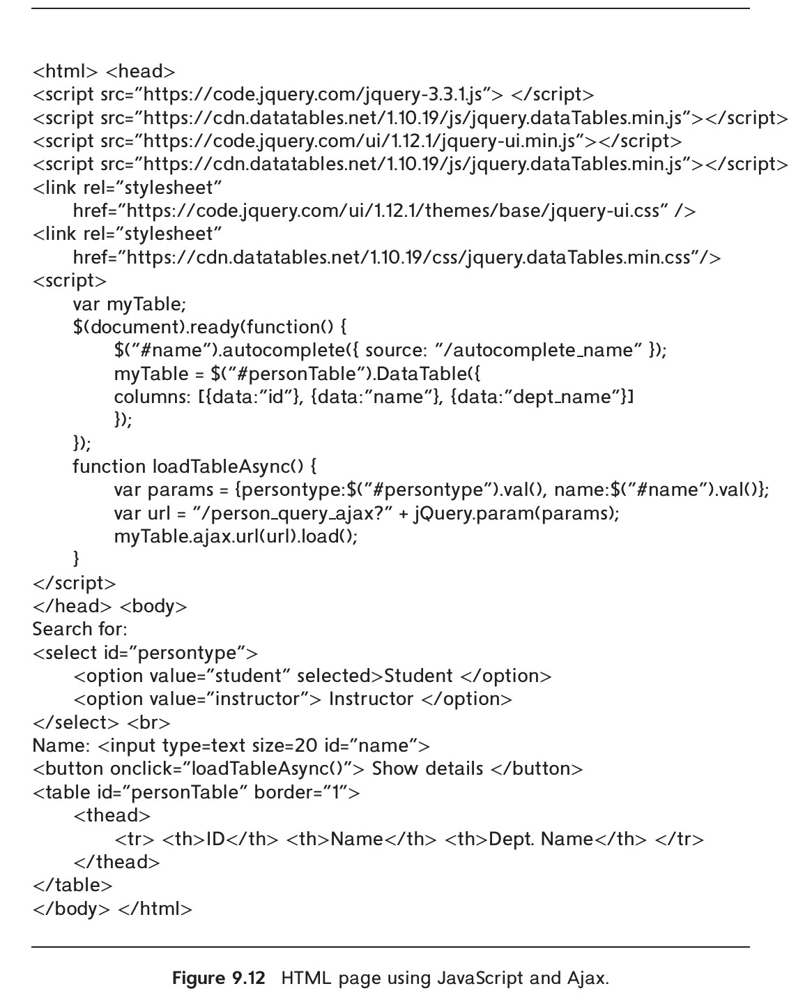
*Figure 9.12 — Dynamic display using JavaScript and Ajax.*

a state from a list of states in that country. Until the country is selected, the drop-down list of states is empty. The Ajax framework allows the list of states to be downloaded

<!-- Page 426 -->

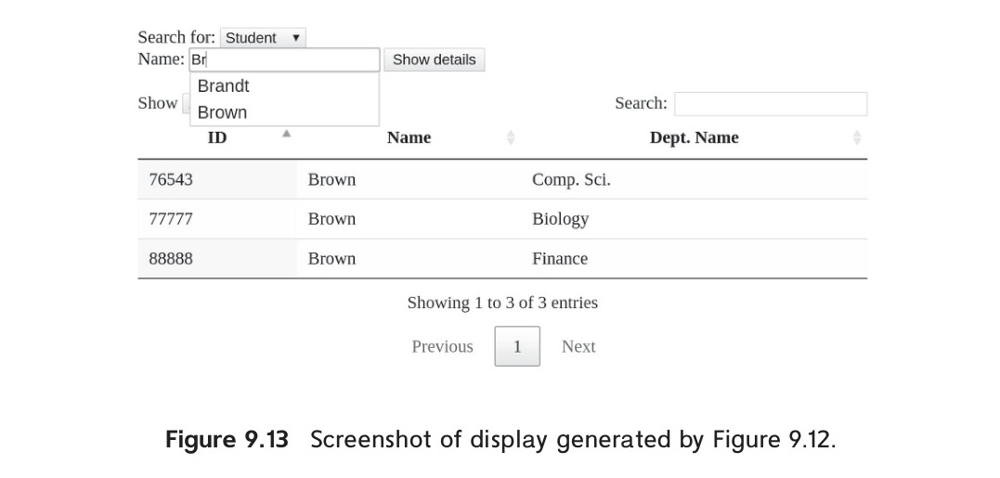
*Figure 9.13 — Screenshot of display generated by Figure 9.12.*

from the web site in the background when the country is selected, and as soon as the list has been fetched, it is added to the drop-down list, which allows you to select the state.

### 9.5.2 Web Services

A **web service** is an application component that can be invoked over the web and functions, in effect, like an application programming interface. A web service request is sent using the HTTP protocol, it is executed at an application server, and the results are sent back to the calling program.

Two approaches are widely used to implement web services. In the simpler approach, called **Representational State Transfer** (or **REST**), web service function calls are executed by a standard HTTP request to a URL at an application server, with parameters sent as standard HTTP request parameters. The application server executes the request (which may involve updating the database at the server), generates and encodes the result, and returns the result as the result of the HTTP request. The most widely used encoding for the results today is the JSON representation, although XML, which we saw earlier in Section 8.1.3, is also used. The requestor parses the returned page to access the returned data.

In many applications of such RESTful web services (i.e., web services using REST), the requestor is JavaScript code running in a web browser; the code updates the browser screen using the result of the function call. For example, when you scroll the display on a map interface on the web, the part of the map that needs to be newly displayed may be fetched by JavaScript code using a RESTful interface and then displayed on the screen.

While some web services are not publicly documented and are used only internally by specific applications, other web services have their interfaces documented and can be used by any application. Such services may allow use without any restriction,

<!-- Page 427 -->

may require users to be logged in before accessing the service, or may require users or application developers to pay the web service provider for the privilege of using the service.

Today, a very large variety of RESTful web services are available, and most front-end applications use one or more such services to perform backend activities. For example, your web-based email system, your social media web page, or your web-based map service would almost surely be built with JavaScript code for rendering and would use backend web services to fetch data as well as to perform updates. Similarly, any mobile app that stores data at the back end almost surely uses web services to fetch data and to perform updates.

Web services are also increasingly used at the backend, to make use of functionalities provided by other backend systems. For example, web-based storage systems provide a web service API for storing and retrieving data; such services are provided by a number of providers, such as Amazon S3, Google Cloud Storage, and Microsoft Azure. They are very popular with application developers since they allow storage of very large amounts of data, and they support a very large number of operations per second, allowing scalability far beyond what a centralized database can support.

There are many more such web-service APIs. For example, text-to-speech, speech recognition, and vision web-service APIs allow developers to construct applications incorporating speech and image recognition with very little development effort.

A more complex and less frequently used approach, sometimes referred to as “Big Web Services,” uses XML encoding of parameters as well as results, has a formal definition of the web API using a special language, and uses a protocol layer built on top of the HTTP protocol.

### 9.5.3 Disconnected Operation

Many applications wish to support some operations even when a client is disconnected from the application server. For example, a student may wish to complete an application form even if her laptop is disconnected from the network but have it saved back when the laptop is reconnected. As another example, if an email client is built as a web application, a user may wish to compose an email even if her laptop is disconnected from the network and have it sent when it is reconnected. Building such applications requires local storage in the client machine.

The HTML5 standard supports local storage, which can be accessed using JavaScript. The code:

```javascript
if (typeof(Storage) !== "undefined") { // browser supports local storage
    ...
}
```

checks if the browser supports local storage. If it does, the following functions can be used to store, load, or delete values for a given key.

<!-- Page 428 -->

```javascript
localStorage.setItem(key, value)
localStorage.getItem(key)
localStorage.removeItem(key)
```

To avoid excessive data storage, the browser may limit a web site to storing at most some amount of data; the default maximum is typically 5 megabytes.

The above interface only allows storage/retrieval of key/value pairs. Retrieval requires that a key be provided; otherwise the entire set of key/value pairs will need to be scanned to find a required value. Applications may need to store tuples indexed on multiple attributes, allowing efficient access based on values of any of the attributes. HTML5 supports IndexedDB, which allows storage of JSON objects with indices on multiple attributes. IndexedDB also supports schema versions and allows the developer to provide code to migrate data from one schema version to the next version.

### 9.5.4 Mobile Application Platforms

Mobile applications (or mobile apps, for short) are widely used today, and they form the primary user interface for a large class of users. The two most widely used mobile platforms today are Android and iOS. Each of these platforms provides a way of building applications with a graphical user interface, tailored to small touch-screen devices. The graphical user interface provides a variety of standard GUI features such as menus, lists, buttons, check boxes, progress bars, and so on, and the ability to display text, images, and video.

Mobile apps can be downloaded and stored and used later. Thus, the user can download apps when connected to a high-speed network and then use the app with a lower-speed network. In contrast, web apps may get downloaded when they are used, resulting in a lot of data transfer when a user may be connected to a lower-speed network or a network where data transfer is expensive. Further, mobile apps can be better tuned to small-sized devices than web apps, with user interfaces that work well on small devices. Mobile apps can also be compiled to machine code, resulting in lower power demands than web apps. More importantly, unlike (earlier generation) web apps, mobile apps can store data locally, allowing offline usage. Further, mobile apps have a well-developed authorization model, allowing them to use information and device features such as location, cameras, contacts, and so on with user authorization.

However, one of the drawbacks of using mobile-app interfaces is that code written for the Android platform can only run on that platform and not on iOS, and vice versa. As a result, developers are forced to code every application twice, once for Android and once for iOS, unless they decide to ignore one of the platforms completely, which is not very desirable.

The ability to create applications where the same high-level code can run on either Android or iOS is clearly very important. The React Native framework based on JavaScript, developed by Facebook, and the Flutter framework based on the Dart language developed by Google, are designed to allow cross-platform development. (Dart

<!-- Page 429 -->

is a language optimized for developing user interfaces, providing features such as asynchronous function invocation and functions on streams.) Both frameworks allow much of the application code to be common for both Android and iOS, but some functionality can be made specific to the underlying platform in case it is not supported in the platform-independent part of the framework.

With the wide availability of high-speed mobile networks, some of the motivation for using mobile apps instead of web apps, such as the ability to download ahead of time, is not as important anymore. A new generation of web apps, called **Progressive Web Apps** (**PWA**) that combine the benefits of mobile apps with web apps is seeing increasing usage. Such apps are built using JavaScript and HTML5 and are tailored for mobile devices.

A key enabling feature for PWAs is the HTML5 support for local data storage, which allows apps to be used even when the device is offline. Another enabling feature is the support for compilation of JavaScript code; compilation is restricted to code that follows a restricted syntax, since compilation of arbitrary JavaScript code is not practical. Such compilation is typically done just-in-time, that is, it is done when the code needs to be executed, or if it has already been executed multiple times. Thus, by writing CPU-heavy parts of a web application using only JavaScript features that allow compilation, it is possible to ensure CPU and energy-efficient execution of the code on a mobile device.

PWAs also make use of HTML5 service workers, which allow a script to run in the background in the browser, separate from a web page. Such service workers can be used to perform background synchronization operations between the local store and a web service, or to receive or push notifications from a backend service. HTML5 also allows apps to get device location (after user authorization), allowing PWAs to use location information.

Thus, PWAs are likely to see increasing use, replacing many (but certainly not all) of the use cases for mobile apps.

## 9.6 Application Architectures

To handle their complexity, large applications are often broken into several layers:

- **The presentation or user-interface layer**, which deals with user interaction. A single application may have several different versions of this layer, corresponding to distinct kinds of interfaces such as web browsers and user interfaces of mobile phones, which have much smaller screens.
  
  In many implementations, the presentation/user-interface layer is itself conceptually broken up into layers, based on the **model-view-controller** (**MVC**) architecture. The **model** corresponds to the business-logic layer, described below. The **view** defines the presentation of data; a single underlying model can have different views depending on the specific software/device used to access the application. The **controller** receives events (user actions), executes actions on the model, and returns

<!-- Page 430 -->

a view to the user. The MVC architecture is used in a number of web application frameworks.

- **The business-logic layer**, which provides a high-level view of data and actions on data. We discuss the business-logic layer in more detail in Section 9.6.1.
- **The data-access layer**, which provides the interface between the business-logic layer and the underlying database. Many applications use an object-oriented language to code the business-logic layer and use an object-oriented model of data, while the underlying database is a relational database. In such cases, the data-access layer also provides the mapping from the object-oriented data model used by the business logic to the relational model supported by the database. We discuss such mappings in more detail in Section 9.6.2.

Figure 9.14 shows these layers, along with a sequence of steps taken to process a request from the web browser. The labels on the arrows in the figure indicate the order of the steps. When the request is received by the application server, the controller sends a request to the model. The model processes the request, using business logic, which may involve updating objects that are part of the model, followed by creating a result object. The model in turn uses the data-access layer to update or retrieve information from a database. The result object created by the model is sent to the view module, which creates an HTML view of the result to be displayed on the web browser. The view may be tailored based on the characteristics of the device used to view the result—for example, whether it is a computer monitor with a large screen or a small screen on a phone. Increasingly, the view module sends back data encoded in JSON to JavaScript code on the browser, which then updates the display, instead of the view module generating HTML directly.

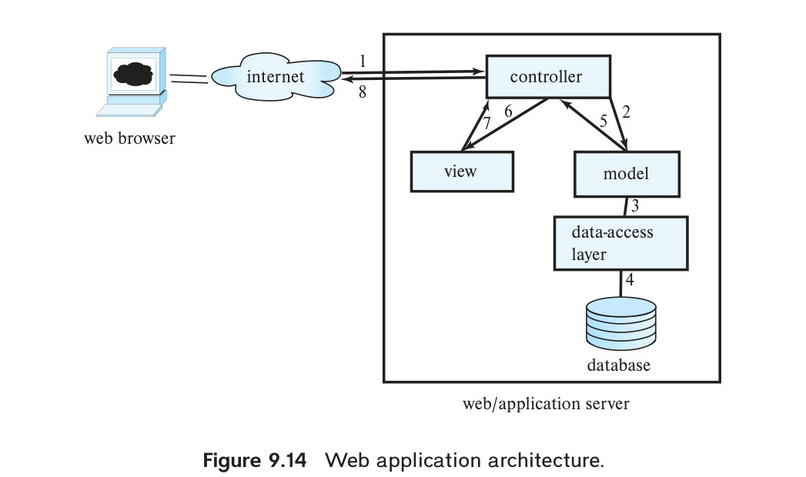
*Figure 9.14 — Web application architecture.*

<!-- Page 431 -->

### 9.6.1 The Business-Logic Layer

The business-logic layer of an application for managing a university may provide abstractions of entities such as students, instructors, courses, sections, etc., and actions such as admitting a student to the university, enrolling a student in a course, and so on. The code implementing these actions ensures that business rules are satisfied; for example, the code would ensure that a student can enroll for a course only if she has already completed course prerequisites and has paid her tuition fees.

In addition, the business logic includes **workflows**, which describe how a particular task that involves multiple participants is handled. For example, if a candidate applies to the university, there is a workflow that defines who should see and approve the application first, and if approved in the first step, who should see the application next, and so on until either an offer is made to the student, or a rejection note is sent out. Workflow management also needs to deal with error situations; for example, if a deadline for approval/rejection is not met, a supervisor may need to be informed so she can intervene and ensure the application is processed.

### 9.6.2 The Data-Access Layer and Object-Relational Mapping

In the simplest scenario, where the business-logic layer uses the same data model as the database, the data-access layer simply hides the details of interfacing with the database. However, when the business-logic layer is written using an object-oriented programming language, it is natural to model data as objects, with methods invoked on objects.

In early implementations, programmers had to write code for creating objects by fetching data from the database and for storing updated objects back in the database. However, such manual conversions between data models is cumbersome and error prone. One approach to handling this problem was to develop a database system that natively stores objects, and relationships between objects, and allows objects in the database to be accessed in exactly the same way as in-memory objects. Such databases, called **object-oriented databases**, were discussed in Section 8.2. However, object-oriented databases did not achieve commercial success for a variety of technical and commercial reasons.

An alternative approach is to use traditional relational databases to store data, but to automate the mapping of data in relation to in-memory objects, which are created on demand (since memory is usually not sufficient to store all data in the database), as well as the reverse mapping to store updated objects back as relations in the database. Several systems have been developed to implement such **object-relational mappings**. We describe the Hibernate and Django ORMs next.

#### 9.6.2.1 Hibernate ORM

The Hibernate system is widely used for mapping from Java objects to relations. Hibernate provides an implementation of the **Java Persistence API** (**JPA**). In Hibernate, the mapping from each Java class to one or more relations is specified in a mapping file.

<!-- Page 432 -->

The mapping file can specify, for example, that a Java class called Student is mapped to the relation student, with the Java attribute ID mapped to the attribute student.ID, and so on. Information about the database, such as the host on which it is running and user name and password for connecting to the database, are specified in a properties file. The program has to open a session, which sets up the connection to the database. Once the session is set up, a Student object stud created in Java can be stored in the database by invoking session.save(stud). The Hibernate code generates the SQL commands required to store corresponding data in the student relation.

While entities in an E-R model naturally correspond to objects in an object-oriented language such as Java, relationships often do not. Hibernate supports the ability to map such relationships as sets associated with objects. For example, the takes relationship between student and section can be modeled by associating a set of sections with each student, and a set of students with each section. Once the appropriate mapping is specified, Hibernate populates these sets automatically from the database relation takes, and updates to the sets are reflected back to the database relation on commit.

As an example of the use of Hibernate, we create a Java class corresponding to the student relation as follows:

```java
@Entity public class Student {
    @Id String ID;
    String name;
    String department;
    int tot_cred;
}
```

To be precise, the class attributes should be declared as private, and getter/setter methods should be provided to access the attributes. The annotation `@Entity` specifies that the class is an entity, and `@Id` specifies that ID is the primary key.

The mapping of the class attributes of Student to attributes of the relation student is straightforward and is assumed to follow default naming rules.

The following code snippet then creates a Student object and saves it in the database:

```java
Session session = getSessionFactory().openSession();
Transaction txn = session.beginTransaction();
Student student = new Student("12345", "Shannon", "Comp. Sci.", 0);
session.save(student);
txn.commit();
session.close();
```

<!-- Page 433 -->

Hibernate automatically generates the required SQL insert statement to store the object in the student relation.

Objects can be retrieved either by primary key or by a query, as illustrated in the following code snippet:

```java
Session session = getSessionFactory().openSession();
Transaction txn = session.beginTransaction();
Student student = session.get(Student.class, "12345");
.. print out the Student information ..
List students =
    session.createQuery("from Student as s order by s.ID asc").list();
for (Iterator iter = students.iterator(); iter.hasNext();) {
    Student stud = (Student) iter.next();
    .. print out the Student information ..
}
txn.commit();
session.close();
```

A single object can be retrieved using the session.get() method by providing the primary key value.

The preceding code snippet also shows a query in Hibernate’s HQL query language. HQL is an object-oriented query language that is similar to SQL, but it operates on objects rather than on relations. The query returns a list of Student objects, which can then be iterated over using standard Java iterators.

These features help to provide the programmer with a high-level model of data, and save the programmer the effort of converting between objects and relations.

#### 9.6.2.2 The Django ORM

Several ORMs have been developed for the Python language. The ORM component of the Django web framework is widely used. Models in Django are Python classes that subclass models.Model.

Figure 9.15 shows a model definition for Student and Instructor in Django. Observe that all of the class attributes are declared as fields of different types (such as CharField, IntegerField, and DecimalField). In addition, the relation advisor has been modeled here as a many-to-many relationship attribute

<!-- Page 434 -->

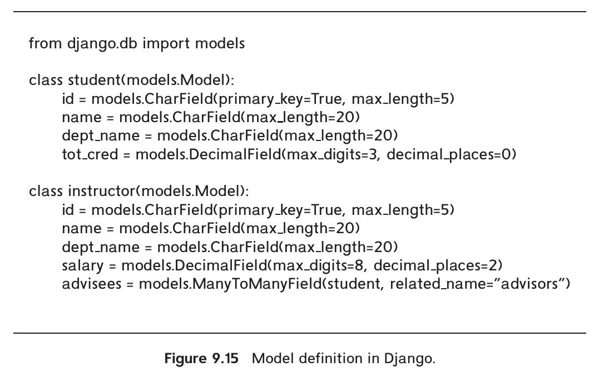
*Figure 9.15 — Model definition in Django.*

called advisees in Instructor, which stores a set of references to Student objects. The attribute declaration specifies the reverse relationship attribute name in the Student class as advisors; this attribute stores a set of references to Instructor objects.

The Django view person_query_model shown in Figure 9.16 illustrates how to access database objects directly from the Python language, without using SQL. The expression Student.objects.filter() returns all student objects that satisfy the specified filter condition, and the advisors attribute of the student object is used to access the advisors of the student, and then output their names.

Django provides a tool called migrate, which creates database relations corresponding to models, as well as altering database relations when model definitions change.

## 9.7 Application Performance

Web sites may be accessed by millions of people from across the globe, and ensuring

<!-- Page 435 -->

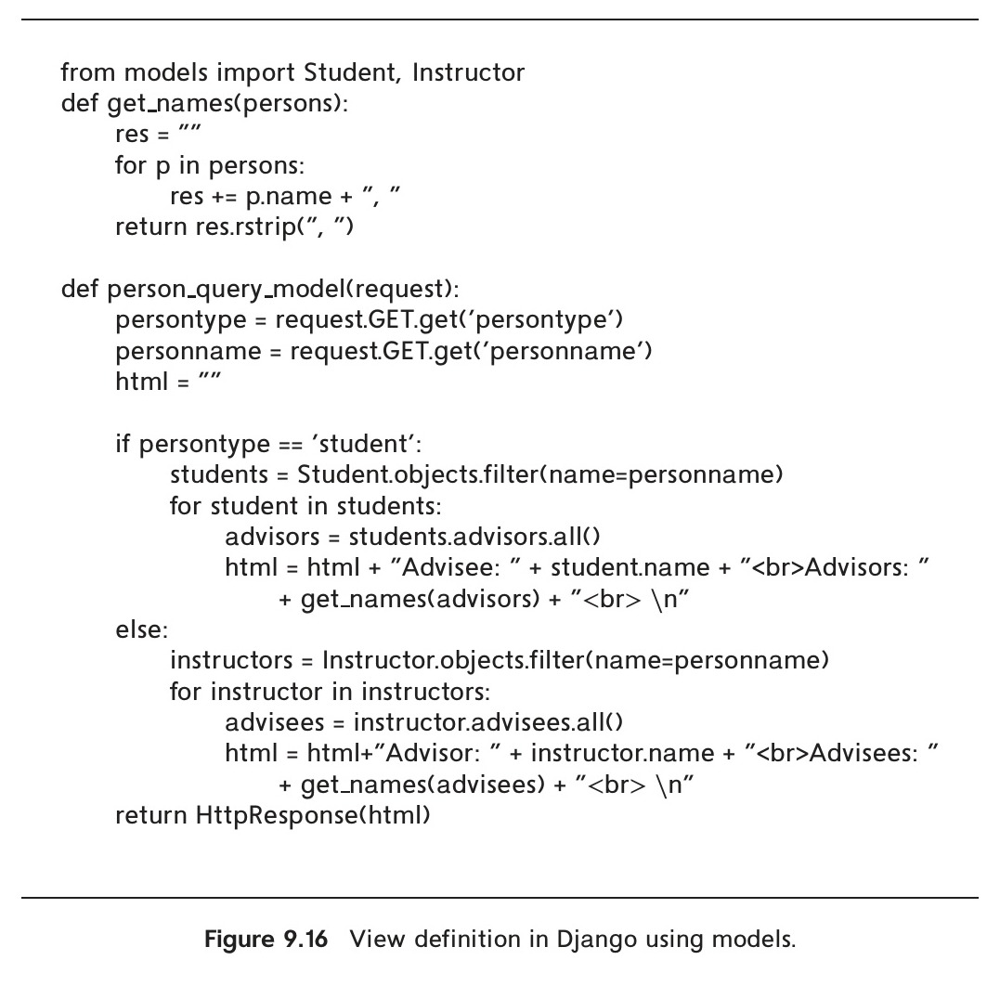
*Figure 9.16 — View definition in Django using models.*

that requests are served with low response times is a major challenge for web-site developers. To do so, application developers try to speed up the processing of individual requests by using techniques such as caching, and they exploit parallel processing by using multiple application servers. We describe these techniques briefly next. Tuning of database applications is another way to improve performance and is described in Section 25.1.

### 9.7.1 Reducing Overhead by Caching

Suppose that the application code for servicing each user request connects to a database through JDBC. Creating a new JDBC connection may take several milliseconds, so opening a new connection for each user request is not a good idea if very high transaction rates are to be supported.

<!-- Page 436 -->

The **connection pooling** method is used to reduce this overhead; it works as follows: The connection pool manager (typically a part of the application server) creates a pool (that is, a set) of open ODBC/JDBC connections. Instead of opening a new connection to the database, the code servicing a user request (typically a servlet) asks for (requests) a connection from the connection pool and returns the connection to the pool when the code (servlet) completes its processing. If the pool has no unused connections when a connection is requested, a new connection is opened to the database (taking care not to exceed the maximum number of connections that the database system can support concurrently). If there are many open connections that have not been used for a while, the connection pool manager may close some of the open database connections. Many application servers and newer ODBC/JDBC drivers provide a built-in connection pool manager.

Details of how to create a connection pool vary by application server or JDBC driver, but most implementations require the creation of a DataSource object using the JDBC connection details such as the machine, port, database, user-id and password, as well as other parameters related to connection pooling. The getConnection() method invoked on the DataSource object gets a connection from the connection pool. Closing the connection returns the connection to the pool.

Certain requests may result in exactly the same query being resubmitted to the database. The cost of communication with the database can be greatly reduced by caching the results of earlier queries and reusing them, so long as the query result has not changed at the database. Some web servers support such query-result caching; caching can otherwise be done explicitly in application code.

Costs can be further reduced by caching the final web page that is sent in response to a request. If a new request comes with exactly the same parameters as a previous request, the request does not perform any updates, and the resultant web page is in the cache, that page can be reused to avoid the cost of recomputing the page. Caching can be done at the level of fragments of web pages, which are then assembled to create complete web pages.

Cached query results and cached web pages are forms of materialized views. If the underlying database data change, the cached results must be discarded, or recomputed, or even incrementally updated, as in materialized-view maintenance (described in Section 16.5). Some database systems (such as Microsoft SQL Server) provide a way for the application server to register a query with the database and get a notification from the database when the result of the query changes. Such a notification mechanism can be used to ensure that query results cached at the application server are up-to-date.

There are several widely used main-memory caching systems; among the more popular ones are memcached and Redis. Both systems allow applications to store data with an associated key and retrieve data for a specified key. Thus, they act as hash-map data structures that allow data to be stored in the main memory but also provide cache eviction of infrequently used data.

<!-- Page 437 -->

For example, with memcached, data can be stored using memcached.add(key, data) and fetched using memcached.fetch(key). Instead of issuing a database query to fetch user data with a specified key, say key1, from a relation r, an application would first check if the required data are already cached by issuing a fetch("r:"+key1) (here, the key is appended to the relation name, to distinguish data from different relations that may be stored in the same memcached instance). If the fetch returns null, the database query is issued, a copy of the data fetched from the database is stored in memcached, and the data are then returned to the user. If the fetch does find the requested data, it can be used without accessing the database, leading to much faster access.

A client can connect to multiple memcached instances, which may run on different machines and store/retrieve data from any of them. How to decide what data are stored on which instance is left to the client code. By partitioning the data storage across multiple machines, an application can benefit from the aggregate main memory available across all the machines.

Memcached does not support automatic invalidation of cached data, but the application can track database changes and issue updates (using memcached_set(key, newvalue)) or deletes (using memcached_delete(key)) for the key values affected by update or deletion in the database. Redis offers very similar functionality. Both memcached and Redis provide APIs in multiple languages.

### 9.7.2 Parallel Processing

A commonly used approach to handling such very heavy loads is to use a large number of application servers running in parallel, each handling a fraction of the requests. A web server or a network router can be used to route each client request to one of the application servers. All requests from a particular client session must go to the same application server, since the server maintains state for a client session. This property can be ensured, for example, by routing all requests from a particular IP address to the same application server. The underlying database is, however, shared by all the application servers, so users see a consistent view of the database.

While the above architecture ensures that application servers do not become bottlenecks, it cannot prevent the database from becoming a bottleneck, since there is only one database server. To avoid overloading the database, application designers often use caching techniques to reduce the number of requests to the database. In addition, parallel database systems, described in Chapter 21 through Chapter 23, are used when the database needs to handle very large amounts of data, or a very large query load. Parallel data storage systems that are accessible via web service APIs are also popular in applications that need to scale to a very large number of users.

## 9.8 Application Security

Application security has to deal with several security threats and issues beyond those handled by SQL authorization.

<!-- Page 438 -->

The first point where security has to be enforced is in the application. To do so, applications must authenticate users and ensure that users are only allowed to carry out authorized tasks.

There are many ways in which an application’s security can be compromised, even if the database system is itself secure, due to badly written application code. In this section, we first describe several security loopholes that can permit hackers to carry out actions that bypass the authentication and authorization checks carried out by the application, and we explain how to prevent such loopholes. Later in the section, we describe techniques for secure authentication, and for fine-grained authorization. We then describe audit trails that can help in recovering from unauthorized access and from erroneous updates. We conclude the section by describing issues in data privacy.

### 9.8.1 SQL Injection

In **SQL injection** attacks, the attacker manages to get an application to execute an SQL query created by the attacker. In Section 5.1.1.5, we saw an example of an SQL injection vulnerability if user inputs are concatenated directly with an SQL query and submitted to the database. As another example of SQL injection vulnerability, consider the form source text shown in Figure 9.3. Suppose the corresponding servlet shown in Figure 9.7 creates an SQL query string using the following Java expression:

```java
String query = "select * from student where name like '%"
    + name + "%' ";
```

where name is a variable containing the string input by the user, and then executes the query on the database. A malicious attacker using the web form can then type a string such as “ `'; <some SQL statement>; – – ` ”, where `<some SQL statement>` denotes any SQL statement that the attacker desires, in place of a valid student name. The servlet would then execute the following string.

```sql
select * from student where name like '%'; <some SQL statement>; – – %'
```

The quote inserted by the attacker closes the string, the following semicolon terminates the query, and the following text inserted by the attacker gets interpreted as a second SQL query, while the closing quote has been commented out. Thus, the malicious user has managed to insert an arbitrary SQL statement that is executed by the application. The statement can cause significant damage, since it can perform any action on the database, bypassing all security measures implemented in the application code.

As discussed in Section 5.1.1.5, to avoid such attacks, it is best to use prepared statements to execute SQL queries. When setting a parameter of a prepared query, JDBC automatically adds escape characters so that the user-supplied quote would no longer be able to terminate the string. Equivalently, a function that adds such escape

<!-- Page 439 -->

characters could be applied on input strings before they are concatenated with the SQL query, instead of using prepared statements.

Another source of SQL-injection risk comes from applications that create queries dynamically, based on selection conditions and ordering attributes specified in a form. For example, an application may allow a user to specify what attribute should be used for sorting the results of a query. An appropriate SQL query is constructed, based on the attribute specified. Suppose the application takes the attribute name from a form, in the variable orderAttribute, and creates a query string such as the following:

```java
String query = "select * from takes order by " + orderAttribute;
```

A malicious user can send an arbitrary string in place of a meaningful orderAttribute value, even if the HTML form used to get the input tried to restrict the allowed values by providing a menu. To avoid this kind of SQL injection, the application should ensure that the orderAttribute variable value is one of the allowed values (in our example, attribute names) before appending it.

### 9.8.2 Cross-Site Scripting and Request Forgery

A web site that allows users to enter text, such as a comment or a name, and then stores it and later displays it to other users, is potentially vulnerable to a kind of attack called a **cross-site scripting** (**XSS**) attack. In such an attack, a malicious user enters code written in a client-side scripting language such as JavaScript or Flash instead of entering a valid name or comment. When a different user views the entered text, the browser executes the script, which can carry out actions such as sending private cookie information back to the malicious user or even executing an action on a different web server that the user may be logged into.

For example, suppose the user happens to be logged into her bank account at mybank.com, and the malicious script contains an HTML element of the form:

```html

```

assuming that the URL mybank.com/transfermoney accepts the specified parameters to transfer money between accounts. When the browser displays the image, it sends an HTTP request for the above URL to the server mybank.com, with the cookies associated with that domain. The server mybank.com then authenticates the user, transfers the money, and returns a dummy image to the browser. The user would not even realize that money has been transferred out of her account! This form of attack, which exploits actions that can be executed on another site, is called a **cross-site request forgery** (**CSRF** or **XSRF**) attack.

XSS can be done in other ways, such as luring a user into visiting a web site created by the attacker; when the user visits the site, malicious scripts embedded in the site can attempt to access other web sites the user may be logged into, or try to exploit vulnerabilities in the browser to download malicious code. There are other more complex kinds of XSS

<!-- Page 440 -->

and XSRF attacks, which we shall not get into here. To protect against such attacks, two things need to be done:

- **Prevent your web site from being used to launch XSS or XSRF attacks.**
  
  The simplest technique is to disallow any HTML tags whatsoever in text input by users. There are functions that detect or strip all such tags. These functions can be used to prevent HTML tags, and as a result, any scripts, from being displayed to other users. In some cases HTML formatting is useful, and in that case functions that parse the text and allow limited HTML constructs but disallow other dangerous constructs can be used instead; these must be designed carefully, since something as innocuous as an image include could potentially be dangerous in case there is a bug in the image display software that can be exploited.

- **Protect your web site from XSS or XSRF attacks launched from other sites.**
  
  If the user has logged into your web site and visits a different web site vulnerable to XSS, the malicious code executing on the user’s browser could execute actions on your web site or pass session information related to your web site back to the malicious user, who could try to exploit it. This cannot be prevented altogether, but you can take a few steps to minimize the risk.
  
  - The HTTP protocol allows a server to check the referer of a page access, that is, the URL of the page that had the link that the user clicked on to initiate the page access. By checking that the referer is valid, for example, that the referer URL is a page on the same web site, XSS attacks that originated on a different web page accessed by the user can be prevented.
  - Instead of using only the cookie to identify a session, the session could also be restricted to the IP address from which it was originally authenticated. As a result, even if a malicious user gets a cookie, he may not be able to log in from a different computer.
  - Never use a GET method to perform any updates. This prevents attacks using `` such as the one we saw earlier. In fact, the HTTP standard specifies that GET methods should not perform any updates.
  - If you use a web application framework like Django, make sure to use the XSRF/CSRF protection mechanisms provided by the framework.

### 9.8.3 Password Leakage

Another problem that application developers must deal with is storing passwords in clear text in the application code. For example, programs such as JSP scripts often contain passwords in clear text. If such scripts are stored in a directory accessible by a web server, an external user may be able to access the source code of the script and get access to the password for the database account used by the application. To avoid such problems, many application servers provide mechanisms to store passwords in

<!-- Page 441 -->

encrypted form, which the server decrypts before passing it on to the database. Such a feature removes the need for storing passwords as clear text in application programs. However, if the decryption key is also vulnerable to being exposed, this approach is not fully effective.

As another measure against compromised database passwords, many database systems allow access to the database to be restricted to a given set of internet addresses, typically, the machines running the application servers. Attempts to connect to the database from other internet addresses are rejected. Thus, unless the malicious user is able to log into the application server, she cannot do any damage even if she gains access to the database password.

### 9.8.4 Application-Level Authentication

**Authentication** refers to the task of verifying the identity of a person/software connecting to an application. The simplest form of authentication consists of a secret password that must be presented when a user connects to the application. Unfortunately, passwords are easily compromised, for example, by guessing, or by sniffing of packets on the network if the passwords are not sent encrypted. More robust schemes are needed for critical applications, such as online bank accounts. Encryption is the basis for more robust authentication schemes. Authentication through encryption is addressed in Section 9.9.3.

Many applications use **two-factor authentication**, where two independent factors (i.e., pieces of information or processes) are used to identify a user. The two factors should not share a common vulnerability; for example, if a system merely required two passwords, both could be vulnerable to leakage in the same manner (by network sniffing, or by a virus on the computer used by the user, for example). While biometrics such as fingerprints or iris scanners can be used, they are expensive, and difficult to deploy widely. Hardware tokens such as smart cards or specialized USB tokens (see Section 9.9.3), are widely used as second factors.

Passwords are used as the first factor in most such two-factor authentication systems. The second factor is typically a randomly generated one-time password (OTP) sent to the user via SMS to a registered phone number, or generated by an authenticator application or hardware device.

One-time password devices, which generate a new pseudo-random number (which changes every 30 to 60 seconds) synchronized with a server, are widely used as hardware tokens for two-factor authentication. More recently, smartphone applications such as Google Authenticator that implement the same functionality in software on a smartphone have gained wide popularity.

Yet another second-factor approach is to send an SMS with a (randomly generated) one-time password to the user’s phone (whose number is registered earlier) whenever

<!-- Page 442 -->

the user wishes to log in to the application. The user must possess a phone to receive the SMS, in addition to knowing the password, making this a two-factor authentication system. However, this approach is vulnerable to phone-number porting attacks, where an attacker tricks a phone company into porting the user’s number to a SIM card controlled by the attacker.

It is worth noting that even with two-factor authentication, users may be vulnerable to phishing attacks. In a phishing attack, an attacker sets up a fake web site that mimics a legitimate site, and tricks users into entering their credentials (including one-time passwords), which the attacker immediately uses to log in to the legitimate site.

When users access multiple web sites, it is often annoying for a user to remember different user names and passwords for each site. Many organizations set up a **central authentication service** that authenticates users on behalf of multiple applications within the organization. When an application needs to authenticate a user, it redirects the user to the central authentication service. The user logs in to the central authentication service, which then redirects the user back to the application, along with a digitally signed token (described in Section 9.9.3.1) that verifies the user’s identity.

In addition to authenticating users, a central authentication service may also manage authorization attributes, such as which departments or groups a user belongs to, and communicate these attributes to the application.

A **single sign-on** (**SSO**) system further allows the user to be authenticated once, and then access multiple applications without having to log in again, as long as the user’s session with the central authentication service remains valid.

The **Security Assertion Markup Language** (**SAML**) is a protocol for exchanging authentication and authorization information between an identity provider (such as an organization’s central authentication service) and a service provider (an application). SAML is widely used for single sign-on across different organizations.

<!-- Page 443 -->

For example, an application hosted at an external organization can redirect a user to Yale University’s authentication service, which authenticates the user and then tells the application who the user is and may provide some additional information such as the category of the user (e.g., student, faculty, staff).

The **OpenID** protocol is an alternative for single sign-on across organizations. OpenID allows users to use existing accounts (such as Google or Facebook accounts) to log in to other web sites, without creating a new password for each site.

### 9.8.5 Application-Level Authorization

Although the SQL standard supports a fairly flexible system of authorization, as described in Chapter 4, the authorization facility of SQL is not sufficient for web applications, for two main reasons:

1. **Lack of end-user information.** With the growth in the web, database systems are accessed primarily from web application servers. The end users typically do not have user accounts in the database; rather, the application server connects to the database using a single, shared database user account. As a result, the database system does not know who the actual end user is, and therefore cannot enforce user-specific authorizations.[^6]
   
   It is possible for an application server to authenticate end users and then inform the database about the identity of the end user, but standard SQL does not provide a standard mechanism for this purpose.

2. **Lack of fine-grained authorization.** Authorization must be at the level of individual tuples if we are to authorize students to see only their own grades. Standard SQL authorization allows privileges to be granted on relations or views, but not on individual tuples.[^7]
   
   We could try to get around this limitation by creating for each student a view that contains only tuples pertaining to that student, and granting authorization to the student on that view. However, creating and managing tens of thousands of views (one for each student) would place a significant burden on the database system.
   
   An alternative is to create a view of the form

[^6]: In Oracle, a JDBC connection using Oracle’s JDBC drivers can set the end user identifier using an Oracle-specific API; other databases provide similar mechanisms.

[^7]: Database systems are designed to manage large relations but to manage schema information such as views in a way that assumes smaller data volumes so as to enhance overall performance.

<!-- Page 444 -->

```sql
create view studentTakes as
    select *
    from takes
    where takes.ID = syscontext.user_id()
```

Users are then given authorization to this view, rather than to the underlying takes relation. However, queries executed on behalf of students must now be written on the view studentTakes, rather than on the original takes relation, whereas queries executed on behalf of instructors may need to use a different view. The task of developing applications becomes more complex as a result.

The task of authorization is often typically carried out entirely in the application, bypassing the authorization facilities of SQL. At the application level, users are authorized to access specific interfaces, and they may further be restricted to view or update certain data items only.

While carrying out authorization in the application gives a great deal of flexibility to application developers, there are problems, too.

- The code for checking authorization becomes intermixed with the rest of the application code.
- Implementing authorization through application code, rather than specifying it declaratively in SQL, makes it hard to ensure the absence of loopholes. Because of an oversight, one of the application programs may not check for authorization, allowing unauthorized users access to confidential data.

Verifying that all application programs make all required authorization checks involves reading through all the application-server code, a formidable task in a large system. In other words, applications have a very large “surface area,” making the task of protecting the application significantly harder. And in fact, security loopholes have been found in a variety of real-life applications.

In contrast, if a database directly supported fine-grained authorization, authorization policies could be specified and enforced at the SQL level, which has a much smaller surface area. Even if some of the application interfaces inadvertently omit required authorization checks, the SQL-level authorization could prevent unauthorized actions from being executed.

Some database systems provide mechanisms for row-level authorization as we saw in Section 4.7.7. For example, the Oracle Virtual Private Database (VPD) allows a system administrator to associate a function with a relation; the function returns a predicate that must be added to any query that uses the relation (different functions can be defined for relations that are being updated). For example, using our syntax for retrieving application user identifiers, the function for the takes relation can return a predicate such as:

<!-- Page 445 -->

```sql
ID = sys_context.user_id()
```

This predicate is added to the where clause of every query that uses the takes relation. As a result (assuming that the application program sets the user_id value to the student’s ID), each student can see only the tuples corresponding to courses that she took.

As we discussed in Section 4.7.7, a potential pitfall with adding a predicate as described above is that it may change the meaning of a query. For example, if a user wrote a query to find the average grade over all courses, she would end up getting the average of her grades, not all grades. Although the system would give the “right” answer for the rewritten query, that answer would not correspond to the query the user may have thought she was submitting.

PostgreSQL and Microsoft SQL Server offer row-level authorization support with similar functionality to Oracle VPD. More information on Oracle VPD and PostgreSQL and SQL Server row-level authorization may be found in their respective system manuals available online.

### 9.8.6 Audit Trails

An **audit trail** is a log of all changes (inserts, deletes, and updates) to the application data, along with information such as which user performed the change and when the change was performed. If application security is breached, or even if security was not breached, but some update was carried out erroneously, an audit trail can (a) help find out what happened, and who may have carried out the actions, and (b) aid in fixing the damage caused by the security breach or erroneous update.

For example, if a student’s grade is found to be incorrect, the audit log can be examined to locate when and how the grade was updated, as well as to find which user carried out the updates. The university could then also use the audit trail to trace all the updates performed by this user in order to find other incorrect or fraudulent updates, and then correct them.

Audit trails can also be used to detect security breaches where a user’s account is compromised and accessed by an intruder. For example, each time a user logs in, she may be informed about all updates in the audit trail that were done from that login in the recent past; if the user sees an update that she did not carry out, it is likely the account has been compromised.

It is possible to create a database-level audit trail by defining appropriate triggers on relation updates (using system-defined variables that identify the user name and time). However, many database systems provide built-in mechanisms to create audit trails that are much more convenient to use. Details of how to create audit trails vary across database systems, and you should refer to the database-system manuals for details.

Database-level audit trails are usually insufficient for applications, since they are usually unable to track who was the end user of the application. Further, updates are recorded at a low level, in terms of updates to tuples of a relation, rather than at a higher level, in terms of the business logic. Applications, therefore, usually create a

<!-- Page 446 -->

higher-level audit trail, recording, for example, what action was carried out, by whom, when, and from which IP address the request originated.

A related issue is that of protecting the audit trail itself from being modified or deleted by users who breach application security. One possible solution is to copy the audit trail to a different machine, to which the intruder would not have access, with each record in the trail copied as soon as it is generated. A more robust solution is to use blockchain techniques, which are described in Chapter 26; blockchain techniques store logs in multiple machines and use a hashing mechanism that makes it very difficult for an intruder to modify or delete data without being detected.

### 9.8.7 Privacy

In a world where an increasing amount of personal data are available online, people are increasingly worried about the privacy of their data. For example, most people would want their personal medical data to be kept private and not revealed publicly. However, the medical data must be made available to doctors and emergency medical technicians who treat the patient. Many countries have laws on privacy of such data that define when and to whom the data may be revealed. Violation of privacy law can result in criminal penalties in some countries. Applications that access such private data must be built carefully, keeping the privacy laws in mind.

On the other hand, aggregated private data can play an important role in many tasks such as detecting drug side effects, or in detecting the spread of epidemics. How to make such data available to researchers carrying out such tasks without compromising the privacy of individuals is an important real-world problem. As an example, suppose a hospital hides the name of the patient but provides a researcher with the date of birth and the postal code of the patient (both of which may be useful to the researcher). Just these two pieces of information can be used to uniquely identify the patient in many cases (using information from an external database), compromising his privacy. In this particular situation, one solution would be to give the year of birth but not the date of birth, along with the address, which may suffice for the researcher. This would not provide enough information to uniquely identify most individuals.[^8]

As another example, web sites often collect personal data such as address, telephone, email, and credit-card information. Such information may be required to carry out a transaction such as purchasing an item from a store. However, the customer may not want the information to be made available to other organizations, or may want part of the information (such as credit-card numbers) to be erased after some period of time as a way to prevent it from falling into unauthorized hands in the event of a security breach. Many web sites allow customers to specify their privacy preferences, and those web sites must then ensure that these preferences are respected.

[^8]: For extremely old people, who are relatively rare, even the year of birth plus postal code may be enough to uniquely identify the individual, so a range of values, such as 90 years or older, may be provided instead of the actual age for people older than 90 years.

<!-- Page 447 -->

## 9.9 Encryption and Its Applications

Encryption refers to the process of transforming data into a form that is unreadable, unless the reverse process of decryption is applied. Encryption algorithms use an encryption key to perform encryption, and they require a decryption key (which could be the same as the encryption key, depending on the encryption algorithm used) to perform decryption.

The oldest uses of encryption were for transmitting messages, encrypted using a secret key known only to the sender and the intended receiver. Even if the message is intercepted by an enemy, the enemy, not knowing the key, will not be able to decrypt and understand the message. Encryption is widely used today for protecting data in transit in a variety of applications such as data transfer on the internet, and on cell-phone networks. Encryption is also used to carry out other tasks, such as authentication, as we will see in Section 9.9.3.

In the context of databases, encryption is used to store data in a secure way, so that even if the data are acquired by an unauthorized user (e.g., a laptop computer containing the data is stolen), the data will not be accessible without a decryption key.

Many databases today store sensitive customer information, such as credit-card numbers, names, fingerprints, signatures, and identification numbers such as, in the United States, social security numbers. A criminal who gets access to such data can use them for a variety of illegal activities, such as purchasing goods using a credit-card number, or even acquiring a credit card in someone else’s name. Organizations such as credit-card companies use knowledge of personal information as a way of identifying who is requesting a service or goods. Leakage of such personal information allows a criminal to impersonate someone else and get access to service or goods; such impersonation is referred to as **identity theft**. Thus, applications that store such sensitive data must take great care to protect them from theft.

To reduce the chance of sensitive information being acquired by criminals, many countries and states today require by law that any database storing such sensitive information must store the information in an encrypted form. A business that does not protect its data thus could be held criminally liable in case of data theft. Thus, encryption is a critical component of any application that stores such sensitive information.

### 9.9.1 Encryption Techniques

There are a vast number of techniques for the encryption of data. Simple encryption techniques may not provide adequate security, since it may be easy for an unauthorized user to break the code. As an example of a weak encryption technique, consider the substitution of each character with the next character in the alphabet. Thus,

Perryridge

becomes

Qfsszsjehf

<!-- Page 448 -->

If an unauthorized user sees only “Qfsszsjehf,” she probably has insufficient information to break the code. However, if the intruder sees a large number of encrypted branch names, she could use statistical data regarding the relative frequency of characters to guess what substitution is being made (for example, E is the most common letter in English text, followed by T, A, O, N, I, and so on).

A good encryption technique has the following properties:

- It is relatively simple for authorized users to encrypt and decrypt data.
- It depends not on the secrecy of the algorithm, but rather on a parameter of the algorithm called the **encryption key**, which is used to encrypt data. In a **symmetric-key encryption** technique, the encryption key is also used to decrypt data. In contrast, in **public-key** (also known as **asymmetric-key**) encryption techniques, there are two different keys, the public key and the private key, used to encrypt and decrypt the data.
- Its decryption key is extremely difficult for an intruder to determine, even if the intruder has access to encrypted data. In the case of asymmetric-key encryption, it is extremely difficult to infer the private key even if the public key is available.

The **Advanced Encryption Standard** (**AES**) is a symmetric-key encryption algorithm that was adopted as an encryption standard by the U.S. government in 2000 and is now widely used. The standard is based on the Rijndael algorithm (named for the inventors V. Rijmen and J. Daemen). The algorithm operates on a 128-bit block of data at a time, while the key can be 128, 192, or 256 bits in length. The algorithm runs a series of steps to jumble up the bits in a data block in a way that can be reversed during decryption, and it performs an XOR operation with a 128-bit “round key” that is derived from the encryption key at each step. AES has withstood extensive cryptanalysis and is considered secure for general use.

For any symmetric-key encryption scheme to work, authorized users must exchange the encryption key in a secure manner. This key-exchange problem is a major limitation of symmetric-key encryption, especially when communication is between parties who do not have an existing relationship.

**Public-key encryption** is an alternative scheme that avoids some of the key-exchange problems of symmetric-key encryption. In a public-key encryption scheme, each user $U$ has two keys: a **public key** $E_U$ and a **private key** $D_U$. The public key is made available to everyone, while the private key is kept secret by $U$. Data encrypted with the public key can be decrypted only with the private key.

Because the encryption key for each user is public, it is possible to exchange information securely by this scheme. If user $U_1$ wants to share data with $U_2$, $U_1$ encrypts

<!-- Page 449 -->

the data using $E_2$, the public key of $U_2$. Since only user $U_2$ knows how to decrypt the data, information can be transferred securely.

For public-key encryption to work, there must be a scheme for encryption such that it is infeasible (that is, extremely hard) to deduce the private key, given the public key. Such a scheme does exist and is based on these conditions:

- There is an efficient algorithm for testing whether or not a number is prime.
- No efficient algorithm is known for finding the prime factors of a number.

For purposes of this scheme, data are treated as a collection of integers. We create a public key by computing the product of two large prime numbers: $P_1$ and $P_2$. The private key consists of the pair $(P_1, P_2)$. The decryption algorithm cannot be used successfully if only the product $P_1P_2$ is known; it needs the individual values $P_1$ and $P_2$. Since all that is published is the product $P_1P_2$, an unauthorized user would need to be able to factor $P_1P_2$ to steal data. By choosing $P_1$ and $P_2$ to be sufficiently large (over 100 digits), we can make the cost of factoring $P_1P_2$ prohibitively high (on the order of years of computation time, on even the fastest computers).

The details of public-key encryption and the mathematical justification of this technique’s properties are referenced in the bibliographical notes.

Although public-key encryption by this scheme is secure, it is also computationally very expensive. A hybrid scheme widely used for secure communication is as follows: a symmetric encryption key (based, for example, on AES) is randomly generated and exchanged in a secure manner using a public-key encryption scheme, and symmetric-key encryption using that key is used on the data transmitted subsequently.

Encryption of small values, such as identifiers or names, is made complicated by the possibility of dictionary attacks, particularly if the encryption key is publicly available. For example, if date-of-birth fields are encrypted, an attacker trying to decrypt a particular encrypted value $e$ could try encrypting every possible date of birth until he finds one whose encrypted value matches $e$. Even if the encryption key is not publicly available, statistical information about data distributions can be used to figure out what an encrypted value represents in some cases, such as age or address. For example, if the age 18 is the most common age in a database, the encrypted age value that occurs most often can be inferred to represent 18.

Dictionary attacks can be deterred by adding extra random bits to the end of the value before encryption (and removing them after decryption). Such extra bits, referred to as an **initialization vector** in AES, or as **salt** bits in other contexts, provide good protection against dictionary attack.

### 9.9.2 Encryption Support in Databases

Many file systems and database systems today support encryption of data. Such encryption protects the data from someone who is able to access the data but is not able to access the decryption key. In the case of file-system encryption, the data to be encrypted are usually large files and directories containing information about files.

<!-- Page 450 -->

In the context of databases, encryption can be done at several different levels. At the lowest level, the disk blocks containing database data can be encrypted, using a key available to the database-system software. When a block is retrieved from disk, it is first decrypted and then used in the usual fashion. Such disk-block-level encryption protects against attackers who can access the disk contents but do not have access to the encryption key.

At the next higher level, specified (or all) attributes of a relation can be stored in encrypted form. In this case, each attribute of a relation could have a different encryption key. Many databases today support encryption at the level of specified attributes as well as at the level of an entire relation, or all relations in a database. Encryption of specified attributes minimizes the overhead of decryption by allowing applications to encrypt only attributes that contain sensitive values such as credit-card numbers. Encryption also then needs to use extra random bits to prevent dictionary attacks, as described earlier. However, databases typically do not allow primary and foreign key attributes to be encrypted, and they do not support indexing on encrypted attributes.

A decryption key is obviously required to get access to encrypted data. A single master encryption key may be used for all the encrypted data; with attribute level encryption, different encryption keys could be used for different attributes, and the keys could themselves be encrypted using a master key. The master key could be provided by a database administrator on system startup and held in main memory, but it should not be stored in the database or anywhere on the storage device. However, if the key is held in memory, a reboot of the system would require an administrator to enter the key before the system can restart, which can impact availability. Hardware security modules (HSMs) are specialized hardware devices that can store keys securely and perform encryption and decryption operations within the device, without exposing the key.

A connection to the database that needs to access encrypted attributes can provide the required key upon connection, and the database can decrypt data on demand. Alternatively, encryption can be handled entirely by the application, with the database storing and retrieving already-encrypted data. This approach protects against compromised database accounts, but it prevents the database from performing any query processing on encrypted attributes.

Encryption at the database level has the advantage of requiring relatively little changes to application code. However, it requires that the database system be trusted, and it does not protect against a rogue database administrator who has access to the keys.

An alternative to performing encryption in the database is to perform **client-side encryption**, where data are encrypted before being sent to the database. The database stores the data in encrypted form, and cannot read or search the data (unless specialized searchable encryption techniques, or homomorphic encryption, are used, as discussed in Section 25.5).

### 9.9.3 Encryption and Authentication

Password-based authentication is used widely by operating systems as well as web applications. However, sending a password over a network connection is vulnerable to sniffing attacks.

<!-- Page 451 -->

If an eavesdropper is able to “sniff” the data being sent over the network, she may be able to find the password as it is being sent across the network. Once the eavesdropper has a user name and password, she can connect to the database, pretending to be the user whose name and password she stole.

A more secure scheme involves a **challenge–response** system. The database sends a randomly generated number, called a challenge, to the user. The user encrypts the challenge using a secret key known only to the user and the database (such as the user’s password) and returns the encrypted response. The database decrypts the response (or encrypts the challenge itself) and compares the result. If they match, the user is authenticated. In this scheme, the secret key (password) is never transmitted across the network, and an eavesdropper cannot reuse the response because each challenge is unique.

Public-key systems can be used for encryption in challenge–response systems. The user encrypts the challenge using her private key and returns the result. The database decrypts the result using the user’s public key. If the result matches the challenge, the user is authenticated.

Storing the private key of a user on a computer (even a personal computer) can be insecure, since the computer may be infected by malware. To prevent unauthorized access to private keys, smart cards or specialized USB tokens (such as YubiKeys) can be used. The private key is stored within the hardware device and cannot be read out of it. The challenge is sent to the device, which performs the decryption/signing operation internally and returns the result.[^9]

#### 9.9.3.1 Digital Signatures

Another interesting application of public-key encryption is in **digital signatures** to verify authenticity of data; digital signatures play the electronic role of physical signatures on documents. The private key is used to “sign,” that is, encrypt, data, and the signed data can be made public. Anyone can verify the signature by decrypting the data using the public key, but no one could have generated the signed data without having the private key. (Note the reversal of the roles of the public and private keys in this scheme.) Thus, we can authenticate the data; that is, we can verify that the data were indeed created by the person who is supposed to have created them.

Furthermore, digital signatures also serve to ensure **nonrepudiation**. That is, in case the person who created the data later claims she did not create them (the electronic equivalent of claiming not to have signed the check), we can prove that that person must have created the data (unless her private key was leaked to others).

#### 9.9.3.2 Digital Certificates

Authentication is, in general, a two-way process, where each of a pair of interacting entities authenticates itself to the other. Such pairwise authentication is needed even

[^9]: Smart cards provide other functionality too, such as the ability to store cash digitally and make payments, which is not relevant in our context.

<!-- Page 452 -->

when a client contacts a web site, to prevent a malicious site from masquerading as a legal web site. Such masquerading could be done, for example, if the network routers were compromised and data rerouted to the malicious site.

For a user to ensure that she is interacting with an authentic web site, she must have the site’s public key. This raises the problem of how the user can get the public key—if it is stored on the web site, the malicious site could supply a different key, and the user would have no way of verifying if the supplied public key is itself authentic. Authentication can be handled by a system of **digital certificates**, whereby public keys are signed by a **certification agency**, whose public key is well known. For example, the public keys of the root certification authorities are stored in standard web browsers. A certificate issued by them can be verified by using the stored public keys.

A two-level system would place an excessive burden of creating certificates on the root certification authorities, so a multilevel system is used instead, with one or more root certification authorities and a tree of certification authorities below each root. Each authority (other than the root authorities) has a digital certificate issued by its parent.

A digital certificate issued by a certification authority $A$ consists of a public key $K_A$ and an encrypted text $E$ that can be decoded by using the public key $K_A$. The encrypted text contains the name of the party to whom the certificate was issued and her public key $K_C$. In case the certification authority $A$ is not a root certification authority, the encrypted text also contains the digital certificate issued to $A$ by its parent certification authority; this certificate authenticates the key $K_A$ itself. (That certificate may in turn contain a certificate from a further parent authority, and so on.)

To verify a certificate, the encrypted text $E$ is decrypted by using the public key $K_A$ to retrieve the name of the party (i.e., the name of the organization owning the web site); additionally, if $A$ is not a root authority whose public key is known to the verifier, the public key $K_A$ is verified recursively by using the digital certificate contained within $E$; recursion terminates when a certificate issued by the root authority is reached. Verifying the certificate establishes the chain through which a particular site was authenticated and provides the name and authenticated public key for the site.

Digital certificates are widely used to authenticate web sites to users, to prevent malicious sites from masquerading as other web sites. In the HTTPS protocol (the secure version of the HTTP protocol), the site provides its digital certificate to the browser, which then displays it to the user. If the user accepts the certificate, the browser then uses the provided public key to encrypt data. A malicious site will have access to the certificate, but not the private key, and will thus not be able to decrypt the data sent by the browser. Only the authentic site, which has the corresponding private key, can decrypt the data sent by the browser. We note that public-/private-key encryption and decryption costs are much higher than encryption/decryption costs using symmetric private keys. To reduce encryption costs, HTTPS actually creates a one-time symmetric key after authentication and uses it to encrypt data for the rest of the session.

<!-- Page 453 -->

Digital certificates can also be used for authenticating users. The user must submit a digital certificate containing her public key to a site, which verifies that the certificate has been signed by a trusted authority. The user’s public key can then be used in a challenge-response system to ensure that the user possesses the corresponding private key, thereby authenticating the user.

## 9.10 Summary

- Application programs that use databases as back ends and interact with users have been around since the 1960s. Application architectures have evolved over this period. Today most applications use web browsers as their front end, and a database as their back end, with an application server in between.
- HTML provides the ability to define interfaces that combine hyperlinks with forms facilities. Web browsers communicate with web servers by the HTTP protocol. Web servers can pass on requests to application programs and return the results to the browser.
- Web servers execute application programs to implement desired functionality. Servlets are a widely used mechanism to write application programs that run as part of the web server process, in order to reduce overhead. There are also many server-side scripting languages that are interpreted by the web server and provide application-program functionality as part of the web server.
- There are several client-side scripting languages—JavaScript is the most widely used—that provide richer user interaction at the browser end.
- Complex applications usually have a multilayer architecture, including a model implementing business logic, a controller, and a view mechanism to display results. They may also include a data access layer that implements an object-relational mapping. Many applications implement and use web services, allowing functions to be invoked over HTTP.
- Techniques such as caching of various forms, including query result caching and connection pooling, and parallel processing are used to improve application performance.
- Application developers must pay careful attention to security, to prevent attacks such as SQL injection attacks and cross-site scripting attacks.
- SQL authorization mechanisms are coarse grained and of limited value to applications that deal with large numbers of users. Today application programs implement fine-grained, tuple-level authorization, dealing with a large number of application users, completely outside the database system. Database extensions to provide tuple-level access control and to deal with large numbers of application users have been developed, but are not standard as yet.

<!-- Page 454 -->

- Protecting the privacy of data are an important task for database applications. Many countries have legal requirements on protection of certain kinds of data, such as credit-card information or medical data.
- Encryption plays a key role in protecting information and in authentication of users and web sites. Symmetric-key encryption and public-key encryption are two contrasting but widely used approaches to encryption. Encryption of certain sensitive data stored in databases is a legal requirement in many countries and states.
- Encryption also plays a key role in authentication of users to applications, of Web sites to users, and for digital signatures.

### Review Terms

- Application programs
- Web interfaces to databases
- HTML
- Hyperlinks
- Uniform resource locator (URL)
- Forms
- HyperText Transfer Protocol (HTTP)
- Connectionless protocols
- Cookie
- Session
- Servlets and Servlet sessions
- Server-side scripting
- Java Server Pages (JSP)
- PHP
- Client-side scripting
- JavaScript
- Document Object Model (DOM)
- Ajax
- Progressive Web Apps
- Application architecture
- Presentation layer
- Model-view-controller (MVC) architecture
- Business-logic layer
- Data-access layer
- Object-relational mapping
- Hibernate
- Django
- Web services
- RESTful web services
- Web application frameworks
- Connection pooling
- Query result caching
- Application security
- SQL injection
- Cross-site scripting (XSS)
- Cross-site request forgery (XSRF)
- Authentication
- Two-factor authentication
- Man-in-the-middle attack
- Central authentication
- Single sign-on
- OpenID
- Authorization
- Virtual Private Database (VPD)
- Audit trail

<!-- Page 455 -->

- Encryption
- Symmetric-key encryption
- Public-key encryption
- Dictionary attack
- Challenge–response
- Digital signatures
- Digital certificates

## Practice Exercises

**9.1** What is the main reason why servlets give better performance than programs that use the common gateway interface (CGI), even though Java programs generally run slower than C or C++ programs?

**9.2** List some benefits and drawbacks of connectionless protocols over protocols that maintain connections.

**9.3** Consider a carelessly written web application for an online-shopping site, which stores the price of each item as a hidden form variable in the web page sent to the customer; when the customer submits the form, the information from the hidden form variable is used to compute the bill for the customer. What is the loophole in this scheme? (There was a real instance where the loophole was exploited by some customers of an online-shopping site before the problem was detected and fixed.)

**9.4** Consider another carelessly written web application which uses a servlet that checks if there was an active session but does not check if the user is authorized to access that page, instead depending on the fact that a link to the page is shown only to authorized users. What is the risk with this scheme? (There was a real instance where applicants to a college admissions site could, after logging into the web site, exploit this loophole and view information they were not authorized to see; the unauthorized access was, however, detected, and those who accessed the information were punished by being denied admission.)

**9.5** Why is it important to open JDBC connections using the try-with-resources (`try (…){ … }`) syntax?

**9.6** List three ways in which caching can be used to speed up web server performance.

**9.7** The netstat command (available on Linux and on Windows) shows the active network connections on a computer. Explain how this command can be used to find out if a particular web page is not closing connections that it opened, or if connection pooling is used, not returning connections to the connection pool. You should account for the fact that with connection pooling, the connection may not get closed immediately.

<!-- Page 456 -->

**9.8** Testing for SQL-injection vulnerability:
a. Suggest an approach for testing an application to find if it is vulnerable to SQL injection attacks on text input.
b. Can SQL injection occur with forms of HTML input other than text boxes? If so, how would you test for vulnerability?

**9.9** A database relation may have the values of certain attributes encrypted for security. Why do database systems not support indexing on encrypted attributes? Using your answer to this question, explain why database systems do not allow encryption of primary-key attributes.

**9.10** Exercise 9.9 addresses the problem of encryption of certain attributes. However, some database systems support encryption of entire databases. Explain how the problems raised in Exercise 9.9 are avoided if the entire database is encrypted.

**9.11** Suppose someone impersonates a company and gets a certificate from a certificate-issuing authority. What is the effect on things (such as purchase orders or programs) certified by the impersonated company, and on things certified by other companies?

**9.12** Perhaps the most important data items in any database system are the passwords that control access to the database. Suggest a scheme for the secure storage of passwords. Be sure that your scheme allows the system to test passwords supplied by users who are attempting to log into the system.

## Exercises

**9.13** Write a servlet and associated HTML code for the following very simple application: A user is allowed to submit a form containing a value, say $n$, and should get a response containing $n$ “*” symbols.

**9.14** Write a servlet and associated HTML code for the following simple application: A user is allowed to submit a form containing a number, say $n$, and should get a response saying how many times the value $n$ has been submitted previously. The number of times each value has been submitted previously should be stored in a database.

**9.15** Write a servlet that authenticates a user (based on user names and passwords stored in a database relation) and sets a session variable called `userid` after authentication.

**9.16** What is an SQL injection attack? Explain how it works and what precautions must be taken to prevent SQL injection attacks.

**9.17** Write pseudocode to manage a connection pool. Your pseudocode must include a function to create a pool (providing a database connection string, database user name, and password as parameters), a function to request a connection

<!-- Page 457 -->

from the pool, a connection to release a connection to the pool, and a function to close the connection pool.

**9.18** Explain the terms CRUD and REST.

**9.19** Many web sites today provide rich user interfaces using Ajax. List two features each of which reveals if a site uses Ajax, without having to look at the source code. Using the above features, find three sites which use Ajax; you can view the HTML source of the page to check if the site is actually using Ajax.

**9.20** XSS attacks:
a. What is an XSS attack?
b. How can the referer field be used to detect some XSS attacks?

**9.21** What is multifactor authentication? How does it help safeguard against stolen passwords?

**9.22** Consider the Oracle Virtual Private Database (VPD) feature described in Section 9.8.5 and an application based on our university schema.
a. What predicate (using a subquery) should be generated to allow each faculty member to see only `takes` tuples corresponding to course sections that they have taught?
b. Give an SQL query such that the query with the predicate added gives a result that is a subset of the original query result without the added predicate.
c. Give an SQL query such that the query with the predicate added gives a result containing a tuple that is not in the result of the original query without the added predicate.

**9.23** What are two advantages of encrypting data stored in the database?

**9.24** Suppose you wish to create an audit trail of changes to the `takes` relation.
a. Define triggers to create an audit trail, logging the information into a relation called, for example, `takes_trail`. The logged information should include the user-id (assume a function `user_id()` provides this information) and a timestamp, in addition to old and new values. You must also provide the schema of the `takes_trail` relation.
b. Can the preceding implementation guarantee that updates made by a malicious database administrator (or someone who manages to get the administrator’s password) will be in the audit trail? Explain your answer.

**9.25** Hackers may be able to fool you into believing that their web site is actually a web site (such as a bank or credit card web site) that you trust. This may be done by misleading email, or even by breaking into the network infrastructure

<!-- Page 458 -->

and rerouting network traffic destined for, say mybank.com, to the hacker’s site. If you enter your user name and password on the hacker’s site, the site can record it and use it later to break into your account at the real site. When you use a URL such as https://mybank.com, the HTTPS protocol is used to prevent such attacks. Explain how the protocol might use digital certificates to verify authenticity of the site.

**9.26** Explain what is a challenge–response system for authentication. Why is it more secure than a traditional password-based system?

## Project Suggestions

Each of the following is a large project, which can be a semester-long project done by a group of students. The difficulty of the project can be adjusted easily by adding or deleting features.

You can choose to use either a web front-end using HTML5, or a mobile front-end on Android or iOS for your project.

**Project 9.1** Pick your favorite interactive web site, such as Bebo, Blogger, Facebook, Flickr, Last.FM, Twitter, Wikipedia; these are just a few examples, there are many more. Most of these sites manage a large amount of data and use databases to store and process the data. Implement a subset of the functionality of the web site you picked. Implementing even a significant subset of the features of such a site is well beyond a course project, but it is possible to find a set of features that is interesting to implement yet small enough for a course project.

Most of today’s popular web sites make extensive use of Javascript to create rich interfaces. You may wish to go easy on this for your project, at least initially, since it takes time to build such interfaces, and then add more features to your interfaces, as time permits.

Make use of web application development frameworks, or Javascript libraries available on the web, such as the jQuery library, to speed up your front-end development. Alternatively, implement the application as a mobile app on Android or iOS.

**Project 9.2** Create a “mashup” which uses web services such as Google or Yahoo map APIs to create an interactive web site. For example, the map APIs provide a way to display a map on the web page, with other information overlaid on the maps. You could implement a restaurant recommendation system, with users contributing information about restaurants such as location, cuisine, price range, and ratings. Results of user searches could be displayed on the map. You could allow Wikipedia-like features, such as allowing users to add information and edit

<!-- Page 459 -->

information added by other users, along with moderators who can weed out inappropriate inputs.

**Project 9.3** Your university probably uses a course-management system such as Moodle, Blackboard, or WebCT. Implement a subset of the functionality of such a system.

**Project 9.4** Consider the E-R schema of Practice Exercise 6.3 (Chapter 6), which represents information about teams in a league. Design and implement a web site that presents this information in a user-friendly manner.

**Project 9.5** Design and implement a shopping cart system that lets shoppers add/delete items into a shopping cart (you can decide what information is to be stored for each item).

**Project 9.6** Design and implement a web-based system to record student assignment and grade information for courses at a university.

**Project 9.7** Design and implement a system that permits recording of course performance information—specifically, the marks given to each student in each exam, assignment, etc., and using this information to generate grade sheets. You may also wish to integrate it with the student registration system.

**Project 9.8** Design and implement a web-based system for booking classrooms at your university. Periodic booking (fixed days/times each week for a whole semester) for courses, as well as one-time booking for events such as examinations and extra lectures can be noted at a single interface and will be reflected in the classroom booking and communicated to students via email.

<!-- Page 460 -->

**Project 9.9** Design and implement a system for managing online multiple-choice tests. You should support distributed contribution of questions (by teaching assistants, for example), along with randomized assignment of questions to students, to make it harder to cheat.

**Project 9.10** Design and implement a system for managing email customer support. Incoming mail goes to a common pool. There is a set of customer service representatives who pick up unhandled requests and process them. Some requests may be answered immediately, while others may require action to be taken; in the latter case, a response may be sent to the customer saying the problem is being handled. Provide an interface to allow tracking of status of each request. The system should also support canned responses for standard questions.

**Project 9.11** Design and implement a simple electronic marketplace where items can be listed for sale or for purchase under various categories (which should form a hierarchy). You may also wish to support alerting services, whereby a user can register interest in items in a particular category, perhaps with other constraints as well, without publicly advertising her interest, and is notified when such an item is listed for sale.

**Project 9.12** Design and implement a web-based system for managing a sports “ladder.” Many people register and may be given some initial rankings (perhaps based on past performance). Anyone can challenge anyone else to a match, and the rankings are adjusted according to the result. One simple system for adjusting rankings just moves the winner ahead of the loser in the rank order, in case the winner was behind earlier. You can try to invent more complicated rank-adjustment systems.

**Project 9.13** Design and implement a publication-listing service. The service should permit entering of information about publications, such as title, authors, year, where the publication appeared, and pages. Authors should be a separate entity with attributes such as name, institution, department, email, address, and home page.

Your application should support multiple views on the same data. For instance, you should provide all publications by a given author (sorted by year, for example), or all publications by authors from a given institution or department. You should also support search by keywords, on the overall database as well as within each of the views.

**Project 9.14** A common task in any organization is to collect structured information from a group of people. For example, a manager may need to ask employees to enter their vacation plans, a professor may wish to collect feedback on a particu-

<!-- Page 461 -->

lar topic from students, or a student organizing an event may wish to allow other students to register for the event, or someone may wish to conduct an online vote on some topic. Google Forms can be used for such activities; your task is to create something like Google Forms, but with authorization on who can fill a form.

Specifically, create a system that will allow users to easily create information collection events. When creating an event, the event creator must define who is eligible to participate; to do so, your system must maintain user information and allow predicates defining a subset of users. The event creator should be able to specify a set of inputs (with types, default values, and validation checks) that the users will have to provide. The event should have an associated deadline, and the system should have the ability to send reminders to users who have not yet submitted their information. The event creator may be given the option of automatic enforcement of the deadline based on a specified date/time, or choosing to login and declare the deadline is over. Statistics about the submissions should be generated—to do so, the event creator may be allowed to create simple summaries on the entered information. The event creator may choose to make some of the summaries public, viewable by all users, either continually (e.g., how many people have responded) or after the deadline (e.g., what was the average feedback score).

**Project 9.15** Create a library of functions to simplify creation of web interfaces, using jQuery. You must implement at least the following functions: a function to display a JDBC result set (with tabular formatting), functions to create different types of text and numeric inputs (with validation criteria such as input type and optional range, enforced at the client by appropriate JavaScript code), and functions to create menu items based on a result set. Also implement functions to get input for specified fields of specified relations, ensuring that database constraints such as type and foreign-key constraints are enforced at the client side. Foreign key constraints can also be used to provide either autocomplete or drop-down menus, to ease the task of data entry for the fields.

For extra credit, use support CSS styles which allow the user to change style parameters such as colors and fonts. Build a sample database application to illustrate the use of these functions.

**Project 9.16** Design and implement a web-based multiuser calendar system. The system must track appointments for each person, including multioccurrence events, such as weekly meetings, and shared events (where an update made by the event creator gets reflected to all those who share the event). Provide interfaces to schedule multiuser events, where an event creator can add a number of users who are invited to the event. Provide email notification of events. For extra credits implement a web service that can be used by a reminder program running on the client machine.

<!-- Page 462 -->

### Tools

There are several integrated development environments that provide support for web application development. Eclipse (www.eclipse.org) and Netbeans (netbeans.org) are popular open-source IDEs. IntelliJ IDEA (www.jetbrains.com/idea/) is a popular commercial IDE which provides free licenses for students, teachers and non-commercial open source projects. Microsoft’s Visual Studio (visualstudio.microsoft.com) also supports web application development. All these IDEs support integration with application servers, to allow web applications to be executed directly from the IDE.

The Apache Tomcat (jakarta.apache.org), GlassFish (javaee.github.io/glassfish/), JBoss Enterprise Application Platform (developers.redhat.com/products/eap/overview/), WildFly (wildfly.org) (which is the community edition of JBoss) and Caucho’s Resin (www.caucho.com), are application servers that support servlets and JSP. The Apache web server (apache.org) is the most widely used web server today. Microsoft’s IIS (Internet Information Services) is a web and application server that is widely used on Microsoft Windows platforms, supporting Microsoft’s ASP.NET (msdn.microsoft.com/asp.net/).

The jQuery JavaScript library jquery.com is among the most widely used JavaScript libraries for creating interactive web interfaces.

Android Studio (developer.android.com/studio/) is a widely used IDE for developing Android apps. Xcode (developer.apple.com/xcode/) from Apple and AppCode (www.jetbrains.com/objc/) are popular IDEs for iOS application development. Google’s Flutter framework (flutter.io), which is based on the Dart language, and Facebook’s React Native (facebook.github.io/react-native/) which is based on Javascript, are frameworks that support cross-platform application development across Android and iOS.

The Open Web Application Security Project (OWASP) (www.owasp.org) provides a variety of resources related to application security, including technical articles, guides, and tools.

## Further Reading

The HTML tutorials at www.w3schools.com/html, the CSS tutorials at www.w3schools.com/css are good resources for learning HTML and CSS. A tutorial on Java Servlets can be found at docs.oracle.com/javaee/7/tutorial/servlets.htm. The JavaScript tutorials at www.w3schools.com/js are an excellent source of learning material on JavaScript. You can also learn more about JSON and Ajax as part of the JavaScript tutorial. The jQuery tutorial at www.w3schools.com/Jquery is a very good resource for learning how to use jQuery. These tutorials allow you to modify sample code and test it in the browser, with no software download. Information about the

<!-- Page 463 -->

.NET framework and about web application development using ASP.NET can be found at msdn.microsoft.com.

You can learn more about the Hibernate ORM and Django (including the Django ORM) from the tutorials and documentation at hibernate.org/orm and docs.djangoproject.com respectively.

The Open Web Application Security Project (OWASP) (www.owasp.org) provides a variety of technical material such as the OWASP Testing Guide, the OWASP Top Ten document which describes critical security risks, and standards for application security verification.

The concepts behind cryptographic hash functions and public-key encryption were introduced in [Diffie and Hellman (1976)] and [Rivest et al. (1978)]. A good reference for cryptography is [Katz and Lindell (2014)], while [Stallings (2017)] provides textbook coverage of cryptography and network security.

## Bibliography

- **[Diffie and Hellman (1976)]** W. Diffie and M. E. Hellman, “New Directions in Cryptography”, *IEEE Transactions on Information Theory*, Volume 22, Number 6 (1976), pages 644–654.
- **[Katz and Lindell (2014)]** J. Katz and Y. Lindell, *Introduction to Modern Cryptography*, 3rd edition, Chapman and Hall/CRC (2014).
- **[Rivest et al. (1978)]** R. L. Rivest, A. Shamir, and L. Adleman, “A Method for Obtaining Digital Signatures and Public-Key Cryptosystems”, *Communications of the ACM*, Volume 21, Number 2 (1978), pages 120–126.
- **[Stallings (2017)]** W. Stallings, *Cryptography and Network Security - Principles and Practice*, 7th edition, Pearson (2017).

## Credits

The photo of the sailboats in the beginning of the chapter is due to ©Pavel Nesvadba/Shutterstock.
