<!-- Page 465 -->

# Part 4: Big Data Analytics

Traditional applications of relational databases are based on structured data and they deal with data from a single enterprise. Modern data management applications often need to deal with data that are not necessarily in relational form; further, such applications also need to deal with volumes of data that are far larger than what a single traditional organization would have generated. In Chapter 10, we study techniques for managing such data, often referred to as **Big Data**. Our coverage of Big Data in this chapter is from the perspective of a programmer who uses Big Data systems. We start with storage systems for Big Data, and then cover querying techniques, including the MapReduce framework, algebraic operations, steaming data, and graph databases.

One major application of Big Data is data analytics, which refers broadly to the processing of data to infer patterns, correlations, or models for prediction. The financial benefits of making correct decisions can be substantial, as can the costs of making wrong decisions. Organizations therefore make substantial investments both to gather or purchase required data and to build systems for data analytics. In Chapter 11, we cover data analytics in general and, in particular, decision-making tasks that benefit greatly by using data about the past to predict the future and using the predictions to make decisions. Topics covered include data warehousing, online analytical processing, and data mining.

<!-- Page 466 -->

<!-- Page 467 -->

# Chapter 10: Big Data

Traditional applications of relational databases are based on structured data, and they deal with data from a single enterprise. Modern data management applications often need to deal with data that are not necessarily in relational form; further, such applications also need to deal with volumes of data that are far larger than what a single enterprise would generate. We study techniques for managing such data, often referred to as **Big Data**, in this chapter.

## 10.1 Motivation

The growth of the World Wide Web in the 1990s and 2000s resulted in the need to store and query data with volumes that far exceeded the enterprise data that relational databases were designed to manage. Although much of the user-visible data on the web in the early days was static, web sites generated a very large amount of data about users who visited their sites, what web pages they accessed, and when. These data were typically stored on log files on the web server, in textual form. People managing web sites soon realized that there was a wealth of information in the web logs that could be used by companies to understand more about their users and to target advertisements and marketing campaigns at users. Such information included details of which pages had been accessed by users, which could also be linked with user profile data, such as age, gender, income level, and so on, that were collected by many web sites. Transactional web sites such as shopping sites had other kinds of data as well, such as what products a user had browsed or purchased. The 2000s saw exceptionally large growth in the volume of user-generated data, in particular social-media data.

The volume of such data soon grew well beyond the scale that could be handled by traditional database systems, and both storage and processing require a very high degree of parallelism. Furthermore, much of the data were in textual form such as log records, or in other semi-structured forms that we saw in Chapter 8. Such data, are characterized by their size, speed at which they are generated, and the variety of formats, are generically called **Big Data**.

<!-- Page 468 -->

Big Data has been contrasted with traditional relational databases on the following metrics:

- **Volume:** The amount of data to be stored and processed is much larger than traditional databases, including traditional parallel relational databases, were designed to handle. Although there is a long history of parallel database systems, early generation parallel databases were designed to work on tens to a few hundreds of machines. In contrast, some of the new applications require the use of thousands of machines in parallel to store and process the data.
- **Velocity:** The rate of arrival of data are much higher in today’s networked world than in earlier days. Data management systems must be able to ingest and store data at very high rates. Further, many applications need data items to be processed as they arrive, in order to detect and respond quickly to certain events (such systems are referred to a streaming data systems). Thus, processing velocity is very important for many applications today.
- **Variety:** The relational representation of data, relational query languages, and relational database systems have been very successful over the past several decades, and they form the core of the data representation of most organizations. However, clearly, not all data are relational.
  
  As we saw in Chapter 8, a variety of data representations are used for different purposes today. While much of today’s data can be efficiently represented in relational form, there are many data sources that have other forms of data, such as semi-structured data, textual data, and graph data. The SQL query language is well suited to specifying a variety of queries on relational data, and it has been extended to handle semi-structured data. However, many computations cannot be easily expressed in SQL or efficiently evaluated if represented using SQL.
  
  A new generation of languages and frameworks has been developed for specifying and efficiently executing complex queries on new forms of data.

We shall use the term Big Data in a generic sense, to refer to any data-processing need that requires a high degree of parallelism to handle, regardless of whether the data are relational or otherwise.

Over the past decade, several systems have been developed for storing and processing Big Data, using very large clusters of machines, with thousands, or in some cases, tens of thousands of machines. The term **node** is often used to refer to a machine in a cluster.

### 10.1.1 Sources and Uses of Big Data

The rapid growth of the web was the key driver for the enormous growth of data volumes in the late 1990s and early 2000s. The initial sources of data were logs from web server software, which recorded user interactions with the web servers. With each user

<!-- Page 469 -->

clicking on multiple links each day, and hundreds of millions of users, which later grew to billions of users, the large web companies found they were generating multiple terabytes of data each day. Web companies soon realized that there was a lot of important information in the web logs, which could be used for multiple purposes, such as these:

- Deciding what posts, news, and other information to present to which user, to keep them more engaged with the site. Information on what the user had viewed earlier, as well as information on what other users with similar preferences had viewed, are key to making these decisions.
- Deciding what advertisements to show to which users, to maximize the benefit to the advertiser, while also ensuring the advertisements that a user sees are more likely to be of relevance to the user. Again, information on what pages a user had visited, or what advertisements a user had clicked on earlier, are key to making such decisions.
- Deciding how a web site should be structured, to make it easy for most users to find information that they are looking for. Knowing to what pages users typically navigate, and what page they typically view after visiting a particular page, is key to making such decisions.
- Determining user preferences and trends based on page views, which can help a manufacturer or vendor decide what items to produce or stock more of, and what to produce or stock less of. This is part of a more general topic of business intelligence.
- Advertisement display and click-through information. A **click-through** refers to a user clicking on an advertisement to get more information, and is a measure of the success of the advertisement in getting user attention. A **conversion** occurs when the user actually purchases the advertised product or service. Web sites are often paid when a click-through or conversion occurs. This makes click-through and conversion rates for different advertisements a key metric for a site to decide which advertisements to display.

Today, there are many other sources of very high-volume data. Examples include the following:

- Data from mobile phone apps that help in understanding user interaction with the app, in the same way that clicks on a web site help in understanding user interaction with the web site.
- Transaction data from retain enterprises (both online and offline). Early users of very large volumes of data included large retail chains such as Walmart, who used parallel database systems even in the years preceding the web, to manage and analyze their data.

<!-- Page 470 -->

- Data from sensors. High-end equipment today typically has a large number of sensors to monitor the health of the equipment. Collecting such data centrally helps to track status and predict the chances of problems with the equipment, helping fix problems before they result in failure. The increasing use of such sensors to the connection of sensors and other computing devices embedded within other objects such as vehicles, buildings, machinery, and so forth to the internet, often referred to as the **internet of things**. The number of such devices is now more than the number of humans on the internet.
- Metadata from communication networks, including traffic and other monitoring information for data networks, and call information for voice networks. Such data are important for detecting potential problems before they occur, for detecting problems as they occur, and for capacity planning and other related decisions.

The amount of data stored in databases has been growing rapidly for multiple decades, well before the term Big Data came into use. But the extremely rapid growth of the web created an inflection point, with the major web sites having to handle data generated by hundreds of millions to billions of users; this was a scale significantly greater than most of the earlier applications.

Even companies that are not web related have found it necessary to deal with very large amounts of data. Many companies procure and analyze large volumes of data generated by other companies. For example, web search histories annotated with user profile information, have become available to many companies, which can use such information to make a variety of business decisions, such as planning advertising campaigns, planning what products to manufacture and when, and so on.

Companies today find it essential to make use of social media data to make business decisions. Reactions to new product launches by a company, or a change in existing offerings can be found on Twitter and other social media sites. Not only is the volume of data on social media sites such as Twitter very high, but the data arrives at a very high velocity, and needs to be analyzed and responded to very quickly. For example, if a company puts out an advertisement, and there is strong negative reaction on Twitter, the company would want to detect the issue quickly, and perhaps stop using the advertisement before there is too much damage. Thus, Big Data has become a key enabler for a variety of activities of many organizations today.

### 10.1.2 Querying Big Data

SQL is by far the most widely used language for querying relational databases. However, there is a wider variety of query language options for Big Data applications, driven by the need to handle more variety of data types, and by the need to scale to very large data volumes/velocity.

Building data management systems that can scale to a large volume/velocity of data requires parallel storage and processing of data. Building a relational database that supports SQL along with other database features, such as transactions (which we

<!-- Page 471 -->

study later in Chapter 17), and at the same time can support very high performance by running on a very large number of machines, is not an easy task. There are two categories of such applications:

1. **Transaction-processing systems that need very high scalability:** Transaction-processing systems support a large number of short running queries and updates. It is much easier for a database designed to support transaction processing to scale to very large numbers of machines if the requirements to support all features of a relational database are relaxed. Conversely, many transaction-processing applications that need to scale to very high volumes/velocity can manage without full database support.
   
   The primary mode of data access for such applications is to store data with an associated key, and to retrieve data with that key; such a storage system is called a **key-value store**. In the preceding user profile example, the key for user-profile data would be the user’s identifier. There are applications that conceptually require joins but implement the joins either in application code or by a form of view materialization.
   
   For example, in a social-networking application, when a user connects to the system, the user should be shown new posts from all her friends. If the data about posts and friends is maintained in relational format, this would require a join. Suppose that instead, the system maintains an object for each user in a key-value store, containing their friend information as well as their posts. Instead of a join done in the database, the application code could implement the join by first finding the set of friends of the user, and then querying the data object of each friend to find their posts. Another alternative is as follows: whenever a user $u_0$ makes a post, for each friend $u_i$ of the user, a message is sent to the data object representing $u_i$, and the data associated with the friend are updated with a summary of the new post. When that user $u_i$ checks for updates, all data required to provide a summary view of posts by friends are available in one place and can be retrieved quickly.
   
   There are trade-offs between the two alternatives, such as higher cost at query time for the first alternative, versus higher storage cost and higher cost at the time of writes for the second alternative.[^1] But both approaches allow the application to carry out its tasks without support for joins in the key-value storage system.

2. **Query processing systems that need very high scalability, and need to support non-relational data:** Typical examples of such systems are those designed to perform analysis on logs generated by web servers and other applications. Other examples include document and knowledge storage and indexing systems, such as those that support keyword search on the web.

[^1]: It is worth mentioning that it appears (based on limited publicly available information as of 2018) that Facebook uses the first alternative for its news feed to avoid the high storage overhead of the second alternative.

<!-- Page 472 -->

The data consumed by many such applications are stored in multiple files. A system designed to support such applications first needs to be able to store a large number of large files. Second, it must be able to support parallel querying of data stored in such files. Since the data are not necessarily relational, a system designed for querying such data must support arbitrary program code, not just relational algebra or SQL queries.

Big Data applications often require processing of very large volumes of text, image, and video data. Traditionally such data were stored in file systems and processed using stand-alone applications. For example, keyword search on textual data, and its successor, keyword search on the web, both depend on preprocessing textual data, followed by query processing using data structures such as indices built during the preprocessing step. It should be clear that the SQL constructs we have seen earlier are not suited for carrying out such tasks, since the input data are not in relational form, and the output too may not be in relational form.

In earlier days, processing of such data was done using stand-alone programs; this is very similar to how organizational data were processed prior to the advent of database management systems. However, with the very rapid growth of data sizes, the limitations of stand-alone programs became clear. Parallel processing is critical given the very large scale of Big Data. Writing programs that can process data in parallel while dealing with failures (which are common with large scale parallelism) is not easy.

In this chapter, we study techniques for querying of Big Data that are widely used today. A key to the success of these techniques is the fact that they allow specification of complex data processing tasks, while enabling easy parallelization of the tasks. These techniques free the programmer from having to deal with issues such as how to perform parallelization, how to deal with failures, how to deal with load imbalances between machines, and many other similar low-level issues.

## 10.2 Big Data Storage Systems

Applications on Big Data have extremely high scalability requirements. Popular applications have hundreds of millions of users, and many applications have seen their load increase many-fold within a single year, or even within a few months. To handle the data management needs of such applications, data must be stored partitioned across thousands of computing and storage nodes.

A number of systems for Big Data storage have been developed and deployed over the past two decades to address the data management requirements of such applications. These include the following:

- **Distributed File Systems.** These allow files to be stored across a number of machines, while allowing access to files using a traditional file-system interface. Distributed file systems are used to store large files, such as log files. They are also used as a storage layer for systems that support storage of records.

<!-- Page 473 -->

- **Sharding across multiple databases.** Sharding refers to the process of partitioning of records across multiple systems; in other words, the records are divided up among the systems. A typical use case for sharding is to partition records corresponding to different users across a collection of databases. Each database is a traditional centralized database, which may not have any information about the other databases. It is the job of client software to keep track of how records are partitioned, and to send each query to the appropriate database.
- **Key-Value Storage Systems.** These allow records to be stored and retrieved based on a key, and may additionally provide limited query facilities. However, they are not full-fledged database systems; they are sometimes called NoSQL systems, since such storage systems typically do not support the SQL language.
- **Parallel and Distributed Databases.** These provide a traditional database interface but store data across multiple machines, and they perform query processing in parallel across multiple machines.

Parallel and distributed database storage systems, including distributed file systems and key-value stores, are described in detail in Chapter 21. We provide a user-level overview of these Big Data storage systems in this section.

### 10.2.1 Distributed File Systems

A distributed file system stores files across a large collection of machines while giving a single-file-system view to clients. As with any file system, there is a system of file names and directories, which clients can use to identify and access files. Clients do not need to bother about where the files are stored. Such distributed file systems can store very large amounts of data, and support very large numbers of concurrent clients. Such systems are ideal for storing unstructured data, such as web pages, web server logs, images, and so on, that are stored as large files.

A landmark system in this context was the Google File System (GFS), developed in the early 2000s, which saw widespread use within Google. The open-source Hadoop File System (HDFS) is based on the GFS architecture and is now very widely used. Distributed file systems are designed for efficient storage of large files, whose sizes range from tens of megabytes to hundreds of gigabytes or more.

The data in a distributed file system is stored across a number of machines. Files are broken up into multiple blocks. The blocks of a single file can be partitioned across multiple machines. Further, each file block is replicated across multiple (typically three) machines, so that a machine failure does not result in the file becoming inaccessible.

File systems, whether centralized or distributed, typically support the following:

- A directory system, which allows a hierarchical organization of files into directories and subdirectories.
- A mapping from a file name to the sequence of identifiers of blocks that store the actual data in each file.

<!-- Page 474 -->

- The ability to store and retrieve data to/from a block with a specified identifier.

In the case of a centralized file system, the block identifiers help locate blocks in a storage device such as a disk. In the case of a distributed file system, in addition to providing a block identifier, the file system must provide the location (machine identifier) where the block is stored; in fact, due to replication, the file system provides a set of machine identifiers along with each block identifier.

Figure 10.1 shows the architecture of the Hadoop File System (HDFS), which is derived from the architecture of the Google File System (GFS). The core of HDFS is

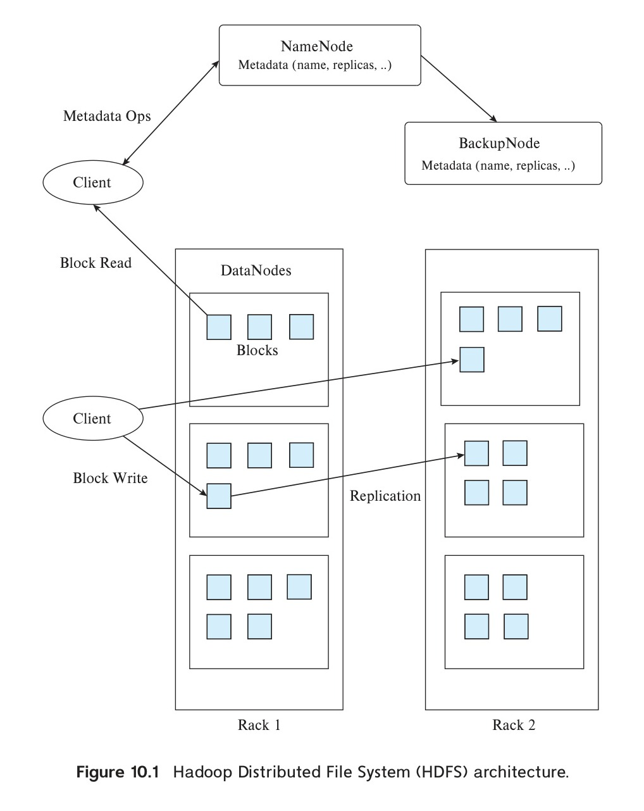
*Figure 10.1 — Hadoop Distributed File System (HDFS) architecture.*

<!-- Page 475 -->

a server running a machine referred to as the **NameNode**. All file system requests are sent to the NameNode. A file system client program that wants to read an existing file sends the file name (which can be a path, such as `/home/avi/book/ch10`) to the NameNode. The NameNode stores a list of block identifiers of the blocks in each file; for each block identifier, the NameNode also stores the identifiers of machines that store copies of that block. The machines that store data blocks in HDFS are called **DataNodes**.

For a file read request, the HDFS server sends back a list of block identifiers of the blocks in the file and the identifiers of the machines that contain each block. Each block is then fetched from one of the machines that store a copy of the block.

For a file write, the HDFS server creates new block identifiers and assigns each block identifier to several (usually three) machines, and returns the block identifiers and machine assignment to the client. The client then sends the block identifiers and block data to the assigned machines, which store the data.

Files can be accessed by programs by using HDFS file system APIs that are available in multiple languages, such as Java and Python; the APIs allow a program to connect to the HDFS server and access data.

An HDFS distributed file system can also be connected to the local file system of a machine in such a way that files in HDFS can be accessed as though they are stored locally. This requires providing the address of the NameNode machine, and the port on which the HDFS server listens for requests, to the local file system. The local file system recognizes which file accesses are to files in HDFS based on the file path, and sends appropriate requests to the HDFS server.

More details about distributed file system implementation may be found in Section 21.6.

### 10.2.2 Sharding

A single database system typically has sufficient storage and performance to handle all the transaction processing needs of an enterprise. However, using a single database is not sufficient for applications with millions or even billions of users, including social-media or similar web-scale applications, but also the user-facing applications of very large organizations such as large banks.

Suppose an organization has built an application with a centralized database, but needs to scale to handle more users, and the centralized database is not capable of handling the storage or processing speed requirements. A commonly used way to deal with such a situation is to partition the data across multiple databases, with a subset of users assigned to each of the databases. The term **sharding** refers to the partitioning of data across multiple databases or machines.

Partitioning is usually done on one or more attributes, referred to as **partitioning attributes**, **partitioning keys**, or **shard keys**. User or account identifiers are commonly used as partitioning keys. Partitioning can be done by defining a range of keys that each of the databases handles; for example, keys from 1 to 100,000 may be assigned to the

<!-- Page 476 -->

first database, keys from 100,001 to 200,000 to the second database, and so on. Such partitioning is called **range partitioning**. Partitioning may also be done by computing a hash function that maps a key value to a partition number; such partitioning is called **hash partitioning**. We study partitioning of data in detail in Chapter 21.

When sharding is done in application code, the application must keep track of which keys are stored on which database, and must route queries to the appropriate database. Queries that read or update data from multiple databases cannot be processed in a simple manner, since it is not possible to submit a single query that gets executed across all the databases. Instead, the application would need to read data from multiple databases and compute the final query result. Updates across databases cause further issues, which we discuss in Section 10.2.5.

While sharding performed by modifying application code provided a simple way to scale applications, the limitations of the approach soon became apparent. First, the application code has to track how data was partitioned and route queries appropriately. If a database becomes overloaded, parts of the data in that database have to be offloaded to a new database, or to one of the other existing databases; managing this process is a non-trivial task. As more databases are added, there is a greater chance of failure leading to loss of access to data. Replication is needed to ensure data is accessible despite failures, but managing the replicas, and ensuring they are consistent, poses further challenges. Key-value stores, which we study next, address some of these issues. Challenges related to consistency and availability are discussed later, in Section 10.2.5.

### 10.2.3 Key-Value Storage Systems

Many web applications need to store very large numbers (many billions or in extreme cases, trillions) of relatively small records (of size ranging from a few kilobytes to a few megabytes). Storing each record as a separate file is infeasible, since file systems, including distributed file systems, are not designed to store such large numbers of files.

Ideally, a massively parallel relational database should be used to store such data. However, it is not easy to build relational database systems that can run in parallel across a large number of machines while also supporting standard database features such as foreign-key constraints and transactions.

A number of storage systems have been developed that can scale to the needs of web applications and store large amounts of data, scaling to thousands to tens of thousands of machines, but typically offering only a simple key-value storage interface. A **key-value storage system** (or **key-value store**) is a system that provides a way to store or update a record (value) with an associated key and to retrieve the record with a given key.

Parallel key-value stores partition keys across multiple machines, and route updates and lookups to the correct machine. They also support replication, and ensure that replicas are kept consistent. Further, they provide the ability to add more machines to a system when required, and ensure that the load is automatically balanced across the machines in a system In contrast to systems that implement sharding in the application

<!-- Page 477 -->

code, systems that use a parallel key-value store do not need to worry about any of the above issues. Parallel key-value stores are therefore more widely used than sharding today.

Widely used parallel key-value stores include Bigtable from Google, Apache HBase, Dynamo from Amazon, Cassandra from Facebook, MongoDB, Azure cloud storage from Microsoft, and Sherpa/PNUTS from Yahoo!, among many others.

While several key-value data stores view the values stored in the data store as an uninterpreted sequence of bytes, and do not look at their content, other data stores allow some form of structure or schema to be associated with each record. Several such key-value storage systems require the stored data to follow a specified data representation, allowing the data store to interpret the stored values and execute simple queries based on stored values. Such data stores are called **document stores**. MongoDB is a widely used data store that accepts values in the JSON format.

Key-value storage systems are, at their core, based on two primitive functions, `put(key, value)`, used to store values with an associated key, and `get(key)`, used to retrieve the stored value associated with the specified key. Some systems, such as Bigtable, additionally provide range queries on key values. Document stores additionally support limited forms of querying on the data values.

An important motivation for the use of key-value stores is their ability to handle very large amounts of data as well as queries, by distributing the work across a cluster consisting of a large number of machines. Records are partitioned (divided up) among the machines in the cluster, with each machine storing a subset of the records and processing lookups and updates on those records.

Note that key-value stores are not full-fledged databases, since they do not provide many of the features that are viewed as standard on database systems today. Key-value stores typically do not support declarative querying (using SQL or any other declarative query language) and do not support transactions (which, as we shall see in Chapter 17, allow multiple updates to be committed atomically to ensure that the database state remains consistent despite failures, and control concurrent access to data to ensure that problems do not arise due to concurrent access by multiple transactions). Key-value stores also typically do not support retrieval of records based on selections on non-key attributes, although some document stores do support such retrieval.

An important reason for not supporting such features is that some of them are not easy to support on very large clusters; thus, most systems sacrifice these features in order to achieve scalability. Applications that need scalability may be willing to sacrifice these features in exchange for scalability.

Key-value stores are also called **NoSQL systems**, to emphasize that they do not support SQL, and the lack of support for SQL was initially viewed as something positive, rather than a limitation. However, it soon became clear that lack of database features such as transaction support and support for SQL, make application development more complicated. Thus, many key-value stores have evolved to support features, such as the SQL language and transactions.

<!-- Page 478 -->

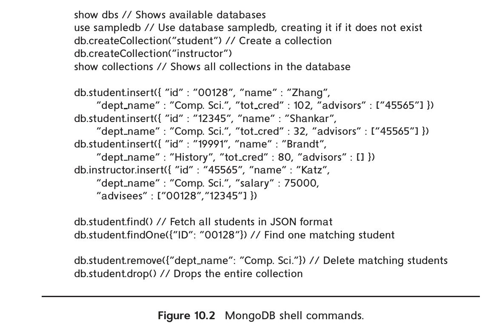
*Figure 10.2 — MongoDB shell commands.*

The APIs provided by these systems to store and access data are widely used. While the basic `get()` and `put()` functions mentioned earlier are straightforward, most systems support further features. As an example of such APIs, we provide a brief overview of the MongoDB API.

Figure 10.2 illustrates access to the MongoDB document store through a JavaScript shell interface. Such a shell can be opened by executing the `mongo` command on a system that has MongoDB installed and configured. MongoDB also provides equivalent API functions in a variety of languages, including Java and Python. The `use` command shown in the figure opens the specified database, creating it if it does not already exist. The `db.createCollection()` command is used to create collections, which store documents; a document in MongoDB is basically a JSON object. The code in the figure creates two collections, *student* and *instructor*, and inserts JSON objects representing students and instructors into the two collections.

MongoDB automatically creates identifiers for the inserted objects, which can be used as keys to retrieve the objects. The key associated with an object can be fetched using the `_id` attribute, and an index on this attribute is created by default.

MongoDB also supports queries based on the stored values. The `db.student.find()` function returns a collection of all objects in the *student* collection, while the `findOne()` function returns one object from the collection. Both functions can take as argument a JSON object that specifies a selection on desired attributes. In our example, the

<!-- Page 479 -->

student with ID 00128 is retrieved. Similarly, all objects matching such a selection can be deleted by the `remove()` function shown in the figure. The `drop()` function shown in the figure drops an entire collection.

MongoDB supports a variety of other features such as creation of indices on specified attributes of the stored JSON objects, such as the ID and name attributes.

Since a key goal of MongoDB is to enable scaling to very large data sizes and query/update loads, MongoDB allows multiple machines to be part of a single MongoDB cluster. Data are then sharded (partitioned) across these machines. We study partitioning of data across machines in detail in Chapter 21, and we study parallel processing of queries in detail in Chapter 22. However we outline key ideas in this section.

In MongoDB (as in many other databases), partitioning is done based on the value of a specified attribute, called the **partitioning attribute** or **shard key**. For example, if we specify that the *student* collection should be partitioned on the `dept_name` attribute, all objects of a particular department are stored on one machine, but objects of different departments may be stored on different machines. To ensure data can be accessed even if a machine has failed, each partition is replicated on multiple machines. This way, even if one machine fails, the data in that partition can be fetched from another machine. Requests from a MongoDB client are sent to a router, which then forwards requests to the appropriate partitions in a cluster.

Bigtable is another key-value store that requires data values to follow a format that allows the storage system access to individual parts of a stored value. In Bigtable, data values (records) can have multiple attributes; the set of attribute names is not predetermined and can vary across different records. Thus, the key for an attribute value conceptually consists of (record-identifier, attribute-name). Each attribute value is just a string as far as Bigtable is concerned. To fetch all attributes of a record, a range query, or more precisely a prefix-match query consisting of just the record identifier, is used. The `get()` function returns the attribute names along with the values. For efficient retrieval of all attributes of a record, the storage system stores entries sorted by the key, so all attribute values of a particular record are clustered together.

In fact, the record identifier can itself be structured hierarchically, although to Bigtable itself the record identifier is just a string. For example, an application that stores pages retrieved from a web crawl could map a URL of the form:

```text
www.cs.yale.edu/people/silberschatz.html
```

to the record identifier:

```text
edu.yale.cs.www/people/silberschatz.html
```

With this representation, all URLs of cs.yale.edu can be retried by a query that fetches all keys with the prefix edu.yale.cs, which would be stored in a consecutive range of key values in the sorted key order. Similarly, all URLs of yale.edu would have a prefix of edu.yale and would be stored in a consecutive range of key values.

<!-- Page 480 -->

Although Bigtable does not support JSON natively, JSON data can be mapped to the data model of Bigtable. For example, consider the following JSON data:

```json
{  "ID": "22222",
   "name": { "firstname: "Albert", "lastname: "Einstein" },
   "deptname": "Physics",
   "children": [
      {"firstname": "Hans", "lastname": "Einstein" },
      {"firstname": "Eduard", "lastname": "Einstein" } ]
}
```

The above data can be represented by a Bigtable record with identifier “22222”, with multiple attribute names such as “name.firstname”, “deptname”, “children[1].firstname” or “children[2].lastname”.

Further, a single instance of Bigtable can store data for multiple applications, with multiple tables per application, by simply prefixing the application name and table name to the record identifier.

Many data-storage systems allow multiple versions of data items to be stored. Versions are often identified by timestamp, but they may be alternatively identified by an integer value that is incremented whenever a new version of a data item is created. Lookups can specify the required version of a data item or can pick the version with the highest version number. In Bigtable, for example, a key actually consists of three parts: (record-identifier, attribute-name, timestamp). Bigtable can be accessed as a service from Google. The open-source version of Bigtable, HBase, is widely used.

### 10.2.4 Parallel and Distributed Databases

Parallel databases are databases that run on multiple machines (together referred to as a cluster) and are designed to store data across multiple machines and to process large queries using multiple machines. Parallel databases were initially developed in the 1980s, and thus they predate the modern generation of Big Data systems. From a programmer viewpoint, parallel databases can be used just like databases running on a single machine.

Early generation parallel databases designed for transaction processing supported only a few machines in a cluster, while those designed to process large analytical queries were designed to support tens to hundreds of machines. Data are replicated across multiple machines in a cluster, to ensure that data are not lost, and they continue to be accessible, even if a machine in a cluster fails. Although failures do occur and need to be dealt with, failures during the processing of a query are not common in systems with tens to hundreds of machines. If a query was being processed on a node that failed, the query is simply restarted, using replicas of data that are on other nodes.

If such database systems are run on clusters with thousands of machines, the probability of failure during execution of a query increases significantly for queries that process a large amount of data and consequently run for a long time. Restarting a query in

<!-- Page 481 -->

the event of a failure is no longer an option, since there is a fairly high probability that a failure will happen yet again while the query is executing. Techniques to avoid complete restart, allowing only computation on the failed machines to be redone, were developed in the context of map-reduce systems, which we study in Section 10.3. However, these techniques introduce significant overhead; given the fact that computation spanning thousands to tens of thousands of nodes is needed only by some exceptionally large applications, even today most parallel relational database systems target applications that run on tens to hundreds of machines and just restart queries in the event of failure.

Query processing in such parallel and distributed databases is covered in detail in Chapter 22, while transaction processing in such databases is covered in Chapter 23.

### 10.2.5 Replication and Consistency

Replication is key to ensuring availability of data, ensuring a data item can be accessed despite failure of some of the machines storing the data item. Any update to a data item must be applied to all replicas of the data item. As long as all the machines containing the replicas are up and connected to each other, applying the update to all replicas is straightforward.

However, since machines do fail, there are two key problems. The first is how to ensure atomic execution of a transaction that updates data at more than one machine: the transaction execution is said to be atomic if despite failures, either all the data items updated by the transaction are successfully updated, or all the data items are reverted back to their original values. The second problem is, how to perform updates on a data item that has been replicated, when some of the replicas of the data item are on a machine that has failed. A key requirement here is consistency, that is, all live replicas of a data item have the same value, and each read sees the latest version of the data item. There are several possible solutions, which offer different degrees of resilience to failures. We study solutions to the both these problems in Chapter 23.

We note that the solutions to the second problem typically require that a majority of the replicas are available for reading and update. If we had 3 replicas, this would require not more than 1 fail, but if we had 5 replicas, even if two machines fail we would still have a majority of replicas available. Under these assumptions, writes will not get blocked, and reads will see the latest value for any data item.

While the probability of multiple machines failing is relatively low, network link failures can cause further problems. In particular, a network partition is said to occur if two live machines in a network are unable to communicate with each other.

It has been shown that no protocol can ensure availability, that is, the ability to read and write data, while also guaranteeing consistency, in the presence of network partitions. Thus, distributed systems need to make tradeoffs: if they want high availability, they need to sacrifice consistency, for example by allowing reads to see old values of data items, or to allow different replicas to have different values. In the latter case, how to bring the replicas to a common value by merging the updates is a task that the

<!-- Page 482 -->

application has to deal with. Some applications, or some parts of an application, may choose to prioritize availability over consistency. But other applications, or some parts of an application, may choose to prioritize consistency even at the cost of potential non-availability of the system in the event of failures. The above issues are discussed in more detail in Chapter 23.

> ### Note 10.1 Building Scalable Database Applications
>
> When faced with the task of creating a database application that can scale to a very large number of users, application developers typically have to choose between a database system that runs on a single server, and a key-value store that can scale by running on a large number of servers. A database that supports SQL and atomic transactions, and at the same time is highly scalable, would be ideal; as of 2018, Google Cloud Spanner, which is only available on the cloud, and the recently developed open source database CockroachDB are the only such databases.
>
> Simple applications can be written using only key-value stores, but more complex applications benefit greatly from having SQL support. Application developers therefore typically use a combination of parallel key-value stores and databases.
>
> Some relations, such as those that store user account and user profile data are queried frequently, but with simple select queries on a key, typically on the user identifier. Such relations are stored in a parallel key-value store. In case select queries on other attributes are required, key-value stores that support indexing on attributes other than the primary key, such as MongoDB, could still be used.
>
> Other relations that are used in more complex queries are stored in a relational database that runs on a single server. Databases running on a single server do exploit the availability of multiple cores to execute transactions in parallel, but are limited by the number of cores that can be supported in a single machine.
>
> Most relational databases support a form of replication where update transactions run on only one database (the primary), but the updates are propagated to replicas of the database running on other servers. Applications can execute read-only queries on these replicas, but with the understanding that they may see data that is a few seconds behind in time, as compared to the primary database. Offloading read-only queries from the primary database allows the system to handle a load larger than what a single database server can handle.
>
> In-memory caching systems, such as memcached or Redis, are also used to get scalable read-only access to relations stored in a database. Applications may store some relations, or some parts of some relations, in such an in-memory cache, which may be replicated or partitioned across multiple machines. Thereby, applications can get fast and scalable read-only access to the cached data. Updates must however be performed on the database, and the application is responsible for updating the cache whenever the data is updated on the database.

<!-- Page 483 -->

## 10.3 The MapReduce Paradigm

The MapReduce paradigm models a common situation in parallel processing, where some processing, identified by the `map()` function, is applied to each of a large number of input records, and then some form of aggregation, identified by the `reduce()` function, is applied to the result of the `map()` function. The `map()` function is also permitted to specify grouping keys, such that the aggregation specified in the `reduce()` function is applied within each group, identified by the grouping key, of the `map()` output. We examine the MapReduce paradigm, and the `map()` and `reduce()` functions in detail, in the rest of this section.

The MapReduce paradigm for parallel processing has a long history, dating back several decades, in the functional programming and parallel processing community (the map and reduce functions were supported in the Lisp language, for example).

### 10.3.1 Why MapReduce?

As a motivating example for the use of the MapReduce paradigm, we consider the following word count application, which takes a large number of files as input, and outputs a count of the number of times each word appears, across all the files. Here, the input would be in the form of a potentially large number of files stored in a directory.

We start by considering the case of a single file. In this case, it is straightforward to write a program that reads in the words in the file and maintains an in-memory data structure that keeps track of all the words encountered so far, along with their counts. The question is, how to extend the above algorithm, which is sequential in nature, to an environment where there are tens of thousands of files, each containing tens to hundreds of megabytes of data. It is infeasible to process such a large volume of data sequentially.

One solution is to extend the above scheme by coding it as a parallel program that would run across many machines with each machine processing a part of the files. The counts computed locally at each machine must then be combined to get the final counts. In this case, the programmer would be responsible for all the “plumbing” required to start up jobs on different machines, coordinate them, and to compute the final answer. In addition, the “plumbing” code must also deal with ensuring completion of the program in spite of machine failures; failures are quite frequent when the number of participating machines is large, such as in the thousands, and the program runs for a long duration.

The “plumbing” code to implement the above requirements is quite complex; it makes sense to write it just once and reuse it for all desired applications.

MapReduce systems provide the programmer a way of specifying the core logic needed for an application, with the details of the earlier-mentioned plumbing handled by the MapReduce system. The programmer needs to provide only `map()` and `reduce()` functions, plus optionally functions for reading and writing data. The `map()` and `reduce()` functions provided by the programmer are invoked on the data by the MapRe-

<!-- Page 484 -->

duce system to process data in parallel. The programmer does not need to be aware of the plumbing or its complexity; in fact, she can for the most part ignore the fact that the program is to be executed in parallel on multiple machines.

The MapReduce approach can be used to process large amounts of data for a variety of applications. The above-mentioned word count program is a toy example of a class of text and document processing applications. Consider, for example, search engines which take keywords and return documents containing the keywords. MapReduce can, for example, be used to process documents and create text indices, which are then used to efficiently find documents containing specified keywords.

### 10.3.2 MapReduce By Example 1: Word Count

Our word count application can be implemented in the MapReduce framework using the following functions, which we defined in pseudocode. Note that our pseudocode is not in any specific programming language; it is intended to introduce concepts. We describe how to write MapReduce code in specific languages in later sections.

1. In the MapReduce paradigm, the `map()` function provided by the programmer is invoked on each input record and emits zero or more output data items, which are then passed on to the `reduce()` function. The first question is, what is a record? MapReduce systems provide defaults, treating each line of each input file as a record; such a default works well for our word count application, but the programmers are allowed to specify their own functions to break up input files into records.
   
   For the word count application, the `map()` function could break up each record (line) into individual words and output a number of records, each of which is a pair `(word, count)`, where `count` is the number of occurrences of the word in the record. In fact in our simplified implementation, the `map()` function does even less work and outputs each word as it is found, with a count of 1. These counts are added up later by the `reduce()`. Pseudocode for the `map()` function for the word count program is shown in Figure 10.3.
   
   The function breaks up the record (line) into individual words.[^2] As each word is found, the `map()` function emits (outputs) a record `(word, 1)`. Thus, if the file contained just the sentence:
   
   > “One a penny, two a penny, hot cross buns.”
   
   the records output by the `map()` function would be
   
   > (“one”, 1), (“a”, 1), (“penny”, 1),(“two”, 1), (“a”, 1), (“penny”, 1), (“hot”, 1), (“cross”, 1), (“buns”, 1).

[^2]: We omit details of how a line is broken up into words. In a real implementation, non-alphabet characters would be removed, and uppercase characters mapped to lowercase, before breaking up the line based on spaces to generate a list of words.

<!-- Page 485 -->

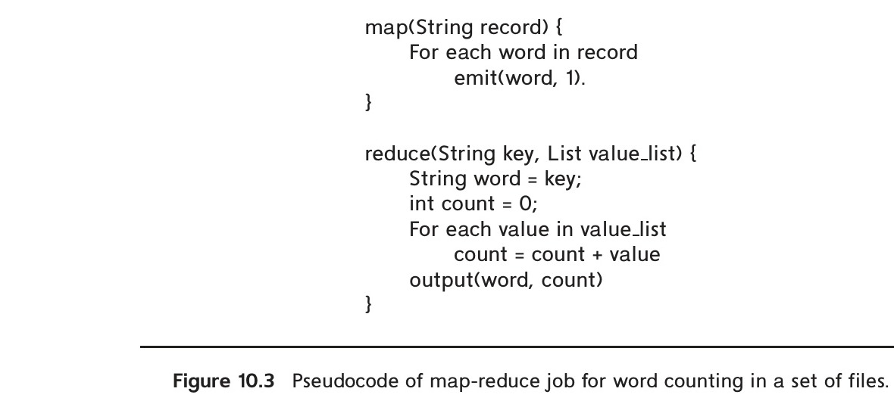
*Figure 10.3 — Pseudocode of map-reduce job for word counting in a set of files.*

In general, the `map()` function outputs a set of `(key, value)` pairs for each input record. The first attribute (key) of the `map()` output record is referred to as a **reduce key**, since it is used by the reduce step, which we study next.

2. The MapReduce system takes all the `(key, value)` pairs emitted by the `map()` functions and sorts (or at least, groups them) such that all records with a particular key are gathered together. All records whose keys match are grouped together, and a list of all the associated values is created. The `(key, list)` pairs are then passed to the `reduce()` function.
   
   In our word count example, each key is a word, and the associated list is a list of counts generated for different lines of different files. With our example data, the result of this step is the following:
   
   > (“a”, [1,1]), (“buns”, [1]) (“cross”, [1]), (“hot”, [1]), (“one”, [1]), (“penny”, [1,1]), (“two”, [1])
   
   The `reduce()` function for our example combines the list of word counts by adding the counts, and outputs `(word, total-count)` pairs. For the example input, the records output by the `reduce()` function would be as follows:
   
   > (“one”, 1), (“a”, 2), (“penny”, 2), (“two”, 1), (“hot”, 1), (“cross”, 1), (“buns”, 1).
   
   Pseudocode for the `reduce()` function for the word count program is shown in Figure 10.3. The counts generated by the `map()` function are all 1, so the `reduce()` function could have just counted the number of values in the list, but adding up the values allows some optimizations that we will see later.

A key issue here is that with many files, there may be many occurrences of the same word across different files. Reorganizing the outputs of the `map()` functions

<!-- Page 486 -->

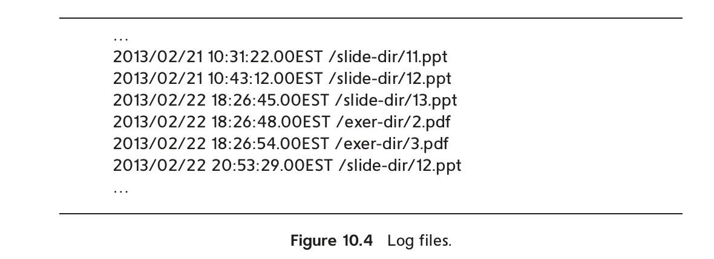
*Figure 10.4 — Log files.*

is required to bring all the values for a particular key together. In a parallel system with many machines, this requires data for different reduce keys to be exchanged between machines, so all the values for any particular reduce key are available at a single machine. This work is done by the **shuffle step**, which performs data exchange between machines and then sorts the `(key, value)` pairs to bring all the values for a key together. Observe in our example that the words have actually been sorted alphabetically. Sorting the output records from the `map()` is one way for the system to collect all occurrences of a word together; the lists for each word are created from the sorted records.

By default, the output of the `reduce()` function is sent to one or more files, but MapReduce systems allow programmers to control what happens to the output.

### 10.3.3 MapReduce by Example 2: Log Processing

As another example of the use of the MapReduce paradigm, which is closer to traditional database query processing, suppose we have a log file recording accesses to a web site, which is structured as shown in Figure 10.4. The goal of our file access count application is to find how many times each of the files in the slide-dir directory was accessed between 2013/01/01 and 2013/01/31. The application illustrates one of a variety of kinds of questions an analyst may ask using data from web log files.

For our log-file processing application, each line of the input file can be treated as a record. The `map()` function would do the following: it would first break up the input record into individual fields, namely date, time, and filename. If the date is in the required date range, the `map()` function would emit a record `(filename, 1)`, which indicates that the filename appeared once in that record. Pseudocode for the `map()` function for this example is shown in Figure 10.5.

The shuffle step brings all the values for a particular reduce key (in our case, a file name) together as a list. The `reduce()` function provided by the programmer, shown in Figure 10.6, is then invoked for each reduce key value. The first argument of `reduce()` is the reduce key itself, while the second argument is a list containing the values in the

<!-- Page 487 -->

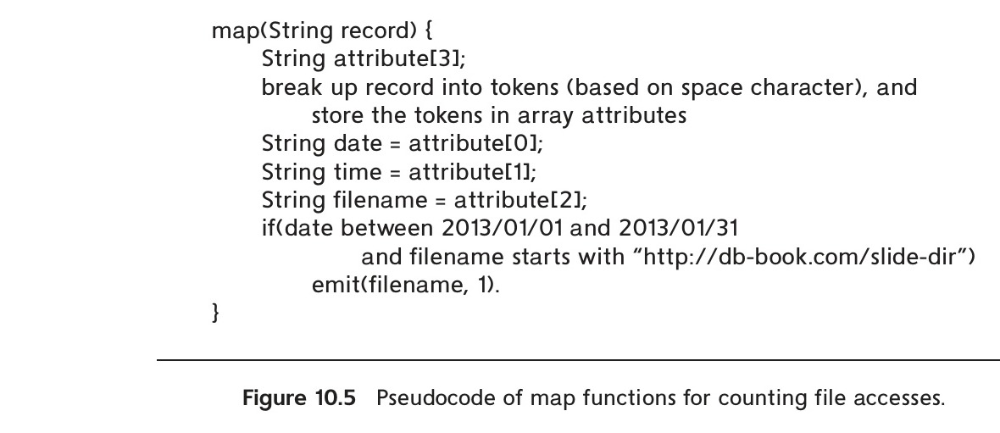
*Figure 10.5 — Pseudocode of map functions for counting file accesses.*

records emitted by the `map()` function for that reduce key. In our example, the values for a particular key are added to get the total number of accesses for a file. This number is then output by the `reduce()` function.

If we were to use the values generated by the `map()` function, the values would be “1” for all emitted records, and we could have just counted the number of elements in the list. However, MapReduce systems support optimizations such as performing a partial addition of values from each input file, before they are redistributed. In that case, the values received by the `reduce()` function may not necessarily be ones, and we therefore add the values.

Figure 10.7 shows a schematic view of the flow of keys and values through the `map()` and `reduce()` functions. In the figure the $mk_i$’s denote map keys, $mv_i$’s denote map input values, $rk_i$’s denote reduce keys, and $rv_i$’s denote reduce input values. Reduce outputs are not shown.

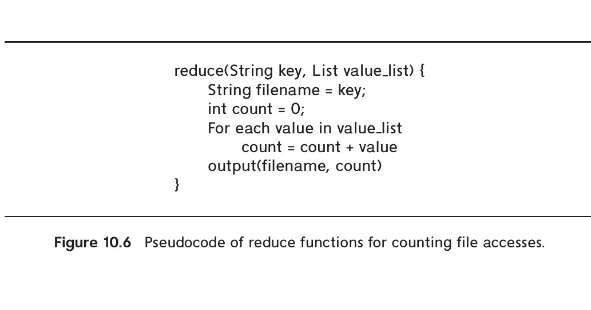
*Figure 10.6 — Pseudocode of reduce functions for counting file accesses.*

<!-- Page 488 -->

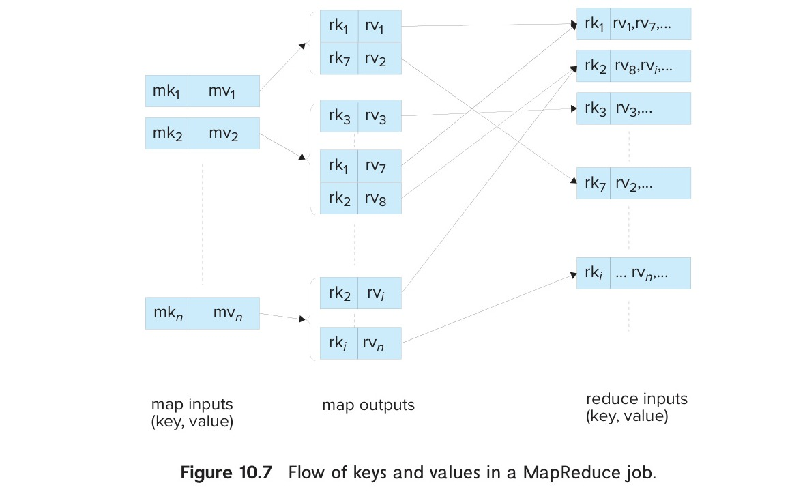
*Figure 10.7 — Flow of keys and values in a MapReduce job.*

### 10.3.4 Parallel Processing of MapReduce Tasks

Our description of the `map()` and `reduce()` functions so far has ignored the issue of parallel processing. We can understand the meaning of MapReduce code without considering parallel processing. However, our goal in using the MapReduce paradigm is to enable parallel processing. Thus, MapReduce systems execute the `map()` function in parallel on multiple machines, with each map task processing some part of the data, for example some of the files, or even parts of a file in case the input files are very large. Similarly, the `reduce()` functions are also executed in parallel on multiple machines, with each reduce task processing a subset of the reduce keys (note that a particular call to the `reduce()` function is still for a single reduce key).

Parallel execution of map and reduce tasks is shown pictorially in Figure 10.8. In the figure, the input file partitions, denoted as Part $i$, could be files or parts of files. The nodes denoted as Map $i$ are the map tasks, and the nodes denoted Reduce $i$ are the reduce tasks. The master node sends copies of the `map()` and `reduce()` code to the map and reduce tasks. The map tasks execute the code and write output data to local files on the machines where the tasks are executed, after being sorted and partitioned based on the reduce key values; separate files are created for each reduce task at each Map node. These files are fetched across the network by the reduce tasks; the files fetched by a reduce task (from different map tasks) are merged and sorted to ensure that all occurrences of a particular reduce key are together in the sorted file. The reduce keys and values are then fed to the `reduce()` functions.

<!-- Page 489 -->

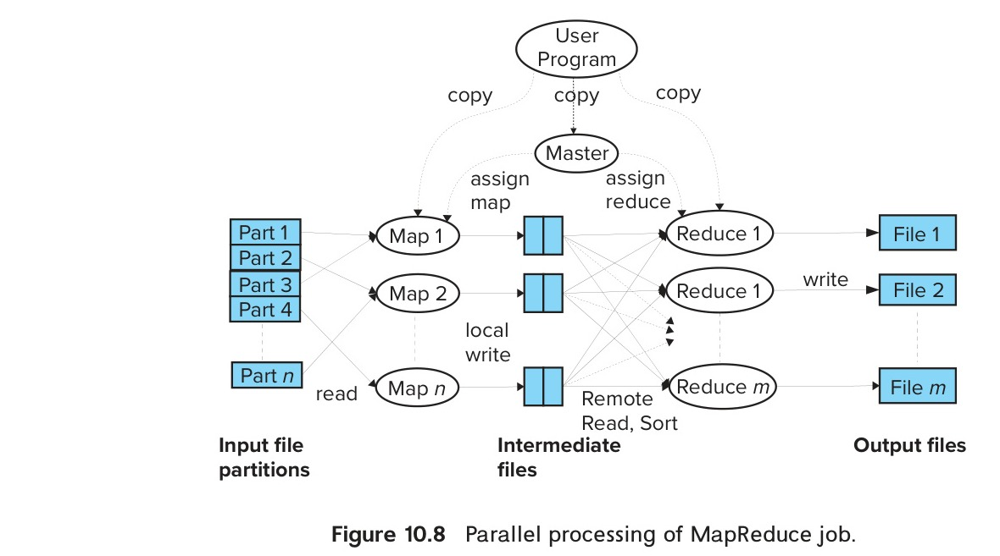
*Figure 10.8 — Parallel processing of MapReduce job.*

MapReduce systems also need to parallelize file input and output across multiple machines; otherwise the single machine storing the data will become a bottleneck. Parallelization of file input and output can be done by using a distributed file system, such as the Hadoop File System (HDFS). As we saw in Section 10.2, distributed file systems allow a number of machines to cooperate in storing files, partitioning the files across the machines. Further, file system data are replicated (copied) across several (typically three) machines, so that even if a few of the machines fail, the data are available from other machines which have copies of the data in the failed machine.

Today, in addition to distributed file systems such as HDFS, MapReduce systems support input from a variety of Big Data storage systems such as HBase, MongoDB, Cassandra, and Amazon Dynamo, by using storage adapters. Output can similarly be sent to any of these storage systems.

### 10.3.5 MapReduce in Hadoop

The Hadoop project provides a widely used open-source implementation of MapReduce in the Java language. We summarize its main features here using the Java API provided by Hadoop. We note that Hadoop provides MapReduce APIs in several other languages, such as Python and C++.

Unlike our MapReduce pseudocode, real implementations such as Hadoop require types to be specified for the input keys and values, as well as the output keys and value, of the `map()` function. Similarly, the types of the input as well as output keys and values of the `reduce()` function need to be specified. Hadoop requires the programmer to implement `map()` and `reduce()` functions as member functions of classes that extend Hadoop `Mapper` and `Reducer` classes. Hadoop allows the programmer to provide

<!-- Page 490 -->

functions to break up the file into records, or to specify that the file is one of the file types for which Hadoop provides built-in functions to break up files into records. For example, the `TextInputFormat` specifies that the file should be broken up into lines, with each line being a separate record. Compressed file formats are widely used today, with Avro, ORC, and Parquet being the most widely used compressed file formats in the Hadoop world (compressed file formats are discussed in Section 13.6). Decompression is done by the system, and a programmer writing a query need only specify one of the supported types, and the uncompressed representation is made available to the code implementing the query.

Input files in Hadoop can come from a file system of a single machine, but for large datasets, a file system on a single machine would become a performance bottleneck. Hadoop MapReduce allows input and output files to be stored in a distributed file system such as HDFS, allowing multiple machines to read and write data in parallel.

In addition to the `reduce()` function, Hadoop also allows the programmer to define a `combine()` function, which can perform a part of the `reduce()` operation at the node where the `map()` function is executed. In our word count example, the `combine()` function would be the same as the `reduce()` function we saw earlier. The `reduce()` function would then receive a list of partial counts for a particular word; since the `reduce()` function for word count adds up the values, it would work correctly even with the `combine()` function. One benefit of using the `combine()` function is that it reduces the amount of data that has to be sent over the network: each node that runs map tasks would send only one entry for a word across the network, instead of multiple entries.

A single MapReduce step in Hadoop executes a map and a reduce function. A program may have multiple MapReduce steps, with each step having its own map and reduce functions. The Hadoop API allows a program to execute multiple such MapReduce steps. The `reduce()` output from each step is written to the (distributed) file system and read back in the following step. Hadoop also allows the programmer to control the number of map and reduce tasks to be run in parallel for the job.

The rest of this section assumes a basic knowledge of Java (you may skip the rest of this section without loss of continuity, if you are not familiar with Java).

Figure 10.9 shows the Java implementation in Hadoop of the word count application we saw earlier. For brevity we have omitted Java import statements. The code defines two classes, one that implements the `Mapper` interface, and another that implements the `Reducer` interface. The `Mapper` and `Reducer` classes are generic classes which take as arguments the types of the keys and values. Specifically, the generic `Mapper` and `Reducer` interfaces both takes four type arguments that specify the types of the input key, input value, output key, and output value, respectively.

The type definition of the `Map` class in Figure 10.9, which implements the `Mapper` interface, specifies that the map key is of type `LongWritable`, is basically a long integer, and the value which is (all or part of) a document is of type `Text`. The output of map has a key of type `Text`, since the key is a word, while the value is of type `IntWritable`, which is an integer value.

<!-- Page 491 -->

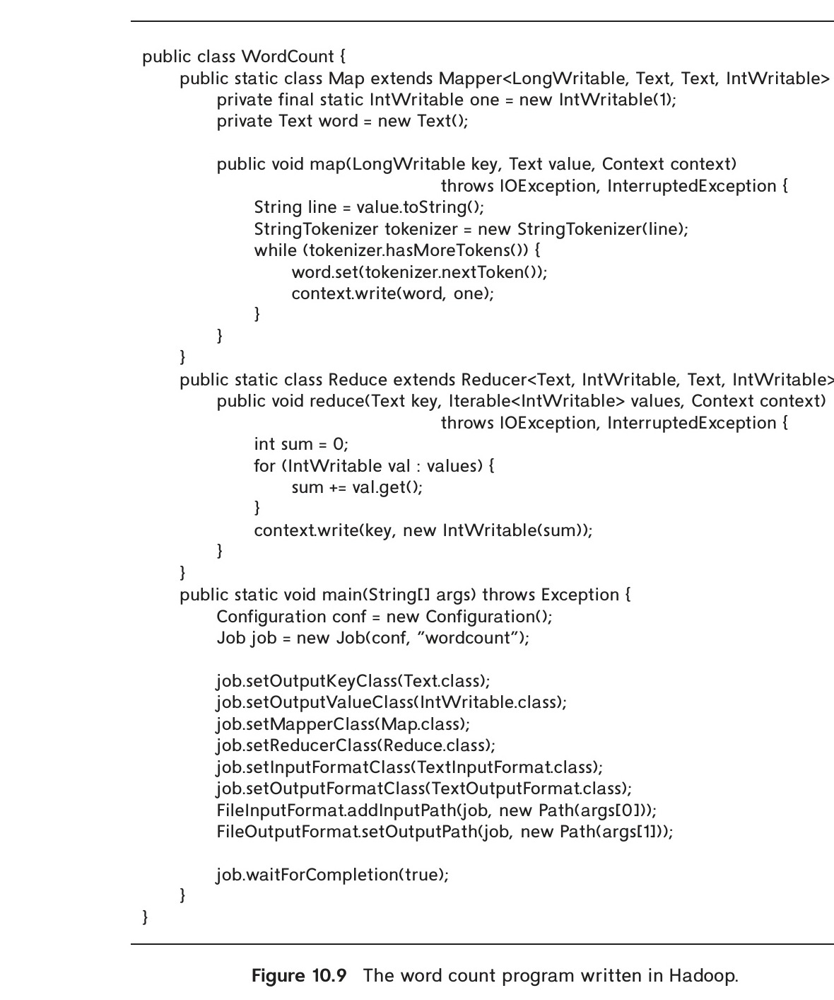
*Figure 10.9 — The word count program written in Hadoop.*

The `map()` code for the word count example breaks up the input text value into words using `StringTokenizer`, and then for each word, it invokes `context.write(word,`

<!-- Page 492 -->

`one)` to output a key and value pair; note that `one` is an `IntWritable` object with numeric value 1.

All the values output by the `map()` invocations that have a particular key (word, in our example) are collected in a list by the MapReduce system infrastructure. Doing so requires interchange of data from multiple map tasks to multiple reduce tasks; in a distributed setting, the data would have to be sent over the network. To ensure that all values for a particular key come together, the MapReduce system typically sorts the keys output by the map functions, ensuring all values for a particular key will come together in the sorted order. This list of values for each key is provided to the `reduce()` function.

The type of the `reduce()` input key is the same as the type of the map output key. The `reduce()` input value in our example is a Java `Iterable<IntWritable>` object, which contains a list of map output values (`IntWritable` is the type of the map output value). The output key for `reduce()` is a word, of type `Text`, while the output value is a word count, of type `IntWritable`.

In our example, the `reduce()` simply adds up the values it receives in its input to get the total count; `reduce()` writes the word and the total count using the `context.write()` function.

Note that in our simple example, the values are all 1, so `reduce()` just needs to count the number of values it receives. In general, however, Hadoop allows the programmer to declare a `Combiner` class, whose `combine()` function is run on the output of a single map job; the output of this function replaces multiple `map()` output values for a single key with a single value. In our example, a `combine()` function could just count the number of occurrences of each word and output a single value, which is the local word count at the map task. These outputs are then passed on to the `reduce()` function, which would add up the local counts to get the overall count. The Combiner’s job is to reduce the traffic over the network.

A MapReduce job runs a map and a reduce step. A program may have multiple MapReduce steps, and each step would have its own settings for the map and reduce functions. The `main()` function sets up the parameters for each MapReduce job, and then executes it.

The example code in Figure 10.9 executes a single MapReduce job; the parameters for the job are as follows:

- The classes that contain the map and reduce functions for the job, set by the methods `setMapperClass` and `setReducerClass`.
- The types of the job’s output key and values, set to `Text` (for the words) and `IntWritable` (for the count), respectively, by methods `setOutputKeyClass` and `setOutputValueClass`, respectively.
- The input format of the job, set to `TextInputFormat` by the method `job.setInputFormatClass`. The default input format in Hadoop is the `TextInputFormat`, which creates a map key whose value is a byte offset into the file, and the

<!-- Page 493 -->

map value is the contents of one line of the file. Since files are allowed to be bigger than 4 gigabytes, the offset is of type `LongWritable`. Programmers can provide their own implementations for the input format class, which would process input files and break the files into records, each record having a key and a value.

The output format of the job is set to `TextOutputFormat` by the method `job.setOutputFormatClass`, and the input and output directories are set by `FileInputFormat.addInputPath` and `FileOutputFormat.setOutputPath`.

The Hadoop MapReduce engine takes care of executing the map and reduce tasks in parallel, while ensuring that the tasks are rerun if any of the machines on which they are running fail. Hadoop MapReduce allows the programmer to control the number of map and reduce tasks to be run in parallel for the job and the amount of memory to be allocated to each map and reduce task, among many others.

### 10.3.6 SQL on MapReduce

Many of the applications of MapReduce are for parallel processing of large amounts of non-relational data, using computations that cannot be expressed easily in SQL. For example, our word count program cannot be expressed easily in SQL. There are many real-world uses of MapReduce that cannot be expressed in SQL. Examples include computation of “inverted indices” which are key for web search engines to efficiently answer keyword queries, and computation of Google’s PageRank, which is an important measure of the importance of web sites, and is used to rank answers to web search queries.

However, there are a large number of applications that have used the MapReduce paradigm for data processing of various kinds, whose logic can be easily expressed using SQL. If the data were in a database, it would make sense to write such queries using SQL and execute the queries on a parallel database system (parallel database systems are discussed in detail in Chapter 22. Using SQL is much easier for users than is coding in the MapReduce paradigm. However, the data for many such applications reside in a file system, and there are significant time and space overhead demands when loading them into a database.

Relational operations can be implemented using map and reduce steps, as illustrated by the following examples:

- The relational selection operation can be implemented by a single `map()` function, without a `reduce()` function (or with a `reduce()` function that simply outputs its inputs, without any change).
- The relational group by and aggregate function $\gamma$ can be implemented using a single MapReduce step: the `map()` outputs records with the group by attribute values as the reduce key; the `reduce()` function receives a list of all the attribute values for a particular group by key and computes the required aggregate on the values in its input list.

<!-- Page 494 -->

- A join operation can be implemented using a single MapReduce step, Consider the equijoin operation $r \bowtie_{r.A=s.A} s$. We define a `map()` function which for each input record $r_i$ outputs a pair $(r_i.A, r_i)$, and similarly for each input record $s_i$ outputs a pair $(s_i.A, s_i)$; the map output also includes a tag to indicate which relation ($r$ or $s$) the output came from. The `reduce()` function is invoked for each join-attribute value, with a list of all the $r_i$ and $s_i$ records with that join-attribute value. The function separates out the $r$ and $s$ tuples, and then outputs a cross products of the $r$ tuples and the $s$ tuples, since all of them have the same value for the join attribute.

We leave details as an exercise to the reader (Exercise 10.4). More complex tasks, for example a query with multiple operations, can be expressed using multiple stages of map and reduce tasks.

While it is indeed possible for relational queries to be expressed using the MapReduce paradigm, it can be very cumbersome for a human to do so. Writing queries in SQL is much more concise and easy to understand, but traditional databases did not allow data access from files, nor did they support parallel processing of such queries.

A new generation of systems have been developed that allows queries written in (variants of) the SQL language to be executed in parallel on data stored in file systems. These systems include Apache Hive (which was initially developed at Facebook), SCOPE, which developed by Microsoft, both of which use variants of SQL, and Apache Pig (which was initially developed at Yahoo!), which uses a declarative language called Pig Latin, based on the relational algebra. All these systems allow data to be read directly from the file system but allow the programmer to define functions that convert the input data to a record format.

All these systems generate a program containing a sequence of map and reduce tasks to execute a given query. The programs are compiled and executed on a MapReduce framework such as Hadoop. These systems became very popular, and far more queries are written using these systems today than are written directly using the MapReduce paradigm.

Today, Hive implementations provide an option of compiling SQL code to a tree of algebraic operations that are executed on a parallel environment. Apache Tez and Spark are two widely used platforms that support the execution of a tree (or DAG) of algebraic operations on a parallel environment, which we study next in Section 10.4.

## 10.4 Beyond MapReduce: Algebraic Operations

Relational algebra forms the foundation of relational query processing, allowing queries to be modeled as trees of operations. This idea is extended to settings with more complex data types by supporting algebraic operators that can work on datasets containing records with complex data types, and returning datasets with records containing similar complex data types.

<!-- Page 495 -->

### 10.4.1 Motivation for Algebraic Operations

As we saw in Section 10.3.6, relational operations can be expressed by a sequence of map and reduce steps. Expressing tasks in such as fashion can be quite cumbersome. For example, if programmers need to compute the join of two inputs, they should be able to express it as a single algebraic operation, instead of having to express it indirectly via map and reduce functions. Having access to functions such as joins can greatly simplify the job of a programmer.

The join operation can be executed in parallel, using a variety of techniques that we will see later in Section 22.3. In fact, doing so can be much more efficient than implementing the join using map and reduce functions. Thus, even systems like Hive, where programmers do not directly write MapReduce code, can benefit from direct support for operations such as join.

Later-generation parallel data-processing systems therefore added support for other relational operations such as joins (including variants such as outerjoins and semijoins), as well as a variety of other operations to support data analytics. For example, many machine-learning models can be modeled as operators that take a set of records as input then output a set of records that have an extra attribute containing the value predicted by the model based on the other attributes of the record. Machine-learning algorithms can themselves be modeled as operators that take a set of training records as input and output a learned model. Processing of data often involves multiple steps, which can be modeled as a sequence (pipeline) or tree of operators.

A unifying framework for these operations is to treat them as algebraic operations that take one or more datasets as inputs and output one or more datasets.

Recall that in the relational algebra (Section 2.6) each operation takes one or more relations as input, and outputs a relation. These later-generation parallel query-processing systems are based on the same idea, but there are several differences. A key difference is that the input data could be of arbitrary types, instead of just consisting of columns with atomic data types as in the relational model. Recall that the extended relational algebra required to support SQL could restrict itself to simple arithmetic, string, and boolean expressions. In contrast, the new-generation algebraic operators need to support more complex expressions, requiring the full power of a programming language.

There are a number of frameworks that support algebraic operations on complex data; the most widely used ones today are Apache Tez and Apache Spark.

Apache Tez provides a low-level API which is suitable for system implementors. For example, Hive on Tez compiles SQL queries into algebraic operations that run on Tez. Tez programmers can create trees (or in general Directed Acyclic Graphs, or DAGs) of nodes, and they provide code that is to be executed on each of the nodes. Input nodes would read in data from data sources and pass them to other nodes, which operate on the data. Data can be partitioned across multiple machines, and the code for each node can be executed on each of the machines. Since Tez is not really designed for application programmers to use directly, we do not describe it in further detail.

<!-- Page 496 -->

However, Apache Spark provides higher-level APIs which are suitable for application programmers. We describe Spark in more detail next.

### 10.4.2 Algebraic Operations in Spark

Apache Spark is a widely used parallel data processing system that supports a variety of algebraic operations. Data can be input from or output to a variety of storage systems.

Just as relational databases use a relation as the primary abstraction for data representation, Spark uses a representation called a **Resilient Distributed Dataset (RDD)**, which is a collection of records that can be stored across multiple machines. The term *distributed* refers to the records being stored on different machines, and *resilient* refers to the resilience to failure, in that even if one of the machines fails, records can be retrieved from other machines where they are stored.

Operators in Spark take one or more RDDs as input, and their output is an RDD. The types of records stored in RDDs is not predefined and can be anything that the application desires. Spark also supports a relational data representation called a DataSet, which we describe later.

Spark provides APIs for Java, Scala, and Python. Our coverage of Spark is based on the Java API.

Figure 10.10 shows our word count application, written in Java using Apache Spark; this program uses the RDD data representation, whose Java type is called `JavaRDD`. Note that JavaRDDs require a type for the record, specified in angular brackets (“<>”). In the program we have RDDs of Java Strings. The program also has `JavaPairRDD` types, which store records with two attributes of specified types. Records with multiple attributes can be represented by using structured data types instead of primitive data types. While any user-defined data type can be used, the predefined data types `Tuple2` which stores two attributes, `Tuple3`, which stores three attributes, and `Tuple4`, which stores four attributes, are widely used.

The first step in processing data using Spark is to convert data from input representation to the RDD representation, which is done by the `spark.read().textFile()` function, which creates a record for each line in the input. Note that the input can be a file or a directory with multiple files; a Spark system running on multiple nodes will actually partition the RDD across multiple machines, although the program can treat it (for most purposes) as if it is a data structure on a single machine. In our sample code in Figure 10.10, the result is the RDD called `lines`.

The next step in our Spark program is to split each line into an array of words, by calling `s.split(" ")` on the line; this function breaks up the line based on spaces and returns an array of words; a more complete function would split the input on other punctuation characters such as periods, semicolons, and so on. The split function can be invoked on each line in the input RDD by calling the `map()` function, which in Spark returns a single record for each input record. In our example, we instead use a variant called `flatMap()`, which works as follows: like `map()`, `flatMap()` invokes a user-defined

<!-- Page 497 -->

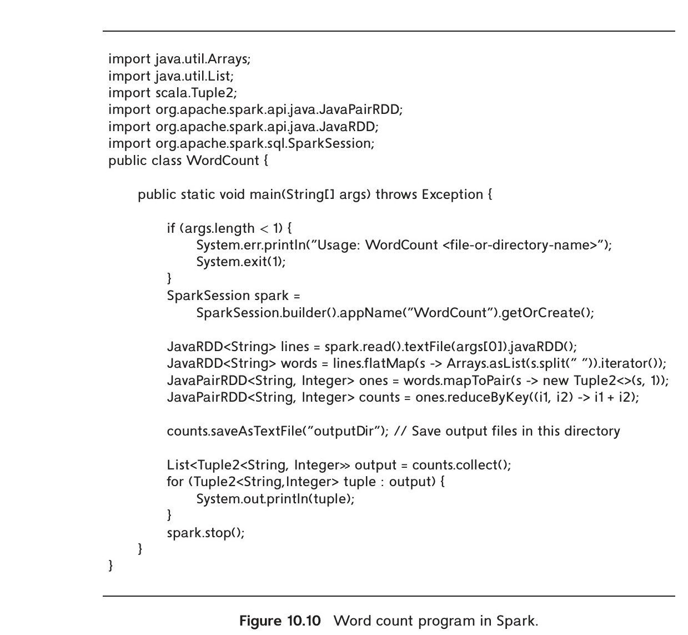
*Figure 10.10 — Word count program in Spark.*

```java
import java.util.Arrays;
import java.util.List;
import scala.Tuple2;
import org.apache.spark.api.java.JavaPairRDD;
import org.apache.spark.api.java.JavaRDD;
import org.apache.spark.sql.SparkSession;

public class WordCount {
    public static void main(String[] args) throws Exception {
        if (args.length < 1) {
            System.err.println("Usage: WordCount <file-or-directory-name>");
            System.exit(1);
        }
        SparkSession spark =
            SparkSession.builder().appName("WordCount").getOrCreate();
        JavaRDD<String> lines = spark.read().textFile(args[0]).javaRDD();
        JavaRDD<String> words = lines.flatMap(s -> Arrays.asList(s.split(" ")).iterator());
        JavaPairRDD<String, Integer> ones = words.mapToPair(s -> new Tuple2<>(s, 1));
        JavaPairRDD<String, Integer> counts = ones.reduceByKey((i1, i2) -> i1 + i2);
        counts.saveAsTextFile("outputDir"); // Save output files in this directory
        List<Tuple2<String, Integer>> output = counts.collect();
        for (Tuple2<String,Integer> tuple : output) {
            System.out.println(tuple);
        }
        spark.stop();
    }
}
```

function on each input record; the function is expected to return an iterator. A Java iterator supports a `next()` function that can be used to fetch multiple results by calling the function multiple times. The `flatMap()` function invokes the user-defined function to get an iterator, invokes the `next()` function repeatedly on the iterator to get multiple values, and then returns an RDD containing the union of all the values across all input records.

The code shown in Figure 10.10 uses the “lambda expression” syntax introduced in Java 8, which allows functions to be defined compactly, without even giving them a name; in the Java code, the syntax
```java
s -> Arrays.asList(s.split(" ")).iterator()
```

<!-- Page 498 -->

defines a function that takes a parameter `s` and returns an expression that does the following: it applies the `split` function described earlier to create an array of words, then uses `Arrays.asList` to convert the array to a list, and finally applies the `iterator()` method on the list to create an iterator. The `flatMap()` function works on this iterator as described earlier.

The result of the above steps is an RDD called `words`, where each record contains a single word.

The next step is to create a `JavaPairRDD` called `ones`, which contains pairs of the form “(word, 1)” for each word in `words`; if a word appears multiple times in the input file, there would correspondingly be as many records in `words` and in `ones`.

Finally the algebraic operation `reduceByKey()` implements a group by and aggregation step. In the sample code, we specify that addition is to be used for aggregation, by passing the lambda function `(i1, i2) -> i1+i2` to the `reduceByKey()` function. The `reduceByKey()` function works on a `JavaPairRDD`, grouping by the first attribute, and aggregating the values of the second attribute using the provided lambda function. When applied on the `ones` RDD, grouping would be on the word, which is the first attribute, and the values of the second attribute (all ones, in the `ones` RDD) would be added up. The result is stored in the `JavaPairRDD` `counts`.

In general, any binary function can be used to perform the aggregation, as long as it gives the same result regardless of the order in which it is applied on a collection of values.

Finally, the `counts` RDD is stored to the file system by `saveAsTextFile()`. Instead of creating just one file, the function creates multiple files if the RDD itself is partitioned across machines.

Key to understanding how parallel processing is achieved is to understand that
• RDDs may be partitioned and stored on multiple machines, and
• each operation may be executed in parallel on multiple machines, on the RDD partition available at the machine. Operations may first repartition their input, to bring related records to the same machine before executing operations in parallel. For example, `reduceByKey()` would repartition the input RDD to bring all records belonging to a group together on a single machine; records of different groups may be on different machines.

Another important aspect of Spark is that the algebraic operations are not necessarily evaluated immediately on the function call, although the code seems to imply that this is what happens. Instead, the code shown in the figure actually creates a tree of operations; in our code, the leaf operation `textFile()` reads data from a file; the next operation `flatMap()` has the `textFile()` operation as its child; the `mapToPairs()` in turn has `flatMap()` as child, and so on. The operators can be thought of in relational terms as defining views, which are not executed as soon as they are defined but get executed later.

<!-- Page 499 -->

The entire tree of operations actually get evaluated only when certain operations demand that the tree be evaluated. For example, `saveAsTextFile()` forces the tree to be evaluated; other such functions include `collect()`, which evaluates the tree and brings all records to a single machine, where they can subsequently be processed, for example by printing them out.

An important benefit of such lazy evaluation of the tree (i.e., the tree is evaluated when required, rather than when it is defined) is that before actual evaluation, it is possible for a query optimizer to rewrite the tree to another tree that computes the same result but may execute faster. Query optimization techniques, which we study in Chapter 16 can be applied to optimize such trees.

While the preceding example created a tree of operations, in general the operations may form a Directed Acyclic Graph (DAG) structure, if the result of an operation is consumed by more than one other operation. That would result in operations having more than one parent, leading to a DAG structure, whereas operations in a tree can have at most one parent.

While RDDs are well suited for representing certain data types such as textual data, a very large fraction of Big Data applications need to deal with structured data, where each record may have multiple attributes. Spark therefore introduced the DataSet type, which supports records with attributes. The DataSet type works well with widely used Parquet, ORC, and Avro file formats (discussed in more detail later in Section 13.6), which are designed to store records with multiple attributes in a compressed fashion. Spark also supports JDBC connectors that can read relations from a database.

The following code illustrates how data in Parquet format can be read and processed in Spark, where `spark` is a Spark session that has been opened earlier.

```java
Dataset<Row> instructor = spark.read().parquet("...");
Dataset<Row> department = spark.read().parquet("...");
instructor.filter(instructor.col("salary").gt(100000))
    .join(department, instructor.col("dept_name")
        .equalTo(department.col("dept_name")))
    .groupBy(department.col("building"))
    .agg(count(instructor.col("ID")));
```

The `DataSet<Row>` type above uses the type `Row`, which allows access to column values by name. The code reads `instructor` and `department` relations from Parquet files (whose names are omitted in the code above); Parquet files store metadata such as column names in addition to the values, which allows Spark to create a schema for the relations. The Spark code then applies a filter (selection) operation on the `instructor` relation, which retains only instructors with salary greater than 100000, then joins the result with the `department` relation on the `dept_name` attribute, performs a group by on the `building` attribute (an attribute of the `department` relation), and for each group (here, each building), a count of the number of `ID` values is computed.

<!-- Page 500 -->

The ability to define new algebraic operations and to use them in queries has been found to be very useful for many applications and has led to wide adoption of Spark. The Spark system also supports compilation of Hive SQL queries into Spark operation trees, which are then executed.

Spark also allows classes other than `Row` to be used with DataSets. Spark requires that for each attribute $Attr_k$ of the class, methods `getAttrk()` and `setAttrk()` must be defined to allow retrieval and storage of attribute values. Suppose we have created a class `Instructor`, and we have a Parquet file whose attributes match those of the class. Then we can read data from Parquet files as follows:

```java
Dataset<Instructor> instructor = spark.read().parquet("...").
    as(Encoders.bean(Instructor.class));
```

In this case Parquet provides the names of attributes in the input file, which are used to map their values to attributes of the `Instructor` class. Unlike with `Row`, where the types are not known at compile time the types of attributes of `Instructor` are known at compile time, and can be represented more compactly than if we used the `Row` type. Further, the methods of the class `Instructor` can be used to access attributes; for example, we could use `getSalary()` instead of using `col("salary")`, which avoids the runtime cost of mapping attribute names to locations in the underlying records. More information on how to use these constructs can be found on the Spark documentation available online at spark.apache.org.

Our coverage of Spark has focused on database operations, but as mentioned earlier, Spark supports a number of other algebraic operations such as those related to machine learning, which can be invoked on DataSet types.

## 10.5 Streaming Data

Querying of data can be done in an ad hoc manner—for example, whenever an analyst wants to extract some information from a database. It can also be done in a periodic manner—for example, queries may be executed at the beginning of each day to get a summary of transactions that happened on the previous day.

However, there are many applications where queries need to be executed continuously, on data that arrive in a continuous fashion. The term **streaming data** refers to data that arrive in a continuous fashion. Many application domains need to process incoming data in real time (i.e., as they arrive, with delays, if any, guaranteed to be less than some bound).

### 10.5.1 Applications of Streaming Data

Here are a few examples of streaming data, and the real-time needs of applications that use the data.

<!-- Page 501 -->

• **Stock market:** In a stock market, each trade that is made (i.e., a stock is sold by someone and bought by someone else) is represented by a tuple. Trades are sent as a stream to processing systems.

Stock market traders analyze the stream of trades to look for patterns, and they make buy or sell decisions based on the patterns that they observe. Real-time requirements in such systems used to be of the order of seconds in earlier days, but many of today’s systems require delays to be of the order of tens of microseconds (usually to be able to react before others do, to the same patterns).

Stock market regulators may use the same stream, but for a different purpose: to see if there are patterns of trades that are indicative of illegal activities. In both cases, there is a need for continuous queries that look for patterns; the results of the queries are used to carry out further actions.

• **E-commerce:** In an e-commerce site, each purchase made is represented as a tuple, and the sequence of all purchases forms a stream. Further, even the searches executed by a customer are of value to the e-commerce site, even if no actual purchase is made; thus, the searches executed by users form a stream.

These streams can be used for multiple purposes. For example, if an advertising campaign is launched, the e-commerce site may wish to monitor in real time how the campaign is affecting searches and purchases. The e-commerce site may also wish to detect any spikes in sales of specific products to which it may need to respond by ordering more of that product. Similarly, the site may wish to monitor users for patterns of activities such as frequently returning items, and block further returns or purchases by the user.

• **Sensors:** Sensors are very widely used in systems such as vehicles, buildings, and factories. These sensors send readings periodically, and thus the readings form a stream. Readings in the stream are used to monitor the health of the system. If some readings are abnormal, actions may need to be taken to raise alarms, and to detect and fix any underlying faults, with minimal delay.

Depending on the complexity of the system and the required frequency of readings, the stream can be of very high volume. In many cases, the monitoring is done at a central facility in the cloud, which monitors a very large number of systems. Parallel processing is essential in such a system to handle very large volumes of data in the incoming streams.

• **Network data:** Any organization that manages a large computer network needs to monitor activity on the network to detect network problems as well as attacks on the network by malicious software (malware). The underlying data being monitored can be represented as a stream of tuples containing data observed by each monitoring point (such as network switch). The tuples could contain information about individual network packets, such as source and destination addresses, size of the packet, and timestamp of packet generation. However, the rate of creation of tuples in such a stream is extremely high, and they cannot be handled except us-

<!-- Page 502 -->

ing special-purpose hardware. Instead, data can be aggregated to reduce the rate at which tuples are generated: for example, individual tuples could record data such as source and destination addresses, time interval, and total bytes transmitted in the time interval.

This aggregated stream must then be processed to detect problems. For example, link failures could be detected by observing a sudden drop in tuples traversing a particular link. Excessive traffic from multiple hosts to a single or a few destinations could indicate a denial-of-service attack. Packets sent from one host to many other hosts in the network could indicate malware trying to propagate itself to other hosts in the network. Detection of such patterns must be done in real time so that links can be fixed or action taken to stop the malware attack.

• **Social media:** Social media such as Facebook and Twitter get a continuous stream of messages (such as posts or tweets) from users. Each message in the stream of messages must be routed appropriately, for example by sending it to friends or followers. The messages that can potentially be delivered to a subscriber are then ranked and delivered in rank order, based on user preferences, past interactions, or advertisement charges.

Social-media streams can be consumed not just by humans, but also by software. For example, companies may keep a lookout for tweets regarding the company and raise an alert if there are many tweets that reflect a negative sentiment about the company or its products. If a company launches an advertisement campaign, it may analyze tweets to see if the campaign had an impact on users.

There are many more examples of the need to process and query streaming data across a variety of domains.

### 10.5.2 Querying Streaming Data

Data stored in a database are sometimes referred to as **data-at-rest**, in contrast to streaming data. In contrast to stored data, streams are unbounded, that is, conceptually they may never end. Queries that can output results only after seeing all the tuples in a stream would then never be able to output any result. As an example, a query that asks for the number of tuples in a stream can never give a final result.

One way to deal with the unbounded nature of streams is to define **windows on the streams**, where each window contains tuples with a certain timestamp range or a certain number of tuples. Given information about timestamps of incoming tuples (e.g., they are increasing), we can infer when all tuples in a particular window have been seen. Based on the above, some query languages for streaming data require that windows be defined on streams, and queries can refer to one or a few windows of tuples rather than to a stream.

Another option is to output results that are correct at a particular point in the stream, but to output updates as more tuples arrive. For example, a count query can

<!-- Page 503 -->

output the number of tuples seen at a particular point in time, and as more tuples arrive, the query updates its result based on the new count.

Several approaches have been developed for querying streaming data, based on the two options described above.

1. **Continuous queries.** In this approach the incoming data stream is treated as inserts to a relation, and queries on the relations can be written in SQL, or using relational algebra operations. These queries can be registered as continuous queries, that is, queries that are running continuously. The result of the query on initial data are output when the system starts up. Each incoming tuple may result in insertion, update, or deletion of tuples in the result of the continuous query. The output of a continuous query is then a stream of updates to the query result, as the underlying database is updated by the incoming streams.

This approach has some benefits in applications where users wish to view all database inserts that satisfy some conditions. However, a major drawback of the approach is that consumers of a query result would be flooded with a large number of updates to continuous queries if the input rate is high. In particular, this approach is not desirable for applications that output aggregated values, where users may wish to see final aggregates for some period of time, rather than every intermediate result as each incoming tuple is inserted.

2. **Stream query languages.** A second approach is to define a query language by extending SQL or relational algebra, where streams are treated differently from stored relations.

Most stream query languages use window operations, which are applied to streams, and create relations corresponding to the contents of a window. For example, a window operation on a stream may create sets of tuples for each hour of the day; each such set is thus a relation. Relational operations can be executed on each such set of tuples, including aggregation, selection, and joins with stored relational data or with windows of other streams, to generate outputs.

We provide an outline of stream query languages in Section 10.5.2.1. These languages separate streaming data from stored relations at the language level and require window operations to be applied before performing relational operations. Doing so ensures that results can be output after seeing only part of a stream. For example, if a stream guarantees that tuples have increasing timestamps, a window based on time can be deduced to have no more tuples once a tuple with a higher timestamp than the window end has been seen. The aggregation result for the window can be output at this point.

Some streams do not guarantee that tuples have increasing timestamps. However, such streams would contain punctuations, that is, metadata tuples that state that all future tuples will have a timestamp greater than some value. Such punctuations are emitted periodically and can be used by window operators to decide

<!-- Page 504 -->

when an aggregate result, such as aggregates for an hourly window, is complete and can be output.

3. **Algebraic operators on streams.** A third approach is to allow users to write operators (user-defined functions) that are executed on each incoming tuple. Tuples are routed from inputs to operators; outputs of an operator may be routed to another operator, to a system output, or may be stored in a database. Operators can maintain internal state across the tuples that are processed, allowing them to aggregate incoming data. They may also be permitted to store data persistently in a database, for long-term use.

This approach has seen widespread adoption in recent years, and we describe it in more detail later.

4. **Pattern matching.** A fourth option is to define a pattern matching language and allow users to write multiple rules, each with a pattern and an action. When the system finds a subsequence of tuples that match a particular pattern, the action corresponding to the pattern is executed. Such systems are called **complex event processing (CEP)** systems. Popular complex event processing systems include Oracle Event Processing, Microsoft StreamInsight, and FlinkCEP, which is part of the Apache Flink project,

We discuss stream query languages and algebraic operations in more detail later in this section.

Many stream-processing systems keep data in-memory and do not provide persistence guarantees; their goal is to generate results with minimum delay, to enable fast response based on analysis of streaming data. On the other hand, the incoming data may also need to be stored in a database for later processing. To support both patterns of querying, many applications use a so-called **lambda architecture**, where a copy of the input data is provided to the stream-processing system and another copy is provided to a database for storage and later processing. Such an architecture allows stream-processing systems to be developed rapidly, without worrying about persistence-related issues. However, the streaming system and database system are separate, resulting in these problems:
• Queries may need to be written twice, once for the streaming system and once for the database system, in different languages.
• Streaming queries may not be able to access stored data efficiently.

Systems that support streaming queries along with persistent storage and queries that span streams and stored data avoid these problems.

### 10.5.2.1 Stream Extensions to SQL

SQL window operations were described in Section 5.5.2, but stream query languages support further window types that are not supported by SQL window functions. For

<!-- Page 505 -->

example, a window that contains tuples for each hour cannot be specified using SQL window functions; note, however, that aggregates on such windows can be specified in SQL in a more roundabout fashion, first computing an extra attribute that contains just the hour component of a timestamp, and then grouping on the hour attribute. Window functions in streaming query languages simplify specification of such aggregation. Commonly supported window functions include:

• **Tumbling window:** Hourly windows are an example of tumbling windows. Windows do not overlap but are adjacent to each other. Windows are specified by their window size (for example, number of hours, minutes, or seconds).
• **Hopping window:** An hourly window computed every 20 minutes would be an example of a hopping window; the window width is fixed, similar to tumbling windows, but adjacent windows can overlap.
• **Sliding window:** Sliding windows are windows of a specified size (based on time, or number of tuples) around each incoming tuple. These are supported by the SQL standard.
• **Session window:** Session windows model users who perform multiple operations as part of a session. A window is identified by a user and a time-out interval, and contains a sequence of operations such that each operation occurs within the time-out interval from the previous operation. For example, if the time-out is 5 minutes, and a user performs an operation at 10 AM, a second operation at 10:04 AM, and a third operation at 11 AM, then the first two operations are part of one session, while the third is part of a different session. A maximum duration may also be specified, so once that duration expires, the session window is closed even if some operations have been performed within the time-out interval.

The exact syntax for specifying windows varies by implementation. Suppose we have a relation `order(orderid, datetime, itemid, amount)`. In Azure Stream Analytics, the total order amount for each item for each hour can be specified by the following tumbling window:

```sql
select item, System.Timestamp as window_end, sum(amount)
from order timestamp by datetime
group by itemid, tumblingwindow(hour, 1)
```

Each output tuple has a timestamp whose value is equal to the timestamp of the end of the window; the timestamp can be accessed using the keyword `System.Timestamp` as shown in the query above.

SQL extensions to support streams differentiate between streams, where tuples have implicit timestamps and are expected to receive a potentially unbounded number of tuples and relations whose content is fixed at any point. For example, customers, suppliers, and items associated with orders would be treated as relations, rather than

<!-- Page 506 -->

as streams. The results of queries with windowing are treated as relations, rather than as streams.

Joins are permitted between a stream and a relation, and the result is a stream; the timestamp of a join result tuple is the same as the timestamp of the input stream tuple. Joins between two streams have the problem that a tuple early in one stream may match a tuple that occurs much later in the other stream; such a join condition would require storing the entire stream for a potentially unbounded amount of time. To avoid this problem, streaming SQL systems allow stream-to-stream join only if there is a join condition that bounds the time difference between matching tuples. A condition that the timestamps of the two tuples differ by at most 1 hour is an example of such a condition.

### 10.5.3 Algebraic Operations on Streams

While SQL queries on streaming data are quite useful, there are many applications where SQL queries are not a good fit. With the algebraic operations approach to stream processing, user-defined code can be provided for implementing an algebraic operation; a number of predefined algebraic operations, such as selection and windowed aggregation, are also provided.

To perform computation, incoming tuples must be routed to operators that consume the tuples, and outputs of operators must be routed to their consumers. A key task of the implementation is to provide fault-tolerant routing of tuples between system input, operators, and outputs. Apache Storm and Kafka are widely used implementations that support such routing of data.

The logical routing of tuples is done by creating a directed acyclic graph (DAG) with operators as nodes. Edges between nodes define the flow of tuples. Each tuple output by an operator is sent along all the out-edges of the operator, to the consuming operators. Each operator receives tuples from all its in-edges. Figure 10.11a depicts the logical

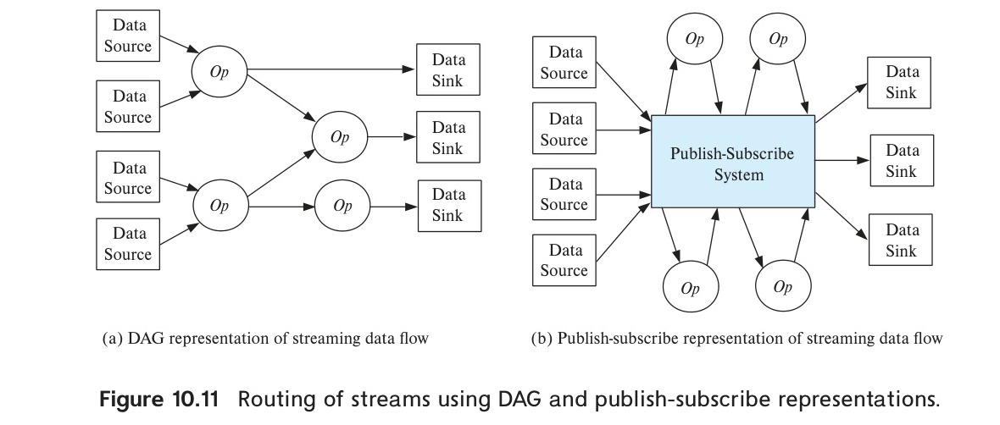
*Figure 10.11 — Routing of streams using DAG and publish-subscribe representations.*

<!-- Page 507 -->

routing of stream tuples through a DAG structure. Operation nodes are denoted as “Op” nodes in the figure. The entry points to the stream-processing system are the data-source nodes of the DAG; these nodes consume tuples from the stream sources and inject them into the stream-processing system. The exit points of the stream-processing system are data-sink nodes; tuples exiting the system through a data sink may be stored in a data store or file system or may be output in some other manner.

One way of implementing a stream-processing system is by specifying the graph as part of the system configuration, which is read when the system starts processing tuples, and is then used to route tuples. The Apache Storm stream-processing system is an example of a system that uses a configuration file to define the graph, which is called a topology in the Storm system. Data-source nodes are called spouts in the Storm system, while operator nodes are called bolts, and edges connect these nodes.

An alternative way of creating such a routing graph is by using publish-subscribe systems. A publish-subscribe system allows publication of documents or other forms of data, with an associated topic. Subscribers correspondingly subscribe to specified topics. Whenever a document is published to a particular topic, a copy of the document is sent to all subscribers who have subscribed to that topic. Publish-subscribe systems are also referred to as pub-sub systems for short.

When a publish-subscribe system is used for routing tuples in a stream-processing system, tuples are considered documents, and each tuple is tagged with a topic. The entry points to the system conceptually “publish” tuples, each with an associated topic. Operators subscribe to one or more topics; the system routes all tuples with a specific topic to all subscribers of that topic. Operators can also publish their outputs back to the publish-subscribe system, with an associated topic.

A major benefit of the publish-subscribe approach is that operators can be added to the system, or removed from it, with relative ease. Figure 10.11b depicts the routing of tuples using a publish-subscribe representation. Each data source is assigned a unique topic name; the output of each operator is also assigned a unique topic name. Each operator subscribes to the topics of its inputs and publishes to the topics corresponding to its output. Data sources publish to their associated topic, while data sinks subscribe to the topics of the operators whose output goes to the sink.

The Apache Kafka system uses the publish-subscribe model to manage routing of tuples in streams. In the Kafka system, tuples published for a topic are retained for a specified period of time (called the retention period), even if there is currently no subscriber for the topic. Subscribers usually process tuples at the earliest possible time, but in case processing is delayed or temporarily stopped due to failures, the tuples are still available for processing until the retention time expires.

More details of routing, and in particular how publish-subscribe is implemented in a parallel system, are provided in Section 22.8.

The next detail to be addressed is how to implement the algebraic operations. We saw earlier how algebraic operations can be computed using data from files and other data sources as inputs.

<!-- Page 508 -->

Apache Spark allows streaming data sources to be used as inputs for such operations. The key issue is that some of the operations may not output any results at all until the entire stream is consumed, which may take potentially unbounded time. To avoid this problem, Spark breaks up streams into discretized streams, where the stream data for a particular time window are treated as a data input to algebraic operators. When the data in that window have been consumed, the operator generates its output, just as it would have if the data source were a file or a relation.

However, the above approach has the problem that the discretization of streams has to be done before any algebraic operations are executed. Other systems such as Apache Storm and Apache Flink support stream operations, which take a stream as input and output another stream. This is straightforward for operations such as map or relational select operations; each output tuple inherits a timestamp from the input tuple. On the other hand, relational aggregate operations and reduce operations may be unable to generate any output until the entire stream is consumed. To support such operations, Flink supports a window operation which breaks up the stream into windows; aggregates are computed within each window and are output once the window is complete. Note that the output is treated as a stream, where tuples have a timestamp based on the end of the window.[^3]

## 10.6 Graph Databases

Graphs are an important type of data that databases need to deal with. For example, a computer network with multiple routers and links between them can be modeled as a graph, with routers as nodes and network links as edges. Road networks are another common type of graph, with road intersections modeled as nodes and the road links between intersections as edges. Web pages with hyperlinks between them are yet another example of graphs, where web pages can be modeled as nodes and hyperlinks between them as edges.

In fact, if we consider an E-R model of an enterprise, every entity can be modeled as a node of a graph, and every binary relationship can be modeled as an edge of the graph. Ternary and higher-degree relationships are harder to model, but as we saw in Section 6.9.4, such relationships can be modeled as a set of binary relationships if desired.

Graphs can be represented using the relational model using the following two relations:

1. `node(ID, label, node_data)`
2. `edge(fromID, toID, label, edge_data)`

where `node_data` and `edge_data` contain all the data related to nodes and edges, respectively.

[^3]: Some systems generate timestamps based on when the window is processed, but doing so results in output timestamps that are nondeterministic.

<!-- Page 509 -->

Modeling a graph using just two relations is too simplistic for complex database schemas. For example, applications require modeling of many types of nodes, each with its own set of attributes, and many types of edges, each with its own set of attributes. We can correspondingly have multiple relations that store nodes of different types and multiple relations that store edges of different types.

Although graph data can be easily stored in relational databases, graph databases such as the widely used Neo4j provide several extra features:
• They allow relations to be identified as representing nodes or edges and offer special syntax for defining such relations
• They support query languages designed for easily expressing path queries, which may be harder to express in SQL.
• They provide efficient implementations for such queries, which can execute queries much faster than if they were expressed in SQL and executed on a regular database.
• They provide support for other features such as graph visualization.

As an example of a graph query, we consider a query in the Cypher query language supported by Neo4j. Suppose the input graph has nodes corresponding to students (stored in a relation student) and instructors (stored in a relation instructor, and an edge type advisor from student to instructor. We omit details of how to create such node and edge types in Neo4j and assume appropriate schemas for these types. We can then write the following query:

```cypher
match (i:instructor)<-[:advisor]-(s:student)
where i.dept_name= 'Comp. Sci.'
return i.ID as ID, i.name as name, collect(s.name) as advisees
```

Observe that the match clause in the query connects instructors to students via the advisor relation, which is modeled as a graph path that traverses the advisor edge in the backwards direction (the edge points from student to instructor), by using the syntax (i:instructor)<-[:advisor]-(s:student). This step basically performs a join of the instructor, advisor and student relations. The query then performs a group by on instructor ID and name, and collects all the students advised by the instructor into a set called advisees. We omit details, and refer the interested reader to online tutorials available at neo4j.com/developer.

Neo4J also supports recursive traversal of edges. For example, suppose we wish to find direct and indirect prerequisites of courses, with the relation course modeled with type node, and relation `prereq(course_id, prereq_id)` modeled with type edge. We can then write the following query:

```cypher
match (c1:course)-[:prereq *1..]->(c2:course)
return c1.course_id, c2.course_id
```

<!-- Page 510 -->

Here, the annotation “*1..” indicates we want to consider paths with multiple prereq edges, with a minimum of 1 edge (with a minimum of 0, a course would appear as its own prerequisite).

We note that Neo4j is a centralized system and does not (as of 2018) support parallel processing. However, there are many applications that need to process very large graphs, and parallel processing is key for such applications.

Computation of PageRank (which we saw earlier in Section 8.3.2.2) on very large graphs containing a node for every web page, and an edge for every hyperlink from one page to another, is a good example of a complex computation on very large graphs. The web graph today has hundreds of billions of nodes and trillions of edges. Social networks are another example of very large graphs, containing billions of nodes and edges; computations on such graphs include shortest paths (to find connectivity between people), or computing how influential people are based on edges in the social network.

There are two popular approaches for parallel graph processing:

1. Map-reduce and algebraic frameworks: Graphs can be represented as relations, and individual steps of many parallel graph algorithms can be represented as joins. Graphs can thus be stored in a parallel storage system, partitioned across multiple machines. We can then use map-reduce programs, algebraic frameworks such as Spark, or parallel relational database implementations to process each step of a graph algorithm in parallel across multiple nodes.

Such approaches work well for many applications. However, when performing iterative computations that traverse long paths in graphs, these approaches are quite inefficient, since they typically read the entire graph in each iteration.

2. Bulk synchronous processing frameworks: The bulk synchronous processing (BSP) framework for graph algorithms frames graph algorithms as computations associated with vertices that operate in an iterative manner. Unlike the preceding approach, here the graph is typically stored in memory, with vertices partitioned across multiple machines; most importantly, the graph does not have to be read in each iteration.

Each vertex (node) of the graph has data (state) associated with it. Similar to how programmers provide map() and reduce() functions in the MapReduce framework, in the BSP framework programmers provide methods that are executed for each node of the graph. The methods can send messages to neighboring nodes and receive messages from neighboring nodes of the graph. In each iteration, called a superstep, the method associated with each node is executed; the method consumes any incoming messages, updates the data associated with the node, and may optionally send messages to neighboring nodes. Messages sent in one iteration are received by the recipients in the next iteration. The method executing at each vertex may vote to halt if they decide they have no more computation to carry out. If in some iteration all vertices vote to halt, and no messages are sent out, the computation can be halted.

<!-- Page 511 -->

The result of the computation is contained in the state at each node. The state can be collected and output as the result of the computation.

The idea of bulk synchronous processing is quite old but was popularized by the Pregel system developed by Google, which provided a fault-tolerant implementation of the framework. The Apache Giraph system is an open-source version of the Pregel system.

The GraphX component of Apache Spark supports graph computations on large graphs. It provides an API based on Pregel, as well as a number of other operations that take a graph as input, and output a graph. Operations supported by GraphX include map functions applied on vertices and edges of graphs, join of a graph with an RDD, and an aggregation operation that works as follows: a user-defined function is used to create messages that are sent to all the neighbors of each node, and another user-defined function is used to aggregate the messages. All these operations can be executed in parallel to handle large graphs.

For more information on how to write graph algorithms in such settings, see the references in the Further Reading section at the end of the chapter.

## 10.7 Summary

- Modern data management applications often need to deal with data that are not necessarily in relational form, and these applications also need to deal with volumes of data that are far larger than what a single traditional organization would have generated.
- The increasing use of data sensors leads to the connection of sensors and other computing devices embedded within other objects to the internet, often referred to as the “internet of things.”
- There is now a wider variety of query language options for Big Data applications, driven by the need to handle more varied of data types, and by the need to scale to very large data volumes/velocity.
- Building data management systems that can scale to large volume/velocity of data requires parallel storage and processing of data.
- Distributed file systems allow files to be stored across a number of machines, while allowing access to files using a traditional file-system interface.
- Key-value storage systems allow records to be stored and retrieved based on a key and may additionally provide limited query facilities. These systems are not full-fledged database systems, and they are sometimes called NoSQL systems.
- Parallel and distributed databases provide a traditional database interface, but they store data across multiple machines, and they perform query processing in parallel across multiple machines.

<!-- Page 512 -->

- The MapReduce paradigm models a common situation in parallel processing, where some processing, identified by the map() function, is applied to each of a large number of input records, and then some form of aggregation, identified by the reduce() function, is applied to the result of the map() function.
- The Hadoop system provides a widely used open-source implementation of MapReduce in the Java language.
- There are a large number of applications that use the MapReduce paradigm for data processing of various kinds whose logic can be easily expressed using SQL.
- Relational algebra forms the foundation of relational query processing, allowing queries to be modeled as trees of operations. This idea is extended to settings with more complex data types by supporting algebraic operators that can work on datasets containing records with complex data types, and returning datasets with records containing similar complex data types.
- There are many applications where queries need to be executed continuously, on data that arrive in a continuous fashion. The term streaming data refers to data that arrive in a continuous fashion. Many application domains need to process incoming data in real time.
- Graphs are an important type of data that databases need to deal with.

## Review Terms

- Volume
- Velocity
- Conversion
- Internet of things
- Distributed file system
- NameNode server
- DataNodes machines
- Sharding
- Partitioning attribute
- Key-value storage system
- Key-value store
- Document stores
- NoSQL systems
- Shard key
- Parallel databases
- Reduce key
- Shuffle step
- Streaming data
- Data-at-rest
- Windows on the streams
- Continuous queries
- Punctuations
- Lambda architecture
- Tumbling window
- Hopping window
- Sliding window
- Session window
- Publish-subscribe systems
- Pub-sub systems
- Discretized streams
- Superstep

<!-- Page 513 -->

## Practice Exercises

10.1
Suppose you need to store a very large number of small files, each of size say 2 kilobytes. If your choice is between a distributed file system and a distributed key-value store, which would you prefer, and explain why.

10.2
Suppose you need to store data for a very large number of students in a distributed document store such as MongoDB. Suppose also that the data for each student correspond to the data in the student and the takes relations. How would you represent the above data about students, ensuring that all the data for a particular student can be accessed efficiently? Give an example of the data representation for one student.

10.3
Suppose you wish to store utility bills for a large number of users, where each bill is identified by a customer ID and a date. How would you store the bills in a key-value store that supports range queries, if queries request the bills of a specified customer for a specified date range.

10.4
Give pseudocode for computing a join $r \bowtie_{r.A=s.A} s$ using a single MapReduce step, assuming that the map() function is invoked on each tuple of r and s. Assume that the map() function can find the name of the relation using context.relname().

10.5
What is the conceptual problem with the following snippet of Apache Spark code meant to work on very large data. Note that the collect() function returns a Java collection, and Java collections (from Java 8 onwards) support map and reduce functions.

```java
JavaRDD<String< lines = sc.textFile("logDirectory");
int totalLength = lines.collect().map(s −> s.length())
.reduce(0,(a,b) −> a+b);
```

10.6
Apache Spark:
a.
How does Apache Spark perform computations in parallel?
b.
Explain the statement: “Apache Spark performs transformations on RDDs in a lazy manner.”
c.
What are some of the benefits of lazy evaluation of operations in Apache Spark?

10.7
Given a collection of documents, for each word $w_i$, let $n_i$ denote the number of times the word occurs in the collection. Let $N$ be the total number of word occurrences across all documents. Next, consider all pairs of consecutive words

<!-- Page 514 -->

$(w_i, w_j)$ in the document; let $n_{i,j}$ denote the number of occurrences of the word pair $(w_i, w_j)$ across all documents.
Write an Apache Spark program that, given a collection of documents in a directory, computes $N$, all pairs $(w_i, n_i)$, and all pairs $((w_i, w_j), n_{i,j})$. Then output all word pairs such that $n_{i,j}/N \ge 10 \times (n_i/N) \times (n_j/N)$. These are word pairs that occur 10 times or more as frequently as they would be expected to occur if the two words occurred independently of each other.
You will find the join operation on RDDs useful for the last step, to bring related counts together. For simplicity, do not bother about word pairs that cross lines. Also assume for simplicity that words only occur in lowercase and that there are no punctuation marks.

10.8
Consider the following query using the tumbling window operator:

```sql
select item, System.Timestamp as window_end, sum(amount)
from order timestamp by datetime
group by itemid, tumblingwindow(hour, 1)
```

Give an equivalent query using normal SQL constructs, without using the tumbling window operator. You can assume that the timestamp can be converted to an integer value that represents the number of seconds elapsed since (say) midnight, January 1, 1970, using the function to_seconds(timestamp). You can also assume that the usual arithmetic functions are available, along with the function floor(a) which returns the largest integer $\le a$.

10.9
Suppose you wish to model the university schema as a graph. For each of the following relations, explain whether the relation would be modeled as a node or as an edge:
(i) student, (ii) instructor, (iii) course, (iv) section, (v) takes, (vi) teaches.
Does the model capture connections between sections and courses?

## Exercises

10.10
Give four ways in which information in web logs pertaining to the web pages visited by a user can be used by the web site.

10.11
One of the characteristics of Big Data is the variety of data. Explain why this characteristic has resulted in the need for languages other than SQL for processing Big Data.

10.12
Suppose your company has built a database application that runs on a centralized database, but even with a high-end computer and appropriate indices created on the data, the system is not able to handle the transaction load, lead-

<!-- Page 515 -->

ing to slow processing of queries. What would be some of your options to allow the application to handle the transaction load?

10.13
The map-reduce framework is quite useful for creating inverted indices on a set of documents. An inverted index stores for each word a list of all document IDs that it appears in (offsets in the documents are also normally stored, but we shall ignore them in this question).
For example, if the input document IDs and contents are as follows:
1: data clean
2: data base
3: clean base
then the inverted lists would
data: 1, 2
clean: 1, 3
base: 2, 3
Give pseudocode for map and reduce functions to create inverted indices on a given set of files (each file is a document). Assume the document ID is available using a function context.getDocumentID(), and the map function is invoked once per line of the document. The output inverted list for each word should be a list of document IDs separated by commas. The document IDs are normally sorted, but for the purpose of this question you do not need to bother to sort them.

10.14
Fill in the blanks below to complete the following Apache Spark program which computes the number of occurrences of each word in a file. For simplicity we assume that words only occur in lowercase, and there are no punctuation marks.

```java
JavaRDD<String> textFile = sc.textFile("hdfs://...");
JavaPairRDD<String, Integer> counts =
textFile.____________(s −> Arrays.asList(s.split(" ")).____________())
.mapToPair(word -> new ____________).reduceByKey((a, b) −> a + b);
```

10.15
Suppose a stream can deliver tuples out of order with respect to tuple timestamps. What extra information should the stream provide, so a stream query processing system can decide when all tuples in a window have been seen?

10.16
Explain how multiple operations can be executed on a stream using a publish-subscribe system such as Apache Kafka.

## Tools

A wide variety of open-source Big Data tools are available, in addition to some commercial tools. In addition, a number of these tools are available on cloud plat-

<!-- Page 516 -->

forms. We list below several popular tools, along with the URLs where they can be found. Apache HDFS (hadoop.apache.org) is a widely used distributed file system implementation. Open-source distributed/parallel key-value stores include Apache HBase (hbase.apache.org), Apache Cassandra (cassandra.apache.org), MongoDB (www.mongodb.com), and Riak (basho.com).
Hosted cloud storage systems include the Amazon S3 storage system (aws.amazon.com/s3) and Google Cloud Storage (cloud.google.com/storage). Hosted key-value stores include Google BigTable (cloud.google.com/bigtable), and Amazon DynamoDB (aws.amazon.com/dynamodb).
Google Spanner (cloud.google.com/spanner) and the open source CockroachDB (www.cockroachlabs.com) are scalable parallel databases that support SQL and transactions, and strongly consistent storage.
Open-source MapReduce systems include Apache Hadoop (hadoop.apache.org), and Apache Spark (spark.apache.org), while Apache Tez (tez.apache.org) supports data processing using a DAG of algebraic operators. These are also available as cloud-based offerings from Amazon Elastic MapReduce (aws.amazon.com/emr), which also supports Apache HDFS and Apache HBase, and from Microsoft Azure (azure.microsoft.com).
Apache Hive (hive.apache.org) is a popular open-source SQL implementation that runs on top of the Apache MapReduce, Apache Tez, as well as Apache Spark; these systems are designed to support large queries running in parallel on multiple machines. Apache Impala (impala.apache.org) is an SQL implementation that runs on Hadoop, and is designed to handle a large number of queries, and to return query results with minimal delays (latency). Hosted SQL offerings on the cloud that support parallel processing include Amazon EMR (aws.amazon.com/emr), Google Cloud SQL (cloud.google.com/sql), and Microsoft Azure SQL (azure.microsoft.com).
Apache Kafka (kafka.apache.org) and Apache Flink (flink.apache.org) are open-source stream-processing systems; Apache Spark also provides support for stream processing. Hosted stream-processing platforms include Amazon Kinesis (aws.amazon.com/kinesis), Google Cloud Dataflow (cloud.google.com/dataflow) and Microsoft Stream Analytics (azure.microsoft.com). Open source graph processing platforms include Neo4J (neo4j.com) and Apache Giraph (giraph.apache.org).

## Further Reading

[Davoudian et al. (2018)] provides a nice survey of NoSQL data stores, including data model querying and internals. More information about Apache Hadoop, including documentation on HDFS and Hadoop MapReduce, can be found on the Apache Hadoop homepage, hadoop.apache.org. Information about Apache Spark may be found on the Spark homepage, spark.apache.org. Information about the Apache Kafka streaming data platform may be found on kafka.apache.org, and details of stream processing in Apache Flink may be found on flink.apache.org. Bulk Synchronous Processing

<!-- Page 517 -->

was introduced in [Valiant (1990)]. A description of the Pregel system, including its support for bulk synchronous processing, may be found in [Malewicz et al. (2010)], while information about the open source equivalent, Apache Giraph, may be found on giraph.apache.org.

## Bibliography

- **[Davoudian et al. (2018)]** A. Davoudian, L. Chen, and M. Liu, “A Survey of NoSQL Stores”, ACM Computing Surveys, Volume 51, Number 2 (2018), pages 2–42.
- **[Malewicz et al. (2010)]** G. Malewicz, M. H. Austern, A. J. C. Bik, J. C. Dehnert, I. Horn, N. Leiser, and G. Czajkowski, “Pregel: a system for large-scale graph processing”, In Proc. of the ACM SIGMOD Conf. on Management of Data (2010), pages 135–146.
- **[Valiant (1990)]** L. G. Valiant, “A Bridging Model for Parallel Computation”, Communications of the ACM, Volume 33, Number 8 (1990), pages 103–111.

## Credits

The photo of the sailboats in the beginning of the chapter is due to ©Pavel Nesvadba/Shutterstock.