<!-- Page 519 -->

# Chapter 11: Data Analytics

Decision-making tasks benefit greatly by using data about the past to predict the future and using the predictions to make decisions. For example, online advertisement systems need to decide what advertisement to show to each user. Analysis of past actions and profiles of other users, as well as past actions and profile of the current user, are key to deciding which advertisement the user is most likely to respond to. Here, each decision is low-value, but with high volumes the overall value of making the right decisions is very high. At the other end of the value spectrum, manufacturers and retailers need to decide what items to manufacture or stock many months ahead of the actual sale of the items. Predicting future demand of different types of items based on past sales and other indicators is key to avoiding both overproduction or overstocking of some items, and underproduction or understocking of other items. Errors can lead to monetary loss due to unsold inventory of some items, or loss of potential revenue due to nonavailability of some items.

The term **data analytics** refers broadly to the processing of data to infer patterns, correlations, or models for prediction. The results of analytics are then used to drive business decisions.

The financial benefits of making correct decisions can be substantial, as can the costs of making wrong decisions. Organizations therefore invest a lot of money to gather or purchase required data and build systems for data analytics.

## 11.1 Overview of Analytics

Large companies have diverse sources of data that they need to use for making business decisions. The sources may store the data under different schemas. For performance reasons (as well as for reasons of organization control), the data sources usually will not permit other parts of the company to retrieve data on demand.

Organizations therefore typically gather data from multiple sources into one location, referred to as a *data warehouse*. Data warehouses gather data from multiple sources at a single site, under a unified schema (which is usually designed to support efficient analysis, even at the cost of redundant storage). Thus, they provide the user

<!-- Page 520 -->

a single uniform interface to data. However, data warehouses today also collect and store data from non-relational sources, where schema unification is not possible. Some sources of data have errors that can be detected and corrected using business constraints; further, organizations may collect data from multiple sources, and there may be duplicates in the data collected from different sources. These steps of collecting data, cleaning/deduplicating the data, and loading the data into a warehouse are referred to as *extract, transform and load* (ETL) tasks. We study issues in building and maintaining a data warehouse in Section 11.2.

The most basic form of analytics is generation of aggregates and reports summarizing the data in ways that are meaningful to the organization. Analysts need to get a number of different aggregates and compare them to understand patterns in the data. Aggregates, and in some cases the underlying data, are typically presented graphically as charts, to make it easy for humans to visualize the data. Dashboards that display charts summarizing key organizational parameters, such as sales, expenses, product returns, and so forth, are popular means of monitoring the health of an organization. Analysts also need to visualize data in ways that can highlight anomalies or give insights into causes for changes in the business.

Systems that support very efficient analysis, where aggregate queries on large data are answered in almost real time (as opposed to being answered after tens of minutes or multiple hours) are popular with analysts. Such systems are referred to as *online analytical processing* (OLAP) systems. We discuss online analytical processing in Section 11.3, where we cover the concept of multidimensional data, OLAP operations, relational representation of multidimensional summaries. We also discuss graphical representation of data and visualization in Section 11.3.

Statistical analysis is an important part of data analysis. There are several tools that are designed for statistical analysis, including the R language/environment, which is open source, and commercial systems such as SAS and SPSS. The R language is widely used today, and in addition to features for statistical analysis, it supports facilities for graphical display of data. A large number of R packages (libraries) are available that implement a wide variety of data analysis tasks, including many machine-learning algorithms. R has been integrated with databases as well as with Big Data systems such as Apache Spark, which allows R programs to be executed in parallel on large datasets. Statistical analysis is a large area by itself, and we do not discuss it further in this book. References providing more information may be found in the Further Reading section at the end of this chapter.

Prediction of different forms is another key aspect of analytics. For example, banks need to decide whether to give a loan to a loan applicant, and online advertisers need to decide which advertisement to show to a particular user. As another example, manufacturers and retailers need to make decisions on what items to manufacture or order in what quantities.

These decisions are driven significantly by techniques for analyzing past data and using the past to predict the future. For example, the risk of loan default can be predicted as follows. First, the bank would examine the loan default history of past cus-

<!-- Page 521 -->

tomers, find key features of customers, such as salary, education level, job history, and so on, that help in prediction of loan default. The bank would then build a prediction model (such as a decision tree, which we study later in this chapter) using the chosen features. When a customer then applies for a loan, the features of that particular customer are fed into the model which makes a prediction, such as an estimated likelihood of loan default. The prediction is used to make business decisions, such as whether to give a loan to the customer.

Similarly, analysts may look at the past history of sales and use it to predict future sales, to make decisions on what and how much to manufacture or order, or how to target their advertising. For example, a car company may search for customer attributes that help predict who buys different types of cars. It may find that most of its small sports cars are bought by young women whose annual incomes are above \$50,000. The company may then target its marketing to attract more such women to buy its small sports cars and may avoid wasting money trying to attract other categories of people to buy those cars.

Machine-learning techniques are key to finding patterns in data and in making predictions from these patterns. The field of data mining combines knowledge-discovery techniques invented by machine-learning researchers with efficient implementation techniques that enable them to be used on extremely large databases. Section 11.4 discusses data mining.

The term **business intelligence** (BI) is used in a broadly similar sense to data analytics. The term **decision support** is also used in a related but narrower sense, with a focus on reporting and aggregation, but not including machine learning/data mining. Decision-support tasks typically use SQL queries to process large amounts of data. Decision-support queries are can be contrasted with queries for online transaction processing, where each query typically reads only a small amount of data and may perform a few small updates.

## 11.2 Data Warehousing

Large organizations have a complex internal organization structure, and therefore different data may be present in different locations, or on different operational systems, or under different schemas. For instance, manufacturing-problem data and customer-complaint data may be stored on different database systems. Organizations often purchase data from external sources, such as mailing lists that are used for product promotions, or credit scores of customers that are provided by credit bureaus, to decide on creditworthiness of customers.[^1]

Corporate decision makers require access to information from multiple such sources. Setting up queries on individual sources is both cumbersome and inefficient.

[^1]: Credit bureaus are companies that gather information about consumers from multiple sources and compute a credit-worthiness score for each consumer.

<!-- Page 522 -->

Moreover, the sources of data may store only current data, whereas decision makers may need access to past data as well; for instance, information about how purchase patterns have changed in the past few years could be of great importance. Data warehouses provide a solution to these problems.

A **data warehouse** is a repository (or archive) of information gathered from multiple sources, stored under a unified schema, at a single site. Once gathered, the data are stored for a long time, permitting access to historical data. Thus, data warehouses provide the user a single consolidated interface to data, making decision-support queries easier to write. Moreover, by accessing information for decision support from a data warehouse, the decision maker ensures that online transaction-processing systems are not affected by the decision-support workload.

### 11.2.1 Components of a Data Warehouse

Figure 11.1 shows the architecture of a typical data warehouse and illustrates the gathering of data, the storage of data, and the querying and data analysis support. Among the issues to be addressed in building a warehouse are the following:

- **When and how to gather data.** In a **source-driven architecture** for gathering data, the data sources transmit new information, either continually (as transaction processing takes place), or periodically (nightly, for example). In a **destination-driven architecture**, the data warehouse periodically sends requests for new data to the sources.

  Unless updates at the sources are “synchronously” replicated at the warehouse, the warehouse will never be quite up-to-date with the sources. Synchronous replication can be expensive, so many data warehouses do not use synchronous replication, and they perform queries only on data that are old enough that they have

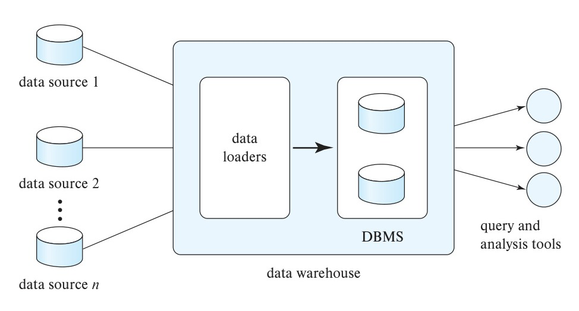
*Figure 11.1 — Data-warehouse architecture.*

<!-- Page 523 -->

  been completely replicated. Traditionally, analysts were happy with using yesterday’s data, so data warehouses could be loaded with data up to the end of the previous day. However, increasingly organizations want more up-to-date data. The data freshness requirements depend on the application. Data that are within a few hours old may be sufficient for some applications; others that require real-time responses to events may use stream processing infrastructure (described in Section 10.5) instead of depending on a warehouse infrastructure.
- **What schema to use.** Data sources that have been constructed independently are likely to have different schemas. In fact, they may even use different data models. Part of the task of a warehouse is to perform schema integration and to convert data to the integrated schema before they are stored. As a result, the data stored in the warehouse are not just a copy of the data at the sources. Instead, they can be thought of as a materialized view of the data at the sources.
- **Data transformation and cleansing.** The task of correcting and preprocessing data is called **data cleansing**. Data sources often deliver data with numerous minor inconsistencies, which can be corrected. For example, names are often misspelled, and addresses may have street, area, or city names misspelled, or postal codes entered incorrectly. These can be corrected to a reasonable extent by consulting a database of street names and postal codes in each city. The approximate matching of data required for this task is referred to as **fuzzy lookup**.

  Address lists collected from multiple sources may have duplicates that need to be eliminated in a **merge–purge operation** (this operation is also referred to as **deduplication**). Records for multiple individuals in a house may be grouped together so only one mailing is sent to each house; this operation is called **householding**.

  Data may be **transformed** in ways other than cleansing, such as changing the units of measure, or converting the data to a different schema by joining data from multiple source relations. Data warehouses typically have graphical tools to support data transformation. Such tools allow transformation to be specified as boxes, and edges can be created between boxes to indicate the flow of data. Conditional boxes can route data to an appropriate next step in transformation.
- **How to propagate updates.** Updates on relations at the data sources must be propagated to the data warehouse. If the relations at the data warehouse are exactly the same as those at the data source, the propagation is straightforward. If they are not, the problem of propagating updates is basically the *view-maintenance* problem, which was discussed in Section 4.2.3, and is covered in more detail in Section 16.5.
- **What data to summarize.** The raw data generated by a transaction-processing system may be too large to store online. However, we can answer many queries by maintaining just summary data obtained by aggregation on a relation, rather than maintaining the entire relation. For example, instead of storing data about every sale of clothing, we can store total sales of clothing by item name and category.

<!-- Page 524 -->

The different steps involved in getting data into a data warehouse are called **extract, transform, and load** or **ETL** tasks; extraction refers to getting data from the sources, while load refers to loading the data into the data warehouse. In current generation data warehouses that support user-defined functions or MapReduce frameworks, data may be extracted, loaded into the warehouse, and then transformed. The steps are then referred to as **extract, load, and transform** or **ELT** tasks. The ELT approach permits the use of parallel processing frameworks for data transformation.

### 11.2.2 Multidimensional Data and Warehouse Schemas

Data warehouses typically have schemas that are designed for data analysis, using tools such as OLAP tools. The relations in a **data warehouse schema** can usually be classified as *fact tables* and *dimension tables*. **Fact tables** record information about individual events, such as sales, and are usually very large. A table recording sales information for a retail store, with one tuple for each item that is sold, is a typical example of a fact table. The attributes in fact table can be classified as either *dimension attributes* or *measure attributes*. The **measure attributes** store quantitative information, which can be aggregated upon; the measure attributes of a *sales* table would include the number of items sold and the price of the items. In contrast, **dimension attributes** are dimensions upon which measure attributes, and summaries of measure attributes, are grouped and viewed. The dimension attributes of a *sales* table would include an item identifier, the date when the item is sold, which location (store) the item was sold from, the customer who bought the item, and so on.

Data that can be modeled using dimension attributes and measure attributes are called **multidimensional data**.

To minimize storage requirements, dimension attributes are usually short identifiers that are foreign keys into other tables called **dimension tables**. For instance, a fact table *sales* would have dimension attributes *item_id*, *store_id*, *customer_id*, and *date*, and measure attributes *number* and *price*. The attribute *store_id* is a foreign key into a dimension table *store*, which has other attributes such as store location (city, state, country). The *item_id* attribute of the *sales* table would be a foreign key into a dimension table *item_info*, which would contain information such as the name of the item, the category to which the item belongs, and other item details such as color and size. The *customer_id* attribute would be a foreign key into a *customer* table containing attributes such as name and address of the customer. We can also view the *date* attribute as a foreign key into a *date_info* table giving the month, quarter, and year of each date.

The resultant schema appears in Figure 11.2. Such a schema, with a fact table, multiple dimension tables, and foreign keys from the fact table to the dimension tables is called a **star schema**. More complex data-warehouse designs may have multiple levels of dimension tables; for instance, the *item_info* table may have an attribute *manufacturer_id* that is a foreign key into another table giving details of the manufacturer. Such schemas are called **snowflake schemas**. Complex data-warehouse designs may also have more than one fact table.

<!-- Page 525 -->

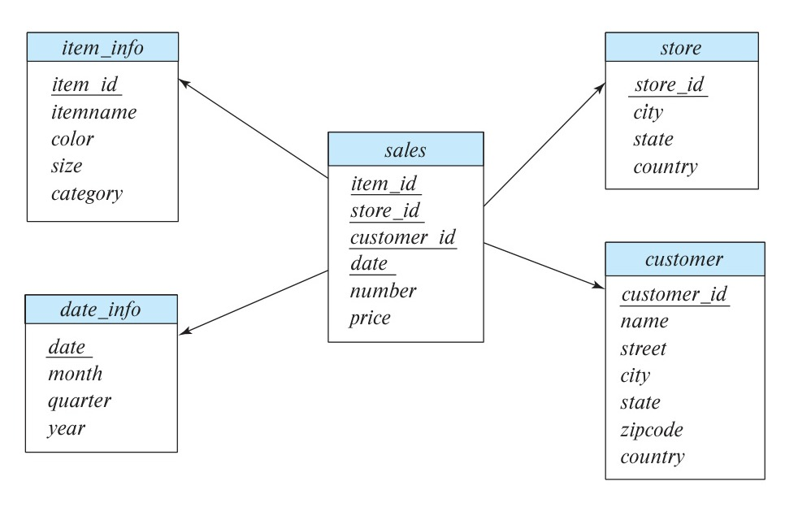
*Figure 11.2 — Star schema for a data warehouse.*

### 11.2.3 Database Support for Data Warehouses

The requirements of a database system designed for transaction processing are somewhat different from one designed to support a data-warehouse system. One key difference is that a transaction-processing database needs to support many small queries, which may involve updates in addition to reads. In contrast, data warehouses typically need to process far fewer queries, but each query accesses a much larger amount of data.

Most importantly, while new records are inserted into relations in a data warehouse, and old records may be deleted once they are no longer needed, to make space for new data, records are typically never updated once they are added to a relation. Thus, data warehouses do not need to pay any overhead for concurrency control. (As described in Chapter 17 and Chapter 18, if concurrent transactions read and write the same data, the resultant data may become inconsistent. Concurrency control restricts concurrent accesses in a way that ensures there is no erroneous update to the database.) The overhead of concurrency control can be significant in terms of not just time taken for query processing, but also in terms of storage, since databases often store multiple versions of data to avoid conflicts between small update transactions and long read-only transactions. None of these overheads are needed in a data warehouse.

Databases traditionally store all attributes of a tuple together, and tuples are stored sequentially in a file. Such a storage layout is referred to as row-oriented storage. In contrast, in column-oriented storage, each attribute of a relation is stored in a separate file, with values from successive tuples stored at successive positions in the file. Assuming fixed-size data types, the value of attribute $A$ of the $i$th tuple of a relation can be found

<!-- Page 526 -->

by accessing the file corresponding to attribute $A$ and reading the value at offset $(i - 1)$ times the size (in bytes) of values in attribute $A$.

Column-oriented storage has at least two major benefits over row-oriented storage:

1. When a query needs to access only a few attributes of a relation with a large number of attributes, the remaining attributes need not be fetched from disk into memory. In contrast, in row-oriented storage, not only are irrelevant attributes fetched into memory, but they may also get prefetched into processor cache, wasting cache space and memory bandwidth, if they are stored adjacent to attributes used in the query.
2. Storing values of the same type together increases the effectiveness of compression; compression can greatly reduce both the disk storage cost and the time to retrieve data from disk.

On the other hand, column-oriented storage has the drawback that storing or fetching a single tuple requires multiple I/O operations.

As a result of these trade-offs, column-oriented storage is not widely used for transaction-processing applications. However, column-oriented storage is today widely used for data-warehousing applications, where accesses are rarely to individual tuples but rather require scanning and aggregating multiple tuples. Column-oriented storage is described in more detail in Section 13.6.

Database implementations that are designed purely for data warehouse applications include Teradata, Sybase IQ, and Amazon Redshift. Many traditional databases support efficient execution of data warehousing applications by adding features such as columnar storage; these include Oracle, SAP HANA, Microsoft SQL Server, and IBM DB2.

In the 2010s there has been an explosive growth in Big Data systems that are designed to process queries over data stored in files. Such systems are now a key part of the data warehouse infrastructure. As we saw in Section 10.3, the motivation for such systems was the growth of data generated by online systems in the form of log files, which have a lot of valuable information that can be exploited for decision support. However, these systems can handle any kind of data, including relational data. Apache Hadoop is one such system, and the Hive system allows SQL queries to be executed on top of the Hadoop system.

A number of companies provide software to optimize Hive query processing, including Cloudera and Hortonworks. Apache Spark is another popular Big Data system that supports SQL queries on data stored in files. Compressed file structures containing records with columns, such as Orc and Parquet, are increasingly used to store such log records, simplifying integration with SQL. Such file formats are discussed in more detail in Section 13.6.

<!-- Page 527 -->

### 11.2.4 Data Lakes

While data warehouses pay a lot of attention to ensuring a common data schema to ease the job of querying the data, there are situations where organizations want to store data without paying the cost of creating a common schema and transforming data to the common schema. The term **data lake** is used to refer to a repository where data can be stored in multiple formats, including structured records and unstructured file formats. Unlike data warehouses, data lakes do not require up-front effort to preprocess data, but they do require more effort when creating queries. Since data may be stored in many different formats, querying tools also need to be quite flexible. Apache Hadoop and Apache Spark are popular tools for querying such data, since they support querying of both unstructured and structured data.

## 11.3 Online Analytical Processing

Data analysis often involves looking for patterns that arise when data values are grouped in “interesting” ways. As a simple example, summing credit hours for each department is a way to discover which departments have high teaching responsibilities. In a retail business, we might group sales by product, the date or month of the sale, the color or size of the product, or the profile (such as age group and gender) of the customer who bought the product.

### 11.3.1 Aggregation on Multidimensional Data

Consider an application where a shop wants to find out what kinds of clothes are popular. Let us suppose that clothes are characterized by their *item_name*, *color*, and *size*, and that we have a relation *sales* with the schema:

```text
sales (item_name, color, clothes_size, quantity)
```

Suppose that *item_name* can take on the values (skirt, dress, shirt, pants), *color* can take on the values (dark, pastel, white), *clothes_size* can take on values (small, medium, large), and *quantity* is an integer value representing the total number of items of a given {*item_name*, *color*, *clothes_size*}. An instance of the *sales* relation is shown in Figure 11.3.

Statistical analysis often requires grouping on multiple attributes. The attribute *quantity* of the *sales* relation is a measure attribute, since it measures the number of units sold, while *item_name*, *color*, and *clothes_size* are dimension attributes. (A more realistic version of the *sales* relation would have additional dimensions, such as time and sales location, and additional measures such as monetary value of the sale.)

To analyze the multidimensional data, a manager may want to see data laid out as shown in the table in Figure 11.4. The table shows total quantities for different combinations of *item_name* and *color*. The value of *clothes_size* is specified to be **all**, indicating that the displayed values are a summary across all values of *clothes_size* (i.e., we want to group the “small,” “medium,” and “large” items into one single group.

<!-- Page 528 -->

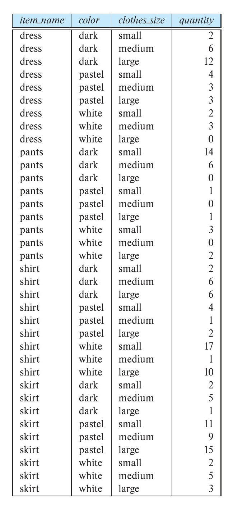
*Figure 11.3 — An example of sales relation.*

The table in Figure 11.4 is an example of a **cross-tabulation** (or **cross-tab**, for short), also referred to as a **pivot-table**. In general, a cross-tab is a table derived from a relation

<!-- Page 529 -->

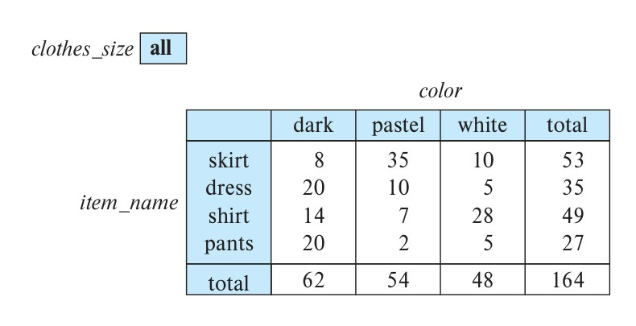
*Figure 11.4 — Cross-tabulation of sales by item name and color.*

(say $R$), where values for one attribute (say $A$) form the column headers and values for another attribute (say $B$) form the row header. For example, in Figure 11.4, the attribute *color* corresponds to $A$ (with values “dark,” “pastel,” and “white”), and the attribute *item_name* corresponds to $B$ (with values “skirt,” “dress,” “shirt,” and “pants”).

Each cell in the pivot-table can be identified by ($a_i$, $b_j$), where $a_i$ is a value for $A$ and $b_j$ a value for $B$. The values of the various cells in the pivot-table are derived from the relation $R$ as follows: If there is at most one tuple in $R$ with any ($a_i$, $b_j$) value, the value in the cell is derived from that single tuple (if any); for instance, it could be the value of one or more other attributes of the tuple. If there can be multiple tuples with an ($a_i$, $b_j$) value, the value in the cell must be derived by aggregation on the tuples with that value. In our example, the aggregation used is the sum of the values for attribute *quantity*, across all values for *clothes_size*, as indicated by “*clothes_size*: **all**” above the cross-tab in Figure 11.4. Thus, the value for cell (skirt, pastel) is 35, since there are three tuples in the *sales* table that meet that criteria, with values 11, 9, and 15.

In our example, the cross-tab also has an extra column and an extra row storing the totals of the cells in the row/column. Most cross-tabs have such summary rows and columns.

The generalization of a cross-tab, which is two-dimensional, to $n$ dimensions can be visualized as an $n$-dimensional cube, called the **data cube**. Figure 11.5 shows a data cube on the *sales* relation. The data cube has three dimensions, *item_name*, *color*, and *clothes_size*, and the measure attribute is *quantity*. Each cell is identified by values for these three dimensions. Each cell in the data cube contains a value, just as in a cross-tab. In Figure 11.5, the value contained in a cell is shown on one of the faces of the cell; other faces of the cell are shown blank if they are visible. All cells contain values, even if they are not visible. The value for a dimension may be **all**, in which case the cell contains a summary over all values of that dimension, as in the case of cross-tabs.

The number of different ways in which the tuples can be grouped for aggregation can be large. In the example of Figure 11.5, there are 3 colors, 4 items, and 3 sizes resulting in a cube size of $3 \times 4 \times 3 = 36$. Including the summary values, we obtain a

<!-- Page 530 -->

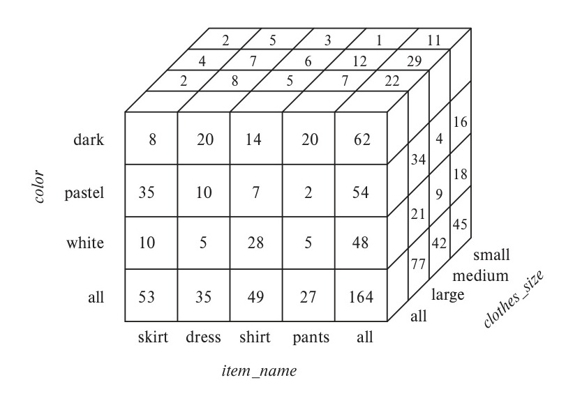
*Figure 11.5 — Three-dimensional data cube.*

$4 \times 5 \times 4$ cube, whose size is 80. In fact, for a table with $n$ dimensions, aggregation can be performed with grouping on each of the $2^n$ subsets of the $n$ dimensions.[^2]

An **online analytic processing** (OLAP) system allows a data analyst to look at different cross-tabs on the same data by *interactively* selecting the attributes in the cross-tab. Each cross-tab is a two-dimensional view on a multidimensional data cube. For instance, the analyst may select a cross-tab on *item_name* and *clothes_size* or a cross-tab on *color* and *clothes_size*. The operation of changing the dimensions used in a cross-tab is called **pivoting**.

OLAP systems allow an analyst to see a cross-tab on *item_name* and *color* for a fixed value of *clothes_size*, for example, large, instead of the sum across all sizes. Such an operation is referred to as **slicing**, since it can be thought of as viewing a slice of the data cube. The operation is sometimes called **dicing**, particularly when values for multiple dimensions are fixed.

When a cross-tab is used to view a multidimensional cube, the values of dimension attributes that are not part of the cross-tab are shown above the cross-tab. The value of such an attribute can be **all**, as shown in Figure 11.4, indicating that data in the cross-tab are a summary over all values for the attribute. Slicing/dicing simply consists of selecting specific values for these attributes, which are then displayed on top of the cross-tab.

OLAP systems permit users to view data at any desired level of granularity. The operation of moving from finer-granularity data to a coarser granularity (by means of aggregation) is called a **rollup**. In our example, starting from the data cube on the

[^2]: Grouping on the set of all $n$ dimensions is useful only if the table may have duplicates.

<!-- Page 531 -->

sales table, we got our example cross-tab by rolling up on the attribute clothes size. The opposite operation—that of moving from coarser-granularity data to finer-granularity data—is called a **drill down**. Finer-granularity data cannot be generated from coarse-granularity data; they must be generated either from the original data or from even finer-granularity summary data.

Analysts may wish to view a dimension at different levels of detail. For instance, consider an attribute of type *datetime* that contains a date and a time of day. Using time precise to a second (or less) may not be meaningful: An analyst who is interested in rough time of day may look at only the hour value. An analyst who is interested in sales by day of the week may map the date to a day of the week and look only at that. Another analyst may be interested in aggregates over a month, or a quarter, or for an entire year.

The different levels of detail for an attribute can be organized into a hierarchy. Figure 11.6a shows a hierarchy on the datetime attribute. As another example, Figure 11.6b shows a hierarchy on location, with the city being at the bottom of the hierarchy, state above it, country at the next level, and region being the top level. In our earlier example, clothes can be grouped by category (for instance, menswear or womenswear); category would then lie above item name in our hierarchy on clothes. At the level of actual values, skirts and dresses would fall under the womenswear category and pants and shirts under the menswear category.

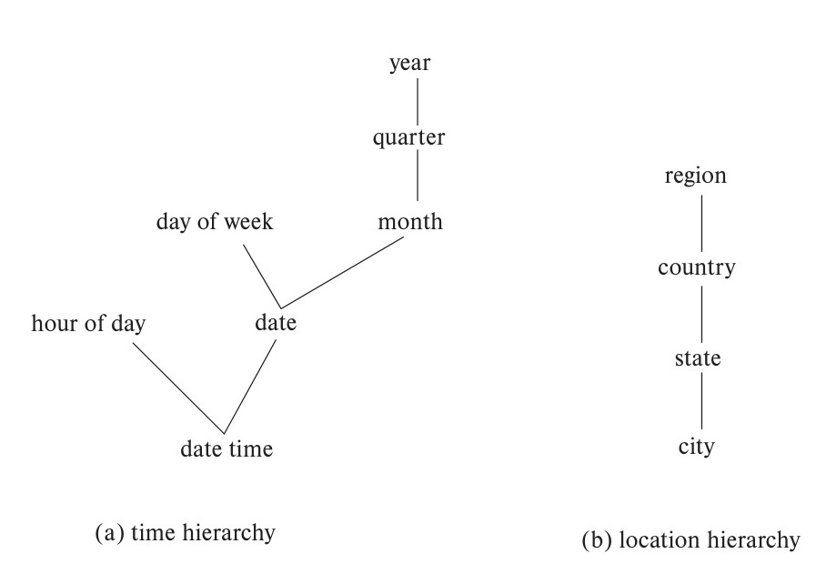
*Figure 11.6 — Hierarchies on dimensions.*

<!-- Page 532 -->

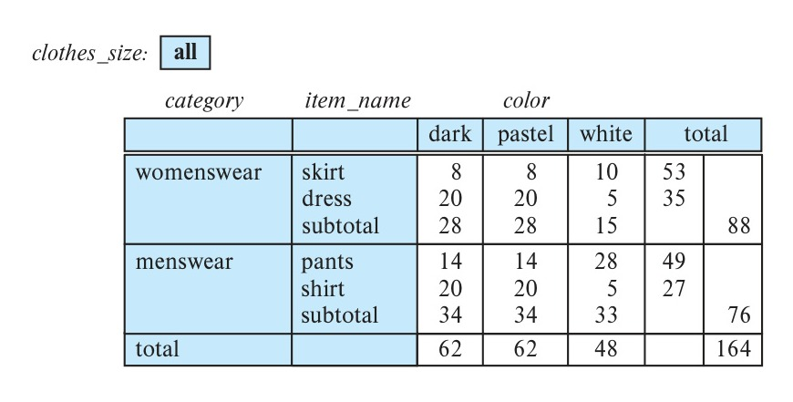
*Figure 11.7 — Cross-tabulation of sales with hierarchy on item name.*

An analyst may be interested in viewing sales of clothes divided as menswear and womenswear, and not interested in individual values. After viewing the aggregates at the level of womenswear and menswear, an analyst may *drill down the hierarchy* to look at individual values. An analyst looking at the detailed level may *drill up the hierarchy* and look at coarser-level aggregates. Both levels can be displayed on the same cross-tab, as in Figure 11.7.

### 11.3.2 Relational Representation of Cross-Tabs

A cross-tab is different from relational tables usually stored in databases, since the number of columns in the cross-tab depends on the actual data. A change in the data values may result in adding more columns, which is not desirable for data storage. However, a cross-tab view is desirable for display to users. It is straightforward to represent a cross-tab without summary values in a relational form with a fixed number of columns. A cross-tab with summary rows/columns can be represented by introducing a special value **all** to represent subtotals, as in Figure 11.8. The SQL standard actually uses the *null* value in place of **all**, but to avoid confusion with regular null values, we shall continue to use **all**.

Consider the tuples (skirt, **all**, **all**, 53) and (dress, **all**, **all**, 35). We have obtained these tuples by eliminating individual tuples with different values for *color* and *clothes_size*, and by replacing the value of *quantity* with an aggregate—namely, the sum of the quantities. The value **all** can be thought of as representing the set of all values for an attribute. Tuples with the value **all** for the *color* and *clothes_size* dimensions can be obtained by an aggregation on the *sales* relation with a **group by** on the column *item_name*. Similarly, a **group by** on *color*, *clothes_size* can be used to get the tuples with the value **all** for *item_name*, and a **group by** with no attributes (which can simply be omitted in SQL) can be used to get the tuple with value **all** for *item_name*, *color*, and *clothes_size*.

<!-- Page 533 -->

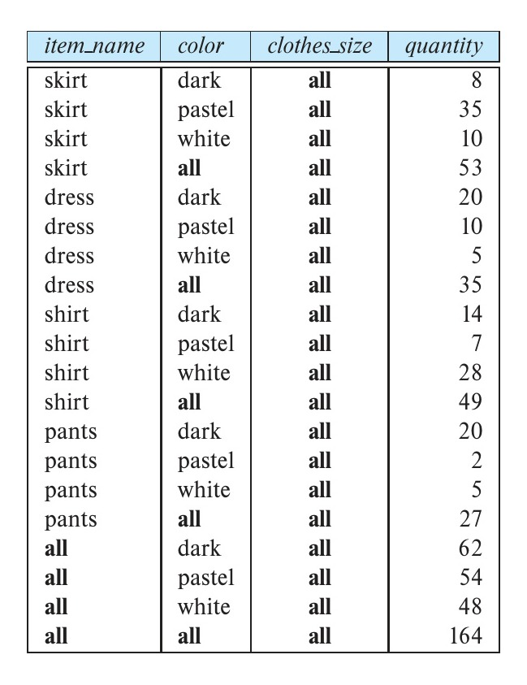
*Figure 11.8 — Relational representation of the data in Figure 11.4.*

Hierarchies can also be represented by relations. For example, the fact that skirts and dresses fall under the womenswear category and the pants and shirts under the menswear category can be represented by a relation:

```text
itemcategory (item_name, category)
```

This relation can be joined with the *sales* relation to get a relation that includes the category for each item. Aggregation on this joined relation allows us to get a cross-tab with hierarchy. As another example, a hierarchy on city can be represented by a single relation:

```text
city_hierarchy (ID, city, state, country, region)
```

or by multiple relations, each mapping values in one level of the hierarchy to values at the next level. We assume here that cities have unique identifiers, stored in the attribute ID, to avoid confusing between two cities with the same name, for example, the Springfield in Missouri and the Springfield in Illinois.

### 11.3.3 OLAP in SQL

Analysts using OLAP systems need answers to multiple aggregates to be generated interactively, without having to wait for multiple minutes or hours. This led initially to the development of specialized systems for OLAP (see Note 11.1 on page 535). Many database systems now implement OLAP along with SQL constructs to express OLAP queries. As we saw in Section 5.5.3, several SQL implementations, such as Microsoft

<!-- Page 534 -->

SQL Server and Oracle, support a **pivot** clause that allows creation of cross-tabs. Given the *sales* relation from Figure 11.3, the query:

```sql
select *
from sales
pivot (
    sum(quantity)
    for color in ('dark', 'pastel', 'white')
)
order by item_name;
```

returns the cross-tab shown in Figure 11.9. Note that the **for** clause within the **pivot** clause specifies the *color* values that appear as attribute names in the pivot result. The attribute *color* itself does not appear in the result, although all other attributes are retained, except that the values for the newly created attributes are specified to come from the attribute *quantity*. In case more than one tuple contributes values to a given cell, the aggregate operation within the **pivot** clause specifies how the values should be combined. In the above example, the *quantity* values are summed up.

Note that the pivot clause by itself does not compute the subtotals we saw in the pivot table from Figure 11.4. However, we can first generate the relational representation shown in Figure 11.8, using a cube operation, as outlined shortly, and then apply the pivot clause on that representation to get an equivalent result. In this case, the value **all** must also be listed in the **for** clause, and the **order by** clause needs to be modified to order **all** at the end.

The data in a data cube cannot be generated by a single SQL query if we use only the basic **group by** constructs, since aggregates are computed for several different groupings

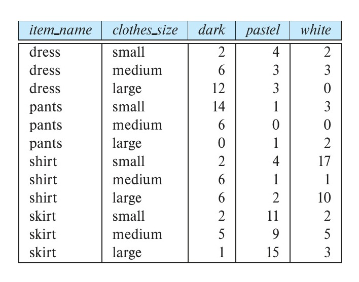
*Figure 11.9 — Result of SQL pivot operation on the sales relation of Figure 11.3.*

<!-- Page 535 -->

> ### Note 11.1: OLAP IMPLEMENTATION
>
> The earliest OLAP systems used multidimensional arrays in memory to store data cubes and are referred to as **multidimensional OLAP** (**MOLAP**) systems. Later, OLAP facilities were integrated into relational systems, with data stored in a relational database. Such systems are referred to as **relational OLAP** (**ROLAP**) systems. Hybrid systems, which store some summaries in memory and store the base data and other summaries in a relational database, are called **hybrid OLAP** (**HOLAP**) systems.
>
> Many OLAP systems are implemented as client-server systems. The server contains the relational database as well as any MOLAP data cubes. Client systems obtain views of the data by communicating with the server.
>
> A naïve way of computing the entire data cube (all groupings) on a relation is to use any standard algorithm for computing aggregate operations, one grouping at a time. The naïve algorithm would require a large number of scans of the relation. A simple optimization is to compute an aggregation on, say, (*item_name*, *color*) from an aggregation (*item_name*, *color*, *clothes_size*), instead of from the original relation. The amount of data read drops significantly by computing an aggregate from another aggregate, instead of from the original relation. Further improvements are possible; for instance, multiple groupings can be computed on a single scan of the data.
>
> Early OLAP implementations precomputed and stored entire data cubes, that is, groupings on all subsets of the dimension attributes. Precomputation allows OLAP queries to be answered within a few seconds, even on datasets that may contain millions of tuples adding up to gigabytes of data. However, there are $2^n$ groupings with $n$ dimension attributes; hierarchies on attributes increase the number further. As a result, the entire data cube is often larger than the original relation that formed the data cube and in many cases it is not feasible to store the entire data cube.
>
> Instead of precomputing and storing all possible groupings, it makes sense to precompute and store some of the groupings, and to compute others on demand. Instead of computing queries from the original relation, which may take a very long time, we can compute them from other precomputed queries. For instance, suppose that a query requires grouping by (*item_name*, *color*), and this has not been precomputed. The query result can be computed from summaries by (*item_name*, *color*, *clothes_size*), if that has been precomputed. See the bibliographical notes for references on how to select a good set of groupings for precomputation, given limits on the storage available for precomputed results.

<!-- Page 536 -->

of the dimension attributes. Using only the basic group by construct, we would have to write many separate SQL queries and combine them using a union operation. SQL supports special syntax to allow multiple group by operations to be specified concisely.

As we saw in Section 5.5.4, SQL supports generalizations of the group by construct to perform the cube and rollup operations. The cube and rollup constructs in the group by clause allow multiple group by queries to be run in a single query with the result returned as a single relation in a style similar to that of the relation of Figure 11.8.

Consider again our retail shop example and the relation:

```text
sales (item_name, color, clothes_size, quantity)
```

If we want to generate the entire data cube using individual group by queries, we have to write a separate query for each of the following eight sets of group by attributes:

```text
{ (item_name, color, clothes_size), (item_name, color), (item_name, clothes_size),
  (color, clothes_size), (item_name), (color), (clothes_size), () }
```

where () denotes an empty group by list.

As we saw in Section 5.5.4, the **cube** construct allows us to accomplish this in one query:

```sql
select item_name, color, clothes_size, sum(quantity)
from sales
group by cube(item_name, color, clothes_size);
```

The preceding query produces a relation whose schema is:

```text
(item_name, color, clothes_size, sum(quantity))
```

So that the result of this query is indeed a relation, tuples in the result contain null as the value of those attributes not present in a particular grouping. For example, tuples produced by grouping on clothes size have a schema (clothes size, sum(quantity)). They are converted to tuples on (item name, color, clothes size, sum(quantity)) by inserting null for item name and color.

Data cube relations are often very large. The cube query above, with 3 possible colors, 4 possible item names, and 3 sizes, has 80 tuples. The relation of Figure 11.8 is generated by doing a group by cube on item name and color, with an extra column specified in the select clause showing **all** for clothes size.

To generate that relation in SQL, we substitute all for null using the **grouping** function, as we saw earlier in Section 5.5.4. The grouping function distinguishes those nulls generated by OLAP operations from “normal” nulls actually stored in the database or arising from an outer join. Recall that the grouping function returns 1 if its argument

<!-- Page 537 -->

is a null value generated by a **cube** or **rollup** and 0 otherwise. We may then operate on the result of a call to **grouping** using **case** expressions to replace OLAP-generated nulls with **all**. Then the relation in Figure 11.8, with occurrences of *null* replaced by **all**, can be computed by the query:

```sql
select case when grouping(item_name) = 1 then 'all'
            else item_name end as item_name,
       case when grouping(color) = 1 then 'all'
            else color end as color,
       'all' as clothes_size, sum(quantity) as quantity
from sales
group by cube(item_name, color);
```

The **rollup** construct is the same as the cube construct except that rollup generates fewer group by queries. We saw that `group by cube(item_name, color, clothes_size)` generated all eight ways of forming a group by query using some (or all or none) of the attributes. In:

```sql
select item_name, color, clothes_size, sum(quantity)
from sales
group by rollup(item_name, color, clothes_size);
```

the clause `group by rollup(item_name, color, clothes_size)` generates only four groupings:

```text
{ (item_name, color, clothes_size), (item_name, color), (item_name), () }
```

Notice that the order of the attributes in the **rollup** makes a difference; the last attribute (*clothes_size*, in our example) appears in only one grouping, the penultimate (second last) attribute in two groupings, and so on, with the first attribute appearing in all groups but one (the empty grouping).

Why might we want the specific groupings that are used in **rollup**? These groups are of frequent practical interest for hierarchies (as in Figure 11.6, for example). For the location hierarchy (*Region, Country, State, City*), we may want to group by *Region* to get sales by region. Then we may want to “drill down” to the level of countries within each region, which means we would group by *Region, Country*. Drilling down further, we may wish to group by *Region, Country, State* and then by *Region, Country, State, City*. The **rollup** construct allows us to specify this sequence of drilling down for further detail.

As we saw earlier in Section 5.5.4, multiple **rollup**s and **cube**s can be used in a single **group by** clause. For instance, the following query:

```sql
select item_name, color, clothes_size, sum(quantity)
from sales
group by rollup(item_name), rollup(color, clothes_size);
```

<!-- Page 538 -->

generates the groupings:

```text
{ (item_name, color, clothes_size), (item_name, color), (item_name),
  (color, clothes_size), (color), () }
```

To understand why, observe that `rollup(item_name)` generates two groupings, {(*item_name*), ()}, and `rollup(color, clothes_size)` generates three groupings, {(*color*, *clothes_size*), (*color*), ()}. The Cartesian product of the two gives us the six groupings shown.

Neither the **rollup** nor the **cube** clause gives complete control on the groupings that are generated. For instance, we cannot use them to specify that we want only groupings {(*color*, *clothes_size*), (*clothes_size*, *item_name*)}. Such restricted groupings can be generated by using the **grouping sets** construct, in which one can specify the specific list of groupings to be used. To obtain only groupings {(*color*, *clothes_size*), (*clothes_size*, *item_name*)}, we would write:

```sql
select item_name, color, clothes_size, sum(quantity)
from sales
group by grouping sets ((color, clothes_size), (clothes_size, item_name));
```

Specialized languages have been developed for querying multidimensional OLAP schemas, which allow some common tasks to be expressed more easily than with SQL. These include the MDX and DAX query languages developed by Microsoft.

### 11.3.4 Reporting and Visualization Tools

Report generators are tools to generate human-readable summary reports from a database. They integrate querying the database with the creation of formatted text and summary charts (such as bar or pie charts). For example, a report may show the total sales in each of the past 2 months for each sales region.

The application developer can specify report formats by using the formatting facilities of the report generator. Variables can be used to store parameters such as the month and the year and to define fields in the report. Tables, graphs, bar charts, or other graphics can be defined via queries on the database. The query definitions can make use of the parameter values stored in the variables.

Once we have defined a report structure on a report-generator facility, we can store it and can execute it at any time to generate a report. Report-generator systems provide a variety of facilities for structuring tabular output, such as defining table and column headers, displaying subtotals for each group in a table, automatically splitting long tables into multiple pages, and displaying subtotals at the end of each page.

Figure 11.10 is an example of a formatted report. The data in the report are generated by aggregation on information about orders.

Report-generation tools are available from a variety of vendors, such as SAP Crystal Reports and Microsoft (SQL Server Reporting Services). Several application suites, such as Microsoft Office, provide a way of embedding formatted query results from

<!-- Page 539 -->

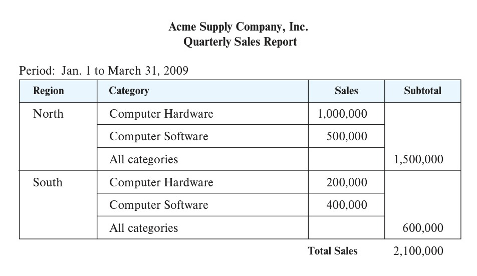
*Figure 11.10 — A formatted report.*

a database directly into a document. Chart-generation facilities provided by Crystal Reports or by spreadsheets such as Excel can be used to access data from databases and to generate tabular depictions of data or graphical depictions using charts or graphs. Such charts can be embedded within text documents. The charts are created initially from data generated by executing queries against the database; the queries can be re-executed and the charts regenerated when required, to generate a current version of the overall report.

Techniques for **data visualization**, that is, graphical representation of data, that go beyond the basic chart types, are very important for data analysis. Data-visualization systems help users to examine large volumes of data and to detect patterns visually. Visual displays of data—such as maps, charts, and other graphical representations—allow data to be presented compactly to users. A single graphical screen can encode as much information as a far larger number of text screens.

For example, if the user wants to find out whether the occurrence of a disease is correlated to the locations of the patients, the locations of patients can be encoded in a special color—say, red—on a map. The user can then quickly discover locations where problems are occurring. The user may then form hypotheses about why problems are occurring in those locations and may verify the hypotheses quantitatively against the database.

As another example, information about values can be encoded as a color and can be displayed with as little as one pixel of screen area. To detect associations between pairs of items, we can use a two-dimensional pixel matrix, with each row and each column representing an item. The percentage of transactions that buy both items can be encoded by the color intensity of the pixel. Items with high association will show up as bright pixels in the screen—easy to detect against the darker background.

<!-- Page 540 -->

In recent years a number of tools have been developed for web-based data visualization and for the creation of dashboards that display multiple charts showing key organizational information. These include Tableau (www.tableau.com), FusionCharts (www.fusioncharts.com), plotly (plot.ly), Datawrapper (www.datawrapper.de), and Google Charts (developers.google.com/chart), among others. Since their display is based on HTML and JavaScript, they can be used on a wide variety of browsers and on mobile devices.

Interaction is a key element of visualization. For example, a user can “drill down” into areas of interest, such as moving from an aggregate view showing the total sales across an entire year to the monthly sales figures for a particular year. Analysts may wish to interactively add selection conditions to visualize subsets of data. Data visualization tools such as Tableau offer a rich set of features for interactive visualization.

## 11.4 Data Mining

The term **data mining** refers loosely to the process of analyzing large databases to find useful patterns. Like knowledge discovery in artificial intelligence (also called machine learning) or statistical analysis, data mining attempts to discover rules and patterns from data. However, data mining differs from traditional machine learning and statistics in that it deals with large volumes of data, stored primarily on disk. Today, many machine-learning algorithms also work on very large volumes of data, blurring the distinction between data mining and machine learning. Data-mining techniques form part of the process of **knowledge discovery in databases** (**KDD**).

Some types of knowledge discovered from a database can be represented by a set of **rules**. The following is an example of a rule, stated informally: “Young women with annual incomes greater than \$50,000 are the most likely people to buy small sports cars.” Of course such rules are not universally true and have degrees of “support” and “confidence,” as we shall see. Other types of knowledge are represented by equations relating different variables to each other. More generally, knowledge discovered by applying machine-learning techniques on past instances in a database is represented by a **model**, which is then used for predicting outcomes for new instances. Features or attributes of instances are inputs to the model, and the output of a model is a prediction.

There are a variety of possible types of patterns that may be useful, and different techniques are used to find different types of patterns. We shall study a few examples of patterns and see how they may be automatically derived from a database.

Usually there is a manual component to data mining, consisting of preprocessing data to a form acceptable to the algorithms and post-processing of discovered patterns to find novel ones that could be useful. There may also be more than one type of pattern that can be discovered from a given database, and manual interaction may be needed to pick useful types of patterns. For this reason, data mining is really a semiautomatic process in real life. However, in our description we concentrate on the automatic aspect of mining.

<!-- Page 541 -->

### 11.4.1 Types of Data-Mining Tasks

The most widely used applications of data mining are those that require some sort of prediction. For instance, when a person applies for a credit card, the credit-card company wants to predict if the person is a good credit risk. The prediction is to be based on known attributes of the person, such as age, income, debts, and past debt-repayment history. Rules for making the prediction are derived from the same attributes of past and current credit-card holders, along with their observed behavior, such as whether they defaulted on their credit-card dues. Other types of prediction include predicting which customers may switch over to a competitor (these customers may be offered special discounts to tempt them not to switch), predicting which people are likely to respond to promotional mail (“junk mail”), or predicting what types of phone calling-card usage are likely to be fraudulent.

Another class of applications looks for associations, for instance, books that tend to be bought together. If a customer buys a book, an online bookstore may suggest other associated books. If a person buys a camera, the system may suggest accessories that tend to be bought along with cameras. A good salesperson is aware of such patterns and exploits them to make additional sales. The challenge is to automate the process. Other types of associations may lead to discovery of causation. For instance, discovery of unexpected associations between a newly introduced medicine and cardiac problems led to the finding that the medicine may cause cardiac problems in some people. The medicine was then withdrawn from the market.

Associations are an example of descriptive patterns. Clusters are another example of such patterns. For example, over a century ago a cluster of typhoid cases was found around a well, which led to the discovery that the water in the well was contaminated and was spreading typhoid. Detection of clusters of disease remains important even today.

### 11.4.2 Classification

Abstractly, the classification problem is this: Given that items belong to one of several classes, and given past instances (called training instances) of items along with the classes to which they belong, the problem is to predict the class to which a new item belongs. The class of the new instance is not known, so other attributes of the instance must be used to predict the class.

As an example, suppose that a credit-card company wants to decide whether or not to give a credit card to an applicant. The company has a variety of information about the person, such as her age, educational background, annual income, and current debts, that it can use for making a decision.

To make the decision, the company assigns a credit worthiness level of *excellent*, *good*, *average*, or *bad* to each of a sample set of current or past customers according to each customer’s payment history. These instances form the set of training instances.

Then, the company attempts to learn rules or models that classify the credit-worthiness of a new applicant as excellent, good, average, or bad, on the basis of the

<!-- Page 542 -->

information about the person, other than the actual payment history (which is unavailable for new customers). There are a number of techniques for classification, and we outline a few of them in this section.

#### 11.4.2.1 Decision-Tree Classifiers

**Decision-tree classifiers** are a widely used technique for classification. As the name suggests, decision-tree classifiers use a tree; each leaf node has an associated class, and each internal node has a predicate (or more generally, a function) associated with it. Figure 11.11 shows an example of a decision tree. To keep the example simple, we use just two attributes: education level (highest degree earned) and income.

To classify a new instance, we start at the root and traverse the tree to reach a leaf; at an internal node we evaluate the predicate (or function) on the data instance to find which child to go to. The process continues until we reach a leaf node. For example, if the degree level of a person is masters, and the person’s income is 40K, starting from the root we follow the edge labeled “masters,” and from there the edge labeled “25K to 75K,” to reach a leaf. The class at the leaf is “good,” so we predict that the credit risk of that person is good.

There are a number of techniques for building decision-tree classifiers from a given training set. We omit details, but you can learn more details from the references provided in the Further Reading section.

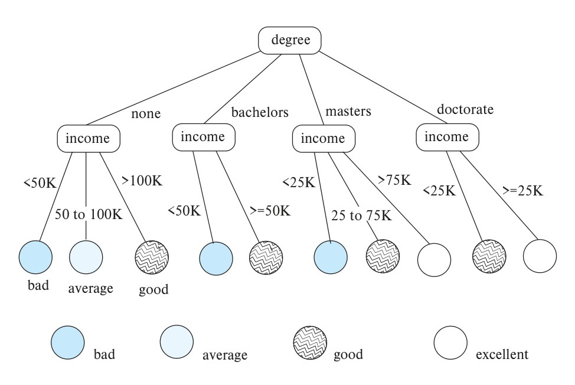
*Figure 11.11 — Classification tree.*

<!-- Page 543 -->

#### 11.4.2.2 Bayesian Classifiers

**Bayesian classifiers** find the distribution of attribute values for each class in the training data; when given a new instance $d$, they use the distribution information to estimate, for each class $c_j$, the probability that instance $d$ belongs to class $c_j$, denoted by $p(c_j|d)$, in a manner outlined here. The class with maximum probability becomes the predicted class for instance $d$.

To find the probability $p(c_j|d)$ of instance $d$ being in class $c_j$, Bayesian classifiers use **Bayes’ theorem**, which says:

$$p(c_j|d) = \frac{p(d|c_j)p(c_j)}{p(d)}$$

where $p(d|c_j)$ is the probability of generating instance $d$ given class $c_j$, $p(c_j)$ is the probability of occurrence of class $c_j$, and $p(d)$ is the probability of instance $d$ occurring. Of these, $p(d)$ can be ignored since it is the same for all classes. $p(c_j)$ is simply the fraction of training instances that belong to class $c_j$.

For example, let us consider a special case where only one attribute, *income*, is used for classification, and suppose we need to classify a person whose income is 76,000. We assume that income values are broken up into buckets, and we assume that the bucket containing 76,000 contains values in the range (75,000, 80,000). Suppose among instances of class *excellent*, the probability of income being in (75,000, 80,000) is 0.1, while among instances of class *good*, the probability of income being in (75,000, 80,000) is 0.05. Suppose also that overall 0.1 fraction of people are classified as *excellent*, and 0.3 are classified as *good*. Then, $p(d|c_j)p(c_j)$ for class *excellent* is .01, while for class *good*, it is 0.015. The person would therefore be classified in class *good*.

In general, multiple attributes need to be considered for classification. Then, finding $p(d|c_j)$ exactly is difficult, since it requires the distribution of instances of $c_j$, across all combinations of values for the attributes used for classification. The number of such combinations (for example of income buckets, with degree values and other attributes) can be very large. With a limited training set used to find the distribution, most combinations would not have even a single training set matching them, leading to incorrect classification decisions. To avoid this problem, as well as to simplify the task of classification, **naive Bayesian classifiers** assume attributes have independent distributions and thereby estimate:

$$p(d|c_j) = p(d_1|c_j) * p(d_2|c_j) * \cdots * p(d_n|c_j)$$

That is, the probability of the instance $d$ occurring is the product of the probability of occurrence of each of the attribute values $d_i$ of $d$, given the class is $c_j$.

The probabilities $p(d_i|c_j)$ derive from the distribution of values for each attribute $i$, for each class $c_j$. This distribution is computed from the training instances that belong to each class $c_j$; the distribution is usually approximated by a histogram. For instance, we may divide the range of values of attribute $i$ into equal intervals, and store the fraction of instances of class $c_j$ that fall in each interval. Given a value $d_i$ for attribute $i$, the

<!-- Page 544 -->

value of $p(d_i|c_j)$ is simply the fraction of instances belonging to class $c_j$ that fall in the interval to which $d_i$ belongs.

#### 11.4.2.3 Support Vector Machine Classifiers

The **Support Vector Machine** (**SVM**) is a type of classifier that has been found to give very accurate classification across a range of applications. We provide some basic information about Support Vector Machine classifiers here; see the references in the bibliographical notes for further information.

Support Vector Machine classifiers can best be understood geometrically. In the simplest case, consider a set of points in a two-dimensional plane, some belonging to class $A$, and some belonging to class $B$. We are given a training set of points whose class ($A$ or $B$) is known, and we need to build a classifier of points using these training points. This situation is illustrated in Figure 11.12, where the points in class $A$ are denoted by X marks, while those in class $B$ are denoted by O marks.

Suppose we can draw a line on the plane, such that all points in class $A$ lie to one side and all points in line $B$ lie to the other. Then, the line can be used to classify new points, whose class we don’t already know. But there may be many possible such lines that can separate points in class $A$ from points in class $B$. A few such lines are shown in Figure 11.12. The Support Vector Machine classifier chooses the line whose distance from the nearest point in either class (from the points in the training dataset) is maximum. This line (called the *maximum margin line*) is then used to classify other points into class $A$ or $B$, depending on which side of the line they lie on. In Figure 11.12, the maximum margin line is shown in bold, while the other lines are shown as dashed lines.

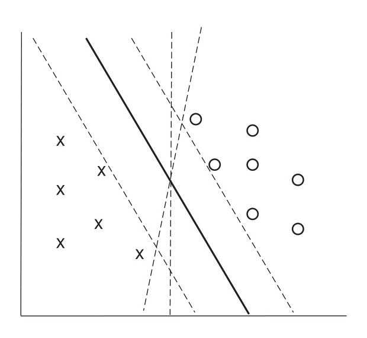
*Figure 11.12 — Example of a Support Vector Machine classifier.*

<!-- Page 545 -->

The preceding intuition can be generalized to more than two dimensions, allowing multiple attributes to be used for classification; in this case, the classifier finds a dividing plane, not a line. Further, by first transforming the input points using certain functions, called *kernel functions*, Support Vector Machine classifiers can find nonlinear curves separating the sets of points. This is important for cases where the points are not separable by a line or plane. In the presence of noise, some points of one class may lie in the midst of points of the other class. In such cases, there may not be any line or meaningful curve that separates the points in the two classes; then, the line or curve that most accurately divides the points into the two classes is chosen.

Although the basic formulation of Support Vector Machines is for binary classifiers, i.e., those with only two classes, they can be used for classification into multiple classes as follows: If there are $N$ classes, we build $N$ classifiers, with classifier $i$ performing a binary classification, classifying a point either as in class $i$ or not in class $i$. Given a point, each classifier $i$ also outputs a value indicating how related a given point is to class $i$. We then apply all $N$ classifiers on a given point and choose the class for which the relatedness value is the highest.

#### 11.4.2.4 Neural Network Classifiers

Neural-net classifiers use the training data to train artificial neural nets. There is a large body of literature on neural nets; we do not provide details here, but we outline a few key properties of neural network classifiers.

Neural networks consist of several layers of “neurons,” each of which are connected to neurons in the preceding layer. An input instance of the problem is fed to the first layer; neurons at each layer are “activated” based on some function applied to the inputs at the preceding layer. The function applied at each neuron computes a weighted combination of the activations of the input neurons and generates an output based on the weighted combination. The activation of a neuron in one layer thus affects the activation of neurons in the next layer. The final output layer typically has one neuron corresponding to each class of the classification problem being addressed. The neuron with maximum activation for a given input decides the predicted class for that input.

Key to the success of a neural network is the weights used in the computation described above. These weights are learned, based on training data. They are initially set to some default value, and then training data are used to learn the weights. Training is typically done by applying each input to the current state of the neural network and checking if the prediction is correct. If not, a backpropagation algorithm is used to tweak the weights of the neurons in the network, to bring the prediction closer to the correct one for the current input. Repeating this process results in a trained neural network, which can then be used for classification on new inputs.

In recent years, neural networks have achieved a great degree of success for tasks which were earlier considered very hard, such as vision (e.g., recognition of objects in images), speech recognition, and natural language translation. A simple example of a vision task is that of identifying the species, such as cat or dog, given an image of

<!-- Page 546 -->

an animal; such problems are basically classification problems. Other examples include identifying object occurrences in an image and assigning a class label to each identified object.

Deep neural networks, which are neural networks with a large number of layers, have proven very successful at such tasks, if given a very large number of training instances. The term **deep learning** refers to the machine-learning techniques that create such deep neural networks, and train them on very large numbers of training instances.

### 11.4.3 Regression

Regression deals with the prediction of a value, rather than a class. Given values for a set of variables, $X_1, X_2, \ldots, X_n$, we wish to predict the value of a variable $Y$. For instance, we could treat the level of education as a number and income as another number, and, on the basis of these two variables, we wish to predict the likelihood of default, which could be a percentage chance of defaulting, or the amount involved in the default.

One way is to infer coefficients $a_0, a_1, a_2, \ldots, a_n$ such that:

$$Y = a_0 + a_1 * X_1 + a_2 * X_2 + \cdots + a_n * X_n$$

Finding such a linear polynomial is called **linear regression**. In general, we wish to find a curve (defined by a polynomial or other formula) that fits the data; the process is also called **curve fitting**.

The fit may be only approximate, because of noise in the data or because the relationship is not exactly a polynomial, so regression aims to find coefficients that give the best possible fit. There are standard techniques in statistics for finding regression coefficients. We do not discuss these techniques here, but the bibliographical notes provide references.

### 11.4.4 Association Rules

Retail shops are often interested in associations between different items that people buy. Examples of such associations are:

- Someone who buys bread is quite likely also to buy milk.
- A person who bought the book *Database System Concepts* is quite likely also to buy the book *Operating System Concepts*.

Association information can be used in several ways. When a customer buys a particular book, an online shop may suggest associated books. A grocery shop may decide to place bread close to milk, since they are often bought together, to help shoppers finish their task faster. Or, the shop may place them at opposite ends of a row and place other associated items in between to tempt people to buy those items as well as the shoppers walk from one end of the row to the other. A shop that offers discounts on one associ-

<!-- Page 547 -->

ated item may not offer a discount on the other, since the customer will probably buy the other anyway.

An example of an association rule is:

$$\text{bread} \Rightarrow \text{milk}$$

In the context of grocery-store purchases, the rule says that customers who buy bread also tend to buy milk with a high probability. An association rule must have an associated population: The population consists of a set of instances. In the grocery-store example, the population may consist of all grocery-store purchases; each purchase is an instance. In the case of a bookstore, the population may consist of all people who made purchases, regardless of when they made a purchase. Each customer is an instance. In the bookstore example, the analyst has decided that when a purchase is made is not significant, whereas for the grocery-store example, the analyst may have decided to concentrate on single purchases, ignoring multiple visits by the same customer.

Rules have an associated **support**, as well as an associated **confidence**. These are defined in the context of the population:

- **Support** is a measure of what fraction of the population satisfies both the antecedent and the consequent of the rule.

  For instance, suppose only 0.001 percent of all purchases include milk and screwdrivers. The support for the rule:

  $$\text{milk} \Rightarrow \text{screwdrivers}$$

  is low. The rule may not even be statistically significant—perhaps there was only a single purchase that included both milk and screwdrivers. Businesses are usually not interested in rules that have low support, since they involve few customers and are not worth bothering about.

  On the other hand, if 50 percent of all purchases involve milk and bread, then support for rules involving bread and milk (and no other item) is relatively high, and such rules may be worth attention. Exactly what minimum degree of support is considered desirable depends on the application.
- **Confidence** is a measure of how often the consequent is true when the antecedent is true. For instance, the rule:

  $$\text{bread} \Rightarrow \text{milk}$$

  has a confidence of 80 percent if 80 percent of the purchases that include bread also include milk. A rule with a low confidence is not meaningful. In business applications, rules usually have confidences significantly less than 100 percent, whereas in other domains, such as in physics, rules may have high confidences.

Note that the confidence of $\text{bread} \Rightarrow \text{milk}$ may be very different from the confidence of $\text{milk} \Rightarrow \text{bread}$, although both have the same support.

<!-- Page 548 -->

### 11.4.5 Clustering

Intuitively, clustering refers to the problem of finding clusters of points in the given data. The problem of **clustering** can be formalized from distance metrics in several ways. One way is to phrase it as the problem of grouping points into $k$ sets (for a given $k$) so that the average distance of points from the **centroid** of their assigned cluster is minimized.[^3] Another way is to group points so that the average distance between every pair of points in each cluster is minimized. There are other definitions too; see the bibliographical notes for details. But the intuition behind all these definitions is to group similar points together in a single set.

Another type of clustering appears in classification systems in biology. (Such classification systems do not attempt to *predict* classes; rather they attempt to cluster related items together.) For instance, leopards and humans are clustered under the class mammalia, while crocodiles and snakes are clustered under reptilia. Both mammalia and reptilia come under the common class chordata. The clustering of mammalia has further subclusters, such as carnivora and primates. We thus have **hierarchical clustering**. Given characteristics of different species, biologists have created a complex hierarchical clustering scheme grouping related species together at different levels of the hierarchy.

The statistics community has studied clustering extensively. Database research has provided scalable clustering algorithms that can cluster very large datasets (that may not fit in memory).

An interesting application of clustering is to predict what new movies (or books or music) a person is likely to be interested in on the basis of:

1. The person’s past preferences in movies.
2. Other people with similar past preferences.
3. The preferences of such people for new movies.

One approach to this problem is as follows: To find people with similar past preferences we create clusters of people based on their preferences for movies. The accuracy of clustering can be improved by previously clustering movies by their similarity, so even if people have not seen the same movies, if they have seen similar movies they would be clustered together. We can repeat the clustering, alternately clustering people, then movies, then people, and so on until we reach an equilibrium. Given a new user, we find a cluster of users most similar to that user, on the basis of the user’s preferences for movies already seen. We then predict movies in movie clusters that are popular with that user’s cluster as likely to be interesting to the new user. In fact, this problem

[^3]: The centroid of a set of points is defined as a point whose coordinate on each dimension is the average of the coordinates of all the points of that set on that dimension. For example, in two dimensions, the centroid of a set of points $\{ (x_1, y_1), (x_2, y_2), \ldots, (x_n, y_n) \}$ is given by
$$\left( \frac{\sum_{i=1}^n x_i}{n}, \frac{\sum_{i=1}^n y_i}{n} \right).$$

<!-- Page 549 -->

is an instance of *collaborative filtering*, where users collaborate in the task of filtering information to find information of interest.

### 11.4.6 Text Mining

**Text mining** applies data-mining techniques to textual documents. There are a number of different text mining tasks. One such task is **sentiment analysis**. For example, suppose a company wishes to find out how users have reacted to a new product. There are typically a large number of product reviews on the web—for example, reviews by different users on e-commerce platforms. Reading each review to find out reactions is not practical for a human. Instead, the company may analyze reviews to find the *sentiment* of the reviews of the product; the sentiment could be positive, negative, or neutral. The occurrence of specific words such as excellent, good, awesome, beautiful, and so on are correlated with a positive sentiment, while words such as awful, average, worthless, poor quality, and so on are correlated with a negative sentiment. Sentiment analysis techniques can be used to analyze the reviews and come up with an overall score reflecting the broad sense of the reviews.

Another task is **information extraction**, which creates structured information from unstructured textual descriptions, or semi-structured data such as tabular displays of data in documents. A key subtask of this process is **entity recognition**, that is, the task of identifying mentions of entities in text and disambiguating them. For example, an article may mention the name Michael Jordan. There are at least two famous people named Michael Jordan: one was a basketball player, while the other is a professor who is a well known machine-learning expert. **Disambiguation** is the process of figuring out which of these two is being referred to in a particular article, and it can be done based on the article context; in this case, an occurrence of the name Michael Jordan in a sports article probably refers to the basketball player, while an occurrence in a machine-learning paper probably refers to the professor. After entity recognition, other techniques may be used to learn attributes of entities and to learn relationships between entities.

Information extraction can be used in many ways. For example, it can be used to analyze customer support conversations or reviews posted on social media, to judge customer satisfaction, and to decide when intervention is needed to retain customers. Service providers may want to know what aspect of the service such as pricing, quality, hygiene, or behavior of the person providing the service, a review was positive or negative about; information extraction techniques can be used to infer what aspect an article or a part of an article is about, and to infer the associated sentiment. Attributes such as the location of service can also be extracted and are important for taking corrective action.

Information extracted from the enormous collection of documents and other resources on the web can be valuable for many tasks. Such extracted information can be represented in a graph, called a **knowledge graph**, which we outlined in Section 8.1.4. Such knowledge graphs are used by web search engines to generate more meaningful answers to user queries.

<!-- Page 550 -->

## 11.5 Summary

- Data analytics systems analyze online data collected by transaction-processing systems, along with data collected from other sources, to help people make business decisions. Decision-support systems come in various forms, including OLAP systems and data-mining systems.
- Data warehouses help gather and archive important operational data. Warehouses are used for decision support and analysis on historical data, for instance, to predict trends. Data cleansing from input data sources is often a major task in data warehousing. Warehouse schemas tend to be multidimensional, involving one or a few very large fact tables and several much smaller dimension tables.
- Online analytical processing (OLAP) tools help analysts view data summarized in different ways, so that they can gain insight into the functioning of an organization.
  - OLAP tools work on multidimensional data, characterized by dimension attributes and measure attributes.
  - The data cube consists of multidimensional data summarized in different ways. Precomputing the data cube helps speed up queries on summaries of data.
  - Cross-tab displays permit users to view two dimensions of multidimensional data at a time, along with summaries of the data.
  - Drill down, rollup, slicing, and dicing are among the operations that users perform with OLAP tools.
- The SQL standard provides a variety of operators for data analysis, including cube, rollup, and pivot operations.
- Data mining is the process of semiautomatically analyzing large databases to find useful patterns. There are a number of applications of data mining, such as prediction of values based on past examples, finding of associations between purchases, and automatic clustering of people and movies.
- Classification deals with predicting the class of test instances by using attributes of the test instances, based on attributes of training instances, and the actual class of training instances. There are several types of classifiers, such as:
  - Decision-tree classifiers, which perform classification by constructing a tree based on training instances with leaves having class labels.
  - Bayesian classifiers, which are based on probability theory.
  - The support vector machine is another widely used classification technique.
  - Neural networks, and in particular deep learning, has been very successful in classification and related tasks in the context of vision, speech recognition, and language understanding and translation.

<!-- Page 551 -->

- Association rules identify items that co-occur frequently, for instance, items that tend to be bought by the same customer. Correlations look for deviations from expected levels of association.
- Other types of data mining include clustering and text mining.

### Review Terms

- Decision-support systems
- Business intelligence
- Data warehousing
  - Gathering data
  - Source-driven architecture
  - Destination-driven architecture
  - Data cleansing
  - Extract, transform, load (ETL)
  - Extract, load, transform (ELT)
- Warehouse schemas
  - Fact table
  - Dimension tables
  - Star schema
  - Snowflake schema
- Column-oriented storage
- Online analytical processing (OLAP)
- Multidimensional data
  - Measure attributes
  - Dimension attributes
  - Hierarchy
  - Cross-tabulation / Pivoting
  - Data cube
  - Rollup and drill down
  - SQL `group by cube`, `group by rollup`
- Data visualization
- Data mining
- Prediction
- Classification
  - Training data
  - Test data
- Decision-tree classifiers
- Bayesian classifiers
  - Bayes’ theorem
  - Naive Bayesian classifiers
- Support Vector Machine (SVM)
- Regression
- Neural-networks
- Deep learning
- Association rules
- Clustering
- Text mining
  - Sentiment analysis
  - Information extraction
  - Named entity recognition
  - Knowledge graph

<!-- Page 552 -->

### Practice Exercises

**11.1** Describe benefits and drawbacks of a source-driven architecture for gathering of data at a data warehouse, as compared to a destination-driven architecture.

**11.2** Draw a diagram that shows how the *classroom* relation of our university example as shown in Appendix A would be stored under a column-oriented storage structure.

**11.3** Consider the *takes* relation. Write an SQL query that computes a cross-tab that has a column for each of the years 2017 and 2018, and a column for **all**, and one row for each course, as well as a row for **all**. Each cell in the table should contain the number of students who took the corresponding course in the corresponding year, with column **all** containing the aggregate across all years, and row **all** containing the aggregate across all courses.

**11.4** Consider the data warehouse schema depicted in Figure 11.2. Give an SQL query to summarize sales numbers and price by store and date, along with the hierarchies on store and date.

**11.5** Classification can be done using *classification rules*, which have a *condition*, a *class*, and a *confidence*; the confidence is the percentage of the inputs satisfying the condition that fall in the specified class.

For example, a classification rule for credit ratings may have a condition that salary is between \$30,000 and \$50,000, and education level is graduate, with the credit rating class of *good*, and a confidence of 80%. A second rule may have a condition that salary is between \$30,000 and \$50,000, and education level is high-school, with the credit rating class of *satisfactory*, and a confidence of 80%. A third rule may have a condition that salary is above \$50,001, with the credit rating class of *excellent*, and confidence of 90%. Show a decision tree classifier corresponding to the above rules.

Show how the decision tree classifier can be extended to record the confidence values.

**11.6** Consider a classification problem where the classifier predicts whether a person has a particular disease. Suppose that 95% of the people tested do not suffer from the disease. Let *pos* denote the fraction of *true positives*, which is 5% of the test cases, and let *neg* denote the fraction of *true negatives*, which is 95% of the test cases. Consider the following classifiers:

- Classifier $C_1$, which always predicts negative (a rather useless classifier, of course).
- Classifier $C_2$, which predicts positive in 80% of the cases where the person actually has the disease but also predicts positive in 5% of the cases where the person does not have the disease.

<!-- Page 553 -->

- Classifier $C_3$, which predicts positive in 95% of the cases where the person actually has the disease but also predicts positive in 20% of the cases where the person does not have the disease.

For each classifier, let $t_{pos}$ denote the *true positive* fraction, that is the fraction of cases where the classifier prediction was positive, and the person actually had the disease. Let $f_{pos}$ denote the *false positive* fraction, that is the fraction of cases where the prediction was positive, but the person did not have the disease. Let $t_{neg}$ denote *true negative* and $f_{neg}$ denote *false negative* fractions, which are defined similarly, but for the cases where the classifier prediction was negative.

a. Compute the following metrics for each classifier:
   i. *Accuracy*, defined as $(t_{pos} + t_{neg}) / (pos + neg)$, that is, the fraction of the time when the classifier gives the correct classification.
   ii. *Recall* (also known as **sensitivity**) defined as $t_{pos} / pos$, that is, how many of the actual positive cases are classified as positive.
   iii. *Precision*, defined as $t_{pos} / (t_{pos} + f_{pos})$, that is, how often the positive prediction is correct.
   iv. *Specificity*, defined as $t_{neg} / neg$.
b. If you intend to use the results of classification to perform further screening for the disease, how would you choose between the classifiers?
c. On the other hand, if you intend to use the result of classification to start medication, where the medication could have harmful effects if given to someone who does not have the disease, how would you choose between the classifiers?

### Exercises

**11.7** Why is column-oriented storage potentially advantageous in a database system that supports a data warehouse?

**11.8** Consider each of the *takes* and *teaches* relations as a fact table; they do not have an explicit measure attribute, but assume each table has a measure attribute *reg_count* whose value is always 1. What would the dimension attributes and dimension tables be in each case. Would the resultant schemas be star schemas or snowflake schemas?

**11.9** Consider the star schema from Figure 11.2. Suppose an analyst finds that monthly total sales (sum of the *price* values of all *sales* tuples) have decreased, instead of growing, from April 2018 to May 2018. The analyst wishes to check if there are specific item categories, stores, or customer countries that are responsible for the decrease.

<!-- Page 554 -->

a. What are the aggregates that the analyst would start with, and what are the relevant drill-down operations that the analyst would need to execute?
b. Write an SQL query that shows the item categories that were responsible for the decrease in sales, ordered by the impact of the category on the sales decrease, with categories that had the highest impact sorted first.

**11.10** Suppose half of all the transactions in a clothes shop purchase jeans, and one-third of all transactions in the shop purchase T-shirts. Suppose also that half of the transactions that purchase jeans also purchase T-shirts. Write down all the (nontrivial) association rules you can deduce from the above information, giving support and confidence of each rule.

**11.11** The organization of parts, chapters, sections, and subsections in a book is related to clustering. Explain why, and to what form of clustering.

**11.12** Suggest how predictive mining techniques can be used by a sports team, using your favorite sport as an example.

### Tools

Data warehouse systems are available from Teradata, Teradata Aster, SAP IQ (formerly known as Sybase IQ), and Amazon Redshift, all of which support parallel processing across a large number of machines. A number of databases including Oracle, SAP HANA, Microsoft SQL Server, and IBM DB2 support data warehouse applications by adding features such as columnar storage. There are a number of commercial ETL tools including tools from Informatica, Business Objects, IBM InfoSphere, Microsoft Azure Data Factory, Microsoft SQL Server Integration Services, Oracle Warehouse Builder, and Pentaho Data Integration. Open-source ETL tools include Apache NiFi (nifi.apache.org), Jasper ETL (www.jaspersoft.com/data-integration) and Talend (sourceforge.net/projects/talend-studio). Apache Kafka (kafka.apache.org) can also be used to build ETL systems.

Most database vendors provide OLAP tools as part of their database systems, or as add-on applications. These include OLAP tools from Microsoft Corp., Oracle, IBM and SAP. The Mondrian OLAP server (github.com/pentaho/mondrian) is an open-source OLAP server. Apache Kylin (kylin.apache.org) is an open-source distributed analytics engine which can process data stored in Hadoop, build OLAP cubes and store them in the HBase key-value store, and then query the stored cubes using SQL. Many companies also provide analysis tools for specific applications, such as customer relationship management.

Tools for visualization include Tableau (www.tableau.com), FusionCharts (www.fusioncharts.com), plotly (plot.ly), Datawrapper (www.datawrapper.de), and Google Charts (developers.google.com/chart).

<!-- Page 555 -->

The Python language is very popular for machine-learning tasks, due to the availability of a number of open-source libraries for machine-learning tasks. The R language is also used widely for statistical analysis and machine learning, for the same reasons. Popular utility libraries in Python include are NumPy (www.numpy.org) which provides operations on arrays and matrices, SciPy (www.scipy.org), which provides linear algebra, optimization and statistics functions, and Pandas (pandas.pydata.org), which provides a relational abstraction of data. Popular machine-learning libraries in Python include SciKit-Learn (scikit-learn.org), which adds image-processing and machine-learning functionality to SciPy. Deep learning libraries in Python include Keras (keras.io), and TensorFlow (www.tensorflow.org) which was developed by Google; TensorFlow provides APIs in several languages, with particularly good support for Python. Text mining is supported by natural language processing libraries, such as NLTK (www.nltk.org) and web crawling libraries, such as Scrapy (scrapy.org). Visualization is supported by libraries such as Matplotlib (matplotlib.org), Plotly (plot.ly) and Bokeh (bokeh.pydata.org).

Open-source tools for data mining include RapidMiner (rapidminer.com), Weka (www.cs.waikato.ac.nz/ml/weka), and Orange (orange.biolab.si). Commercial tools include SAS Enterprise Miner, IBM Intelligent Miner, and Oracle Data Mining.

### Further Reading

[Kimball et al. (2008)] and [Kimball and Ross (2013)] provide textbook coverage of data warehouses and multidimensional modeling.

[Mitchell (1997)] is a classic textbook on machine learning and covers classification techniques in detail. [Goodfellow et al. (2016)] is a definitive text on deep learning. [Witten et al. (2011)] and [Han et al. (2011)] provide textbook coverage of data mining. [Agrawal et al. (1993)] introduced the notion of association rules.

Information about the R language and environment may be found at www.r-project.org; information about the SparkR package, which provides an R frontend to Apache Spark, may be found at spark.apache.org/docs/latest/sparkr.html.

[Chakrabarti (2002)], [Manning et al. (2008)] and [Baeza-Yates and Ribeiro-Neto (2011)] provide textbook description of information retrieval, including extensive coverage of data-mining tasks related to textual and hypertext data, such as classification and clustering.

### Bibliography

- **[Agrawal et al. (1993)]** R. Agrawal, T. Imielinski, and A. Swami, “Mining Association Rules between Sets of Items in Large Databases”, In *Proc. of the ACM SIGMOD Conf. on Management of Data* (1993), pages 207–216.
- **[Baeza-Yates and Ribeiro-Neto (2011)]** R. Baeza-Yates and B. Ribeiro-Neto, *Modern Information Retrieval*, 2nd edition, ACM Press (2011).

<!-- Page 556 -->

- **[Chakrabarti (2002)]** S. Chakrabarti, *Mining the Web: Discovering Knowledge from HyperText Data*, Morgan Kaufmann (2002).
- **[Goodfellow et al. (2016)]** I. Goodfellow, Y. Bengio, and A. Courville, *Deep Learning*, MIT Press (2016).
- **[Han et al. (2011)]** J. Han, M. Kamber, and J. Pei, *Data Mining: Concepts and Techniques*, 3rd edition, Morgan Kaufmann (2011).
- **[Kimball and Ross (2013)]** R. Kimball and M. Ross, “The Data Warehouse Tookit: The Definitive Guide to Dimensional Modeling”, John Wiley and Sons (2013).
- **[Kimball et al. (2008)]** R. Kimball, M. Ross, W. Thornthwaite, J. Mundy, and B. Becker, “The Data Warehouse Lifecycle Toolkit”, John Wiley and Sons (2008).
- **[Manning et al. (2008)]** C. D. Manning, P. Raghavan, and H. Schütze, *Introduction to Information Retrieval*, Cambridge University Press (2008).
- **[Mitchell (1997)]** T. M. Mitchell, *Machine Learning*, McGraw Hill (1997).
- **[Witten et al. (2011)]** I. H. Witten, E. Frank, and M. Hall, *Data Mining: Practical Machine Learning Tools and Techniques with Java Implementations*, 3rd edition, Morgan Kaufmann (2011).

### Credits

The photo of the sailboats in the beginning of the chapter is due to ©Pavel Nesvadba/Shutterstock.
