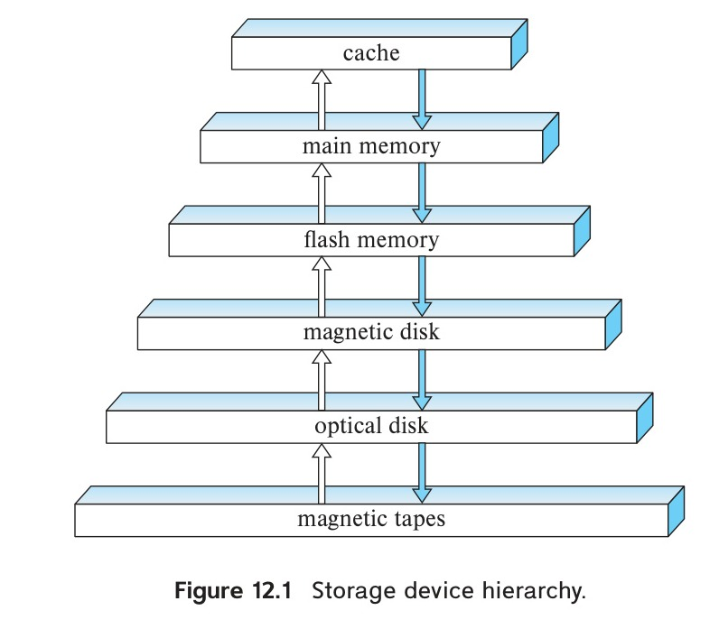
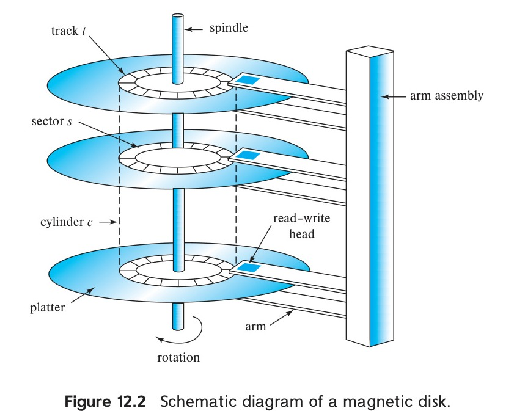
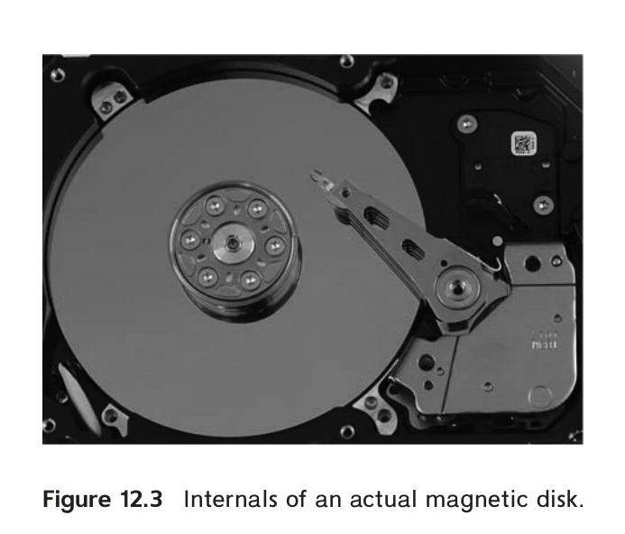
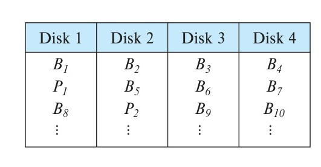

# Part 5: Storage Management and Indexing

<!-- Page 557 -->

Although a database system provides a high-level view of data, ultimately data have to be stored as bits on one or more storage devices. A vast majority of database systems today store data on magnetic disk, with data having higher performance requirements stored on flash-based solid-state drives. Database systems fetch data into main memory for processing, and write data back to storage for persistence. Data are also copied to tapes and other backup devices for archival storage. The physical characteristics of storage devices play a major role in the way data are stored, in particular because access to a random piece of data on magnetic disk is much slower than main-memory access. Magnetic disk access takes tens of milliseconds, flash-based storage access takes 20 to 100 microseconds, whereas main-memory access takes a tenth of a microsecond.

Chapter 12 begins with an overview of physical storage media, including magnetic disks and flash-based solid-state drives (SSD). The chapter then covers mechanisms to minimize the chance of data loss due to device failures, including RAID. The chapter concludes with a discussion of techniques for efficient disk-block access.

Chapter 13 describes how records are mapped to files, which in turn are mapped to bits on the disk. The chapter then covers techniques for the efficient management of the main-memory buffer for disk-based data. Column-oriented storage, used in data analytics systems, is also covered in this chapter.

Many queries reference only a small proportion of the records in a file. An index is a structure that helps locate desired records of a relation quickly, without examining all records. Chapter 14 describes several types of indices used in database systems.

<!-- Page 559 -->

# Chapter 12: Physical Storage Systems

In preceding chapters, we have emphasized the higher-level models of a database. For example, at the *conceptual* or *logical* level, we viewed the database, in the relational model, as a collection of tables. Indeed, the logical model of the database is the correct level for database *users* to focus on. This is because the goal of a database system is to simplify and facilitate access to data; users of the system should not be burdened unnecessarily with the physical details of the implementation of the system.

In this chapter, however, as well as in Chapter 13, Chapter 14, Chapter 15, and Chapter 16, we probe below the higher levels as we describe various methods for implementing the data models and languages presented in preceding chapters. We start with characteristics of the underlying storage media, with a particular focus on magnetic disks and flash-based solid-state disks, and then discuss how to create highly reliable storage structures by using multiple storage devices.

## 12.1 Overview of Physical Storage Media

Several types of data storage exist in most computer systems. These storage media are classified by the speed with which data can be accessed, by the cost per unit of data to buy the medium, and by the medium’s reliability. Among the media typically available are these:

- **Cache.** The cache is the fastest and most costly form of storage. Cache memory is relatively small; its use is managed by the computer system hardware. We shall not be concerned about managing cache storage in the database system. It is, however, worth noting that database implementors do pay attention to cache effects when designing query processing data structures and algorithms, and we shall return to this issue in later chapters.
- **Main memory.** The storage medium used for data that are available to be operated on is main memory. The general-purpose machine instructions operate on main memory. Main memory may contain tens of gigabytes of data on a personal com-

<!-- Page 560 -->

  puter, and even hundreds to thousands of gigabytes of data in large server systems. It is generally too small (or too expensive) for storing the entire database for very large databases, but many enterprise databases can fit in main memory. However, the contents of main memory are lost in the event of a power failure or system crash; main memory is therefore said to be **volatile**.
- **Flash memory.** Flash memory differs from main memory in that stored data are retained even if power is turned off (or fails)—that is, it is **non-volatile**. Flash memory has a lower cost per byte than main memory, but a higher cost per byte than magnetic disks.

  Flash memory is widely used for data storage in devices such as cameras and cell phones. Flash memory is also used for storing data in "USB flash drives," also known as "pen drives," which can be plugged into the Universal Serial Bus (USB) slots of computing devices.

  Flash memory is also increasingly used as a replacement for magnetic disks in personal computers as well as in servers. A **solid-state drive (SSD)** uses flash memory internally to store data but provides an interface similar to a magnetic disk, allowing data to be stored or retrieved in units of a block; such an interface is called a *block-oriented interface*. Block sizes typically range from 512 bytes to 8-kilobytes. As of 2018, a 1-terabyte SSD costs around \$250. We provide more details about flash memory in Section 12.4.
- **Magnetic-disk storage.** The primary medium for the long-term online storage of data is the magnetic disk drive, which is also referred to as the **hard disk drive (HDD)**. Magnetic disk, like flash memory, is non-volatile: that is, magnetic disk storage survives power failures and system crashes. Disks may sometimes fail and destroy data, but such failures are quite rare compared to system crashes or power failures.

  To access data stored on magnetic disk, the system must first move the data from disk to main memory, from where they can be accessed. After the system has performed the designated operations, the data that have been modified must be written to disk.

  Disk capacities have grown steadily over the years. As of 2018, the size of magnetic disks ranges from 500 gigabytes to 14 terabytes, and a 1-terabyte disk costs about \$50, while an 8-terabyte disk around \$150. Although significantly cheaper than SSDs, magnetic disks provide lower performance in terms of number of data access operations that they can support per second. We provide further details about magnetic disks in Section 12.3.
- **Optical storage.** The *digital video disk* (DVD) is an optical storage medium, with data written and read back using a laser light source. The *Blu-ray DVD* format has a capacity of 27 gigabytes to 128 gigabytes, depending on the number of layers supported. Although the original (and still main) use of DVDs was to store video data, they are capable of storing any type of digital data, including backups of

<!-- Page 561 -->

  database contents. DVDs are not suitable for storing active database data since the time required to access a given piece of data can be quite long compared to the time taken by a magnetic disk.

  Some DVD versions are read-only, written at the factory where they are produced, other versions support *write-once*, allowing them to be written once, but not overwritten, and some versions can be rewritten multiple times. Disks that can be written only once are called **write-once, read-many (WORM)** disks.

  Optical disk **jukebox** systems contain a few drives and numerous disks that can be loaded into one of the drives automatically (by a robot arm) on demand.
- **Tape storage.** Tape storage is used primarily for backup and archival data. *Archival data* refers to data that must be stored safely for a long period of time, often for legal reasons. Magnetic tape is cheaper than disks and can safely store data for many years. However, access to data is much slower because the tape must be accessed sequentially from the beginning of the tape; tapes can be very long, requiring tens to hundreds of seconds to access data. For this reason, tape storage is referred to as **sequential-access** storage. In contrast, magnetic disk and SSD storage are referred to as **direct-access** storage because it is possible to read data from any location on disk.

  Tapes have a high capacity (1 to 12 terabyte capacities are currently available), and can be removed from the tape drive. Tape drives tend to be expensive, but individual tapes are usually significantly cheaper than magnetic disks of the same capacity. As a result, tapes are well suited to cheap archival storage and to transferring large amounts of data between different locations. Archival storage of large video files, as well as storage of large volumes of scientific data, which can range up to many petabytes (1 petabyte = $10^{15}$ bytes) of data, are two common use cases for tapes.

  Tape libraries (jukeboxes) are used to hold large collections of tapes, allowing automated storage and retrieval of tapes without human intervention.

The various storage media can be organized in a hierarchy (Figure 12.1) according to their speed and their cost. The higher levels are expensive, but fast. As we move down the hierarchy, the cost per bit decreases, whereas the access time increases. This trade-off is reasonable; if a given storage system were both faster and less expensive than another—other properties being the same—then there would be no reason to use the slower, more expensive memory.

The fastest storage media—for example, cache and main memory—are referred to as **primary storage**. The media in the next level in the hierarchy—for example, flash memory and magnetic disks—are referred to as **secondary storage**, or **online storage**. The media in the lowest level in the hierarchy—for example, magnetic tape and optical-disk jukeboxes—are referred to as **tertiary storage**, or **offline storage**.

In addition to the speed and cost of the various storage systems, there is also the issue of storage volatility. In the hierarchy shown in Figure 12.1, the storage systems

<!-- Page 562 -->

*Figure 12.1 — Storage device hierarchy.*

from main memory up are volatile, whereas the storage systems from flash memory down are non-volatile. Data must be written to non-volatile storage for safekeeping. We shall return to the subject of safe storage of data in the face of system failures later, in Chapter 19.

## 12.2 Storage Interfaces

Magnetic disks as well as flash-based solid-state disks are connected to a computer system through a high-speed interconnection. Disks typically support either the **Serial ATA (SATA)** interface, or the **Serial Attached SCSI (SAS)** interface; the SAS interface is typically used only in servers. The SATA-3 version of SATA nominally supports 6 gigabytes per second, allowing data transfer speeds of up to 600 megabytes per second, while SAS version 3 supports data transfer rates of 12 gigabits per second. The **Non-Volatile Memory Express (NVMe)** interface is a logical interface standard developed to better support SSDs and is typically used with the PCIe interface (the PCIe interface provides high-speed data transfer internal to computer systems).

While disks are usually connected directly by cables to the disk interface of the computer system, they can be situated remotely and connected by a high-speed network to the computer. In the **storage area network (SAN)** architecture, large numbers of disks are connected by a high-speed network to a number of server computers. The disks are usually organized locally using a storage organization technique called *redundant arrays of independent disks* (RAID) (described later, in Section 12.5), to give the servers a logical view of a very large and very reliable disk. Interconnection technologies used

<!-- Page 563 -->

in storage area networks include iSCSI, which allows SCSI commands to be sent over an IP network, Fiber Channel FC, which supports transfer rates of 1.6 to 12 gigabytes per second, depending on the version, and InfiniBand, which provides very low latency high-bandwidth network communication.

**Network attached storage (NAS)** is an alternative to SAN. NAS is much like SAN, except that instead of the networked storage appearing to be a large disk, it provides a file system interface using networked file system protocols such as NFS or CIFS. Recent years have also seen the growth of **cloud storage**, where data are stored in the cloud and accessed via an API. Cloud storage has a very high latency of tens to hundreds of milliseconds, if the data are not co-located with the database, and is thus not ideal as the underlying storage for databases. However, applications often use cloud storage for storing objects. Cloud-based storage systems are discussed further in Section 21.7.

## 12.3 Magnetic Disks

Magnetic disks provide the bulk of secondary storage for modern computer systems. Magnetic disk capacities have been growing steadily year after year, but the storage requirements of large applications have also been growing very fast, in some cases even faster than the growth rate of disk capacities. Very large databases at "web-scale" require thousands to tens of thousands of disks to store their data.[^1]

[^1]: We study later, in Chapter 21, how to partition such large amounts of data across multiple nodes in a parallel computing system.

In recent years, SSD storage sizes have grown rapidly, and the cost of SSDs has come down significantly; the increasing affordability of SSDs coupled with their much better performance has resulted in SSDs increasingly becoming a competitor to magnetic disk storage for several applications. However, the fact that the per-byte cost of storage on SSDs is around six to eight times the per-byte cost of storage on magnetic disks means that magnetic disks continue to be the preferred choice for storing very large volumes of data in many applications. Example of such data include video and image data, as well as data that is accessed less frequently, such as user-generated data in many web-scale applications. SSDs have however, increasingly become the preferred choice for enterprise data.

### 12.3.1 Physical Characteristics of Disks

Figure 12.2 shows a schematic diagram of a magnetic disk, while Figure 12.3 shows the internals of an actual magnetic disk. Each disk **platter** has a flat, circular shape. Its two surfaces are covered with a magnetic material, and information is recorded on the surfaces. Platters are made from rigid metal or glass.

When the disk is in use, a drive motor spins it at a constant high speed, typically 5400 to 10,000 revolutions per minute, depending on the model. There is a read-write head positioned just above the surface of the platter. The disk surface is logically di-

<!-- Page 564 -->

*Figure 12.2 — Schematic diagram of a magnetic disk.*

vided into **tracks**, which are subdivided into **sectors**. A **sector** is the smallest unit of information that can be read from or written to the disk. Sector sizes are typically 512 bytes, and current generation disks have between 2 billion and 24 billion sectors. The inner tracks (closer to the spindle) are of smaller length than the outer tracks, and the outer tracks contain more sectors than the inner tracks.

The **read–write head** stores information on a sector magnetically as reversals of the direction of magnetization of the magnetic material.

*Figure 12.3 — Internals of an actual magnetic disk.*

<!-- Page 565 -->

Each side of a platter of a disk has a read-write head that moves across the platter to access different tracks. A disk typically contains many platters, and the read-write heads of all the tracks are mounted on a single assembly called a **disk arm** and move together. The disk platters mounted on a spindle and the heads mounted on a disk arm are together known as **head-disk assemblies**. Since the heads on all the platters move together, when the head on one platter is on the $i$th track, the heads on all other platters are also on the $i$th track of their respective platters. Hence, the $i$th tracks of all the platters together are called the $i$th **cylinder**.

The read-write heads are kept as close as possible to the disk surface to increase the recording density. The head typically floats or flies only microns from the disk surface; the spinning of the disk creates a small breeze, and the head assembly is shaped so that the breeze keeps the head floating just above the disk surface. Because the head floats so close to the surface, platters must be machined carefully to be flat.

Head crashes can be a problem. If the head contacts the disk surface, the head can scrape the recording medium off the disk, destroying the data that had been there. In older-generation disks, the head touching the surface caused the removed medium to become airborne and to come between the other heads and their platters, causing more crashes; a head crash could thus result in failure of the entire disk. Current-generation disk drives use a thin film of magnetic metal as recording medium. They are much less susceptible to failure of the entire disk, but are susceptible to failure of individual sectors.

A **disk controller** interfaces between the computer system and the actual hardware of the disk drive; in modern disk systems, the disk controller is implemented within the disk drive unit. A disk controller accepts high-level commands to read or write a sector, and initiates actions, such as moving the disk arm to the right track and actually reading or writing the data. Disk controllers also attach **checksums** to each sector that is written; the checksum is computed from the data written to the sector. When the sector is read back, the controller computes the checksum again from the retrieved data and compares it with the stored checksum; if the data are corrupted, with a high probability the newly computed checksum will not match the stored checksum. If such an error occurs, the controller will retry the read several times; if the error continues to occur, the controller will signal a read failure.

Another interesting task that disk controllers perform is **remapping of bad sectors**. If the controller detects that a sector is damaged when the disk is initially formatted, or when an attempt is made to write the sector, it can logically map the sector to a different physical location (allocated from a pool of extra sectors set aside for this purpose). The remapping is noted on disk or in non-volatile memory, and the write is carried out on the new location.

### 12.3.2 Performance Measures of Disks

The main measures of the qualities of a disk are capacity, access time, data-transfer rate, and reliability.

<!-- Page 566 -->

**Access time** is the time from when a read or write request is issued to when data transfer begins. To access (i.e., to read or write) data on a given sector of a disk, the arm first must move so that it is positioned over the correct track, and then must wait for the sector to appear under it as the disk rotates. The time for repositioning the arm is called the **seek time**, and it increases with the distance that the arm must move. Typical seek times range from 2 to 20 milliseconds depending on how far the track is from the initial arm position. Smaller disks tend to have lower seek times since the head has to travel a smaller distance.

The **average seek time** is the average of the seek times, measured over a sequence of (uniformly distributed) random requests. If all tracks have the same number of sectors, and we disregard the time required for the head to start moving and to stop moving, we can show that the average seek time is one-third the worst-case seek time. Taking these factors into account, the average seek time is around one-half of the maximum seek time. Average seek times currently range between 4 and 10 milliseconds, depending on the disk model.[^2]

[^2]: Smaller 2.5-inch diameter disks have a lesser arm movement distance than larger 3.5-inch disks, and thus have lower seek times. As a result 2.5-inch disks have been the preferred choice for applications where latency needs to be minimized, although SSDs are increasingly preferred for such applications. Larger 3.5-inch diameter disks have a lower cost per byte and are used in data storage applications where cost is an important factor.

Once the head has reached the desired track, the time spent waiting for the sector to be accessed to appear under the head is called the **rotational latency time**. Rotational speeds of disks today range from 5400 rotations per minute (90 rotations per second) up to 15,000 rotations per minute (250 rotations per second), or, equivalently, 4 milliseconds to 11.1 milliseconds per rotation. On an average, one-half of a rotation of the disk is required for the beginning of the desired sector to appear under the head. Thus, the **average latency time** of the disk is one-half the time for a full rotation of the disk. Disks with higher rotational speeds are used for applications where latency needs to be minimized.

The access time is then the sum of the seek time and the latency; average access times range from 5 to 20 milliseconds depending on the disk model. Once the first sector of the data to be accessed has come under the head, data transfer begins. The **data-transfer rate** is the rate at which data can be retrieved from or stored to the disk. Current disk systems support maximum transfer rates of 50 to 200 megabytes per second; transfer rates are significantly lower than the maximum transfer rates for inner tracks of the disk, since they have fewer sectors. For example, a disk with a maximum transfer rate of 100 megabytes per second may have a sustained transfer rate of around 30 megabytes per second on its inner tracks.

Requests for disk I/O are typically generated by the file system but can be generated directly by the database system. Each request specifies the address on the disk to be referenced; that address is in the form of a *block number*. A **disk block** is a logical unit of storage allocation and retrieval, and block sizes today typically range from 4 to 16

<!-- Page 567 -->

kilobytes. Data are transferred between disk and main memory in units of blocks. The term **page** is often used to refer to blocks, although in a few contexts (such as flash memory) they refer to different things.

A sequence of requests for blocks from disk may be classified as a sequential access pattern or a random access pattern. In a **sequential access** pattern, successive requests are for successive block numbers, which are on the same track, or on adjacent tracks. To read blocks in sequential access, a disk seek may be required for the first block, but successive requests would either not require a seek, or require a seek to an adjacent track, which is faster than a seek to a track that is farther away. Data transfer rates are highest with a sequential access pattern, since seek time is minimal.

In contrast, in a **random access** pattern, successive requests are for blocks that are randomly located on disk. Each such request would require a seek. The number of **I/O operations per second (IOPS)**, that is, the number random block accesses that can be satisfied by a disk in a second, depends on the access time, and the block size, and the data transfer rate of the disk. With a 4-kilobyte block size, current generation disks support between 50 and 200 IOPS, depending on the model. Since only a small amount (one block) of data are read per seek, the data transfer rate is significantly lower with a random access pattern than with a sequential access pattern.

The final commonly used measure of a disk is the **mean time to failure (MTTF)**,[^3] which is a measure of the reliability of the disk. The mean time to failure of a disk (or of any other system) is the amount of time that, on average, we can expect the system to run continuously without any failure. According to vendors’ claims, the mean time to failure of disks today ranges from 500,000 to 1,200,000 hours—about 57 to 136 years. In practice the claimed mean time to failure is computed on the probability of failure when the disk is new—the figure means that given 1000 relatively new disks, if the MTTF is 1,200,000 hours, on an average one of them will fail in 1200 hours. A mean time to failure of 1,200,000 hours does not imply that the disk can be expected to function for 136 years! Most disks have an expected life span of about 5 years and have significantly higher rates of failure once they become more than a few years old.

[^3]: The term mean time between failures (MTBF) is often used to refer to MTTF in the context of disk drives, although technically MTBF should only be used in the context of systems that can be repaired after failure, and may fail again; MTBF would then be the sum of MTTF and the mean time to repair. Magnetic disks can almost never be repaired after a failure.

## 12.4 Flash Memory

There are two types of flash memory, NOR flash and NAND flash. NAND flash is the variant that is predominantly used for data storage. Reading from NAND flash requires an entire *page* of data, which is very commonly 4096 bytes, to be fetched from NAND flash into main memory. Pages in a NAND flash are thus similar to sectors in a magnetic disk.

<!-- Page 568 -->

Solid-state disks (SSDs) are built using NAND flash and provide the same block-oriented interface as disk storage. Compared to magnetic disks, SSDs can provide much faster random access: the latency to retrieve a page of data ranges from 20 to 100 microseconds for SSDs, whereas a random access on disk would take 5 to 10 milliseconds. The data transfer rate of SSDs is higher than that of magnetic disks and is usually limited by the interconnect technology; transfer rates range from around 500 megabytes per second with SATA interfaces, up to 3 gigabytes per second using NVMe PCIe interfaces, depending on the specific SSD model, in contrast to a maximum of about 200 megabytes per second with magnetic disk. The power consumption of SSDs is also significantly lower than that of magnetic disks.

Writes to flash memory are a little more complicated. A write to a page of flash memory typically takes about 100 microseconds. However, once written, a page of flash memory cannot be directly overwritten. Instead, it has to be erased and rewritten subsequently. The erase operation must be performed on a group of pages, called an **erase block**, erasing all the pages in the block, and takes about 2 to 5 milliseconds. An erase block (often referred to as just "block" in flash literature), is typically 256 kilobytes to 1 megabyte, and contains around 128 to 256 pages. Further, there is a limit to how many times a flash page can be erased, typically around 100,000 to 1,000,000 times. Once this limit is reached, errors in storing bits are likely to occur.

Flash memory systems limit the impact of both the slow erase speed and the update limits by mapping logical page numbers to physical page numbers. When a logical page is updated, it can be remapped to any already erased physical page, and the original location can be erased later. Each physical page has a small area of memory where its logical address is stored; if the logical address is remapped to a different physical page, the original physical page is marked as deleted. Thus, by scanning the physical pages, we can find where each logical page resides. The logical-to-physical page mapping is replicated in an in-memory **translation table** for quick access.

Blocks containing multiple deleted pages are periodically erased, taking care to first copy nondeleted pages in those blocks to a different block (the translation table is updated for these nondeleted pages). Since each physical page can be updated only a fixed number of times, physical pages that have been erased many times are assigned "cold data," that is, data that are rarely updated, while pages that have not been erased many times are used to store "hot data," that is, data that are updated frequently. This principle of evenly distributing erase operations across physical blocks is called **wear leveling** and is usually performed transparently by flash-memory controllers. If a physical page is damaged due to an excessive number of updates, it can be removed from usage, without affecting the flash memory as a whole.

All the above actions are carried out by a layer of software called the **flash translation layer**; above this layer, flash storage looks identical to magnetic disk storage, providing the same page/sector-oriented interface, except that flash storage is much faster. File systems and database storage structures can thus see an identical logical view of the underlying storage structure, regardless of whether it is flash or magnetic storage.

<!-- Page 569 -->

> ### Note 12.1 STORAGE CLASS MEMORY
>
> Although flash is the most widely used type of non-volatile memory, there have been a number of alternative non-volatile memory technologies developed over the years. Several of these technologies allow direct read and write access to individual bytes or words, avoiding the need to read or write in units of pages (and also avoiding the erase overhead of NAND flash). Such types of non-volatile memory are referred to as **storage class memory**, since they can be treated as a large non-volatile block of memory. The 3D-XPoint memory technology, developed by Intel and Micron, is a recently developed storage class memory technology. In terms of cost per byte, latency of access, and capacity, 3D-XPoint memory lies in between main memory and flash memory. Intel Optane SSDs based on 3D-XPoint started shipping in 2017, and Optane persistent memory modules were announced in 2018.

SSD performance is usually expressed in terms of:

1. The *number of random block reads per second*, with 4-kilobyte blocks being the standard. Typical values in 2018 are about 10,000 random reads per second (also referred to as 10,000 IOPS) with 4-kilobyte blocks, although some models support higher rates.

   Unlike magnetic disks, SSDs can support multiple random requests in parallel, with 32 parallel requests being commonly supported; a flash disk with SATA interface supports nearly 100,000 random 4-kilobyte block reads in a second with 32 requests sent in parallel, while SSDs connected using NVMe PCIe can support over 350,000 random 4-kilobyte block reads per second. These numbers are specified as QD-1 for rates without parallelism and QD-$n$ for $n$-way parallelism, with QD-32 being the most commonly used number.
2. The *data transfer rate for sequential reads and sequential writes*. Typical rates for both sequential reads and sequential writes are 400 to 500 megabytes per second for SSDs with a SATA 3 interface, and 2 to 3 gigabytes per second for SSDs using NVMe over the PCIe 3.0x4 interface.
3. The *number of random block writes per second*, with 4-kilobyte blocks being the standard. Typical values in 2018 are about 40,000 random 4-kilobyte writes per second for QD-1 (without parallelism), and around 100,000 IOPS for QD-32, although some models support higher rates for both QD-1 and QD-32.

**Hybrid disk drives** are hard-disk systems that combine magnetic storage with a smaller amount of flash memory, which is used as a cache for frequently accessed data. Frequently accessed data that are rarely updated are ideal for caching in flash memory.

<!-- Page 570 -->

Modern SAN and NAS systems support the use of a combination of magnetic disks and SSDs, and they can be configured to use the SSDs as a cache for data that reside on magnetic disks.

## 12.5 RAID

The data-storage requirements of some applications (in particular web, database, and multimedia applications) have been growing so fast that a large number of disks are needed to store their data, even though disk-drive capacities have been growing very fast.

Having a large number of disks in a system presents opportunities for improving the rate at which data can be read or written, if the disks are operated in parallel. Several independent reads or writes can also be performed in parallel. Furthermore, this setup offers the potential for improving the reliability of data storage, because redundant information can be stored on multiple disks. Thus, failure of one disk does not lead to loss of data.

A variety of disk-organization techniques, collectively called **redundant arrays of independent disks (RAID)**, have been proposed to achieve improved performance and reliability.

In the past, system designers viewed storage systems composed of several small, cheap disks as a cost-effective alternative to using large, expensive disks; the cost per megabyte of the smaller disks was less than that of larger disks. In fact, the I in RAID, which now stands for *independent*, originally stood for *inexpensive*. Today, however, all disks are physically small, and larger-capacity disks actually have a lower cost per megabyte. RAID systems are used for their higher reliability and higher performance rate, rather than for economic reasons. Another key justification for RAID use is easier management and operations.

### 12.5.1 Improvement of Reliability via Redundancy

Let us first consider reliability. The chance that at least one disk out of a set of $N$ disks will fail is much higher than the chance that a specific single disk will fail. Suppose that the mean time to failure of a disk is 100,000 hours, or slightly over 11 years. Then, the mean time to failure of some disk in an array of 100 disks will be $100,000 / 100 = 1000$ hours, or around 42 days, which is not long at all! If we store only one copy of the data, then each disk failure will result in loss of a significant amount of data (as discussed in Section 12.3.1). Such a high frequency of data loss is unacceptable.

The solution to the problem of reliability is to introduce **redundancy**; that is, we store extra information that is not needed normally but that can be used in the event of failure of a disk to rebuild the lost information. Thus, even if a disk fails, data are not lost, so the effective mean time to failure is increased, provided that we count only failures that lead to loss of data or to non-availability of data.

<!-- Page 571 -->

The simplest (but most expensive) approach to introducing redundancy is to duplicate every disk. This technique is called **mirroring** (or, sometimes, *shadowing*). A logical disk then consists of two physical disks, and every write is carried out on both disks. If one of the disks fails, the data can be read from the other. Data will be lost only if the second disk fails before the first failed disk is repaired.

The mean time to failure (where failure is the loss of data) of a mirrored disk depends on the mean time to failure of the individual disks, as well as on the **mean time to repair**, which is the time it takes (on an average) to replace a failed disk and to restore the data on it. Suppose that the failures of the two disks are *independent*; that is, there is no connection between the failure of one disk and the failure of the other. Then, if the mean time to failure of a single disk is 100,000 hours, and the mean time to repair is 10 hours, the **mean time to data loss** of a mirrored disk system is $100,000^2 / (2 * 10) = 500 * 10^6$ hours, or 57,000 years! (We do not go into the derivations here; references in the bibliographical notes provide the details.)

You should be aware that the assumption of independence of disk failures is not valid. Power failures and natural disasters such as earthquakes, fires, and floods may result in damage to both disks at the same time. As disks age, the probability of failure increases, increasing the chance that a second disk will fail while the first is being repaired. In spite of all these considerations, however, mirrored-disk systems offer much higher reliability than do single-disk systems. Mirrored-disk systems with mean time to data loss of about 500,000 to 1,000,000 hours, or 55 to 110 years, are available today.

Power failures are a particular source of concern, since they occur far more frequently than do natural disasters. Power failures are not a concern if there is no data transfer to disk in progress when they occur. However, even with mirroring of disks, if writes are in progress to the same block in both disks, and power fails before both blocks are fully written, the two blocks can be in an inconsistent state. The solution to this problem is to write one copy first, then the next, so that one of the two copies is always consistent. Some extra actions are required when we restart after a power failure, to recover from incomplete writes. This matter is examined in Practice Exercise 12.6.

### 12.5.2 Improvement in Performance via Parallelism

Now let us consider the benefit of parallel access to multiple disks. With disk mirroring, the rate at which read requests can be handled is doubled, since read requests can be sent to either disk (as long as both disks in a pair are functional, as is almost always the case). The transfer rate of each read is the same as in a single-disk system, but the number of reads per unit time has doubled.

With multiple disks, we can improve the transfer rate as well (or instead) by **striping data** across multiple disks. In its simplest form, data striping consists of splitting the bits of each byte across multiple disks; such striping is called **bit-level striping**. For example, if we have an array of eight disks, we write bit $i$ of each byte to disk $i$. In such an organization, every disk participates in every access (read or write), so the number of accesses that can be processed per second is about the same as on a single disk, but each access can read eight times as much data in the same time as on a single disk.

<!-- Page 572 -->

**Block-level striping** stripes blocks across multiple disks. It treats the array of disks as a single large disk, and it gives blocks logical numbers; we assume the block numbers start from 0. With an array of $n$ disks, block-level striping assigns logical block $i$ of the disk array to disk $(i \bmod n) + 1$; it uses the $\lfloor i / n \rfloor$th physical block of the disk to store logical block $i$. For example, with eight disks, logical block 0 is stored in physical block 0 of disk 1, while logical block 11 is stored in physical block 1 of disk 4. When reading a large file, block-level striping fetches $n$ blocks at a time in parallel from the $n$ disks, giving a high data-transfer rate for large reads. When a single block is read, the data-transfer rate is the same as on one disk, but the remaining $n - 1$ disks are free to perform other actions.

Block-level striping offers several advantages over bit-level striping, including the ability to support a larger number of block reads per second, and lower latency for single block reads. As a result, bit-level striping is not used in any practical system.

In summary, there are two main goals of parallelism in a disk system:

1. Load-balance multiple small accesses (block accesses), so that the throughput of such accesses increases.
2. Parallelize large accesses so that the response time of large accesses is reduced.

### 12.5.3 RAID Levels

Mirroring provides high reliability, but it is expensive. Striping provides high data-transfer rates, but does not improve reliability. Various alternative schemes aim to provide redundancy at lower cost by combining disk striping with "parity blocks".

Blocks in a RAID system are partitioned into sets, as we shall see. For a given set of blocks, a **parity block** can be computed and stored on disk; the $i$th bit of the parity block is computed as the "exclusive or" (XOR) of the $i$th bits of the all blocks in the set. If the contents of any one of the blocks in a set is lost due to a failure, the block contents can be recovered by computing the bitwise-XOR of the remaining blocks in the set, along with the parity block.

Whenever a block is written, the parity block for its set must be recomputed and written to disk. The new value of the parity block can be computed by either (i) reading all the other blocks in the set from disk and computing the new parity block, or (ii) by computing the XOR of the old value of the parity block with the old and new value of the updated block.

These schemes have different cost-performance trade-offs. The schemes are classified into **RAID levels**.[^4] Figure 12.4 illustrates the four levels that are used in practice. In the figure, P indicates error-correcting bits, and C indicates a second copy of the data. For all levels, the figure depicts four disks’ worth of data, and the extra disks depicted are used to store redundant information for failure recovery.

[^4]: There are 7 different RAID levels, numbered 0 to 6; Levels 2, 3, and 4 are not used in practice anymore and thus are not covered in the text

<!-- Page 573 -->

*Figure 12.4 — RAID levels.*

- **RAID level 0** refers to disk arrays with striping at the level of blocks, but without any redundancy (such as mirroring or parity bits). Figure 12.4a shows an array of size 4.
- **RAID level 1** refers to disk mirroring with block striping. Figure 12.4b shows a mirrored organization that holds four disks’ worth of data.

  Note that some vendors use the term **RAID level 1+0** or **RAID level 10** to refer to mirroring with striping, and they use the term RAID level 1 to refer to mirroring without striping. Mirroring without striping can also be used with arrays of disks, to give the appearance of a single large, reliable disk: if each disk has $M$ blocks, logical blocks 0 to $M - 1$ are stored on disk 0, $M$ to $2M - 1$ on disk 1 (the second disk), and so on, and each disk is mirrored.[^5]
- **RAID level 5** refers to block-interleaved distributed parity. The data and parity are partitioned among all $N + 1$ disks. For each set of $N$ logical blocks, one of the disks stores the parity, and the other $N$ disks store the blocks. The parity blocks are stored on different disks for different sets of $N$ blocks. Thus, all disks can participate in satisfying read requests.[^6]

  Figure 12.4c shows the setup. The P’s are distributed across all the disks. For example, with an array of five disks, the parity block, labeled Pk, for logical blocks

[^5]: Note that some vendors use the term RAID 0+1 to refer to a version of RAID that uses striping to create a RAID 0 array, and mirrors the array onto another array, with the difference from RAID 1 being that if a disk fails, the RAID 0 array containing the disk becomes unusable. The mirrored array can still be used, so there is no loss of data. This arrangement is inferior to RAID 1 when a disk has failed, since the other disks in the RAID 0 array can continue to be used in RAID 1, but remain idle in RAID 0+1.

[^6]: In RAID level 4 (which is not used in practice) all parity blocks are stored on one disk. That disk would not be useful for reads, and it would also have a higher load than other disks if there were many random writes.

<!-- Page 574 -->

$4k, 4k + 1, 4k + 2, 4k + 3$ is stored in disk $k \bmod 5$; the corresponding blocks of the other four disks store the four data blocks $4k$ to $4k + 3$. The following table indicates how the first 20 blocks, numbered 0 to 19, and their parity blocks are laid out. The pattern shown gets repeated on further blocks.

| P0 | 0 | 1 | 2 | 3 |
| :---: | :---: | :---: | :---: | :---: |
| 4 | P1 | 5 | 6 | 7 |
| 8 | 9 | P2 | 10 | 11 |
| 12 | 13 | 14 | P3 | 15 |
| 16 | 17 | 18 | 19 | P4 |

Note that a parity block cannot store parity for blocks in the same disk, since then a disk failure would result in loss of data as well as of parity, and hence would not be recoverable.

- **RAID level 6**, the P + Q redundancy scheme, is much like RAID level 5, but it stores extra redundant information to guard against multiple disk failures. Instead of using parity, level 6 uses error-correcting codes such as the Reed-Solomon codes (see the bibliographical notes). In the scheme in Figure 12.4d, two bits of redundant data are stored for every four bits of data—unlike one parity bit in level 5—and the system can tolerate two disk failures.

  The letters P and Q in the figure denote blocks containing the two corresponding error-correcting blocks for a given set of data blocks. The layout of blocks is an extension of that for RAID 5. For example, with six disks, the two parity blocks, labeled Pk and Qk, for logical blocks $4k, 4k + 1, 4k + 2$, *and* $4k + 3$ are stored in disk $k \bmod 6$ and $(k + 1) \bmod 6$, and the corresponding blocks of the other four disks store the four data blocks $4k$ to $4k + 3$.

Finally, we note that several variations have been proposed to the basic RAID schemes described here, and different vendors use different terminologies for the variants. Some vendors support nested schemes that create multiple separate RAID arrays, and then stripe data across the RAID arrays; one of RAID levels 1, 5 or 6 is chosen for the individual arrays. References to further information on this idea are provided in the Further Reading section at the end of the chapter.

### 12.5.4 Hardware Issues

RAID can be implemented with no change at the hardware level, using only software modification. Such RAID implementations are called **software RAID**. However, there are significant benefits to be had by building special-purpose hardware to support RAID, which we outline below; systems with special hardware support are called **hardware RAID** systems.

<!-- Page 575 -->

Hardware RAID implementations can use non-volatile RAM to record writes before they are performed. In case of power failure, when the system comes back up, it retrieves information about any incomplete writes from non-volatile RAM and then completes the writes. Normal operations can then commence.

In contrast, with software RAID extra work needs to be done to detect blocks that may have been partially written before power failure. For RAID 1, all blocks of the disks are scanned to see if any pair of blocks on the two disks have different contents. For RAID 5, the disks need to be scanned and parity recomputed for each set of blocks and compared to the stored parity. Such scans take a long time, and they are done in the background using a small fraction of the disks’ available bandwidth. See Practice Exercise 12.6 for details of how to recover data to the latest value, when an inconsistency is detected; we revisit this issue in the context of database system recovery in Section 19.2.1. The RAID system is said to be **resynchronizing** (or *resynching*) during this phase; normal reads and writes are allowed while resynchronization is in progress, but a failure of a disk during this phase could result in data loss for blocks with incomplete writes. Hardware RAID does not have this limitation.

Even if all writes are completed properly, there is a small chance of a sector in a disk becoming unreadable at some point, even though it was successfully written earlier. Reasons for loss of data on individual sectors could range from manufacturing defects to data corruption on a track when an adjacent track is written repeatedly. Such loss of data that were successfully written earlier is sometimes referred to as a **latent failure**, or as **bit rot**. When such a failure happens, if it is detected early the data can be recovered from the remaining disks in the RAID organization. However, if such a failure remains undetected, a single disk failure could lead to data loss if a sector in one of the other disks has a latent failure.

To minimize the chance of such data loss, good RAID controllers perform **scrubbing**; that is, during periods when disks are idle, every sector of every disk is read, and if any sector is found to be unreadable, the data are recovered from the remaining disks in the RAID organization, and the sector is written back. (If the physical sector is damaged, the disk controller would remap the logical sector address to a different physical sector on disk.)

Server hardware is often designed to permit **hot swapping**; that is, faulty disks can be removed and replaced by new ones without turning power off. The RAID controller can detect that a disk was replaced by a new one and can immediately proceed to reconstruct the data that was on the old disk, and write it to the new disk. Hot swapping reduces the mean time to repair, since replacement of a disk does not have to wait until a time when the system can be shut down. In fact, many critical systems today run on a $24 \times 7$ schedule; that is, they run 24 hours a day, 7 days a week, providing no time for shutting down and replacing a failed disk. Further, many RAID implementations assign a spare disk for each array (or for a set of disk arrays). If a disk fails, the spare disk is immediately used as a replacement. As a result, the mean time to repair is reduced greatly, minimizing the chance of any data loss. The failed disk can be replaced at leisure.

<!-- Page 576 -->

The power supply, or the disk controller, or even the system interconnection in a RAID system could become a single point of failure that could stop the functioning of the RAID system. To avoid this possibility, good RAID implementations have multiple redundant power supplies (with battery backups so they continue to function even if power fails). Such RAID systems have multiple disk interfaces and multiple interconnections to connect the RAID system to the computer system (or to a network of computer systems). Thus, failure of any single component will not stop the functioning of the RAID system.

### 12.5.5 Choice of RAID Level

The factors to be taken into account in choosing a RAID level are:

- Monetary cost of extra disk-storage requirements.
- Performance requirements in terms of number of I/O operations per second.
- Performance when a disk has failed.
- Performance during rebuild (i.e., while the data in a failed disk are being rebuilt on a new disk).

The time to rebuild the data of a failed disk can be significant, and it varies with the RAID level that is used. Rebuilding is easiest for RAID level 1, since data can be copied from another disk; for the other levels, we need to access all the other disks in the array to rebuild data of a failed disk. The **rebuild performance** of a RAID system may be an important factor if continuous availability of data is required, as it is in high-performance database systems. Furthermore, since rebuild time can form a significant part of the repair time, rebuild performance also influences the mean time to data loss.

RAID level 0 is used in a few high-performance applications where data safety is not critical, but not anywhere else.

RAID level 1 is popular for applications such as storage of log files in a database system, since it offers the best write performance. RAID level 5 has a lower storage overhead than level 1, but it has a higher time overhead for writes. For applications where data are read frequently, and written rarely, level 5 is the preferred choice.

Disk-storage capacities have been increasing rapidly for many years. Capacities were effectively doubling every 13 months at one point; although the current rate of growth is much less now, capacities have continued to increase rapidly. The cost per byte of disk storage has been falling at about the same rate as the capacity increase. As a result, for many existing database applications with moderate storage requirements, the monetary cost of the extra disk storage needed for mirroring has become relatively small (the extra monetary cost, however, remains a significant issue for storage-intensive applications such as video data storage). Disk access speeds have not improved significantly in recent years, while the number of I/O operations required per second has increased tremendously, particularly for web application servers.

<!-- Page 577 -->

RAID level 5 has a significant overhead for random writes, since a single random block write requires 2 block reads (to get the old values of the block and parity block) and 2 block writes to write these blocks back. In contrast, the overhead is low for large sequential writes, since the parity block can be computed from the new blocks in most cases, without any reads. RAID level 1 is therefore the RAID level of choice for many applications with moderate storage requirements and high random I/O requirements.

RAID level 6 offers better reliability than level 1 or 5, since it can tolerate two disk failures without losing data. In terms of performance during normal operation, it is similar to RAID level 5, but it has a higher storage cost than RAID level 5. RAID level 6 is used in applications where data safety is very important. It is being viewed as increasingly important since latent sector failures are not uncommon, and it may take a long time to be detected and repaired. A failure of a different disk before a latent failure is detected and repaired would then be similar to a two-disk failure for that sector and result in loss of data of that sector. RAID levels 1 and 5 would suffer from data loss in such a scenario, unlike level 6.

Mirroring can also be extended to store copies on three disks instead of two to survive two-disk failures. Such triple-redundancy schemes are not commonly used in RAID systems, although they are used in distributed file systems, where data are stored in multiple machines, since the probability of machine failure is significantly higher than that of disk failure.

RAID system designers have to make several other decisions as well. For example, how many disks should there be in an array? How many bits should be protected by each parity bit? If there are more disks in an array, data-transfer rates are higher, but the system will be more expensive. If there are more bits protected by a parity bit, the space overhead due to parity bits is lower, but there is an increased chance that a second disk will fail before the first failed disk is repaired, and that will result in data loss.

### 12.5.6 Other RAID Applications

The concepts of RAID have been generalized to other storage devices, including in the flash memory devices within SSDs, arrays of tapes, and even to the broadcast of data over wireless systems. Individual flash pages have a higher rate of data loss than sectors of magnetic disks. Flash devices such as SSDs implement RAID internally, to ensure that the device does not lose data due to the loss of a flash page. When applied to arrays of tapes, the RAID structures are able to recover data even if one of the tapes in an array of tapes is damaged. When applied to broadcast of data, a block of data are split into short units and is broadcast along with a parity unit; if one of the units is not received for any reason, it can be reconstructed from the other units.

## 12.6 Disk-Block Access

Requests for disk I/O are generated by the database system, with the query processing subsystem responsible for most of the disk I/O. Each request specifies a disk identifier and a logical block number on the disk; in case database data are stored in operating

<!-- Page 578 -->

system files, the request instead specifies the file identifier and a block number within the file. Data are transferred between disk and main memory in units of blocks.

As we saw earlier, a sequence of requests for blocks from disk may be classified as a sequential access pattern or a random access pattern. In a sequential access pattern, successive requests are for successive block numbers, which are on the same track, or on adjacent tracks. In contrast, in a random access pattern, successive requests are for blocks that are randomly located on disk. Each such request would require a seek, resulting in a longer access time, and a lower number of random I/O operations per second.

A number of techniques have been developed for improving the speed of access to blocks, by minimizing the number of accesses, and in particular minimizing the number of random accesses. We describe these techniques below. Reducing the number of random accesses is very important for data stored on magnetic disks; SSDs support much faster random access than do magnetic disks, so the impact of random access is less with SSDs, but data access from SSDs can still benefit from some of the techniques described below.

- **Buffering.** Blocks that are read from disk are stored temporarily in an in-memory buffer, to satisfy future requests. Buffering is done by both the operating system and the database system. Database buffering is discussed in more detail in Section 13.5.
- **Read-ahead.** When a disk block is accessed, consecutive blocks from the same track are read into an in-memory buffer even if there is no pending request for the blocks. In the case of sequential access, such read-ahead ensures that many blocks are already in memory when they are requested, and it minimizes the time wasted in disk seeks and rotational latency per block read. Operating systems also routinely perform read-ahead for consecutive blocks of an operating system file. Read-ahead is, however, not very useful for random block accesses.
- **Scheduling.** If several blocks from a cylinder need to be transferred from disk to main memory, we may be able to save access time by requesting the blocks in the order in which they will pass under the heads. If the desired blocks are on different cylinders, it is advantageous to request the blocks in an order that minimizes disk-arm movement. **Disk-arm–scheduling** algorithms attempt to order accesses to tracks in a fashion that increases the number of accesses that can be processed. A commonly used algorithm is the **elevator algorithm**, which works in the same way many elevators do. Suppose that, initially, the arm is moving from the innermost track toward the outside of the disk. Under the elevator algorithm’s control, for each track for which there is an access request, the arm stops at that track, services requests for the track, and then continues moving outward until there are no waiting requests for tracks farther out. At this point, the arm changes direction and moves toward the inside, again stopping at each track for which there is a re-

<!-- Page 579 -->

quest, until it reaches a track where there is no request for tracks farther toward the center. Then, it reverses direction and starts a new cycle.

Disk controllers usually perform the task of reordering read requests to improve performance, since they are intimately aware of the organization of blocks on disk, of the rotational position of the disk platters, and of the position of the disk arm. To enable such reordering, the disk controller interface must allow multiple requests to be added to a queue; results may be returned in a different order from the request order.

- **File organization.** To reduce block-access time, we can organize blocks on disk in a way that corresponds closely to the way we expect data to be accessed. For example, if we expect a file to be accessed sequentially, then we should ideally keep all the blocks of the file sequentially on adjacent cylinders. Modern disks hide the exact block location from the operating system but use a logical numbering of blocks that gives consecutive numbers to blocks that are adjacent to each other. By allocating consecutive blocks of a file to disk blocks that are consecutively numbered, operating systems ensure that files are stored sequentially.

  Storing a large file in a single long sequence of consecutive blocks poses challenges to disk block allocation; instead, operating systems allocate some number of consecutive blocks (an **extent**) at a time to a file. Different extents allocated to a file may not be adjacent to each other on disk. Sequential access to the file needs one seek per extent, instead of one seek per block if blocks are randomly allocated; with large enough extents, the cost of seeks relative to data transfer costs can be minimized.

  Over time, a sequential file that has multiple small appends may become **fragmented**; that is, its blocks become scattered all over the disk. To reduce fragmentation, the system can make a backup copy of the data on disk and restore the entire disk. The restore operation writes back the blocks of each file contiguously (or nearly so). Some systems (such as different versions of the Windows operating system) have utilities that scan the disk and then move blocks to decrease the fragmentation. The performance increases realized from these techniques can be quite significant.
- **Non-volatile write buffers.** Since the contents of main memory are lost in a power failure, information about database updates has to be recorded on disk to survive possible system crashes. For this reason, the performance of update-intensive database applications, such as transaction-processing systems, is heavily dependent on the latency of disk writes.

  We can use **non-volatile random-access memory (NVRAM)** to speed up disk writes. The contents of NVRAM are not lost in power failure. NVRAM was implemented using battery-backed-up RAM in earlier days, but flash memory is currently the primary medium for non-volatile write buffering. The idea is that, when the database system (or the operating system) requests that a block be written to disk, the disk controller writes the block to a non-volatile write buffer and imme-

<!-- Page 580 -->

diately notifies the operating system that the write completed successfully. The controller can subsequently write the data to their destination on disk in a way that minimizes disk arm movement, using the elevator algorithm, for example. If such write reordering is done without using non-volatile write buffers, the database state may become inconsistent in the event of a system crash; recovery algorithms that we study later in Chapter 19 depend on writes being written in the specified order. When the database system requests a block write, it notices a delay only if the NVRAM buffer is full. On recovery from a system crash, any pending buffered writes in the NVRAM are written back to the disk. NVRAM buffers are found in certain high-end disks, but are more frequently found in RAID controllers.

In addition to the above low-level optimizations, optimizations to minimize random accesses can be done at a higher level, by clever design of query processing algorithms. We study efficient query processing techniques in Chapter 15.

## 12.7 Summary

- Several types of data storage exist in most computer systems. They are classified by the speed with which they can access data, by their cost per unit of data to buy the memory, and by their reliability. Among the media available are cache, main memory, flash memory, magnetic disks, optical disks, and magnetic tapes.
- Magnetic disks are mechanical devices, and data access requires a read–write head to move to the required cylinder, and the rotation of the platters must then bring the required sector under the read–write head. Magnetic disks thus have a high latency for data access.
- SSDs have a much lower latency for data access, and higher data transfer bandwidth than magnetic disks. However, they also have a higher cost per byte than magnetic disks.
- Disks are vulnerable to failure, which could result in loss of data stored on the disk. We can reduce the likelihood of irretrievable data loss by retaining multiple copies of data.
- Mirroring reduces the probability of data loss greatly. More sophisticated methods based on redundant arrays of independent disks (RAID) offer further benefits. By striping data across disks, these methods offer high throughput rates on large accesses; by introducing redundancy across disks, they improve reliability greatly.
- Several different RAID organizations are possible, each with different cost, performance, and reliability characteristics. RAID level 1 (mirroring) and RAID level 5 are the most commonly used.
- Several techniques have been developed to optimize disk block access, such as read ahead, buffering, disk arm scheduling, prefetching, and non-volatile write buffers.

<!-- Page 581 -->

## Review Terms

- Physical storage media
  - Cache
  - Main memory
  - Flash memory
  - Magnetic disk
  - Optical storage
  - Tape storage
- Volatile storage
- Non-volatile storage
- Sequential-access
- Direct-access
- Storage interfaces
  - Serial ATA (SATA)
  - Serial Attached SCSI (SAS)
  - Non-Volatile Memory Express (NVMe)
  - Storage area network (SAN)
  - Network attached storage (NAS)
- Magnetic disk
  - Platter
  - Hard disks
  - Tracks
  - Sectors
  - Read–write head
  - Disk arm
  - Cylinder
  - Disk controller
  - Checksums
  - Remapping of bad sectors
- Disk block
- Performance measures of disks
  - Access time
  - Seek time
  - Latency time
  - I/O operations per second (IOPS)
  - Rotational latency
  - Data-transfer rate
  - Mean time to failure (MTTF)
- Flash Storage
  - Erase Block
  - Wear leveling
  - Flash translation table
  - Flash Translation Layer
- Storage class memory
  - 3D-XPoint
- Redundant arrays of independent disks (RAID)
  - Mirroring
  - Data striping
  - Bit-level striping
  - Block-level striping
- RAID levels
  - Level 0 (block striping, no redundancy)
  - Level 1 (block striping, mirroring)
  - Level 5 (block striping, distributed parity)

<!-- Page 582 -->

  - Level 6 (block striping, P + Q redundancy)
- Rebuild performance
- Software RAID
- Hardware RAID
- Hot swapping
- Optimization of disk-block access
  - Disk-arm scheduling
  - Elevator algorithm
  - File organization
  - Defragmenting
  - Non-volatile write buffers
  - Log disk

## Practice Exercises

**12.1** SSDs can be used as a storage layer between memory and magnetic disks, with some parts of the database (e.g., some relations) stored on SSDs and the rest on magnetic disks. Alternatively, SSDs can be used as a buffer or cache for magnetic disks; frequently used blocks would reside on the SSD layer, while infrequently used blocks would reside on magnetic disk.
a. Which of the two alternatives would you choose if you need to support real-time queries that must be answered within a guaranteed short period of time? Explain why.
b. Which of the two alternatives would you choose if you had a very large *customer* relation, where only some disk blocks of the relation are accessed frequently, with other blocks rarely accessed.

**12.2** Some databases use magnetic disks in a way that only sectors in outer tracks are used, while sectors in inner tracks are left unused. What might be the benefits of doing so?

**12.3** Flash storage:
a. How is the flash translation table, which is used to map logical page numbers to physical page numbers, created in memory?
b. Suppose you have a 64-gigabyte flash storage system, with a 4096-byte page size. How big would the flash translation table be, assuming each page has a 32-bit address, and the table is stored as an array?
c. Suggest how to reduce the size of the translation table if very often long ranges of consecutive logical page numbers are mapped to consecutive physical page numbers.

**12.4** Consider the following data and parity-block arrangement on four disks:

<!-- Page 583 -->

| Disk 1 | Disk 2 | Disk 3 | Disk 4 |
| :---: | :---: | :---: | :---: |
| $B_1$ | $B_2$ | $B_3$ | $B_4$ |
| $P_1$ | $B_5$ | $B_6$ | $B_7$ |
| $B_8$ | $P_2$ | $B_9$ | $B_{10}$ |
| $\vdots$ | $\vdots$ | $\vdots$ | $\vdots$ |

The $B_i\text{s}$ represent data blocks; the $P_i\text{s}$ represent parity blocks. Parity block $P_i$ is the parity block for data blocks $B_{4i-3}$ to $B_{4i}$. What, if any, problem might this arrangement present?

**12.5** A database administrator can choose how many disks are organized into a single RAID 5 array. What are the trade-offs between having fewer disks versus more disks, in terms of cost, reliability, performance during failure, and performance during rebuild?

**12.6** A power failure that occurs while a disk block is being written could result in the block being only partially written. Assume that partially written blocks can be detected. An atomic block write is one where either the disk block is fully written or nothing is written (i.e., there are no partial writes). Suggest schemes for getting the effect of atomic block writes with the following RAID schemes. Your schemes should involve work on recovery from failure.
a. RAID level 1 (mirroring)
b. RAID level 5 (block interleaved, distributed parity)

**12.7** Storing all blocks of a large file on consecutive disk blocks would minimize seeks during sequential file reads. Why is it impractical to do so? What do operating systems do instead, to minimize the number of seeks during sequential reads?

## Exercises

**12.8** List the physical storage media available on the computers you use routinely. Give the speed with which data can be accessed on each medium.

**12.9** How does the remapping of bad sectors by disk controllers affect data-retrieval rates?

**12.10** Operating systems try to ensure that consecutive blocks of a file are stored on consecutive disk blocks. Why is doing so very important with magnetic disks? If SSDs were used instead, is doing so still important, or is it irrelevant? Explain why.

<!-- Page 584 -->

**12.11** RAID systems typically allow you to replace failed disks without stopping access to the system. Thus, the data in the failed disk must be rebuilt and written to the replacement disk while the system is in operation. Which of the RAID levels yields the least amount of interference between the rebuild and ongoing disk accesses? Explain your answer.

**12.12** What is scrubbing, in the context of RAID systems, and why is scrubbing important?

**12.13** Suppose you have data that should not be lost on disk failure, and the application is write-intensive. How would you store the data?

## Further Reading

[Hennessy et al. (2017)] is a popular textbook on computer architecture, which includes coverage of cache and memory organization.

The specifications of current-generation magnetic disk drives can be obtained from the web sites of their manufacturers, such as Hitachi, Seagate, Maxtor, and Western Digital. The specifications of current-generation SSDs can be obtained from the web sites of their manufacturers, such as Crucial, Intel, Micron, Samsung, SanDisk, Toshiba and Western Digital.

[Patterson et al. (1988)] provided early coverage of RAID levels and helped standardize the terminology. [Chen et al. (1994)] presents a survey of RAID principles and implementation.

A comprehensive coverage of RAID levels supported by most modern RAID systems, including the nested RAID levels, 10, 50 and 60, which combine RAID levels 1, 5 and 6 with striping as in RAID level 0, can be found in the "Introduction to RAID" chapter of [Cisco (2018)]. Reed-Solomon codes are covered in [Pless (1998)].

## Bibliography

- **[Chen et al. (1994)]** P. M. Chen, E. K. Lee, G. A. Gibson, R. H. Katz, and D. A. Patterson, "RAID: High-Performance, Reliable Secondary Storage", *ACM Computing Surveys*, Volume 26, Number 2 (1994), pages 145–185.
- **[Cisco (2018)]** *Cisco UCS Servers RAID Guide*. Cisco (2018).
- **[Hennessy et al. (2017)]** J. L. Hennessy, D. A. Patterson, and D. Goldberg, *Computer Architecture: A Quantitative Approach*, 6th edition, Morgan Kaufmann (2017).
- **[Patterson et al. (1988)]** D. A. Patterson, G. Gibson, and R. H. Katz, "A Case for Redundant Arrays of Inexpensive Disks (RAID)", In *Proc. of the ACM SIGMOD Conf. on Management of Data* (1988), pages 109–116.

<!-- Page 585 -->

- **[Pless (1998)]** V. Pless, *Introduction to the Theory of Error-Correcting Codes*, 3rd edition, John Wiley and Sons (1998).

## Credits

The photo of the sailboats in the beginning of the chapter is due to ©Pavel Nesvadba/Shutterstock.

Figure 12.3 is due to ©Silberschatz, Korth, and Sudarshan.
