<!-- Page 587 -->

# Chapter 13: Data Storage Structures

In Chapter 12 we studied the characteristics of physical storage media, focusing on magnetic disks and SSDs, and saw how to build fast and reliable storage systems using multiple disks in a RAID structure. In this chapter, we focus on the organization of data stored on the underlying storage media, and how data are accessed.

## 13.1 Database Storage Architecture

Persistent data are stored on non-volatile storage, which, as we saw in Chapter 12, is typically magnetic disk or SSD. Magnetic disks as well as SSDs are block structured devices, that is, data are read or written in units of a block. In contrast, databases deal with records, which are usually much smaller than a block (although in some cases records may have attributes that are very large).

Most databases use operating system files as an intermediate layer for storing records, which abstract away some details of the underlying blocks. However, to ensure efficient access, as well as to support recovery from failures (as we will see later in Chapter 19), databases must continue to be aware of blocks. Thus, in Section 13.2, we study how individual records are stored in files, taking block structure into account.

Given a set of records, the next decision lies in how to organize them in the file structure; for example, they may stored in sorted order, in the order they are created, or in an arbitrary order. Section 13.3 studies several alternative file organizations.

Section 13.4 then describes how databases organize data about the relational schemas as well as storage organization, in the data dictionary. Information in the data dictionary is crucial for many tasks, for example, to locate and retrieve records of a relation when given the name of the relation.

For a CPU to access data, it must be in main memory, whereas persistent data must be resident on non-volatile storage such as magnetic disks or SSDs. For databases that are larger than main memory, which is the usual case, data must be fetched from non-volatile storage and saved back if it is updated. Section 13.5 describes how databases use a region of memory called the database buffer to store blocks that are fetched from non-volatile storage.

<!-- Page 588 -->

An approach to storing data based on storing all values of a particular column together, rather than storing all attributes of a particular row together, has been found to work very well for analytical query processing. This idea, called column-oriented storage, is discussed in Section 13.6.

Some applications need very fast access to data and have small enough data sizes that the entire database can fit into the main memory of a database server machine. In such cases, we can keep a copy of the entire database in memory.[^1] Databases that store the entire database in memory and optimize in-memory data structures as well as query processing and other algorithms used by the database to exploit the memory residency of data are called main-memory databases. Storage organization in main-memory databases is discussed in Section 13.7. We note that non-volatile memory that allows direct access to individual bytes or cache lines, called storage class memory, is under development. Main-memory database architectures can be further optimized for such storage.

## 13.2 File Organization

A database is mapped into a number of different files that are maintained by the underlying operating system. These files reside permanently on disks. A file is organized logically as a sequence of records. These records are mapped onto disk blocks. Files are provided as a basic construct in operating systems, so we shall assume the existence of an underlying file system. We need to consider ways of representing logical data models in terms of files.

Each file is also logically partitioned into fixed-length storage units called blocks, which are the units of both storage allocation and data transfer. Most databases use block sizes of 4 to 8 kilobytes by default, but many databases allow the block size to be specified when a database instance is created. Larger block sizes can be useful in some database applications.

A block may contain several records; the exact set of records that a block contains is determined by the form of physical data organization being used. We shall assume that no record is larger than a block. This assumption is realistic for most data-processing applications, such as our university example. There are certainly several kinds of large data items, such as images, that can be significantly larger than a block. We briefly discuss how to handle such large data items in Section 13.2.2, by storing large data items separately, and storing a pointer to the data item in the record.

In addition, we shall require that each record is entirely contained in a single block; that is, no record is contained partly in one block, and partly in another. This restriction simplifies and speeds up access to data items.

[^1]: To be safe, not only should the current database fit in memory, but there should be a reasonable certainty that the database will continue to fit in memory in the medium term future, despite potential growth of the organization.

<!-- Page 589 -->

large data item in the record.

In a relational database, tuples of distinct relations are generally of different sizes. One approach to mapping the database to files is to use several files, and to store records of only one fixed length in any given file. An alternative is to structure files so that they can accommodate multiple lengths for records. The slotted-page method, which we describe in Section 13.2.2, is widely used for this purpose. We first look at files of fixed-length records, which are simpler to manage, before looking at files with variable-length records.

### 13.2.1 Fixed-Length Records

As an example, let us consider a file of instructor records for our university database. Each record of this file is defined (in pseudocode) as:

```sql
type instructor = record
    ID varchar (5);
    name varchar (20);
    dept_name varchar (20);
    salary numeric (8,2);
end
```

Assume that each character occupies 1 byte and that numeric (8,2) occupies 8 bytes. Suppose that instead of allocating a variable amount of bytes for the attributes ID, name, and dept_name, we allocate the maximum number of bytes that each attribute can hold. Then, the instructor record is 53 bytes long. A simple approach is to use the first 53 bytes for the first record, the next 53 bytes for the second record, and so on (Figure 13.1).

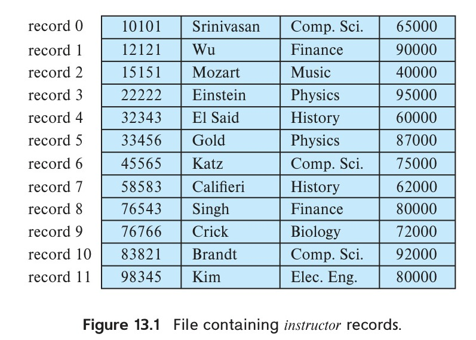
*Figure 13.1 — File containing instructor records.*

<!-- Page 590 -->

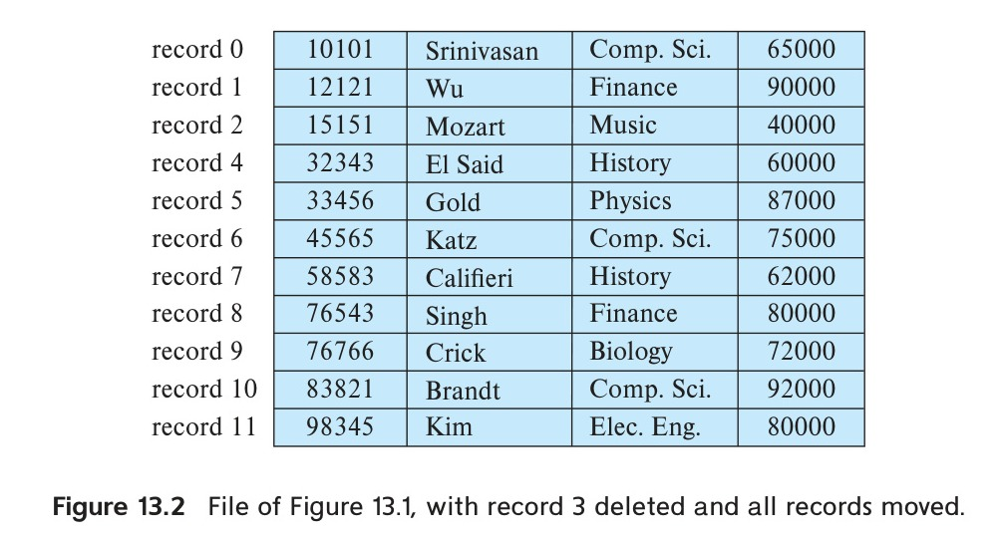
*Figure 13.2 — File of Figure 13.1, with record 3 deleted and all records moved.*

However, there are two problems with this simple approach:

1. Unless the block size happens to be a multiple of 53 (which is unlikely), some records will cross block boundaries. That is, part of the record will be stored in one block and part in another. It would thus require two block accesses to read or write such a record.
2. It is difficult to delete a record from this structure. The space occupied by the record to be deleted must be filled with some other record of the file, or we must have a way of marking deleted records so that they can be ignored.

To avoid the first problem, we allocate only as many records to a block as would fit entirely in the block (this number can be computed easily by dividing the block size by the record size, and discarding the fractional part). Any remaining bytes of each block are left unused.

When a record is deleted, we could move the record that comes after it into the space formerly occupied by the deleted record, and so on, until every record following the deleted record has been moved ahead (Figure 13.2). Such an approach requires moving a large number of records. It might be easier simply to move the final record of the file into the space occupied by the deleted record (Figure 13.3).

It is undesirable to move records to occupy the space freed by a deleted record, since doing so requires additional block accesses. Since insertions tend to be more frequent than deletions, it is acceptable to leave open the space occupied by the deleted record and to wait for a subsequent insertion before reusing the space. A simple marker on a deleted record is not sufficient, since it is hard to find this available space when an insertion is being done. Thus, we need to introduce an additional structure.

At the beginning of the file, we allocate a certain number of bytes as a file header. The header will contain a variety of information about the file. For now, all we need

<!-- Page 591 -->

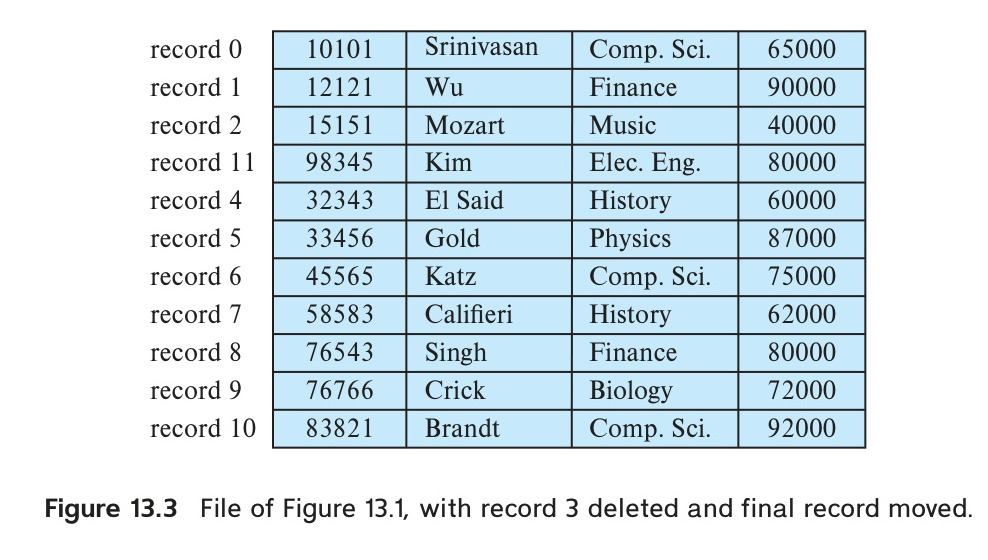
*Figure 13.3 — File of Figure 13.1, with record 3 deleted and final record moved.*

to store there is the address of the first record whose contents are deleted. We use this first record to store the address of the second available record, and so on. Intuitively, we can think of these stored addresses as pointers, since they point to the location of a record. The deleted records thus form a linked list, which is often referred to as a free list. Figure 13.4 shows the file of Figure 13.1, with the free list, after records 1, 4, and 6 have been deleted.

On insertion of a new record, we use the record pointed to by the header. We change the header pointer to point to the next available record. If no space is available, we add the new record to the end of the file.

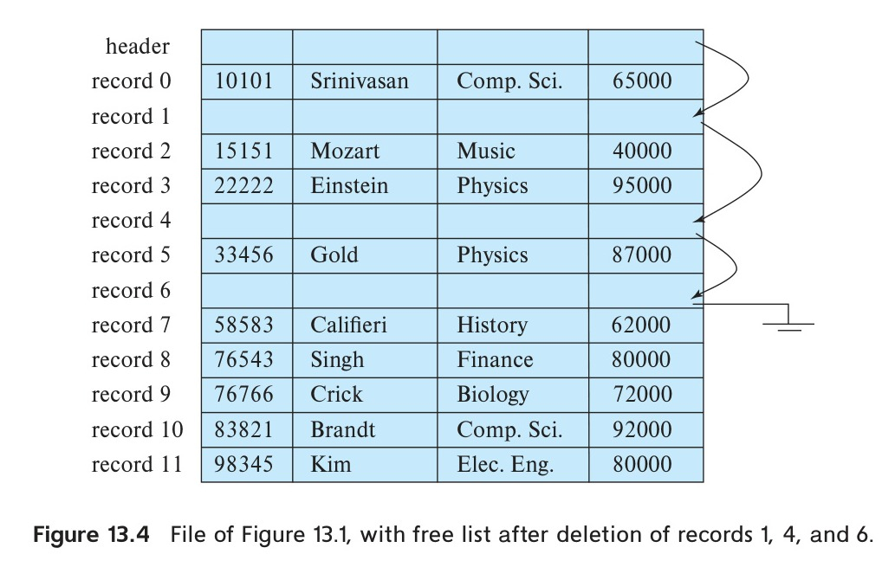
*Figure 13.4 — File of Figure 13.1, with free list after deletion of records 1, 4, and 6.*

<!-- Page 592 -->

Insertion and deletion for files of fixed-length records are simple to implement because the space made available by a deleted record is exactly the space needed to insert a record. If we allow records of variable-length in a file, this match no longer holds. An inserted record may not fit in the space left free by a deleted record, or it may fill only part of that space.

### 13.2.2 Variable-Length Records

Variable-length records arise in database systems due to several reasons. The most common reason is the presence of variable length fields, such as strings. Other reasons include record types that contain repeating fields such as arrays or multisets, and the presence of multiple record types within a file.

Different techniques for implementing variable-length records exist. Two different problems must be solved by any such technique:

1. How to represent a single record in such a way that individual attributes can be extracted easily, even if they are of variable length
2. How to store variable-length records within a block, such that records in a block can be extracted easily

The representation of a record with variable-length attributes typically has two parts: an initial part with fixed-length information, whose structure is the same for all records of the same relation, followed by the contents of variable-length attributes. Fixed-length attributes, such as numeric values, dates, or fixed-length character strings are allocated as many bytes as required to store their value. Variable-length attributes, such as varchar types, are represented in the initial part of the record by a pair (offset, length), where offset denotes where the data for that attribute begins within the record, and length is the length in bytes of the variable-sized attribute. The values for the variable-length attributes are stored consecutively, after the initial fixed-length part of the record. Thus, the initial part of the record stores a fixed size of information about each attribute, whether it is fixed-length or variable-length.

An example of such a record representation is shown in Figure 13.5. The figure shows an instructor record whose first three attributes ID, name, and dept_name are variable-length strings, and whose fourth attribute salary is a fixed-sized number. We assume that the offset and length values are stored in two bytes each, for a total of 4

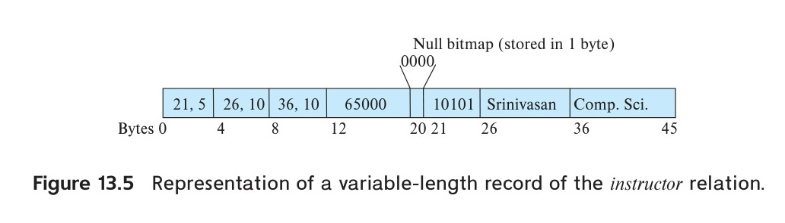
*Figure 13.5 — Representation of a variable-length record of the instructor relation.*

<!-- Page 593 -->

bytes per attribute. The salary attribute is assumed to be stored in 8 bytes, and each string takes as many bytes as it has characters.

The figure also illustrates the use of a null bitmap, which indicates which attributes of the record have a null value. In this particular record, if the salary were null, the fourth bit of the bitmap would be set to 1, and the salary value stored in bytes 12 through 19 would be ignored. Since the record has four attributes, the null bitmap for this record fits in 1 byte, although more bytes may be required with more attributes. In some representations, the null bitmap is stored at the beginning of the record, and for attributes that are null, no data (value, or offset/length) are stored at all. Such a representation would save some storage space, at the cost of extra work to extract attributes of the record. This representation is particularly useful for certain applications where records have a large number of fields, most of which are null.

We next address the problem of storing variable-length records in a block. The slotted-page structure is commonly used for organizing records within a block and is shown in Figure 13.6.[^2] There is a header at the beginning of each block, containing the following information:

• The number of record entries in the header
• The end of free space in the block
• An array whose entries contain the location and size of each record

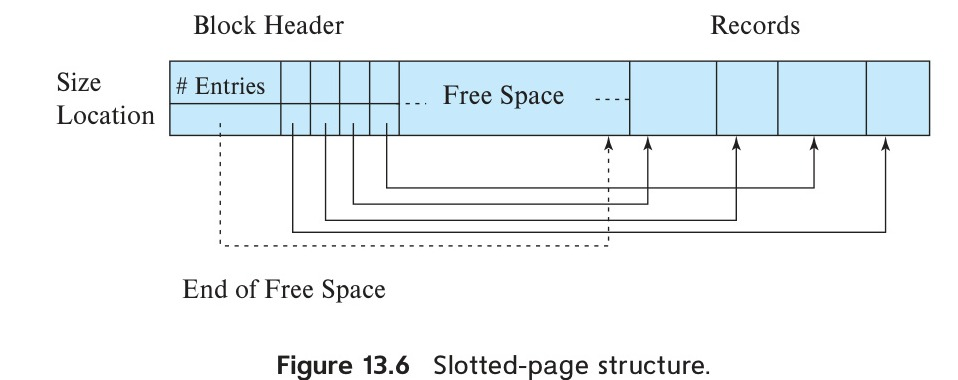
*Figure 13.6 — Slotted-page structure.*

The actual records are allocated contiguously in the block, starting from the end of the block. The free space in the block is contiguous between the final entry in the header array and the first record. If a record is inserted, space is allocated for it at the end of free space, and an entry containing its size and location is added to the header. If a record is deleted, the space that it occupies is freed, and its entry is set to deleted (its size is set to $-1$, for example). Further, the records in the block before the deleted record are moved, so that the free space created by the deletion gets occupied, and all

[^2]: Here, “page” is synonymous with “block.”

<!-- Page 594 -->

free space is again between the final entry in the header array and the first record. The end-of-free-space pointer in the header is appropriately updated as well. Records can be grown or shrunk by similar techniques, as long as there is space in the block. The cost of moving the records is not too high, since the size of a block is limited: typical values are around 4 to 8 kilobytes.

The slotted-page structure requires that there be no pointers that point directly to records. Instead, pointers must point to the entry in the header that contains the actual location of the record. This level of indirection allows records to be moved to prevent fragmentation of space inside a block, while supporting indirect pointers to the record.

### 13.2.3 Storing Large Objects

Databases often store data that can be much larger than a disk block. For instance, an image or an audio recording may be multiple megabytes in size, while a video object may be multiple gigabytes in size. Recall that SQL supports the types blob and clob, which store binary and character large objects.

Many databases internally restrict the size of a record to be no larger than the size of a block.[^3] These databases allow records to logically contain large objects, but they store the large objects separate from the other (short) attributes of records in which they occur. A (logical) pointer to the object is then stored in the record containing the large object.

Large objects may be stored either as files in a file system area managed by the database, or as file structures stored in and managed by the database. In the latter case, such in-database large objects can optionally be represented using B+-tree file organizations, which we study in Section 14.4.1, to allow efficient access to any location within the object. B+-tree file organizations permit us to read an entire object, or specified byte ranges in the object, as well as to insert and delete parts of the object.

However, there are some performance issues with storing very large objects in databases. The efficiency of accessing large objects via database interfaces is one concern. A second concern is the size of database backups. Many enterprises periodically create “database dumps,” that is, backup copies of their databases; storing large objects in the database can result in a large increase in the size of the database dumps.

Many applications therefore choose to store very large objects, such as video data, outside of the database, in a file system. In such cases, the application may store the file name (usually a path in the file system) as an attribute of a record in the database. Storing data in files outside the database can result in file names in the database pointing to files that do not exist, perhaps because they have been deleted, which results in a form of foreign-key constraint violation. Further, database authorization controls are not applicable to data stored in the file system.

[^3]: This restriction helps simplify buffer management; as we see in Section 13.5, disk blocks are brought into an area of memory called the buffer before they are accessed. Records larger than a block would get split between blocks, which may be different areas of the buffer, and thus cannot be guaranteed to be in a contiguous area of memory.

<!-- Page 595 -->

Some databases support file system integration with the database, to ensure that constraints are satisfied (for example, deletion of files will be blocked if the database has a pointer to the file), and to ensure that access authorizations are enforced. Files can be accessed both from a file system interface and from the database SQL interface. For example, Oracle supports such integration through its SecureFiles and Database File System features.

## 13.3 Organization of Records in Files

So far, we have studied how records are represented in a file structure. A relation is a set of records. Given a set of records, the next question is how to organize them in a file. Several of the possible ways of organizing records in files are:

• Heap file organization. Any record can be placed anywhere in the file where there is space for the record. There is no ordering of records. Typically, there is either a single file or a set of files for each relation. Heap file organization is discussed in Section 13.3.1.
• Sequential file organization. Records are stored in sequential order, according to the value of a “search key” of each record. Section 13.3.2 describes this organization.
• Multitable clustering file organization: Generally, a separate file or set of files is used to store the records of each relation. However, in a multitable clustering file organization, records of several different relations are stored in the same file, and in fact in the same block within a file, to reduce the cost of certain join operations. Section 13.3.3 describes the multitable clustering file organization.
• B+-tree file organization. The traditional sequential file organization described in Section 13.3.2 does support ordered access even if there are insert, delete, and update operations, which may change the ordering of records. However, in the face of a large number of such operations, efficiency of ordered access suffers. We study another way of organizing records, called the B+-tree file organization, in Section 14.4.1. The B+-tree file organization is related to the B+-tree index structure described in that chapter and can provide efficient ordered access to records even if there are a large number of insert, delete, or update operations. Further, it supports very efficient access to specific records, based on the search key.
• Hashing file organization. A hash function is computed on some attribute of each record. The result of the hash function specifies in which block of the file the record should be placed. Section 14.5 describes this organization; it is closely related to the indexing structures described in that chapter.

<!-- Page 596 -->

### 13.3.1 Heap File Organization

In a heap file organization, a record may be stored anywhere in the file corresponding to a relation. Once placed in a particular location, the record is not usually moved.[^4]

When a record is inserted in a file, one option for choosing the location is to always add it at the end of the file. However, if records get deleted, it makes sense to use the space thus freed up to store new records. It is important for a database system to be able to efficiently find blocks that have free space, without having to sequentially search through all the blocks of the file.

Most databases use a space-efficient data structure called a free-space map to track which blocks have free space to store records. The free-space map is commonly represented by an array containing 1 entry for each block in the relation. Each entry represents a fraction f such that at least a fraction f of the space in the block is free. In PostgreSQL, for example, an entry is 1 byte, and the value stored in the entry must be divided by 256 to get the free-space fraction. The array is stored in a file, whose blocks are fetched into memory,[^5] as required. Whenever a record is inserted, deleted, or changed in size, if the occupancy fraction changes enough to affect the entry value, the entry is updated in the free-space map. An example of a free-space map for a file with 16 blocks is shown below. We assume that 3 bits are used to store the occupancy fraction; the value at position i should be divided by 8 to get the free-space fraction for block i.

| 4 | 2 | 1 | 4 | 7 | 3 | 6 | 5 | 1 | 2 | 0 | 1 | 1 | 0 | 5 | 6 |
| :-: | :-: | :-: | :-: | :-: | :-: | :-: | :-: | :-: | :-: | :-: | :-: | :-: | :-: | :-: | :-: |

For example, a value of 7 indicates that at least $7/8$th of the space in the block is free.

To find a block to store a new record of a given size, the database can scan the free-space map to find a block that has enough free space to store that record. If there is no such block, a new block is allocated for the relation.

While such a scan is much faster than actually fetching blocks to find free space, it can still be very slow for large files. To further speed up the task of locating a block with sufficient free space, we can create a second-level free-space map, which has, say 1 entry for every 100 entries of the main free-space map. That 1 entry stores the maximum value amongst the 100 entries in the main free-space map that it corresponds to. The free-space map below is a second level free-space map for our earlier example, with 1 entry for every 4 entries in the main free-space map.

| 4 | 7 | 2 | 6 |
| :-: | :-: | :-: | :-: |

[^4]: Records may be occasionally moved, for example, if the database sorts the records of the relation; but note that even if the relation is reordered by sorting, subsequent insertions and updates may result in the records no longer being ordered.
[^5]: Via the database buffer, which we discuss in Section 13.5.

<!-- Page 597 -->

With 1 entry for every 100 entries in the main free-space map, a scan of the second-level free space map would take only 1/100th of the time to scan the main free-space map; once a suitable entry indicating enough free space is found there, its corresponding 100 entries in the main free-space map can be examined to find a block with sufficient free space. Such a block must exist, since the second-level free-space map entry stores the maximum of the entries in the main free-space map. To deal with very large relations, we can create more levels beyond the second level, using the same idea.

Writing the free-space map to disk every time an entry in the map is updated would be very expensive. Instead, the free-space map is written periodically; as a result, the free-space map on disk may be outdated, and when a database starts up, it may get outdated data about available free space. The free-space map may, as a result, claim a block has free space when it does not; such an error will be detected when the block is fetched, and can be dealt with by a further search in the free-space map to find another block. On the other hand, the free-space map may claim that a block does not have free space when it does; generally this will not result in any problem other than unused free space. To fix any such errors, the relation is scanned periodically and the free-space map recomputed and written to disk.

### 13.3.2 Sequential File Organization

A sequential file is designed for efficient processing of records in sorted order based on some search key. A search key is any attribute or set of attributes; it need not be the primary key, or even a superkey. To permit fast retrieval of records in search-key order, we chain together records by pointers. The pointer in each record points to the next record in search-key order. Furthermore, to minimize the number of block accesses in sequential file processing, we store records physically in search-key order, or as close to search-key order as possible.

Figure 13.7 shows a sequential file of instructor records taken from our university example. In that example, the records are stored in search-key order, using ID as the search key.

The sequential file organization allows records to be read in sorted order; that can be useful for display purposes, as well as for certain query-processing algorithms that we shall study in Chapter 15.

It is difficult, however, to maintain physical sequential order as records are inserted and deleted, since it is costly to move many records as a result of a single insertion or deletion. We can manage deletion by using pointer chains, as we saw previously. For insertion, we apply the following two rules:

1. Locate the record in the file that comes before the record to be inserted in search-key order.
2. If there is a free record (i.e., space left after a deletion) within the same block as this record, insert the new record there. Otherwise, insert the new record in

<!-- Page 598 -->

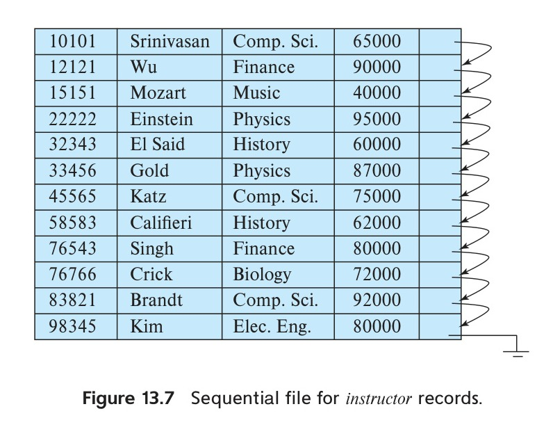
*Figure 13.7 — Sequential file for instructor records.*

an overflow block. In either case, adjust the pointers so as to chain together the records in search-key order.

Figure 13.8 shows the file of Figure 13.7 after the insertion of the record (32222, Verdi, Music, 48000). The structure in Figure 13.8 allows fast insertion of new records, but it forces sequential file-processing applications to process records in an order that does not match the physical order of the records.

If relatively few records need to be stored in overflow blocks, this approach works well. Eventually, however, the correspondence between search-key order and physical order may be totally lost over a period of time, in which case sequential processing will become much less efficient. At this point, the file should be reorganized so that it is once again physically in sequential order. Such reorganizations are costly and must be done during times when the system load is low. The frequency with which reorganizations are needed depends on the frequency of insertion of new records. In the extreme case in which insertions rarely occur, it is possible always to keep the file in physically sorted order. In such a case, the pointer field in Figure 13.7 is not needed.

The B+-tree file organization, which we describe in Section 14.4.1, provides efficient ordered access even if there are many inserts, deletes, and updates, without requiring expensive reorganizations.

### 13.3.3 Multitable Clustering File Organization

Most relational database systems store each relation in a separate file, or a separate set of files. Thus, each file, and as a result, each block, stores records of only one relation, in such a design.

<!-- Page 599 -->

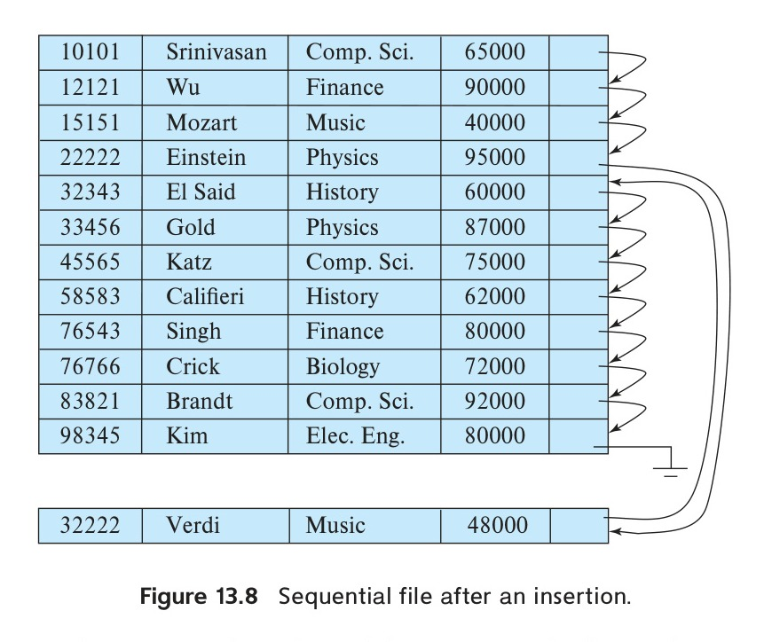
*Figure 13.8 — Sequential file after an insertion.*

However, in some cases it can be useful to store records of more than one relation in a single block. To see the advantage of storing records of multiple relations in one block, consider the following SQL query for the university database:

```sql
select dept_name, building, budget, ID, name, salary
from department natural join instructor;
```

This query computes a join of the department and instructor relations. Thus, for each tuple of department, the system must locate the instructor tuples with the same value for dept_name. Ideally, these records will be located with the help of indices, which we shall discuss in Chapter 14. Regardless of how these records are located, however, they need to be transferred from disk into main memory. In the worst case, each record will reside on a different block, forcing us to do one block read for each record required by the query.

As a concrete example, consider the department and instructor relations of Figure 13.9 and Figure 13.10, respectively (for brevity, we include only a subset of the tuples

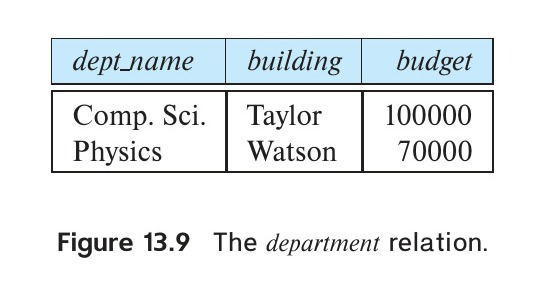
*Figure 13.9 — The department relation.*

<!-- Page 600 -->

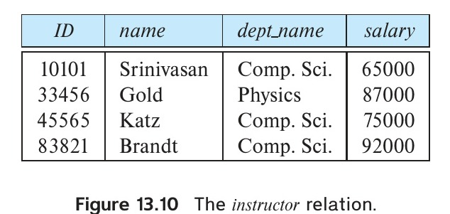
*Figure 13.10 — The instructor relation.*

of the relations we have used thus far). In Figure 13.11, we show a file structure designed for the efficient execution of queries involving the natural join of department and instructor. All the instructor tuples for a particular dept_name are stored near the department tuple for that dept_name. We say that the two relations are clustered on the key dept_name. We assume that each record contains the identifier of the relation to which it belongs, although this is not shown in Figure 13.11.

Although not depicted in the figure, it is possible to store the value of the dept_name attribute, which defines the clustering, only once for a group of tuples (from both relations), reducing storage overhead.

This structure allows for efficient processing of the join. When a tuple of the department relation is read, the entire block containing that tuple is copied from disk into main memory. Since the corresponding instructor tuples are stored on the disk near the department tuple, the block containing the department tuple contains tuples of the instructor relation needed to process the query. If a department has so many instructors that the instructor records do not fit in one block, the remaining records appear on nearby blocks.

A multitable clustering file organization is a file organization, such as that illustrated in Figure 13.11, that stores related records of two or more relations in each block.[^6] The cluster key is the attribute that defines which records are stored together; in our preceding example, the cluster key is dept_name.

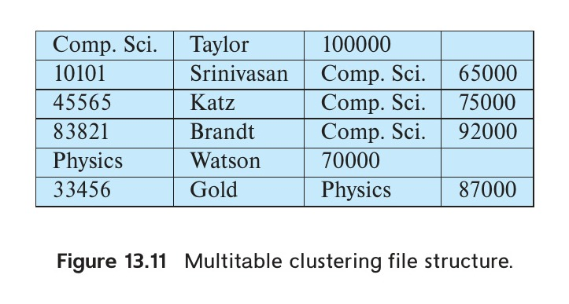
*Figure 13.11 — Multitable clustering file structure.*

[^6]: Note that the word cluster is often used to refer to a group of machines that together constitute a parallel database; that use of the word cluster is unrelated to the concept of multitable clustering.

<!-- Page 601 -->

Although a multitable clustering file organization can speed up certain join queries, it can result in slowing processing of other types of queries. For example, in our preceding example,

```sql
select *
from department;
```

requires more block accesses than it did in the scheme under which we stored each relation in a separate file, since each block now contains significantly fewer department records. To locate efficiently all tuples of the department relation within a particular block, we can chain together all the records of that relation using pointers; however, the number of blocks read does not get affected by using such chains.

When multitable clustering is to be used depends on the types of queries that the database designer believes to be most frequent. Careful use of multitable clustering can produce significant performance gains in query processing.

Multitable clustering is supported by the Oracle database system. Clusters can be created by using a create cluster command, with a specified cluster key. An extension of the create table command can be used to specify that a relation is to be stored in a specific cluster, with a particular attribute used as the cluster key. Multiple relations can thus be allocated to a cluster.

### 13.3.4 Partitioning

Many databases allow the records in a relation to be partitioned into smaller relations that are stored separately. Such table partitioning is typically done on the basis of an attribute value; for example, records in a transaction relation in an accounting database may be partitioned by year into smaller relations corresponding to each year, such as transaction_2018, transaction_2019, and so on. Queries can be written based on the transaction relation but are translated into queries on the year-wise relations. Most accesses are to records of the current year and include a selection based on the year. Query optimizers can rewrite such a query to only access the smaller relation corresponding to the requested year, and they can avoid reading records corresponding to other years. For example, a query

```sql
select *
from transaction
where year = 2019
```

would only access the relation transaction_2019, ignoring the other relations, while a query without the selection condition would read all the relations.

The cost of some operations, such as finding free space for a record, increase with relation size; by reducing the size of each relation, partitioning helps reduce such overheads. Partitioning can also be used to store different parts of a relation on different

<!-- Page 602 -->

storage devices; for example, in the year 2019, transaction_2018 and earlier year transactions can which are infrequently accessed could be stored on magnetic disk, while transaction_2019 could be stored on SSD, for faster access.

## 13.4 Data-Dictionary Storage

So far, we have considered only the representation of the relations themselves. A relational database system needs to maintain data about the relations, such as the schema of the relations. In general, such “data about data” are referred to as metadata.

Relational schemas and other metadata about relations are stored in a structure called the data dictionary or system catalog. Among the types of information that the system must store are these:

• Names of the relations
• Names of the attributes of each relation
• Domains and lengths of attributes
• Names of views defined on the database, and definitions of those views
• Integrity constraints (e.g., key constraints)

In addition, many systems keep the following data on users of the system:

• Names of users, the default schemas of the users, and passwords or other information to authenticate users
• Information about authorizations for each user

Further, the database may store statistical and descriptive data about the relations and attributes, such as the number of tuples in each relation, or the number of distinct values for each attribute.

The data dictionary may also note the storage organization (heap, sequential, hash, etc.) of relations, and the location where each relation is stored:

• If relations are stored in operating system files, the dictionary would note the names of the file (or files) containing each relation.
• If the database stores all relations in a single file, the dictionary may note the blocks containing records of each relation in a data structure such as a linked list.

In Chapter 14, in which we study indices, we shall see a need to store information about each index on each of the relations:

• Name of the index

<!-- Page 603 -->

• Name of the relation being indexed
• Attributes on which the index is defined
• Type of index formed

All this metadata information constitutes, in effect, a miniature database. Some database systems store such metadata by using special-purpose data structures and code. It is generally preferable to store the data about the database as relations in the database itself. By using database relations to store system metadata, we simplify the overall structure of the system and harness the full power of the database for fast access to system data.

The exact choice of how to represent system metadata by relations must be made by the system designers. We show the schema diagram of a toy data dictionary in Figure 13.12, storing part of the information mentioned above. The schema is only illustrative; real implementations store far more information than what the figure shows. Read the manuals for whichever database you use to see what system metadata it maintains.

In the metadata representation shown, the attribute index_attributes of the relation Index_metadata is assumed to contain a list of one or more attributes, which can be represented by a character string such as “dept_name, building”. The Index_metadata relation is thus not in first normal form; it can be normalized, but the preceding representation is likely to be more efficient to access. The data dictionary is often stored in a nonnormalized form to achieve fast access.

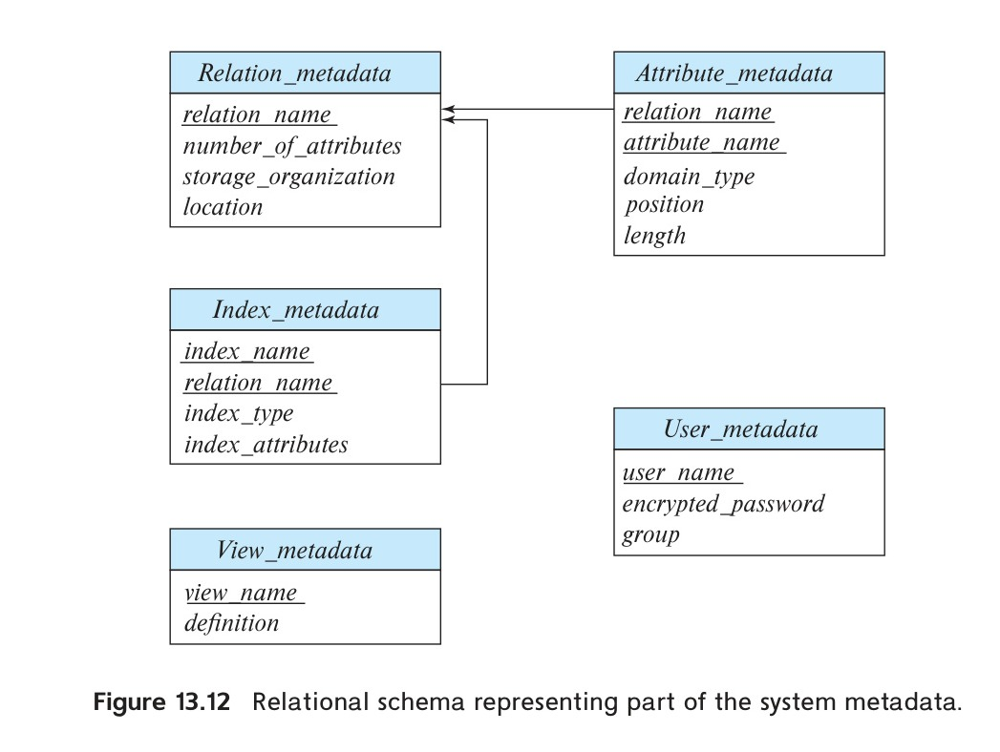
*Figure 13.12 — Relational schema representing part of the system metadata.*

<!-- Page 604 -->

Whenever the database system needs to retrieve records from a relation, it must first consult the Relation_metadata relation to find the location and storage organization of the relation, and then fetch records using this information.

However, the storage organization and location of the Relation_metadata relation itself must be recorded elsewhere (e.g., in the database code itself, or in a fixed location in the database), since we need this information to find the contents of Relation_metadata.

Since system metadata are frequently accessed, most databases read it from the database into in-memory data structures that can be accessed very efficiently. This is done as part of the database startup, before the database starts processing any queries.

## 13.5 Database Buffer

The size of main memory on servers has increased greatly over the years, and many medium-sized databases can fit in memory. However, a server has many demands on its memory, and the amount of memory it can give to a database may be much smaller than the database size even for medium-sized databases. And many large databases are much larger than the available memory on servers.

Thus, even today, database data reside primarily on disk in most databases, and they must be brought into memory to be read or updated; updated data blocks must be written back to disk subsequently.

Since data access from disk is much slower than in-memory data access, a major goal of the database system is to minimize the number of block transfers between the disk and memory. One way to reduce the number of disk accesses is to keep as many blocks as possible in main memory. The goal is to maximize the chance that, when a block is accessed, it is already in main memory, and, thus, no disk access is required.

Since it is not possible to keep all blocks in main memory, we need to manage the allocation of the space available in main memory for the storage of blocks. The buffer is that part of main memory available for storage of copies of disk blocks. There is always a copy kept on disk of every block, but the copy on disk may be a version of the block older than the version in the buffer. The subsystem responsible for the allocation of buffer space is called the buffer manager.

### 13.5.1 Buffer Manager

Programs in a database system make requests (i.e., calls) on the buffer manager when they need a block from disk. If the block is already in the buffer, the buffer manager passes the address of the block in main memory to the requester. If the block is not in the buffer, the buffer manager first allocates space in the buffer for the block, throwing out some other block, if necessary, to make space for the new block. The thrown-out block is written back to disk only if it has been modified since the most recent time that it was written to the disk. Then, the buffer manager reads in the requested block from the disk to the buffer, and passes the address of the block in main memory to the

<!-- Page 605 -->

requester. The internal actions of the buffer manager are transparent to the programs that issue disk-block requests.

If you are familiar with operating-system concepts, you will note that the buffer manager appears to be nothing more than a virtual-memory manager, like those found in most operating systems. One difference is that the size of the database might be larger than the hardware address space of a machine, so memory addresses are not sufficient to address all disk blocks. Further, to serve the database system well, the buffer manager must use techniques more sophisticated than typical virtual-memory management schemes:

#### 13.5.1.1 Buffer replacement strategy

When there is no room left in the buffer, a block must be evicted, that is, removed, from the buffer before a new one can be read in. Most operating systems use a least recently used (LRU) scheme, in which the block that was referenced least recently is written back to disk and is removed from the buffer. This simple approach can be improved on for database applications(see Section 13.5.2).

#### 13.5.1.2 Pinned blocks

Once a block has been brought into the buffer, a database process can read the contents of the block from the buffer memory. However, while the block is being read, if a concurrent process evicts the block and replaces it with a different block, the reader that was reading the contents of the old block will see incorrect data; if the block was being written when it was evicted, the writer would end up damaging the contents of the replacement block.

It is therefore important that before a process reads data from a buffer block, it ensures that the block will not get evicted. To do so, the process executes a pin operation on the block; the buffer manager never evicts a pinned block. When it has finished reading data, the process should execute an unpin operation, allowing the block to be evicted when required. The database code should be written carefully to avoid pinning too many blocks: if all the blocks in the buffer get pinned, no blocks can be evicted, and no other block can be brought into the buffer. If this happens, the database will be unable to carry out any further processing!

Multiple processes can read data from a block that is in the buffer. Each of them is required to execute a pin operation before accessing data, and an unpin after completing access. The block cannot be evicted until all processes that have executed a pin have then executed an unpin operation. A simple way to ensure this property is to keep a pin count for each buffer block. Each pin operation increments the count, and an unpin operation decrements the count. A page can be evicted only if the pin count equals 0.

#### 13.5.1.3 Shared and Exclusive Locks on Buffer

A process that adds or deletes a tuple from a page may need to move the page contents around; during this period, no other process should read the contents of the page, since

<!-- Page 606 -->

they may be inconsistent. Database buffer managers allow processes to get shared and exclusive locks on the buffer.

We will study locking in more detail in Chapter 18, but here we discuss a limited form of locking in the context of the buffer manager. The locking system provided by the buffer manager allows a database process to lock a buffer block either in shared mode or in exclusive mode before accessing the block, and to release the lock later, after the access is completed. Here are the rules for locking:

• Any number of processes may have shared locks on a block at the same time.
• Only one process is allowed to get an exclusive lock at a time, and further when a process has an exclusive lock, no other process may have a shared lock on the block. Thus, an exclusive lock can be granted only when no other process has a lock on the buffer block.
• If a process requests an exclusive lock when a block is already locked in shared or exclusive mode, the request is kept pending until all earlier locks are released.
• If a process requests a shared lock when a block is not locked, or already shared locked, the lock may be granted; however, if another process has an exclusive lock, the shared lock is granted only after the exclusive lock has been released.

Locks are acquired and released as follows:

• Before carrying out any operation on a block, a process must pin the block as we saw earlier. Locks are obtained subsequently and must be released before unpinning the block.
• Before reading data from a buffer block, a process must get a shared lock on the block. When it is done reading the data, the process must release the lock.
• Before updating the contents of a buffer block, a process must get an exclusive lock on the block; the lock must be released after the update is complete.

These rules ensure that a block cannot be updated while another process is reading it, and conversely, a block cannot be read while another process is updating it. These rules are required for safety of buffer access; however, to protect a database system from problems due to concurrent access, these steps are not sufficient: further steps need to be taken. These are discussed further in Chapter 17 and Chapter 18.

#### 13.5.1.4 Output of blocks

It is possible to output a block only when the buffer space is needed for another block. However, it makes sense to not wait until the buffer space is needed, but to rather write out updated blocks ahead of such a need. Then, when space is required in the buffer,

<!-- Page 607 -->

a block that has already been written out can be evicted, provided it is not currently pinned.

However, for the database system to be able to recover from crashes (Chapter 19), it is necessary to restrict those times when a block may be written back to disk. For instance, most recovery systems require that a block should not be written to disk while an update on the block is in progress. To enforce this requirement, a process that wishes to write the block to disk must obtain a shared lock on the block.

Most databases have a process that continually detects updated blocks and writes them back to disk.

#### 13.5.1.5 Forced output of blocks

There are situations in which it is necessary to write a block to disk, to ensure that certain data on disk are in a consistent state. Such a write is called a forced output of a block. We shall see the reason for forced output in Chapter 19.

Memory contents and thus buffer contents are lost in a crash, whereas data on disk (usually) survive a crash. Forced output is used in conjunction with a logging mechanism to ensure that when a transaction that has performed updates commits, enough data has been written to disk to ensure the updates of the transaction are not lost. How exactly this is done is covered in detail in Chapter 19.

### 13.5.2 Buffer-Replacement Strategies

The goal of a replacement strategy for blocks in the buffer is to minimize accesses to the disk. For general-purpose programs, it is not possible to predict accurately which blocks will be referenced. Therefore, operating systems use the past pattern of block references as a predictor of future references. The assumption generally made is that blocks that have been referenced recently are likely to be referenced again. Therefore, if a block must be replaced, the least recently referenced block is replaced. This approach is called the least recently used (LRU) block-replacement scheme.

LRU is an acceptable replacement scheme in operating systems. However, a database system is able to predict the pattern of future references more accurately than an operating system. A user request to the database system involves several steps. The database system is often able to determine in advance which blocks will be needed by looking at each of the steps required to perform the user-requested operation. Thus, unlike operating systems, which must rely on the past to predict the future, database systems may have information regarding at least the short-term future.

To illustrate how information about future block access allows us to improve the LRU strategy, consider the processing of the SQL query:

```sql
select *
from instructor natural join department;
```

<!-- Page 608 -->

Assume that the strategy chosen to process this request is given by the pseudocode program shown in Figure 13.13. (We shall study other, more efficient, strategies in Chapter 15.)

Assume that the two relations of this example are stored in separate files. In this example, we can see that, once a tuple of instructor has been processed, that tuple is not needed again. Therefore, once processing of an entire block of instructor tuples is completed, that block is no longer needed in main memory, even though it has been used recently. The buffer manager should be instructed to free the space occupied by an instructor block as soon as the final tuple has been processed. This buffer-management strategy is called the toss-immediate strategy.

Now consider blocks containing department tuples. We need to examine every block of department tuples once for each tuple of the instructor relation. When processing of a department block is completed, we know that that block will not be accessed again until all other department blocks have been processed. Thus, the most recently used department block will be the final block to be re-referenced, and the least recently used department block is the block that will be referenced next. This assumption set is the exact opposite of the one that forms the basis for the LRU strategy. Indeed, the optimal strategy for block replacement for the above procedure is the most recently used (MRU) strategy. If a department block must be removed from the buffer, the MRU strategy chooses the most recently used block (blocks are not eligible for replacement while they are being used).

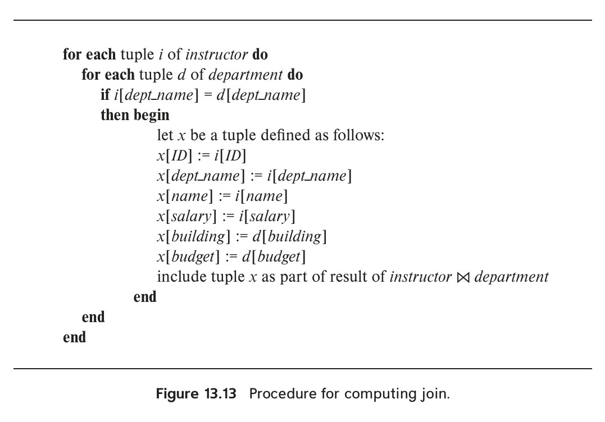
*Figure 13.13 — Procedure for computing join.*

<!-- Page 609 -->

For the MRU strategy to work correctly for our example, the system must pin the department block currently being processed. After the final department tuple has been processed, the block is unpinned, and it becomes the most recently used block.

In addition to using knowledge that the system may have about the request being processed, the buffer manager can use statistical information about the probability that a request will reference a particular relation. For example, the data dictionary, which we saw in Section 13.4, is one of the most frequently accessed parts of the database, since the processing of every query needs to access the data dictionary. Thus, the buffer manager should try not to remove data-dictionary blocks from main memory, unless other factors dictate that it do so. In Chapter 14, we discuss indices for files. Since an index for a file may be accessed more frequently than the file itself, the buffer manager should, in general, not remove index blocks from main memory if alternatives are available.

The ideal database block-replacement strategy needs knowledge of the database operations—both those being performed and those that will be performed in the future. No single strategy is known that handles all the possible scenarios well. Indeed, a surprisingly large number of database systems use LRU, despite that strategy’s faults. The practice questions and exercises explore alternative strategies.

The strategy that the buffer manager uses for block replacement is influenced by factors other than the time at which the block will be referenced again. If the system is processing requests by several users concurrently, the concurrency-control subsystem (Chapter 18) may need to delay certain requests, to ensure preservation of database consistency. If the buffer manager is given information from the concurrency-control subsystem indicating which requests are being delayed, it can use this information to alter its block-replacement strategy. Specifically, blocks needed by active (nondelayed) requests can be retained in the buffer at the expense of blocks needed by the delayed requests.

The crash-recovery subsystem (Chapter 19) imposes stringent constraints on block replacement. If a block has been modified, the buffer manager is not allowed to write back the new version of the block in the buffer to disk, since that would destroy the old version. Instead, the block manager must seek permission from the crash-recovery subsystem before writing out a block. The crash-recovery subsystem may demand that certain other blocks be force-output before it grants permission to the buffer manager to output the block requested. In Chapter 19, we define precisely the interaction between the buffer manager and the crash-recovery subsystem.

### 13.5.3 Reordering of Writes and Recovery

Database buffers allow writes to be performed in-memory and output to disk at a later time, possibly in an order different from the order in which the writes were performed. File systems, too, routinely reorder write operations. However, such reordering can lead to inconsistent data on disk in the event of a system crash.

<!-- Page 610 -->

To understand the problem in the context of a file system, suppose that a file system uses a linked list to track which blocks are part of a file. Suppose also that it inserts a new node at the end of the list by first writing the data for the new node, then updating the pointer from the previous node. Suppose further that the writes were reordered, so the pointer was updated first, and the system crashes before the new node is written. The contents of the node would then be whatever happened to be on that disk earlier, resulting in a corrupted data structure.

To deal with the possibility of such data structure corruption, earlier-generation file systems had to perform a file system consistency check on system restart, to ensure that the data structures were consistent. And if they were not, extra steps had to be taken to restore them to consistency. These checks resulted in long delays in system restart after a crash, and the delays became worse as disk systems grew to higher capacities.

The file system can avoid inconsistencies in many cases if it writes updates to metadata in a carefully chosen order. But doing so would mean that optimizations such as disk arm scheduling cannot be done, affecting the efficiency of the update. If a non-volatile write buffer were available, it could be used to perform the writes in order to non-volatile RAM and later reorder the writes when writing them to disk.

However, most disks do not come with a non-volatile write buffer; instead, modern file systems assign a disk for storing a log of the writes in the order that they are performed. Such a disk is called a log disk. For each write, the log contains the block number to be written to, and the data to be written, in the order in which the writes were performed. All access to the log disk is sequential, essentially eliminating seek time, and several consecutive blocks can be written at once, making writes to the log disk several times faster than random writes. As before, the data have to be written to their actual location on disk as well, but the write to the actual location can be done later; the writes can be reordered to minimize disk-arm movement.

If the system crashes before some writes to the actual disk location have been completed, when the system comes back up it reads the log disk to find those writes that had not been completed and carries them out then. After the writes have been performed, the records are deleted from the log disk.

File systems that support log disks as above are called journaling file systems. Journaling file systems can be implemented even without a separate log disk, keeping data and the log on the same disk. Doing so reduces the monetary cost at the expense of lower performance.

Most modern file systems implement journaling and use the log disk when writing file system metadata such as file allocation information. Journaling file systems allow quick restart without the need for such file system consistency checks.

However, writes performed by applications are usually not written to the log disk. Database systems instead implement their own forms of logging, which we study in Chapter 19, to ensure that the contents of a database can be safely recovered in the event of a failure, even if writes were reordered.

<!-- Page 611 -->

## 13.6 Column-Oriented Storage

Databases traditionally store all attributes of a tuple together in a record, and tuples are stored in a file as we have just seen. Such a storage layout is referred to as a row-oriented storage.

In contrast, in column-oriented storage, also called a columnar storage, each attribute of a relation is stored separately, with values of the attribute from successive tuples stored at successive positions in the file. Figure 13.14 shows how the instructor relation would be stored in column-oriented storage, with each attribute stored separately.

In the simplest form of column-oriented storage, each attribute is stored in a separate file. Further, each file is compressed, to reduce its size. (We discuss more complex schemes that store columns consecutively in a single file later in this section.)

If a query needs to access the entire contents of the $i$th row of a table, the values at the $i$th position in each of the columns are retrieved and used to reconstruct the row. Column-oriented storage thus has the drawback that fetching multiple attributes of a single tuple requires multiple I/O operations. Thus, it is not suitable for queries that fetch multiple attributes from a few rows of a relation.

However, column-oriented storage is well suited for data analysis queries, which process many rows of a relation, but often only access some of the attributes. The reasons are as follows:

• **Reduced I/O.** When a query needs to access only a few attributes of a relation with a large number of attributes, the remaining attributes need not be fetched from disk into memory. In contrast, in row-oriented storage, irrelevant attributes are fetched into memory from disk. The reduction in I/O can lead to significant reduction in query execution cost.

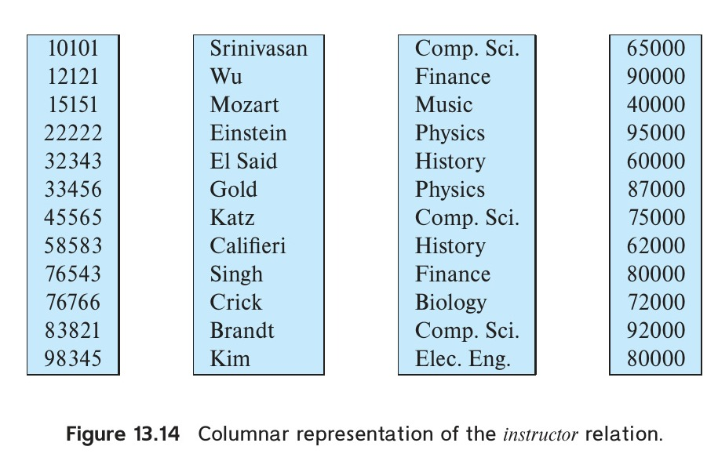
*Figure 13.14 — Columnar representation of the instructor relation.*

<!-- Page 612 -->

• **Improved CPU cache performance.** When the query processor fetches the contents of a particular attribute, with modern CPU architectures multiple consecutive bytes, called a cache line, are fetched from memory to CPU cache. If these bytes are accessed later, access is much faster if they are in cache than if they have to be fetched from main memory. However, if these adjacent bytes contain values for attributes that are not be needed by the query, fetching them into cache wastes memory bandwidth and uses up cache space that could have been used for other data. Column-oriented storage does not suffer from this problem, since adjacent bytes are from the same column, and data analysis queries usually access all these values consecutively.

• **Improved compression.** Storing values of the same type together significantly increases the effectiveness of compression, when compared to compressing data stored in row format; in the latter case, adjacent attributes are of different types, reducing the efficiency of compression. Compression significantly reduces the time taken to retrieve data from disk, which is often the highest-cost component for many queries. If the compressed files are stored in memory, the in-memory storage space is also reduced correspondingly, which is particularly important since main memory is significantly more expensive than disk storage.

• **Vector processing.** Many modern CPU architectures support vector processing, which allows a CPU operation to be applied in parallel on a number of elements of an array. Storing data columnwise allows vector processing of operations such as comparing an attribute with a constant, which is important for applying selection conditions on a relation. Vector processing can also be used to compute an aggregate of multiple values in parallel, instead of aggregating the values one at a time.

As a result of these benefits, column-oriented storage is increasingly used in data-warehousing applications, where queries are primarily data analysis queries. It should be noted that indexing and query processing techniques need to be carefully designed to get the performance benefits of column-oriented storage. We outline indexing and query processing techniques based on bitmap representations, which are well suited to column-oriented storage, in Section 14.9; further details are provided in Section 24.3.

Databases that use column-oriented storage are referred to as column stores, while databases that use row-oriented storage are referred to as row stores.

It should be noted that column-oriented storage does have several drawbacks, which make them unsuitable for transaction processing.

• **Cost of tuple reconstruction.** As we saw earlier, reconstructing a tuple from the individual columns can be expensive, negating the benefits of columnar representation if many columns need to be reconstructed. While tuple reconstruction is common in transaction-processing applications, data analysis applications usually

<!-- Page 613 -->

output only a few columns out of many that are stored in “fact tables” in data warehouses.

• **Cost of tuple deletion and update.** Deleting or updating a single tuple in a compressed representation would require rewriting the entire sequence of tuples that are compressed as one unit. Since updates and deletes are common in transaction-processing applications, column-oriented storage would result in a high cost for these operations if a large number of tuples were compressed as one unit.

  In contrast, data-warehousing systems typically do not support updates to tuples, and instead support only insert of new tuples and bulk deletes of a large number of old tuples at a time. Inserts are done at the end of the relation representation, that is, new tuples are appended to the relation. Since small deletes and updates do not occur in a data warehouse, large sequences of attribute values can be stored and compressed together as one unit, allowing for better compression than with small sequences.

• **Cost of decompression.** Fetching data from a compressed representation requires decompression, which in the simplest compressed representations requires reading all the data from the beginning of a file. Transaction processing queries usually only need to fetch a few records; sequential access is expensive in such a scenario, since many irrelevant records may have to be decompressed to access a few relevant records.

Since data analysis queries tend to access many consecutive records, the time spent on decompression is typically not wasted. However, even data analysis queries do not need to access records that fail selection conditions, and attributes of such records should be skipped to reduce disk I/O.

To allow skipping of attribute values from such records, compressed representations for column stores allow decompression to start at any of a number of points in the file, skipping earlier parts of the file. This could be done by starting compression afresh after every 10,000 values (for example). By keeping track of where in the file the data start for each group of 10,000 values, it is possible to access the $i$th value by going to the start of the group $\lfloor i/10000 \rfloor$ and starting decompression from there.

ORC and Parquet are columnar file representations used in many big-data processing applications. In ORC, a row-oriented representation is converted to column-oriented representation as follows: A sequence of tuples occupying several hundred megabytes is broken up into a columnar representation called a stripe. An ORC file contains several such stripes, with each stripe occupying around 250 megabytes.

Figure 13.15 illustrates some details of the ORC file format. Each stripe has index data followed by row data. The row data area stores a compressed representation of the sequence of value for the first column, followed by the compressed representation of the second column, and so on. The index data region of a stripe stores for each attribute the starting point within the stripe for each group of (say) 10,000 values of

<!-- Page 614 -->

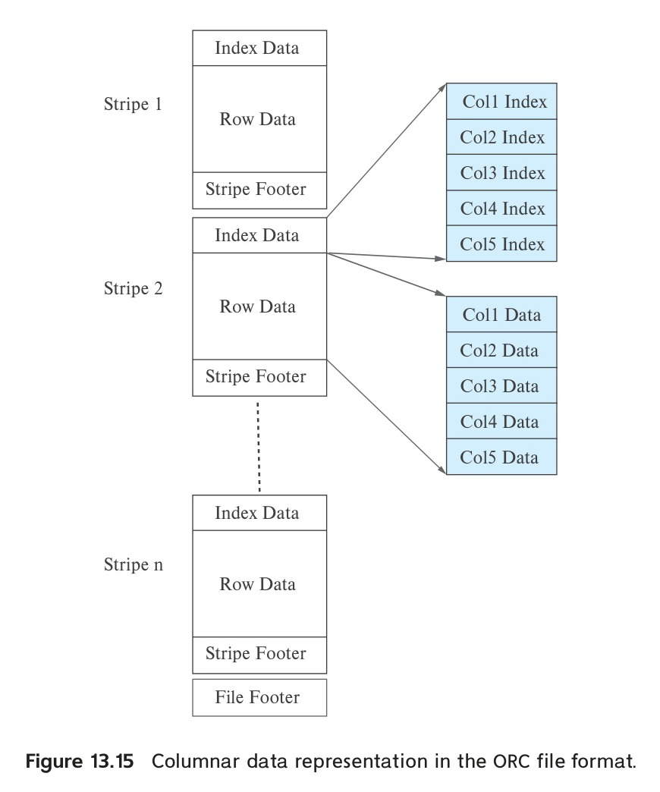
*Figure 13.15 — Columnar data representation in the ORC file format.*

that attribute.[^7] The index is useful for quick access to a desired tuple or sequence of tuples; the index also allows queries containing selections to skip groups of tuples if the query determines that no tuple in those groups satisfies the selections. ORC files store several other pieces of information in the stripe footer and file footer, which we skip here.

Some column-store systems allow groups of columns that are often accessed together to be stored together, instead of breaking up each column into a different file. Such systems thus allow a spectrum of choices that range from pure column-oriented storage, where every column is stored separately, to pure row-oriented storage, where all columns are stored together. The choice of which attributes to store together depends on the query workload.

[^7]: ORC files have some other information that we ignore here.

<!-- Page 615 -->

Some of the benefits of column-oriented storage can be obtained even in a row-oriented storage system by logically decomposing a relation into multiple relations. For example, the instructor relation could be decomposed into three relations, containing (ID, name), (ID, dept_name) and (ID, salary), respectively. Then, queries that access only the name do not have to fetch the dept_name and salary attributes. However, in this case the same ID attribute occurs in three tuples, resulting in wasted space.

Some database systems use a column-oriented representation for data within a disk block, without using compression.[^8] Thus, a block contains data for a set of tuples, and all attributes for that set of tuples are stored in the same block. Such a scheme is useful in transaction-processing systems, since retrieving all attribute values does not require multiple disk accesses. At the same time, using column-oriented storage within the block provides the benefits of more efficient memory access and cache usage, as well as the potential for using vector processing on the data. However, this scheme does not allow irrelevant disk blocks to be skipped when only a few attributes are retrieved, nor does it give the benefits of compression. Thus, it represents a point in the space between pure row-oriented storage and pure column-oriented storage.

Some databases, such as SAP HANA support two underlying storage systems, one a row-oriented one designed for transaction processing, and the second a column-oriented one, designed for data analysis. Tuples are normally created in the row-oriented store but are later migrated to the column-oriented store when they are no longer likely to be accessed in a row-oriented manner. Such systems are called hybrid row/column stores.

In other cases, applications store transactional data in a row-oriented store, but copy data periodically (e.g., once a day or a few times a day) to a data warehouse, which may use a column-oriented storage system.

Sybase IQ was one of the early products to use column-oriented storage, but there are now several research projects and companies that have developed database systems based on column stores, including C-Store, Vertica, MonetDB, Vectorwise, among others. See Further Reading at the end of the chapter for more details.

## 13.7 Storage Organization in Main-Memory Databases

Today, main-memory sizes are large enough, and main memory is cheap enough, that many organizational databases fit entirely in memory. Such large main memories can be used by allocating a large amount of memory to the database buffer, which will allow the entire database to be loaded into buffer, avoiding disk I/O operations for reading data; updated blocks still have to be written back to disk for persistence. Thus, such a setup would provide much better performance than one where only part of the database can fit in the buffer.

[^8]: Compression can be applied to data in a disk block, but accessing them requires decompression, and the decompressed data may no longer fit in a block. Significant changes need to be made to the database code, including buffer management, to handle such issues.

<!-- Page 616 -->

However, if the entire database fits in memory, performance can be improved significantly by tailoring the storage organization and database data structures to exploit the fact that data are fully in memory. A main-memory database is a database where all data reside in memory; main-memory database systems are typically designed to optimize performance by making use of this fact. In particular, they do away entirely with the buffer manager.

As an example of optimizations that can be done with memory-resident data, consider the cost of accessing a record, given a record pointer. With disk-based databases, records are stored in blocks, and pointers to records consist of a block identifier and an offset or slot number within the block. Following such a record pointer requires checking if the block is in the buffer (usually done by using an in-memory hash index), and if it is, finding where in the buffer it is located. If it is not in buffer, it has to be fetched. All these actions take a significant number of CPU cycles.

In contrast, in a main-memory database, it is possible to keep direct pointers to records in memory, and accessing a record is just an in-memory pointer traversal, which is a very efficient operation. This is possible as long as records are not moved around. Indeed, one reason for such movement, namely loading into buffer and eviction from buffer, is no longer an issue.

If records are stored in a slotted-page structure within a block, records may move within a block as other records are deleted or resized. Direct pointers to records are not possible in that case, although records can be accessed with one level of indirection through the entries in the slotted page header. Locking of the block may be required to ensure that a record does not get moved while another process is reading its data. To avoid these overheads, many main-memory databases do not use a slotted-page structure for allocating records. Instead they directly allocate records in main memory, and ensure that records never get moved due to updates to other records. However, a problem with direct allocation of records is that memory may get fragmented if variable sized records are repeatedly inserted and deleted. The database must ensure that main memory does not get fragmented over time, either by using suitably designed memory management schemes or by periodically performing compaction of memory; the latter scheme will result in record movement, but it can be done without acquiring locks on blocks.

If a column-oriented storage scheme is used in main memory, all the values of a column can be stored in consecutive memory locations. However, if there are appends to the relation, ensuring contiguous allocation would require existing data be reallocated. To avoid this overhead, the logical array for a column may be divided into multiple physical arrays. An indirection table stores pointers to all the physical arrays. This scheme is depicted in Figure 13.16. To find the $i$th element of a logical array, the indirection table is used to locate the physical array containing the $i$th element, and then an appropriate offset is computed and looked up within that physical array.

There are other ways in which processing can be optimized with main-memory databases, as we shall see in later chapters.

<!-- Page 617 -->

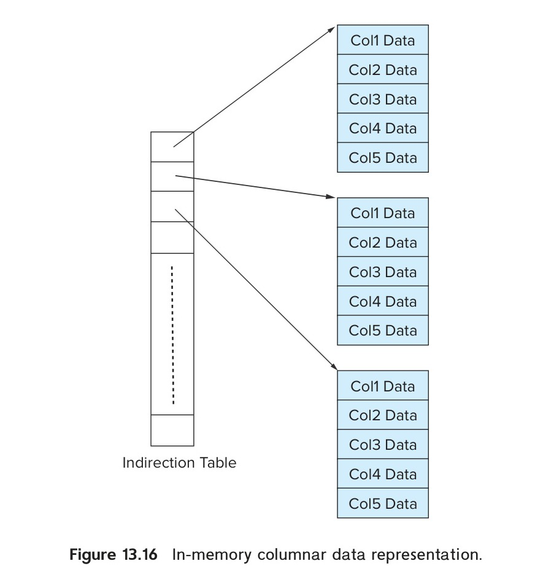
*Figure 13.16 — In-memory columnar data representation.*

## 13.8 Summary

• We can organize a file logically as a sequence of records mapped onto disk blocks. One approach to mapping the database to files is to use several files, and to store records of only one fixed length in any given file. An alternative is to structure files so that they can accommodate multiple lengths for records. The slotted-page method is widely used to handle varying-length records within a disk block.

• Since data are transferred between disk storage and main memory in units of a block, it is worthwhile to assign file records to blocks in such a way that a single block contains related records. If we can access several of the records we want with only one block access, we save disk accesses. Since disk accesses are usually the bottleneck in the performance of a database system, careful assignment of records to blocks can pay significant performance dividends.

• The data dictionary, also referred to as the system catalog, keeps track of metadata, that is, data about data, such as relation names, attribute names and types, storage information, integrity constraints, and user information.

<!-- Page 618 -->

• One way to reduce the number of disk accesses is to keep as many blocks as possible in main memory. Since it is not possible to keep all blocks in main memory, we need to manage the allocation of the space available in main memory for the storage of blocks. The buffer is that part of main memory available for storage of copies of disk blocks. The subsystem responsible for the allocation of buffer space is called the buffer manager.

• Column-oriented storage systems provide good performance for many data warehousing applications.

## Review Terms

• File Organization
  - File
  - Blocks
• Fixed-length records
• File header
• Free list
• Variable-length records
• Null bitmap
• Slotted-page structure
• Large objects
• Organization of records
  - Heap file organization
  - Sequential file organization
  - Multitable clustering file organization
  - B+-tree file organizations
  - Hashing file organization
• Free-space map
• Sequential file
• Search key
• Cluster key
• Table partitioning
• Data-dictionary storage
  - Metadata
  - Data dictionary
  - System catalog
• Database buffer
  - Buffer manager
  - Pinned blocks
  - Evicted blocks
  - Forced output of blocks
  - Shared and exclusive locks
• Buffer-replacement strategies
  - Least recently used (LRU)
  - Toss-immediate
  - Most recently used (MRU)
• Output of blocks
• Forced output of blocks
• Log disk
• Journaling file systems
• Column-oriented storage
  - Columnar storage
  - Vector processing
  - Column stores
  - Row stores
  - Stripe
  - Hybrid row/column storage
• Main-memory database

<!-- Page 619 -->

## Practice Exercises

**13.1** Consider the deletion of record 5 from the file of Figure 13.3. Compare the relative merits of the following techniques for implementing the deletion:
a. Move record 6 to the space occupied by record 5, and move record 7 to the space occupied by record 6.
b. Move record 7 to the space occupied by record 5.
c. Mark record 5 as deleted, and move no records.

**13.2** Show the structure of the file of Figure 13.4 after each of the following steps:
a. Insert (24556, Turnamian, Finance, 98000).
b. Delete record 2.
c. Insert (34556, Thompson, Music, 67000).

**13.3** Consider the relations *section* and *takes*. Give an example instance of these two relations, with three sections, each of which has five students. Give a file structure of these relations that uses multitable clustering.

**13.4** Consider the bitmap representation of the free-space map, where for each block in the file, two bits are maintained in the bitmap. If the block is between 0 and 30 percent full the bits are 00, between 30 and 60 percent the bits are 01, between 60 and 90 percent the bits are 10, and above 90 percent the bits are 11. Such bitmaps can be kept in memory even for quite large files.
a. Outline two benefits and one drawback to using two bits for a block, instead of one byte as described earlier in this chapter.
b. Describe how to keep the bitmap up to date on record insertions and deletions.
c. Outline the benefit of the bitmap technique over free lists in searching for free space and in updating free space information.

**13.5** It is important to be able to quickly find out if a block is present in the buffer, and if so where in the buffer it resides. Given that database buffer sizes are very large, what (in-memory) data structure would you use for this task?

**13.6** Suppose your university has a very large number of *takes* records, accumulated over many years. Explain how table partitioning can be done on the *takes* relation, and what benefits it could offer. Explain also one potential drawback of the technique.

<!-- Page 620 -->

**13.7** Give an example of a relational-algebra expression and a query-processing strategy in each of the following situations:
a. MRU is preferable to LRU.
b. LRU is preferable to MRU.

**13.8** PostgreSQL normally uses a small buffer, leaving it to the operating system buffer manager to manage the rest of main memory available for file system buffering. Explain (a) what is the benefit of this approach, and (b) one key limitation of this approach.

## Exercises

**13.9** In the variable-length record representation, a null bitmap is used to indicate if an attribute has the null value.
a. For variable-length fields, if the value is null, what would be stored in the offset and length fields?
b. In some applications, tuples have a very large number of attributes, most of which are null. Can you modify the record representation such that the only overhead for a null attribute is the single bit in the null bitmap?

**13.10** Explain why the allocation of records to blocks affects database-system performance significantly.

**13.11** List two advantages and two disadvantages of each of the following strategies for storing a relational database:
a. Store each relation in one file.
b. Store multiple relations (perhaps even the entire database) in one file.

**13.12** In the sequential file organization, why is an overflow block used even if there is, at the moment, only one overflow record?

**13.13** Give a normalized version of the *Index_metadata* relation, and explain why using the normalized version would result in worse performance.

**13.14** Standard buffer managers assume each block is of the same size and costs the same to read. Consider a buffer manager that, instead of LRU, uses the rate of reference to objects, that is, how often an object has been accessed in the last $n$ seconds. Suppose we want to store in the buffer objects of varying sizes, and varying read costs (such as web pages, whose read cost depends on the site from which they are fetched). Suggest how a buffer manager may choose which block to evict from the buffer.

<!-- Page 621 -->

## Further Reading

[Hennessy et al. (2017)] is a popular textbook on computer architecture, which includes coverage of hardware aspects of translation look-aside buffers, caches, and memory-management units.

The storage structure of specific database systems, such as IBM DB2, Oracle, Microsoft SQL Server, and PostgreSQL are documented in their respective system manuals, which are available online.

Algorithms for buffer management in database systems, along with a performance evaluation, were presented by [Chou and Dewitt (1985)]. Buffer management in operating systems is discussed in most operating-system texts, including in [Silberschatz et al. (2018)].

[Abadi et al. (2008)] presents a comparison of column-oriented and row-oriented storage, including issues related to query processing and optimization.

Sybase IQ, developed in the mid 1990s, was the first commercially successful column-oriented database, designed for analytics. MonetDB and C-Store were column-oriented databases developed as academic research projects. The Vertica column-oriented database is a commercial database that grew out of C-Store, while VectorWise is a commercial database that grew out of MonetDB. As its name suggests, VectorWise supports vector processing of data, and as a result supports very high processing rates for many analytical queries. [Stonebraker et al. (2005)] describe C-Store, while [Idreos et al. (2012)] give an overview of the MonetDB project and [Zukowski et al. (2012)] describes Vectorwise.

The ORC and Parquet columnar file formats were developed to support compressed storage of data for big-data applications that run on the Apache Hadoop platform.

## Bibliography

- **[Abadi et al. (2008)]** D. J. Abadi, S. Madden, and N. Hachem, “Column-Stores vs. Row-Stores: How Different Are They Really?”, In *Proc. of the ACM SIGMOD Conf. on Management of Data* (2008), pages 967–980.
- **[Chou and Dewitt (1985)]** H. T. Chou and D. J. Dewitt, “An Evaluation of Buffer Management Strategies for Relational Database Systems”, In *Proc. of the International Conf. on Very Large Databases* (1985), pages 127–141.
- **[Hennessy et al. (2017)]** J. L. Hennessy, D. A. Patterson, and D. Goldberg, *Computer Architecture: A Quantitative Approach*, 6th edition, Morgan Kaufmann (2017).
- **[Idreos et al. (2012)]** S. Idreos, F. Groffen, N. Nes, S. Manegold, K. S. Mullender, and M. L. Kersten, “MonetDB: Two Decades of Research in Column-oriented Database Architectures”, *IEEE Data Engineering Bulletin*, Volume 35, Number 1 (2012), pages 40–45.
- **[Silberschatz et al. (2018)]** A. Silberschatz, P. B. Galvin, and G. Gagne, *Operating System Concepts*, 10th edition, John Wiley and Sons (2018).

<!-- Page 622 -->

- **[Stonebraker et al. (2005)]** M. Stonebraker, D. J. Abadi, A. Batkin, X. Chen, M. Cherniack, M. Ferreira, E. Lau, A. Lin, S. Madden, E. J. O’Neil, P. E. O’Neil, A. Rasin, N. Tran, and S. B. Zdonik, “C-Store: A Column-oriented DBMS”, In *Proc. of the International Conf. on Very Large Databases* (2005), pages 553–564.
- **[Zukowski et al. (2012)]** M. Zukowski, M. van de Wiel, and P. A. Boncz, “Vectorwise: A Vectorized Analytical DBMS”, In *Proc. of the International Conf. on Data Engineering* (2012), pages 1349–1350.

## Credits

The photo of the sailboats in the beginning of the chapter is due to ©Pavel Nesvadba/Shutterstock.
