# Chapter 14: Indexing

<!-- Page 623 -->

Many queries reference only a small proportion of the records in a file. For example, a query like “Find all instructors in the Physics department” or “Find the total number of credits earned by the student with ID 22201” references only a fraction of the *instructor* or *student* records. It is inefficient for the system to read every tuple in the *instructor* relation to check if the *dept_name* value is “Physics”. Likewise, it is inefficient to read the entire *student* relation just to find the one tuple for the ID “22201”. Ideally, the system should be able to locate these records directly. To allow these forms of access, we design additional structures that we associate with files.

## 14.1 Basic Concepts

An index for a file in a database system works in much the same way as the index in this textbook. If we want to learn about a particular topic (specified by a word or a phrase) in this textbook, we can search for the topic in the index at the back of the book, find the pages where it occurs, and then read the pages to find the information for which we are looking. The words in the index are in sorted order, making it easy to find the word we want. Moreover, the index is much smaller than the book, further reducing the effort needed.

Database-system indices play the same role as book indices in libraries. For example, to retrieve a *student* record given an *ID*, the database system would look up an index to find on which disk block[^1] the corresponding record resides, and then fetch the disk block, to get the appropriate *student* record.

Indices are critical for efficient processing of queries in databases. Without indices, every query would end up reading the entire contents of every relation that it uses; doing so would be unreasonably expensive for queries that only fetch a few records, for example, a single *student* record, or the records in the *takes* relation corresponding to a single student.

[^1]: As in earlier chapters, we use the term *disk* to refer to persistent storage devices, such as magnetic disks and solid-state drives.

<!-- Page 624 -->

Implementing an index on the *student* relation by keeping a sorted list of students’ *ID* would not work well on very large databases, since (i) the index would itself be very big, (ii) even though keeping the index sorted reduces the search time, finding a student can still be rather time-consuming, and (iii) updating a sorted list as students are added or removed from the database can be very expensive. Instead, more sophisticated indexing techniques are used in database systems. We shall discuss several of these techniques in this chapter.

There are two basic kinds of indices:

- **Ordered indices.** Based on a sorted ordering of the values.
- **Hash indices.** Based on a uniform distribution of values across a range of buckets. The bucket to which a value is assigned is determined by a function, called a *hash function*.

We shall consider several techniques for ordered indexing. No one technique is the best. Rather, each technique is best suited to particular database applications. Each technique must be evaluated on the basis of these factors:

- **Access types:** The types of access that are supported efficiently. Access types can include finding records with a specified attribute value and finding records whose attribute values fall in a specified range.
- **Access time:** The time it takes to find a particular data item, or set of items, using the technique in question.
- **Insertion time:** The time it takes to insert a new data item. This value includes the time it takes to find the correct place to insert the new data item, as well as the time it takes to update the index structure.
- **Deletion time:** The time it takes to delete a data item. This value includes the time it takes to find the item to be deleted, as well as the time it takes to update the index structure.
- **Space overhead:** The additional space occupied by an index structure. Provided that the amount of additional space is moderate, it is usually worthwhile to sacrifice the space to achieve improved performance.

We often want to have more than one index for a file. For example, we may wish to search for a book by author, by subject, or by title.

An attribute or set of attributes used to look up records in a file is called a **search key**. Note that this definition of *key* differs from that used in *primary key*, *candidate key*, and *superkey*. This duplicate meaning for *key* is (unfortunately) well established in practice. Using our notion of a search key, we see that if there are several indices on a file, there are several search keys.

<!-- Page 625 -->

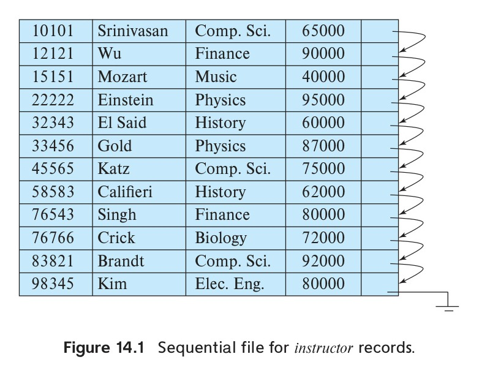
*Figure 14.1 — Sequential file for instructor records.*

## 14.2 Ordered Indices

To gain fast random access to records in a file, we can use an index structure. Each index structure is associated with a particular search key. Just like the index of a book or a library catalog, an ordered index stores the values of the search keys in sorted order and associates with each search key the records that contain it.

The records in the indexed file may themselves be stored in some sorted order, just as books in a library are stored according to some attribute such as the Dewey decimal number. A file may have several indices, on different search keys. If the file containing the records is sequentially ordered, a **clustering index** is an index whose search key also defines the sequential order of the file. Clustering indices are also called **primary indices**; the term *primary index* may appear to denote an index on a primary key, but such indices can in fact be built on any search key. The search key of a clustering index is often the primary key, although that is not necessarily so. Indices whose search key specifies an order different from the sequential order of the file are called **nonclustering indices**, or **secondary indices**. The terms “clustered” and “nonclustered” are often used in place of “clustering” and “nonclustering.”

In Section 14.2.1 through Section 14.2.3, we assume that all files are ordered sequentially on some search key. Such files, with a clustering index on the search key, are called **index-sequential files**. They represent one of the oldest index schemes used in database systems. They are designed for applications that require both sequential processing of the entire file and random access to individual records. In Section 14.2.4 we cover secondary indices.

Figure 14.1 shows a sequential file of *instructor* records taken from our university example. In the example of Figure 14.1, the records are stored in sorted order of instructor *ID*, which is used as the search key.

<!-- Page 626 -->

### 14.2.1 Dense and Sparse Indices

An **index entry**, or **index record**, consists of a search-key value and pointers to one or more records with that value as their search-key value. A pointer to a record consists of the identifier of a disk block and an offset within the disk block to identify the record within the block.

There are two types of ordered indices that we can use:

- **Dense index:** In a dense index, an index entry appears for every search-key value in the file. In a dense clustering index, the index record contains the search-key value and a pointer to the first data record with that search-key value. The rest of the records with the same search-key value would be stored sequentially after the first record, since, because the index is a clustering one, records are sorted on the same search key.

  In a dense nonclustering index, the index must store a list of pointers to all records with the same search-key value.
- **Sparse index:** In a sparse index, an index entry appears for only some of the search-key values. Sparse indices can be used only if the relation is stored in sorted order of the search key; that is, if the index is a clustering index. As is true in dense indices, each index entry contains a search-key value and a pointer to the first data record with that search-key value. To locate a record, we find the index entry with the largest search-key value that is less than or equal to the search-key value for which we are looking. We start at the record pointed to by that index entry and follow the pointers in the file until we find the desired record.

Figure 14.2 and Figure 14.3 show dense and sparse indices, respectively, for the *instructor* file. Suppose that we are looking up the record of instructor with *ID* “22222”. Using the dense index of Figure 14.2, we follow the pointer directly to the desired record. Since *ID* is a primary key, there exists only one such record and the search is complete. If we are using the sparse index (Figure 14.3), we do not find an index entry for “22222”. Since the last entry (in numerical order) before “22222” is “10101”, we follow that pointer. We then read the *instructor* file in sequential order until we find the desired record.

Consider a (printed) dictionary. The header of each page lists the first word alphabetically on that page. The words at the top of each page of the book index together form a sparse index on the contents of the dictionary pages.

As another example, suppose that the search-key value is not a primary key. Figure 14.4 shows a dense clustering index for the *instructor* file with the search key being *dept_name*. Observe that in this case the *instructor* file is sorted on the search key *dept_name*, instead of *ID*, otherwise the index on *dept_name* would be a nonclustering index. Suppose that we are looking up records for the History department. Using the dense index of Figure 14.4, we follow the pointer directly to the first History record. We process this record and follow the pointer in that record to locate the next record in

<!-- Page 627 -->


*Figure 14.2 — Dense index.*

search-key (*dept_name*) order. We continue processing records until we encounter a record for a department other than History.

As we have seen, it is generally faster to locate a record if we have a dense index rather than a sparse index. However, sparse indices have advantages over dense indices in that they require less space and they impose less maintenance overhead for insertions and deletions.

There is a trade-off that the system designer must make between access time and space overhead. Although the decision regarding this trade-off depends on the specific application, a good compromise is to have a sparse index with one index entry per


*Figure 14.3 — Sparse index.*

<!-- Page 628 -->

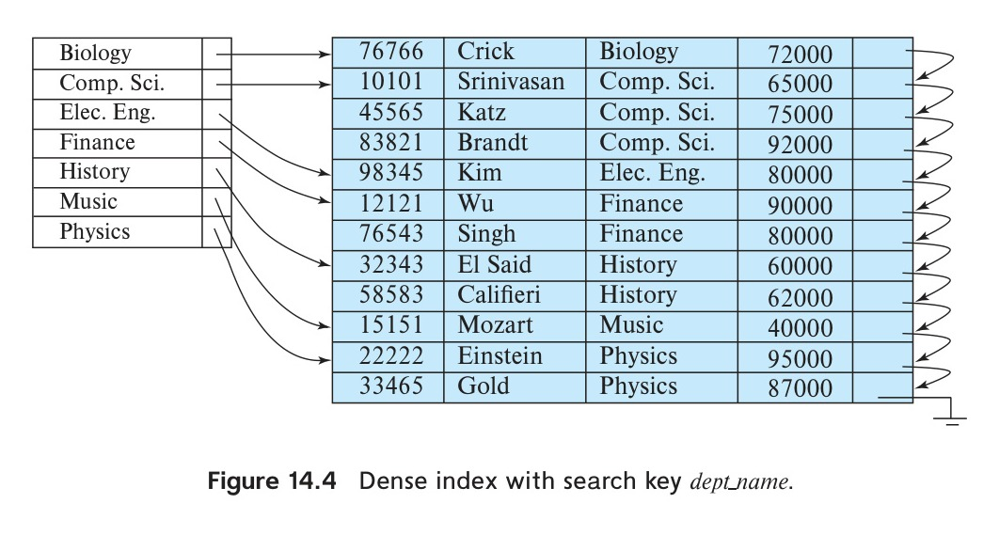
*Figure 14.4 — Dense index with search key dept_name.*

block. The reason this design is a good trade-off is that the dominant cost in processing a database request is the time that it takes to bring a block from disk into main memory. Once we have brought in the block, the time to scan the entire block is negligible. Using this sparse index, we locate the block containing the record that we are seeking. Thus, unless the record is on an overflow block (see Section 13.3.2), we minimize block accesses while keeping the size of the index (and thus our space overhead) as small as possible.

For the preceding technique to be fully general, we must consider the case where records for one search-key value occupy several blocks. It is easy to modify our scheme to handle this situation.

### 14.2.2 Multilevel Indices

Suppose we build a dense index on a relation with 1,000,000 tuples. Index entries are smaller than data records, so let us assume that 100 index entries fit on a 4-kilobyte block. Thus, our index occupies 10,000 blocks. If the relation instead had 100,000,000 tuples, the index would instead occupy 1,000,000 blocks, or 4 gigabytes of space. Such large indices are stored as sequential files on disk.

If an index is small enough to be kept entirely in main memory, the search time to find an entry is low. However, if the index is so large that not all of it can be kept in memory, index blocks must be fetched from disk when required. (Even if an index is smaller than the main memory of a computer, main memory is also required for a number of other tasks, so it may not be possible to keep the entire index in memory.) The search for an entry in the index then requires several disk-block reads.

Binary search can be used on the index file to locate an entry, but the search still has a large cost. If the index would occupy $b$ blocks, binary search requires as many as $\lceil \log_2(b) \rceil$ blocks to be read. ($\lceil x \rceil$ denotes the least integer that is greater than or equal to $x$; that is, we round upward.) Note that the blocks that are read are not adjacent

<!-- Page 629 -->

to each other, so each read requires a random (i.e., non-sequential) I/O operation. For a 10,000-block index, binary search requires 14 random block reads. On a magnetic disk system where a random block read takes on average 10 milliseconds, the index search will take 140 milliseconds. This may not seem much, but we would be able to carry out only seven index searches a second on a single disk, whereas a more efficient search mechanism would let us carry out far more searches per second, as we shall see shortly. Note that, if overflow blocks have been used, binary search is only possible on the non-overflow blocks, and the actual cost may be even higher than the logarithmic bound above. A sequential search requires $b$ sequential block reads, which may take even longer (although in some cases the lower cost of sequential block reads may result in sequential search being faster than a binary search). Thus, the process of searching a large index may be costly.

To deal with this problem, we treat the index just as we would treat any other sequential file, and we construct a sparse outer index on the original index, which we now call the inner index, as shown in Figure 14.5. Note that the index entries are always in sorted order, allowing the outer index to be sparse. To locate a record, we first use binary search on the outer index to find the record for the largest search-key value less

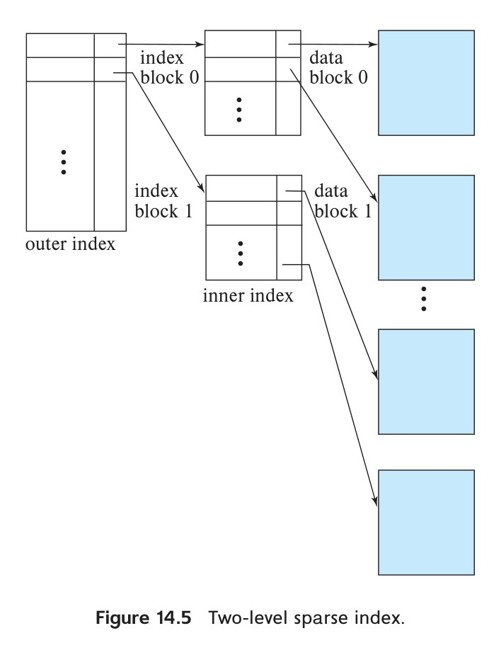
*Figure 14.5 — Two-level sparse index.*

<!-- Page 630 -->

than or equal to the one that we desire. The pointer points to a block of the inner index. We scan this block until we find the record that has the largest search-key value less than or equal to the one that we desire. The pointer in this record points to the block of the file that contains the record for which we are looking.

In our example, an inner index with 10,000 blocks would require 10,000 entries in the outer index, which would occupy just 100 blocks. If we assume that the outer index is already in main memory, we would read only one index block for a search using a multilevel index, rather than the 14 blocks we read with binary search. As a result, we can perform 14 times as many index searches per second.

If our file is extremely large, even the outer index may grow too large to fit in main memory. With a 100,000,000-tuple relation, the inner index would occupy 1,000,000 blocks, and the outer index would occupy 10,000 blocks, or 40 megabytes. Since there are many demands on main memory, it may not be possible to reserve that much main memory just for this particular outer index. In such a case, we can create yet another level of index. Indeed, we can repeat this process as many times as necessary. Indices with two or more levels are called **multilevel indices**. Searching for records with a multilevel index requires significantly fewer I/O operations than does searching for records by binary search.[^2]

Multilevel indices are closely related to tree structures, such as the binary trees used for in-memory indexing. We shall examine the relationship later, in Section 14.3.

### 14.2.3 Index Update

Regardless of what form of index is used, every index must be updated whenever a record is either inserted into or deleted from the file. Further, in case a record in the file is updated, any index whose search-key attribute is affected by the update must also be updated; for example, if the department of an instructor is changed, an index on the *dept_name* attribute of *instructor* must be updated correspondingly. Such a record update can be modeled as a deletion of the old record, followed by an insertion of the new value of the record, which results in an index deletion followed by an index insertion. As a result we only need to consider insertion and deletion on an index, and we do not need to consider updates explicitly.

We first describe algorithms for updating single-level indices.

#### 14.2.3.1 Insertion

First, the system performs a lookup using the search-key value that appears in the record to be inserted. The actions the system takes next depend on whether the index is dense or sparse:

[^2]: In the early days of disk-based indices, each level of the index corresponded to a unit of physical storage. Thus, we may have indices at the track, cylinder, and disk levels. Such a hierarchy does not make sense today since disk subsystems hide the physical details of disk storage, and the number of disks and platters per disk is very small compared to the number of cylinders or bytes per track.

<!-- Page 631 -->

- **Dense indices:**
  1. If the search-key value does not appear in the index, the system inserts an index entry with the search-key value in the index at the appropriate position.
  2. Otherwise the following actions are taken:
     a. If the index entry stores pointers to all records with the same search-key value, the system adds a pointer to the new record in the index entry.
     b. Otherwise, the index entry stores a pointer to only the first record with the search-key value. The system then places the record being inserted after the other records with the same search-key values.
- **Sparse indices:** We assume that the index stores an entry for each block. If the system creates a new block, it inserts the first search-key value (in search-key order) appearing in the new block into the index. On the other hand, if the new record has the least search-key value in its block, the system updates the index entry pointing to the block; if not, the system makes no change to the index.

#### 14.2.3.2 Deletion

To delete a record, the system first looks up the record to be deleted. The actions the system takes next depend on whether the index is dense or sparse:

- **Dense indices:**
  1. If the deleted record was the only record with its particular search-key value, then the system deletes the corresponding index entry from the index.
  2. Otherwise the following actions are taken:
     a. If the index entry stores pointers to all records with the same search-key value, the system deletes the pointer to the deleted record from the index entry.
     b. Otherwise, the index entry stores a pointer to only the first record with the search-key value. In this case, if the deleted record was the first record with the search-key value, the system updates the index entry to point to the next record.
- **Sparse indices:**
  1. If the index does not contain an index entry with the search-key value of the deleted record, nothing needs to be done to the index.
  2. Otherwise the system takes the following actions:
     a. If the deleted record was the only record with its search key, the system replaces the corresponding index record with an index record for the next search-key value (in search-key order). If the next search-key value already has an index entry, the entry is deleted instead of being replaced.

<!-- Page 632 -->

     b. Otherwise, if the index entry for the search-key value points to the record being deleted, the system updates the index entry to point to the next record with the same search-key value.

Insertion and deletion algorithms for multilevel indices are a simple extension of the scheme just described. On deletion or insertion, the system updates the lowest-level index as described. As far as the second level is concerned, the lowest-level index is merely a file containing records—thus, if there is any change in the lowest-level index, the system updates the second-level index as described. The same technique applies to further levels of the index, if there are any.

### 14.2.4 Secondary Indices

Secondary indices must be dense, with an index entry for every search-key value, and a pointer to every record in the file. A clustering index may be sparse, storing only some of the search-key values, since it is always possible to find records with intermediate search-key values by a sequential access to a part of the file, as described earlier. If a secondary index stores only some of the search-key values, records with intermediate search-key values may be anywhere in the file and, in general, we cannot find them without searching the entire file.

A secondary index on a candidate key looks just like a dense clustering index, except that the records pointed to by successive values in the index are not stored sequentially. In general, however, secondary indices may have a different structure from clustering indices. If the search key of a clustering index is not a candidate key, it suffices if the index points to the first record with a particular value for the search key, since the other records can be fetched by a sequential scan of the file.

In contrast, if the search key of a secondary index is not a candidate key, it is not enough to point to just the first record with each search-key value. The remaining records with the same search-key value could be anywhere in the file, since the records are ordered by the search key of the clustering index, rather than by the search key of the secondary index. Therefore, a secondary index must contain pointers to all the records.

If a relation can have more than one record containing the same search key value (that is, two or more records can have the same values for the indexed attributes), the search key is said to be a **nonunique search key**.

One way to implement secondary indices on nonunique search keys is as follows: Unlike the case of primary indices, the pointers in such a secondary index do not point directly to the records. Instead, each pointer in the index points to a bucket that in turn contains pointers to the file. Figure 14.6 shows the structure of a secondary index that uses such an extra level of indirection on the *instructor* file, on the search key *dept_name*.

However, this approach has a few drawbacks. First, index access takes longer, due to an extra level of indirection, which may require a random I/O operation. Second,

<!-- Page 633 -->

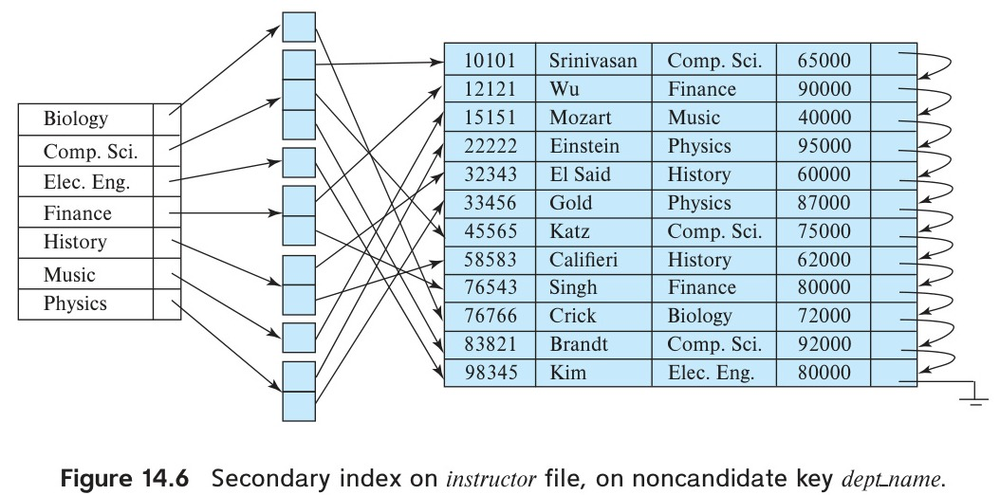
*Figure 14.6 — Secondary index on instructor file, on noncandidate key dept_name.*

if a key has very few or no duplicates, if a whole block is allocated to its associated bucket, a lot of space would be wasted. Later in this chapter, we study more efficient alternatives for implementing secondary indices, which avoid these drawbacks.

A sequential scan in clustering index order is efficient because records in the file are stored physically in the same order as the index order. However, we cannot (except in rare special cases) store a file physically ordered by both the search key of the clustering index and the search key of a secondary index. Because secondary-key order and physical-key order differ, if we attempt to scan the file sequentially in secondary-key order, the reading of each record is likely to require the reading of a new block from disk, which is very slow.

The procedure described earlier for deletion and insertion can also be applied to secondary indices; the actions taken are those described for dense indices storing a pointer to every record in the file. If a file has multiple indices, whenever the file is modified, every index must be updated.

Secondary indices improve the performance of queries that use keys other than the search key of the clustering index. However, they impose a significant overhead on modification of the database. The designer of a database decides which secondary indices are desirable on the basis of an estimate of the relative frequency of queries and modifications.

### 14.2.5 Indices on Multiple Keys

Although the examples we have seen so far have had a single attribute in a search key, in general a search key can have more than one attribute. A search key containing more than one attribute is referred to as a **composite search key**. The structure of the index is the same as that of any other index, the only difference being that the search key is not a single attribute, but rather is a list of attributes. The search key can be represented as a tuple of values, of the form $(a_1, \dots, a_n)$, where the indexed attributes are $A_1, \dots, A_n$.

<!-- Page 634 -->

The ordering of search-key values is the lexicographic ordering. For example, for the case of two attribute search keys, $(a_1, a_2) < (b_1, b_2)$ if either $a_1 < b_1$ or $a_1 = b_1$ and $a_2 < b_2$. Lexicographic ordering is basically the same as alphabetic ordering of words.

As an example, consider an index on the *takes* relation, on the composite search key (*course_id*, *semester*, *year*). Such an index would be useful to find all students who have registered for a particular course in a particular semester/year. An ordered index on a composite key can also be used to answer several other kinds of queries efficiently, as we shall see in Section 14.6.2.

## 14.3 B+-Tree Index Files

The main disadvantage of the index-sequential file organization is that performance degrades as the file grows, both for index lookups and for sequential scans through the data. Although this degradation can be remedied by reorganization of the file, frequent reorganizations are undesirable.

The B+-tree index structure is the most widely used of several index structures that maintain their efficiency despite insertion and deletion of data. A B+-tree index takes the form of a balanced tree in which every path from the root of the tree to a leaf of the tree is of the same length. Each nonleaf node in the tree (other than the root) has between $\lceil n/2 \rceil$ and $n$ children, where $n$ is fixed for a particular tree; the root has between 2 and $n$ children.

We shall see that the B+-tree structure imposes performance overhead on insertion and deletion and adds space overhead. The overhead is acceptable even for frequently modified files, since the cost of file reorganization is avoided. Furthermore, since nodes may be as much as half empty (if they have the minimum number of children), there is some wasted space. This space overhead, too, is acceptable given the performance benefits of the B+-tree structure.

### 14.3.1 Structure of a B+-Tree

A B+-tree index is a multilevel index, but it has a structure that differs from that of the multilevel index-sequential file. We assume for now that there are no duplicate search key values, that is, each search key is unique and occurs in at most one record; we consider the issue of nonunique search keys later.

Figure 14.7 shows a typical node of a B+-tree. It contains up to $n - 1$ search-key values $K_1, K_2, \dots, K_{n-1}$, and $n$ pointers $P_1, P_2, \dots, P_n$. The search-key values within a node are kept in sorted order; thus, if $i < j$, then $K_i < K_j$.

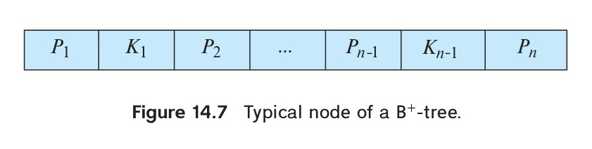
*Figure 14.7 — Typical node of a B+-tree.*

<!-- Page 635 -->

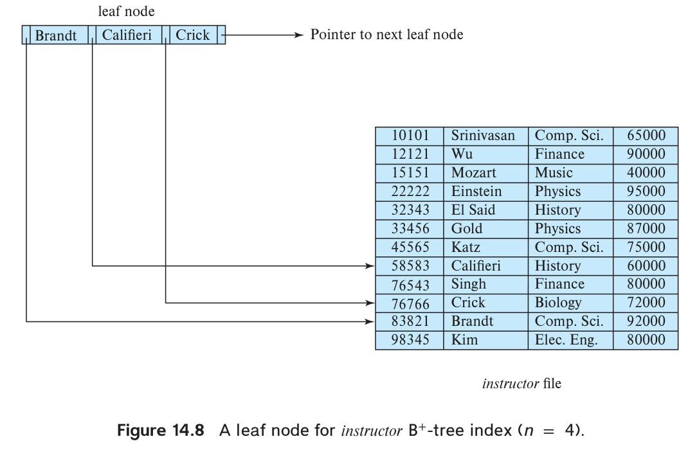
*Figure 14.8 — A leaf node for instructor B+-tree index ($n = 4$).*

We consider first the structure of the leaf nodes. For $i = 1, 2, \dots, n - 1$, pointer $P_i$ points to a file record with search-key value $K_i$. Pointer $P_n$ has a special purpose that we shall discuss shortly.

Figure 14.8 shows one leaf node of a B+-tree for the *instructor* file, in which we have chosen $n$ to be 4, and the search key is *name*.

Now that we have seen the structure of a leaf node, let us consider how search-key values are assigned to particular nodes. Each leaf can hold up to $n - 1$ values. We allow leaf nodes to contain as few as $\lceil (n - 1)/2 \rceil$ values. With $n = 4$ in our example B+-tree, each leaf must contain at least two values, and at most three values.

If $L_i$ and $L_j$ are leaf nodes and $i < j$ (that is, $L_i$ is to the left of $L_j$ in the tree), then every search-key value $v_i$ in $L_i$ is less than every search-key value $v_j$ in $L_j$.

If the B+-tree index is used as a dense index (as is usually the case), every search-key value must appear in some leaf node.

Now we can explain the use of the pointer $P_n$. Since there is a linear order on the leaves based on the search-key values that they contain, we use $P_n$ to chain together the leaf nodes in search-key order. This ordering allows for efficient sequential processing of the file.

The nonleaf nodes of the B+-tree form a multilevel (sparse) index on the leaf nodes. The structure of nonleaf nodes is the same as that for leaf nodes, except that all pointers are pointers to tree nodes. A nonleaf node may hold up to $n$ pointers and must hold at least $\lceil n/2 \rceil$ pointers. The number of pointers in a node is called the fanout of the node. Nonleaf nodes are also referred to as internal nodes.

<!-- Page 636 -->


*Figure 14.9 — B+-tree for instructor file ($n = 4$).*

Let us consider a node containing $m$ pointers ($m \le n$). For $i = 2, 3, \dots, m - 1$, pointer $P_i$ points to the subtree that contains search-key values less than $K_i$ and greater than or equal to $K_{i-1}$. Pointer $P_m$ points to the part of the subtree that contains those key values greater than or equal to $K_{m-1}$, and pointer $P_1$ points to the part of the subtree that contains those search-key values less than $K_1$.

Unlike other nonleaf nodes, the root node can hold fewer than $\lceil n/2 \rceil$ pointers; however, it must hold at least two pointers, unless the tree consists of only one node. It is always possible to construct a B+-tree, for any $n$, that satisfies the preceding requirements.

Figure 14.9 shows a complete B+-tree for the *instructor* file (with $n = 4$). We have omitted null pointers for simplicity; any pointer field in the figure that does not have an arrow is understood to have a null value.

Figure 14.10 shows another B+-tree for the *instructor* file, this time with $n = 6$. Observe that the height of this tree is less than that of the previous tree, which had $n = 4$.

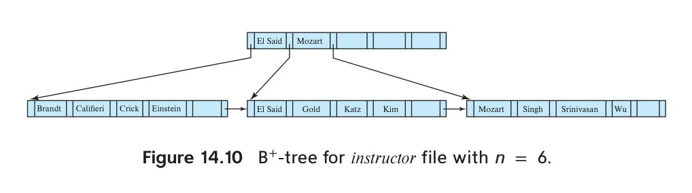
*Figure 14.10 — B+-tree for instructor file with $n = 6$.*

<!-- Page 637 -->

These examples of B+-trees are all balanced. That is, the length of every path from the root to a leaf node is the same. This property is a requirement for a B+-tree. Indeed, the “B” in B+-tree stands for “balanced.” It is the balance property of B+-trees that ensures good performance for lookup, insertion, and deletion.

In general, search keys could have duplicates. One way to handle the case of nonunique search keys is to modify the tree structure to store each search key at a leaf node as many times as it appears in records, with each copy pointing to one record. The condition that $K_i < K_j$ if $i < j$ will need to be modified to $K_i \le K_j$. However, this approach can result in duplicate search key values at internal nodes, making the insertion and deletion procedures more complicated and expensive. Another alternative is to store a set (or bucket) of record pointers with each search key value, as we saw earlier. This approach is more complicated and can result in inefficient access, especially if the number of record pointers for a particular key is very large.

Most database implementations instead make search keys unique as follows: Suppose the desired search key attribute $a_i$ of relation $r$ is nonunique. Let $A_p$ be the primary key of $r$. Then the unique composite search key $(a_i, A_p)$ is used instead of $a_i$ when building the index. (Any set of attributes that together with $a_i$ guarantee uniqueness can also be used instead of $A_p$.) For example, if we wished to create an index on the *instructor* relation on the attribute *name*, we instead create an index on the composite search key (*name*, *ID*), since *ID* is the primary key for *instructor*. Index lookups on just *name* can be efficiently handled using this index, as we shall see shortly. Section 14.3.5 covers issues in handling of nonunique search keys in more detail.

In our examples, we show indices on some nonunique search keys, such as *instructor.name*, assuming for simplicity that there are no duplicates; in reality most databases would automatically add extra attributes internally, to ensure the absence of duplicates.

### 14.3.2 Queries on B+-Trees

Let us consider how we process queries on a B+-tree. Suppose that we wish to find a record with a given value $v$ for the search key. Figure 14.11 presents pseudocode for a function `find(v)` to carry out this task, assuming there are no duplicates, that is, there is at most one record with a particular search key. We address the issue of nonunique search keys later in this section.

Intuitively, the function starts at the root of the tree and traverses the tree down until it reaches a leaf node that would contain the specified value if it exists in the tree. Specifically, starting with the root as the current node, the function repeats the following steps until a leaf node is reached. First, the current node is examined, looking for the smallest $i$ such that search-key value $K_i$ is greater than or equal to $v$. Suppose such a value is found; then, if $K_i$ is equal to $v$, the current node is set to the node pointed to by $P_{i+1}$, otherwise $K_i > v$, and the current node is set to the node pointed to by $P_i$. If no such value $K_i$ is found, then $v > K_{m-1}$, where $P_m$ is the last nonnull pointer in the node. In this case the current node is set to that pointed to by $P_m$. The above procedure is repeated, traversing down the tree until a leaf node is reached.

<!-- Page 638 -->

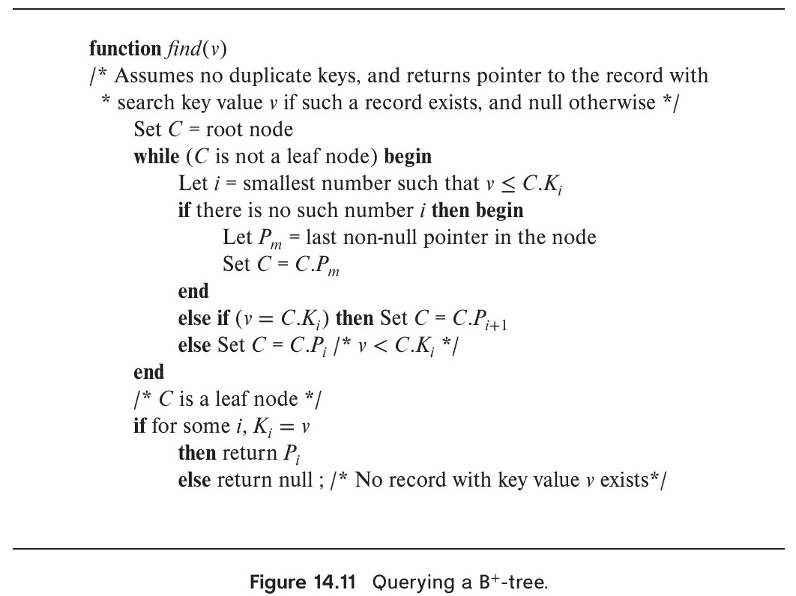
*Figure 14.11 — Querying a B+-tree.*

At the leaf node, if there is a search-key value $K_i = v$, pointer $P_i$ directs us to a record with search-key value $K_i$. The function then returns the pointer to the record, $P_i$. If no search key with value $v$ is found in the leaf node, no record with key value $v$ exists in the relation, and function `find` returns null, to indicate failure.

B+-trees can also be used to find all records with search key values in a specified range $[lb, ub]$. For example, with a B+-tree on attribute *salary* of *instructor*, we can find all instructor records with salary in a specified range such as $[50000, 100000]$ (in other words, all salaries between 50000 and 100000). Such queries are called **range queries**.

To execute such queries, we can create a procedure `findRange(lb, ub)`, shown in Figure 14.12. The procedure does the following: it first traverses to a leaf in a manner similar to `find(lb)`; the leaf may or may not actually contain value $lb$. It then steps through records in that and subsequent leaf nodes collecting pointers to all records with key values $C.K_i$ s.t. $lb \le C.K_i \le ub$ into a set `resultSet`. The function stops when $C.K_i > ub$, or there are no more keys in the tree.

A real implementation would provide a version of `findRange` supporting an iterator interface similar to that provided by the JDBC `ResultSet`, which we saw in Section 5.1.1. Such an iterator interface would provide a method `next()`, which can be called repeatedly to fetch successive records. The `next()` method would step through the entries at the leaf level, in a manner similar to `findRange`, but each call takes only one step and records where it left off, so that successive calls to `next()` step through successive entries. We omit details for simplicity, and leave the pseudocode for the iterator interface as an exercise for the interested reader.

<!-- Page 639 -->

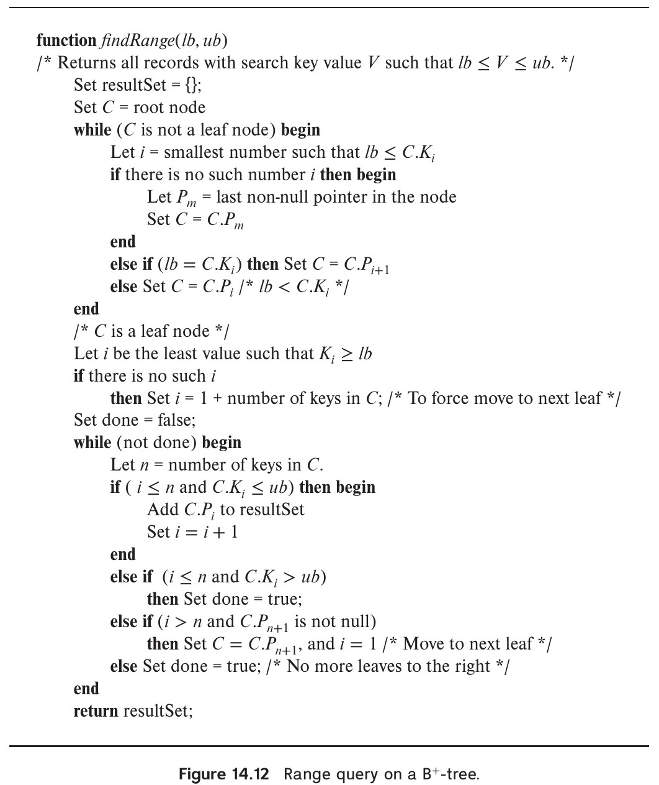
*Figure 14.12 — Range query on a B+-tree.*

We now consider the cost of querying on a B+-tree index. In processing a query, we traverse a path in the tree from the root to some leaf node. If there are $N$ records in the file, the path is no longer than $\lceil \log_{\lceil n/2 \rceil}(N) \rceil$.

Typically, the node size is chosen to be the same as the size of a disk block, which is typically 4 kilobytes. With a search-key size of 12 bytes, and a disk-pointer size of

<!-- Page 640 -->

8 bytes, $n$ is around 200. Even with a more conservative estimate of 32 bytes for the search-key size, $n$ is around 100. With $n = 100$, if we have 1 million search-key values in the file, a lookup requires only $\lceil \log_{50}(1,000,000) \rceil = 4$ nodes to be accessed. Thus, at most four blocks need to be read from disk to traverse the path from the root to a leaf. The root node of the tree is usually heavily accessed and is likely to be in the buffer, so typically only three or fewer blocks need to be read from disk.

An important difference between B+-tree structures and in-memory tree structures, such as binary trees, is the size of a node, and as a result, the height of the tree. In a binary tree, each node is small and has at most two pointers. In a B+-tree, each node is large—typically a disk block—and a node can have a large number of pointers. Thus, B+-trees tend to be fat and short, unlike thin and tall binary trees. In a balanced binary tree, the path for a lookup can be of length $\lceil \log_2(N) \rceil$, where $N$ is the number of records in the file being indexed. With $N = 1,000,000$ as in the previous example, a balanced binary tree requires around 20 node accesses. If each node were on a different disk block, 20 block reads would be required to process a lookup, in contrast to the four block reads for the B+-tree. The difference is significant with a magnetic disk, since each block read could require a disk arm seek which, together with the block read, takes about 10 milliseconds on a magnetic disk. The difference is not quite as drastic with flash storage, where a read of a 4 kilobyte page takes around 10 to 100 microseconds, but it is still significant.

After traversing down to the leaf level, queries on a single value of a unique search key require one more random I/O operation to fetch any matching record.

Range queries have an additional cost, after traversing down to the leaf level: all the pointers in the given range must be retrieved. These pointers are in consecutive leaf nodes; thus, if $M$ such pointers are retrieved, at most $\lceil M/(n/2) \rceil + 1$ leaf nodes need to be accessed to retrieve the pointers (since each leaf node has at least $n/2$ pointers, but even two pointers may be split across two pages). To this cost, we need to add the cost of accessing the actual records. For secondary indices, each such record may be on a different block, which could result in $M$ random I/O operations in the worst case. For clustered indices, these records would be in consecutive blocks, with each block containing multiple records, resulting in a significantly lower cost.

Now, let us consider the case of nonunique keys. As explained earlier, if we wish to create an index on an attribute $a_i$ that is not a candidate key, and may thus have duplicates, we instead create an index on a composite key that is duplicate-free. The composite key is created by adding extra attributes, such as the primary key, to $a_i$, to ensure uniqueness. Suppose we created an index on the composite key $(a_i, A_p)$ instead of creating an index on $a_i$.

An important question, then, is how do we retrieve all tuples with a given value $v$ for $a_i$ using the above index? This question is easily answered by using the function `findRange(lb, ub)`, with $lb = (v, -\infty)$ and $ub = (v, \infty)$, where $-\infty$ and $\infty$ denote the smallest and largest possible values of $A_p$. All records with $a_i = v$ would be returned by the above function call. Range queries on $a_i$ can be handled similarly. These range

<!-- Page 641 -->

queries retrieve pointers to the records quite efficiently, although retrieving the actual records may be expensive if the index is a secondary index, as explained above.

### 14.3.3 Updates on B+-Trees

When a record is inserted into, or deleted from a relation, indices on the relation must be updated correspondingly. In this section, we describe how insertions and deletions are performed on a B+-tree. For clarity of presentation, we assume that search keys are unique.

Insertion and deletion are more complicated than lookup, since it may become necessary to split a node that becomes too large or to coalesce nodes (that is, combine nodes) if a node becomes too small. When a node is split or coalesced, the change must be reflected in the parent node, which in turn may become too large or too small. Thus, the change can cascade up the tree. However, cascading changes are relatively rare, and the cost of insertion and deletion operations in terms of I/O operations is low.

Before presenting the general algorithms for insertion and deletion, we consider an easy special case:

- **Insertion.** Using the same technique as for lookup from the `find()` function, the system finds the leaf node that should contain the key value of the record being inserted. If the key value already appears in the leaf node, the system adds the new record to the file, and if necessary adds a pointer to the record to the bucket for that key. If the key value does not appear in the leaf node, the system inserts the key value and pointer to the record into the leaf node, in search-key order. If the node has too many entries as a result of the insertion, the node is split, as we describe below; but if the leaf node has space for the new entry, no split is required.
- **Deletion.** Using the same technique as for lookup from the `find()` function, the system finds the leaf node that contains the key value of the record being deleted, and deletes the record from the file. If there are multiple records with that search key, the pointer to the record being deleted is removed from the bucket for that key. If the key value is now not associated with any record, the key value is deleted from the leaf node. In case the leaf node now contains too few entries, it is either coalesced with a sibling or entries are redistributed with a sibling, as we describe below. If neither condition occurs, the leaf node is left unchanged.

We now consider the general case of insertion and deletion, dealing with splits and merges of nodes.

#### 14.3.3.1 Insertion

We now consider an example of insertion in which a node must be split. Suppose that we wish to insert a record with name “Adams” into the B+-tree of Figure 14.9. Using the lookup algorithm, we find that “Adams” should appear in the leaf node containing “Brandt” and “Califieri”. There is no space in this leaf node for the new entry, since the node already has three entries (which is the maximum allowed when $n = 4$). We must split the node. To do so, we conceptually expand the node temporarily to hold $n$ (that is, four) values (the three existing values in the

<!-- Page 642 -->

node plus the value being inserted), and put the first $\lceil n/2 \rceil$ in the existing node, and the remaining values in a newly created node. In our example, the values “Adams” and “Brandt” are placed in the existing node, and “Califieri” and “Crick” are placed in the newly created node, as shown in Figure 14.13. The pointers to actual records are handled similarly, and are not shown in the figure.

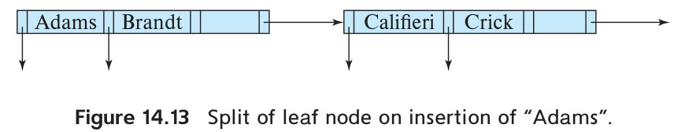
*Figure 14.13 — Split of leaf node on insertion of “Adams”.*

Having split a leaf node, we must insert the new leaf node into the B+-tree structure. In our example, the new leaf node must be inserted to the right of the node that was split. In general, an entry $(K', N')$ is inserted into the parent of the leaf node that was split, where $K'$ is the smallest key value in the new node, and $N'$ is a pointer to the new node. In our example, the smallest value in the new node is “Califieri”, and $N'$ is a pointer to the new node. The parent node, which earlier had entries (Einstein, $n_2$), where $n_2$ is a pointer to the node that was split, now has entries (Califieri, $n_1$), (Einstein, $n_2$), where $n_1$ is a pointer to the new node, as shown in Figure 14.14. Since $n = 4$, the parent node, which had only one search key earlier, has enough space for the new entry, and no further splits are required.

Splitting of a nonleaf node is a little different from splitting of a leaf node. To see why, let us consider the insertion of a record with name “Lamport” into the B+-tree of Figure 14.14. Using the lookup algorithm, we find that “Lamport” should appear in the leaf node containing “Kim” and “Mozart”. There is space in this node for the new entry, and the node does not need to be split. The resulting B+-tree is shown in Figure 14.15.

Now consider the insertion of a record with name “Kim” into the B+-tree of Figure 14.14. The leaf node containing “Gold” and “Katz” must be split into two nodes: one containing “Gold” and “Katz”, and the other containing “Kim” and “Mozart”. An entry (Kim, $n_1$) must then be added to the parent node, where $n_1$ is a pointer to the new node. However, there is no space in the parent node to add a new entry, and the parent node has to be split. To do so, the parent node is conceptually expanded temporarily, the entry added, and the overfull node is then immediately split.

When an overfull nonleaf node is split, the child pointers are divided among the original and the newly created nodes; in our example, the original node is left with the first three pointers, and the newly created node to the right gets the remaining two pointers. The search key values are, however, handled a little differently. The search key values that lie between the pointers moved to the right node (in our example, the value “Kim”) are moved along with the pointers, while those that lie between the pointers that stay on the left (in our example, “Califieri” and “Einstein”) remain undisturbed.

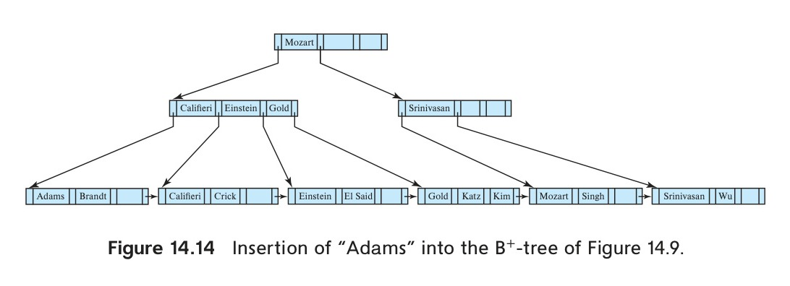
*Figure 14.14 — Insertion of “Adams” into the B+-tree of Figure 14.9.*

<!-- Page 643 -->

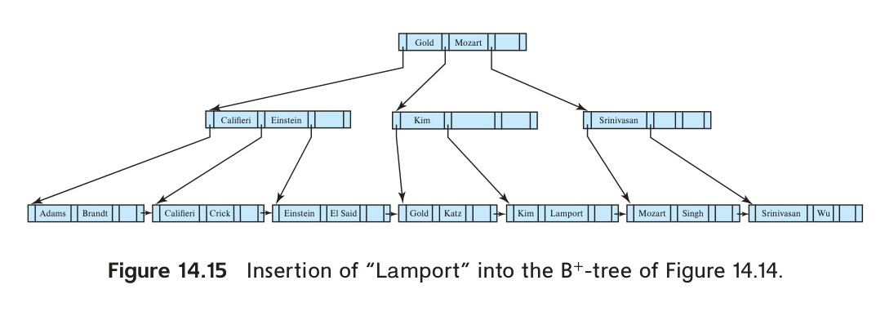
*Figure 14.15 — Insertion of “Lamport” into the B+-tree of Figure 14.14.*

However, the search key value that lies between the pointers that stay on the left, and the pointers that move to the right node is treated differently. In our example, the search key value “Gold” lies between the three pointers that went to the left node, and the two pointers that went to the right node. The value “Gold” is not added to either of the split nodes. Instead, an entry (Gold, $n_2$) is added to the parent node, where $n_2$ is a pointer to the newly created node that resulted from the split. In this case, the parent node is the root, and it has enough space for the new entry.

The general technique for insertion into a B+-tree is to determine the leaf node $l$ into which insertion must occur. If a split results, insert the new node into the parent

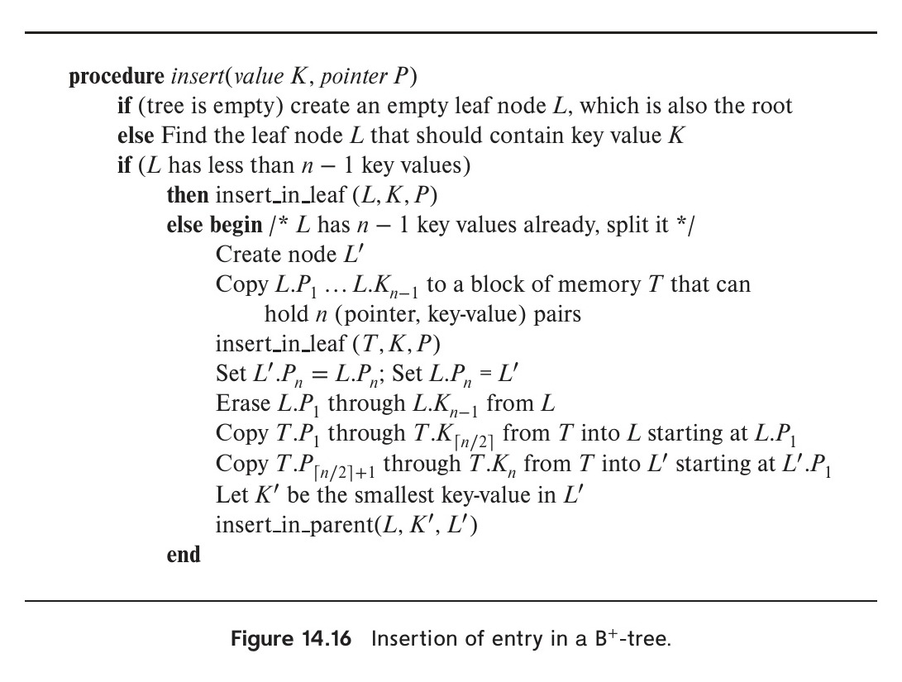
*Figure 14.16 — Insertion of entry in a B+-tree.*

<!-- Page 644 -->

of node $l$. If this insertion causes a split, proceed recursively up the tree until either an insertion does not cause a split or a new root is created.

Figure 14.16 outlines the insertion algorithm in pseudocode. The procedure `insert` inserts a key-value pointer pair into the index, using two subsidiary procedures `insert_in_leaf` and `insert_in_parent`, shown in Figure 14.17. In the pseudocode, $L$, $N$, $P$ and $T$ denote pointers to nodes, with $L$ being used to denote a leaf node. $L.K_i$ and $L.P_i$ denote the $i$th value and the $i$th pointer in node $L$, respectively; $T.K_i$ and $T.P_i$ are used similarly. The pseudocode also makes use of the function `parent(N)` to find the parent of a node $N$. We can compute a list of nodes in the path from the root to the leaf while initially finding the leaf node, and we can use it later to find the parent of any node in the path efficiently.

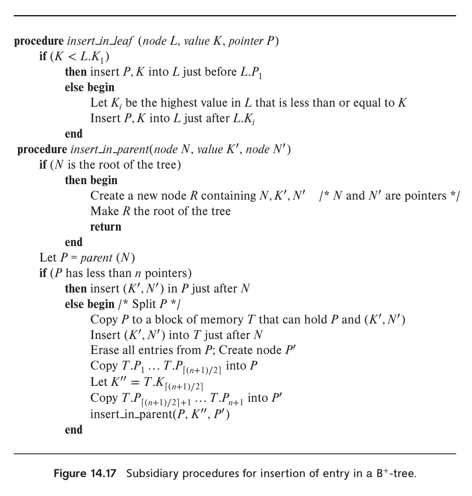
*Figure 14.17 — Subsidiary procedures for insertion of entry in a B+-tree.*

<!-- Page 645 -->

The procedure `insert_in_parent` takes as parameters $N, K', N'$, where node $N$ was split into $N$ and $N'$, with $K'$ being the least value in $N'$. The procedure modifies the parent of $N$ to record the split. The procedures `insert_into_index` and `insert_in_parent` use a temporary area of memory $T$ to store the contents of a node being split. The procedures can be modified to copy data from the node being split directly to the newly created node, reducing the time required for copying data. However, the use of the temporary space $T$ simplifies the procedures.

#### 14.3.3.2 Deletion

We now consider deletions that cause tree nodes to contain too few pointers. First, let us delete “Srinivasan” from the B+-tree of Figure 14.14. The resulting B+-tree appears in Figure 14.18. We now consider how the deletion is performed. We first locate the entry for “Srinivasan” by using our lookup algorithm. When we delete the entry for “Srinivasan” from its leaf node, the node is left with only one entry, “Wu”. Since, in our example, $n = 4$ and $1 < \lceil (n - 1)/2 \rceil$, we must either merge the node with a sibling node or redistribute the entries between the nodes, to ensure that each node is at least half-full. In our example, the underfull node with the entry for “Wu” can be merged with its left sibling node. We merge the nodes by moving the entries from both the nodes into the left sibling and deleting the now-empty right sibling. Once the node is deleted, we must also delete the entry in the parent node that pointed to the just deleted node.

In our example, the entry to be deleted is (Srinivasan, $n_3$), where $n_3$ is a pointer to the leaf containing “Srinivasan”. (In this case the entry to be deleted in the nonleaf node happens to be the same value as that deleted from the leaf; that would not be the case for most deletions.) After deleting the above entry, the parent node, which had a search key value “Srinivasan” and two pointers, now has one pointer (the leftmost pointer in the node) and no search-key values. Since $1 < \lceil n/2 \rceil$ for $n = 4$, the parent node is underfull. (For larger $n$, a node that becomes underfull would still have some values as well as pointers.)

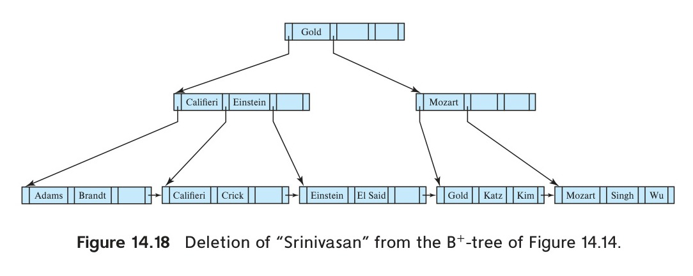
*Figure 14.18 — Deletion of “Srinivasan” from the B+-tree of Figure 14.14.*

<!-- Page 646 -->

In this case, we look at a sibling node; in our example, the only sibling is the nonleaf node containing the search keys “Califieri”, “Einstein”, and “Gold”. If possible, we try to coalesce the node with its sibling. In this case, coalescing is not possible, since the node and its sibling together have five pointers, against a maximum of four. The solution in this case is to redistribute the pointers between the node and its sibling, such that each has at least $\lceil n/2 \rceil = 2$ child pointers. To do so, we move the rightmost pointer from the left sibling (the one pointing to the leaf node containing “Gold”) to the underfull right sibling. However, the underfull right sibling would now have two pointers, namely, its leftmost pointer, and the newly moved pointer, with no value separating them. In fact, the value separating them is not present in either of the nodes, but is present in the parent node, between the pointers from the parent to the node and its sibling. In our example, the value “Mozart” separates the two pointers and is present in the right sibling after the redistribution. Redistribution of the pointers also means that the value “Mozart” in the parent no longer correctly separates search-key values in the two siblings. In fact, the value that now correctly separates search-key values in the two sibling nodes is the value “Gold”, which was in the left sibling before redistribution.

As a result, as can be seen in the B+-tree in Figure 14.18, after redistribution of pointers between siblings, the value “Gold” has moved up into the parent, while the value that was there earlier, “Mozart”, has moved down into the right sibling.

We next delete the search-key values “Singh” and “Wu” from the B+-tree of Figure 14.18. The result is shown in Figure 14.19. The deletion of the first of these values does not make the leaf node underfull, but the deletion of the second value does. It is not possible to merge the underfull node with its sibling, so a redistribution of values is carried out, moving the search-key value “Kim” into the node containing “Mozart”, resulting in the tree shown in Figure 14.19. The value separating the two siblings has been updated in the parent, from “Mozart” to “Kim”.

Now we delete “Gold” from the above tree; the result is shown in Figure 14.20. The deletion of “Gold” makes the leaf node underfull. It is coalesced with its left sibling, and the value “Gold” is deleted from the parent. This deletion makes the parent underfull, and it is coalesced with its sibling, with the value “Gold” earlier present in the root

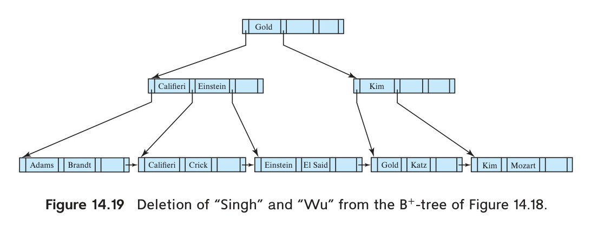
*Figure 14.19 — Deletion of “Singh” and “Wu” from the B+-tree of Figure 14.18.*

<!-- Page 647 -->

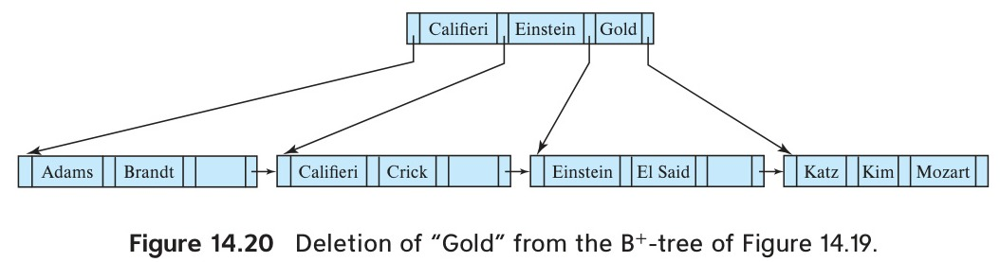
*Figure 14.20 — Deletion of “Gold” from the B+-tree of Figure 14.19.*

moving down from the parent into the merged node. As a result of this merge, an entry is deleted from the root. The root now has only one pointer, and no key values. We then remove the root node, and its child becomes the new root node. The height of the B+-tree is reduced by one as a result, as can be seen in Figure 14.20.

It is worth noting that, as a result of deletion, a key value that is present in an internal node may no longer be present in any leaf node. However, this does not affect correctness, and we do not need to delete the value from the internal node, as long as the nodes remain adequately full after deletion, or redistribution is applied.

In general, to delete a value in a B+-tree, we perform a lookup on the value and delete it from the leaf node that contains it. If the leaf node becomes underfull, we either coalesce it with an adjacent sibling node, or redistribute entries between the two nodes. When coalescing is done, an entry must be deleted from the parent node. This deletion can cascade up the tree, until either a node does not become underfull or the root node is left with only one child, in which case the root node is deleted and its child becomes the new root.

Figure 14.21 outlines the pseudocode for deletion from a B+-tree. The procedure `swap_variables(N, N')` merely swaps the values of the (pointer) variables $N$ and $N'$; this swap has no effect on the tree itself. The pseudocode uses the condition “too few pointers/values.” For nonleaf nodes, this criterion means less than $\lceil n/2 \rceil$ pointers; for leaf nodes, it means less than $\lceil (n-1)/2 \rceil$ values. The pseudocode redistributes entries by borrowing a single entry from an adjacent node. We can also redistribute entries by repartitioning entries equally between the two nodes. The pseudocode refers to deleting an entry $(K, P)$ from a node. In the case of leaf nodes, the pointer to an entry actually precedes the key value, so the pointer $P$ precedes the key value $K$. For nonleaf nodes, $P$ follows the key value $K$.

### 14.3.4 Complexity of B+-Tree Updates

Although insertion and deletion operations on B+-trees are complicated, they require relatively few I/O operations, which is an important benefit since I/O operations are expensive. It can be shown that the number of I/O operations needed in the worst case for an insertion is proportional to $\log_{\lceil n/2 \rceil}(N)$, where $n$ is the maximum number of pointers in a node, and $N$ is the number of records in the file being indexed.

The worst-case complexity of the deletion procedure is also proportional to $\log_{\lceil n/2 \rceil}(N)$, provided there are no duplicate values for the search key; we discuss the case of nonunique search keys later in this chapter.

<!-- Page 648 -->

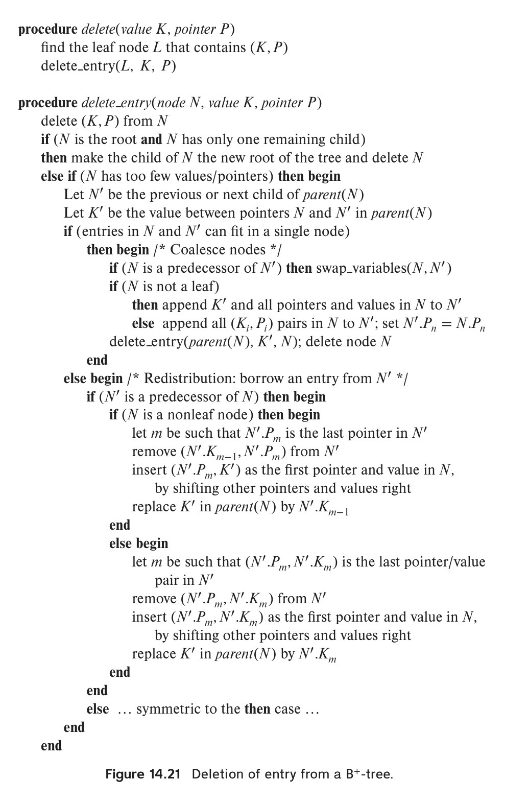
*Figure 14.21 — Deletion of entry from a B+-tree.*

<!-- Page 649 -->

In other words, the cost of insertion and deletion operations in terms of I/O operations is proportional to the height of the B+-tree, and is therefore low. It is the speed of operation on B+-trees that makes them a frequently used index structure in database implementations.

In practice, operations on B+-trees result in fewer I/O operations than the worst-case bounds. With fanout of 100, and assuming accesses to leaf nodes are uniformly distributed, the parent of a leaf node is 100 times more likely to get accessed than the leaf node. Conversely, with the same fanout, the total number of nonleaf nodes in a B+-tree would be just a little more than 1/100th of the number of leaf nodes. As a result, with memory sizes of several gigabytes being common today, for B+-trees that are used frequently, even if the relation is very large it is quite likely that most of the nonleaf nodes are already in the database buffer when they are accessed. Thus, typically only one or two I/O operations are required to perform a lookup. For updates, the probability of a node split occurring is correspondingly very small. Depending on the ordering of inserts, with a fanout of 100, only from 1 in 100 to 1 in 50 insertions will result in a node split, requiring more than one block to be written. As a result, on an average an insert will require just a little more than one I/O operation to write updated blocks.

Although B+-trees only guarantee that nodes will be at least half full, if entries are inserted in random order, nodes can be expected to be more than two-thirds full on average. If entries are inserted in sorted order, on the other hand, nodes will be only half full. (We leave it as an exercise to the reader to figure out why nodes would be only half full in the latter case.)

### 14.3.5 Nonunique Search Keys

We have assumed so far that search keys are unique. Recall also that we described earlier, in Section 14.3.1, how to make search keys unique by creating a composite search key containing the original search key and extra attributes, that together are unique across all records.

The extra attribute can be a record-id, which is a pointer to the record, or a primary key, or any other attribute whose value is unique among all records with the same search-key value. The extra attribute is called a uniquifier attribute.

A search with the original search-key attribute can be carried out using a range search as we saw in Section 14.3.2; alternatively, we can create a variant of the findRange function that takes only the original search key value as parameter and ignores the value of the uniquifier attribute when comparing search-key values.

It is also possible to modify the B+-tree structure to support duplicate search keys. The insert, delete, and lookup methods all have to be modified correspondingly.

- One alternative is to store each key value only once in the tree, and to keep a bucket (or list) of record pointers with a search-key value, to handle nonunique search keys. This approach is space efficient since it stores the key value only once; however, it creates several complications when B+-trees are implemented. If the

<!-- Page 650 -->

buckets are kept in the leaf node, extra code is needed to deal with variable-size buckets, and to deal with buckets that grow larger than the size of the leaf node. If the buckets are stored in separate blocks, an extra I/O operation may be required to fetch records.
- Another option is to store the search key value once per record; this approach allows a leaf node to be split in the usual way if it is found to be full during an insert. However, this approach makes handling of split and search on internal nodes significantly more complicated, since two leaves may contain the same search key value. It also has a higher space overhead, since key values are stored as many times as there are records containing that value.

A major problem with both these approaches, as compared to the unique search-key approach, lies in the efficiency of record deletion. (The complexity of lookup and insertion are the same with both these approaches, as well as with the unique search-key approach.) Suppose a particular search-key value occurs a large number of times, and one of the records with that search key is to be deleted. The deletion may have to search through a number of entries with the same search-key value, potentially across multiple leaf nodes, to find the entry corresponding to the particular record being deleted. Thus, the worst-case complexity of deletion may be linear in the number of records.

In contrast, record deletion can be done efficiently using the unique search key approach. When a record is to be deleted, the composite search-key value is computed from the record and then used to look up the index. Since the value is unique, the corresponding leaf-level entry can be found with a single traversal from root to leaf, with no further accesses at the leaf level. The worst-case cost of deletion is logarithmic in the number of records, as we saw earlier.

Due to the inefficiency of deletion, as well as other complications due to duplicate search keys, B+-tree implementations in most database systems only handle unique search keys, and they automatically add record-ids or other attributes to make nonunique search keys unique.

## 14.4 B+-Tree Extensions

In this section, we discuss several extensions and variations of the B+-tree index structure.

### 14.4.1 B+-Tree File Organization

As mentioned in Section 14.3, the main drawback of index-sequential file organization is the degradation of performance as the file grows: With growth, an increasing percentage of index entries and actual records become out of order and are stored in overflow blocks. We solve the degradation of index lookups by using B+-tree indices on the file.

<!-- Page 651 -->

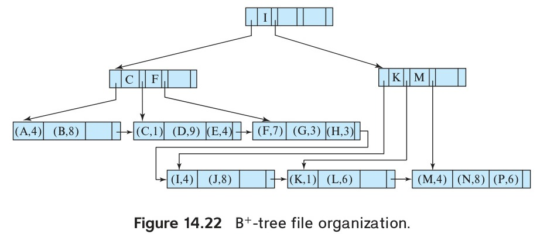
*Figure 14.22 — B+-tree file organization.*

We solve the degradation problem for storing the actual records by using the leaf level of the B+-tree to organize the blocks containing the actual records. We use the B+-tree structure not only as an index, but also as an organizer for records in a file. In a **B+-tree file organization**, the leaf nodes of the tree store records, instead of storing pointers to records. Figure 14.22 shows an example of a B+-tree file organization. Since records are usually larger than pointers, the maximum number of records that can be stored in a leaf node is less than the number of pointers in a nonleaf node. However, the leaf nodes are still required to be at least half full.

Insertion and deletion of records from a B+-tree file organization are handled in the same way as insertion and deletion of entries in a B+-tree index. When a record with a given key value $v$ is inserted, the system locates the block that should contain the record by searching the B+-tree for the largest key in the tree that is $\le v$. If the block located has enough free space for the record, the system stores the record in the block. Otherwise, as in B+-tree insertion, the system splits the block in two and redistributes the records in it (in the B+-tree–key order) to create space for the new record. The split propagates up the B+-tree in the normal fashion. When we delete a record, the system first removes it from the block containing it. If a block $B$ becomes less than half full as a result, the records in $B$ are redistributed with the records in an adjacent block $B'$. Assuming fixed-sized records, each block will hold at least one-half as many records as the maximum that it can hold. The system updates the nonleaf nodes of the B+-tree in the usual fashion.

When we use a B+-tree for file organization, space utilization is particularly important, since the space occupied by the records is likely to be much more than the space occupied by keys and pointers. We can improve the utilization of space in a B+-tree by involving more sibling nodes in redistribution, during insertion and deletion. A variation of B+-trees called **B*-trees** implements this idea.

During insertion, if a node is full, the system attempts to redistribute entries with its sibling node, so that both nodes are about two-thirds full. A node is split only if both it and its sibling are full. When a split occurs, two full nodes are divided into three nodes, each about two-thirds full. Since each node contains more records

<!-- Page 652 -->

than can fit in two nodes, each node will be about two-thirds full. More precisely, each node contains at least $\lfloor 2n/3 \rfloor$ pointers (or records).

During deletion of a record, if the occupancy of a node falls below $\lfloor 2n/3 \rfloor$, the system attempts to redistribute records with a sibling node. If both nodes together contain fewer than $2\lfloor 2n/3 \rfloor$ records, they are merged into two nodes, or if they contain even fewer records, into a single node. The B*-tree variation guarantees that each node is at least two-thirds full, resulting in a space utilization of at least 66 percent, compared to the 50 percent guaranteed by standard B+-trees.

Note that in a B+-tree index or file organization, leaf nodes that are adjacent in search-key order may not be physically adjacent on disk. Over time, as nodes are split and new nodes are allocated, the sequential order of leaf nodes can become fragmented on disk. Such fragmentation can slow down sequential scans of the file. To restore physical sequentiality, database systems provide utilities to reorganize the file.

B+-tree file organizations can also be used to store large objects, such as long text strings, audio, or video. The large object is broken into smaller chunks, each of which fits in a leaf node. The B+-tree then indexes the chunks by their byte offset within the large object, allowing efficient random access and updates to parts of the object.

### 14.4.2 Secondary Indices and Record Relocation

Some file organizations, such as the B+-tree file organization, may change the physical location of records during updates. For example, when a leaf node splits, some records are moved to a new block. If there are secondary indices on the file, the pointers in the secondary indices that point to the moved records must be updated. If a large number of records are moved, updating all the secondary indices can be very expensive.

A widely used solution for this problem is as follows: In secondary indices, instead of storing the physical address (block identifier and offset) of the record, the secondary index stores the search key of the primary index (or clustering index) of the file, along with any other attributes required to make the search key unique.

<!-- Page 653 -->

attributes. For example, suppose we have a primary index on the attribute *ID* of the *instructor* relation, and the file is organized as a B+-tree file organization on *ID*. A secondary index on *dept_name* would store with each *dept_name* value the *ID* of the instructor record, instead of a pointer to the record.

Relocation of records because of leaf-node splits then does not require updating secondary indices, since the *ID* values of the records do not change.

This approach thus greatly reduces the cost of index update due to file reorganization. The disadvantage, however, is that looking up a record through a secondary index now requires a secondary index lookup followed by a primary index lookup, increasing the lookup cost.

### 14.4.3 Indexing Strings

Creating B+-tree indices on string-valued attributes raises two problems. The first problem is that strings can be of variable length. The second problem is that strings can be long, leading to a low fanout and a correspondingly increased tree height.

With variable-length search keys, different nodes can have different fanouts even if they are full. A node must then be split if it is full, that is, there is no space to add a new entry, regardless of how many search entries it has. Similarly, nodes can be merged or entries redistributed depending on what fraction of the space in the nodes is used, instead of being based on the maximum number of entries that the node can hold.

The fanout of nodes can be increased by using a technique called **prefix compression**. With prefix compression, we do not store the entire search key value at nonleaf nodes. We only store a prefix of each search key value that is sufficient to distinguish between the key values in the subtrees that it separates. For example, if we had an index on names, the key value at a nonleaf node could be a prefix of a name; it may suffice to store “Silb” at a nonleaf node, instead of the full “Silberschatz” if the closest values in the two subtrees that it separates are, say, “Silas” and “Silver” respectively.

### 14.4.4 Bulk Loading of B+-Trees

As we saw earlier, insertion of a record in a B+-tree requires a number of I/O operations to traverse the tree from root to leaf, and if a split occurs, to write the new nodes to disk.

Now consider the case where a B+-tree is being built on a large relation that already exists, or where a large number of records are being loaded into an existing relation (called **bulk loading**). If we insert records one at a time using the standard insertion procedure, each insertion will typically require a random read to fetch a leaf block, followed by a random write

<!-- Page 654 -->

to disk. Thus, a random read and a random write operation may be required for each entry inserted.

For example, if the relation has 100 million records, and each I/O operation takes about 10 milliseconds on a magnetic disk, it would take at least 1 million seconds to build the index, counting only the cost of reading leaf nodes, not even counting the cost of writing the updated nodes back to disk. This is clearly a very large amount of time; in contrast, if each record occupies 100 bytes, and the disk subsystem can transfer data at 50 megabytes per second, it would take just 200 seconds to read the entire relation.

Insertion of a large number of entries at a time into an index is referred to as bulk loading of the index. An efficient way to perform bulk loading of an index is as follows: First, create a temporary file containing index entries for the relation, then sort the file on the search key of the index being constructed, and finally scan the sorted file and insert the entries into the index. There are efficient algorithms for sorting large relations, described later in Section 15.4, which can sort even a large file with an I/O cost comparable to that of reading the file a few times, assuming a reasonable amount of main memory is available.

There is a significant benefit to sorting the entries before inserting them into the B+-tree. When the entries are inserted in sorted order, all entries that go to a particular leaf node will appear consecutively, and the leaf needs to be written out only once; nodes will never have to be read from disk during bulk load, if the B+-tree was empty to start with. Each leaf node will thus incur only one I/O operation even though many entries may be inserted into the node. If each leaf contains 100 entries, the leaf level will contain 1 million nodes, resulting in only 1 million I/O operations for creating the leaf level. Even these I/O operations can be expected to be sequential, if successive leaf nodes are allocated on successive disk blocks, and few disk seeks would be required. With magnetic disks, 1 millisecond per block is a reasonable estimate for mostly sequential I/O operations, in contrast to 10 milliseconds per block for random I/O operations.

We shall study the cost of sorting a large relation later, in Section 15.4, but as a rough estimate, the index which would have otherwise taken up to 1,000,000 seconds to build on a magnetic disk can be constructed in well under 1000 seconds by sorting the entries before inserting them into the B+-tree.

If the B+-tree is initially empty, it can be constructed faster by building it bottom-up, from the leaf level, instead of using the usual insert procedure. In bottom-up B+-tree construction, after sorting the entries as we just described, we break up the sorted entries into blocks, keeping as many entries in a block as can fit in the block; the resulting blocks form the leaf level of the B+-tree. The minimum value in each block, along with the pointer to the block, is used to create entries in the next level of the B+-tree, pointing to the leaf blocks. Each further level of the tree is similarly constructed using the minimum values associated with each node one level below, until the root is created. We leave details as an exercise for the reader.

Most database systems implement efficient techniques based on sorting of entries, and bottom-up construction, when creating an index on a relation, although they use

<!-- Page 655 -->

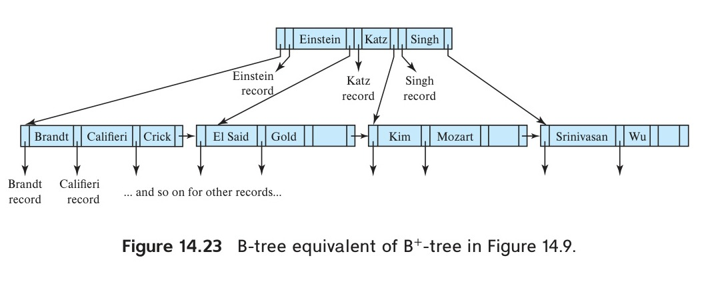
*Figure 14.23 — B-tree equivalent of B+-tree in Figure 14.9.*

the normal insertion procedure when tuples are added one at a time to a relation with an existing index. Some database systems recommend that if a very large number of tuples are added at once to an already existing relation, indices on the relation (other than any index on the primary key) should be dropped, and then re-created after the tuples are inserted, to take advantage of efficient bulk-loading techniques.

### 14.4.5 B-Tree Index Files

B-tree indices are similar to B+-tree indices. The primary distinction between the two approaches is that a B-tree eliminates the redundant storage of search-key values. In the B+-tree of Figure 14.9, the search keys “Einstein”, “Gold”, “Mozart”, and “Srinivasan” appear in nonleaf nodes, in addition to appearing in the leaf nodes. Every search-key value appears in some leaf node; several are repeated in nonleaf nodes.

A B-tree allows search-key values to appear only once (if they are unique), unlike a B+-tree, where search keys may be repeated. Figure 14.23 shows a B-tree that stores the same search-key values as does the B+-tree of Figure 14.9. Since search-key values that appear in nonleaf nodes appear nowhere else in the B-tree, an additional pointer field for each search key in a nonleaf node must be included. These additional pointers point to either the file records or buckets for the search-key value.

It is worth noting that many database system manuals, articles in industry publications, and some database textbooks refer to B+-trees as B-trees. This confusing nomenclature has arisen because B+-trees are universally used instead of B-trees; so everyone knows they are using the variant, and it has become conventional to omit the “+” in informal contexts.

A generalized B-tree leaf node appears in Figure 14.24a; a nonleaf node appears in Figure 14.24b. The leaf node looks like the leaf node of a B+-tree, except that the pointer $P_n$ is omitted. In nonleaf nodes, for each search key $K_i$, there is a pointer $B_i$ that points to the record or bucket of records for $K_i$.

<!-- Page 656 -->

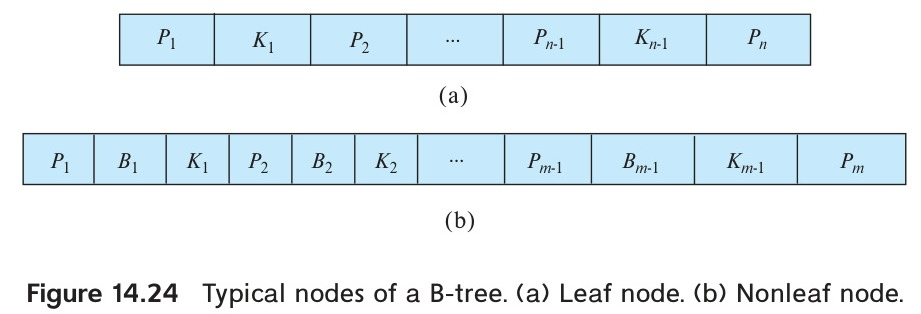
*Figure 14.24 — Typical nodes of a B-tree. (a) Leaf node. (b) Nonleaf node.*

the leaf node, but there are $m - 1$ keys in the nonleaf node. This discrepancy occurs because the leaf node does not need child pointers, while the nonleaf node does.

The number of nodes accessed in a lookup in a B-tree depends on where the search-key value is located. If the search key is in the root, only one node is accessed; if it is in a child of the root, two nodes are accessed; and so on. In the worst case, the number of nodes accessed is the height of the tree. A lookup on a B-tree may therefore require fewer node accesses than does a lookup on a B+-tree, if the search-key value happens to be located in a nonleaf node near the root of the tree. However, nonleaf nodes in a B-tree must store record/bucket pointers $B_i$ in addition to tree pointers $P_i$ and search keys $K_i$, which reduces the fanout of the node. As a result, B-trees tend to have a larger height than equivalent B+-trees, which negates the advantage of finding keys in nonleaf nodes.

Deletion in a B-tree is more complicated. In a B+-tree, the deleted entry always appears in a leaf. In a B-tree, the deleted entry may appear in a nonleaf node. The proper value must be selected as a replacement from the subtree of the node containing the deleted entry. Specifically, if search key $K_i$ is deleted, the smallest search key appearing in the subtree of pointer $P_{i+1}$ must be moved to the field formerly occupied by $K_i$. Further actions need to be taken if the leaf node now has too few entries. In contrast, insertion in a B-tree is only slightly more complicated than is insertion in a B+-tree.

The space advantages of B-trees are marginal for large indices and usually do not outweigh the disadvantages that we have noted. Thus, pretty much all database-system implementations use the B+-tree data structure, even if (as we discussed earlier) they refer to the data structure as a B-tree.

### 14.4.6 Indexing on Flash Storage

In our description of indexing so far, we have assumed that data are resident on magnetic disks. Although this assumption continues to be true for the most part, flash storage capacities have grown significantly, and the cost of flash storage per gigabyte has dropped correspondingly, and flash based SSD storage has now replaced magnetic-disk storage for many applications.

<!-- Page 657 -->

Standard B+-tree indices can continue to be used even on SSDs, with acceptable update performance and significantly improved lookup performance compared to disk storage.

Flash storage is structured as pages, and the B+-tree index structure can be used with flash based SSDs. SSDs provide much faster random I/O operations than magnetic disks, requiring only around 20 to 100 microseconds for a random page read, instead of about 5 to 10 milliseconds with magnetic disks. Thus, lookups run much faster with data on SSDs, compared to data on magnetic disks.

The performance of write operations is more complicated with flash storage. An important difference between flash storage and magnetic disks is that flash storage does not permit in-place updates to data at the physical level, although it appears to do so logically. Every update turns into a copy+write of an entire flash-storage page, requiring the old copy of the page to be erased subsequently. A new page can be written in 20 to 100 microseconds, but eventually old pages need to be erased to free up the pages for further writes. Erases are done at the level of blocks containing multiple pages, and a block erase takes 2 to 5 milliseconds.

The optimum B+-tree node size for flash storage is smaller than that with magnetic disk, since flash pages are smaller than disk blocks; it makes sense for tree-node sizes to match to flash pages, since larger nodes would lead to multiple page writes when a node is updated. Although smaller pages lead to taller trees and more I/O operations to access data, random page reads are so much faster with flash storage that the overall impact on read performance is quite small.

Although random I/O is much cheaper with SSDs than with magnetic disks, bulk loading still provides significant performance benefits, compared to tuple-at-a-time insertion, with SSDs. In particular, bottom-up construction reduces the number of page writes compared to tuple-at-a-time insertion, even if the entries are sorted on the search key. Since page writes on flash cannot be done in place and require relatively expensive block erases at a later point in time, the reduction of number of page writes with bottom-up B+-tree construction provides significant performance benefits.

Several extensions and alternatives to B+-trees have been proposed for flash storage, with a focus on reducing the number of erase operations that result due to page rewrites. One approach is to add buffers to internal nodes of B+-trees and record updates temporarily in buffers at higher levels, pushing the updates down to lower levels lazily. The key idea is that when a page is updated, multiple updates are applied together, reducing the number of page writes per update. Another approach creates multiple trees and merges them; the log-structured merge tree and its variants are based on this idea. In fact, both these approaches are also useful for reducing the cost of writes on magnetic disks; we outline both these approaches in Section 14.8.

### 14.4.7 Indexing in Main Memory

Main memory today is large and cheap enough that many organizations can afford to buy enough main memory to fit all their operational data in-memory. B+-trees can

<!-- Page 658 -->

be used to index in-memory data, with no change to the structure. However, some optimizations are possible.

First, since memory is costlier than disk space, internal data structures in main memory databases have to be designed to reduce space requirements. Techniques that we saw in Section 14.4.1 to improve B+-tree storage utilization can be used to reduce memory usage for in-memory B+-trees.

Data structures that require traversal of multiple pointers are acceptable for in-memory data, unlike in the case of disk-based data, where the cost of the I/Os to traverse multiple pages would be excessively high. Thus, tree structures in main memory databases can be relatively deep, unlike B+-trees.

The speed difference between cache memory and main memory, and the fact that data are transferred between main memory and cache in units of a cache-line (typically about 64 bytes), results in a situation where the relationship between cache and main memory is not dissimilar to the relationship between main memory and disk (although with smaller speed differences). When reading a memory location, if it is present in cache the CPU can complete the read in 1 or 2 nanoseconds, whereas a cache miss results in about 50 to 100 nanoseconds of delay to read data from main memory.

B+-trees with small nodes that fit in a cache line have been found to provide very good performance with in-memory data. Such B+-trees allow index operations to be completed with far fewer cache misses than tall, skinny tree structures such as binary trees, since each node traversal is likely to result in a cache miss. Compared to B+-trees with nodes that match cache lines, trees with large nodes also tend to have more cache misses since locating data within a node requires either a full scan of the node content, spanning multiple cache lines, or a binary search, which also results in multiple cache misses.

For databases where data do not fit entirely in memory, but frequently used data are often memory resident, the following idea is used to create B+-tree structures that offer good performance on disk as well as in-memory. Large nodes are used to optimize disk-based access, but instead of treating data in a node as single large array of keys and pointers, the data within a node are structured as a tree, with smaller nodes that match the size of a cache line. Instead of scanning data linearly or using binary search within a node, the tree-structure within the large B+-tree node is used to access the data with a minimal number of cache misses.

## 14.5 Hash Indices

Hashing is a widely used technique for building indices in main memory as well as in disk-based systems. We begin with the principles of hashing, and then describe its application to indexing.

<!-- Page 659 -->

In our description of hashing, we shall use the term **bucket** to denote a unit of storage that can store one or more records. A bucket is typically a disk block, but could be chosen to be smaller or larger than a disk block. In an in-memory hash structure, a bucket can be an array of pointers, with each pointer pointing to a linked list of records that hash to the bucket. In a disk-based hash structure that stores record pointers, buckets store pointers to records; in a disk-based hash structure that organizes records into a file (a **hash file organization**), instead of storing record pointers, buckets store the actual records; such structures only make sense with disk-resident data. The rest of our description does not depend on whether the buckets store record pointers or actual records.

Formally, let $K$ denote the set of all search-key values, and let $B$ denote the set of all bucket addresses. A **hash function** $h$ is a function from $K$ to $B$. Let $h$ denote a hash function. With in-memory hash indices, the set of buckets is simply an array of pointers, with the $i$th bucket at offset $i$. Each pointer stores the head of a linked list containing the entries in that bucket.

To insert a record with search key $K_i$, we compute $h(K_i)$, which gives the address of the bucket for that record. We add the index entry for the record to the list at offset $i$. Note that there are other variants of hash indices that handle the case of multiple records in a bucket differently; the form described here is the most widely used variant and is called **overflow chaining**.

Hash indexing using overflow chaining is also called **closed addressing** (or, less commonly, **closed hashing**). An alternative hashing scheme called **open addressing** is used in some applications, but is not suitable for most database indexing applications since open addressing does not support deletes efficiently. We do not consider it further.

Hash indices efficiently support equality queries on search keys. To perform a lookup on a search-key value $K_i$, we simply compute $h(K_i)$, then search the bucket with that address. Suppose that two search keys, $K_5$ and $K_7$, have the same hash value; that is, $h(K_5) = h(K_7)$. If we perform a lookup on $K_5$, the bucket $h(K_5)$ contains records with search-key values $K_5$ and records with search-key values $K_7$. Thus, we have to check the search-key value of every record in the bucket to verify that the record is one that we want.

Unlike B+-tree indices, hash indices do not support range queries; for example, a query that wishes to retrieve all search key values $v$ such that $l \le v \le u$ cannot be efficiently answered using a hash index.

Deletion is equally straightforward. If the search-key value of the record to be deleted is $K_i$, we compute $h(K_i)$, then search the corresponding bucket for that record and delete the record from the bucket. With a linked list representation, deletion from the linked list is straightforward.

In a disk-based hash index, when we insert a record, we locate the bucket by using hashing on the search key, as described earlier. Assume for now that there is space in the bucket to store the record. Then, the record is stored in that bucket. If the bucket does not have enough space, a **bucket overflow** is said to occur. We handle bucket overflow by using **overflow buckets**. If a record must be inserted into a bucket $b$, and $b$ is already full, the system provides an overflow bucket for $b$ and inserts the record into the overflow bucket. If the overflow bucket is also full, the system provides another overflow bucket, and so on. All the overflow buckets of a given bucket are chained together in a linked

<!-- Page 660 -->


*Figure 14.25 — Overflow chaining in a disk-based hash structure.*

list, as in Figure 14.25. With overflow chaining, given search key $k$, the lookup algorithm must then search not only bucket $h(k)$, but also the overflow buckets linked from bucket $h(k)$.

Bucket overflow can occur if there are insufficient buckets for the given number of records. If the number of records that are indexed is known ahead of time, the required number of buckets can be allocated; we will shortly see how to deal with situations where the number of records becomes significantly more than what was initially anticipated. Bucket overflow can also occur if some buckets are assigned more records than are others, resulting in one bucket overflowing even when other buckets still have a lot of free space.

Such **skew** in the distribution of records can occur if multiple records may have the same search key. But even if there is only one record per search key, skew may occur if the chosen hash function results in nonuniform distribution of search keys. This chance of this problem can be minimized by choosing hash functions carefully, to ensure the distribution of keys across buckets is uniform and random. Nevertheless, some skew may occur.

So that the probability of bucket overflow is reduced, the number of buckets is chosen to be $(n_r/f_r) * (1 + d)$, where $n_r$ denotes the number of records, $f_r$ denotes the number of records per bucket, $d$ is a fudge factor, typically around 0.2. With a fudge factor of 0.2, about 20 percent of the space in the buckets will be empty. But the benefit is that the probability of overflow is reduced.

Despite allocation of a few more buckets than required, bucket overflow can still occur, especially if the number of records increases beyond what was initially expected.

<!-- Page 661 -->

Hash indexing as described above, where the number of buckets is fixed when the index is created, is called **static hashing**. One of the problems with static hashing is that we need to know how many records are going to be stored in the index. If over time a large number of records are added, resulting in far more records than buckets, lookups would have to search through a large number of records stored in a single bucket, or in one or more overflow buckets, and would thus become inefficient.

To handle this problem, the hash index can be rebuilt with an increased number of buckets. For example, if the number of records becomes twice the number of buckets, the index can be rebuilt with twice as many buckets as before. However, rebuilding the index has the drawback that it can take a long time if the relations are large, causing disruption of normal processing. Several schemes have been proposed that allow the number of buckets to be increased in a more incremental fashion. Such schemes are called **dynamic hashing** techniques; the linear hashing technique and the extendable hashing technique are two such schemes; see Section 24.5 for further details of these techniques.

## 14.6 Multiple-Key Access

Until now, we have assumed implicitly that only one index on one attribute is used to process a query on a relation. However, for certain types of queries, it is advantageous to use multiple indices if they exist, or to use an index built on a multiattribute search key.

### 14.6.1 Using Multiple Single-Key Indices

Assume that the *instructor* file has two indices: one for *dept_name* and one for *salary*. Consider the following query: “Find all instructors in the Finance department with salary equal to \$80,000.” We write

```sql
select ID
from instructor
where dept_name = 'Finance' and salary = 80000;
```

There are three strategies possible for processing this query:

1. Use the index on *dept_name* to find all records pertaining to the Finance department. Examine each such record to see whether *salary* = 80000.
2. Use the index on *salary* to find all records pertaining to instructors with salary of \$80,000. Examine each such record to see whether the department name is “Finance”.

<!-- Page 662 -->

3. Use the index on *dept_name* to find pointers to all records pertaining to the Finance department. Also, use the index on *salary* to find pointers to all records pertaining to instructors with a salary of \$80,000. Take the intersection of these two sets of pointers. Those pointers that are in the intersection point to records pertaining to instructors of the Finance department and with salary of \$80,000.

The third strategy is the only one of the three that takes advantage of the existence of multiple indices. However, even this strategy may be a poor choice if all of the following hold:

- There are many records pertaining to the Finance department.
- There are many records pertaining to instructors with a salary of \$80,000.
- There are only a few records pertaining to both the Finance department and instructors with a salary of \$80,000.

If these conditions hold, we must scan a large number of pointers to produce a small result. An index structure called a “bitmap index” can in some cases greatly speed up the intersection operation used in the third strategy. Bitmap indices are outlined in Section 14.9.

### 14.6.2 Indices on Multiple Keys

An alternative strategy for this case is to create and use an index on a composite search key (*dept_name*, *salary*)—that is, the search key consisting of the department name concatenated with the instructor salary.

We can use an ordered (B+-tree) index on the preceding composite search key to answer efficiently queries of the form

```sql
select ID
from instructor
where dept_name = 'Finance' and salary = 80000;
```

Queries such as the following query, which specifies an equality condition on the first attribute of the search key (*dept_name*) and a range on the second attribute of the search key (*salary*), can also be handled efficiently since they correspond to a range query on the search attribute.

```sql
select ID
from instructor
where dept_name = 'Finance' and salary < 80000;
```

We can even use an ordered index on the search key (*dept_name*, *salary*) to answer the following query on only one attribute efficiently:

<!-- Page 663 -->

```sql
select ID
from instructor
where dept_name = 'Finance';
```

An equality condition *dept_name* = “Finance” is equivalent to a range query on the range with lower end (Finance, $-\infty$) and upper end (Finance, $+\infty$). Range queries on just the *dept_name* attribute can be handled in a similar manner.

The use of an ordered-index structure on a composite search key, however, has a few shortcomings:

- Consider a query that specifies a range on the first attribute and an equality condition on the second:

```sql
select ID
from instructor
where dept_name <= 'Finance' and salary = 80000;
```

We can answer this query by using an ordered index on the search key (*dept_name*, *salary*), by scanning all entries with search key from ($-\infty$, $-\infty$) to (Finance, $+\infty$). The difference between this query and the previous two queries is that we may check a large number of records with *salary* $\ne 80000$ to find the few records with *salary* = 80000.
- Consider a query that specifies an equality condition on *salary*, but no condition on *dept_name*. The index on (*dept_name*, *salary*) would be of no use for this query, since records with a given salary can be scattered throughout the file.

To speed the processing of general composite search-key queries (which specify equality conditions or range conditions on several attributes), we need specialized multidimensional index structures. We discuss some of these structures in Section 14.10.

### 14.6.3 Covering Indices

**Covering indices** are indices that store the values of some attributes along with the search key, so that queries that access only these attributes can be answered directly from the index, without accessing the records in the relation.

For example, suppose that we have a nonclustering index on the *ID* attribute of *instructor*. If the index also stores the *name* attribute, we can answer queries that ask for the name of an instructor given the ID (e.g., to verify an instructor ID against the instructor name) without accessing the *instructor* record.

The same effect could be obtained by creating an index on the search key (*ID*, *name*). However, adding attributes to the search key increases the size of the search key, which can reduce the fanout of internal nodes and increase the height of the B+-tree. Storing the extra attributes only in the leaf nodes, and not in the nonleaf nodes, is therefore preferred.

<!-- Page 664 -->

## 14.7 Creation of Indices

Although the SQL standard does not specify any specific syntax for creating indices, most database systems support DDL statements for creating and dropping indices, based on the following syntax:

```sql
create index <index-name> on <relation-name> (<attribute-list>);
```

The *attribute-list* is the list of attributes of the relations that form the search key for the index. To drop an index, the command is

```sql
drop index <index-name>;
```

For example, to define an index named *dept_index* on the *instructor* relation with *dept_name* as the search key, we write

```sql
create index dept_index on instructor (dept_name);
```

To declare that an attribute or list of attributes is a candidate key, we can use the syntax `create unique index` in place of `create index` above. Databases that support multiple types of indices also allow the type of index to be specified as part of the index creation command. Refer to the manual of your database system to find out what index types are available, and the syntax for specifying the index type.

When a user submits an SQL query that can benefit from using an index, the SQL query processor automatically uses the index.

Indices can be very useful on attributes that participate in selection conditions or join conditions of queries, since they can reduce the cost of queries significantly. Consider a query that retrieves *takes* records for a particular student ID 12345 (expressed in relational algebra as $\sigma_{\text{ID}=12345}(\text{takes})$). If there were an index on the *ID* attribute of *takes*, pointers to the required records could be obtained with only a few I/O operations. Since students typically only take a few tens of courses, even fetching the actual records would take only a few tens of I/O operations subsequently. In contrast, in the absence of this index, the database system would be forced to read all *takes* records and select those with matching *ID* values. Reading an entire relation can be very expensive if there are a large number of students.

However, indices do have a cost, since they have to be updated whenever there is an update to the underlying relation. Creating too many indices would slow down update processing, since each update would have to also update all affected indices.

Sometimes performance problems are apparent during testing, for example, if a query takes tens of seconds, it is clear that it is quite slow. However, suppose each query takes 1 second to scan a large relation without an index, versus 10 milliseconds to retrieve the same records using an index. If testers run one query at a time, queries

<!-- Page 665 -->

respond quickly, even without an index. However, suppose that the queries are part of a registration system that is used by a thousand students in an hour, and the actions of each student require 10 such queries to be executed. The total execution time would then be 10,000 seconds for queries submitted in 1 hour, that is, 3600 seconds. Students are then likely to find that the registration system is extremely slow, or even totally unresponsive. In contrast, if the required indices were present, the execution time required would be 100 seconds for queries submitted in 1 hour, and the performance of the registration system would be very good.

It is therefore important when building an application to figure out which indices are important for performance and to create them before the application goes live.

If a relation is declared to have a primary key, most database systems automatically create an index on the primary key. Whenever a tuple is inserted into the relation, the index can be used to check that the primary-key constraint is not violated (i.e., there are no duplicates on the primary-key value). Without the index on the primary key, whenever a tuple is inserted, the entire relation has to be scanned to ensure that the primary-key constraint is satisfied.

Although most database systems do not automatically create them, it is often a good idea to create indices on foreign-key attributes, too. Most joins are between foreign-key and primary-key attributes, and queries containing such joins, where there is also a selection condition on the referenced table, are not uncommon. Consider a query $\text{takes} \bowtie \sigma_{\text{name}=\text{"Shankar"}}(\text{student})$, where the foreign-key attribute *ID* of *takes* references the primary-key attribute *ID* of *student*. Since very few students are likely to be named Shankar, the index on the foreign-key attribute *takes.ID* can be used to efficiently retrieve the *takes* tuples corresponding to these students.

Many database systems provide tools that help database administrators track what queries and updates are being executed on the system and recommend the creation of indices depending on the frequencies of the queries and updates. Such tools are referred to as **index tuning wizards** or **advisors**.

Some recent cloud-based database systems also support completely automated creation of indices whenever the system finds that doing so would avoid repeated relation scans, without the intervention of a database administrator.

## 14.8 Write-Optimized Index Structures

One of the drawbacks of the B+-tree index structure is that performance degrades when the index is subject to a high rate of random writes (inserts, updates, or deletes).

Now suppose writes or inserts are done in an order that does not match the search-key order. Each insert must locate a leaf page, update it, and write the updated leaf page back to disk. On a system with a magnetic

<!-- Page 666 -->

disk, each write would require a random disk seek, which takes around 10 milliseconds. Thus, a B+-tree on magnetic disk can support at most about 100 random writes per second. Flash-based SSDs support faster random writes (around 10 to 100 microseconds per write), but frequent random writes still cause write amplification and wear out flash memory faster.

Several alternative index structures have been proposed to handle workloads with a high write/insert rate. We discuss two of these structures: the **log-structured merge (LSM) tree** and the **buffer tree**.

### 14.8.1 Log-Structured Merge Tree

An LSM tree consists of several B+-trees, starting with an in-memory tree $L_0$, and one or more disk-resident trees $L_1, L_2, \dots$. Figure 14.26 depicts an LSM tree with three levels.

An index lookup is performed by using separate lookup operations on each of the component trees, starting with $L_0$, and then searching $L_1, L_2$, and so on, until the record is found. If a search key can occur multiple times, the lookup must search all component trees and merge the results.

When a record is first inserted into an LSM tree, it is inserted into the in-memory tree $L_0$. Since $L_0$ is in memory, insertion is very fast and incurs no disk I/O. As more records are inserted, $L_0$ grows. When $L_0$ reaches its maximum allocated size, its contents are merged with the disk-resident tree $L_1$.

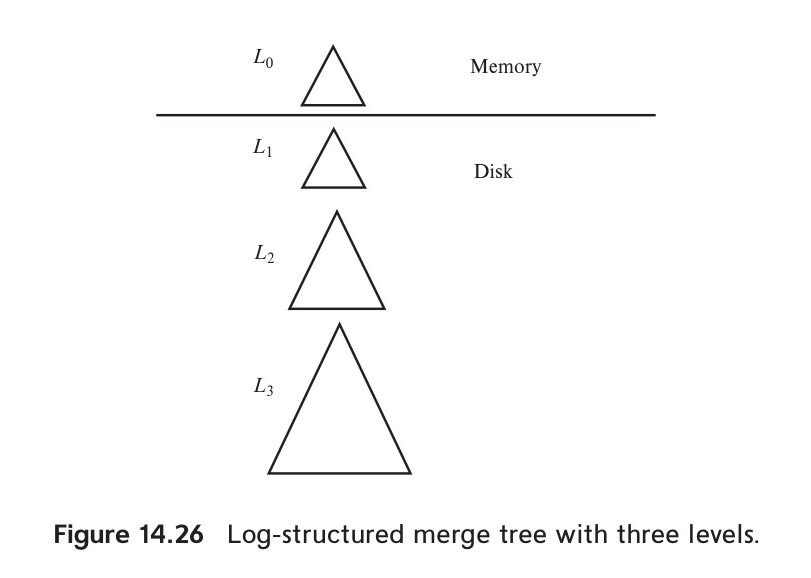
*Figure 14.26 — Log-structured merge tree with three levels.*

<!-- Page 667 -->

If tree $L_1$ is empty, the entire in-memory tree $L_0$ is written to disk to become the new $L_1$ tree. If $L_1$ is not empty, the merge between $L_0$ and $L_1$ is performed by scanning the entries in $L_0$ in sorted order, and merging them with the entries in $L_1$, which are also stored in sorted order. The merged stream of entries is written out as a new $L_1$ tree on disk, and the old $L_1$ tree is deleted.

Note that all entries in the leaf level of the old $L_1$ tree, including those that were not modified, are read and written back during the merge. While this might appear expensive, reading and writing large blocks of entries sequentially is far faster than performing random reads and writes for each individual entry.

When the size of tree $L_1$ exceeds its allocated limit, $L_1$ is merged with $L_2$ in a similar manner, and the process cascades down the levels of the LSM tree.

To allow inserts to continue while $L_0$ is being merged with $L_1$, database systems typically maintain two $L_0$ trees in memory: one is active and accepts new inserts, while the other is frozen and being merged to disk. Once the merge completes, the frozen $L_0$ tree is emptied and made available for future merges.

Sequential I/O operations are much faster than random I/O operations on magnetic disks, because sequential I/O eliminates disk seeks. The merge operation reads and writes sequential blocks of data, allowing high throughput. On SSDs, sequential writes reduce write amplification, which prolongs flash memory lifetime and improves write throughput. Furthermore, leaf nodes of $L_1, L_2, \dots$ are completely full (100% occupancy) when created by the merge process, avoiding the empty space that can occur with page splits.

There is, however, a cost to using the LSM structure as described above: the entire contents of the tree are copied each time a set of entries from $L_0$ are copied into $L_1$. One of two techniques is used to reduce this cost:

1. Multiple levels are used, with level $L_{i+1}$ trees having a maximum size that is $k$ times the maximum size of level $L_i$ trees. Thus, each record is written at most $k$ times at a particular level. The number of levels is proportional to $\log_k(I/M)$ where $I$ is the number of entries and $M$ is the number of entries that fit in the in-memory tree $L_0$.
2. Each level (other than $L_0$) can have up to some number $b$ of trees, instead of just 1 tree. When an $L_0$ tree is written to disk, a new $L_1$ tree is created instead of merging it with an existing $L_1$ tree. When there are $b$ such $L_1$ trees, they are merged into a single new $L_2$ tree. Similarly, when there are $b$ trees at level $L_i$ they are merged into a new $L_{i+1}$ tree.

This variant of the LSM tree is called a **stepped-merge index**. The stepped-merge index decreases the insert cost significantly compared to having only one tree per level, but it can result in an increase in query cost, since multiple trees may need to be searched. Bitmap-based structures called **Bloom filters**, described in Section 24.1, are used to reduce the number of lookups by efficiently detecting that a search key is not present in a particular tree. Bloom filters occupy very little space, but they are quite effective at reducing query cost.

Details of all these variants of LSM trees can be found in Section 24.2.

So far we have only described inserts and lookups. Deletes are handled in an interesting manner. Instead of directly finding an index entry and deleting it, deletion

<!-- Page 668 -->

results in insertion of a new **deletion entry** that indicates which index entry is to be deleted. The process of inserting a deletion entry is identical to the process of inserting a normal index entry.

However, lookups have to carry out an extra step. As mentioned earlier, lookups retrieve entries from all the trees and merge them in sorted order of key value. If there is a deletion entry for some entry, both of them would have the same key value. Thus, a lookup would find both the deletion entry and the original entry for that key, which is to be deleted. If a deletion entry is found, the to-be-deleted entry is filtered out and not returned as part of the lookup result.

When trees are merged, if one of the trees contains an entry, and the other had a matching deletion entry, the entries get matched up during the merge (both would have the same key), and are both discarded.

Updates are handled in a manner similar to deletes, by inserting an **update entry**. Lookups need to match update entries with the original entries and return the latest value. The update is actually applied during a merge, when one tree has an entry and another has its matching update entry; the merge process would find a record and an update record with the same key, apply the update, and discard the update entry.

LSM trees were initially designed to reduce the write and seek overheads of magnetic disks. Flash based SSDs have a relatively low overhead for random I/O operations since they do not require seek, and thus the benefit of avoiding random I/O that LSM tree variants provide is not particularly important with SSDs.

However, recall that flash memory does not allow in-place update, and writing even a single byte to a page requires the whole page to be rewritten to a new physical location; the original location of the page needs to be erased eventually, which is a relatively expensive operation. The reduction in number of writes using LSM tree variants, as compared to traditional B+-trees, can provide substantial performance benefits when LSM trees are used with SSDs.

A variant of the LSM tree similar to the stepped-merge index, with multiple trees in each layer, was used in Google’s BigTable system, as well as in Apache HBase, the open source clone of BigTable. These systems are built on top of distributed file systems that allow appends to files but do not support updates to existing data. The fact that LSM trees do not perform in-place update made LSM trees a very good fit for these systems.

Subsequently, a large number of BigData storage systems such as Apache Cassandra, Apache AsterixDB, and MongoDB added support for LSM trees, with most implementing versions with multiple trees in each layer. LSM trees are also supported in MySQL (using the MyRocks storage engine) and in the embedded database systems SQLite4 and LevelDB.

### 14.8.2 Buffer Tree

The buffer tree is an alternative to the log-structured merge tree approach. The key idea behind the buffer tree is to associate a buffer with each internal node of a B+-tree,

<!-- Page 669 -->

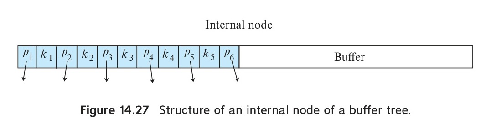
*Figure 14.27 — Structure of an internal node of a buffer tree.*

including the root node; this is depicted pictorially in Figure 14.27. We first outline how inserts and lookups are handled, and subsequently we outline how deletes and updates are handled.

When an index record is inserted into the buffer tree, instead of traversing the tree to the leaf, the index record is inserted into the buffer of the root. If the buffer becomes full, each index record in the buffer is pushed one level down the tree to the appropriate child node. If the child node is an internal node, the index record is added to the child node’s buffer; if that buffer is full, all records in that buffer are similarly pushed down. All records in a buffer are sorted on the search key before being pushed down. If the child node is a leaf node, index records are inserted into the leaf in the usual manner. If the insert results in an overfull leaf node, the node is split in the usual B+-tree manner, with the split potentially propagating to parent nodes. Splitting of an overfull internal node is done in the usual way, with the additional step of also splitting the buffer; the buffer entries are partitioned between the two split nodes based on their key values.

Lookups are done by traversing the B+-tree structure in the usual way, to find leaves that contain records matching the lookup key. But there is one additional step: at each internal node traversed by a lookup, the node’s buffer must be examined to see if there are any records matching the lookup key. Range lookups are done as in a normal B+-tree, but they must also examine the buffers of all internal nodes above any of the leaf nodes that are accessed.

Suppose the buffer at an internal node holds $k$ times as many records as there are child nodes. Then, on average, $k$ records would be pushed down at a time to each child (regardless of whether the child is an internal node or a leaf node). Sorting of records before they are pushed ensures that all these records are pushed down consecutively. The benefit of the buffer-tree approach for inserts is that the cost of accessing the child node from storage, and of writing the updated node back, is amortized (divided), on average, between $k$ records. With sufficiently large $k$, the savings can be quite significant compared to inserts in a regular B+-tree.

Deletes and updates can be processed in a manner similar to LSM trees, using deletion entries or update entries. Alternatively, deletes and updates could be processed using the normal B+-tree algorithms, at the risk of a higher I/O cost per delete/update as compared to the cost when using deletion/update entries.

Buffer trees provide better worst-case complexity bounds on the number of I/O operations than do LSM tree variants. In terms of read cost, buffer trees are significantly faster than LSM trees. However, write operations on buffer trees involve random I/O,

<!-- Page 670 -->

requiring more seeks, in contrast to sequential I/O operations with LSM tree variants. For magnetic disk storage, the high cost of seeks results in buffer trees performing worse than LSM trees on write-intensive workloads. LSM trees have thus found greater acceptance for write-intensive workloads with data stored on magnetic disk. However, since random I/O operations are very efficient on SSDs, and buffer trees tend to perform fewer write operations overall compared to LSM trees, buffer trees can provide better write performance on SSDs. Several index structures designed for flash storage make use of the buffer concept introduced by buffer trees.

Another benefit of buffer trees is that the key idea of associating buffers with internal nodes, to reduce the number of writes, can be used with any type of tree-structured index. For example, buffering has been used as a way of supporting bulk loading of spatial indices such as R-trees (which we study in Section 14.10.1), as well as other types of indices, for which sorting and bottom-up construction are not applicable.

Buffer trees have been implemented as part of the Generalized Search Tree (GiST) index structure in PostgreSQL. The GiST index allows user-defined code to be executed to implement search, update, and split operations on nodes and has been used to implement R-trees and other spatial index structures.

## 14.9 Bitmap Indices

Bitmap indices are a specialized type of index designed for easy querying on multiple keys, although each bitmap index is built on a single key. We describe key features of bitmap indices in this section but provide further details in Section 24.3.

For bitmap indices to be used, records in a relation must be numbered sequentially: $0, 1, \dots, n - 1$. Given the number $i$ of a record, the database system can retrieve the record directly, either because records are stored in an array with fixed-size slots, or by using a mapping that maps record numbers to disk blocks and offsets.

Consider a relation with an attribute that can take on only one of a small number of distinct values. For example, a relation *instructor_info* may have attributes *gender* (with values *m* and *f*), and *income_level* (with values $L_1, L_2, L_3, L_4, L_5$, corresponding to income ranges). Such attributes are called **categorical attributes**. Attributes that have a small number of distinct values are also said to have a low **cardinality**.

A **bitmap** is simply an array of bits. In its simplest form, a bitmap index on an attribute consists of a collection of bitmaps, one for each distinct value of the attribute. Each bitmap has as many bits as there are records in the relation. The $i$th bit of the bitmap for value $v$ is set to 1 if the record with number $i$ has value $v$ for the attribute in question. All other bits of the bitmap are set to 0.

<!-- Page 671 -->

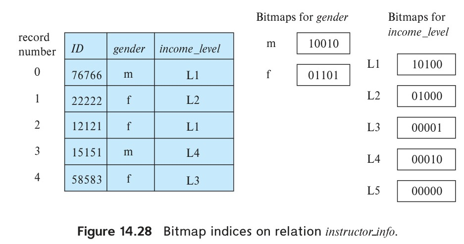
*Figure 14.28 — Bitmap indices on relation instructor info.*

In our example, there is one bitmap for the value *m* and one for *f*. The *gender* bitmap index consists of these two bitmaps. Figure 14.28 shows the bitmaps for the attributes *gender* and *income_level* of relation *instructor_info*. For example, the first record has *gender* = *m*, so the first bit of the *m* bitmap is 1, and the first bit of the *f* bitmap is 0.

We now consider when bitmaps are useful. The simplest way of retrieving records using a bitmap is to find all 1 bits in the bitmap, and fetch the corresponding records. For a single-attribute query, such as finding all male instructors, this approach does not offer much advantage over using a B+-tree index or even scanning the file, since a large fraction of the records in the relation would satisfy the selection condition.

In fact, bitmap indices are useful for selections mainly when there are conditions on multiple attributes.

Consider now a query that selects women with income in the range 10,000 to 20,000 (corresponding to income level $L_2$):

```sql
select *
from instructor_info
where gender = 'f' and income_level = 'L2';
```

To evaluate this selection, we fetch the bitmaps for *gender* value *f* and *income_level* value $L_2$, and perform an intersection of the two bitmaps. In other words, we compute the bitwise AND of the two bitmaps:

$$\text{1001010010} \wedge \text{0100010010} = \text{0000010010}$$

The resulting bitmap has 1s only at positions where both condition bitmaps have 1s. In our example, bits 5 and 8 are set to 1. The database system then retrieves only records 5 and 8.

Bitwise operations like AND, OR, and NOT can be executed in hardware instructions, making bitmap operations extremely fast. For example, a 64-bit CPU can perform a bitwise operation on 64 bits in a single CPU cycle. Thus, intersecting two bitmaps of 1 million bits takes only about 15,000 CPU cycles—less than 10 microseconds on a modern processor!

<!-- Page 672 -->

Since the first attribute can take two values, and the second can take five values, there are $2 \times 5 = 10$ possible combinations of values. If we created a B+-tree on (*gender*, *income_level*), we would have 10 combinations. But if we had 10 categorical attributes, each with 5 values, there would be $5^{10} \approx 10$ million combinations of values, making a composite B+-tree index infeasible. In contrast, with bitmap indices, we need only $10 \times 5 = 50$ bitmaps, each of which can be combined with any other using fast bitwise operations.

More detailed coverage of bitmap indices, including how to efficiently index attributes with more values, and how to handle null values and record deletions, can be found in Section 24.3.

## 14.10 Indexing of Spatial and Temporal Data

Traditional index structures, such as hash indices and B+-trees, are designed for one-dimensional data. However, many applications deal with multidimensional data. We consider two important classes of multidimensional data in this section: spatial data and temporal data.

### 14.10.1 Spatial Data

In this section we provide an overview of techniques for indexing spatial data. We discuss spatial data in more detail in Section 24.4.

There are many forms of queries on spatial data, which need to be efficiently processed:

- **Point queries.** Find all objects that contain a given point, or find if an object is present at a given point.
- **Range queries (region queries).** Find all objects that intersect a given region (e.g., a rectangle, circle, or polygon).
- **Nearest-neighbor queries.** Find the object that is closest to a given point.
- **Spatial joins.** Given two sets of spatial objects, find all pairs of objects that intersect each other.

The goal of spatial indexing is to support different forms of spatial queries efficiently.

To understand how to index spatial data consisting of two or more dimensions, consider the case of points in two-dimensional space. We could consider building a B+-tree on the $x$ coordinate, and a B+-tree on the $y$ coordinate. However, as we saw in Section 14.6.1, evaluating a range query $[x_1 \le x \le x_2 \wedge y_1 \le y \le y_2]$ using separate indices on $x$ and $y$ can perform poorly if the range on either attribute alone is not selective.

An alternative is to use an ordered index on the composite search key $(x, y)$. However, as we saw in Section 14.6.2, such an index is inefficient for range queries that specify a range on $y$ but not on $x$.

To overcome these problems, specialized spatial index structures have been developed.

<!-- Page 673 -->

instance, each internal node of a binary tree partitions a one-dimensional space into two halves: values less than the key, and values greater than the key.

We can use that intuition to create tree structures for two-dimensional points. One such structure is the **$k$-d tree**. In a $k$-d tree, each level of the tree partitions space along a different dimension. At the root (level 0), space is partitioned along dimension 0 (the $x$ dimension). At level 1, space is partitioned along dimension 1 (the $y$ dimension). At level 2, space is again partitioned along dimension 0, and so on, cycling through the dimensions.

Figure 14.29 shows a set of points in two-dimensional space, and a $k$-d tree representing those points. Each internal node stores a point, and partitions space into two subregions using a line that passes through the point and is perpendicular to the split dimension.

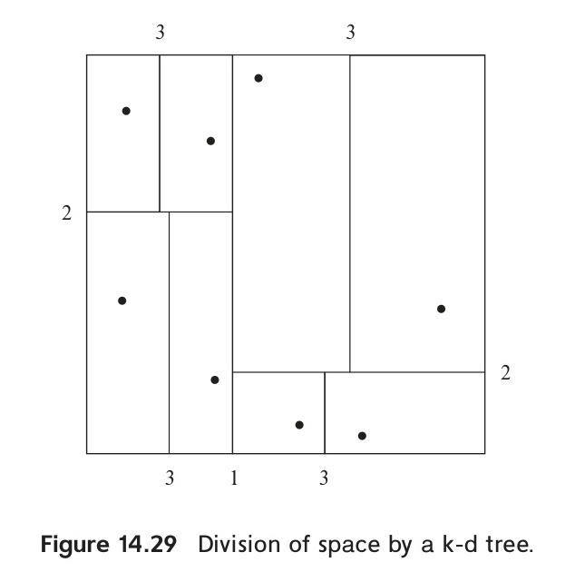
*Figure 14.29 — Division of space by a k-d tree.*

Rectangular range queries, which ask for points within a specified rectangle $[x_{\min}, x_{\max}] \times [y_{\min}, y_{\max}]$, can be efficiently answered by traversing the $k$-d

<!-- Page 674 -->

tree. Range search can be performed by the following recursive procedure, starting at the root:

1. Suppose the node is an internal node, and let it be split on a particular dimension, say $x$, at a point $x_i$. Entries in the left subtree have $x$ values $< x_i$, while entries in the right subtree have $x$ values $\ge x_i$. If the range $[x_{\min}, x_{\max}]$ overlaps with the left subregion ($x_{\min} < x_i$), recursively search the left subtree. If the range overlaps with the right subregion ($x_{\max} \ge x_i$), recursively search the right subtree.
2. If the node is a leaf, all entries that are contained in the query region are added to the result.

Nearest neighbor search is more complicated, and we shall not describe it here; Section 24.4 covers it in more detail.

The **$k$-d-B tree** extends the $k$-d tree to allow multiple child nodes for each internal node, in a manner similar to B-trees. Like B-trees, $k$-d-B trees are balanced and are well suited for disk-based storage.

There are a number of alternative index structures for spatial data. In a **quadtree**, each internal node partitions a two-dimensional region into four quadrants of equal size (northwest, northeast, southwest, southeast). Quadtrees can be used for indexing points as well as regions.

Indexing of regions of space, such as line segments, rectangles, and other complex shapes, is more difficult than indexing points.

A storage structure called an **R-tree** is useful for indexing of objects that have spatial extent (such as bounding boxes of geographical features or polygons). R-trees are an $N$-dimensional extension of B-trees. A key concept in R-trees is the **bounding box** (specifically, the minimum bounding box) of an object. The bounding box of an object is the smallest axis-aligned box (in 2 dimensions, a rectangle) that completely encloses the object.

Each internal node stores the bounding boxes of the child nodes along with pointers to the child nodes. A leaf node stores the bounding boxes of the objects, along with pointers to the actual objects.

Figure 14.30 shows an example of a set of rectangles (drawn with a solid line) and an R-tree that indexes them. The bounding boxes of the internal nodes are shown with dashed lines.

<!-- Page 675 -->

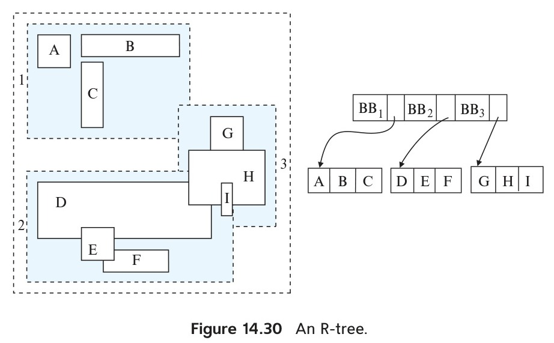
*Figure 14.30 — An R-tree.*

on the objects that they contain; that is, each side of a bounding box is determined by the maximum or minimum coordinate of some object contained within the bounding box.

The R-tree itself is at the right side of Figure 14.30. The figure refers to rectangles $R_1, \dots, R_5$, which are the minimum bounding boxes of the groups of objects. Notice that bounding boxes of sibling nodes can overlap; for example, $R_1$ and $R_2$ overlap.

Unlike some alternative structures for storing polygons and line segments, an R-tree stores only one copy of each object, and we can ensure easily that each node is at least half full. However, querying may be slower than with some of the alternatives, since multiple paths have to be searched. However, because of their better storage efficiency and their similarity to B-trees, R-trees and their variants have proved popular in database systems that support spatial data.

### 14.10.2 Indexing Temporal Data

Temporal data refers to data that has an associated time period, as discussed in Section 7.10. The time period associated with a tuple indicates the period of time for which the tuple is valid. For example, a particular course identifier may have its title changed at some point of time. Thus, a course identifier is associated with a title for a given time interval, after which the same course identifier is associated with a different title. This can be modeled by having two or more tuples in the *course* relation with the same *course_id*, but different *title* values, each with its own valid time interval.

A time interval has a start time and an end time. Further a time interval indicates whether the interval starts at the start time, or just after the start time, that is, whether the interval is closed or open at the start time. Similarly, the time interval indicates whether it is closed or open at the end time. To represent the fact that a tuple is valid currently, until it is next updated, the end time is conceptually set to infinity (which can be represented by a suitably large time, such as midnight of 9999-12-31).

<!-- Page 676 -->

In general, the valid period for a particular fact may not consist of just one time interval; for example, a student may be registered in a university one academic year, take a leave of absence for the next year, and register again the following year. The valid period for the student’s registration at the university is clearly not a single time interval. However, any valid period can be represented by multiple intervals; thus, a tuple with any valid period can be represented by multiple tuples, each of which has a valid period that is a single time interval. We shall therefore only consider time intervals when modeling temporal data.

Suppose we wish to retrieve the value of a tuple, given a value $v$ for an attribute $a$, and a point in time $t_1$. We can create an index on $a$, and use it to retrieve all tuples with value $v$ for attribute $a$. While such an index may be adequate if the number of time intervals for that search-key value is small, in general the index may retrieve a number of tuples whose time intervals do not include the time point $t_1$.

A better solution is to use a spatial index such as an R-tree, with the indexed tuple treated as having two dimensions, one being the indexed attribute $a$, and the other being the time dimension. In this case, the tuple forms a line segment, with value $v$ for dimension $a$, and the valid time interval of the tuple as interval in the time dimension.

One issue that complicates the use of a spatial index such as an R-tree is that the end time interval may be infinity (perhaps represented by a very large value), whereas spatial indices typically assume that bounding boxes are finite, and may have poor performance if bounding boxes are very large. This problem can be dealt with as follows:

- All current tuples (i.e., those with end time as infinity, which is perhaps represented by a large time value) are stored in a separate index from those tuples that have a non-infinite end time. The index on current tuples can be a B+-tree index on ($a$, *start_time*), where $a$ is the indexed attribute and *start_time* is the start time, while the index for non-current tuples would be a spatial index such as an R-tree.
- Lookups for a key value $v$ at a point in time $t_i$ would need to search on both indices; the search on the current-tuple index would be for tuples with $a = v$, and $\text{start\_ts} \le t_i$, which can be done by a simple range query. Queries with a time range can be handled similarly.

Instead of using spatial indices that are designed for multidimensional data, one can use specialized indices, such as the interval B+-tree, that are designed to index intervals in a single dimension, and provide better complexity guarantees than R-tree indices. However, most database implementations find it simpler to use R-tree indices instead of implementing yet another type of index for time intervals.

Recall that with temporal data, more than one tuple may have the same value for a primary key, as long as the tuples with the same primary-key value have non-overlapping time intervals. Temporal indices on the primary key attribute can be used to efficiently determine if the temporal primary key constraint is violated when a new tuple is inserted or the valid time interval of an existing tuple is updated.

<!-- Page 677 -->

## 14.11 Summary

- Many queries reference only a small proportion of the records in a file. To reduce the overhead in searching for these records, we can construct indices for the files that store the database.
- There are two types of indices that we can use: dense indices and sparse indices. Dense indices contain entries for every search-key value, whereas sparse indices contain entries only for some search-key values.
- If the sort order of a search key matches the sort order of a relation, an index on the search key is called a clustering index. The other indices are called nonclustering or secondary indices. Secondary indices improve the performance of queries that use search keys other than the search key of the clustering index. However, they impose an overhead on modification of the database.
- Index-sequential files are one of the oldest index schemes used in database systems. To permit fast retrieval of records in search-key order, records are stored sequentially, and out-of-order records are chained together. To allow fast random access, we use an index structure.
- The primary disadvantage of the index-sequential file organization is that performance degrades as the file grows. To overcome this deficiency, we can use a B+-tree index.
- A B+-tree index takes the form of a balanced tree, in which every path from the root of the tree to a leaf of the tree is of the same length. The height of a B+-tree is proportional to the logarithm to the base $N$ of the number of records in the relation, where each nonleaf node stores $N$ pointers; the value of $N$ is often around 50 or 100. B+-trees are much shorter than other balanced binary-tree structures such as AVL trees, and therefore require fewer disk accesses to locate records.
- Lookup on B+-trees is straightforward and efficient. Insertion and deletion, however, are somewhat more complicated, but still efficient. The number of operations required for lookup, insertion, and deletion on B+-trees is proportional to the logarithm to the base $N$ of the number of records in the relation, where each nonleaf node stores $N$ pointers.
- We can use B+-trees for indexing a file containing records, as well as to organize records into a file.
- B-tree indices are similar to B+-tree indices. The primary advantage of a B-tree is that the B-tree eliminates the redundant storage of search-key values. The major disadvantages are overall complexity and reduced fanout for a given node size. System designers almost universally prefer B+-tree indices over B-tree indices in practice.

<!-- Page 678 -->

- Hashing is a widely used technique for building indices in main memory as well as in disk-based systems.
- Ordered indices such as B+-trees can be used for selections based on equality conditions involving single attributes. When multiple attributes are involved in a selection condition, we can intersect record identifiers retrieved from multiple indices.
- The basic B+-tree structure is not ideal for applications that need to support a very large number of random writes/inserts per second. Several alternative index structures have been proposed to handle workloads with a high write/insert rate, including the log-structured merge tree and the buffer tree.
- Bitmap indices provide a very compact representation for indexing attributes with very few distinct values. Intersection operations are extremely fast on bitmaps, making them ideal for supporting queries on multiple attributes.
- R-trees are a multidimensional extension of B-trees; with variants such as R+-trees and R*-trees, they have proved popular in spatial databases. Index structures that partition space in a regular fashion, such as quadtrees, help in processing spatial join queries.
- There are a number of techniques for indexing temporal data, including the use of spatial index and the interval B+-tree specialized index.

## Review Terms

- Index type
  - Ordered indices
  - Hash indices
- Evaluation factors
  - Access types
  - Access time
  - Insertion time
  - Deletion time
  - Space overhead
- Search key
- Ordered indices
  - Ordered index
  - Clustering index
  - Primary indices
  - Nonclustering indices
  - Secondary indices
  - Index-sequential files
- Index entry
- Index record
- Dense index
- Sparse index
- Multilevel indices
- Nonunique search key
- Composite search key
- B+-tree index files
  - Balanced tree
  - Leaf nodes
<!-- Page 679 -->
  - Nonleaf nodes
  - Internal nodes
  - Range queries
  - Node split
  - Node coalesce
  - Redistribute of pointers
  - Uniquifier
- B+-tree extensions
  - Prefix compression
  - Bulk loading
  - Bottom-up B+-tree construction
- B-tree indices
- Hash file organization
  - Hash function
  - Bucket
  - Overflow chaining
  - Closed addressing
  - Closed hashing
  - Bucket overflow
  - Skew
  - Static hashing
  - Dynamic hashing
- Multiple-key access
- Covering indices
- Write-optimized index structure
  - Log-structured merge (LSM) tree
  - Stepped-merge index
  - Buffer tree
- Bitmap index
- Bitmap intersection
- Indexing of spatial data
  - Range queries
  - Nearest neighbor queries
  - k-d tree
  - k-d-B tree
  - Quadtrees
  - R-tree
  - Bounding box
- Temporal indices
- Time interval
- Closed interval
- Open interval

## Practice Exercises

**14.1** Indices speed query processing, but it is usually a bad idea to create indices on every attribute, and every combination of attributes, that are potential search keys. Explain why.

**14.2** Is it possible in general to have two clustering indices on the same relation for different search keys? Explain your answer.

**14.3** Construct a B+-tree for the following set of key values:

$$(2, 3, 5, 7, 11, 17, 19, 23, 29, 31)$$

<!-- Page 680 -->

Assume that the tree is initially empty and values are added in ascending order. Construct B+-trees for the cases where the number of pointers that will fit in one node is as follows:

a. Four
b. Six
c. Eight

**14.4** For each B+-tree of Exercise 14.3, show the form of the tree after each of the following series of operations:

a. Insert 9.
b. Insert 10.
c. Insert 8.
d. Delete 23.
e. Delete 19.

**14.5** Consider the modified redistribution scheme for B+-trees described on page 651. What is the expected height of the tree as a function of $n$?

**14.6** Give pseudocode for a B+-tree function `findRangeIterator()`, which is like the function `findRange()`, except that it returns an iterator object, as described in Section 14.3.2. Also give pseudocode for the iterator class, including the variables in the iterator object, and the `next()` method.

**14.7** What would the occupancy of each leaf node of a B+-tree be if index entries were inserted in sorted order? Explain why.

**14.8** Suppose you have a relation $r$ with $n_r$ tuples on which a secondary B+-tree is to be constructed.

a. Give a formula for the cost of building the B+-tree index by inserting one record at a time. Assume each block will hold an average of $f$ entries and that all levels of the tree above the leaf are in memory.
b. Assuming a random disk access takes 10 milliseconds, what is the cost of index construction on a relation with 10 million records?
c. Write pseudocode for bottom-up construction of a B+-tree, which was outlined in Section 14.4.4. You can assume that a function to efficiently sort a large file is available.

**14.9** The leaf nodes of a B+-tree file organization may lose sequentiality after a sequence of inserts.

a. Explain why sequentiality may be lost.

<!-- Page 681 -->

b. To minimize the number of seeks in a sequential scan, many databases allocate leaf pages in extents of $n$ blocks, for some reasonably large $n$. When the first leaf of a B+-tree is allocated, only one block of an $n$-block unit is used, and the remaining pages are free. If a page splits, and its $n$-block unit has a free page, that space is used for the new page. If the $n$-block unit is full, another $n$-block unit is allocated, and the first $n/2$ leaf pages are placed in one $n$-block unit and the remaining one in the second $n$-block unit. For simplicity, assume that there are no delete operations.
    i. What is the worst-case occupancy of allocated space, assuming no delete operations, after the first $n$-block unit is full?
    ii. Is it possible that leaf nodes allocated to an $n$-node block unit are not consecutive, that is, is it possible that two leaf nodes are allocated to one $n$-node block, but another leaf node in between the two is allocated to a different $n$-node block?
    iii. Under the reasonable assumption that buffer space is sufficient to store an $n$-page block, how many seeks would be required for a leaf-level scan of the B+-tree, in the worst case? Compare this number with the worst case if leaf pages are allocated a block at a time.
    iv. The technique of redistributing values to siblings to improve space utilization is likely to be more efficient when used with the preceding allocation scheme for leaf blocks. Explain why.

**14.10** Suppose you are given a database schema and some queries that are executed frequently. How would you use the above information to decide what indices to create?

**14.11** In write-optimized trees such as the LSM tree or the stepped-merge index, entries in one level are merged into the next level only when the level is full. Suggest how this policy can be changed to improve read performance during periods when there are many reads but no updates.

**14.12** What trade offs do buffer trees pose as compared to LSM trees?

**14.13** Consider the *instructor* relation shown in Figure 14.1.

a. Construct a bitmap index on the attribute *salary*, dividing salary values into four ranges: below 50,000, 50,000 to below 60,000, 60,000 to below 70,000, and 70,000 and above.
b. Consider a query that requests all instructors in the Finance department with salary of 80,000 or more. Outline the steps in answering the query, and show the final and intermediate bitmaps constructed to answer the query.

**14.14** Suppose you have a relation containing the $x, y$ coordinates and names of restaurants. Suppose also that the only queries that will be asked are of the

<!-- Page 682 -->

following form: The query specifies a point and asks if there is a restaurant exactly at that point. Which type of index would be preferable, R-tree or B-tree? Why?

**14.15** Suppose you have a spatial database that supports region queries with circular regions, but not nearest-neighbor queries. Describe an algorithm to find the nearest neighbor by making use of multiple region queries.

## Exercises

**14.16** When is it preferable to use a dense index rather than a sparse index? Explain your answer.

**14.17** What is the difference between a clustering index and a secondary index?

**14.18** For each B+-tree of Exercise 14.3, show the steps involved in the following queries:

a. Find records with a search-key value of 11.
b. Find records with a search-key value between 7 and 17, inclusive.

**14.19** The solution presented in Section 14.3.5 to deal with nonunique search keys added an extra attribute to the search key. What effect could this change have on the height of the B+-tree?

**14.20** Suppose there is a relation $r(A, B, C)$, with a B+-tree index with search key $(A, B)$.

a. What is the worst-case cost of finding records satisfying $10 < A < 50$ using this index, in terms of the number of records retrieved $n_1$ and the height $h$ of the tree?
b. What is the worst-case cost of finding records satisfying $10 < A < 50 \wedge 5 < B < 10$ using this index, in terms of the number of records $n_2$ that satisfy this selection, as well as $n_1$ and $h$ defined above?
c. Under what conditions on $n_1$ and $n_2$ would the index be an efficient way of finding records satisfying $10 < A < 50 \wedge 5 < B < 10$?

**14.21** Suppose you have to create a B+-tree index on a large number of names, where the maximum size of a name may be quite large (say 40 characters) and the average name is itself large (say 10 characters). Explain how prefix compression can be used to maximize the average fanout of nonleaf nodes.

**14.22** Suppose a relation is stored in a B+-tree file organization. Suppose secondary indices store record identifiers that are pointers to records on disk.

<!-- Page 683 -->

a. What would be the effect on the secondary indices if a node split happened in the file organization?
b. What would be the cost of updating all affected records in a secondary index?
c. How does using the search key of the file organization as a logical record identifier solve this problem?
d. What is the extra cost due to the use of such logical record identifiers?

**14.23** What trade-offs do write-optimized indices pose as compared to B+-tree indices?

**14.24** An existence bitmap has a bit for each record position, with the bit set to 1 if the record exists, and 0 if there is no record at that position (for example, if the record were deleted). Show how to compute the existence bitmap from other bitmaps. Make sure that your technique works even in the presence of null values by using a bitmap for the value null.

**14.25** Spatial indices that can index spatial intervals can conceptually be used to index temporal data by treating valid time as a time interval. What is the problem with doing so, and how is the problem solved?

**14.26** Some attributes of relations may contain sensitive data, and may be required to be stored in an encrypted fashion. How does data encryption affect index schemes? In particular, how might it affect schemes that attempt to store data in sorted order?

## Further Reading

B-tree indices were first introduced in [Bayer and McCreight (1972)] and [Bayer (1972)]. B+-trees are discussed in [Comer (1979)], [Bayer and Unterauer (1977)], and [Knuth (1973)]. [Gray and Reuter (1993)] provide a good description of issues in the implementation of B+-trees.

The log-structured merge (LSM) tree is presented in [O’Neil et al. (1996)], while the stepped merge tree is presented in [Jagadish et al. (1997)]. The buffer tree is presented in [Arge (2003)]. [Vitter (2001)] provides an extensive survey of external-memory data structures and algorithms.

Bitmap indices are described in [O’Neil and Quass (1997)]. They were first introduced in the IBM Model 204 file manager on the AS 400 platform. They provide very large speedups on certain types of queries and are today implemented on most database systems.

[Samet (2006)] and [Shekhar and Chawla (2003)] provide textbook coverage of spatial data structures and spatial databases. [Bentley (1975)] describes the k-d tree,

<!-- Page 684 -->

and [Robinson (1981)] describes the k-d-B tree. The R-tree was originally presented in [Guttman (1984)].

## Bibliography

- **[Arge (2003)]** L. Arge, “The Buffer Tree: A Technique for Designing Batched External Data Structures”, *Algorithmica*, Volume 37, Number 1 (2003), pages 1–24.
- **[Bayer (1972)]** R. Bayer, “Symmetric Binary B-trees: Data Structure and Maintenance Algorithms”, *Acta Informatica*, Volume 1, Number 4 (1972), pages 290–306.
- **[Bayer and McCreight (1972)]** R. Bayer and E. M. McCreight, “Organization and Maintenance of Large Ordered Indices”, *Acta Informatica*, Volume 1, Number 3 (1972), pages 173–189.
- **[Bayer and Unterauer (1977)]** R. Bayer and K. Unterauer, “Prefix B-trees”, *ACM Transactions on Database Systems*, Volume 2, Number 1 (1977), pages 11–26.
- **[Bentley (1975)]** J. L. Bentley, “Multidimensional Binary Search Trees Used for Associative Searching”, *Communications of the ACM*, Volume 18, Number 9 (1975), pages 509–517.
- **[Comer (1979)]** D. Comer, “The Ubiquitous B-tree”, *ACM Computing Surveys*, Volume 11, Number 2 (1979), pages 121–137.
- **[Gray and Reuter (1993)]** J. Gray and A. Reuter, *Transaction Processing: Concepts and Techniques*, Morgan Kaufmann (1993).
- **[Guttman (1984)]** A. Guttman, “R-Trees: A Dynamic Index Structure for Spatial Searching”, In *Proc. of the ACM SIGMOD Conf. on Management of Data* (1984), pages 47–57.
- **[Jagadish et al. (1997)]** H. V. Jagadish, P. P. S. Narayan, S. Seshadri, S. Sudarshan, and R. Kanneganti, “Incremental Organization for Data Recording and Warehousing”, In *Proceedings of the 23rd International Conference on Very Large Data Bases, VLDB ’97* (1997), pages 16–25.
- **[Knuth (1973)]** D. E. Knuth, *The Art of Computer Programming*, Volume 3, Sorting and Searching, Addison Wesley (1973).
- **[O’Neil and Quass (1997)]** P. O’Neil and D. Quass, “Improved Query Performance with Variant Indexes”, In *Proc. of the ACM SIGMOD Conf. on Management of Data* (1997), pages 38–49.
- **[O’Neil et al. (1996)]** P. O’Neil, E. Cheng, D. Gawlick, and E. O’Neil, “The Log-structured Merge-tree (LSM-tree)”, *Acta Inf.*, Volume 33, Number 4 (1996), pages 351–385.
- **[Robinson (1981)]** J. Robinson, “The k-d-B Tree: A Search Structure for Large Multidimensional Indexes”, In *Proc. of the ACM SIGMOD Conf. on Management of Data* (1981), pages 10–18.
- **[Samet (2006)]** H. Samet, *Foundations of Multidimensional and Metric Data Structures*, Morgan Kaufmann (2006).

<!-- Page 685 -->

- **[Shekhar and Chawla (2003)]** S. Shekhar and S. Chawla, *Spatial Databases: A TOUR*, Pearson (2003).
- **[Vitter (2001)]** J. S. Vitter, “External Memory Algorithms and Data Structures: Dealing with Massive Data”, *ACM Computing Surveys*, Volume 33, (2001), pages 209–271.

## Credits

The photo of the sailboats in the beginning of the chapter is due to ©Pavel Nesvadba/Shutterstock.
