<!-- Page 687 -->
# Part 6 Querying and Optimization

User queries have to be executed on the database contents, which reside on storage devices. It is usually convenient to break up queries into smaller operations, roughly corresponding to the relational-algebra operations. Chapter 15 describes how queries are processed, presenting algorithms for implementing individual operations and then outlining how the operations are executed in synchrony to process a query. The algorithms covered include those that can work on data much larger than main-memory, as well as those that are optimized for in-memory data.

There are many alternative ways of processing a query, and these can have widely varying costs. Query optimization refers to the process of finding the lowest-cost method of evaluating a given query. Chapter 16 describes the process of query optimization, covering techniques for estimating query plan cost, and techniques for generating alternative query plans and picking the lowest cost plans. The chapter also describes other optimization techniques, such as materialized views, for speeding up query processing.

<!-- Page 688 -->

<!-- Page 689 -->
# Chapter 15 Query Processing

Query processing refers to the range of activities involved in extracting data from a database. The activities include translation of queries in high-level database languages into expressions that can be used at the physical level of the file system, a variety of query-optimizing transformations, and actual evaluation of queries.

## 15.1 Overview

The steps involved in processing a query appear in Figure 15.1. The basic steps are:

1. Parsing and translation.
2. Optimization.
3. Evaluation.

Before query processing can begin, the system must translate the query into a usable form. A language such as SQL is suitable for human use, but it is ill suited to be the system's internal representation of a query. A more useful internal representation is one based on the extended relational algebra.

Thus, the first action the system must take in query processing is to translate a given query into its internal form. This translation process is similar to the work performed by the parser of a compiler. In generating the internal form of the query, the parser checks the syntax of the user's query, verifies that the relation names appearing in the query are names of the relations in the database, and so on. The system constructs a parse-tree representation of the query, which it then translates into a relational-algebra expression. If the query was expressed in terms of a view, the translation phase also replaces all uses of the view by the relational-algebra expression that defines the view.[^1] Most compiler texts cover parsing in detail.

[^1]: For materialized views, the expression defining the view has already been evaluated and stored. Therefore, the stored relation can be used, instead of uses of the view being replaced by the expression defining the view. Recursive views are handled differently, via a fixed-point procedure, as discussed in Section 5.4 and Section 27.4.7.

<!-- Page 690 -->
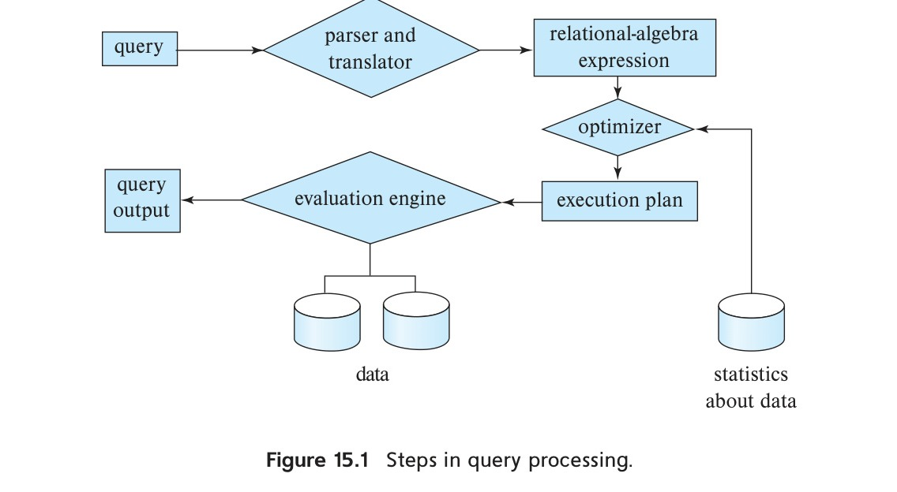
*Figure 15.1 — Steps in query processing.*

Given a query, there are generally a variety of methods for computing the answer. For example, we have seen that, in SQL, a query could be expressed in several different ways. Each SQL query can itself be translated into a relational-algebra expression in one of several ways. Furthermore, the relational-algebra representation of a query specifies only partially how to evaluate a query; there are usually several ways to evaluate relational-algebra expressions. As an illustration, consider the query:

```sql
select salary
from instructor
where salary < 75000;
```

This query can be translated into either of the following relational-algebra expressions:

- $\sigma_{\text{salary} < 75000} (\Pi_{\text{salary}} (\text{instructor}))$
- $\Pi_{\text{salary}} (\sigma_{\text{salary} < 75000} (\text{instructor}))$

Further, we can execute each relational-algebra operation by one of several different algorithms. For example, to implement the preceding selection, we can search every tuple in $\text{instructor}$ to find tuples with salary less than 75000. If a B+-tree index is available on the attribute $\text{salary}$, we can use the index instead to locate the tuples.

To specify fully how to evaluate a query, we need not only to provide the relational-algebra expression, but also to annotate it with instructions specifying how to evaluate each operation. Annotations may state the algorithm to be used for a specific operation or the particular index or indices to use. A relational-algebra operation annotated

<!-- Page 691 -->
with instructions on how to evaluate it is called an **evaluation primitive**. A sequence of primitive operations that can be used to evaluate a query is a **query-execution plan** or **query-evaluation plan**. Figure 15.2 illustrates an evaluation plan for our example query, in which a particular index (denoted in the figure as "index 1") is specified for the selection operation. The query-execution engine takes a query-evaluation plan, executes that plan, and returns the answers to the query.

The different evaluation plans for a given query can have different costs. We do not expect users to write their queries in a way that suggests the most efficient evaluation plan. Rather, it is the responsibility of the system to construct a query-evaluation plan that minimizes the cost of query evaluation; this task is called **query optimization**. Chapter 16 describes query optimization in detail.

Once the query plan is chosen, the query is evaluated with that plan, and the result of the query is output.

The sequence of steps already described for processing a query is representative; not all databases exactly follow those steps. For instance, instead of using the relational-algebra representation, several databases use an annotated parse-tree representation based on the structure of the given SQL query. However, the concepts that we describe here form the basis of query processing in databases.

In order to optimize a query, a query optimizer must know the cost of each operation. Although the exact cost is hard to compute, since it depends on many parameters such as actual memory available to the operation, it is possible to get a rough estimate of execution cost for each operation.

In this chapter, we study how to evaluate individual operations in a query plan and how to estimate their cost; we return to query optimization in Chapter 16. Section 15.2 outlines how we measure the cost of a query. Section 15.3 through Section 15.6 cover the evaluation of individual relational-algebra operations. Several operations may be grouped together into a pipeline, in which each of the operations starts working on its input tuples even as they are being generated by another operation. In Section 15.7, we examine how to coordinate the execution of multiple operations in a query evaluation

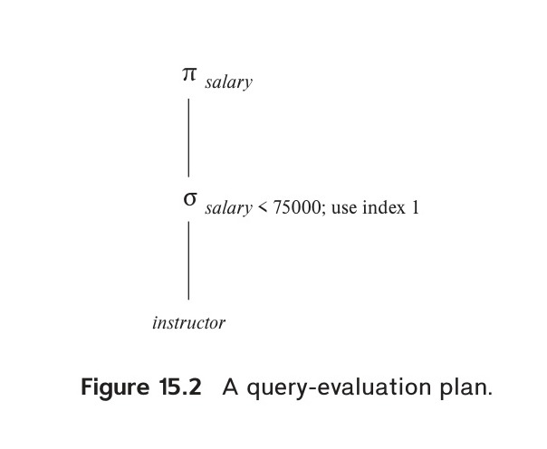
*Figure 15.2 — A query-evaluation plan.*

<!-- Page 692 -->
plan, in particular, how to use pipelined operations to avoid writing intermediate results to disk.

## 15.2 Measures of Query Cost

There are multiple possible evaluation plans for a query, and it is important to be able to compare the alternatives in terms of their (estimated) cost, and choose the best plan. To do so, we must estimate the cost of individual operations and combine them to get the cost of a query evaluation plan. Thus, as we study evaluation algorithms for each operation later in this chapter, we also outline how to estimate the cost of the operation.

The cost of query evaluation can be measured in terms of a number of different resources, including disk accesses, CPU time to execute a query, and, in parallel and distributed database systems, the cost of communication. (We discuss parallel and distributed database systems in Chapter 21 through Chapter 23.)

For large databases resident on magnetic disk, the I/O cost to access data from disk usually dominates the other costs; thus, early cost models focused on the I/O cost when estimating the cost of query operations. However, with flash storage becoming larger and less expensive, most organizational data today can be stored on solid-state drives (SSDs) in a cost effective manner. In addition, main memory sizes have increased significantly, and the cost of main memory has decreased enough in recent years that for many organizations, organizational data can be stored cost-effectively in main memory for querying, although it must of course be stored on flash or magnetic storage to ensure persistence.

With data resident in-memory or on SSDs, I/O cost does not dominate the overall cost, and we must include CPU costs when computing the cost of query evaluation. We do not include CPU costs in our model to simplify our presentation, but note that they can be approximated by simple estimators. For example, the cost model used by PostgreSQL (as of 2018) includes (i) a CPU cost per tuple, (ii) a CPU cost for processing each index entry (in addition to the I/O cost), and (iii) a CPU cost per operator or function (such as arithmetic operators, comparison operators, and related functions). The database has default values for each of these costs, which are multiplied by the number of tuples processed, the number of index entries processed, and the number of operators and functions executed, respectively. The defaults can be changed as a configuration parameter.

We use the number of blocks transferred from storage and the number of random I/O accesses, each of which will require a disk seek on magnetic storage, as two important factors in estimating the cost of a query-evaluation plan. If the disk subsystem takes an average of $t_T$ seconds to transfer a block of data and has an average block-access time (disk seek time plus rotational latency) of $t_S$ seconds, then an operation that transfers $b$ blocks and performs $S$ random I/O accesses would take $b * t_T + S * t_S$ seconds.

The values of $t_T$ and $t_S$ must be calibrated for the disk system used. We summarize performance data here; see Chapter 12 for full details on storage systems. Typical values for high-end magnetic disks in the year 2018 would be $t_S = 4\text{ milliseconds}$ and $t_T = 0.1$

<!-- Page 693 -->
milliseconds, assuming a 4-kilobyte block size and a transfer rate of 40 megabytes per second.[^2]

Although SSDs do not perform a physical seek operation, they have an overhead for initiating an I/O operation; we refer to the latency from the time an I/O request is made to the time when the first byte of data is returned as $t_S$. For mid-range SSDs in 2018 using the SATA interface, $t_S$ is around 90 microseconds, while the transfer time $t_T$ is about 10 microseconds for a 4-kilobyte block. Thus, SSDs can support about 10,000 random 4-kilobyte reads per second, and they support 400 megabytes/second throughput on sequential reads using the standard SATA interface. SSDs using the PCIe 3.0x4 interface have smaller $t_S$, of 20 to 60 microseconds, and much higher transfer rates of around 2 gigabytes/second, corresponding to $t_T$ of 2 microseconds, allowing around 50,000 to 15,000 random 4-kilobyte block reads per second, depending on the model.[^3]

For data that are already present in main memory, reads happen at the unit of cache lines, instead of disk blocks. But assuming entire blocks of data are read, the time to transfer $t_T$ for a 4-kilobyte block is less than 1 microsecond for data in memory. The latency to fetch data from memory, $t_S$, is less than 100 nanoseconds.

Given the wide diversity of speeds of different storage devices, database systems must ideally perform test seeks and block transfers to estimate $t_S$ and $t_T$ for specific systems/storage devices, as part of the software installation process. Databases that do not automatically infer these numbers often allow users to specify the numbers as part of configuration files.

We can refine our cost estimates further by distinguishing block reads from block writes. Block writes are typically about twice as expensive as reads on magnetic disks, since disk systems read sectors back after they are written to verify that the write was successful. On PCIe flash, write throughput may be about 50 percent less than read throughput, but the difference is almost completely masked by the limited speed of SATA interfaces, leading to write throughput matching read throughput. However, the throughput numbers do not reflect the cost of erases that are required if blocks are overwritten. For simplicity, we ignore this detail.

The cost estimates we give do not include the cost of writing the final result of an operation back to disk. These are taken into account separately where required.

[^2]: Storage device specifications often mention the transfer rate, and the number of random I/O operations that can be carried out in 1 second. The values $t_T$ can be computed as block size divided by transfer rate, while $t_S$ can be computed as $(1/N) - t_T$, where $N$ is the number of random I/O operations per second that the device supports, since a random I/O operation performs a random I/O access, followed by data transfer of 1 block.

[^3]: The I/O operations per second number used here are for the case of sequential I/O requests, usually denoted as QD-1 in the SSD specifications. SSDs can support multiple random requests in parallel, with 32 to 64 parallel requests being commonly supported; an SSD with SATA interface supports nearly 100,000 random 4-kilobyte block reads in a second if multiple requests are sent in parallel, while PCIe disks can support over 350,000 random 4-kilobyte block reads per second; these numbers are referred to as the QD-32 or QD-64 numbers depending on how many requests are sent in parallel. We do not explore parallel requests in our cost model, since we only consider sequential query processing algorithms in this chapter. Shared-memory parallel query processing techniques, discussed in Section 22.6, can be used to exploit the parallel request capabilities of SSDs.

<!-- Page 694 -->
The costs of all the algorithms that we consider depend on the size of the buffer in main memory. In the best case, if data fits in the buffer, the data can be read into the buffers, and the disk does not need to be accessed again. In the worst case, we may assume that the buffer can hold only a few blocks of data—approximately one block per relation. However, with large main memories available today, such worst-case assumptions are overly pessimistic. In fact, a good deal of main memory is typically available for processing a query, and our cost estimates use the amount of memory available to an operator, $M$, as a parameter. In PostgreSQL the total memory available to a query, called the effective cache size, is assumed by default to be 4 gigabytes, for the purpose of cost estimation; if a query has several operators that run concurrently, the available memory has to be divided amongst the operators.

In addition, although we assume that data must be read from disk initially, it is possible that a block that is accessed is already present in the in-memory buffer. Again, for simplicity, we ignore this effect; as a result, the actual disk-access cost during the execution of a plan may be less than the estimated cost. To account (at least partially) for buffer residence, PostgreSQL uses the following "hack": the cost of a random page read is assumed to be 1/10th of the actual random page read cost, to model the situation that 90% of reads are found to be resident in cache. Further, to model the situation that internal nodes of B+-tree indices are traversed often, most database systems assume that all internal nodes are present in the in-memory buffer, and assume that a traversal of an index only incurs a single random I/O cost for the leaf node.

The response time for a query-evaluation plan (that is, the wall-clock time required to execute the plan), assuming no other activity is going on in the computer, would account for all these costs, and could be used as a measure of the cost of the plan. Unfortunately, the response time of a plan is very hard to estimate without actually executing the plan, for the following two reasons:

1. The response time depends on the contents of the buffer when the query begins execution; this information is not available when the query is optimized and is hard to account for even if it were available.
2. In a system with multiple disks, the response time depends on how accesses are distributed among disks, which is hard to estimate without detailed knowledge of data layout on disk.

Interestingly, a plan may get a better response time at the cost of extra resource consumption. For example, if a system has multiple disks, a plan A that requires extra disk reads, but performs the reads in parallel across multiple disks may finish faster than another plan B that has fewer disk reads, but performs reads from only one disk at a time. However, if many instances of a query using plan A run concurrently, the overall response time may actually be more than if the same instances are executed using plan B, since plan A generates more load on the disks.

As a result, instead of trying to minimize the response time, optimizers generally try to minimize the total resource consumption of a query plan. Our model of estimating

<!-- Page 695 -->
the total disk access time (including seek and data transfer) is an example of such a resource consumption–based model of query cost.

## 15.3 Selection Operation

In query processing, the file scan is the lowest-level operator to access data. File scans are search algorithms that locate and retrieve records that fulfill a selection condition. In relational systems, a file scan allows an entire relation to be read in those cases where the relation is stored in a single, dedicated file.

### 15.3.1 Selections Using File Scans and Indices

Consider a selection operation on a relation whose tuples are stored together in one file. The most straightforward way of performing a selection is as follows:

- **A1 (linear search).** In a linear search, the system scans each file block and tests all records to see whether they satisfy the selection condition. An initial seek is required to access the first block of the file. In case blocks of the file are not stored contiguously, extra seeks may be required, but we ignore this effect for simplicity.

  Although it may be slower than other algorithms for implementing selection, the linear-search algorithm can be applied to any file, regardless of the ordering of the file, or the availability of indices, or the nature of the selection operation. The other algorithms that we shall study are not applicable in all cases, but when applicable they are generally faster than linear search.

Cost estimates for linear scan, as well as for other selection algorithms, are shown in Figure 15.3. In the figure, we use $h_i$ to represent the height of the B+-tree, and assume a random I/O operation is required for each node in the path from the root to a leaf. Most real-life optimizers assume that the internal nodes of the tree are present in the in-memory buffer since they are frequently accessed, and usually less than 1 percent of the nodes of a B+-tree are nonleaf nodes. The cost formulae can be correspondingly simplified, charging only one random I/O cost for a traversal from the root to a leaf, by setting $h_i = 1$.

Index structures are referred to as **access paths**, since they provide a path through which data can be located and accessed. In Chapter 14, we pointed out that it is efficient to read the records of a file in an order corresponding closely to physical order. Recall that a **clustering index** (also referred to as a **primary index**) is an index that allows the records of a file to be read in an order that corresponds to the physical order in the file. An index that is not a clustering index is called a **secondary index** or a **nonclustering index**.

<!-- Page 696 -->
Search algorithms that use an index are referred to as index scans. We use the selection predicate to guide us in the choice of the index to use in processing the query. Search algorithms that use an index are:

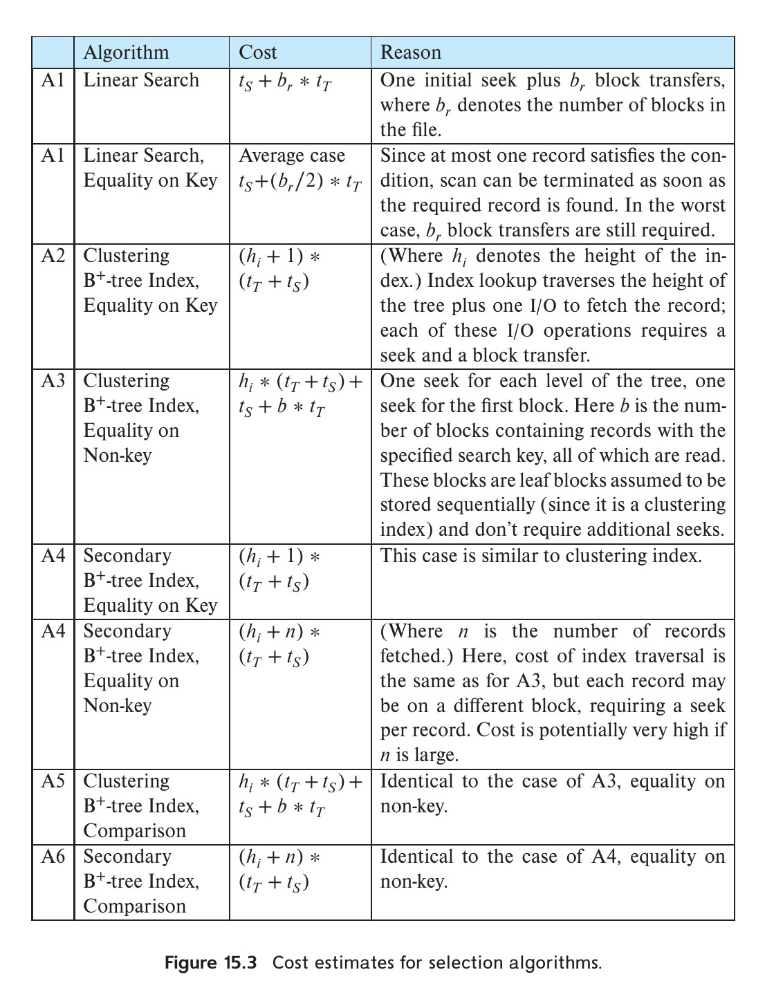
*Figure 15.3 — Cost estimates for selection algorithms.*
<!-- Page 697 -->
- **A2 (clustering index, equality on key).** For an equality comparison on a key attribute with a clustering index, we can use the index to retrieve a single record that satisfies the corresponding equality condition. Cost estimates are shown in Figure 15.3. To model the common situation that the internal nodes of the index are in the in-memory buffer, $h_i$ can be set to 1.
- **A3 (clustering index, equality on non-key).** We can retrieve multiple records by using a clustering index when the selection condition specifies an equality comparison on a non-key attribute, $A$. The only difference from the previous case is that multiple records may need to be fetched. However, the records must be stored consecutively in the file since the file is sorted on the search key. Cost estimates are shown in Figure 15.3.
- **A4 (secondary index, equality).** Selections specifying an equality condition can use a secondary index. This strategy can retrieve a single record if the equality condition is on a key; multiple records may be retrieved if the indexing field is not a key.

  In the first case, only one record is retrieved. The cost in this case is the same as that for a clustering index (case A2).

  In the second case, each record may be resident on a different block, which may result in one I/O operation per retrieved record, with each I/O operation requiring a seek and a block transfer. The worst-case cost in this case is $(h_i + n) * (t_S + t_T)$, where $n$ is the number of records fetched, if each record is in a different disk block, and the block fetches are randomly ordered. The worst-case cost could become even worse than that of linear search if a large number of records are retrieved.

  If the in-memory buffer is large, the block containing the record may already be in the buffer. It is possible to construct an estimate of the average or expected cost of the selection by taking into account the probability of the block containing the record already being in the buffer. For large buffers, that estimate will be much less than the worst-case estimate.

In certain algorithms, including A2, the use of a B+-tree file organization can save one access since records are stored at the leaf level of the tree.

As described in Section 14.4.2, when records are stored in a B+-tree file organization or other file organizations that may require relocation of records, secondary indices usually do not store pointers to the records.[^4] Instead, secondary indices store the values of the attributes used as the search key in a B+-tree file organization. Accessing a record through such a secondary index is then more expensive: First the secondary index is searched to find the B+-tree file organization search-key values, then the B+-tree file organization is looked up to find the records. The cost formulae described for secondary indices have to be modified appropriately if such indices are used.

[^4]: Recall that if B+-tree file organizations are used to store relations, records may be moved between blocks when leaf nodes are split or merged, and when records are redistributed.

<!-- Page 698 -->
### 15.3.2 Selections Involving Comparisons

Consider a selection of the form $\sigma_{A \le v}(r)$. We can implement the selection either by using linear search or by using indices in one of the following ways:

- **A5 (clustering index, comparison).** A clustering ordered index (for example, a clustering B+-tree index) can be used when the selection condition is a comparison. For comparison conditions of the form $A > v$ or $A \ge v$, a clustering index on $A$ can be used to direct the retrieval of tuples, as follows: For $A \ge v$, we look up the value $v$ in the index to find the first tuple in the file that has a value of $A \ge v$. A file scan starting from that tuple up to the end of the file returns all tuples that satisfy the condition. For $A > v$, the file scan starts with the first tuple such that $A > v$. The cost estimate for this case is identical to that for case A3.

  For comparisons of the form $A < v$ or $A \le v$, an index lookup is not required. For $A < v$, we use a simple file scan starting from the beginning of the file, and continuing up to (but not including) the first tuple with attribute $A = v$. The case of $A \le v$ is similar, except that the scan continues up to (but not including) the first tuple with attribute $A > v$. In either case, the index is not useful.
- **A6 (secondary index, comparison).** We can use a secondary ordered index to guide retrieval for comparison conditions involving $<, \le, \ge$, or $>$. The lowest-level index blocks are scanned, either from the smallest value up to $v$ (for $<$ and $\le$), or from $v$ up to the maximum value (for $>$ and $\ge$).

  The secondary index provides pointers to the records, but to get the actual records we have to fetch the records by using the pointers. This step may require an I/O operation for each record fetched, since consecutive records may be on different disk blocks; as before, each I/O operation requires a disk seek and a block transfer. If the number of retrieved records is large, using the secondary index may be even more expensive than using linear search. Therefore, the secondary index should be used only if very few records are selected.

As long as the number of matching tuples is known ahead of time, a query optimizer can choose between using a secondary index or using a linear scan based on the cost estimates. However, if the number of matching tuples is not known accurately at compilation time, either choice may lead to bad performance, depending on the actual number of matching tuples.

To deal with the above situation, PostgreSQL uses a hybrid algorithm that it calls a bitmap index scan,[^5] when a secondary index is available, but the number of matching records is not known precisely. The bitmap index scan algorithm first creates a bitmap with as many bits as the number of blocks in the relation, with all bits initialized to 0. The algorithm then uses the secondary index to find index entries for matching tuples, but instead of fetching the tuples immediately, it does the following. As each index

[^5]: This algorithm should not be confused with a scan using a bitmap index.

<!-- Page 699 -->
entry is found, the algorithm gets the block number from the index entry, and sets the corresponding bit in the bitmap to 1.

Once all index entries have been processed, the bitmap is scanned to find all blocks whose bit is set to 1. These are exactly the blocks containing matching records. The relation is then scanned linearly, but blocks whose bit is not set to 1 are skipped; only blocks whose bit is set to 1 are fetched, and then a scan within each block is used to retrieve all matching records in the block.

In the worst case, this algorithm is only slightly more expensive than linear scan, but in the best case it is much cheaper than linear scan. Similarly, in the worst case it is only slightly more expensive than using a secondary index scan to directly fetch tuples, but in the best case it is much cheaper than a secondary index scan. Thus, this hybrid algorithm ensures that performance is never much worse than the best plan for that database instance.

A variant of this algorithm collects all the index entries, and sorts them (using sorting algorithms which we study later in this chapter), and then performs a relation scan that skips blocks that do not have any matching entries. Using a bitmap as above can be cheaper than sorting the index entries.

### 15.3.3 Implementation of Complex Selections

So far, we have considered only simple selection conditions of the form $A\text{ op }B$, where $\text{op}$ is an equality or comparison operation. We now consider more complex selection predicates.

- **Conjunction:** A conjunctive selection is a selection of the form:

$$\sigma_{\theta_1 \land \theta_2 \land \dots \land \theta_n}(r)$$

- **Disjunction:** A disjunctive selection is a selection of the form:

$$\sigma_{\theta_1 \lor \theta_2 \lor \dots \lor \theta_n}(r)$$

A disjunctive condition is satisfied by the union of all records satisfying the individual, simple conditions $\theta_i$.
- **Negation:** The result of a selection $\sigma_{\neg \theta}(r)$ is the set of tuples of $r$ for which the condition $\theta$ evaluates to false. In the absence of nulls, this set is simply the set of tuples in $r$ that are not in $\sigma_\theta(r)$.

We can implement a selection operation involving either a conjunction or a disjunction of simple conditions by using one of the following algorithms:

- **A7 (conjunctive selection using one index).** We first determine whether an access path is available for an attribute in one of the simple conditions. If one is, one of the

<!-- Page 700 -->
selection algorithms A2 through A6 can retrieve records satisfying that condition. We complete the operation by testing, in the memory buffer, whether or not each retrieved record satisfies the remaining simple conditions.

To reduce the cost, we choose a $\theta_i$ and one of algorithms A1 through A6 for which the combination results in the least cost for $\sigma_{\theta_i}(r)$. The cost of algorithm A7 is given by the cost of the chosen algorithm.
- **A8 (conjunctive selection using composite index).** An appropriate composite index (that is, an index on multiple attributes) may be available for some conjunctive selections. If the selection specifies an equality condition on two or more attributes, and a composite index exists on these combined attribute fields, then the index can be searched directly. The type of index determines which of algorithms A2, A3, or A4 will be used.
- **A9 (conjunctive selection by intersection of identifiers).** Another alternative for implementing conjunctive selection operations involves the use of record pointers or record identifiers. This algorithm requires indices with record pointers, on the fields involved in the individual conditions. The algorithm scans each index for pointers to tuples that satisfy an individual condition. The intersection of all the retrieved pointers is the set of pointers to tuples that satisfy the conjunctive condition. The algorithm then uses the pointers to retrieve the actual records. If indices are not available on all the individual conditions, then the algorithm tests the retrieved records against the remaining conditions.

The cost of algorithm A9 is the sum of the costs of the individual index scans, plus the cost of retrieving the records in the intersection of the retrieved lists of pointers. This cost can be reduced by sorting the list of pointers and retrieving records in the sorted order. Thereby, (1) all pointers to records in a block come together, hence all selected records in the block can be retrieved using a single I/O operation, and (2) blocks are read in sorted order, minimizing disk-arm movement. Section 15.4 describes sorting algorithms.
- **A10 (disjunctive selection by union of identifiers).** If access paths are available on all the conditions of a disjunctive selection, each index is scanned for pointers to tuples that satisfy the individual condition. The union of all the retrieved pointers yields the set of pointers to all tuples that satisfy the disjunctive condition. We then use the pointers to retrieve the actual records.

However, if even one of the conditions does not have an access path, we have to perform a linear scan of the relation to find tuples that satisfy the condition. Therefore, if there is even one such condition in the disjunct, the most efficient access method is a linear scan, with the disjunctive condition tested on each tuple during the scan.

The implementation of selections with negation conditions is left to you as an exercise (Practice Exercise 15.6).

<!-- Page 701 -->
## 15.4 Sorting

Sorting of data plays an important role in database systems for two reasons. First, SQL queries can specify that the output be sorted. Second, and equally important for query processing, several of the relational operations, such as joins, can be implemented efficiently if the input relations are first sorted. Thus, we discuss sorting here before discussing the join operation in Section 15.5.

We can sort a relation by building an index on the sort key and then using that index to read the relation in sorted order. However, such a process orders the relation only logically, through an index, rather than physically. Hence, the reading of tuples in the sorted order may lead to a disk access (disk seek plus block transfer) for each record, which can be very expensive, since the number of records can be much larger than the number of blocks. For this reason, it may be desirable to order the records physically.

The problem of sorting has been studied extensively, both for relations that fit entirely in main memory and for relations that are bigger than memory. In the first case, standard sorting techniques such as quick-sort can be used. Here, we discuss how to handle the second case.

### 15.4.1 External Sort-Merge Algorithm

Sorting of relations that do not fit in memory is called **external sorting**. The most commonly used technique for external sorting is the **external sort–merge** algorithm. We describe the external sort–merge algorithm next. Let $M$ denote the number of blocks in the main memory buffer available for sorting, that is, the number of disk blocks whose contents can be buffered in available main memory.

1. In the first stage, a number of sorted runs are created; each run is sorted but contains only some of the records of the relation.

```pascal
i = 0;
repeat
    read M blocks of the relation, or the rest of the relation,
    whichever is smaller;
    sort the in-memory part of the relation;
    write the sorted data to run file Ri;
    i = i + 1;
until the end of the relation
```

2. In the second stage, the runs are merged. Suppose, for now, that the total number of runs, $N$, is less than $M$, so that we can allocate one block to each run and have space left to hold one block of output. The merge stage operates as follows:

<!-- Page 702 -->
```pascal
read one block of each of the N files Ri into a buffer block in memory;
repeat
    choose the first tuple (in sort order) among all buffer blocks;
    write the tuple to the output, and delete it from the buffer block;
    if the buffer block of any run Ri is empty and not end-of-file(Ri)
        then read the next block of Ri into the buffer block;
until all input buffer blocks are empty
```

The output of the merge stage is the sorted relation. The output file is buffered to reduce the number of disk write operations. The preceding merge operation is a generalization of the two-way merge used by the standard in-memory sort–merge algorithm; it merges $N$ runs, so it is called an **N-way merge**.

In general, if the relation is much larger than memory, there may be $M$ or more runs generated in the first stage, and it is not possible to allocate a block for each run during the merge stage. In this case, the merge operation proceeds in multiple passes. Since there is enough memory for $M - 1$ input buffer blocks, each merge can take $M - 1$ runs as input.

The initial pass functions in this way: It merges the first $M - 1$ runs (as described in item 2 above) to get a single run for the next pass. Then, it merges the next $M - 1$ runs similarly, and so on, until it has processed all the initial runs. At this point, the number of runs has been reduced by a factor of $M - 1$. If this reduced number of runs is still greater than or equal to $M$, another pass is made, with the runs created by the first pass as input. Each pass reduces the number of runs by a factor of $M - 1$. The passes repeat as many times as required, until the number of runs is less than $M$; a final pass then generates the sorted output.

Figure 15.4 illustrates the steps of the external sort–merge for an example relation. For illustration purposes, we assume that only one tuple fits in a block ($f_r = 1$), and we assume that memory holds at most three blocks. During the merge stage, two blocks are used for input and one for output.

### 15.4.2 Cost Analysis of External Sort-Merge

We compute the disk-access cost for the external sort–merge in this way: Let $b_r$ denote the number of blocks containing records of relation $r$. The first stage reads every block of the relation and writes them out again, giving a total of $2b_r$ block transfers. The initial number of runs is $\lceil b_r / M \rceil$. During the merge pass, reading in each run one block at a time leads to a large number of seeks; to reduce the number of seeks, a larger number of blocks, denoted $b_b$, are read or written at a time, requiring $b_b$ buffer blocks to be allocated to each input run and to the output run. Then, $\lfloor M / b_b \rfloor - 1$ runs can be merged in each merge pass, decreasing the number of runs by a factor of $\lfloor M / b_b \rfloor - 1$. The total number of merge passes required is $\lceil \log_{\lfloor M / b_b \rfloor - 1} (b_r / M) \rceil$. Each of these passes reads every block of the relation once and writes it out once, with two exceptions. First, the final pass can produce the sorted output without writing its result

<!-- Page 703 -->
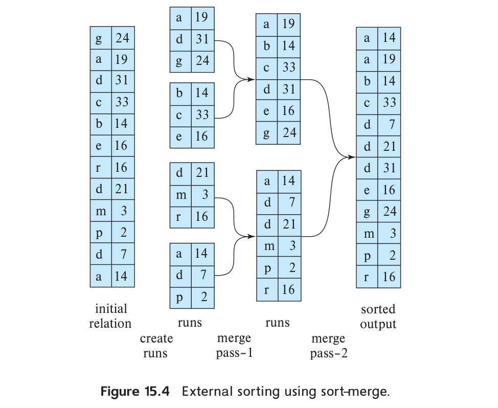
*Figure 15.4 — External sorting using sort–merge.*

to disk. Second, there may be runs that are not read in or written out during a pass—for example, if there are $\lfloor M / b_b \rfloor$ runs to be merged in a pass, $\lfloor M / b_b \rfloor - 1$ are read in and merged, and one run is not accessed during the pass. Ignoring the (relatively small) savings due to the latter effect, the total number of block transfers for external sorting of the relation is:

$$b_r(2\lceil\log_{\lfloor M/b_b \rfloor - 1}(b_r / M)\rceil + 1)$$

Applying this equation to the example in Figure 15.4, with $b_b$ set to 1, we get a total of $12 * (4 + 1) = 60$ block transfers, as you can verify from the figure. Note that these above numbers do not include the cost of writing out the final result.

We also need to add the disk-seek costs. Run generation requires seeks for reading data for each of the runs as well as for writing the runs. Each merge pass requires around $\lceil b_r / b_b \rceil$ seeks for reading data.[^6] Although the output is written sequentially, if it is on the same disk as the input runs, the head may have moved away between writes of consecutive blocks. Thus we would have to add a total of $2\lceil b_r / b_b \rceil$ seeks for each merge pass, except the final pass (since we assume the final result is not written back to disk).

[^6]: To be more precise, since we read each run separately and may get fewer than $b_b$ blocks when reading the end of a run, we may require an extra seek for each run. We ignore this detail for simplicity.

<!-- Page 704 -->
$$2\lceil b_r / M \rceil + \lceil b_r / b_b \rceil (2\lceil \log_{\lfloor M/b_b \rfloor - 1}(b_r/M) \rceil - 1)$$

Applying this equation to the example in Figure 15.4, we get a total of $8 + 12 * (2 * 2 - 1) = 44$ disk seeks if we set the number of buffer blocks per run $b_b$ to 1.

## 15.5 Join Operation

In this section, we study several algorithms for computing the join of relations, and we analyze their respective costs. We use the term **equi-join** to refer to a join of the form $r \bowtie_{r.A = s.B} s$, where $A$ and $B$ are attributes or sets of attributes of relations $r$ and $s$, respectively.

We use as a running example the expression:

$$\text{student} \bowtie \text{takes}$$

using the same relation schemas that we used in Chapter 2. We assume the following information about the two relations:

- Number of records of $\text{student}$: $n_{\text{student}} = 5000$.
- Number of blocks of $\text{student}$: $b_{\text{student}} = 100$.
- Number of records of $\text{takes}$: $n_{\text{takes}} = 10{,}000$.
- Number of blocks of $\text{takes}$: $b_{\text{takes}} = 400$.

### 15.5.1 Nested-Loop Join

Figure 15.5 shows a simple algorithm to compute the theta join, $r \bowtie_\theta s$, of two relations $r$ and $s$. This algorithm is called the **nested-loop join** algorithm, since it basically consists of a pair of nested for loops. Relation $r$ is called the **outer relation** and relation $s$ the **inner relation** of the join, since the loop for $r$ encloses the loop for $s$. The algorithm uses the notation $t_r \cdot t_s$, where $t_r$ and $t_s$ are tuples; $t_r \cdot t_s$ denotes the tuple constructed by concatenating the attribute values of tuples $t_r$ and $t_s$.

Like the linear file-scan algorithm for selection, the nested-loop join algorithm requires no indices, and it can be used regardless of what the join condition is. Extending the algorithm to compute the natural join is straightforward, since the natural join can be expressed as a theta join followed by elimination of repeated attributes by a projection. The only change required is an extra step of deleting repeated attributes from the tuple $t_r \cdot t_s$, before adding it to the result.

The nested-loop join algorithm is expensive, since it examines every pair of tuples in the two relations. Consider the cost of the nested-loop join algorithm. The number of pairs of tuples to be considered is $n_r * n_s$, where $n_r$ denotes the number of tuples in $r$, and $n_s$ denotes the number of tuples in $s$. For each record in $r$, we have to perform

<!-- Page 705 -->
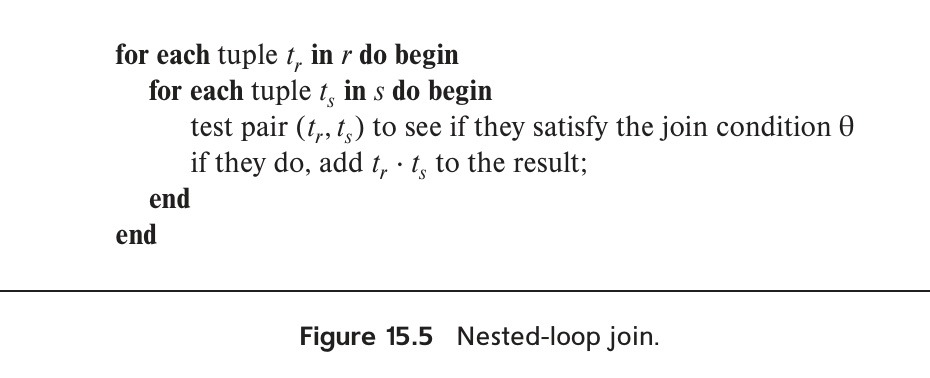
*Figure 15.5 — Nested-loop join.*

a complete scan on $s$. In the worst case, the buffer can hold only one block of each relation, and a total of $n_r * b_s + b_r$ block transfers would be required, where $b_r$ and $b_s$ denote the number of blocks containing tuples of $r$ and $s$, respectively. We need only one seek for each scan on the inner relation $s$ since it is read sequentially, and a total of $b_r$ seeks to read $r$, leading to a total of $n_r + b_r$ seeks. In the best case, there is enough space for both relations to fit simultaneously in memory, so each block would have to be read only once; hence, only $b_r + b_s$ block transfers would be required, along with two seeks.

If one of the relations fits entirely in main memory, it is beneficial to use that relation as the inner relation, since the inner relation would then be read only once. Therefore, if $s$ is small enough to fit in main memory, our strategy requires only a total $b_r + b_s$ block transfers and two seeks—the same cost as that for the case where both relations fit in memory.

Now consider the natural join of $\text{student}$ and $\text{takes}$. Assume for now that we have no indices whatsoever on either relation, and that we are not willing to create any index. We can use the nested loops to compute the join; assume that $\text{student}$ is the outer relation and $\text{takes}$ is the inner relation in the join. We will have to examine $5000 * 10{,}000 = 50 * 10^6$ pairs of tuples. In the worst case, the number of block transfers is $5000 * 400 + 100 = 2{,}000{,}100$, plus $5000 + 100 = 5100$ seeks. In the best-case scenario, however, we can read both relations only once and perform the computation. This computation requires at most $100 + 400 = 500$ block transfers, plus two seeks—a significant improvement over the worst-case scenario. If we had used $\text{takes}$ as the relation for the outer loop and $\text{student}$ for the inner loop, the worst-case cost of our final strategy would have been $10{,}000 * 100 + 400 = 1{,}000{,}400$ block transfers, plus 10,400 disk seeks. The number of block transfers is significantly less, and although the number of seeks is higher, the overall cost is reduced, assuming $t_S = 4\text{ milliseconds}$ and $t_T = 0.1\text{ milliseconds}$.

### 15.5.2 Block Nested-Loop Join

If the buffer is too small to hold either relation entirely in memory, we can still obtain a major saving in block accesses if we process the relations on a per-block basis, rather

<!-- Page 706 -->
than on a per-tuple basis. Figure 15.6 shows block nested-loop join, which is a variant of the nested-loop join where every block of the inner relation is paired with every block of the outer relation. Within each pair of blocks, every tuple in one block is paired with every tuple in the other block, to generate all pairs of tuples. As before, all pairs of tuples that satisfy the join condition are added to the result.

The primary difference in cost between the block nested-loop join and the basic nested-loop join is that, in the worst case, each block in the inner relation $s$ is read only once for each block in the outer relation, instead of once for each tuple in the outer relation. Thus, in the worst case, there will be a total of $b_r * b_s + b_r$ block transfers, where $b_r$ and $b_s$ denote the number of blocks containing records of $r$ and $s$, respectively. Each scan of the inner relation requires one seek, and the scan of the outer relation requires one seek per block, leading to a total of $2 * b_r$ seeks. It is more efficient to use the smaller relation as the outer relation, in case neither of the relations fits in memory. In the best case, where the inner relation fits in memory, there will be $b_r + b_s$ block transfers and just two seeks (we would choose the smaller relation as the inner relation in this case).

Now return to our example of computing $\text{student} \bowtie \text{takes}$, using the block nested-loop join algorithm. In the worst case, we have to read each block of $\text{takes}$ once for each block of $\text{student}$. Thus, in the worst case, a total of $100 * 400 + 100 = 40{,}100$ block transfers plus $2 * 100 = 200$ seeks are required. This cost is a significant improvement over the $5000 * 400 + 100 = 2{,}000{,}100$ block transfers plus 5100 seeks needed in the worst case for the basic nested-loop join. The best-case cost remains the same—namely, $100 + 400 = 500$ block transfers and two seeks.

The performance of the nested-loop and block nested-loop procedures can be further improved:

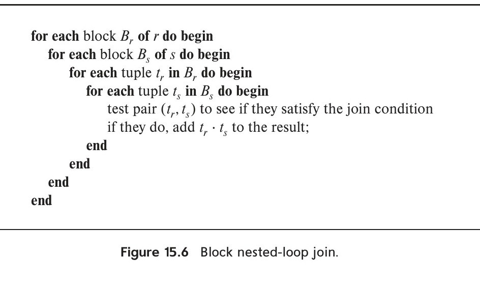
*Figure 15.6 — Block nested-loop join.*
<!-- Page 707 -->
- If the join attributes in a natural join or an equi-join form a key on the inner relation, then for each outer relation tuple the inner loop can terminate as soon as the first match is found.
- In the block nested-loop algorithm, instead of using disk blocks as the blocking unit for the outer relation, we can use the biggest size that can fit in memory, while leaving enough space for the buffers of the inner relation and the output. In other words, if memory has $M$ blocks, we read in $M - 2$ blocks of the outer relation at a time, and when we read each block of the inner relation we join it with all the $M - 2$ blocks of the outer relation. This change reduces the number of scans of the inner relation from $b_r$ to $\lceil b_r / (M - 2) \rceil$, where $b_r$ is the number of blocks of the outer relation. The total cost is then $\lceil b_r / (M - 2) \rceil * b_s + b_r$ block transfers and $2\lceil b_r / (M - 2) \rceil$ seeks.
- We can scan the inner loop alternately forward and backward. This scanning method orders the requests for disk blocks so that the data remaining in the buffer from the previous scan can be reused, thus reducing the number of disk accesses needed.
- If an index is available on the inner loop's join attribute, we can replace file scans with more efficient index lookups. Section 15.5.3 describes this optimization.

### 15.5.3 Indexed Nested-Loop Join

In a nested-loop join (Figure 15.5), if an index is available on the inner loop's join attribute, index lookups can replace file scans. For each tuple $t_r$ in the outer relation $r$, the index is used to look up tuples in $s$ that will satisfy the join condition with tuple $t_r$.

This join method is called an **indexed nested-loop join**; it can be used with existing indices, as well as with temporary indices created for the sole purpose of evaluating the join.

Looking up tuples in $s$ that will satisfy the join conditions with a given tuple $t_r$ is essentially a selection on $s$. For example, consider $\text{student} \bowtie \text{takes}$. Suppose that we have a student tuple with ID "00128". Then, the relevant tuples in takes are those that satisfy the selection "$\text{ID} = \text{00128}$".

The cost of an indexed nested-loop join can be computed as follows: For each tuple in the outer relation $r$, a lookup is performed on the index for $s$, and the relevant tuples are retrieved. In the worst case, there is space in the buffer for only one block of $r$ and one block of the index. Then, $b_r$ I/O operations are needed to read relation $r$, where $b_r$ denotes the number of blocks containing records of $r$; each I/O requires a seek and a block transfer, since the disk head may have moved in between each I/O. For each tuple in $r$, we perform an index lookup on $s$. Then, the cost of the join can be computed as $b_r(t_T + t_S) + n_r * c$, where $n_r$ is the number of records in relation $r$, and $c$ is the cost of a single selection on $s$ using the join condition. We have seen in Section 15.3 how to estimate the cost of a single selection algorithm (possibly using indices); that estimate gives us the value of $c$.

<!-- Page 708 -->
The cost formula indicates that, if indices are available on both relations $r$ and $s$, it is generally most efficient to use the one with fewer tuples as the outer relation.

For example, consider an indexed nested-loop join of $\text{student} \bowtie \text{takes}$, with $\text{student}$ as the outer relation. Suppose also that $\text{takes}$ has a clustering B+-tree index on the join attribute ID, which contains 20 entries on average in each index node. Since $\text{takes}$ has 10,000 tuples, the height of the tree is 4, and one more access is needed to find the actual data. Since $n_{\text{student}}$ is 5000, the total cost is $100 + 5000 * 5 = 25{,}100$ disk accesses, each of which requires a seek and a block transfer. In contrast, as we saw before, 40,100 block transfers plus 200 seeks were needed for a block nested-loop join. Although the number of block transfers has been reduced, the seek cost has actually increased, increasing the total cost since a seek is considerably more expensive than a block transfer. However, if we had a selection on the student relation that reduces the number of rows significantly, indexed nested-loop join could be significantly faster than block nested-loop join.

### 15.5.4 Merge Join

The **merge-join** algorithm (also called the **sort-merge-join** algorithm) can be used to compute natural joins and equi-joins. Let $r(R)$ and $s(S)$ be the relations whose natural join is to be computed, and let $R \cap S$ denote their common attributes. Suppose that both relations are sorted on the attributes $R \cap S$. Then, their join can be computed by a process much like the merge stage in the merge–sort algorithm.

#### 15.5.4.1 Merge-Join Algorithm

Figure 15.7 shows the merge-join algorithm. In the algorithm, JoinAttrs refers to the attributes in $R \cap S$, and $t_r \bowtie t_s$, where $t_r$ and $t_s$ are tuples that have the same values for JoinAttrs, denotes the concatenation of the attributes of the tuples, followed by projecting out repeated attributes. The merge-join algorithm associates one pointer with each relation. These pointers point initially to the first tuple of the respective relations. As the algorithm proceeds, the pointers move through the relation. A group of tuples of one relation with the same value on the join attributes is read into $S_s$. The algorithm in Figure 15.7 requires that every set of tuples $S_s$ fit in main memory; we discuss extensions of the algorithm to avoid this requirement shortly. Then, the corresponding tuples (if any) of the other relation are read in and are processed as they are read.

Figure 15.8 shows two relations that are sorted on their join attribute $a_1$. It is instructive to go through the steps of the merge-join algorithm on the relations shown in the figure.

The merge-join algorithm of Figure 15.7 requires that each set $S_s$ of all tuples with the same value for the join attributes must fit in main memory. This requirement can usually be met, even if the relation $s$ is large. If there are some join attribute values for

<!-- Page 709 -->
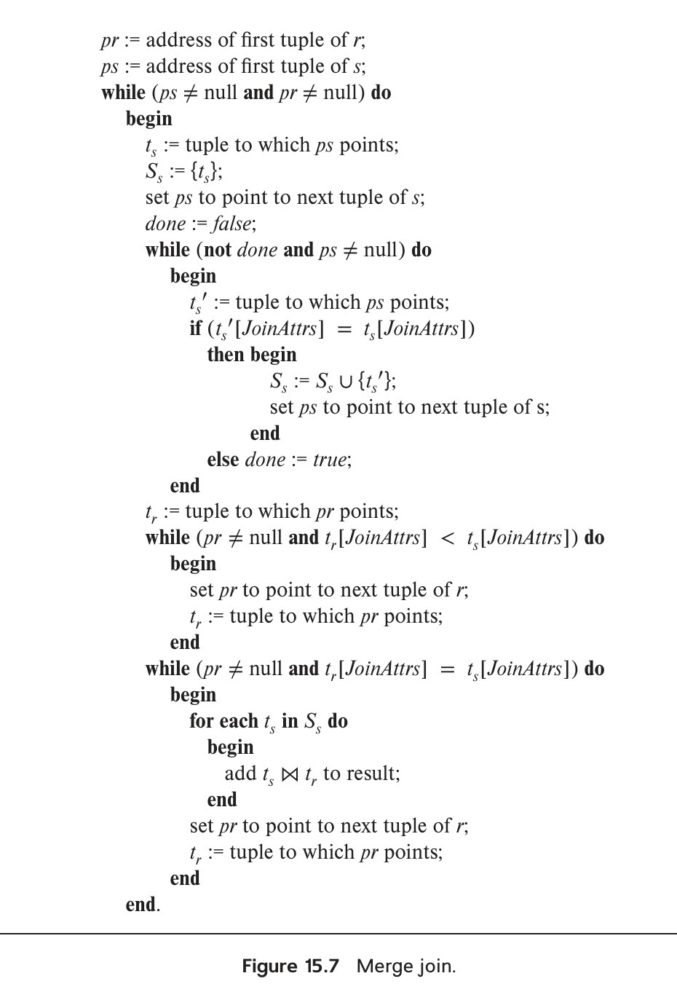
*Figure 15.7 — Merge join.*

which $S_s$ is larger than available memory, a block nested-loop join can be performed for such sets $S_s$, matching them with corresponding blocks of tuples in $r$ with the same values for the join attributes.

<!-- Page 710 -->
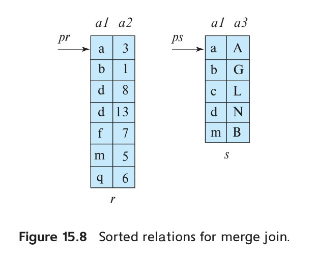
*Figure 15.8 — Sorted relations for merge join.*

If either of the input relations $r$ and $s$ is not sorted on the join attributes, they can be sorted first, and then the merge-join algorithm can be used. The merge-join algorithm can also be easily extended from natural joins to the more general case of equi-joins.

#### 15.5.4.2 Cost Analysis

Once the relations are in sorted order, tuples with the same value on the join attributes are in consecutive order. Thereby, each tuple in the sorted order needs to be read only once, and, as a result, each block is also read only once. Since it makes only a single pass through both files (assuming all sets $S_s$ fit in memory), the merge-join method is efficient; the number of block transfers is equal to the sum of the number of blocks in both files, $b_r + b_s$.

Assuming that $b_b$ buffer blocks are allocated to each relation, the number of disk seeks required would be $\lceil b_r / b_b \rceil + \lceil b_s / b_b \rceil$ disk seeks. Since seeks are much more expensive than data transfer, it makes sense to allocate multiple buffer blocks to each relation, provided extra memory is available. For example, with $t_T = 0.1\text{ milliseconds}$ per 4-kilobyte block, and $t_S = 4\text{ milliseconds}$, the buffer size is 400 blocks (or 1.6 megabytes), so the seek time would be 4 milliseconds for every 40 milliseconds of transfer time; in other words, seek time would be just 10 percent of the transfer time.

If either of the input relations $r$ and $s$ is not sorted on the join attributes, they must be sorted first; the cost of sorting must then be added to the above costs. If some sets $S_s$ do not fit in memory, the cost would increase slightly.

Suppose the merge-join scheme is applied to our example of $\text{student} \bowtie \text{takes}$. The join attribute here is ID. Suppose that the relations are already sorted on the join attribute ID. In this case, the merge join takes a total of $400 + 100 = 500$ block transfers. If we assume that in the worst case only one buffer block is allocated to each input relation (that is, $b_b = 1$), a total of $400 + 100 = 500$ seeks would also be required; in reality $b_b$ can be set much higher since we need to buffer blocks for only two relations, and the seek cost would be significantly less.

<!-- Page 711 -->
Suppose the relations are not sorted, and the memory size is the worst case, only three blocks. The cost is as follows:

1. Using the formulae that we developed in Section 15.4, we can see that sorting relation $\text{takes}$ requires $\lceil \log_{3-1}(400/3) \rceil = 8$ merge passes. Sorting of relation $\text{takes}$ then takes $400 * (2\lceil \log_{3-1}(400/3) \rceil + 1)$, or 6800, block transfers, with 400 more transfers to write out the result. The number of seeks required is $2 * \lceil 400/3 \rceil + 400 * (2 * 8 - 1)$ or 6268 seeks for sorting, and 400 seeks for writing the output, for a total of 6668 seeks, since only one buffer block is available for each run.
2. Similarly, sorting relation $\text{student}$ takes $\lceil \log_{3-1}(100/3) \rceil = 6$ merge passes and $100 * (2\lceil \log_{3-1}(100/3) \rceil + 1)$, or 1300, block transfers, with 100 more transfers to write it out. The number of seeks required for sorting $\text{student}$ is $2 * \lceil 100/3 \rceil + 100 * (2 * 6 - 1) = 1168$, and 100 seeks are required for writing the output, for a total of 1268 seeks.
3. Finally, merging the two relations takes $400 + 100 = 500$ block transfers and 500 seeks.

Thus, the total cost is 9100 block transfers plus 8932 seeks if the relations are not sorted, and the memory size is just 3 blocks.

With a memory size of 25 blocks, and the relations not sorted, the cost of sorting followed by merge join would be as follows:

1. Sorting the relation $\text{takes}$ can be done with just one merge step and takes a total of just $400 * (2\lceil \log_{24}(400/25) \rceil + 1) = 1200$ block transfers. Similarly, sorting $\text{student}$ takes 300 block transfers. Writing the sorted output to disk requires $400 + 100 = 500$ block transfers, and the merge step requires 500 block transfers to read the data back. Adding up these costs gives a total cost of 2500 block transfers.
2. If we assume that only one buffer block is allocated for each run, the number of seeks required in this case is $2 * \lceil 400/25 \rceil + 400 + 400 = 832$ seeks for sorting $\text{takes}$ and writing the sorted output to disk, and similarly $2 * \lceil 100/25 \rceil + 100 + 100 = 208$ for $\text{student}$, plus $400 + 100$ seeks for reading the sorted data in the merge-join step. Adding up these costs gives a total cost of 1640 seeks.

The number of seeks can be significantly reduced by setting aside more buffer blocks for each run. For example, if 5 buffer blocks are allocated for each run and for the output from merging the 4 runs of $\text{student}$, the cost is reduced to $2 * \lceil 100/25 \rceil + \lceil 100/5 \rceil + \lceil 100/5 \rceil = 48$ seeks, from 208 seeks. If the merge-join step sets aside 12 blocks each for buffering $\text{takes}$ and $\text{student}$, the number of seeks for the merge-join step goes down to $\lceil 400/12 \rceil + \lceil 100/12 \rceil = 43$, from 500. The total number of seeks is then 251.

<!-- Page 712 -->
Thus, the total cost is 2500 block transfers plus 251 seeks if the relations are not sorted, and the memory size is 25 blocks.

#### 15.5.4.3 Hybrid Merge Join

It is possible to perform a variation of the merge-join operation on unsorted tuples, if secondary indices exist on both join attributes. The algorithm scans the records through the indices, resulting in their being retrieved in sorted order. This variation presents a significant drawback, however, since records may be scattered throughout the file blocks. Hence, each tuple access could involve accessing a disk block, and that is costly.

To avoid this cost, we can use a hybrid merge-join technique that combines indices with merge join. Suppose that one of the relations is sorted; the other is unsorted, but has a secondary B+-tree index on the join attributes. The hybrid merge-join algorithm merges the sorted relation with the leaf entries of the secondary B+-tree index. The result file contains tuples from the sorted relation and addresses for tuples of the unsorted relation. The result file is then sorted on the addresses of tuples of the unsorted relation, allowing efficient retrieval of the corresponding tuples, in physical storage order, to complete the join. Extensions of the technique to handle two unsorted relations are left as an exercise for you.

### 15.5.5 Hash Join

Like the merge-join algorithm, the **hash-join** algorithm can be used to implement natural joins and equi-joins. In the hash-join algorithm, a hash function $h$ is used to partition tuples of both relations. The basic idea is to partition the tuples of each of the relations into sets that have the same hash value on the join attributes.

We assume that:

- $h$ is a hash function mapping JoinAttrs values to $\{0, 1, \dots, n_h\}$, where JoinAttrs denotes the common attributes of $r$ and $s$ used in the natural join.
- $r_0, r_1, \dots, r_{n_h}$ denote partitions of $r$ tuples, each initially empty. Each tuple $t_r \in r$ is put in partition $r_i$, where $i = h(t_r[\text{JoinAttrs}])$.
- $s_0, s_1, \dots, s_{n_h}$ denote partitions of $s$ tuples, each initially empty. Each tuple $t_s \in s$ is put in partition $s_i$, where $i = h(t_s[\text{JoinAttrs}])$.

The hash function $h$ should have the "goodness" properties of randomness and uniformity that we discussed in Chapter 14. Figure 15.9 depicts the partitioning of the relations.

#### 15.5.5.1 Basics

The idea behind the hash-join algorithm is this: Suppose that an $r$ tuple and an $s$ tuple satisfy the join condition; then, they have the same value for the join attributes. If that value is hashed to some value $i$, the $r$ tuple has to be in $r_i$ and the $s$ tuple in $s_i$. Therefore,

<!-- Page 713 -->
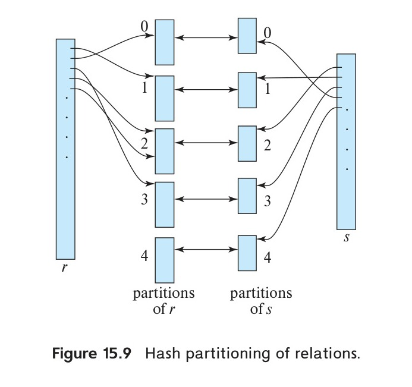
*Figure 15.9 — Hash partitioning of relations.*

$r$ tuples in $r_i$ need only be compared with $s$ tuples in $s_i$; they do not need to be compared with $s$ tuples in any other partition.

For example, if $d$ is a tuple in $\text{student}$, $c$ a tuple in $\text{takes}$, and $h$ a hash function on the ID attributes of the tuples, then $d$ and $c$ must be tested only if $h(c) = h(d)$. If $h(c) \ne h(d)$, then $c$ and $d$ must have different values for ID. However, if $h(c) = h(d)$, we must test $c$ and $d$ to see whether the values in their join attributes are the same, since it is possible that $c$ and $d$ have different IDs that have the same hash value.

Figure 15.10 shows the details of the hash-join algorithm to compute the natural join of relations $r$ and $s$. As in the merge-join algorithm, $t_r \bowtie t_s$ denotes the concatenation of the attributes of tuples $t_r$ and $t_s$, followed by projecting out repeated attributes. After the partitioning of the relations, the rest of the hash-join code performs a separate indexed nested-loop join on each of the partition pairs $i$, for $i = 0, \dots, n_h$. To do so, it first builds a hash index on each $s_i$, and then probes (that is, looks up $s_i$) with tuples from $r_i$. The relation $s$ is the build input, and $r$ is the probe input.

The hash index on $s_i$ is built in memory, so there is no need to access the disk to retrieve the tuples. The hash function used to build this hash index must be different from the hash function $h$ used earlier, but it is still applied to only the join attributes. In the course of the indexed nested-loop join, the system uses this hash index to retrieve records that match records in the probe input.

The build and probe phases require only a single pass through both the build and probe inputs. It is straightforward to extend the hash-join algorithm to compute general equi-joins.

The value $n_h$ must be chosen to be large enough such that, for each $i$, the tuples in the partition $s_i$ of the build relation, along with the hash index on the partition, fit in memory. It is not necessary for the partitions of the probe relation to fit in memory. It is

<!-- Page 714 -->
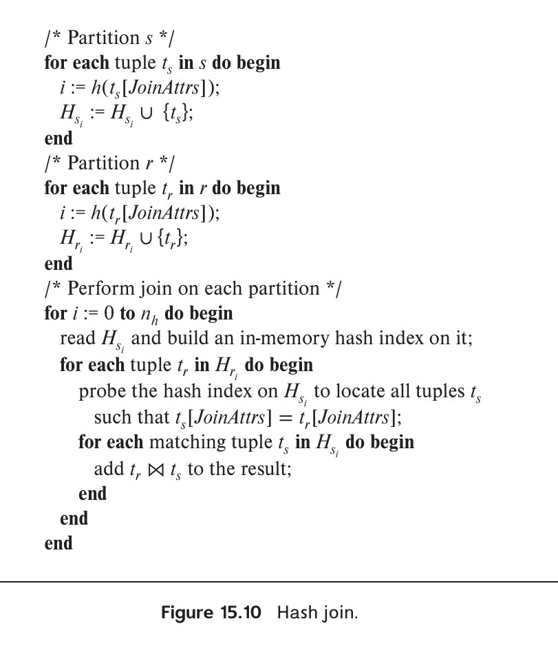
*Figure 15.10 — Hash join.*

best to use the smaller input relation as the build relation. If the size of the build relation is $b_s$ blocks, then, for each of the $n_h$ partitions to be of size less than or equal to $M$, $n_h$ must be at least $\lceil b_s / M \rceil$. More precisely stated, we have to account for the extra space occupied by the hash index on the partition as well, so $n_h$ should be correspondingly larger. For simplicity, we sometimes ignore the space requirement of the hash index in our analysis.

#### 15.5.5.2 Recursive Partitioning

If the value of $n_h$ is greater than or equal to the number of blocks of memory, the relations cannot be partitioned in one pass, since there will not be enough buffer blocks. Instead, partitioning has to be done in repeated passes. In one pass, the input can be split into at most as many partitions as there are blocks available for use as output buffers. Each bucket generated by one pass is separately read in and partitioned again in the next pass, to create smaller partitions. The hash function used in a pass is different from the one used in the previous pass. The system repeats this splitting of the

<!-- Page 715 -->
input until each partition of the build input fits in memory. Such partitioning is called **recursive partitioning**.

A relation does not need recursive partitioning if $M > n_h + 1$, or equivalently $M > (b_s / M) + 1$, which simplifies (approximately) to $M > \sqrt{b_s}$. For example, consider a memory size of 12 megabytes, divided into 4-kilobyte blocks; it would contain a total of 3-kilobyte (3072) blocks. We can use a memory of this size to partition relations of size up to 3-kilobyte * 3-kilobyte blocks, which is 36 gigabytes. Similarly, a relation of size 1 gigabyte requires just over $\sqrt{256\text{K}}$ blocks, or 2 megabytes, to avoid recursive partitioning.

#### 15.5.5.3 Handling of Overflows

Hash-table overflow occurs in partition $i$ of the build relation $s$ if the hash index on $s_i$ is larger than main memory. Hash-table overflow can occur if there are many tuples in the build relation with the same values for the join attributes, or if the hash function does not have the properties of randomness and uniformity. In either case, some of the partitions will have more tuples than the average, whereas others will have fewer; partitioning is then said to be skewed.

We can handle a small amount of skew by increasing the number of partitions so that the expected size of each partition (including the hash index on the partition) is somewhat less than the size of memory. The number of partitions is therefore increased by a small value, called the **fudge factor**, that is usually about 20 percent of the number of hash partitions computed as described in Section 15.5.5.

Even if, by using a fudge factor, we are conservative on the sizes of the partitions, overflows can still occur. Hash-table overflows can be handled by either **overflow resolution** or **overflow avoidance**:

- **Overflow resolution:** Overflow resolution is performed during the build phase if a hash-index overflow is detected. Overflow resolution proceeds in this way: If $s_i$, for any $i$, is found to be too large, it is further partitioned into smaller partitions by using a different hash function. Similarly, $r_i$ is also partitioned using the new hash function, and only tuples in the matching partitions need to be joined.
- **Overflow avoidance:** In contrast, overflow avoidance performs the partitioning carefully, so that overflows never occur during the build phase. In overflow avoidance, the build relation $s$ is initially partitioned into many small partitions, and then some partitions are combined in such a way that each combined partition fits in memory. The probe relation $r$ is partitioned in the same way as the combined partitions on $s$, but the sizes of $r_i$ do not matter.

If a large number of tuples in $s$ have the same value for the join attributes, the resolution and avoidance techniques may fail on some partitions. In that case, instead of creating an in-memory hash index and using a nested-loop join to join the partitions, we can use other join techniques, such as block nested-loop join, on those partitions.

#### 15.5.5.4 Cost of Hash Join

We now consider the cost of a hash join. Our analysis assumes that there is no hash-table overflow. First, consider the case where recursive partitioning is not required.

<!-- Page 716 -->
- The partitioning of the two relations $r$ and $s$ calls for a complete reading of both relations and a subsequent writing back of them. This operation requires $2(b_r + b_s)$ block transfers, where $b_r$ and $b_s$ denote the number of blocks containing records of relations $r$ and $s$, respectively. The build and probe phases read each of the partitions once, calling for further $b_r + b_s$ block transfers. The number of blocks occupied by partitions could be slightly more than $b_r + b_s$, as a result of partially filled blocks. Accessing such partially filled blocks can add an overhead of at most $2n_h$ for each of the relations, since each of the $n_h$ partitions could have a partially filled block that has to be written and read back. Thus, a hash join is estimated to require:

$$3(b_r + b_s) + 4n_h$$

block transfers. The overhead $4n_h$ is usually quite small compared to $b_r + b_s$ and can be ignored.
- Assuming $b_b$ blocks are allocated for the input buffer and each output buffer, partitioning requires a total of $2(\lceil b_r / b_b \rceil + \lceil b_s / b_b \rceil)$ seeks. The build and probe phases require only one seek for each of the $n_h$ partitions of each relation, since each partition can be read sequentially. The hash join thus requires $2(\lceil b_r / b_b \rceil + \lceil b_s / b_b \rceil) + 2n_h$ seeks.

Now consider the case where recursive partitioning is required. Again we assume that $b_b$ blocks are allocated for buffering each partition. Each pass then reduces the size of each of the partitions by an expected factor of $\lfloor M / b_b \rfloor - 1$; and passes are repeated until each partition is of size at most $M$ blocks. The expected number of passes required for partitioning $s$ is therefore $\lceil \log_{\lfloor M / b_b \rfloor - 1} (b_s / M) \rceil$.

- Since, in each pass, every block of $s$ is read in and written out, the total number of block transfers for partitioning of $s$ is $2b_s \lceil \log_{\lfloor M / b_b \rfloor - 1} (b_s / M) \rceil$. The number of passes for partitioning of $r$ is the same as the number of passes for partitioning of $s$, therefore the join is estimated to require:

$$2(b_r + b_s)\lceil \log_{\lfloor M / b_b \rfloor - 1} (b_s / M) \rceil + b_r + b_s$$

block transfers.
- Ignoring the relatively small number of seeks during the build and probe phases, hash join with recursive partitioning requires:

$$2(\lceil b_r / b_b \rceil + \lceil b_s / b_b \rceil)\lceil \log_{\lfloor M / b_b \rfloor - 1} (b_s / M) \rceil$$

disk seeks.

Consider, for example, the natural join $\text{takes} \bowtie \text{student}$. With a memory size of 20 blocks, the $\text{student}$ relation can be partitioned into five partitions, each of size 20 blocks, which size will fit into memory. Only one pass is required for the partitioning. The
<!-- Page 717 -->
relation $\text{takes}$ is similarly partitioned into five partitions, each of size 80. Ignoring the cost of writing partially filled blocks, the cost is $3(100 + 400) = 1500$ block transfers. There is enough memory to allocate the buffers for the input and each of the five outputs during partitioning (i.e, $b_b = 3$) leading to $2(\lceil 100/3 \rceil + \lceil 400/3 \rceil) = 336$ seeks.

The hash join can be improved if the main memory size is large. When the entire build input can be kept in main memory, $n_h$ can be set to 0; then, the hash-join algorithm executes quickly, without partitioning the relations into temporary files, regardless of the probe input's size. The cost estimate goes down to $b_r + b_s$ block transfers and two seeks.

Indexed nested loops join can have a much lower cost than hash join in case the outer relation is small, and the index lookups fetch only a few tuples from the inner (indexed) relation. However, in case a secondary index is used, and the number of tuples in the outer relation is large, indexed nested loops join can have a very high cost, as compared to hash join. If the number of tuples in the outer relation is known at query optimization time, the best join algorithm can be chosen at that time. However, in some cases, for example, when there is a selection condition on the outer input, the optimizer makes a decision based on an estimate that may potentially be imprecise. The number of tuples in the outer relation may be found only at runtime, for example, after executing selection. Some systems allow a dynamic choice between the two algorithms at run time, after finding the number of tuples in the outer input.

#### 15.5.5.5 Hybrid Hash Join

The hybrid hash-join algorithm performs another optimization; it is useful when memory sizes are relatively large but not all of the build relation fits in memory. The partitioning phase of the hash-join algorithm needs a minimum of one block of memory as a buffer for each partition that is created, and one block of memory as an input buffer. To reduce the impact of seeks, a larger number of blocks would be used as a buffer; let $b_b$ denote the number of blocks used as a buffer for the input and for each partition. Hence, a total of $(n_h + 1) * b_b$ blocks of memory are needed for partitioning the two relations. If memory is larger than $(n_h + 1) * b_b$, we can use the rest of memory ($M - (n_h + 1) * b_b$ blocks) to buffer the first partition of the build input (i.e, $s_0$) so that it will not need to be written out and read back in. Further, the hash function is designed in such a way that the hash index on $s_0$ fits in $M - (n_h + 1) * b_b$ blocks, in order that, at the end of partitioning of $s$, $s_0$ is completely in memory and a hash index can be built on $s_0$.

When the system partitions $r$, it again does not write tuples in $r_0$ to disk; instead, as it generates them, the system uses them to probe the memory-resident hash index on $s_0$, and to generate output tuples of the join. After they are used for probing, the tuples can be discarded, so the partition $r_0$ does not occupy any memory space. Thus, a write and a read access have been saved for each block of both $r_0$ and $s_0$. The system writes out tuples in the other partitions as usual and joins them later. The savings of hybrid hash join can be significant if the build input is only slightly bigger than memory.

<!-- Page 718 -->
If the size of the build relation is $b_s$, $n_h$ is approximately equal to $b_s / M$. Thus, hybrid hash join is most useful if $M \gg (b_s / M) * b_b$, or $M \gg \sqrt{b_s * b_b}$, where the notation $\gg$ denotes much larger than. For example, suppose the block size is 4 kilobytes, the build relation size is 5 gigabytes, and $b_b$ is 20. Then, the hybrid hash-join algorithm is useful if the size of memory is significantly more than 20 megabytes; memory sizes of gigabytes or more are common on computers today. If we devote 1 gigabyte for the join algorithm, $s_0$ would be nearly 1 gigabyte, and hybrid hash join would be nearly 20 percent cheaper than hash join.

### 15.5.6 Complex Joins

Nested-loop and block nested-loop joins can be used regardless of the join conditions. The other join techniques are more efficient than the nested-loop join and its variants, but they can handle only simple join conditions, such as natural joins or equi-joins. We can implement joins with complex join conditions, such as conjunctions and disjunctions, by using the efficient join techniques, if we apply the techniques developed in Section 15.3.3 for handling complex selections.

Consider the following join with a conjunctive condition:

$$r \bowtie_{\theta_1 \land \theta_2 \land \dots \land \theta_n} s$$

One or more of the join techniques described earlier may be applicable for joins on the individual conditions $r \bowtie_{\theta_1} s$, $r \bowtie_{\theta_2} s$, $r \bowtie_{\theta_3} s$, and so on. We can compute the overall join by first computing the result of one of these simpler joins $r \bowtie_{\theta_i} s$; each pair of tuples in the intermediate result consists of one tuple from $r$ and one from $s$. The result of the complete join consists of those tuples in the intermediate result that satisfy the remaining conditions:

$$\theta_1 \land \dots \land \theta_{i-1} \land \theta_{i+1} \land \dots \land \theta_n$$

These conditions can be tested as tuples in $r \bowtie_{\theta_i} s$ are being generated.

A join whose condition is disjunctive can be computed in this way. Consider:

$$r \bowtie_{\theta_1 \lor \theta_2 \lor \dots \lor \theta_n} s$$

The join can be computed as the union of the records in individual joins $r \bowtie_{\theta_i} s$:

$$(r \bowtie_{\theta_1} s) \cup (r \bowtie_{\theta_2} s) \cup \dots \cup (r \bowtie_{\theta_n} s)$$

Section 15.6 describes algorithms for computing the union of relations.

<!-- Page 719 -->
### 15.5.7 Joins over Spatial Data

The join algorithms we have presented make no specific assumptions about the type of data being joined, but they do assume the use of standard comparison operations such as equality, less than, or greater than, where the values are linearly ordered.

Selection and join conditions on spatial data involve comparison operators that check if one region contains or overlaps another, or whether a region contains a particular point; and the regions may be multi-dimensional. Comparisons may pertain also to the distance between points, for example, finding a set of points closest to a given point in a two-dimensional space.

Merge-join cannot be used with such comparison operations, since there is no simple sort order over spatial data in two or more dimensions. Partitioning of data based on hashing is also not applicable, since there is no way to ensure that tuples that satisfy an overlap or containment predicate are hashed to the same value. Nested loops join can always be used regardless of the complexity of the conditions, but can be very inefficient on large datasets.

Indexed nested-loops join can however be used, if appropriate spatial indices are available. In Section 14.10, we saw several types of indices for spatial data, including R-trees, k-d trees, k-d-B trees, and quadtrees. Additional details on those indices appear in Section 24.4. These index structures enable efficient retrieval of spatial data based on predicates such as contains, contained in, or overlaps, and can also be effectively used to find nearest neighbors.

Most major database systems today incorporate support for indexing spatial data, and make use of them when processing queries using spatial comparison conditions.

## 15.6 Other Operations

Other relational operations and extended relational operations—such as duplicate elimination, projection, set operations, outer join, and aggregation—can be implemented as outlined in Section 15.6.1 through Section 15.6.5.

### 15.6.1 Duplicate Elimination

We can implement duplicate elimination easily by sorting. Identical tuples will appear adjacent to each other as a result of sorting, and all but one copy can be removed. With external sort–merge, duplicates found while a run is being created can be removed before the run is written to disk, thereby reducing the number of block transfers. The remaining duplicates can be eliminated during merging, and the final sorted run has no duplicates. The worst-case cost estimate for duplicate elimination is the same as the worst-case cost estimate for sorting of the relation.

We can also implement duplicate elimination by hashing, as in the hash-join algorithm. First, the relation is partitioned on the basis of a hash function on the whole tuple. Then, each partition is read in, and an in-memory hash index is constructed.

<!-- Page 720 -->
While constructing the hash index, a tuple is inserted only if it is not already present. Otherwise, the tuple is discarded. After all tuples in the partition have been processed, the tuples in the hash index are written to the result. The cost estimate is the same as that for the cost of processing (partitioning and reading each partition) of the build relation in a hash join.

Because of the relatively high cost of duplicate elimination, SQL requires an explicit request by the user to remove duplicates; otherwise, the duplicates are retained.

### 15.6.2 Projection

We can implement projection easily by performing projection on each tuple, which gives a relation that could have duplicate records, and then removing duplicate records. Duplicates can be eliminated by the methods described in Section 15.6.1. If the attributes in the projection list include a key of the relation, no duplicates will exist; hence, duplicate elimination is not required. Generalized projection can be implemented in the same way as projection.

### 15.6.3 Set Operations

We can implement the union, intersection, and set-difference operations by first sorting both relations, and then scanning once through each of the sorted relations to produce the result. In $r \cup s$, when a concurrent scan of both relations reveals the same tuple in both files, only one of the tuples is retained. The result of $r \cap s$ will contain only those tuples that appear in both relations. We implement set difference, $r - s$, similarly, by retaining tuples in $r$ only if they are absent in $s$.

For all these operations, only one scan of the two sorted input relations is required, so the cost is $b_r + b_s$ block transfers if the relations are sorted in the same order. Assuming a worst case of one block buffer for each relation, a total of $b_r + b_s$ disk seeks would be required in addition to $b_r + b_s$ block transfers. The number of seeks can be reduced by allocating extra buffer blocks.

If the relations are not sorted initially, the cost of sorting has to be included. Any sort order can be used in the evaluation of set operations, provided that both inputs have that same sort order.

Hashing provides another way to implement these set operations. The first step in each case is to partition the two relations by the same hash function and thereby create the partitions $r_0, r_1, \dots, r_{n_h}$ and $s_0, s_1, \dots, s_{n_h}$. Depending on the operation, the system then takes these steps on each partition $i = 0, 1, \dots, n_h$:

- $r \cup s$:
  1. Build an in-memory hash index on $r_i$.
  2. Add the tuples in $s_i$ to the hash index only if they are not already present.
  3. Add the tuples in the hash index to the result.

<!-- Page 721 -->
> ### Note 15.1: Answering Keyword Queries
>
> Keyword search on documents is widely used in the context of web search. In its simplest form, a keyword query provides a set of words $K_1, K_2, \dots, K_n$, and the goal is to find documents $d_i$ from a collection of documents $D$ such that $d_i$ contains all the keywords in the query. Real-life keyword search is more complicated, since it requires ranking of documents based on various metrics such TF–IDF and PageRank, as we saw earlier in Section 8.3.
>
> Documents that contain a specified keyword can be located efficiently by using an index (often referred to as an inverted index) that maps each keyword $K_i$ to a list $S_i$ of identifiers of the documents that contain $K_i$. The list is kept sorted. For example, if documents $d_1, d_9$ and $d_{21}$ contain the term "Silberschatz", the inverted list for the keyword Silberschatz would be "$d_1; d_9; d_{21}$". Compression techniques are used to reduce the size of the inverted lists. A B+-tree index can be used to map each keyword $K_i$ to its associated inverted list $S_i$.
>
> To answer a query with keyword $K_1, K_2, \dots, K_n$, we retrieve the inverted list $S_i$ for each keyword $K_i$, and then compute the intersection $S_1 \cap S_2 \cap \dots \cap S_n$ to find documents that appear in all the lists. Since the lists are sorted, the intersection can be efficiently implemented by merging the lists using concurrent scans of all the lists. Many information-retrieval systems return documents that contain several, even if not all, of the keywords; the merge step can be easily modified to output documents that contain at least $k$ of the $n$ keywords.
>
> To support ranking of keyword-query results, extra information can be stored in each inverted list, including the inverse document frequency of the term, and for each document the PageRank, the term frequency of the term, as well as the positions within the document where the term occurs. This information can be used to compute scores that are then used to rank the documents. For example, documents where the keywords occur close to each other may receive a higher score for keyword proximity than those where they occur farther from each other. The keyword proximity score may be combined with the TF–IDF score, and PageRank to compute an overall score. Documents are then ranked on this score. Since most web searches retrieve only the top few answers, search engines incorporate a number of optimizations that help to find the top few answers efficiently, without computing the full list and then finding the ranking. References providing further details may be found in the Further Reading section at the end of the chapter.

- $r \cap s$:
  1. Build an in-memory hash index on $r_i$.
  2. For each tuple in $s_i$, probe the hash index and output the tuple to the result only if it is already present in the hash index.

<!-- Page 722 -->
- $r - s$:
  1. Build an in-memory hash index on $r_i$.
  2. For each tuple in $s_i$, probe the hash index, and, if the tuple is present in the hash index, delete it from the hash index.
  3. Add the tuples remaining in the hash index to the result.

### 15.6.4 Outer Join

Recall the outer-join operations described in Section 4.1.3. For example, the natural left outer join $\text{takes} \leftouterjoin \text{student}$ contains the join of $\text{takes}$ and $\text{student}$, and, in addition, for each $\text{takes}$ tuple $t$ that has no matching tuple in $\text{student}$ (i.e, where ID is not in $\text{student}$), the following tuple $t_1$ is added to the result. For all attributes in the schema of $\text{takes}$, tuple $t_1$ has the same values as tuple $t$. The remaining attributes (from the schema of $\text{student}$) of tuple $t_1$ contain the value null.

We can implement the outer-join operations by using one of two strategies:

1. Compute the corresponding join, and then add further tuples to the join result to get the outer-join result. Consider the left outer-join operation and two relations: $r(R)$ and $s(S)$. To evaluate $r \leftouterjoin_\theta s$, we first compute $r \bowtie_\theta s$ and save that result as temporary relation $q_1$. Next, we compute $r - \Pi_R(q_1)$ to obtain those tuples in $r$ that do not participate in the theta join. We can use any of the algorithms for computing the joins, projection, and set difference described earlier to compute the outer joins. We pad each of these tuples with null values for attributes from $s$, and add it to $q_1$ to get the result of the outer join.

   The right outer-join operation $r \rightouterjoin_\theta s$ is equivalent to $s \leftouterjoin_\theta r$ and can therefore be implemented in a symmetric fashion to the left outer join. We can implement the full outer-join operation $r \fullouterjoin_\theta s$ by computing the join $r \bowtie s$ and then adding the extra tuples of both the left and right outer-join operations, as before.

2. Modify the join algorithms. It is easy to extend the nested-loop join algorithms to compute the left outer join: Tuples in the outer relation that do not match any tuple in the inner relation are written to the output after being padded with null values. However, it is hard to extend the nested-loop join to compute the full outer join.

   Natural outer joins and outer joins with an equi-join condition can be computed by extensions of the merge-join and hash-join algorithms. Merge join can be extended to compute the full outer join as follows: When the merge of the two relations is being done, tuples in either relation that do not match any tuple in the other relation can be padded with nulls and written to the output. Similarly, we can extend merge join to compute the left and right outer joins by writing out nonmatching tuples (padded with nulls) from only one of the relations. Since the relations are sorted, it is easy to detect whether or not a tuple matches any tuples

<!-- Page 723 -->
from the other relation. For example, when a merge join of $\text{takes}$ and $\text{student}$ is done, the tuples are read in sorted order of ID, and it is easy to check, for each tuple, whether there is a matching tuple in the other.

The cost estimates for implementing outer joins using the merge-join algorithm are the same as are those for the corresponding join. The only difference lies in the size of the result, and therefore in the block transfers for writing it out, which we did not count in our earlier cost estimates.

The extension of the hash-join algorithm to compute outer joins is left for you to do as an exercise (Exercise 15.21).

### 15.6.5 Aggregation

Recall the aggregation function (operator), discussed in Section 3.7. For example, the function

```sql
select dept_name, avg (salary)
from instructor
group by dept_name;
```

computes the average salary in each university department.

The aggregation operation can be implemented in the same way as duplicate elimination. We use either sorting or hashing, just as we did for duplicate elimination, but based on the grouping attributes ($\text{dept\_name}$ in the preceding example). However, instead of eliminating tuples with the same value for the grouping attribute, we gather them into groups and apply the aggregation operations on each group to get the result.

The cost estimate for implementing the aggregation operation is the same as the cost of duplicate elimination for aggregate functions such as $\min, \max, \text{sum}, \text{count}$, and $\text{avg}$.

Instead of gathering all the tuples in a group and then applying the aggregation operations, we can implement the aggregation operations $\text{sum}, \min, \max, \text{count}$, and $\text{avg}$ on the fly as the groups are being constructed. For the case of $\text{sum}, \min$, and $\max$, when two tuples in the same group are found, the system replaces them with a single tuple containing the sum, min, or max, respectively, of the columns being aggregated. For the count operation, it maintains a running count for each group for which a tuple has been found. Finally, we implement the avg operation by computing the sum and the count values on the fly, and finally dividing the sum by the count to get the average.

If all tuples of the result fit in memory, the sort-based and the hash-based implementations do not need to write any tuples to disk. As the tuples are read in, they can be inserted in a sorted tree structure or in a hash index. When we use on-the-fly aggregation techniques, only one tuple needs to be stored for each of the groups. Hence, the sorted tree structure or hash index fits in memory, and the aggregation can be processed with just $b_r$ block transfers (and 1 seek) instead of the $3b_r$ transfers (and a worst case of up to $2b_r$ seeks) that would be required otherwise.

<!-- Page 724 -->
## 15.7 Evaluation of Expressions

So far, we have studied how individual relational operations are carried out. Now we consider how to evaluate an expression containing multiple operations. The obvious way to evaluate an expression is simply to evaluate one operation at a time, in an appropriate order. The result of each evaluation is materialized in a temporary relation for subsequent use. A disadvantage to this approach is the need to construct the temporary relations, which (unless they are small) must be written to disk. An alternative approach is to evaluate several operations simultaneously in a pipeline, with the results of one operation passed on to the next, without the need to store a temporary relation.

In Section 15.7.1 and Section 15.7.2, we consider both the materialization approach and the pipelining approach. We shall see that the costs of these approaches can differ substantially, but also that there are cases where only the materialization approach is feasible.

### 15.7.1 Materialization

It is easiest to understand intuitively how to evaluate an expression by looking at a pictorial representation of the expression in an operator tree. Consider the expression:

$$\Pi_{\text{name}}(\sigma_{\text{building} = \text{"Watson"}}(\text{department}) \bowtie \text{instructor})$$

in Figure 15.11.

If we apply the materialization approach, we start from the lowest-level operations in the expression (at the bottom of the tree). In our example, there is only one such operation: the selection operation on $\text{department}$. The inputs to the lowest-level operations are relations in the database. We execute these operations using the algorithms that we studied earlier, and we store the results in temporary relations. We can use these temporary relations to execute the operations at the next level up in the tree, where the inputs now are either temporary relations or relations stored in the database. In our

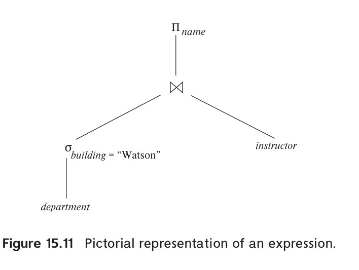
*Figure 15.11 — Pictorial representation of an expression.*

<!-- Page 725 -->
example, the inputs to the join are the $\text{instructor}$ relation and the temporary relation created by the selection on $\text{department}$. The join can now be evaluated, creating another temporary relation.

By repeating the process, we will eventually evaluate the operation at the root of the tree, giving the final result of the expression. In our example, we get the final result by executing the projection operation at the root of the tree, using as input the temporary relation created by the join.

Evaluation as just described is called **materialized evaluation**, since the results of each intermediate operation are created (materialized) and then are used for evaluation of the next-level operations.

The cost of a materialized evaluation is not simply the sum of the costs of the operations involved. When we computed the cost estimates of algorithms, we ignored the cost of writing the result of the operation to disk. To compute the cost of evaluating an expression as done here, we have to add the costs of all the operations, as well as the cost of writing the intermediate results to disk. We assume that the records of the result accumulate in a buffer, and, when the buffer is full, they are written to disk. The number of blocks written out, $b_r$, can be estimated as $n_r / f_r$, where $n_r$ is the estimated number of tuples in the result relation $r$ and $f_r$ is the blocking factor of the result relation, that is, the number of records of $r$ that will fit in a block. In addition to the transfer time, some disk seeks may be required, since the disk head may have moved between successive writes. The number of seeks can be estimated as $\lceil b_r / b_b \rceil$ where $b_b$ is the size of the output buffer (measured in blocks).

Double buffering (using two buffers, with one continuing execution of the algorithm while the other is being written out) allows the algorithm to execute more quickly by performing CPU activity in parallel with I/O activity. The number of seeks can be reduced by allocating extra blocks to the output buffer and writing out multiple blocks at once.

### 15.7.2 Pipelining

We can improve query-evaluation efficiency by reducing the number of temporary files that are produced. We achieve this reduction by combining several relational operations into a pipeline of operations, in which the results of one operation are passed along to the next operation in the pipeline. Evaluation as just described is called **pipelined evaluation**.

For example, consider the expression $\Pi_{a_1, a_2}(r \bowtie s)$. If materialization were applied, evaluation would involve creating a temporary relation to hold the result of the join and then reading back in the result to perform the projection. These operations can be combined: When the join operation generates a tuple of its result, it passes that tuple immediately to the project operation for processing. By combining the join and the projection, we avoid creating the intermediate result and instead create the final result directly.

<!-- Page 726 -->
Creating a pipeline of operations can provide two benefits:

1. It eliminates the cost of reading and writing temporary relations, reducing the cost of query evaluation. Note that the cost formulae that we saw earlier for each operation included the cost of reading the result from disk. If the input to an operator $o_i$ is pipelined from a preceding operator $o_j$, the cost of $o_i$ should not include the cost of reading the input from disk; the cost formulae that we saw earlier can be modified accordingly.
2. It can start generating query results quickly, if the root operator of a query-evaluation plan is combined in a pipeline with its inputs. This can be quite useful if the results are displayed to a user as they are generated, since otherwise there may be a long delay before the user sees any query results.

#### 15.7.2.1 Implementation of Pipelining

We can implement a pipeline by constructing a single, complex operation that combines the operations that constitute the pipeline. Although this approach may be feasible for some frequently occurring situations, it is desirable in general to reuse the code for individual operations in the construction of a pipeline.

In the example of Figure 15.11, all three operations can be placed in a pipeline, which passes the results of the selection to the join as they are generated. In turn, it passes the results of the join to the projection as they are generated. The memory requirements are low, since results of an operation are not stored for long. However, as a result of pipelining, the inputs to the operations are not available all at once for processing.

Pipelines can be executed in either of two ways:

1. In a **demand-driven pipeline**, the system makes repeated requests for tuples from the operation at the top of the pipeline. Each time that an operation receives a request for tuples, it computes the next tuple (or tuples) to be returned and then returns that tuple. If the inputs of the operation are not pipelined, the next tuple(s) to be returned can be computed from the input relations, while the system keeps track of what has been returned so far. If it has some pipelined inputs, the operation also makes requests for tuples from its pipelined inputs. Using the tuples received from its pipelined inputs, the operation computes tuples for its output and passes them up to its parent.
2. In a **producer-driven pipeline**, operations do not wait for requests to produce tuples, but instead generate the tuples eagerly. Each operation in a producer-driven pipeline is modeled as a separate process or thread within the system that takes a stream of tuples from its pipelined inputs and generates a stream of tuples for its output.
<!-- Page 727 -->
We describe next how demand-driven and producer-driven pipelines can be implemented.

Each operation in a demand-driven pipeline can be implemented as an iterator that provides the following functions: `open()`, `next()`, and `close()`. After a call to `open()`, each call to `next()` returns the next output tuple of the operation. The implementation of the operation in turn calls `open()` and `next()` on its inputs, to get its input tuples when required. The function `close()` tells an iterator that no more tuples are required. The iterator maintains the state of its execution in between calls so that successive `next()` requests receive successive result tuples.

For example, for an iterator implementing the select operation using linear search, the `open()` operation starts a file scan, and the iterator's state records the point to which the file has been scanned. When the `next()` function is called, the file scan continues from after the previous point; when the next tuple satisfying the selection is found by scanning the file, the tuple is returned after storing the point where it was found in the iterator state. A merge-join iterator's `open()` operation would open its inputs, and if they are not already sorted, it would also sort the inputs. On calls to `next()`, it would return the next pair of matching tuples. The state information would consist of up to where each input had been scanned. Details of the implementation of iterators are left for you to complete in Practice Exercise 15.7.

Producer-driven pipelines, on the other hand, are implemented in a different manner. For each pair of adjacent operations in a producer-driven pipeline, the system creates a buffer to hold tuples being passed from one operation to the next. The processes or threads corresponding to different operations execute concurrently. Each operation at the bottom of a pipeline continually generates output tuples, and puts them in its output buffer, until the buffer is full. An operation at any other level of a pipeline generates output tuples when it gets input tuples from lower down in the pipeline until its output buffer is full. Once the operation uses a tuple from a pipelined input, it removes the tuple from its input buffer. In either case, once the output buffer is full, the operation waits until its parent operation removes tuples from the buffer so that the buffer has space for more tuples. At this point, the operation generates more tuples until the buffer is full again. The operation repeats this process until all the output tuples have been generated.

It is necessary for the system to switch between operations only when an output buffer is full or when an input buffer is empty and more input tuples are needed to generate any more output tuples. In a parallel-processing system, operations in a pipeline may be run concurrently on distinct processors (see Section 22.5.1).

Using producer-driven pipelining can be thought of as pushing data up an operation tree from below, whereas using demand-driven pipelining can be thought of as pulling data up an operation tree from the top. Whereas tuples are generated eagerly in producer-driven pipelining, they are generated lazily, on demand, in demand-driven pipelining. Demand-driven pipelining is used more commonly than producer-driven pipelining because it is easier to implement. However, producer-driven pipelining is very useful in parallel processing systems. Producer-driven pipelining has also been

<!-- Page 728 -->
found to be more efficient than demand-driven pipelining on modern CPUs since it reduces the number of function call invocations as compared to demand-driven pipelining. Producer-driven pipelining is increasingly used in systems that generate machine code for high performance query evaluation.

#### 15.7.2.2 Evaluation Algorithms for Pipelining

Query plans can be annotated to mark edges that are pipelined; such edges are called **pipelined edges**. In contrast, non-pipelined edges are referred to as **blocking edges** or **materialized edges**. The two operators connected by a pipelined edge must be executed concurrently, since one consumes tuples as the other generates them. Since a plan can have multiple pipelined edges, the set of all operators that are connected by pipelined edges must be executed concurrently. A query plan can be divided into subtrees such that each subtree has only pipelined edges, and the edges between the subtrees are non-pipelined. Each such subtree is called a **pipeline stage**. The query processor executes the plan one pipeline stage at a time, and concurrently executes all the operators in a single pipeline stage.

Some operations, such as sorting, are inherently blocking operations, that is, they may not be able to output any results until all tuples from their inputs have been examined.[^7] But interestingly, blocking operators can consume tuples as they are generated, and can output tuples to their consumers as they are generated; such operations actually execute in two or more stages, and blocking actually happens between two stages of the operation.

For example, the external sort-merge operation actually has two steps: (i) run-generation, followed by (ii) merging. The run-generation step can accept tuples as they are generated by the input to the sort, and can thus be pipelined with the sort input. The merge step, on the other hand, can send tuples to its consumer as they are generated, and can thus be pipelined with the consumer of the sort operation. But the merge step can start only after the run-generation step has finished. We can thus model the sort-merge operator as two sub-operators connected to each other by a non-pipelined edge, but each of the sub-operators can be connected by pipelined edges to their input and output respectively.

Other operations, such as join, are not inherently blocking, but specific evaluation algorithms may be blocking. For example, the indexed nested loops join algorithm can output result tuples as it gets tuples for the outer relation. It is therefore pipelined on its outer (left-hand side) relation; however, it is blocking on its indexed (right-hand side) input, since the index must be fully constructed before the indexed nested-loop join algorithm can execute.

The hash-join algorithm is a blocking operation on both inputs, since it requires both its inputs to be fully retrieved and partitioned before it outputs any tuples. How-

[^7]: Blocking operations such as sorting may be able to output tuples early if the input is known to satisfy some special properties such as being sorted, or partially sorted, already. However, in the absence of such information, blocking operations cannot output tuples early.

<!-- Page 729 -->
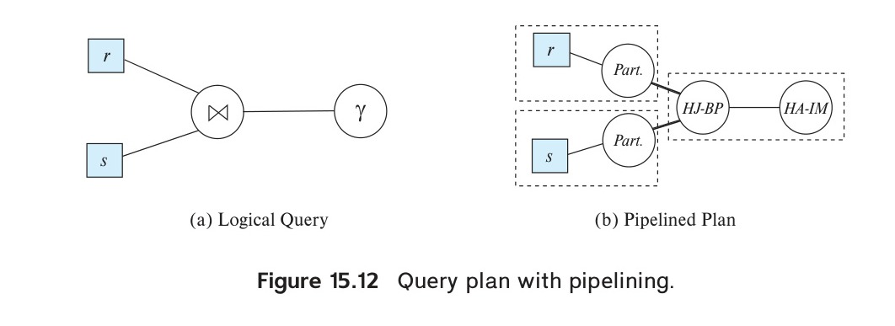
*Figure 15.12 — Query plan with pipelining.*

ever, hash-join partitions each of its inputs, and then performs multiple build-probe steps, once per partition. Thus, the hash-join algorithm has 3 steps: (i) partitioning of the first input, (ii) partitioning of the second input, and (iii) the build-probe step. The partitioning step for each input can accept tuples as they are generated by the input, and can thus be pipelined with its input. The build-probe step can output tuples to its consumer as the tuples are generated, and can thus be pipelined with its consumer. But the two partitioning steps are connected to the build-probe step by non-pipelined edges, since build-probe can start only after partitioning has been completed on both inputs.

Hybrid hash join can be viewed as partially pipelined on the probe relation, since it can output tuples from the first partition as tuples are received for the probe relation. However, tuples that are not in the first partition will be output only after the entire pipelined input relation is received. Hybrid hash join thus provides fully pipelined evaluation on its probe input if the build input fits entirely in memory, or nearly pipelined evaluation if most of the build input fits in memory.

Figure 15.12a shows a query that joins two relations $r$ and $s$, and then performs an aggregation on the result; details of the join predicate, group by attributes and aggregation functions are omitted for simplicity. Figure 15.12b shows a pipelined plan for the query using hash join and in-memory hash aggregation. Pipelined edges are shown using a normal line, while blocking edges are shown using a bold line. Pipeline stages are enclosed in dashed boxes. Note that hash join has been split into three suboperators. Two of suboperators, shown abbreviated to Part., partition $r$ and $s$ respectively. The third, abbreviated to HJ-BP, performs the build and probe phase of the hash join. The HA-IM operator is the in-memory hash aggregation operator. The edges from the partition operators to the HJ-BP operator are blocking edges, since the HJ-BP operator can start execution only after the partition operators have completed execution. The edges from the relations (assumed to be scanned using a relation scan operator) to the partition operators are pipelined, as is the edge from the HJ-BP operator to the HA-IM operator. The resultant pipeline stages are shown enclosed in dashed boxes.

In general, for each materialized edge we need to add the cost of writing the data to disk, and the cost of the consumer operator should include the cost of reading the data from disk. However, when a materialized edge is between suboperators of a single

<!-- Page 730 -->
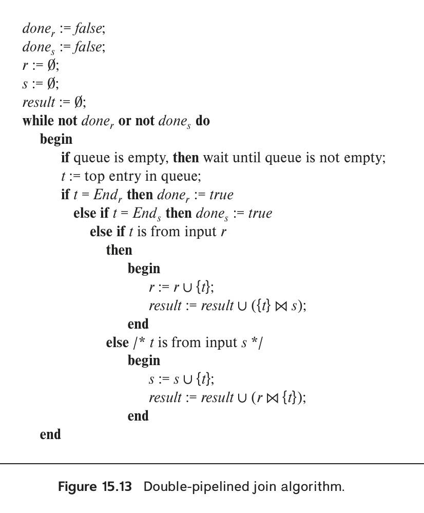
*Figure 15.13 — Double-pipelined join algorithm.*

operator, for example between run generation and merge, the materialization cost has already been accounted for in the operators cost, and should not be added again.

In some applications, a join algorithm that is pipelined on both its inputs and its output is desirable. If both inputs are sorted on the join attribute, and the join condition is an equi-join, merge join can be used, with both its inputs and its output pipelined.

However, in the more common case that the two inputs that we desire to pipeline into the join are not already sorted, another alternative is the double-pipelined join technique, shown in Figure 15.13. The algorithm assumes that the input tuples for both input relations, $r$ and $s$, are pipelined. Tuples made available for both relations are queued for processing in a single queue. Special queue entries, called $\text{End}_r$ and $\text{End}_s$, which serve as end-of-file markers, are inserted in the queue after all tuples from $r$ and $s$ (respectively) have been generated. For efficient evaluation, appropriate indices should be built on the relations $r$ and $s$. As tuples are added to $r$ and $s$, the indices must be kept

<!-- Page 731 -->
up to date. When hash indices are used on $r$ and $s$, the resultant algorithm is called the **double-pipelined hash-join technique**.

The double-pipelined join algorithm in Figure 15.13 assumes that both inputs fit in memory. In case the two inputs are larger than memory, it is still possible to use the double-pipelined join technique as usual until available memory is full. When available memory becomes full, $r$ and $s$ tuples that have arrived up to that point can be treated as being in partition $r_0$ and $s_0$, respectively. Tuples for $r$ and $s$ that arrive subsequently are assigned to partitions $r_1$ and $s_1$, respectively, which are written to disk, and are not added to the in-memory index. However, tuples assigned to $r_1$ and $s_1$ are used to probe $s_0$ and $r_0$, respectively, before they are written to disk. Thus, the join of $r_1$ with $s_0$, and $s_1$ with $r_0$, is also carried out in a pipelined fashion. After $r$ and $s$ have been fully processed, the join of $r_1$ tuples with $s_1$ tuples must be carried out to complete the join; any of the join techniques we have seen earlier can be used to join $r_1$ with $s_1$.

### 15.7.3 Pipelines for Continuous-Stream Data

Pipelining is also applicable in situations where data are entered into the database in a continuous manner, as is the case, for example, for inputs from sensors that are continuously monitoring environmental data. Such data are called **data streams**, as we saw earlier in Section 10.5. Queries may be written over stream data in order to respond to data as they arrive. Such queries are called **continuous queries**.

The operations in a continuous query should be implemented using pipelined algorithms, so that results from the pipeline can be output without blocking. Producer-driven pipelines (which we discussed earlier in Section 15.7.2.1) are the best suited for continuous query evaluation.

Many such queries perform aggregation with windowing; **tumbling windows** which divide time into fixed size intervals, such as 1 minute, or 1 hour, are commonly used. Grouping and aggregation is performed separately on each window, as tuples are received; assuming memory size is large enough, an in-memory hash index is used to perform aggregation.

The result of aggregation on a window can be output once the system knows that no further tuples in that window will be received in future. If tuples are guaranteed to arrive sorted by timestamp, the arrival of a tuple of a following window indicates no more tuples will be received for an earlier window. If tuples may arrive out of order, streams must carry punctuations that indicate that all future tuples will have a timestamp greater than some specified value. The arrival of a punctuation allows the output of aggregates of windows whose end-timestamp is less than or equal to the timestamp specified by the punctuation.

## 15.8 Query Processing in Memory

The query processing algorithms that we have described so far focus on minimizing I/O cost. In this section, we discuss extensions to the query processing techniques that

<!-- Page 732 -->
help minimize memory access costs by using cache-conscious query processing algorithms and query compilation. We then discuss query processing with column-oriented storage. The algorithms we describe in this section give significant benefits for memory resident data; they are also very useful with disk-resident data, since they can speed up processing once data has been brought into the in-memory buffer.

### 15.8.1 Cache-Conscious Algorithms

When data is resident in memory, access is much faster than if data were resident on magnetic disks, or even SSDs. However, it must be kept in mind that data already in CPU cache can be accessed as much as 100 times faster than data in memory. Modern CPUs have several levels of cache. Commonly used CPUs today have an L1 cache of size around 64 kilobytes, with a latency of about 1 nanosecond, an L2 cache of size around 256 kilobytes, with a latency of around 5 nanoseconds, and an L3 cache of having a size of around 10 megabytes, with a latency of 10 to 15 nanoseconds. In contrast, reading data in memory results in a latency of around 50 to 100 nanoseconds. For simplicity in the rest of this section we ignore the difference between the L1, L2 and L3 cache levels, and assume that there is only a single cache level.

As we saw in Section 14.4.7, the speed difference between cache memory and main memory, and the fact that data are transferred between main memory and cache in units of a cache-line (typically about 64 bytes), results in a situation where the relationship between cache and main memory is not dissimilar to the relationship between main memory and disk (although with smaller speed differences). But there is a difference: while the contents of the main memory buffers disk-based data are controlled by the database system, CPU cache is controlled by the algorithms built into the computer hardware. Thus, the database system cannot directly control what is kept in cache.

However, query processing algorithms can be designed in a way that the makes the best use of cache, to optimize performance. Here are some ways this can be done:

- To sort a relation that is in-memory, we use the external merge-sort algorithm, with the run size chosen such that the run fits into the cache; assuming we focus on the L3 cache, each run should be a few megabytes in size. We then use an in-memory sorting algorithm on each run; since the run fits in cache, cache misses are likely to be minimal when the run is sorted. The sorted runs (all of which are in memory) are then merged. Merging is cache efficient, since access to the runs is sequential: when a particular word is accessed from memory, the cache line that is fetched will contain the words that would be accessed next from that run.

  To sort a relation larger than memory, we can use external sort-merge with much larger run sizes, but use the in-memory merge-sort technique we just described to perform the in-memory sort of the large runs.
- Hash-join requires probing of an index on the build relation. If the build relation fits in memory, an index could be built on the whole relation; however, cache hits during probe can be maximized by partitioning the relations into smaller pieces

<!-- Page 733 -->
such that each partition of the build-relation along with the index fits in the cache. Each partition is processed separately, with a build and a probe phase; since the build partition and its index fit in cache, cache misses are minimized during the build as well as the probe phase.

For relations larger than memory, the first stage of hash-join should partition the two relations such that for each partition, the partitions of the two relations together fit in memory. The technique just described can then be used to perform the hash join on each of these partitions, after fetching the contents into memory.
- Attributes in a tuple can be arranged such that attributes that tend to be accessed together are laid out consecutively. For example, if a relation is often used for aggregation, those attributes used as group by attributes, and those that are aggregated upon, can be stored consecutively. As a result, if there is a cache miss on one attribute, the cache line that is fetched would contain attributes that are likely to be used immediately.

Cache-aware algorithms are of increasing importance in modern database systems, since memory sizes are often large enough that much of the data is memory-resident.

In cases where the requisite data item is not in cache, there is a processing stall while the data item is retrieved from memory and loaded into cache. In order to continue to make use of the core that made the request resulting in the stall, the operating system maintains multiple threads of execution on which a core may work. Parallel query processing algorithms, which we study in Chapter 22 can use multiple threads running on a single CPU core; if one thread is stalled, another can start execution so the CPU core is utilized better.

### 15.8.2 Query Compilation

With data resident in memory, CPU cost becomes the bottleneck, and minimizing CPU cost can give significant benefits. Traditional databases query processors act as interpreters that execute a query plan. However, there is a significant overhead due to interpretation: for example, to access an attribute of a record, the query execution engine may repeatedly look up the relation meta-data to find the offset of the attribute within the record, since the same code must work for all relations. There is also significant overhead due to function calls that are performed for each record processed by an operation.

To avoid overhead due to interpretation, modern main-memory databases compile query plans into machine code or intermediate level byte-code. For example, the compiler can compute the offset of an attribute at compile time, and generate code where the offset is a constant. The compiler can also combine the code for multiple functions in a way that minimizes function calls. With these, and other related optimizations, compiled code has been found to execute faster, by up to a factor of 10, than interpreted code.

<!-- Page 734 -->
### 15.8.3 Column-Oriented Storage

In Section 13.6, we saw that in data-analytic applications, only a few attributes of a large schema may be needed, and that in such cases, storing a relation by column instead of by row may be advantageous. Selection operations on a single attribute (or small number of attributes) have significantly lower cost in a column store since only the relevant attributes need to be accessed. However, since accessing each attribute requires its own data access, the cost of retrieving many attributes is higher and may incur additional seeks if data are stored on disk.

Because column stores permit efficient access to many values for a given attribute at once, they are well suited to exploit the vector-processing capabilities of modern processors. This capability allows certain operations (such as comparisons and aggregations) to be performed in a parallel on multiple attribute values. When compiling query plans to machine code, the compiler can generate vector-processing instructions supported by the processor.

## 15.9 Summary

- The first action that the system must perform on a query is to translate the query into its internal form, which (for relational database systems) is usually based on the relational algebra. In the process of generating the internal form of the query, the parser checks the syntax of the user's query, verifies that the relation names appearing in the query are names of relations in the database, and so on. If the query was expressed in terms of a view, the parser replaces all references to the view name with the relational-algebra expression to compute the view.
- Given a query, there are generally a variety of methods for computing the answer. It is the responsibility of the query optimizer to transform the query as entered by the user into an equivalent query that can be computed more efficiently. Chapter 16 covers query optimization.
- We can process simple selection operations by performing a linear scan or by making use of indices. We can handle complex selections by computing unions and intersections of the results of simple selections.
- We can sort relations larger than memory by the external sort–merge algorithm.
- Queries involving a natural join may be processed in several ways, depending on the availability of indices and the form of physical storage for the relations.
  - If the join result is almost as large as the Cartesian product of the two relations, a block nested-loop join strategy may be advantageous.
  - If indices are available, the indexed nested-loop join can be used.

<!-- Page 735 -->
  - If the relations are sorted, a merge join may be desirable. It may be advantageous to sort the relations first and then perform a merge join (a variant of the merge-join strategy).
  - The hash-join algorithm partitions the relations into several pieces, such that each piece of one of the relations fits in memory. The partitioning is carried out with a hash function on the join attributes so that corresponding pairs of partitions can be joined independently.
- Duplicate elimination, projection, set operations (union, intersection, and difference), and aggregation can be done by sorting or by hashing.
- Outer-join operations can be implemented by simple extensions of join algorithms.
- Hashing and sorting are dual, in the sense that any operation such as duplicate elimination, projection, aggregation, join, and outer join that can be implemented by hashing can also be implemented by sorting, and vice versa; that is, any operation that can be implemented by sorting can also be implemented by hashing.
- An expression can be evaluated by means of materialization, where the system computes the result of each subexpression and stores it on disk and then uses it to compute the result of the parent expression.
- Pipelining helps to avoid writing the results of many subexpressions to disk by using the results in the parent expression even as they are being generated.

## Review Terms

- Query processing
- Evaluation primitive
- Query-execution plan
- Query-evaluation plan
- Query-execution engine
- Measures of query cost
- Sequential I/O
- Random I/O
- File scan
- Linear search
- Selections using indices
- Access paths
- Index scans
- Conjunctive selection
- Disjunctive selection
- Composite index
- Intersection of identifiers
- External sorting
- External sort–merge
- Runs
- N-way merge
- Equi-join
- Nested-loop join
- Block nested-loop join
- Indexed nested-loop join
- Merge join
- Sort-merge join
- Hybrid merge join

<!-- Page 736 -->
- Hash-join
  - Build
  - Probe
  - Build input
  - Probe input
  - Recursive partitioning
  - Hash-table overflow
  - Skew
  - Fudge factor
  - Overflow resolution
  - Overflow avoidance
- Hybrid hash-join
- Spatial join
- Operator tree
- Materialized evaluation
- Double buffering
- Pipelined evaluation
  - Demand-driven pipeline (lazy, pulling)
  - Producer-driven pipeline (eager, pushing)
  - Iterator
  - Pipeline stages
- Double-pipelined join
- Continuous query evaluation

## Practice Exercises

**15.1** Assume (for simplicity in this exercise) that only one tuple fits in a block and memory holds at most three blocks. Show the runs created on each pass of the sort-merge algorithm when applied to sort the following tuples on the first attribute: (kangaroo, 17), (wallaby, 21), (emu, 1), (wombat, 13), (platypus, 3), (lion, 8), (warthog, 4), (zebra, 11), (meerkat, 6), (hyena, 9), (hornbill, 2), (baboon, 12).

**15.2** Consider the bank database of Figure 15.14, where the primary keys are underlined, and the following SQL query:

```sql
select T.branch_name
from branch T, branch S
where T.assets > S.assets and S.branch_city = "Brooklyn"
```

Write an efficient relational-algebra expression that is equivalent to this query. Justify your choice.

**15.3** Let relations $r_1(A, B, C)$ and $r_2(C, D, E)$ have the following properties: $r_1$ has 20,000 tuples, $r_2$ has 45,000 tuples, 25 tuples of $r_1$ fit on one block, and 30 tuples of $r_2$ fit on one block. Estimate the number of block transfers and seeks required using each of the following join strategies for $r_1 \bowtie r_2$:

a. Nested-loop join.
b. Block nested-loop join.
<!-- Page 737 -->
c. Merge join.
d. Hash join.

**15.4** The indexed nested-loop join algorithm described in Section 15.5.3 can be inefficient if the index is a secondary index and there are multiple tuples with the same value for the join attributes. Why is it inefficient? Describe a way, using sorting, to reduce the cost of retrieving tuples of the inner relation. Under what conditions would this algorithm be more efficient than hybrid merge join?

**15.5** Let $r$ and $s$ be relations with no indices, and assume that the relations are not sorted. Assuming infinite memory, what is the lowest-cost way (in terms of I/O operations) to compute $r \bowtie s$? What is the amount of memory required for this algorithm?

**15.6** Consider the bank database of Figure 15.14, where the primary keys are underlined. Suppose that a B+-tree index on branch_city is available on relation branch, and that no other index is available. List different ways to handle the following selections that involve negation:

a. $\sigma_{\neg(\text{branch\_city} < \text{"Brooklyn"})}(\text{branch})$
b. $\sigma_{\neg(\text{branch\_city} = \text{"Brooklyn"})}(\text{branch})$
c. $\sigma_{\neg(\text{branch\_city} < \text{"Brooklyn"} \lor \text{assets} < 5000)}(\text{branch})$

**15.7** Write pseudocode for an iterator that implements indexed nested-loop join, where the outer relation is pipelined. Your pseudocode must define the standard iterator functions `open()`, `next()`, and `close()`. Show what state information the iterator must maintain between calls.

**15.8** Design sort-based and hash-based algorithms for computing the relational division operation (see Practice Exercise 2.9 for a definition of the division operation).

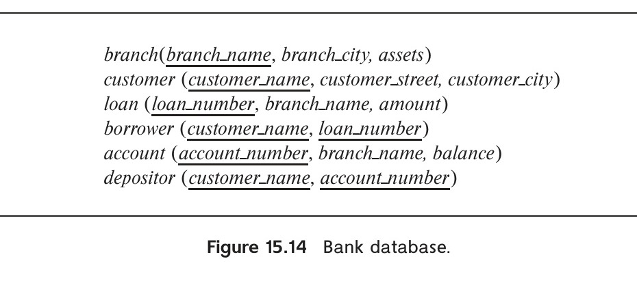
*Figure 15.14 — Bank database.*

<!-- Page 738 -->
**15.9** What is the effect on the cost of merging runs if the number of buffer blocks per run is increased while overall memory available for buffering runs remains fixed?

**15.10** Consider the following extended relational-algebra operators. Describe how to implement each operation using sorting and using hashing.

a. **Semijoin ($\ltimes_\theta$):** The multiset semijoin operator $r \ltimes_\theta s$ is defined as follows: if a tuple $r_i$ appears $n$ times in $r$, it appears $n$ times in the result of $r \ltimes_\theta s$ if there is at least one tuple $s_j$ such that $r_i$ and $s_j$ satisfy predicate $\theta$; otherwise $r_i$ does not appear in the result.
b. **Anti-semijoin ($\overline{\ltimes}_\theta$):** The multiset anti-semijoin operator $r \;\overline{\ltimes}_\theta\; s$ is defined as follows: if a tuple $r_i$ appears $n$ times in $r$, it appears $n$ times in the result of $r \;\overline{\ltimes}_\theta\; s$ if there does not exist any tuple $s_j$ in $s$ such that $r_i$ and $s_j$ satisfy predicate $\theta$; otherwise $r_i$ does not appear in the result.

**15.11** Suppose a query retrieves only the first $K$ results of an operation and terminates after that. Which choice of demand-driven or producer-driven pipelining (with buffering) would be a good choice for such a query? Explain your answer.

**15.12** Current generation CPUs include an instruction cache, which caches recently used instructions. A function call then has a significant overhead because the set of instructions being executed changes, resulting in cache misses on the instruction cache.

a. Explain why producer-driven pipelining with buffering is likely to result in a better instruction cache hit rate, as compared to demand-driven pipelining.
b. Explain why modifying demand-driven pipelining by generating multiple results on one call to `next()`, and returning them together, can improve the instruction cache hit rate.

**15.13** Suppose you want to find documents that contain at least $k$ of a given set of $n$ keywords. Suppose also you have a keyword index that gives you a (sorted) list of identifiers of documents that contain a specified keyword. Give an efficient algorithm to find the desired set of documents.

**15.14** Suggest how a document containing a word (such as "leopard") can be indexed such that it is efficiently retrieved by queries using a more general concept (such as "carnivore" or "mammal"). You can assume that the concept hierarchy is not very deep, so each concept has only a few generalizations (a concept can, however, have a large number of specializations). You can also assume that you are provided with a function that returns the concept for each word in a document. Also suggest how a query using a specialized concept can retrieve documents using a more general concept.

<!-- Page 739 -->
**15.15** Explain why the nested-loops join algorithm (see Section 15.5.1) would work poorly on a database stored in a column-oriented manner. Describe an alternative algorithm that would work better, and explain why your solution is better.

**15.16** Consider the following queries. For each query, indicate if column-oriented storage is likely to be beneficial or not, and explain why.

a. Fetch ID, name and dept_name of the student with ID 12345.
b. Group the takes relation by year and course_id, and find the total number of students for each (year, course_id) combination.

## Exercises

**15.17** Suppose you need to sort a relation of 40 gigabytes, with 4-kilobyte blocks, using a memory size of 40 megabytes. Suppose the cost of a seek is 5 milliseconds, while the disk transfer rate is 40 megabytes per second.

a. Find the cost of sorting the relation, in seconds, with $b_b = 1$ and with $b_b = 100$.
b. In each case, how many merge passes are required?
c. Suppose a flash storage device is used instead of a disk, and it has a latency of 20 microsecond and a transfer rate of 400 megabytes per second. Recompute the cost of sorting the relation, in seconds, with $b_b = 1$ and with $b_b = 100$, in this setting.

**15.18** Why is it not desirable to force users to make an explicit choice of a query-processing strategy? Are there cases in which it is desirable for users to be aware of the costs of competing query-processing strategies? Explain your answer.

**15.19** Design a variant of the hybrid merge-join algorithm for the case where both relations are not physically sorted, but both have a sorted secondary index on the join attributes.

**15.20** Estimate the number of block transfers and seeks required by your solution to Exercise 15.19 for $r_1 \bowtie r_2$, where $r_1$ and $r_2$ are as defined in Exercise 15.3.

**15.21** The hash-join algorithm as described in Section 15.5.5 computes the natural join of two relations. Describe how to extend the hash-join algorithm to compute the natural left outer join, the natural right outer join, and the natural full outer join. (Hint: Keep extra information with each tuple in the hash index to detect whether any tuple in the probe relation matches the tuple in the hash index.) Try out your algorithm on the takes and student relations.

<!-- Page 740 -->
**15.22** Suppose you have to compute ${}_A\gamma_{\text{sum}(C)}(r)$ as well as ${}_{A,B}\gamma_{\text{sum}(C)}(r)$. Describe how to compute these together using a single sorting of $r$.

**15.23** Write pseudocode for an iterator that implements a version of the sort–merge algorithm where the result of the final merge is pipelined to its consumers. Your pseudocode must define the standard iterator functions `open()`, `next()`, and `close()`. Show what state information the iterator must maintain between calls.

**15.24** Explain how to split the hybrid hash-join operator into sub-operators to model pipelining. Also explain how this split is different from the split for a hash-join operator.

**15.25** Suppose you need to sort relation $r$ using sort—merge and merge—join the result with an already sorted relation $s$.

a. Describe how the sort operator is broken into suboperators to model the pipelining in this case.
b. The same idea is applicable even if both inputs to the merge join are the outputs of sort—merge operations. However, the available memory has to be shared between the two merge operations (the merge—join algorithm itself needs very little memory). What is the effect of having to share memory on the cost of each sort-merge operation?

## Further Reading

[Graefe (1993)] presents an excellent survey of query-evaluation techniques. [Faerber et al. (2017)] describe main-memory database implementation techniques, including query processing techniques for main-memory databases, while [Kemper et al. (2012)] describes techniques for query processing with in-memory columnar data. [Samet (2006)] provides a textbook description of spatial data structures, while [Shekhar and Chawla (2003)] provides a textbook description of spatial databases, including indexing and query processing techniques. Textbook descriptions of techniques for indexing documents, and efficiently computing ranked answers to keyword queries may be found in [Manning et al. (2008)].

## Bibliography

- **[Faerber et al. (2017)]** F. Faerber, A. Kemper, P.-A. Larson, J. Levandoski, T. Neumann, and A. Pavlo, "Main Memory Database Systems", *Foundations and Trends in Databases*, Volume 8, Number 1-2 (2017), pages 1–130.
- **[Graefe (1993)]** G. Graefe, "Query Evaluation Techniques for Large Databases", *ACM Computing Surveys*, Volume 25, Number 2 (1993).

<!-- Page 741 -->
- **[Kemper et al. (2012)]** A. Kemper, T. Neumann, F. Funke, V. Leis, and H. Mühe, "HyPer: Adapting Columnar Main-Memory Data Management for Transaction AND Query Processing", *IEEE Data Engineering Bulletin*, Volume 35, Number 1 (2012), pages 46–51.
- **[Manning et al. (2008)]** C. D. Manning, P. Raghavan, and H. Schütze, *Introduction to Information Retrieval*, Cambridge University Press (2008).
- **[Samet (2006)]** H. Samet, *Foundations of Multidimensional and Metric Data Structures*, Morgan Kaufmann (2006).
- **[Shekhar and Chawla (2003)]** S. Shekhar and S. Chawla, *Spatial Databases: A TOUR*, Pearson (2003).

## Credits

The photo of the sailboats in the beginning of the chapter is due to ©Pavel Nesvadba/Shutterstock.

<!-- Page 742 -->
