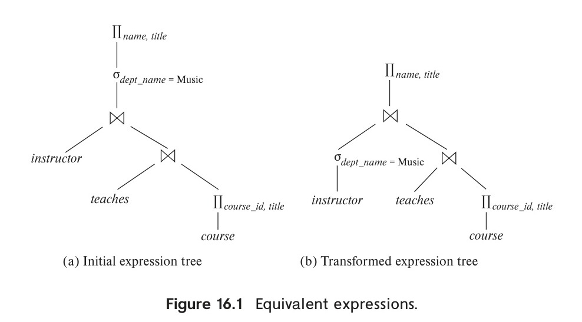
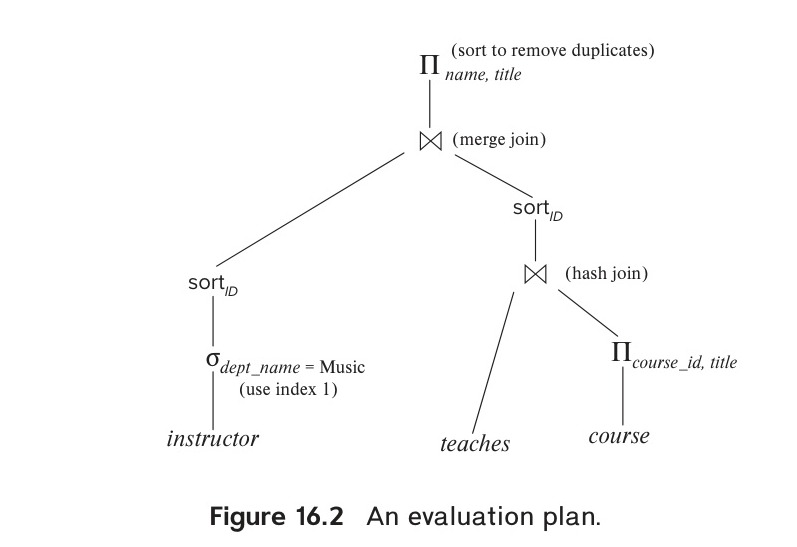
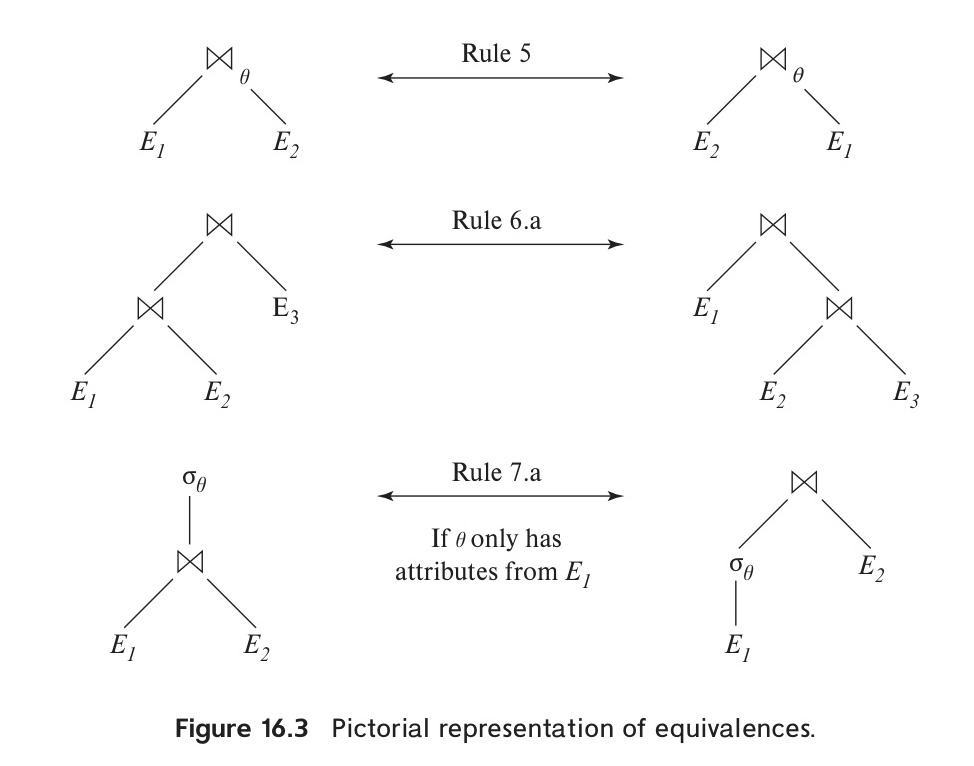
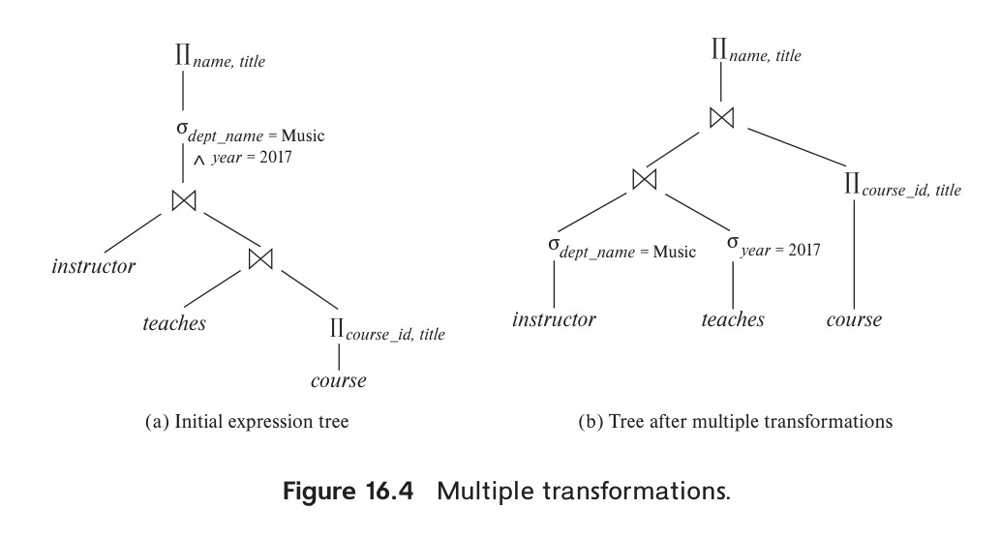
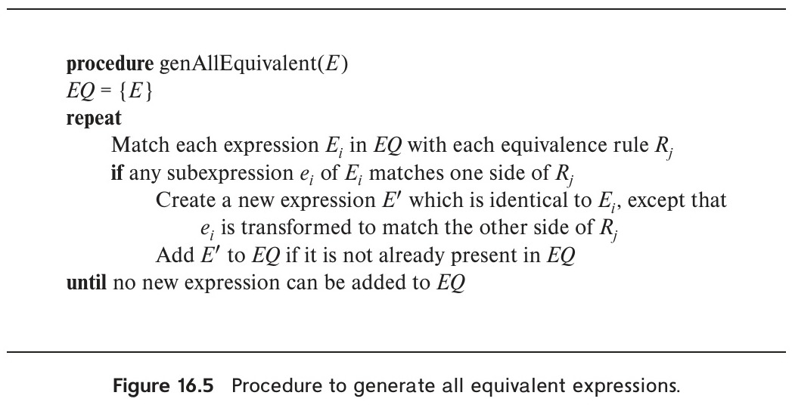
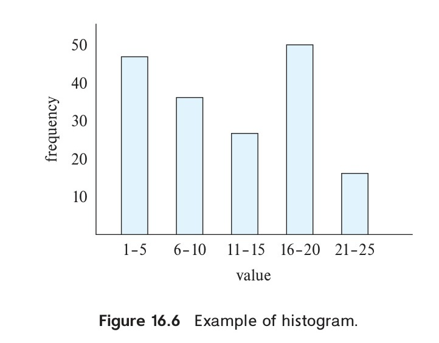
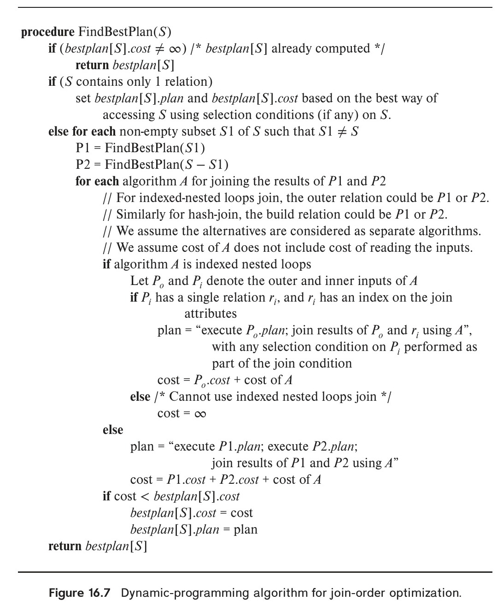
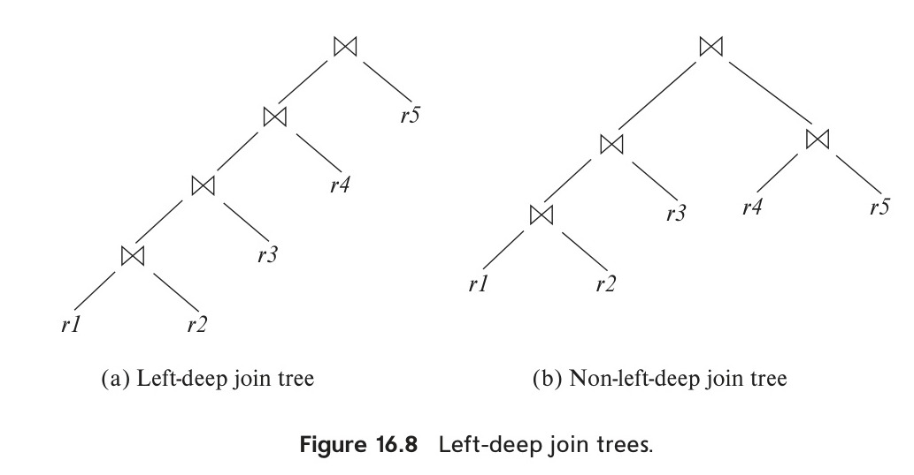
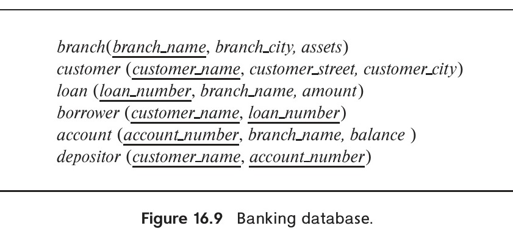

# Chapter 16: Query Optimization

<!-- Page 743 -->

Query optimization is the process of selecting the most efficient query-evaluation plan from among the many strategies usually possible for processing a given query, especially if the query is complex. We do not expect users to write their queries so that they can be processed efficiently. Rather, we expect the system to construct a query-evaluation plan that minimizes the cost of query evaluation. This is where query optimization comes into play.

One aspect of optimization occurs at the relational-algebra level, where the system attempts to find an expression that is equivalent to the given expression, but more efficient to execute. Another aspect is selecting a detailed strategy for processing the query, such as choosing the algorithm to use for executing an operation, choosing the specific indices to use, and so on.

The difference in cost (in terms of evaluation time) between a good strategy and a bad strategy is often substantial and may be several orders of magnitude. Hence, it is worthwhile for the system to spend a substantial amount of time on the selection of a good strategy for processing a query, even if the query is executed only once.

## 16.1 Overview

Consider the following relational-algebra expression, for the query “Find the names of all instructors in the Music department together with the course title of all the courses that the instructors teach.”[^1]

$$\Pi_{name, title} (\sigma_{dept\_name = \text{“Music”}} (instructor \bowtie (teaches \bowtie \Pi_{course\_id, title}(course))))$$

The subexpression $instructor \bowtie teaches \bowtie \Pi_{course\_id, title}(course)$ in the preceding expression can create a very large intermediate result. However, we are interested in only a few tuples of this intermediate result, namely, those pertaining to instructors in the

[^1]: Note that the projection of *course* on (*course_id*, *title*) is required since *course* shares an attribute *dept_name* with *instructor*; if we did not remove this attribute using the projection, the above expression using natural joins would return only courses from the Music department, even if some Music department instructors taught courses in other departments.

<!-- Page 744 -->

Music department, and in only two of the nine attributes of this relation. Since we are concerned with only those tuples in the *instructor* relation that pertain to the Music department, we do not need to consider those tuples that do not have $dept\_name = \text{“Music”}$. By reducing the number of tuples of the *instructor* relation that we need to access, we reduce the size of the intermediate result. Our query is now represented by the relational-algebra expression:

$$\Pi_{name, title} ((\sigma_{dept\_name = \text{“Music”}} (instructor)) \bowtie (teaches \bowtie \Pi_{course\_id, title}(course)))$$

which is equivalent to our original algebra expression, but which generates smaller intermediate relations. Figure 16.1 depicts the initial and transformed expressions.


*Figure 16.1 — Equivalent expressions.*

An evaluation plan defines exactly what algorithm should be used for each operation and how the execution of the operations should be coordinated. Figure 16.2 illustrates one possible evaluation plan for the expression from Figure 16.1(b). As we have seen, several different algorithms can be used for each relational operation, giving rise to alternative evaluation plans. In the figure, hash join has been chosen for one of the join operations, while the other uses merge join, after sorting the relations on the join attribute, which is *ID*. All edges are assumed to be pipelined, unless marked as materialized. With pipelined edges the output of the producer is sent directly to the consumer, without being written out to disk; with materialized edges, on the other hand, the output is written to disk, and then read from the disk by the consumer. There are no materialized edges in the evaluation plan in Figure 16.2, although some of the operators, such as sort and hash join, can be represented using suboperators with materialized edges between the suboperators, as we saw in Section 15.7.2.2.

Given a relational-algebra expression, it is the job of the query optimizer to come up with a query-evaluation plan that computes the same result as the given expression, and is the least costly way of generating the result (or, at least, is not much costlier than the least costly way).

<!-- Page 745 -->


*Figure 16.2 — An evaluation plan.*

The expression that we saw in Figure 16.1 may not necessarily lead to the least-cost evaluation plan for computing the result, since it still computes the join of the entire *teaches* relation with the *course* relation. The following expression gives the same final result, but generates smaller intermediate results, since it joins *teaches* with only instructor tuples corresponding to the Music department, and then joins that result with *course*.

$$\Pi_{name, title} ((\sigma_{dept\_name = \text{“Music”}} (instructor) \bowtie teaches) \bowtie \Pi_{course\_id, title}(course))$$

Regardless of the way the query is written, it is the job of the optimizer to find the least-cost plan for the query.

To find the least costly query-evaluation plan, the optimizer needs to generate alternative plans that produce the same result as the given expression and to choose the least costly one. Generation of query-evaluation plans involves three steps: (1) generating expressions that are logically equivalent to the given expression, (2) annotating the resultant expressions in alternative ways to generate alternative query-evaluation plans, and (3) estimating the cost of each evaluation plan, and choosing the one whose estimated cost is the least.

Steps (1), (2), and (3) are interleaved in the query optimizer—some expressions are generated and annotated to generate evaluation plans, then further expressions are generated and annotated, and so on. As evaluation plans are generated, their costs are estimated by using statistical information about the relations, such as relation sizes and index depths.

To implement the first step, the query optimizer must generate expressions equivalent to a given expression. It does so by means of equivalence rules that specify how to transform an expression into a logically equivalent one. We describe these rules in Section 16.2.

In Section 16.3 we describe how to estimate statistics of the results of each operation in a query plan. Using these statistics with the cost formulae in Chapter 15 allows

<!-- Page 746 -->

> ### Note 16.1 VIEWING QUERY EVALUATION PLANS
>
> Most database systems provide a way to view the evaluation plan chosen to execute a given query. It is usually best to use the GUI provided with the database system to view evaluation plans. However, if you use a command line interface, many databases support variations of a command “**explain** `<query>`”, which displays the execution plan chosen for the specified query `<query>`. The exact syntax varies with different databases:
>
> - **PostgreSQL** uses the syntax shown above.
> - **Oracle** uses the syntax **explain plan for**. However, the command stores the resultant plan in a table called *plan_table*, instead of displaying it. The query “**select \* from table(dbms_xplan.display);**” displays the stored plan.
> - **DB2** follows a similar approach to Oracle, but requires the program **db2exfmt** to be executed to display the stored plan.
> - **SQL Server** requires the command **set showplan_text on** to be executed before submitting the query; then, when a query is submitted, instead of executing the query, the evaluation plan is displayed.
> - **MySQL** uses the same **explain** `<query>` syntax as PostgreSQL, but the output is a table whose contents are not easy to understand. However, executing **show warnings** after the **explain** command displays the evaluation plan in a more human-readable format.
>
> The estimated costs for the plan are also displayed along with the plan. It is worth noting that the costs are usually not in any externally meaningful unit, such as seconds or I/O operations, but rather in units of whatever cost model the optimizer uses. Some optimizers such as PostgreSQL display two cost-estimate numbers; the first indicates the estimated cost for outputting the first result, and the second indicates the estimated cost for outputting all results.

us to estimate the costs of individual operations. The individual costs are combined to determine the estimated cost of evaluating a given relational-algebra expression, as outlined in Section 15.7.

In Section 16.4, we describe how to choose a query-evaluation plan. We can choose one based on the estimated cost of the plans. Since the cost is an estimate, the selected plan is not necessarily the least costly plan; however, as long as the estimates are good, the plan is likely to be the least costly one, or not much more costly than it.

<!-- Page 747 -->

Finally, materialized views help to speed up processing of certain queries. In Section 16.5, we study how to “maintain” materialized views—that is, to keep them up-to-date—and how to perform query optimization with materialized views.

## 16.2 Transformation of Relational Expressions

A query can be expressed in several different ways, with different costs of evaluation. In this section, rather than take the relational expression as given, we consider alternative, equivalent expressions.

Two relational-algebra expressions are said to be **equivalent** if, on every legal database instance, the two expressions generate the same set of tuples. (Recall that a legal database instance is one that satisfies all the integrity constraints specified in the database schema.) Note that the order of the tuples is irrelevant; the two expressions may generate the tuples in different orders, but would be considered equivalent as long as the set of tuples is the same.

In SQL, the inputs and outputs are multisets of tuples, and the multiset version of the relational algebra (described in Note 3.1 on page 80, Note 3.2 on page 97, and Note 3.3 on page 108) is used for evaluating SQL queries. Two expressions in the multiset version of the relational algebra are said to be equivalent if on every legal database the two expressions generate the same multiset of tuples. The discussion in this chapter is based on the relational algebra. We leave extensions to the multiset version of the relational algebra to you as exercises.

### 16.2.1 Equivalence Rules

An **equivalence rule** says that expressions of two forms are equivalent. We can replace an expression of the first form with an expression of the second form, or vice versa—that is, we can replace an expression of the second form by an expression of the first form—since the two expressions generate the same result on any valid database. The optimizer uses equivalence rules to transform expressions into other logically equivalent expressions.

We now describe several equivalence rules on relational-algebra expressions. Some of the equivalences listed appear in Figure 16.3. We use $\theta, \theta_1, \theta_2$, and so on to denote predicates, $L_1, L_2, L_3$, and so on to denote lists of attributes, and $E, E_1, E_2$, and so on to denote relational-algebra expressions. A relation name $r$ is simply a special case of a relational-algebra expression and can be used wherever $E$ appears.

1. Conjunctive selection operations can be deconstructed into a sequence of individual selections. This transformation is referred to as a **cascade of $\sigma$**.
   $$\sigma_{\theta_1 \wedge \theta_2}(E) \equiv \sigma_{\theta_1}(\sigma_{\theta_2}(E))$$

2. Selection operations are commutative.
   $$\sigma_{\theta_1}(\sigma_{\theta_2}(E)) \equiv \sigma_{\theta_2}(\sigma_{\theta_1}(E))$$

<!-- Page 748 -->


*Figure 16.3 — Pictorial representation of equivalences.*

3. Only the final operations in a sequence of projection operations are needed; the others can be omitted. This transformation can also be referred to as a **cascade of $\Pi$**.
   $$\Pi_{L_1}(\Pi_{L_2}(\dots (\Pi_{L_n}(E)) \dots)) \equiv \Pi_{L_1}(E)$$
   where $L_1 \subseteq L_2 \subseteq \dots \subseteq L_n$.

4. Selections can be combined with Cartesian products and theta joins.
   a. $\sigma_\theta(E_1 \times E_2) \equiv E_1 \bowtie_\theta E_2$
   This expression is just the definition of the theta join.
   b. $\sigma_{\theta_1}(E_1 \bowtie_{\theta_2} E_2) \equiv E_1 \bowtie_{\theta_1 \wedge \theta_2} E_2$

5. Theta-join operations are commutative.
   $$E_1 \bowtie_\theta E_2 \equiv E_2 \bowtie_\theta E_1$$
   Recall that the natural-join operator is simply a special case of the theta-join operator; hence, natural joins are also commutative.

   The order of attributes differs between the left-hand side and right-hand side of the commutativity rule, so the equivalence does not hold if the order of attributes is taken into account. Since we use a version of relational algebra where every attribute must have a name for it to be referenced, the order of attributes

<!-- Page 749 -->

does not actually matter, except when the result is finally displayed. When the order does matter, a projection operation can be added to one of the sides of the equivalence to appropriately reorder attributes. However, for simplicity, we omit the projection and ignore the attribute order in all our equivalence rules.

6.
   a. Natural-join operations are associative.
   $$(E_1 \bowtie E_2) \bowtie E_3 \equiv E_1 \bowtie (E_2 \bowtie E_3)$$
   b. Theta joins are associative in the following manner:
   $$(E_1 \bowtie_{\theta_1} E_2) \bowtie_{\theta_2 \wedge \theta_3} E_3 \equiv E_1 \bowtie_{\theta_1 \wedge \theta_3} (E_2 \bowtie_{\theta_2} E_3)$$
   where $\theta_2$ involves attributes from only $E_2$ and $E_3$. Any of these conditions may be empty; hence, it follows that the Cartesian product ($\times$) operation is also associative. The commutativity and associativity of join operations are important for join reordering in query optimization.

7. The selection operation distributes over the theta-join operation under the following two conditions:
   a. Selection distributes over the theta-join operation when all the attributes in selection condition $\theta_1$ involve only the attributes of one of the expressions (say, $E_1$) being joined.
   $$\sigma_{\theta_1}(E_1 \bowtie_\theta E_2) \equiv (\sigma_{\theta_1}(E_1)) \bowtie_\theta E_2$$
   b. Selection distributes over the theta-join operation when selection condition $\theta_1$ involves only the attributes of $E_1$ and $\theta_2$ involves only the attributes of $E_2$.
   $$\sigma_{\theta_1 \wedge \theta_2}(E_1 \bowtie_\theta E_2) \equiv (\sigma_{\theta_1}(E_1)) \bowtie_\theta (\sigma_{\theta_2}(E_2))$$

8. The projection operation distributes over the theta-join operation under the following conditions.
   a. Let $L_1$ and $L_2$ be attributes of $E_1$ and $E_2$, respectively. Suppose that the join condition $\theta$ involves only attributes in $L_1 \cup L_2$. Then,
   $$\Pi_{L_1 \cup L_2}(E_1 \bowtie_\theta E_2) \equiv (\Pi_{L_1}(E_1)) \bowtie_\theta (\Pi_{L_2}(E_2))$$
   b. Consider a join $E_1 \bowtie_\theta E_2$. Let $L_1$ and $L_2$ be sets of attributes from $E_1$ and $E_2$, respectively. Let $L_3$ be attributes of $E_1$ that are involved in join condition $\theta$, but are not in $L_1$ and let $L_4$ be attributes of $E_2$ that are involved in join condition $\theta$, but are not in $L_2$. Then,
   $$\Pi_{L_1 \cup L_2}(E_1 \bowtie_\theta E_2) \equiv \Pi_{L_1 \cup L_2}((\Pi_{L_1 \cup L_3}(E_1)) \bowtie_\theta (\Pi_{L_2 \cup L_4}(E_2)))$$

Similar equivalences hold for outer join operations $\leftouterjoin$, $\rightouterjoin$ and $\fullouterjoin$.

<!-- Page 750 -->

9. The set operations union and intersection are commutative.
   a. $E_1 \cup E_2 \equiv E_2 \cup E_1$
   b. $E_1 \cap E_2 \equiv E_2 \cap E_1$
   Set difference is not commutative.

10. Set union and intersection are associative.
   a. $(E_1 \cup E_2) \cup E_3 \equiv E_1 \cup (E_2 \cup E_3)$
   b. $(E_1 \cap E_2) \cap E_3 \equiv E_1 \cap (E_2 \cap E_3)$

11. The selection operation distributes over the union, intersection, and set-difference operations.
   a. $\sigma_\theta(E_1 \cup E_2) \equiv \sigma_\theta(E_1) \cup \sigma_\theta(E_2)$
   b. $\sigma_\theta(E_1 \cap E_2) \equiv \sigma_\theta(E_1) \cap \sigma_\theta(E_2)$
   c. $\sigma_\theta(E_1 - E_2) \equiv \sigma_\theta(E_1) - \sigma_\theta(E_2)$
   d. $\sigma_\theta(E_1 \cap E_2) \equiv \sigma_\theta(E_1) \cap E_2$
   e. $\sigma_\theta(E_1 - E_2) \equiv \sigma_\theta(E_1) - E_2$
   The preceding equivalence does not hold if $-$ is replaced by $\cup$.

12. The projection operation distributes over the union operation
   $$\Pi_L(E_1 \cup E_2) \equiv (\Pi_L(E_1)) \cup (\Pi_L(E_2))$$
   provided $E_1$ and $E_2$ have the same schema.

13. Selection distributes over aggregation under the following conditions. Let $G$ be a set of group by attributes, and $A$ a set of aggregate expressions. When $\theta$ only involves attributes in $G$, the following equivalence holds.
   $$\sigma_\theta(_G\gamma_A(E)) \equiv\ _G\gamma_A(\sigma_\theta(E))$$

14.
   a. Full outer join is commutative.
   $$E_1 \fullouterjoin E_2 \equiv E_2 \fullouterjoin E_1$$
   b. Left and right outer join are not commutative. However, left outer join and right outer join can be exchanged as follows.
   $$E_1 \leftouterjoin E_2 \equiv E_2 \rightouterjoin E_1$$

15. Selection distributes over left and right outer join under some conditions. Specifically, when the selection condition $\theta_1$ involves only the attributes of one of the expressions being joined, say $E_1$, the following equivalences hold.

<!-- Page 751 -->

   a. $\sigma_{\theta_1}(E_1 \leftouterjoin_\theta E_2) \equiv (\sigma_{\theta_1}(E_1)) \leftouterjoin_\theta E_2$
   b. $\sigma_{\theta_1}(E_2 \rightouterjoin_\theta E_1) \equiv (E_2 \rightouterjoin_\theta (\sigma_{\theta_1}(E_1)))$

16. Outer joins can be replaced by inner joins under some conditions. Specifically, if $\theta_1$ has the property that it evaluates to false or unknown whenever the attributes of $E_2$ are null, then the following equivalences hold.
   a. $\sigma_{\theta_1}(E_1 \leftouterjoin_\theta E_2) \equiv \sigma_{\theta_1}(E_1 \bowtie_\theta E_2)$
   b. $\sigma_{\theta_1}(E_2 \rightouterjoin_\theta E_1) \equiv \sigma_{\theta_1}(E_2 \bowtie_\theta E_2)$

A predicate $\theta_1$ satisfying the above property is said to be **null rejecting** on $E_2$. For example, if $\theta_1$ is of the form $A < 4$ where $A$ is an attribute from $E_2$, then $\theta_1$ would evaluate to unknown whenever $A$ is null, and as a result any tuples in $E_1 \leftouterjoin_\theta E_2$ that are not in $E_1 \bowtie_\theta E_2$ would be rejected by $\sigma_{\theta_1}$. We can therefore replace the outer join by an inner join (or vice versa).

More generally, the condition would hold if $\theta_1$ is of the form $\theta_1^1 \wedge \theta_2^1 \wedge \dots \wedge \theta_k^1$, and at least one of the terms $\theta_i^1$ is of the form $e_1 \text{ relop } e_2$, where $e_1$ and $e_2$ are arithmetic or string expressions involving at least one attribute from $E_2$, and relop is any of $<, \le, =, \ge, >$.

This is only a partial list of equivalences. More equivalences are discussed in the exercises.

Some equivalences that hold for joins do not hold for outer joins. For example, the selection operation does not distribute over outer join when the conditions specified in rule 15.a or rule 15.b do hold. To see this, we look at the expression:

$$\sigma_{\text{year}=2017}(instructor \leftouterjoin teaches)$$

and consider the case of an instructor who teaches no courses at all, regardless of year. In the above expression, the left outer join retains a tuple for each such instructor with a null value for *year*. Then the selection operation removes those tuples since the predicate $\text{null}=2017$ evaluates to unknown, and such instructors do not appear in the result. However, if we push the selection operation down to *teaches*, the resulting expression:

$$instructor \leftouterjoin \sigma_{\text{year}=2017}(teaches)$$

is syntactically correct since the selection predicate includes only attributes from *teaches*, but the result is different. For an instructor that does not teach at all, the instructor tuple appears in the result of $instructor \leftouterjoin \sigma_{\text{year}=2017}(teaches)$, but not in the result of $\sigma_{\text{year}=2017}(instructor \leftouterjoin teaches)$. The following equivalence, however, does hold:

$$\sigma_{\text{year}=2017}(instructor \leftouterjoin teaches) \equiv \sigma_{\text{year}=2017}(instructor \bowtie teaches)$$

As another example, unlike inner joins, outer joins are not associative. We show thus using an example for the natural left outer join. Similar examples can be con-

<!-- Page 752 -->

structed for natural right and natural full outer join, as well as for the corresponding theta-join versions of the outer join operations.

Let relation $r(A, B)$ be a relation consisting of the single tuple $(1, 1)$, $s(B, C)$ be a relation consisting of the single tuple $(1, 1)$, and $t(A, C)$ be an empty relation with no tuples. We shall show that for this example,

$$(r \leftouterjoin s) \leftouterjoin t \not\equiv r \leftouterjoin (s \leftouterjoin t)$$

To see this, note first that $(r \leftouterjoin s)$ produces a result with schema $(A, B, C)$ having one tuple $(1, 1, 1)$. Computing the left outer join of that result with relation $t$ produces a result with schema $(A, B, C)$ having one tuple $(1, 1, 1)$. Next, we look at the expression $r \leftouterjoin (s \leftouterjoin t)$, and note that $s \leftouterjoin t$ produces a result with schema $(A, B, C)$ having one tuple $(\text{null}, 1, 1)$. Computing the left outer join of $r$ with that result produces a result with schema $(A, B, C)$ having one tuple $(1, 1, \text{null})$.

### 16.2.2 Examples of Transformations

We now illustrate the use of the equivalence rules. We use our university example with the relation schemas:

$$\text{instructor}(ID, name, dept\_name, salary)$$
$$\text{teaches}(ID, course\_id, sec\_id, semester, year)$$
$$\text{course}(course\_id, title, dept\_name, credits)$$

In our example in Section 16.1, the expression:

$$\Pi_{name, title} (\sigma_{dept\_name = \text{“Music”}} (instructor \bowtie (teaches \bowtie \Pi_{course\_id, title}(course))))$$

was transformed into the following expression:

$$\Pi_{name, title} ((\sigma_{dept\_name = \text{“Music”}} (instructor)) \bowtie (teaches \bowtie \Pi_{course\_id, title}(course)))$$

which is equivalent to our original algebra expression but generates smaller intermediate relations. We can carry out this transformation by using rule 7.a. Remember that the rule merely says that the two expressions are equivalent; it does not say that one is better than the other.

Multiple equivalence rules can be used, one after the other, on a query or on parts of the query. As an illustration, suppose that we modify our original query to restrict attention to instructors who have taught a course in 2017. The new relational-algebra query is:

$$\Pi_{name, title} (\sigma_{dept\_name = \text{“Music”} \wedge year = 2017} (instructor \bowtie (teaches \bowtie \Pi_{course\_id, title}(course))))$$

<!-- Page 753 -->

We cannot apply the selection predicate directly to the *instructor* relation, since the predicate involves attributes of both the *instructor* and *teaches* relations. However, we can first apply rule 6.a (associativity of natural join) to transform the join $instructor \bowtie (teaches \bowtie \Pi_{course\_id, title}(course))$ into $(instructor \bowtie teaches) \bowtie \Pi_{course\_id, title}(course)$:

$$\Pi_{name, title} (\sigma_{dept\_name = \text{“Music”} \wedge year = 2017} ((instructor \bowtie teaches) \bowtie \Pi_{course\_id, title}(course)))$$

Then, using rule 7.a, we can rewrite our query as:

$$\Pi_{name, title} ((\sigma_{dept\_name = \text{“Music”} \wedge year = 2017} (instructor \bowtie teaches)) \bowtie \Pi_{course\_id, title}(course))$$

Let us examine the selection subexpression within this expression. Using rule 1, we can break the selection into two selections to get the following subexpression:

$$\sigma_{dept\_name = \text{“Music”}} (\sigma_{year = 2017} (instructor \bowtie teaches))$$

Both of the preceding expressions select tuples with $dept\_name = \text{“Music”}$ and $course\_id = 2017$. However, the latter form of the expression provides a new opportunity to apply rule 7.a (“perform selections early”), resulting in the subexpression:

$$\sigma_{dept\_name = \text{“Music”}} (instructor) \bowtie \sigma_{year = 2017} (teaches)$$

Figure 16.4 depicts the initial expression and the final expression after all these transformations. We could equally well have used rule 7.b to get the final expression directly, without using rule 1 to break the selection into two selections. In fact, rule 7.b can itself be derived from rules 1 and 7.a.


*Figure 16.4 — Multiple transformations.*

<!-- Page 754 -->

A set of equivalence rules is said to be **minimal** if no rule can be derived from any combination of the others. The preceding example illustrates that the set of equivalence rules in Section 16.2.1 is not minimal. An expression equivalent to the original expression may be generated in different ways; the number of different ways of generating an expression increases when we use a nonminimal set of equivalence rules. Query optimizers therefore use minimal sets of equivalence rules.

Now consider the following form of our example query:

$$\Pi_{name, title} ((\sigma_{dept\_name = \text{“Music”}} (instructor) \bowtie teaches) \bowtie \Pi_{course\_id, title}(course))$$

When we compute the subexpression:

$$(\sigma_{dept\_name = \text{“Music”}} (instructor) \bowtie teaches)$$

we obtain a relation whose schema is:

$$(ID, name, dept\_name, salary, course\_id, sec\_id, semester, year)$$

We can eliminate several attributes from the schema by pushing projections based on equivalence rules 8.a and 8.b. The only attributes that we must retain are those that either appear in the result of the query or are needed to process subsequent operations. By eliminating unneeded attributes, we reduce the number of columns of the intermediate result. Thus, we reduce the size of the intermediate result. In our example, the only attributes we need from the join of *instructor* and *teaches* are *name* and *course_id*. Therefore, we can modify the expression to:

$$\Pi_{name, title} ((\Pi_{name, course\_id} ((\sigma_{dept\_name = \text{“Music”}} (instructor)) \bowtie teaches)) \bowtie \Pi_{course\_id, title}(course))$$

The projection $\Pi_{name, course\_id}$ reduces the size of the intermediate join results.

### 16.2.3 Join Ordering

A good ordering of join operations is important for reducing the size of temporary results; hence, most query optimizers pay a lot of attention to the join order. As mentioned in equivalence rule 6.a, the natural-join operation is associative. Thus, for all relations $r_1, r_2$, and $r_3$:

$$(r_1 \bowtie r_2) \bowtie r_3 \equiv r_1 \bowtie (r_2 \bowtie r_3)$$

Although these expressions are equivalent, the costs of computing them may differ. Consider again the expression:

$$\Pi_{name, title} ((\sigma_{dept\_name = \text{“Music”}} (instructor)) \bowtie teaches \bowtie \Pi_{course\_id, title}(course))$$

<!-- Page 755 -->

We could choose to compute $teaches \bowtie \Pi_{course\_id, title}(course)$ first, and then to join the result with:

$$\sigma_{dept\_name = \text{“Music”}} (instructor)$$

However, $teaches \bowtie \Pi_{course\_id, title}(course)$ is likely to be a large relation, since it contains one tuple for every course taught. In contrast:

$$\sigma_{dept\_name = \text{“Music”}} (instructor) \bowtie teaches$$

is probably a small relation. To see that it is, we note that a university has fewer instructors than courses and, since a university has a large number of departments, only a small fraction of the instructors are in the Music department. Furthermore, the number of courses taught by the Music department instructors is likely to be much less than the total number of courses taught. Thus, the temporary relation generated by computing:

$$(\sigma_{dept\_name = \text{“Music”}} (instructor) \bowtie teaches)$$

is also likely to be much smaller than the temporary relation that we would compute by joining *teaches* with the projection on *course*. It is better to perform the former join operation first, and then to join that temporary relation with the projection on *course*.

As a final example, suppose that the user had written the initial query as:

$$\Pi_{name, title} (instructor \bowtie (teaches \bowtie \Pi_{course\_id, title}(course)))$$

without the selection on *dept_name*. For this expression, we could use the associativity and commutativity of the natural join to transform this expression to the more efficient expression:

$$(instructor \bowtie teaches) \bowtie \Pi_{course\_id, title}(course)$$

### 16.2.4 Enumeration of Equivalent Expressions

Query optimizers can use equivalence rules to systematically generate expressions equivalent to the given query expression. The cost of an expression is computed based

<!-- Page 756 -->


*Figure 16.5 — Procedure to generate all equivalent expressions.*

```pseudocode
procedure genAllEquivalent(E)
    EQ = {E}
    repeat
        Match each expression E_i in EQ with each equivalence rule R_j
        if any subexpression e_i of E_i matches one side of R_j
            Create a new expression E′ which is identical to E_i, except that
                e_i is transformed to match the other side of R_j
            Add E′ to EQ if it is not already present in EQ
    until no new expression can be added to EQ
```

on statistics that are discussed in Section 16.3. Cost-based query optimizers, described in Section 16.4 compute the cost of each alternative and pick the least cost alternative.

Conceptually, enumeration of equivalent expressions can be done as outlined in Figure 16.5. The process proceeds as follows: Given a query expression $E$, the set of equivalent expressions $EQ$ initially contains only $E$. Now, each expression in $EQ$ is matched with each equivalence rule. If a subexpression $e_j$ of any expression $E_i \in EQ$ (as a special case, $e_j$ could be $E_i$ itself) matches one side of an equivalence rule, the optimizer generates a copy $E_k$ of $E_i$, in which $e_j$ is transformed to match the other side of the rule, and adds $E_k$ to $EQ$. This process continues until no more new expressions can be generated. With a properly chosen set of equivalence rules, the set of equivalent expressions is finite, and the process can be guaranteed to terminate.

For example, given an expression $r \bowtie (s \bowtie t)$, the commutativity rule $A \bowtie B \equiv B \bowtie A$ can be applied to the subexpression $(s \bowtie t)$, to generate $r \bowtie (t \bowtie s)$. The rule could also be applied to the whole expression, with $A = r$ and $B = (s \bowtie t)$, to generate $(s \bowtie t) \bowtie r$. Applying the rule to the subexpression $(t \bowtie s)$ of $r \bowtie (t \bowtie s)$ generates $r \bowtie (s \bowtie t)$, but this expression is already in $EQ$, so it is not added again.

The preceding process is extremely costly both in terms of time and in terms of space (memory). Optimizers therefore use techniques to reduce the space and time required. We mention two of these techniques here:

1. If we generate an expression $E′$ from an expression $E_1$ by using an equivalence rule on subexpression $e_i$, then $E′$ and $E_1$ have identical subexpressions except for $e_i$ and its transformation. Even $e_i$ and its transformed version usually share many identical subexpressions. Expression-representation techniques that allow both expressions to point to shared subexpressions can reduce the space requirement significantly.

<!-- Page 757 -->

2. It is not always necessary to generate every expression that can be generated with the equivalence rules. If an optimizer takes cost estimates of evaluation into account, it may be able to avoid examining some of the expressions, as we shall see in Section 16.4. We can reduce the time required for optimization by using techniques such as these.

## 16.3 Estimating Statistics of Expression Results

The cost of an evaluation plan depends on the size of the relation that is the result of each operation in the plan, as well as on other statistics about the relations, such as the number of distinct values of attributes. We can compute these statistics for the initial relations in the query from information stored in the database-system catalog.

However, to compute costs of intermediate operations, the optimizer must estimate the statistics of intermediate results. For instance, in our example query, to estimate the cost of the outer join in:

$$((\sigma_{dept\_name = \text{“Music”}} (instructor)) \bowtie teaches) \bowtie \Pi_{course\_id, title}(course)$$

we must estimate the size of the intermediate relation resulting from the first join, and other statistics such as the number of distinct values of *course_id* in that relation.

The accuracy of size and cost estimates affects the choice of the evaluation plan. Unfortunately, it is not possible to estimate the statistics of intermediate results precisely. A query-evaluation plan that has the lowest estimated execution cost may therefore not actually have the lowest actual execution cost. However, real-world experience has shown that even if estimates are not precise, the plans with the lowest estimated costs usually have actual execution costs that are either the lowest actual execution costs or are close to the lowest actual execution costs.

<!-- Page 758 -->

### 16.3.1 Catalog Information

The database-system catalog stores the following statistical information about database relations:

- $n_r$, the number of tuples in the relation $r$.
- $b_r$, the number of blocks containing tuples of relation $r$.
- $l_r$, the size of a tuple of relation $r$ in bytes.
- $f_r$, the blocking factor of relation $r$—that is, the number of tuples of relation $r$ that fit into one block.
- $V(A, r)$, the number of distinct values that appear in the relation $r$ for attribute $A$. This value is the same as the size of $\Pi_A(r)$. If $A$ is a key for relation $r$, $V(A, r)$ is $n_r$.

More generally, $V(A, r)$ could be stored for a set of attributes $A$, instead of a single attribute; in this case $V(A, r)$ is the size of $\Pi_A(r)$, and if $A$ includes a key for $r$, $V(A, r)$ is $n_r$.

If the tuples of relation $r$ are stored together in a single file, then $b_r = \lceil n_r / f_r \rceil$.

In addition to the preceding catalog information, some systems also store the minimum and maximum values of attributes, denoted by $\min(A, r)$ and $\max(A, r)$, respectively.

Many systems also store histograms of the values of attributes. A **histogram** divides the values of an attribute into ranges (often called **buckets** or **subranges**), and with each range stores the number of tuples whose attribute value lies in that range. Figure 16.6 shows an example of a histogram for an integer-valued attribute that takes values in the range 1 to 25.

As an example of a histogram, the range of values for an attribute *age* of a relation *person* could be divided into 0—9, 10—19, ..., 90—99 (assuming a maximum age of 99). With each range we store a count of the number of *person* tuples whose age values lie in that range.

<!-- Page 759 -->


*Figure 16.6 — Example of histogram.*

The histogram shown in Figure 16.6, is an **equi-width** histogram since it divides the range of values into equal-sized ranges. In contrast, an **equi-depth** histogram adjusts the boundaries of the ranges such that each range has the same number of values. Thus, an equi-depth histogram merely stores the boundaries of partitions of the range, and need not store the number of values. For example, the following could be the equidepth histogram for the data whose equi-width histogram is shown in Figure 16.6:

$$(4, 8, 14, 19)$$

The histogram indicates that 1/5th of the tuples have age less than 4, another 1/5th have $\text{age} \ge 4$ but $< 8$, and so on, with the last 1/5th having $\text{age} \ge 19$. Information about the total number of tuples is also stored with the equi-width histogram. Equi-depth histograms are preferred to equi-width histograms since they provide better estimates, especially for highly skewed data.

Some systems, in addition to histograms, also store counts of the $n$ most frequent values for some $n$ (say 5 or 10), along with the number of times each value appears. In our example, if ages 4, 7, 18, 19, and 23 are the five most frequently occurring values, the database could store the number of persons having each of these ages. The histogram then only stores statistics for age values other than these five values, since we have now have exact counts for these values.

<!-- Page 760 -->

A histogram takes up only a little space, so histograms on several different attributes can be stored in the system catalog.

### 16.3.2 Selection Size Estimation

The size estimate of the result of a selection operation depends on the selection predicate. We first consider a single equality predicate, then a single comparison predicate, and finally combinations of predicates.

- $\sigma_{A=v}(r)$: For an equality condition, we estimate that the number of records satisfying the condition is:
  - If $v$ is one of the stored most frequent values: the count stored with $v$.
  - If a histogram is available: we find the range that includes $v$, and estimate the count as the number of tuples in the range divided by the number of distinct values in the range.
  - In the absence of a histogram or most frequent value information, we estimate the count as $n_r / V(A, r)$. The assumption here is that each of the distinct values of attribute $A$ appears equally often in the relation $r$.
  - If the equality condition is on a key attribute, the estimate is 1.

- $\sigma_{A \le v}(r)$: For a comparison condition, we estimate the number of records that satisfy the condition:
  - Let $c$ denote the estimated number of tuples satisfying the condition. If $\min(A, r)$ and $\max(A, r)$ are available in the catalog, $c = 0$ if $v < \min(A, r)$, and $c = n_r \cdot \frac{v - \min(A, r)}{\max(A, r) - \min(A, r)}$ otherwise.
  - If a histogram is available on attribute $A$, we can get a more accurate estimate; we leave the details as an exercise for you.

In some cases, such as when the query is part of a stored procedure, the value $v$ may not be available when the query is optimized. In such cases, we assume that approximately one-half the records will satisfy the comparison condition. That is,

<!-- Page 761 -->

> ### Note 16.2 COMPUTING AND MAINTAINING STATISTICS
>
> Conceptually, statistics on relations can be thought of as materialized views, which should be automatically maintained when relations are modified. Unfortunately, keeping statistics up-to-date on every insert, delete or update to the database can be very expensive. On the other hand, optimizers generally do not need exact statistics: an error of a few percent may result in a plan that is not quite optimal being chosen, but the alternative plan chosen is likely to have a cost which is within a few percent of the optimal cost. Thus, it is acceptable to have statistics that are approximate.
>
> Database systems reduce the cost of generating and maintaining statistics, as outlined below, by exploiting the fact that statistics can be approximate.
>
> - **Statistics are often computed from a sample** of the underlying data, instead of examining the entire collection of data. For example, a fairly accurate histogram can be computed from a sample of a few thousand tuples, even on a relation that has millions, or hundreds of millions of records. However, the sample used must be a random sample; a sample that is not random may have an excessive representation of one part of the relation and can give misleading results. For example, if we used a sample of instructors to compute a histogram on salaries, if the sample has an overrepresentation of lower-paid instructors the histogram would result in wrong estimates. Database systems today routinely use random sampling to create statistics. See the bibliographical notes online for references on sampling.
> - **Statistics are not maintained on every update** to the database. In fact, some database systems never update statistics automatically. They rely on database administrators periodically running a command to update statistics. Oracle and PostgreSQL provide an SQL command called **analyze** that generates statistics on specified relations, or on all relations. IBM DB2 supports an equivalent command called **runstats**. See the system manuals for details. You should be aware that optimizers sometimes choose very bad plans due to incorrect statistics. Many database systems, such as IBM DB2, Oracle, and SQL Server, update statistics automatically at certain points of time. For example, the system can keep approximate track of how many tuples there are in a relation and recompute statistics if this number changes significantly. Another approach is to compare estimated cardinalities of a relation scan with actual cardinalities when a query is executed, and if they differ significantly, initiate an update of statistics for that relation.

<!-- Page 762 -->

we assume the result has $n_r / 2$ tuples; the estimate may be very inaccurate, but it is the best we can do without any further information.

- **Complex selections**:
  - **Conjunction**: A conjunctive selection is a selection of the form:
    $$\sigma_{\theta_1 \wedge \theta_2 \wedge \dots \wedge \theta_n}(r)$$
    We can estimate the result size of such a selection: For each $\theta_i$, we estimate the size of the selection $\sigma_{\theta_i}(r)$, denoted by $s_i$, as described previously. Thus, the probability that a tuple in the relation satisfies selection condition $\theta_i$ is $s_i / n_r$. The preceding probability is called the **selectivity** of the selection $\sigma_{\theta_i}(r)$.
    Assuming that the conditions are independent of each other, the probability that a tuple satisfies all the conditions is simply the product of all these probabilities. Thus, we estimate the number of tuples in the full selection as:
    $$\frac{n_r \cdot s_1 \cdot s_2 \cdot \dots \cdot s_n}{n_r^n}$$

  - **Disjunction**: A disjunctive selection is a selection of the form:
    $$\sigma_{\theta_1 \vee \theta_2 \vee \dots \vee \theta_n}(r)$$
    A disjunctive condition is satisfied by the union of all records satisfying the individual, simple conditions $\theta_i$.
    As before, let $s_i / n_r$ denote the probability that a tuple satisfies condition $\theta_i$. The probability that the tuple will satisfy the disjunction is then 1 minus the probability that it will satisfy none of the conditions:
    $$1 - \left(1 - \frac{s_1}{n_r}\right) \cdot \left(1 - \frac{s_2}{n_r}\right) \cdot \dots \cdot \left(1 - \frac{s_n}{n_r}\right)$$
    Multiplying this value by $n_r$ gives us the estimated number of tuples that satisfy the selection.

  - **Negation**: In the absence of nulls, the result of a selection $\sigma_{\neg \theta}(r)$ is simply the tuples of $r$ that are not in $\sigma_\theta(r)$. We already know how to estimate the number of tuples in $\sigma_\theta(r)$. The number of tuples in $\sigma_{\neg \theta}(r)$ is therefore estimated to be $n_r$ minus the estimated number of tuples in $\sigma_\theta(r)$.
    We can account for nulls by estimating the number of tuples for which the condition $\theta$ would evaluate to unknown, and subtracting that number from the above estimate, ignoring nulls. Estimating that number would require extra statistics to be maintained in the catalog.

### 16.3.3 Join Size Estimation

In this section, we see how to estimate the size of the result of a join.

<!-- Page 763 -->

The Cartesian product $r \times s$ contains $n_r \cdot n_s$ tuples. Each tuple of $r \times s$ occupies $l_r + l_s$ bytes, from which we can calculate the size of the Cartesian product.

Estimating the size of a natural join is somewhat more complicated than estimating the size of a selection or of a Cartesian product. Let $r(R)$ and $s(S)$ be relations.

- If $R \cap S = \emptyset$—that is, the relations have no attribute in common—then $r \bowtie s$ is the same as $r \times s$, and we can use our estimation technique for Cartesian products.
- If $R \cap S$ is a key for $R$, then we know that a tuple of $s$ will join with at most one tuple from $r$. Therefore, the number of tuples in $r \bowtie s$ is no greater than the number of tuples in $s$. The case where $R \cap S$ is a key for $S$ is symmetric to the case just described. If $R \cap S$ forms a foreign key of $S$, referencing $R$, the number of tuples in $r \bowtie s$ is exactly the same as the number of tuples in $s$.
- The most difficult case is when $R \cap S$ is a key for neither $R$ nor $S$. In this case, we assume, as we did for selections, that each value appears with equal probability. Consider a tuple $t$ of $r$, and assume $R \cap S = \{A\}$. We estimate that tuple $t$ produces:
  $$\frac{n_s}{V(A, s)}$$
  tuples in $r \bowtie s$, since this number is the average number of tuples in $s$ with a given value for the attributes $A$. Considering all the tuples in $r$, we estimate that there are:
  $$\frac{n_r \cdot n_s}{V(A, s)}$$
  tuples in $r \bowtie s$. Observe that, if we reverse the roles of $r$ and $s$ in the preceding estimate, we obtain an estimate of:
  $$\frac{n_r \cdot n_s}{V(A, r)}$$
  tuples in $r \bowtie s$. These two estimates differ if $V(A, r) \neq V(A, s)$. If this situation occurs, there are likely to be dangling tuples that do not participate in the join. Thus, the lower of the two estimates is probably the more accurate one.

The preceding estimate of join size may be too high if the $V(A, r)$ values for attribute $A$ in $r$ have few values in common with the $V(A, s)$ values for attribute $A$ in $s$. However, this situation is unlikely to happen in the real world, since dangling tuples either do not exist or constitute only a small fraction of the tuples, in most real-world relations.

More important, the preceding estimate depends on the assumption that each value appears with equal probability. More sophisticated techniques for size estimation have to be used if this assumption does not hold. For example, if we have histograms on the join attributes of both relations, and both histograms have the same ranges, then we can use the above estimation technique within each range,

<!-- Page 764 -->

using the number of rows with values in the range instead of $n_r$ or $n_s$, and the number of distinct values in that range, instead of $V(A, r)$ or $V(A, s)$. We then add up the size estimates obtained for each range to get the overall size estimate. We leave the case where both relations have histograms on the join attribute, but the histograms have different ranges, as an exercise for you.

We can estimate the size of a theta join $r \bowtie_\theta s$ by rewriting the join as $\sigma_\theta(r \times s)$ and using the size estimates for Cartesian products along with the size estimates for selections, which we saw in Section 16.3.2.

To illustrate all these ways of estimating join sizes, consider the expression:

$$student \bowtie takes$$

Assume the following catalog information about the two relations:

- $n_{student} = 5000$.
- $n_{takes} = 10000$.
- $V(ID, takes) = 2500$, which implies that only half the students have taken any course (this is unrealistic, but we use it to show that our size estimates are correct even in this case), and on average, each student who has taken a course has taken four courses.

Note that since *ID* is a primary key of *student*, $V(ID, student) = n_{student} = 5000$. The attribute *ID* in *takes* is a foreign key on *student*, and null values do not occur in *takes.ID*, since *ID* is part of the primary key of *takes*; thus, the size of $student \bowtie takes$ is exactly $n_{takes}$, which is 10000.

We now compute the size estimates for $student \bowtie takes$ without using information about foreign keys. Since $V(ID, takes) = 2500$ and $V(ID, student) = 5000$, the two estimates we get are $5000 \cdot 10000 / 2500 = 20000$ and $5000 \cdot 10000 / 5000 = 10000$, and we choose the lower one. In this case, the lower of these estimates is the same as that which we computed earlier from information about foreign keys.

### 16.3.4 Size Estimation for Other Operations

Next we outline how to estimate the sizes of the results of other relational-algebra operations.

- **Projection**: The estimated size (number of records or number of tuples) of a projection of the form $\Pi_A(r)$ is $V(A, r)$, since projection eliminates duplicates.
- **Aggregation**: The estimated size of an aggregation operation $_G\gamma_A(r)$ is $V(G, r)$, since there is one tuple in $_G\gamma_A(r)$ for each distinct value of $G$.
- **Set operations**: If the two inputs to a set operation are selections on the same relation, we can rewrite the set operation as disjunctions, conjunctions, or negations. For example, $\sigma_{\theta_1}(r) \cup \sigma_{\theta_2}(r)$ can be rewritten as $\sigma_{\theta_1 \vee \theta_2}(r)$. Similarly, we can rewrite

<!-- Page 765 -->

intersections as conjunctions, and we can rewrite set difference by using negation, so long as the two relations participating in the set operations are selections on the same relation. We can then use the estimates for selections involving conjunctions, disjunctions, or negations, to estimate the size of the result.

Otherwise, we estimate the size of a set operation as follows:

- $r \cup s$: We estimate the size as the size of $r$ plus the size of $s$, assuming $r$ and $s$ are disjoint; in the worst case, if $r = s$, the size is simply the size of $r$.
- $r \cap s$: In the worst case, all tuples of the smaller relation participate in the intersection, so we estimate the size as $\min(n_r, n_s)$. If the intersection condition can be treated as a join on all attributes, we can use the join estimation techniques.
- $r - s$: In the worst case, no tuples in $s$ are in $r$, and the size is $n_r$. In the best case, all tuples of $r$ are in $s$, and the size is 0. A rough estimate is $\max(0, n_r - n_s)$.

- **Outer join**: The size of $r \leftouterjoin s$ is estimated as the size of $r \bowtie s$ plus the number of tuples of $r$ that do not participate in the join. The latter can be estimated as $\max(0, n_r - \text{size}(r \bowtie s) / V(A, s))$ where $A$ is the join attribute. Similar estimates can be used for right and full outer joins.

### 16.3.5 Estimation of Number of Distinct Values

When we estimate the size of the result of an operation, we also need to estimate the number of distinct values of each attribute in the result, so that we can estimate the sizes of subsequent operations.

For selections of the form $\sigma_\theta(r)$:

- If $\theta$ forces an attribute $A$ to a single constant value, $V(A, \sigma_\theta(r)) = 1$.
- If $\theta$ forces $A$ to take one of a specified set of $v$ values, $V(A, \sigma_\theta(r)) = \min(v, n_{\sigma_\theta(r)})$.
- If the selection condition $\theta$ involves attributes other than $A$, we assume that the distinct values of $A$ are uniformly distributed, and estimate $V(A, \sigma_\theta(r))$ as $\min(V(A, r), n_{\sigma_\theta(r)})$. A more accurate estimate can be derived for this case using probability theory, but the preceding approximation works fairly well.

For joins, the number of distinct values of an attribute (or set of attributes) $A$ in the result of a join, $V(A, r \bowtie s)$, can be estimated in these ways:

<!-- Page 766 -->

- If all attributes in $A$ are from $r$, $V(A, r \bowtie s)$ is estimated as $\min(V(A, r), n_{r \bowtie s})$, and similarly if all attributes in $A$ are from $s$, $V(A, r \bowtie s)$ is estimated to be $\min(V(A, s), n_{r \bowtie s})$.
- If $A$ contains attributes $A_1$ from $r$ and $A_2$ from $s$, then $V(A, r \bowtie s)$ is estimated as:
  $$\min(V(A_1, r) \cdot V(A_2, s), V(A_1, r) \cdot n_{r \bowtie s}, V(A_2, s) \cdot n_{r \bowtie s}, n_{r \bowtie s})$$

For other operations:

- **Projection**: The number of distinct values of attribute $A$ in $\Pi_A(r)$ is simply $V(A, r)$.
- **Aggregation**: The number of distinct values of an attribute $A$ in $_G\gamma_A(r)$ is:
  - If $A$ is one of the group by attributes in $G$, $V(A, _G\gamma_A(r)) = V(A, r)$.
  - If $A$ is an aggregate attribute, the number of distinct values can be estimated as $\min(\text{number of possible values}, V(G, r))$.
- **Set operations**:
  - $r \cup s$: $V(A, r \cup s)$ is estimated as $\min(V(A, r) + V(A, s), n_{r \cup s})$.
  - $r \cap s$: $V(A, r \cap s)$ is estimated as $\min(V(A, r), V(A, s))$.
  - $r - s$: $V(A, r - s)$ is estimated as $V(A, r)$.

## 16.4 Choice of Evaluation Plans

A query optimizer must choose an evaluation plan for a given query. In this section, we study how an optimizer chooses an evaluation plan. We consider:

1. How to choose an evaluation plan for a single relational operation.
2. How to choose an evaluation plan for an entire query.

We first study cost-based join-order selection, and then consider how heuristic rules can be combined with cost-based optimization. We also describe the architecture of cost-based optimizers, and outline how optimizer software is built, without going into details.

Exploring the space of all possible plans may be too expensive for complex queries. Most optimizers include heuristics to reduce the cost of query optimization, at the potential risk of not finding the optimal plan. We study some such heuristics in Section 16.4.3.

<!-- Page 767 -->

### 16.4.1 Cost-Based Join-Order Selection

The most common type of query in SQL consists of a join of a few relations, with join predicates and selections specified in the `where` clause. In this section we consider the problem of choosing the optimal join order for such queries.

To choose the optimal join order, an optimizer needs to consider alternative join orders. Let $r_1 \bowtie r_2 \bowtie \dots \bowtie r_n$ be a join of $n$ relations. There are many different join orders for this join. For example, with $n = 3$, there are 12 different join orders:

$$(r_1 \bowtie r_2) \bowtie r_3, \quad (r_2 \bowtie r_1) \bowtie r_3, \quad (r_3 \bowtie r_1) \bowtie r_2, \quad (r_1 \bowtie r_3) \bowtie r_2, \dots$$

In general, with $n$ relations, there are:

$$\frac{(2(n-1))!}{(n-1)!}$$

different join orders! We can see this result as follows: A join tree with $n$ relations has $n$ leaf nodes. The number of different tree structures with $n$ leaf nodes is $(2(n-1))! / ((n-1)! \cdot n!)$ (which is known as the Catalan number). For each tree structure, there are $n!$ different ways of assigning the $n$ relations to the $n$ leaf nodes. Multiplying the two gives the formula above.

As $n$ grows, the number of join orders grows extremely rapidly. For example, for $n = 3$, there are 12 join orders; for $n = 5$, there are 1680; and for $n = 10$, there are over 1.76 \times 10^7 join orders! Considering all possible join orders is clearly not feasible for large $n$.

Fortunately, dynamic programming can be used to find the best join order in time substantially less than that required for evaluating all join orders.

We consider a set of relations $r_1, r_2, \dots, r_n$ that are to be joined. We assume that relations have unique names.

A recursive procedure implementing the dynamic-programming algorithm appears in Figure 16.7 and is invoked as FindBestPlan($S$), where $S$ is the set of relations above. The procedure applies selections on individual relations at the earliest possible point,

<!-- Page 768 -->


*Figure 16.7 — Dynamic-programming algorithm for join-order optimization.*

```pseudocode
procedure FindBestPlan(S)
    if (bestplan[S].cost ≠ ∞) /* bestplan[S] already computed */
        return bestplan[S]
    if (S contains only 1 relation)
        set bestplan[S].plan and bestplan[S].cost based on the best way of
            accessing S using selection conditions (if any) on S.
    else for each non-empty subset S1 of S such that S1 ≠ S
        P1 = FindBestPlan(S1)
        P2 = FindBestPlan(S − S1)
        for each algorithm A for joining the results of P1 and P2
            // For indexed-nested loops join, the outer relation could be P1 or P2.
            // Similarly for hash-join, the build relation could be P1 or P2.
            // We assume the alternatives are considered as separate algorithms.
            // We assume cost of A does not include cost of reading the inputs.
            if algorithm A is indexed nested loops
                Let Po and Pi denote the outer and inner inputs of A
                if Pi has a single relation ri, and ri has an index on the join
                        attributes
                    plan = “execute Po.plan; join results of Po and ri using A”,
                        with any selection condition on Pi performed as
                        part of the join condition
                    cost = Po.cost + cost of A
                else /* Cannot use indexed nested loops join */
                    cost = ∞
            else
                plan = “execute P1.plan; execute P2.plan;
                    join results of P1 and P2 using A”
                cost = P1.cost + P2.cost + cost of A
            if cost < bestplan[S].cost
                bestplan[S].cost = cost
                bestplan[S].plan = plan
    return bestplan[S]
```

that is, when the relations are accessed. It is easiest to understand the procedure assuming that all joins are natural joins, although the procedure works unchanged with any join condition. With arbitrary join conditions, the join of two subexpressions is understood to include all join conditions that relate attributes from the two subexpressions.

<!-- Page 769 -->

The procedure stores the evaluation plans it computes in an associative array `bestplan`, which is indexed by sets of relations. Each element of the associative array contains two components: the cost of the best plan of $S$, and the plan itself. The value of `bestplan[S].cost` is initialized to $\infty$ for all subsets $S$.

When `FindBestPlan` is called on a set $S$ of relations, it first checks if `bestplan[S]` has already been computed. If so, it returns `bestplan[S]` immediately, thus avoiding duplicate computation.

If $S$ contains only one relation, say $r_i$, the procedure considers all ways of accessing $r_i$, including full relation scans and index scans using applicable selection conditions (if any) on $r_i$.[^2] It sets `bestplan[S]` to the cheapest access plan, and `bestplan[S].cost` to the cost of that plan.

Otherwise, the procedure considers each non-empty proper subset $S_1$ of $S$. For each such subset $S_1$, it recursively calls `FindBestPlan` to find the best plan $P_1$ for $S_1$, and the best plan $P_2$ for $S - S_1$. It then considers each join algorithm $A$ for joining the results of $P_1$ and $P_2$, and computes the cost of the combined plan. The procedure chooses the cheapest plan among all the plans considered for all subsets $S_1$ and all join algorithms $A$.

The recursive procedure shown in Figure 16.7 is an instance of dynamic programming, implemented using memoization. The procedure can also be implemented iteratively, by considering subsets of $S$ in increasing order of size: first subsets of size 1, then subsets of size 2, and so on, up to size $n$. Doing so ensures that when we compute `bestplan[S]`, `bestplan[S1]` and `bestplan[S - S1]` have already been computed.

There are two important optimizations to the dynamic programming procedure:

1. **Interesting sort orders**:
   A plan that produces a result sorted on some attributes may be more expensive than another plan that does not sort the result, but the sort order may help reduce the cost of a subsequent join or other operation (such as aggregation). An ordering of tuples that could be useful for a later operation is called an **interesting sort order**.
   Instead of keeping only the single cheapest plan for each subset $S$, the optimizer keeps the cheapest plan for each interesting sort order of $S$, as well as the overall cheapest plan for $S$. The algorithm then considers all these plans when computing the best plan for a larger set of relations.

[^2]: If an index contains all the attributes of a relation that are used in a query, it is possible to perform an index-only scan, which retrieves the required attribute values from the index, without fetching actual tuples.

<!-- Page 770 -->

For instance, if merge join is used, a potentially expensive sort operation is required on the input, unless the input is already sorted on the join attribute.

A particular sort order of the tuples is said to be an **interesting sort order** if it could be useful for a later operation. For example, if relation $r_1$ is joined with $r_2$ on attribute $A$, and the result is to be joined with $r_3$ on attribute $A$, then sorting on $A$ is an interesting sort order. Generating the join result sorted on $A$ (for example, by using merge join) may be more expensive than using hash join, but can save the cost of sorting the result before joining it with $r_3$.

An optimizer that considers interesting sort orders maintains the best plan for each interesting sort order, in addition to the overall best plan, for each subset $S$ of relations.

2. **Cost of the algorithm**:
   With $n$ relations, there are $2^n$ subsets of relations. For a subset of size $k$, there are $2^k - 2$ non-empty proper subsets $S_1$. The total number of pairs of subplans evaluated by the algorithm is:

   $$\sum_{k=1}^n \binom{n}{k} (2^k - 2) = 3^n - 2^{n+1} + 1 = O(3^n)$$

   Contrast this with the $\frac{(2(n-1))!}{(n-1)!}$ join orders that would have to be considered without dynamic programming. For $n = 5$, $3^5 = 243$ (compared to 1680), and for $n = 10$, $3^{10} = 59049$ (compared to over $1.76 \times 10^7$). Although $3^n$ grows rapidly with $n$, commonly occurring joins usually have less than 10 relations and can be handled easily.

The code shown in Figure 16.7 actually considers each possible way of dividing $S$ into two disjoint subsets twice, since each of the two subsets can play the role of $S_1$. Considering the division twice does not affect correctness, but wastes time. The code can be optimized as follows: find the alphabetically smallest relation $r_i$ in $S_1$, and the alphabetically smallest relation $r_j$ in $S - S_1$, and execute the loop only if $r_i < r_j$. Doing so ensures that each division is considered only once.

If a query does not have a join condition between some pairs of relations, joining them results in a Cartesian product. Evaluating Cartesian products can be very expensive, and usually plans with Cartesian products are not the best plans. We could modify the code to only generate divisions that do not result in Cartesian products. This optimization can save a great deal of time for many queries. See the Further Reading section at the end of the chapter for references providing more details on Cartesian-product-free join order enumeration.

<!-- Page 771 -->

### 16.4.2 Cost-Based Optimization with Equivalence Rules

The join-order optimization technique we just saw handles the most common class of queries, which perform an inner join of a set of relations. However, many queries use other features, such as aggregation, outer joins, or subqueries. For these queries, the optimizer can use equivalence rules to generate alternative expressions.

To do so, the procedure of Section 16.2.4 can be extended to generate evaluation plans as follows: A new class of equivalence rules, called **physical equivalence rules**, is added that allows a logical operation, such as a join, to be transformed to a physical operation, such as a hash join, or a nested-loops join. By adding such rules to the original set of equivalence rules, the procedure can generate all possible evaluation plans. The cost estimation techniques we have seen earlier can then be used to choose the optimal (i.e., the least-cost) plan.

However, the procedure shown in Section 16.2.4 is very expensive, even if we do not consider generation of evaluation plans. To make the approach work efficiently requires the following:

1. A space-efficient representation of expressions that avoids making multiple copies of the same subexpressions when equivalence rules are applied.
2. Efficient techniques for detecting duplicate derivations of the same expression.
3. A form of dynamic programming based on **memoization**, which stores the optimal query evaluation plan for a subexpression when it is optimized for the first time; subsequent requests to optimize the same subexpression are handled by returning the already memorized plan.
4. Techniques that avoid generating all possible equivalent plans by keeping track of the cheapest plan generated for any subexpression up to any point of time, and pruning away any plan that is more expensive than the cheapest plan found so far for that subexpression.

The details are more complex than we wish to deal with here. This approach was pioneered by the Volcano research project, and the query optimizer of SQL Server is based on this approach. See the bibliographical notes for references containing further information.

### 16.4.3 Heuristics in Optimization

A drawback of cost-based optimization is the cost of optimization itself. Although the cost of query optimization can be reduced by clever algorithms, the number of different

<!-- Page 772 -->

evaluation plans for a query can be very large, and finding the optimal plan from this set requires a lot of computational effort. Hence, optimizers use heuristics to reduce the cost of optimization.

An example of a heuristic rule is the following rule for transforming relational-algebra queries:

- **Perform selection operations as early as possible.**

A heuristic optimizer would use this rule without finding out whether the cost is reduced by this transformation. In the first transformation example in Section 16.2, the selection operation was pushed into a join.

We say that the preceding rule is a heuristic because it usually, but not always, helps to reduce the cost. For an example of where it can result in an increase in cost, consider an expression $\sigma_\theta(r \bowtie s)$, where the condition $\theta$ refers to only attributes in $s$. The selection can certainly be performed before the join. However, if $r$ is extremely small compared to $s$, and if there is an index on the join attributes of $s$, but no index on the attributes used by $\theta$, then it is probably a bad idea to perform the selection early. Performing the selection early—that is, directly on $s$—would require doing a scan of all tuples in $s$. It is probably cheaper, in this case, to compute the join by using the index and then to reject tuples that fail the selection. (This case is specifically handled by the dynamic programming algorithm for join order optimization.)

The projection operation, like the selection operation, reduces the size of relations. Thus, whenever we need to generate a temporary relation, it is advantageous to apply immediately any projections that are possible. This advantage suggests a companion to the “perform selections early” heuristic:

- **Perform projections early.**

It is usually better to perform selections earlier than projections, since selections have the potential to reduce the sizes of relations greatly, and selections enable the use of indices to access tuples. An example similar to the one used for the selection heuristic should convince you that this heuristic does not always reduce the cost.

Optimizers based on join-order enumeration typically use heuristic transformations to handle constructs other than joins, and applying the cost-based join-order selection algorithm to subexpressions involving only joins and selections. Details of such heuristics are for the most part specific to individual optimizers, and we do not cover them.

Most practical query optimizers have further heuristics to reduce the cost of optimization. For example, many query optimizers, such as the System R optimizer,[^3] do not consider all join orders, but rather restrict the search to particular kinds of join orders.

[^3]: System R was one of the first implementations of SQL, and its optimizer pioneered the idea of cost-based join-order optimization.

<!-- Page 773 -->


*Figure 16.8 — Left-deep join trees.*

ders. The System R optimizer considers only those join orders where the right operand of each join is one of the initial relations $r_1, \dots, r_n$. Such join orders are called **left-deep join orders**. Left-deep join orders are particularly convenient for pipelined evaluation, since the right operand is a stored relation, and thus only one input to each join is pipelined.

Figure 16.8 illustrates the difference between left-deep join trees and non-left-deep join trees. The time it takes to consider all left-deep join orders is $O(n!)$, which is much less than the time to consider all join orders. With the use of dynamic-programming optimizations, the System R optimizer can find the best join order in time $O(n 2^n)$. Contrast this cost with the $O(3^n)$ time required to find the best overall join order. The System R optimizer uses heuristics to push selections and projections down the query tree.

A heuristic approach to reduce the cost of join-order selection, which was originally used in some versions of Oracle, works roughly this way: For an $n$-way join, it considers $n$ evaluation plans. Each plan uses a left-deep join order, starting with a different one of the $n$ relations. The heuristic constructs the join order for each of the $n$ evaluation plans by repeatedly selecting the “best” relation to join next, on the basis of a ranking of the available access paths. Either nested-loop or sort-merge join is chosen for each of the joins, depending on the available access paths. Finally, the heuristic chooses one of the $n$ evaluation plans in a heuristic manner, on the basis of minimizing the number of nested-loop joins that do not have an index available on the inner relation and on the number of sort-merge joins.

Query-optimization approaches that apply heuristic plan choices for some parts of the query, with cost-based choice based on generation of alternative access plans on other parts of the query, have been adopted in several systems. The approach used in System R and in its successor, the Starburst project, is a hierarchical procedure based on the nested-block concept of SQL. The cost-based optimization techniques described here are used for each block of the query separately. The optimizers in several

<!-- Page 774 -->

database products, such as IBM DB2 and Oracle, are based on the above approach, with extensions to handle other operations such as aggregation. For compound SQL queries (using the $\cup$, $\cap$, or $-$ operation), the optimizer processes each component separately and combines the evaluation plans to form the overall evaluation plan.

Most optimizers allow a cost budget to be specified for query optimization. The search for the optimal plan is terminated when the optimization cost budget is exceeded, and the best plan found up to that point is returned. The budget itself may be set dynamically; for example, if a cheap plan is found for a query, the budget may be reduced, on the premise that there is no point spending a lot of time optimizing the query if the best plan found so far is already quite cheap. On the other hand, if the best plan found so far is expensive, it makes sense to invest more time in optimization, which could result in a significant reduction in execution time. To best exploit this idea, optimizers usually first apply cheap heuristics to find a plan and then start full cost-based optimization with a budget based on the heuristically chosen plan.

Many applications execute the same query repeatedly, but with different values for the constants. For example, a university application may repeatedly execute a query to find the courses for which a student has registered, but each time for a different student with a different value for the student ID. As a heuristic, many optimizers optimize a query once, with whatever values were provided for the constants when the query was first submitted, and cache the query plan. Whenever the query is executed again, perhaps with new values for constants, the cached query plan is reused (using new values for the constants). The optimal plan for the new constants may differ from the optimal plan for the initial values, but as a heuristic the cached plan is reused.[^4] Caching and reuse of query plans is referred to as **plan caching**.

Even with the use of heuristics, cost-based query optimization imposes a substantial overhead on query processing. However, the added cost of cost-based query optimization is usually more than offset by the saving at query-execution time, which

[^4]: For some queries, the optimal plan can vary with the value of the constants. For example, for a student course registration query, the plan would almost certainly be the same for any student ID. But a query that took a range of student IDs, and returned registration information for all student IDs in that range, would probably have a different optimal plan if the range were very small than if the range were large.

<!-- Page 775 -->

is particularly significant for complex queries that take a long time to execute.

### 16.4.4 Optimizing Nested Subqueries

An SQL query can contain nested subqueries. A subquery may contain variables that are bound to values in an outer query; such a subquery is called a **correlated subquery** (these variables are called **correlation variables**). For instance, suppose we have the following query, to find the names of all instructors who taught a course in 2019:

```sql
select name
from instructor
where exists (select *
              from teaches
              where instructor.ID = teaches.ID
                and teaches.year = 2019);
```

In the above query, `instructor.ID` is a correlation variable.

Evaluation of a query with a correlated subquery can be done by **correlated evaluation**: for each tuple of the outer query, the nested query is evaluated with the correlation variables bound to values from the tuple. In the above example, for each instructor tuple, the subquery is evaluated to check if the instructor taught in 2019.

Correlated evaluation can be very inefficient: If the *instructor* relation has 1000 tuples, the subquery is evaluated 1000 times! If *teaches* does not have an index on *ID*, each subquery evaluation would take a full scan of *teaches*, which is extremely expensive. Even if an index is available on *ID*, correlated evaluation would make 1000 index lookups.

Instead of correlated evaluation, the query can be rewritten into a form that does not use subqueries. The rewritten query can then be optimized using standard join-order optimization techniques.

For example, our query can be rewritten as:

```sql
select name
from instructor, teaches
where instructor.ID = teaches.ID
  and teaches.year = 2019;
```

This rewriting works correctly for our example, provided that no instructor taught two courses in 2019. If an instructor taught multiple courses in 2019, the rewritten query would output the instructor name multiple times, once for each course taught, whereas the original query would output the name only once! Using the set version of relational algebra operators will not help either, since if there are two instructors with the same name who teach in 2019, the name would appear only once with the set version of relational algebra, but would appear twice in the SQL query result. (We note that the set version of relational algebra

<!-- Page 776 -->

would give the correct result if the query output contained the primary key of *instructor*, namely *ID*.)

To properly reflect SQL semantics, the number of duplicates of a tuple in the result should not change because of the rewriting. The **semijoin** operator of the relational algebra provides a solution to this problem. The multiset version of the semijoin operator $r \ltimes_\theta s$ is defined as follows: if a tuple $r_i$ appears $n$ times in $r$, it appears $n$ times in the result of $r \ltimes_\theta s$ if there is at least one tuple $s_j$ such that $r_i$ and $s_j$ together satisfy predicate $\theta$; otherwise $r_i$ does not appear in the result. The set version of the semijoin operator $r \ltimes_\theta s$ can be defined as $\Pi_R(r \bowtie_\theta s)$, where $R$ is the set of attributes in the schema of $r$. The multiset version of the semijoin operator outputs the same tuples, but the number of duplicates of each tuple $r_i$ in the semijoin result is the same as the number of duplicates of $r_i$ in $r$.

The preceding SQL query can be translated into the following equivalent relational algebra using the multiset semijoin operator:

$$\Pi_{name} (instructor \ltimes_{instructor.ID = teaches.ID \wedge teaches.year = 2019} teaches)$$

$$\Pi_{name} (instructor \ltimes_{instructor.ID = teaches.ID} (\sigma_{teaches.year = 2019}(teaches)))$$

The following SQL query using the `in` clause is equivalent to the preceding SQL query using the `exists` clause, and can be translated to the same relational algebra expression using semijoin:

```sql
select name
from instructor
where ID in (select ID
             from teaches
             where teaches.year = 2019);
```

The **anti-semijoin** is useful with `not exists` queries. The multiset anti-semijoin operator $r \ \bar{\ltimes}_\theta \ s$ is defined as follows: if a tuple $r_i$ appears $n$ times in $r$, it appears $n$ times in the result of $r \ \bar{\ltimes}_\theta \ s$ if there does not exist any tuple $s_j$ in $s$ such that $r_i$ and $s_j$ satisfy predicate $\theta$; otherwise $r_i$ does not appear in the result. The anti-semijoin operator is also known as the **anti-join** operator.

Consider the SQL query:

```sql
select name
from instructor
where not exists (select *
                  from teaches
                  where instructor.ID = teaches.ID
                    and teaches.year = 2019);
```

<!-- Page 777 -->

The preceding query can be translated into the following relational algebra using the anti-semijoin operator:

$$\Pi_{name} (instructor \ \bar{\ltimes}_{instructor.ID = teaches.ID} (\sigma_{teaches.year = 2019}(teaches)))$$

In general, a query of the form:

```sql
select A
from r1, r2, ..., rn
where P1 and exists (select *
                     from s1, s2, ..., sm
                     where P2);
```

can be rewritten into the relational algebra expression:

$$\Pi_A ((\sigma_{P1}(r_1 \times r_2 \times \dots \times r_n)) \ltimes_{P2} (s_1 \times s_2 \times \dots \times s_m))$$

If `not exists` were used instead of `exists`, the semijoin should be replaced by anti-semijoin in the relational algebra query. If an `in` clause is used instead of `exists`, the relational algebra query can be appropriately modified by adding a corresponding predicate in the semijoin predicate, as our earlier example illustrated.

The process of replacing a nested query by a query with a join, semijoin, or anti-semijoin is called **decorrelation**. The semijoin and anti-semijoin operators can be efficiently implemented using modifications of the join algorithms, as explored in Practice Exercise 15.10.

Decorrelation can be applied to subqueries using aggregation as well. For example, consider the query to find instructors who taught more than one course in 2019:

```sql
select name
from instructor
where 1 < (select count(*)
           from teaches
           where instructor.ID = teaches.ID
             and year = 2019);
```

The above query can be rewritten using a semijoin as follows:

$$\Pi_{name} (instructor \ltimes_{(instructor.ID = TID) \wedge (1 < cnt)} (_{ID \text{ as } TID}\gamma_{count(*) \text{ as } cnt}(\sigma_{year = 2019}(teaches))))$$

Observe that the subquery has a predicate `instructor.ID = teaches.ID`, and aggregation without a `group by` clause. The decorrelated query has the predicate moved into the semijoin condition, and the aggregation is now grouped by *ID*. The predicate $1 < \text{(subquery)}$ has turned into a semijoin predicate. Intuitively, the subquery performs a sep-

<!-- Page 778 -->

arate count for each `instructor.ID`; grouping by *ID* ensures that counts are computed separately for each *ID*.

Decorrelation is clearly more complicated when the nested subquery uses aggregation, or when the nested subquery is used as a scalar subquery. In fact, decorrelation can sometimes lead to unexpected results, or even incorrect results (referred to as decorrelation bugs). See the online bibliographical notes for references on decorrelation.

## 16.5 Materialized Views

Recall that a **view** is a “virtual relation” defined by a query. A view is not stored in the database; rather, whenever the view is accessed, it is computed from the relations that define it. A view that is stored in the database is called a **materialized view**.

Materialized views are useful when a query needs to access a view repeatedly, and the view takes a lot of time to compute. For example, consider the view:

```sql
create materialized view dept_total_salary(dept_name, total_salary) as
    select dept_name, sum(salary)
    from instructor
    group by dept_name;
```

If a query requires the total salary of a department:

```sql
select dept_name, total_salary
from dept_total_salary
where total_salary > 100000;
```

it can be executed very efficiently using the materialized view, without having to scan the entire *instructor* relation and compute the sum of salaries. If the department name is specified as part of the query, the result can even be found by looking up a single tuple in the materialized view.[^5]

[^5]: The difference may not be all that large for a medium-sized university, but in other settings the difference can be very large. For example, if the materialized view computed total sales of each product, from a sales relation with tens of millions of tuples, the difference between computing the aggregate from the underlying data and looking up the materialized view can be many orders of magnitude.

<!-- Page 779 -->

### 16.5.1 View Maintenance

A problem with materialized views is that they must be kept up-to-date when the data used in the view definition changes. For instance, if the salary value of an instructor is updated, the materialized view will become inconsistent with the underlying data, unless the view is updated as well.

The task of keeping a materialized view up-to-date with the underlying data is called **view maintenance**.

View maintenance can be done in two ways:

1. **Recomputation**: The view can be recomputed from scratch whenever the underlying data changes. Recomputing the view is conceptually simple, but can be very expensive if the underlying data changes frequently.
2. **Incremental view maintenance**: Instead of recomputing the view from scratch, the system computes only the changes to the view result, and applies these changes to the materialized view.

View maintenance can be performed:

- **Immediately**: as part of the transaction that modifies the database. This approach ensures that the view is always up-to-date. However, it slows down update transactions.
- **Deferred**: at some later time, such as periodically (say, once a night), or lazily when the view is accessed. Deferred maintenance reduces the overhead on update transactions, but the view may contain stale data.

### 16.5.2 Incremental View Maintenance

Incremental view maintenance is generally much cheaper than recomputing the view from scratch. In this section, we study how to incrementally maintain materialized views for various relational operations.

The changes to a relation are represented by the set of inserted tuples, denoted by $i_r$, and the set of deleted tuples, denoted by $d_r$. To simplify our description, we replace updates to a tuple by deletion of the tuple followed by insertion of the updated tuple. Thus, we need

<!-- Page 780 -->

to consider only inserts and deletes. The changes (inserts and deletes) to a relation or expression are referred to as its **differential**.

#### 16.5.2.1 Join Operation

Consider the materialized view $v = r \bowtie s$. Suppose we modify $r$ by inserting a set of tuples denoted by $i_r$. The new value of the view is:

$$(r \cup i_r) \bowtie s = (r \bowtie s) \cup (i_r \bowtie s)$$

Thus, the set of tuples to be inserted into the materialized view $v$ is simply $i_r \bowtie s$.

Similarly, if a set of tuples $d_r$ is deleted from $r$, the set of tuples to be deleted from $v$ is $d_r \bowtie s$.

If both $r$ and $s$ are modified, with insertions $i_r$ and $i_s$, and deletions $d_r$ and $d_s$, the changes to the view can be computed as:

$$(i_r \bowtie s) \cup (r \bowtie i_s) \cup (i_r \bowtie i_s)$$

for insertions, and:

$$(d_r \bowtie s) \cup (r \bowtie d_s) - (d_r \bowtie d_s)$$

for deletions.

#### 16.5.2.2 Selection and Projection Operations

Maintaining a materialized view $v = \sigma_\theta(r)$ is straightforward:

- When a set of tuples $i_r$ is inserted into $r$, we add $\sigma_\theta(i_r)$ to the materialized view.
- When a set of tuples $d_r$ is deleted from $r$, we delete $\sigma_\theta(d_r)$ from the materialized view.

Maintaining a projection $v = \Pi_A(r)$ is somewhat more complex, because of duplicates. For example, suppose relation $r$ has two tuples with the same value $a$ for attribute $A$. Then $\Pi_A(r)$ has only one tuple with value $a$. If one of the two tuples is deleted from $r$, the tuple $a$ must still remain in $\Pi_A(r)$! If we simply deleted $a$ from $\Pi_A(r)$, the materialized view would become incorrect. The reason is that the same tuple $(a)$ is derived in two ways, and deleting one tuple from $r$ removes only one of the ways of deriving $(a)$; the other is still present.

This reason also gives us the intuition for a solution: For each tuple in a projection such as $\Pi_A(r)$, we will keep a count of how many times it was derived.

<!-- Page 781 -->

When a set of tuples $d_r$ is deleted from $r$, for each tuple $t$ in $d_r$ we do the following: Let $t.A$ denote the projection of $t$ on the attribute $A$. We find $(t.A)$ in the materialized view and decrease the count stored with it by 1. If the count becomes 0, $(t.A)$ is deleted from the materialized view.

When a set of tuples $i_r$ is inserted into $r$, for each tuple $t$ in $i_r$ we do the following: If $(t.A)$ is already present in the materialized view, we increase its count by 1. If $(t.A)$ is not present, we add $(t.A)$ to the materialized view, with the count set to 1.

#### 16.5.2.3 Aggregation Operations

Aggregation operations proceed somewhat like projections. The aggregate operations in SQL are `count`, `sum`, `avg`, `min`, and `max`:

- **count**: Consider a materialized view $v = \ _G\gamma_{count(B)}(r)$, which computes the count of the attribute $B$, after grouping $r$ by attribute $G$.
  When a set of tuples $i_r$ is inserted into $r$, for each tuple $t$ in $i_r$ we do the following: We look for the group $t.G$ in the materialized view. If it is not present, we add $(t.G, 1)$ to the materialized view. If the group $t.G$ is present, we add 1 to the count of the group.
  When a set of tuples $d_r$ is deleted from $r$, for each tuple $t$ in $d_r$ we do the following: We look for the group $t.G$ in the materialized view and subtract 1 from the count for the group. If the count becomes 0, we delete the tuple for the group $t.G$ from the materialized view.

- **sum**: Consider a materialized view $v = \ _G\gamma_{sum(B)}(r)$.
  When a set of tuples $i_r$ is inserted into $r$, for each tuple $t$ in $i_r$ we do the following: We look for the group $t.G$ in the materialized view. If it is not present, we add $(t.G, t.B)$ to the materialized view; in addition, we store a count of 1 associated with $(t.G, t.B)$, just as we did for projection. If the group $t.G$ is present, we add the value of $t.B$ to the aggregate value for the group and add 1 to the count of the group.
  When a set of tuples $d_r$ is deleted from $r$, for each tuple $t$ in $d_r$ we do the following: We look for the group $t.G$ in the materialized view and subtract $t.B$ from the aggregate value for the group. We also subtract 1 from the count for the group, and if the count becomes 0, we delete the tuple for the group $t.G$ from the materialized view.
  Without keeping the extra count value, we would not be able to distinguish a case where the sum for a group is 0 from the case where the last tuple in a group is deleted.

- **avg**: Consider a materialized view $v = \ _G\gamma_{avg(B)}(r)$.
  Directly updating the average on an insert or delete is not possible, since it depends not only on the old average and the tuple being inserted/deleted, but also on the number of tuples in the group.

<!-- Page 782 -->

Instead, to handle the case of `avg`, we maintain the `sum` and `count` aggregate values as described earlier and compute the average as the sum divided by the count.

- **min, max**: Consider a materialized view $v = \ _G\gamma_{min(B)}(r)$. (The case of `max` is exactly equivalent.)
  Handling insertions on $r$ is straightforward, similar to the case of `sum`. Maintaining the aggregate values `min` and `max` on deletions may be more expensive. For example, if the tuple $t$ corresponding to the minimum value for a group is deleted from $r$, we have to look at the other tuples of $r$ that are in the same group to find the new minimum value. It is a good idea to create an ordered index on $(G, B)$ since it would help us to find the new minimum value for a group very efficiently.

#### 16.5.2.4 Other Operations

The set operation intersection is maintained as follows: Given materialized view $v = r \cap s$, when a tuple is inserted in $r$ we check if it is present in $s$, and if so we add it to $v$. If a tuple is deleted from $r$, we delete it from the intersection if it is present. The other set operations, union and set difference, are handled in a similar fashion; we leave details to you.

Outer joins are handled in much the same way as joins, but with some extra work. In the case of deletion from $r$ we have to handle tuples in $s$ that no longer match any tuple in $r$. In the case of insertion to $r$, we have to handle tuples in $s$ that did not match any tuple in $r$. Again we leave details to you.

#### 16.5.2.5 Handling Expressions

So far we have seen how to update incrementally the result of a single operation. To handle an entire expression, we can derive expressions for computing the incremental change to the result of each subexpression, starting from the smallest subexpressions.

For example, suppose we wish to incrementally update a materialized view $E_1 \bowtie E_2$ when a set of tuples $i_r$ is inserted into relation $r$. Let us assume $r$ is used in $E_1$ alone. Suppose the set of tuples to be inserted into $E_1$ is given by expression $D_1$. Then the expression $D_1 \bowtie E_2$ gives the set of tuples to be inserted into $E_1 \bowtie E_2$.

See the online bibliographical notes for further details on incremental view maintenance with expressions.

### 16.5.3 Query Optimization and Materialized Views

Query optimization can be performed by treating materialized views just like regular relations. However, materialized views offer further opportunities for optimization:

- **Rewriting queries to use materialized views**:
  Suppose a materialized view $v = r \bowtie s$ is available, and a user submits a query $r \bowtie s \bowtie t$. Rewriting the query as $v \bowtie t$ may provide a more efficient query plan

<!-- Page 783 -->

than optimizing the query as submitted. Thus, it is the job of the query optimizer to recognize when a materialized view can be used to speed up a query.

- **Replacing a use of a materialized view with the view definition**:
  Suppose a materialized view $v = r \bowtie s$ is available, but without any index on it, and a user submits a query $\sigma_{A=10}(v)$. Suppose also that $s$ has an index on the common attribute $B$, and $r$ has an index on attribute $A$. The best plan for this query may be to replace $v$ with $r \bowtie s$, which can lead to the query plan $\sigma_{A=10}(r) \bowtie s$; the selection and join can be performed efficiently by using the indices on $r.A$ and $s.B$, respectively. In contrast, evaluating the selection directly on $v$ may require a full scan of $v$, which may be more expensive.

The online bibliographical notes give pointers to research showing how to perform query optimization efficiently with materialized views.

### 16.5.4 Materialized View and Index Selection

Another related optimization problem is that of materialized view selection, namely, “What is the best set of views to materialize?” This decision must be made on the basis of the system workload, which is a sequence of queries and updates that reflects the typical load on the system. One simple criterion would be to select a set of materialized views that minimizes the overall execution time of the workload of queries and updates, including the time taken to maintain the materialized views. Database administrators usually modify this criterion to take into account the importance of different queries and updates: Fast response may be required for some queries and updates, but a slow response may be acceptable for others.

Indices are just like materialized views, in that they too are derived data, can speed up queries, and may slow down updates. Thus, the problem of index selection is closely related to that of materialized view selection, although it is simpler. We examine index and materialized view selection in more detail in Section 25.1.4.1 and Section 25.1.4.2.

Most database systems provide tools to help the database administrator with index and materialized view selection. These tools examine the history of queries and updates and suggest indices and views to be materialized. The Microsoft SQL Server Database Tuning Assistant, the IBM DB2 Design Advisor, and the Oracle SQL Tuning Wizard are examples of such tools.

## 16.6 Advanced Topics in Query Optimization

There are a number of opportunities for optimizing queries, beyond those we have seen so far. We examine a few of these in this section.

<!-- Page 784 -->

### 16.6.1 Top-K Optimization

Many queries fetch results sorted on some attributes, and require only the top $K$ results for some $K$. Sometimes the bound $K$ is specified explicitly. For example, some databases support a `limit K` clause which results in only the top $K$ results being returned by the query. Other databases support alternative ways of specifying similar limits. In other cases, the query may not specify such a limit, but the optimizer may allow a hint to be specified, indicating that only the top $K$ results of the query are likely to be retrieved, even if the query generates more results.

When $K$ is small, a query optimization plan that generates the entire set of results, then sorts and generates the top $K$, is very inefficient since it discards most of the intermediate results that it computes. Several techniques have been proposed to optimize such top-$K$ queries. One approach is to use pipelined plans that can generate the results in sorted order. Another approach is to estimate what is the highest value on the sorted attributes that will appear in the top-$K$ output, and introduce selection predicates that eliminate larger values. If extra tuples beyond the top-$K$ are generated they are discarded, and if too few tuples are generated then the selection condition is changed and the query is re-executed. See the bibliographical notes for references to work on top-$K$ optimization.

### 16.6.2 Join Minimization

When queries are generated through views, sometimes more relations are joined than are needed for computation of the query. For example, a view $v$ may include the join of *instructor* and *department*, but a use of the view $v$ may use only attributes from *instructor*. The join attribute *dept_name* of *instructor* is a foreign key referencing *department*. Assuming that *instructor.dept_name* has been declared `not null`, the join with *department* can be dropped, with no impact on the query. For under the above assumption, the join with *department* does not eliminate any tuples from *instructor*, nor does it result in duplicate tuples from *instructor*. In fact, under these conditions, the join with *department* does not even need to be performed! Dropping joins that are not needed can save a substantial amount of time. The process of eliminating unnecessary joins is called **join minimization**.

### 16.6.3 Optimization of Updates

Update operations can be optimized just like queries. However, updates present some special problems that need to be addressed.

Consider an update query that increases the salary of all employees by 10 percent:

```sql
update employee
set salary = salary * 1.1;
```

Suppose there is an index on *salary*, and the database system uses the index to scan the *employee* relation. When an employee tuple is updated, its salary increases, and the tuple moves forward in the index. If the index scan moves forward, the updated tuple may be reinserted in the index ahead of the scan and seen again by the scan; the same employee tuple may then get incorrectly updated multiple times (an infinite number of times, in this case). A similar problem also arises with updates involving subqueries whose result is affected by the update.

<!-- Page 785 -->

The problem of an update affecting the execution of a query associated with the update is known as the **Halloween problem** (named so because it was first recognized on a Halloween day, at IBM). The problem can be avoided by executing the queries defining the update to completion and recording the changes in a temporary relation, before actually updating the relation. Alternatively, the query optimizer can choose an evaluation plan that does not use the index that is being updated, or it can detect when the Halloween problem cannot occur (for instance, if the update decreases salaries instead of increasing them) and use the index without any precautions.

### 16.6.4 Multiquery Optimization and Shared Scans

If several queries are submitted at around the same time, it may be possible to execute them together more efficiently than executing them separately. The process of optimizing a set of queries together is called **multiquery optimization**.

Multiquery optimization can identify subexpressions that are common to multiple queries, compute them once, and reuse the results across queries. For example, if two queries both compute $r \bowtie s$, the join can be computed once and used for both queries.

Although multiquery optimization has been studied extensively, it is rarely implemented in general-purpose database systems, because the complexity of optimization is very high, and queries submitted at around the same time rarely share complex subexpressions.

However, the **shared-scan** optimization is another limited form of multiquery optimization that is implemented in some databases. The shared-scan optimization works as follows: Instead of reading the relation repeatedly from disk, once for each query that needs to scan a relation, data are read once from disk, and pipelined to each of

<!-- Page 786 -->

the queries. The shared-scan optimization is particularly useful when multiple queries perform a scan on a single large relation (typically a “fact table”).

### 16.6.5 Parametric Query Optimization

Plan caching, which we saw in Section 16.4.3, is used as a heuristic in many database systems. However, plan caching can sometimes lead to very bad plans being chosen, if the optimal plan for the new values of constants is very different from the cached plan.

**Parametric query optimization** addresses this problem by optimizing a query containing parameters (constants whose values are not specified at optimization time), and generating an evaluation plan for each of several regions of parameter values. When the query is executed with specific values for parameters, the optimizer merely looks up the region that contains the parameter values and uses the plan generated for that region.

### 16.6.6 Adaptive Query Processing

Another problem with cost-based query optimization is that the cost estimates used by the optimizer may be inaccurate. As a result, the optimizer may choose a plan that is far from optimal.

**Adaptive query processing** techniques address this problem by monitoring the execution of a plan, and if the actual execution costs or cardinalities differ significantly from the estimates, altering the evaluation plan dynamically during query execution. For example, if an index scan is taking much longer than expected because the number of tuples satisfying a selection condition is much higher than estimated, the execution can be aborted and a new plan that uses a table scan can be selected.

To implement adaptive query processing, the system must detect when estimates are significantly wrong, select a new plan, and restart execution using the new plan; the statistics collected during the execution of the old plan ensure the old plan is not selected again. Further, the system must avoid repeated aborts and restarts; ideally, the system should ensure that the overall cost of query evaluation is close to that with the

<!-- Page 787 -->

plan that would be chosen if the optimizer had exact statistics. The specific criteria and mechanisms for such adaptive query processing are complex, and are referenced in the bibliographic notes available online.

## 16.7 Summary

- Given a query, there are generally a variety of methods for computing the answer. It is the responsibility of the system to transform the query as entered by the user into an equivalent query that can be computed more efficiently. The process of finding a good strategy for processing a query is called **query optimization**.
- The evaluation of complex queries involves many accesses to disk. Since the transfer of data from disk is slow relative to the speed of main memory and the CPU of the computer system, it is worthwhile to allocate a considerable amount of processing to choose a method that minimizes disk accesses.
- There are a number of equivalence rules that we can use to transform an expression into an equivalent one. We use these rules to generate systematically all expressions equivalent to the given query.
- Each relational-algebra expression represents a particular sequence of operations. The first step in selecting a query-processing strategy is to find a relational-algebra expression that is equivalent to the given expression and is estimated to cost less to execute.
- The strategy that the database system chooses for evaluating an operation depends on the size of each relation and on the distribution of values within columns. So that they can base the strategy choice on reliable information, database systems may store statistics for each relation $r$. These statistics include:
  - The number of tuples in the relation $r$.
  - The size of a record (tuple) of relation $r$ in bytes.
  - The number of distinct values that appear in the relation $r$ for a particular attribute.
- Most database systems use histograms to store the number of values for an attribute within each of several ranges of values. Histograms are often computed using sampling.
- These statistics allow us to estimate the sizes of the results of various operations, as well as the cost of executing the operations. Statistical information about relations is particularly useful when several indices are available to assist in the processing of a query. The presence of these structures has a significant influence on the choice of a query-processing strategy.

<!-- Page 788 -->

- Alternative evaluation plans for each expression can be generated by equivalence rules, and the cheapest plan across all expressions can be chosen. Several optimization techniques are available to reduce the number of alternative expressions and plans that need to be generated.
- We use heuristics to reduce the number of plans considered, and thereby to reduce the cost of optimization. Heuristic rules for transforming relational-algebra queries include “Perform selection operations as early as possible,” “Perform projections early,” and “Avoid Cartesian products.”
- Materialized views can be used to speed up query processing. Incremental view maintenance is needed to efficiently update materialized views when the underlying relations are modified. The differential of an operation can be computed by means of algebraic expressions involving differentials of the inputs of the operation. Other issues related to materialized views include how to optimize queries by making use of available materialized views, and how to select views to be materialized.
- A number of advanced optimization techniques have been proposed, such as top-$K$ optimization, join minimization, optimization of updates, multiquery optimization, and parametric query optimization.

### Review Terms

- Query optimization
- Transformation of expressions
- Equivalence of expressions
- Equivalence rules
  - Join commutativity
  - Join associativity
- Minimal set of equivalence rules
- Enumeration of equivalent expressions
- Statistics estimation
- Catalog information
- Size estimation
  - Selection
  - Selectivity
  - Join
- Histograms
- Distinct value estimation
- Random sample
- Choice of evaluation plans
- Interaction of evaluation techniques
- Cost-based optimization
- Join-order optimization
  - Dynamic-programming algorithm
  - Left-deep join order
  - Interesting sort order
- Heuristic optimization
- Plan caching
- Access-plan selection

<!-- Page 789 -->

- Correlated evaluation
- Decorrelation
- Semijoin
- Anti-semijoin
- Materialized views
- Materialized view maintenance
  - Recomputation
  - Incremental maintenance
  - Insertion
  - Deletion
  - Updates
- Query optimization with materialized views
- Index selection
- Materialized view selection
- Top-K optimization
- Join minimization
- Halloween problem
- Multiquery optimization

## Practice Exercises

**16.1** Download the university database schema and the large university dataset from `dbbook.com`. Create the university schema on your favorite database, and load the large university dataset. Use the explain feature described in Note 16.1 on page 746 to view the plan chosen by the database, in different cases as detailed below.

a. Write a query with an equality condition on `student.name` (which does not have an index), and view the plan chosen.
b. Create an index on the attribute `student.name`, and view the plan chosen for the above query.
c. Create simple queries joining two relations, or three relations, and view the plans chosen.
d. Create a query that computes an aggregate with grouping, and view the plan chosen.
e. Create an SQL query whose chosen plan uses a semijoin operation.
f. Create an SQL query that uses a `not in` clause, with a subquery using aggregation. Observe what plan is chosen.
g. Create a query for which the chosen plan uses correlated evaluation (the way correlated evaluation is represented varies by database, but most databases would show a filter or a project operator with a subplan or subquery).
h. Create an SQL update query that updates a single row in a relation. View the plan chosen for the update query.

<!-- Page 790 -->

i. Create an SQL update query that updates a large number of rows in a relation, using a subquery to compute the new value. View the plan chosen for the update query.

**16.2** Show that the following equivalences hold. Explain how you can apply them to improve the efficiency of certain queries:

a. $E_1 \bowtie_\theta (E_2 - E_3) \equiv (E_1 \bowtie_\theta E_2 - E_1 \bowtie_\theta E_3)$.
b. $\sigma_\theta(_A\gamma_F(E)) \equiv\ _A\gamma_F(\sigma_\theta(E))$, where $\theta$ uses only attributes from $A$.
c. $\sigma_\theta(E_1 \leftouterjoin E_2) \equiv \sigma_\theta(E_1) \leftouterjoin E_2$, where $\theta$ uses only attributes from $E_1$.

**16.3** For each of the following pairs of expressions, give instances of relations that show the expressions are not equivalent.

a. $\Pi_A(r - s)$ and $\Pi_A(r) - \Pi_A(s)$.
b. $\sigma_{B < 4}(_A\gamma_{max(B) \text{ as } B}(r))$ and $_A\gamma_{max(B) \text{ as } B}(\sigma_{B < 4}(r))$.
c. In the preceding expressions, if both occurrences of `max` were replaced by `min`, would the expressions be equivalent?
d. $(r \rightouterjoin s) \rightouterjoin t$ and $r \rightouterjoin (s \rightouterjoin t)$.
   In other words, the natural right outer join is not associative.
e. $\sigma_\theta(E_1 \leftouterjoin E_2)$ and $E_1 \leftouterjoin \sigma_\theta(E_2)$, where $\theta$ uses only attributes from $E_2$.

**16.4** SQL allows relations with duplicates (Chapter 3), and the multiset version of the relational algebra is defined in Note 3.1 on page 80, Note 3.2 on page 97, and Note 3.3 on page 108. Check which of the equivalence rules 1 through 7.b hold for the multiset version of the relational algebra.

**16.5** Consider the relations $r_1(A, B, C)$, $r_2(C, D, E)$, and $r_3(E, F)$, with primary keys $A$, $C$, and $E$, respectively. Assume that $r_1$ has 1000 tuples, $r_2$ has 1500 tuples, and $r_3$ has 750 tuples. Estimate the size of $r_1 \bowtie r_2 \bowtie r_3$, and give an efficient strategy for computing the join.

**16.6** Consider the relations $r_1(A, B, C)$, $r_2(C, D, E)$, and $r_3(E, F)$ of Practice Exercise 16.5. Assume that there are no primary keys, except the entire schema. Let $V(C, r_1)$ be 900, $V(C, r_2)$ be 1100, $V(E, r_2)$ be 50, and $V(E, r_3)$ be 100. Assume that $r_1$ has 1000 tuples, $r_2$ has 1500 tuples, and $r_3$ has 750 tuples. Estimate the size of $r_1 \bowtie r_2 \bowtie r_3$ and give an efficient strategy for computing the join.

**16.7** Suppose that a B+-tree index on *building* is available on relation *department* and that no other index is available. What would be the best way to handle the following selections that involve negation?

a. $\sigma_{\neg (building < \text{“Watson”})}(department)$

<!-- Page 791 -->

b. $\sigma_{\neg (building = \text{“Watson”})}(department)$
c. $\sigma_{\neg (building < \text{“Watson”} \vee budget < 50000)}(department)$

**16.8** Consider the query:

```sql
select *
from r, s
where upper(r.A) = upper(s.A);
```

where “upper” is a function that returns its input argument with all lowercase letters replaced by the corresponding uppercase letters.

a. Find out what plan is generated for this query on the database system you use.
b. Some database systems would use a (block) nested-loop join for this query, which can be very inefficient. Briefly explain how hash-join or merge-join can be used to execute the query efficiently.

**16.9** Give conditions under which the following expressions are equivalent:

a. $r \bowtie (s - t)$ and $(r \bowtie s) - (r \bowtie t)$
b. $\sigma_\theta(r \leftouterjoin s)$ and $\sigma_\theta(r) \leftouterjoin s$

**16.10** Consider the issue of interesting orders in optimization. Suppose you are given a query that computes the natural join of a set of relations $S$. Given a subset $S_1$ of $S$, what are the interesting orders of $S_1$?

**16.11** Modify the FindBestPlan($S$) function to create a function FindBestPlan($S, O$), where $O$ is a desired sort order for $S$, and which considers interesting sort orders. A null order indicates that the order is not relevant. Hints: An algorithm $A$ may give the desired order $O$; if not a sort operation may need to be added to get the desired order. If $A$ is a merge-join, FindBestPlan must be invoked on the two inputs with the desired orders for the inputs.

**16.12** Show that, with $n$ relations, there are $(2(n - 1))! / (n - 1)!$ different join orders. Hint: A complete binary tree is one where every internal node has exactly two children. Use the fact that the number of different complete binary trees with $n$ leaf nodes is:

$$\frac{1}{n} \binom{2(n-1)}{n-1}$$

If you wish, you can derive the formula for the number of complete binary trees with $n$ nodes from the formula for the number of binary trees with $n$ nodes. The number of binary trees with $n$ nodes is:

$$\frac{1}{n+1} \binom{2n}{n}$$

<!-- Page 792 -->

This number is known as the Catalan number, and its derivation can be found in any standard textbook on data structures or algorithms.

**16.13** Show that the lowest-cost join order can be computed in time $O(3^n)$. Assume that you can store and look up information about a set of relations (such as the optimal join order for the set, and the cost of that join order) in constant time. (If you find this exercise difficult, at least show the looser time bound of $O(2^{2n})$.)

**16.14** Show that, if only left-deep join trees are considered, as in the System R optimizer, the time taken to find the most efficient join order is around $n 2^n$. Assume that there is only one interesting sort order.

**16.15** Consider the bank database of Figure 16.9, where the primary keys are underlined. Construct the following SQL queries for this relational database.

a. Write a nested query on the relation *account* to find, for each branch with name starting with B, all accounts with the maximum balance at the branch.
b. Rewrite the preceding query without using a nested subquery; in other words, decorrelate the query.
c. Give a relational algebra expression using semijoin equivalent to the query.
d. Give a procedure (similar to that described in Section 16.5.2) to maintain the above query incrementally on insert to *account*.


*Figure 16.9 — Banking database.*

- *branch*(<u>*branch_name*</u>, *branch_city*, *assets*)
- *customer* (<u>*customer_name*</u>, *customer_street*, *customer_city*)
- *loan* (<u>*loan_number*</u>, *branch_name*, *amount*)
- *borrower* (<u>*customer_name*</u>, <u>*loan_number*</u>)
- *account* (<u>*account_number*</u>, *branch_name*, *balance*)
- *depositor* (<u>*customer_name*</u>, <u>*account_number*</u>)

## Exercises

**16.16** Suppose that a B+-tree index on (*dept_name*, *building*) is available on relation *department*. What would be the best way to handle the following selection?

$$\sigma_{(building < \text{“Watson”}) \wedge (budget < 55000) \wedge (dept\_name = \text{“Music”})}(department)$$

<!-- Page 793 -->

**16.17** Show how to derive the following equivalences by a sequence of transformations using the equivalence rules in Section 16.2.1.

a. $\sigma_{\theta_1 \wedge \theta_2 \wedge \theta_3}(E) \equiv \sigma_{\theta_1}(\sigma_{\theta_2}(\sigma_{\theta_3}(E)))$
b. $\sigma_{\theta_1 \wedge \theta_2}(E_1 \bowtie_{\theta_3} E_2) \equiv \sigma_{\theta_1}(E_1 \bowtie_{\theta_3} (\sigma_{\theta_2}(E_2)))$, where $\theta_2$ involves only attributes from $E_2$

**16.18** Consider the two expressions $\sigma_\theta(E_1 \leftouterjoin E_2)$ and $\sigma_\theta(E_1 \bowtie E_2)$.

a. Show by an example that the two expressions are not equivalent in general.
b. Give a simple condition on the predicate $\theta$, which if satisfied will ensure that the two expressions are equivalent.

**16.19** A set of equivalence rules is said to be complete if, whenever two expressions are equivalent, one can be derived from the other by a sequence of uses of the equivalence rules. Is the set of equivalence rules that we considered in Section 16.2.1 complete? Hint: Consider the equivalence $\sigma_{3=5}(r) \equiv \{ \}$.

**16.20** Explain how to use a histogram to estimate the size of a selection of the form $\sigma_{A \le v}(r)$.

**16.21** Suppose two relations $r$ and $s$ have histograms on attributes $r.A$ and $s.A$, respectively, but with different ranges. Suggest how to use the histograms to estimate the size of $r \bowtie s$. Hint: Split the ranges of each histogram further.

**16.22** Consider the query:

```sql
select A, B
from r
where r.B < some (select B
                  from s
                  where s.A = r.A);
```

Show how to decorrelate this query using the multiset version of the semijoin operation.

**16.23** Describe how to incrementally maintain the results of the following operations on both insertions and deletions:

a. Union and set difference.
b. Left outer join.

**16.24** Give an example of an expression defining a materialized view and two situations (sets of statistics for the input relations and the differentials) such that incremental view maintenance is better than recomputation in one situation, and recomputation is better in the other situation.

<!-- Page 794 -->

**16.25** Suppose you want to get answers to $r \bowtie s$ sorted on an attribute of $r$, and want only the top $K$ answers for some relatively small $K$. Give a good way of evaluating the query:

a. When the join is on a foreign key of $r$ referencing $s$, where the foreign key attribute is declared to be `not null`.
b. When the join is not on a foreign key.

**16.26** Consider a relation $r(A, B, C)$, with an index on attribute $A$. Give an example of a query that can be answered by using the index only, without looking at the tuples in the relation. (Query plans that use only the index, without accessing the actual relation, are called index-only plans.)

**16.27** Suppose you have an update query $U$. Give a simple sufficient condition on $U$ that will ensure that the Halloween problem cannot occur, regardless of the execution plan chosen or the indices that exist.

## Further Reading

The seminal work of [Selinger et al. (1979)] describes access-path selection in the System R optimizer, which was one of the earliest relational-query optimizers. Query processing in Starburst, described in [Haas et al. (1989)], forms the basis for query optimization in IBM DB2.

[Graefe and McKenna (1993)] describes Volcano, an equivalence-rule–based query optimizer that, along with its successor Cascades ([Graefe (1995)]), forms the basis of query optimization in Microsoft SQL Server. [Moerkotte (2014)] provides extensive textbook coverage of query optimization, including optimizations of the dynamic programming algorithm for join order optimization to avoid considering Cartesian products. Avoiding generation of plans with Cartesian products can result in substantial reduction in optimization cost for common queries.

The bibliographic notes for this chapter, available online, provides references to research on a variety of optimization techniques, including optimization of queries with aggregates, with outer joins, nested subqueries, top-$K$ queries, join minimization, optimization of update queries, materialized view maintenance and view matching, index and materialized view selection, parametric query optimization, and multiquery optimization.

## Bibliography

- **[Graefe (1995)]** G. Graefe, “The Cascades Framework for Query Optimization”, *Data Engineering Bulletin*, Volume 18, Number 3 (1995), pages 19–29.

<!-- Page 795 -->

- **[Graefe and McKenna (1993)]** G. Graefe and W. McKenna, “The Volcano Optimizer Generator”, In *Proc. of the International Conf. on Data Engineering* (1993), pages 209–218.
- **[Haas et al. (1989)]** L. M. Haas, J. C. Freytag, G. M. Lohman, and H. Pirahesh, “Extensible Query Processing in Starburst”, In *Proc. of the ACM SIGMOD Conf. on Management of Data* (1989), pages 377–388.
- **[Moerkotte (2014)]** G. Moerkotte, *Building Query Compilers*, available online at `http://pi3.informatik.uni-mannheim.de/~moer/querycompiler.pdf`, retrieved 13 Dec 2018 (2014).
- **[Selinger et al. (1979)]** P. G. Selinger, M. M. Astrahan, D. D. Chamberlin, R. A. Lorie, and T. G. Price, “Access Path Selection in a Relational Database System”, In *Proc. of the ACM SIGMOD Conf. on Management of Data* (1979), pages 23–34.

## Credits

The photo of the sailboats in the beginning of the chapter is due to ©Pavel Nesvadba/Shutterstock.
