# Chapter 18: Concurrency Control

<!-- Page 835 -->

We saw in Chapter 17 that one of the fundamental properties of a transaction is isolation. When several transactions execute concurrently in the database, however, the isolation property may no longer be preserved. To ensure that it is, the system must control the interaction among the concurrent transactions; this control is achieved through one of a variety of mechanisms called *concurrency-control* schemes. In this chapter, we consider the management of concurrently executing transactions, and we ignore failures. In Chapter 19, we shall see how the system can recover from failures.

As we shall see, there are a variety of concurrency-control schemes. No one scheme is clearly the best; each one has advantages. In practice, the most frequently used schemes are *two-phase locking* and *snapshot isolation*.

## 18.1 Lock-Based Protocols

One way to ensure isolation is to require that data items be accessed in a mutually exclusive manner; that is, while one transaction is accessing a data item, no other transaction can modify that data item. The most common method used to implement this requirement is to allow a transaction to access a data item only if it is currently holding a **lock** on that item. We introduced the concept of locking in Section 17.9.

### 18.1.1 Locks

There are various modes in which a data item may be locked. In this section, we restrict our attention to two modes:

1. **Shared**. If a transaction $T_i$ has obtained a **shared-mode lock** (denoted by S) on item $Q$, then $T_i$ can read, but cannot write, $Q$.
2. **Exclusive**. If a transaction $T_i$ has obtained an **exclusive-mode lock** (denoted by X) on item $Q$, then $T_i$ can both read and write $Q$.

We require that every transaction **request** a lock in an appropriate mode on data item $Q$, depending on the types of operations that it will perform on $Q$. The transaction

<!-- Page 836 -->

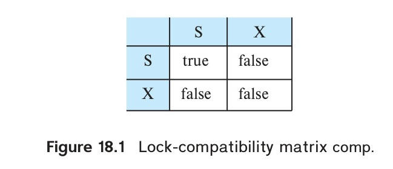
*Figure 18.1 — Lock-compatibility matrix comp.*

makes the request to the concurrency-control manager. The transaction can proceed with the operation only after the concurrency-control manager **grants** the lock to the transaction. The use of these two lock modes allows multiple transactions to read a data item but limits write access to just one transaction at a time.

To state this more generally, given a set of lock modes, we can define a **compatibility function** on them as follows: Let $A$ and $B$ represent arbitrary lock modes. Suppose that a transaction $T_i$ requests a lock of mode $A$ on item $Q$ on which transaction $T_j$ ($T_i \neq T_j$) currently holds a lock of mode $B$. If transaction $T_i$ can be granted a lock on $Q$ immediately, in spite of the presence of the mode $B$ lock, then we say mode $A$ is **compatible** with mode $B$. Such a function can be represented conveniently by a matrix. The compatibility relation between the two modes of locking discussed in this section appears in the matrix *comp* of Figure 18.1. An element *comp*($A, B$) of the matrix has the value *true* if and only if mode $A$ is compatible with mode $B$.

Note that shared mode is compatible with shared mode, but not with exclusive mode. At any time, several shared-mode locks can be held simultaneously (by different transactions) on a particular data item. A subsequent exclusive-mode lock request has to wait until the currently held shared-mode locks are released.

A transaction requests a shared lock on data item $Q$ by executing the `lock-S`($Q$) instruction. Similarly, a transaction requests an exclusive lock through the `lock-X`($Q$) instruction. A transaction can unlock a data item $Q$ by the `unlock`($Q$) instruction.

To access a data item, transaction $T_i$ must first lock that item. If the data item is already locked by another transaction in an incompatible mode, the concurrency-control manager will not grant the lock until all incompatible locks held by other transactions have been released. Thus, $T_i$ is made to **wait** until all incompatible locks held by other transactions have been released.

Transaction $T_i$ may unlock a data item that it had locked at some earlier point.

Note that a transaction must hold a lock on a data item as long as it accesses that item. Moreover, it is not necessarily desirable for a transaction to unlock a data item immediately after its final access of that data item, since serializability may not be ensured.

As an illustration, consider again the banking example that we introduced in Chapter 17. Let $A$ and $B$ be two accounts that are accessed by transactions $T_1$ and $T_2$. Transaction $T_1$ transfers \$50 from account $B$ to account $A$ (Figure 18.2). Transaction $T_2$ displays the total amount of money in accounts $A$ and $B$—that is, the sum $A + B$ (Figure 18.3).

<!-- Page 837 -->

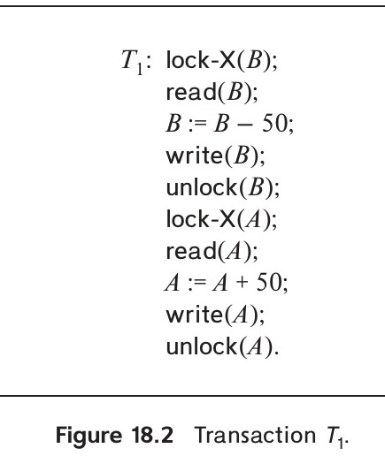
*Figure 18.2 — Transaction $T_1$.*

Suppose that the values of accounts $A$ and $B$ are \$100 and \$200, respectively. If these two transactions are executed serially, either in the order $T_1, T_2$ or the order $T_2, T_1$, then transaction $T_2$ will display the value \$300. If, however, these transactions are executed concurrently, then schedule 1, in Figure 18.4, is possible. In this case, transaction $T_2$ displays \$250, which is incorrect. The reason for this mistake is that the transaction $T_1$ unlocked data item $B$ too early, as a result of which $T_2$ saw an inconsistent state.

The schedule shows the actions executed by the transactions, as well as the points at which the concurrency-control manager grants the locks. The transaction making a lock request cannot execute its next action until the concurrency-control manager grants the lock. Hence, the lock must be granted in the interval of time between the lock-request operation and the following action of the transaction. Exactly when within this interval the lock is granted is not important; we can safely assume that the lock is granted just before the following action of the transaction. We shall therefore drop the

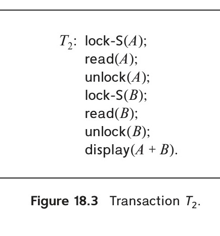
*Figure 18.3 — Transaction $T_2$.*

<!-- Page 838 -->

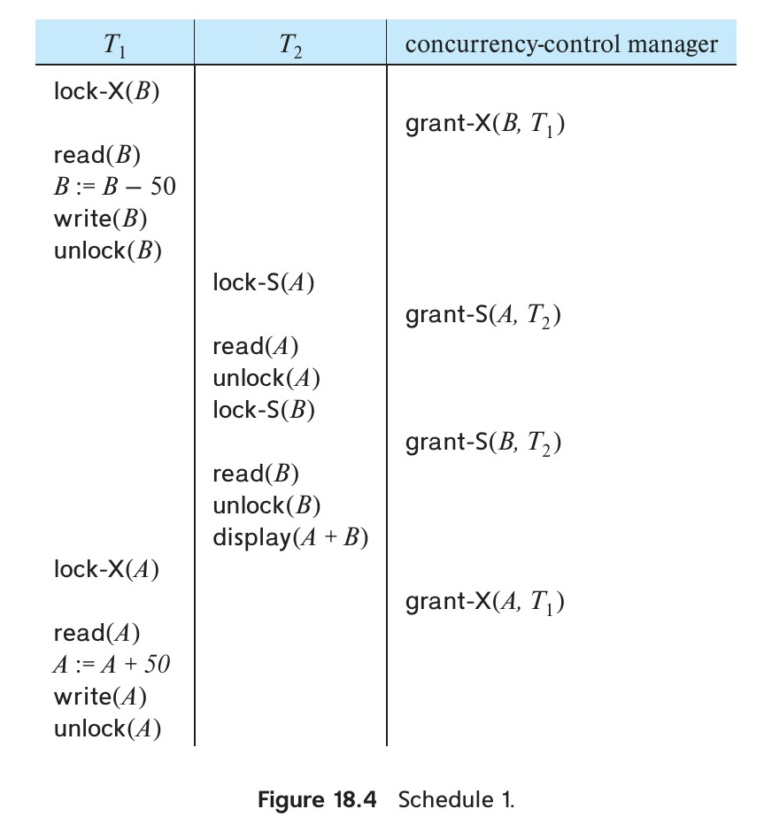
*Figure 18.4 — Schedule 1.*

column depicting the actions of the concurrency-control manager from all schedules depicted in the rest of the chapter. We let you infer when locks are granted.

Suppose now that unlocking is delayed to the end of the transaction. Transaction $T_3$ corresponds to $T_1$ with unlocking delayed (Figure 18.5). Transaction $T_4$ corresponds to $T_2$ with unlocking delayed (Figure 18.6).

You should verify that the sequence of reads and writes in schedule 1, which lead to an incorrect total of \$250 being displayed, is no longer possible with $T_3$ and $T_4$. Other schedules are possible. $T_4$ will not print out an inconsistent result in any of them; we shall see why later.

Unfortunately, locking can lead to an undesirable situation. Consider the partial schedule of Figure 18.7 for $T_3$ and $T_4$. Since $T_3$ is holding an exclusive-mode lock on $B$ and $T_4$ is requesting a shared-mode lock on $B$, $T_4$ is waiting for $T_3$ to unlock $B$. Similarly, since $T_4$ is holding a shared-mode lock on $A$ and $T_3$ is requesting an exclusive-mode lock on $A$, $T_3$ is waiting for $T_4$ to unlock $A$. Thus, we have arrived at a state where neither of these transactions can ever proceed with its normal execution. This situation is called **deadlock**. When deadlock occurs, the system must roll back one of

<!-- Page 839 -->

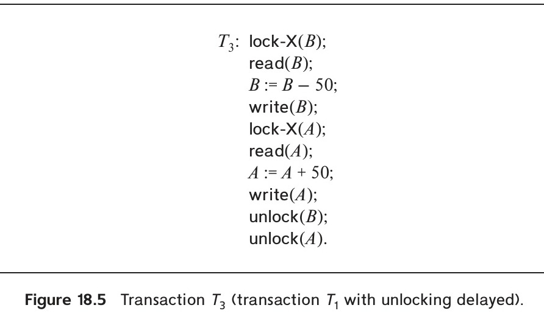
*Figure 18.5 — Transaction $T_3$ (transaction $T_1$ with unlocking delayed).*

the two transactions. Once a transaction has been rolled back, the data items that were locked by that transaction are unlocked. These data items are then available to the other transaction, which can continue with its execution. We shall return to the issue of deadlock handling in Section 18.2.

If we do not use locking, or if we unlock data items too soon after reading or writing them, we may get inconsistent states. On the other hand, if we do not unlock a data item before requesting a lock on another data item, deadlocks may occur. There are ways to avoid deadlock in some situations, as we shall see in Section 18.1.5. However, in general, deadlocks are a necessary evil associated with locking, if we want to avoid inconsistent states. Deadlocks are definitely preferable to inconsistent states, since they can be handled by rolling back transactions, whereas inconsistent states may lead to real-world problems that cannot be handled by the database system.

We shall require that each transaction in the system follow a set of rules, called a **locking protocol**, indicating when a transaction may lock and unlock each of the data items. Locking protocols restrict the number of possible schedules. The set of all such

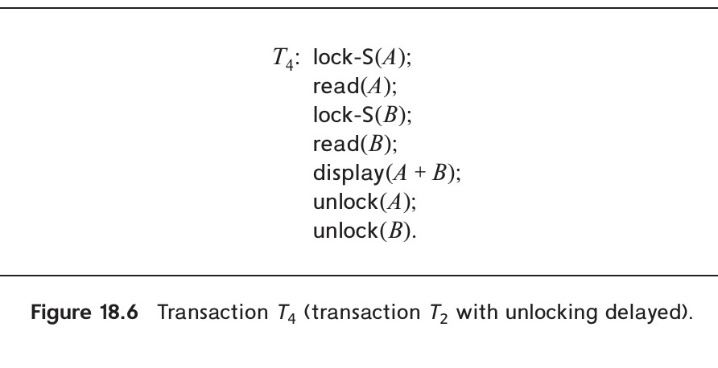
*Figure 18.6 — Transaction $T_4$ (transaction $T_2$ with unlocking delayed).*

<!-- Page 840 -->

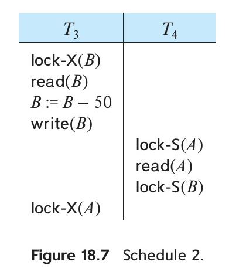
*Figure 18.7 — Schedule 2.*

schedules is a proper subset of all possible serializable schedules. We shall study several locking protocols in the rest of this section.

Before we do so, we consider how locks are granted.

### 18.1.2 Granting of Locks

When a transaction requests a lock on a data item in a particular mode, and no other transaction has a lock on the same data item in a conflicting mode, the lock can be granted. However, care must be taken when there is already other transactions holding locks on the data item.

Suppose that transaction $T_2$ has a shared-mode lock on a data item, and transaction $T_1$ requests an exclusive-mode lock on the data item. $T_1$ must wait for $T_2$ to unlock the data item. Meanwhile, another transaction, $T_3$, may request a shared-mode lock on the same data item. Since the data item is currently locked in shared mode, and $T_3$ is requesting a shared-mode lock, it appears that the lock request from $T_3$ can be granted. If it is granted, $T_1$ has to wait even longer, until $T_3$ also unlocks the data item. Additional transactions may similarly request shared-mode locks on the data item, and each may be granted the lock, since the data item is locked only in shared mode. Transaction $T_1$ may never be granted the lock on the data item. Transaction $T_1$ may never get to make progress, and is said to be **starved**.

We can avoid starvation of transactions by granting locks in the following manner: When a transaction $T_i$ requests a lock on a data item $Q$ in mode $A$, the concurrency-control manager grants the lock provided that:

1. There is no other transaction holding a lock on $Q$ in a mode that conflicts with $A$.
2. There is no other transaction that is already waiting for a lock on $Q$, and that requested its lock before $T_i$ did.

Thus, a lock will not be granted to a transaction if another transaction with a conflicting lock request is already waiting for a lock.

<!-- Page 841 -->

### 18.1.3 The Two-Phase Locking Protocol

One protocol that ensures serializability is the **two-phase locking protocol**. This protocol requires that each transaction issue lock and unlock requests in two phases:

1. **Growing phase**. A transaction may obtain locks, but may not release any lock.
2. **Shrinking phase**. A transaction may release locks, but may not obtain any new locks.

Initially, a transaction is in the growing phase. The transaction acquires locks as needed. Once the transaction releases a lock, it enters the shrinking phase, and it can issue no more lock requests.

For example, transactions $T_3$ and $T_4$ (Figure 18.5 and Figure 18.6) are two-phase. In contrast, transactions $T_1$ and $T_2$ (Figure 18.2 and Figure 18.3) are not two-phase. Observe that, in schedule 1 (Figure 18.4), transaction $T_1$ unlocks data item $B$ and then locks data item $A$; it is therefore not two-phase.

We can show that the two-phase locking protocol ensures conflict serializability. Consider any schedule; the point in the schedule where the transaction has obtained its final lock (that is, the end of its growing phase) is called the **lock point** of the transaction. Now, transactions can be ordered according to their lock points—this ordering is an equivalent serial schedule for the transactions. We ask you to show this fact in Practice Exercise 18.1.

Two-phase locking does not ensure freedom from deadlock. Observe that transactions $T_3$ and $T_4$ are two-phase, but, in schedule 2 (Figure 18.7), they are deadlocked.

Recall from Section 17.7 that, in addition to serializability, we desire schedules to be recoverable, and preferably cascadeless. Two-phase locking does not ensure either of these properties. Cascading rollbacks may occur under two-phase locking. To illustrate this, consider the partial schedule of Figure 18.8. Each transaction observes the two-phase locking protocol. Observe that transaction $T_5$ releases its lock on $A$ in step 6. Transaction $T_6$ then reads $A$, writes $A$, and releases its lock on $A$. Transaction $T_7$ then reads $A$. If transaction $T_5$ now aborts, then $T_6$ must also be aborted, since it read a value written by $T_5$. Since $T_6$ aborts, transaction $T_7$ must also be aborted, since it read a value written by $T_6$. Thus, we have a cascading rollback of $T_6$ and $T_7$.

<!-- Page 842 -->


*Figure 18.8 — Partial schedule under two-phase locking.*

Cascading rollbacks can be avoided by a modification of two-phase locking called the **strict two-phase locking protocol**. This protocol requires not only that locking be two-phase, but also that all exclusive-mode locks taken by a transaction must be held until that transaction commits. This requirement ensures that any data written by an uncommitted transaction are locked in exclusive mode until the transaction commits, preventing any other transaction from reading the data.

Another variant of two-phase locking is the **rigorous two-phase locking protocol**, which requires that *all* locks be held until the transaction commits. We can easily see that, with rigorous two-phase locking, transactions can be serialized in the order in which they commit. Most database systems implement either strict or rigorous two-phase locking.

In this chapter, when we refer to the two-phase locking protocol, we mean the standard two-phase locking protocol (which permits early unlocking). When we refer to the strict or rigorous two-phase locking protocols, we shall say so explicitly.

Consider schedule 2 of Figure 18.7. It is valid under two-phase locking, since $T_3$ and $T_4$ are two-phase. However, it is not valid under either strict or rigorous two-phase locking: in order for $T_4$ to obtain a lock on $B$, $T_3$ must first release its lock on $B$, but under strict or rigorous two-phase locking, it cannot do so until it commits. But $T_3$ cannot commit because it is waiting for a lock on $A$, which cannot be granted until $T_4$ commits.

Two-phase locking may also be extended to allow **lock conversions**. We provide a mechanism for **upgrading** a shared lock to an exclusive lock, and for **downgrading** an exclusive lock to a shared lock. We denote the conversion from shared to exclusive mode by `upgrade`, and from exclusive to shared mode by `downgrade`. Lock conversion that upgrades a lock can occur only in the growing phase, whereas conversion that downgrades a lock can occur only in the shrinking phase.

<!-- Page 843 -->

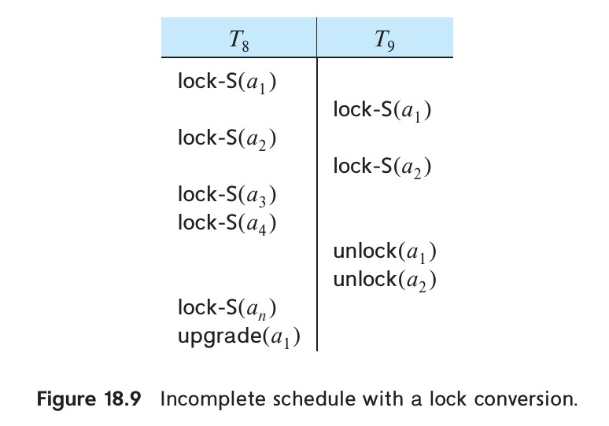
*Figure 18.9 — Incomplete schedule with a lock conversion.*

Recall that, in the absence of lock conversions, if a transaction wants to read a data item and then write it later, it must request an exclusive lock on that item right at the beginning. If the data item is read early in the transaction, but written only towards the end of the transaction, an exclusive lock is held for a long time, preventing other transactions from even reading the data item. With lock conversions, a transaction can take a shared lock on a data item early in its execution, when it wants to read the item. Later, if and when it decides to write the data item, it can upgrade the shared lock to an exclusive lock.

To illustrate, consider the schedule of Figure 18.9, where transactions $T_8$ and $T_9$ each lock data items $a_1, a_2, \ldots, a_n$. Both transactions initially read data items $a_1$ through $a_n$. Towards the end of their execution, both transactions write $a_1$.

Without lock conversions, both transactions would have had to request exclusive locks on $a_1$. If $T_8$ gets the exclusive lock on $a_1$, then $T_9$ must wait until $T_8$ commits (assuming strict or rigorous two-phase locking) before it can even start reading data items $a_1$ through $a_n$.

With lock conversions, both transactions can initially obtain shared locks on $a_1$, allowing both to proceed concurrently with reading $a_1$ through $a_n$. Only when one of the transactions (say, $T_8$) wants to write $a_1$ does it request an upgrade of the lock on $a_1$ to exclusive mode. (However, if both transactions want to upgrade their locks on $a_1$, a deadlock will result, as we shall see in Section 18.2.)

A transaction that uses two-phase locking with lock conversions may enter the shrinking phase when it issues its first `unlock` instruction, or when it issues its first `downgrade` instruction.

There are database systems that use two-phase locking, where the programmer must explicitly specify the locks that a transaction must acquire, and when the locks should be released. However, in most systems, the SQL queries and updates submitted by a transaction are examined by the database system, and appropriate lock and unlock instructions are generated automatically. In such systems, when a transaction issues a `read`($Q$) instruction, the system generates a `lock-S`($Q$) instruction (if the transaction does not already hold a lock on $Q$). When the transaction issues a `write`($Q$) instruction, the system checks if the transaction holds an exclusive lock on $Q$. If not, the system generates a `lock-X`($Q$) instruction (or an `upgrade`($Q$) instruction, if the transaction already holds a shared lock on $Q$). The locks are released at the end of the transaction, to ensure strict or rigorous two-phase locking.

<!-- Page 844 -->

Automatic acquisition of locks makes the programmer's job easier, but it can also cause problems. Since the database system cannot anticipate what operations the transaction will perform in the future, it cannot acquire all locks at the beginning of the transaction. Instead, locks are acquired as operations are performed. As we have seen, acquiring locks as operations are performed can lead to deadlocks.

### 18.1.4 Implementation of Locking

A **lock manager** can be implemented as a process that receives messages from transactions and sends replies. The lock manager process maintains an in-memory data structure called a **lock table** to record the locks that have been granted and the lock requests that are pending.

The lock table can be implemented as an in-memory hash table indexed on the name of the data item being locked. Each data item in the hash table has a list of records representing the locks that have been granted on that item, and the lock requests that are waiting to be granted. Figure 18.10 shows an example of a lock table. The table contains locks for five data items: $I_4, I_7, I_23, I_{44}$, and $I_{912}$.

Each data item that currently has any locks granted or pending has a list associated with it, with each record in the list representing a lock request. The records in the list are shown as squares in Figure 18.10. Each record indicates:

- The transaction that made the lock request.
- The mode of the lock requested (shared or exclusive).
- Whether the request has been granted (shown as dark shaded squares in Figure 18.10), or is waiting (shown as light shaded squares).

The record at the head of the list for a data item is the data item itself, shown as a rectangle in Figure 18.10.

The lock table also contains a separate index on transaction identifiers, which allows the lock manager to easily determine all the locks currently held by a given transaction, and the lock requests of the transaction that are waiting.

When a lock request arrives from a transaction, the lock manager looks up the data item in the hash table. If no lock record exists for the data item, the lock manager creates a new record for the data item, and adds a record for the lock request to the list. The lock request is granted immediately.

If a lock record already exists for the data item, the lock manager checks if the new lock request is compatible with all the locks that have already been granted on the data item. If it is compatible, and there are no other lock requests for the data item currently waiting, the lock manager adds a record for the new request to the list, marks it as granted, and sends a grant message to the transaction.

Otherwise, the lock manager adds a record for the new request to the end of the list, marks it as waiting, and does not send a reply to the transaction until the lock is granted.

<!-- Page 845 -->

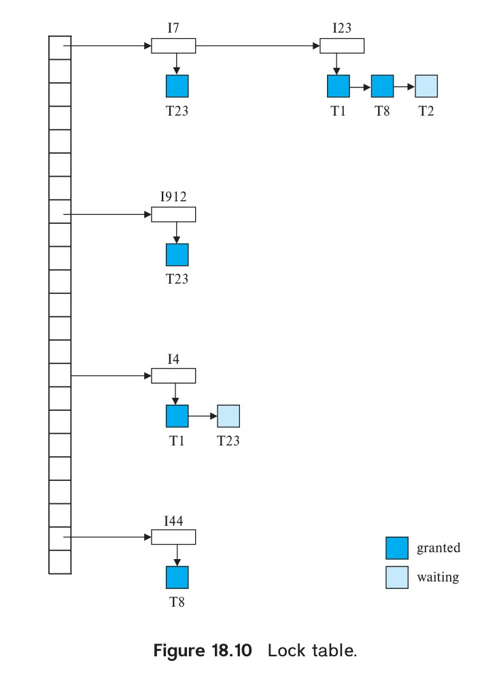
*Figure 18.10 — Lock table.*

It always grants a lock request on a data item that is compatible with all currently granted locks, unless there is a waiting request that arrived earlier.

When a transaction aborts, all its waiting requests are removed from the lock table.

When a transaction commits or aborts, all its held locks are released. To release a lock on a data item, the lock manager deletes the lock record for that transaction from the list for the data item. It then checks the record at the head of the waiting list (if any) to see if that lock request can now be granted. If it can, the lock manager marks the request as granted, and sends a grant message to the transaction. It then checks the next waiting request in the list, and if that request can also be granted, marks it as granted and sends a grant message to the transaction. This process continues until a waiting request is found that cannot be granted, or until the end of the list is reached.

If a transaction aborts, the concurrency-control manager must also undo the effects of the transaction (see Section 19.3).

<!-- Page 846 -->

### 18.1.5 Graph-Based Protocols

If we have prior knowledge about the order in which data items will be accessed, we can design locking protocols that are not two-phase, but that nonetheless ensure conflict serializability and freedom from deadlock.

To acquire such prior knowledge, we impose a partial ordering $\to$ on the set $\mathcal{D} = \{d_1, d_2, \ldots, d_h\}$ of all data items. If $d_i \to d_j$, then any transaction accessing both $d_i$ and $d_j$ must access $d_i$ before accessing $d_j$. This partial ordering implies that the set $\mathcal{D}$ may now be viewed as a directed acyclic graph, called a **database graph**.

In this section, for simplicity, we restrict our attention to graphs that are trees. We assume that there is only one mode of lock: exclusive mode. In Section 18.3, we shall relax both assumptions.

The **tree protocol** is a locking protocol for tree-structured database graphs. The protocol specifies that each transaction must follow these rules:

1. The first lock by $T_i$ may be on any data item.
2. Subsequently, a data item $Q$ can be locked by $T_i$ only if the parent of $Q$ is currently locked by $T_i$.
3. Data items may be unlocked at any time.
4. A data item that has been locked and unlocked by $T_i$ cannot subsequently be relocked by $T_i$.

All schedules that are legal under the tree protocol are conflict serializable.

To illustrate this protocol, consider the tree-structured database graph of Figure 18.11. The following four transactions follow the tree protocol on this graph. We show only the lock and unlock instructions:

$$
\begin{aligned}
T_{10}: & \text{lock-X}(B); \text{ lock-X}(E); \text{ lock-X}(D); \text{ unlock}(B); \text{ unlock}(E); \text{ lock-X}(G); \\
& \text{ unlock}(D); \text{ unlock}(G). \\
T_{11}: & \text{lock-X}(D); \text{ lock-X}(H); \text{ unlock}(D); \text{ unlock}(H). \\
T_{12}: & \text{lock-X}(B); \text{ lock-X}(E); \text{ unlock}(H); \text{ unlock}(E). \\
T_{13}: & \text{lock-X}(D); \text{ lock-X}(H); \text{ unlock}(D); \text{ unlock}(H).
\end{aligned}
$$

<!-- Page 847 -->

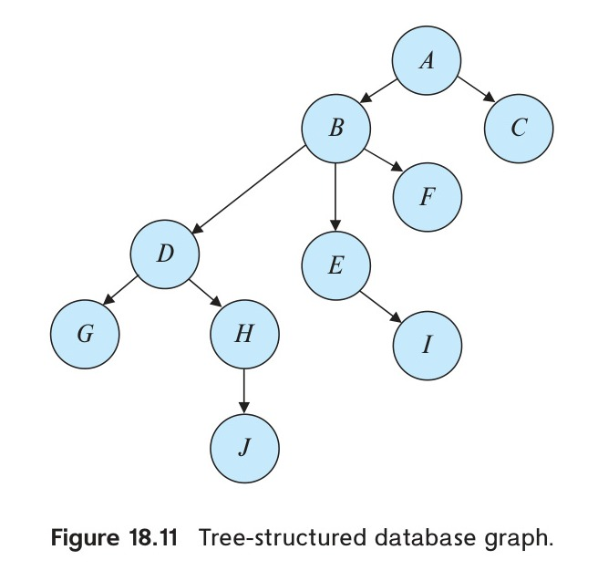
*Figure 18.11 — Tree-structured database graph.*

One possible schedule for these four transactions is shown in Figure 18.12. Note that, during its execution, transaction $T_{10}$ holds locks on two disjoint subtrees.

The tree protocol ensures conflict serializability, and it also ensures freedom from deadlock.

The tree protocol does not, however, ensure recoverability and cascadelessness. To ensure recoverability and cascadelessness, the protocol must be modified so that unlocking is delayed until the end of the transaction. But doing so would reduce the concurrency benefits offered by the tree protocol.

Observe that, in the schedule of Figure 18.12, the transactions do not observe the two-phase locking protocol. For example, transaction $T_{10}$ unlocks data items $B$ and $E$ before it locks data item $G$. Thus, the schedule of Figure 18.12 is conflict serializable, but it is not legal under two-phase locking.

Also observe that, like two-phase locking, the tree protocol does not ensure recoverability and cascadelessness. For example, in Figure 18.12, if $T_{10}$ were to abort, $T_{11}$ would have to be aborted, since $T_{11}$ read data item $D$ written by $T_{10}$. To ensure recoverability and cascadelessness under the tree protocol, we must require that a transaction hold all its exclusive locks until it commits. If transaction $T_{10}$ had held its lock on $D$ until it committed, $T_{11}$ could not have locked $D$ until $T_{10}$ committed, preventing the cascading rollback of $T_{11}$. However, holding locks until commit time reduces concurrency. If transaction $T_i$ aborts, all transactions that read data items written by $T_i$ must also be aborted.

<!-- Page 848 -->

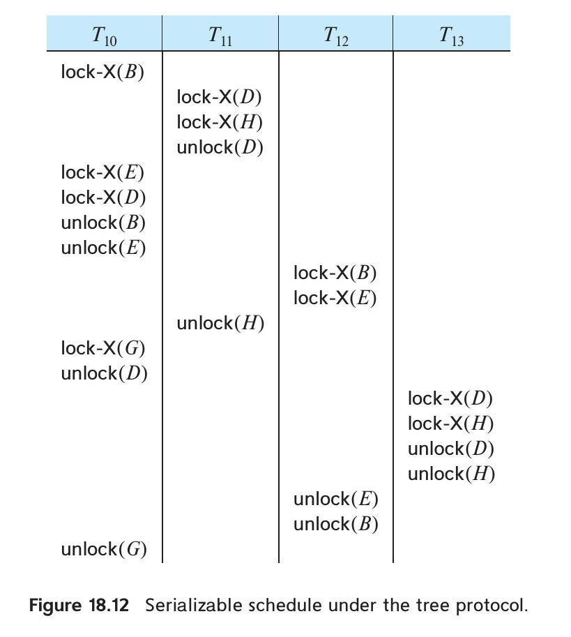
*Figure 18.12 — Serializable schedule under the tree protocol.*

The tree-locking protocol has an advantage over the two-phase locking protocol in that, unlike two-phase locking, it is deadlock-free, so no rollbacks are required. The tree-locking protocol has another advantage over the two-phase locking protocol in that unlocking may occur earlier. Earlier unlocking may lead to shorter waiting times and to an increase in concurrency.

However, the protocol has the disadvantage that, in some cases, a transaction may have to lock data items that it does not access. For example, a transaction that needs to access data items $A$ and $J$ in the database graph of Figure 18.11 must lock not only $A$ and $J$, but also data items $B$, $D$, and $H$. This additional locking results in increased locking overhead, the possibility of additional waiting time, and a potential decrease in concurrency. Further, without prior knowledge of what data items will need to be locked, transactions will have to lock the root of the tree, and that can reduce concurrency greatly.

For a set of transactions, there may be conflict-serializable schedules that cannot be obtained through the tree protocol. Indeed, there are schedules possible under the two-phase locking protocol that are not possible under the tree protocol, and vice versa. Examples of such schedules are explored in the exercises.

<!-- Page 849 -->

## 18.2 Deadlock Handling

A system is in a deadlock state if there exists a set of transactions such that every transaction in the set is waiting for another transaction in the set. More precisely, there exists a set of waiting transactions $\{T_0, T_1, \ldots, T_n\}$ such that $T_0$ is waiting for a data item that $T_1$ holds, and $T_1$ is waiting for a data item that $T_2$ holds, and $\ldots$, and $T_{n-1}$ is waiting for a data item that $T_n$ holds, and $T_n$ is waiting for a data item that $T_0$ holds. None of the transactions can make progress in such a situation.

The only remedy to this undesirable situation is for the system to invoke some drastic action, such as rolling back some of the transactions involved in the deadlock. Rollback of a transaction may be partial: That is, a transaction may be rolled back to the point where it obtained a lock whose release resolves the deadlock.

There are two principal methods for dealing with the deadlock problem. We can use a **deadlock prevention** protocol to ensure that the system will *never* enter a deadlock state. Alternatively, we can allow the system to enter a deadlock state, and then try to recover by using a **deadlock detection** and **deadlock recovery** scheme. As we shall see, both methods may result in transaction rollback. Prevention is commonly used if the probability that the system would enter a deadlock state is relatively high; otherwise, detection and recovery are more efficient.

Note that a detection and recovery scheme requires overhead that includes not only the run-time cost of maintaining the necessary information and of executing the detection algorithm, but also the potential losses inherent in recovery from a deadlock.

### 18.2.1 Deadlock Prevention

There are two approaches to deadlock prevention. One approach ensures that no cyclic waits can occur by ordering the requests for locks, or requiring all locks to be acquired together. The other approach is closer to deadlock recovery, and it performs transaction rollback instead of waiting for a lock whenever the wait could potentially result in a deadlock.

The simplest scheme under the first approach requires that each transaction locks all its data items before it begins execution. Moreover, either all are locked in one step or none are locked. There are two main disadvantages to this protocol: (1) it is often hard to predict, before the transaction begins, what data items need to be locked; (2) data-item utilization may be very low, since many of the data items may be locked but unused for a long time.

Another approach for preventing deadlocks is to impose an ordering of all data items and to require that a transaction lock data items only in a sequence consistent with the ordering. We have seen one such scheme in the tree protocol, which uses a partial ordering of data items.

A variation of this approach is to use a total order of data items, in conjunction with two-phase locking. Once a transaction has locked a particular item, it cannot request locks on items that precede that item in the ordering. This scheme is easy to implement,

<!-- Page 850 -->

as long as the set of data items accessed by a transaction is known when the transaction starts execution. There is no need to change the underlying concurrency-control system if two-phase locking is used: All that is needed is to ensure that locks are requested in the right order.

The second approach for preventing deadlocks is to use preemption and transaction rollbacks. In preemption, when a transaction $T_j$ requests a lock that transaction $T_i$ holds, the lock granted to $T_i$ may be **preempted** by rolling back of $T_i$, and granting of the lock to $T_j$. To control the preemption, we assign a unique timestamp, based on a counter or on the system clock, to each transaction when it begins. The system uses these timestamps only to decide whether a transaction should wait or roll back. Locking is still used for concurrency control. If a transaction is rolled back, it retains its *old* timestamp when restarted. Two different deadlock-prevention schemes using timestamps have been proposed:

1. The **wait–die** scheme is a nonpreemptive technique. When transaction $T_i$ requests a data item currently held by $T_j$, $T_i$ is allowed to wait only if it has a timestamp smaller than that of $T_j$ (that is, $T_i$ is older than $T_j$). Otherwise, $T_i$ is rolled back (**dies**).

   For example, suppose that transactions $T_{22}, T_{23}$, and $T_{24}$ have timestamps 5, 10, and 15, respectively. If $T_{22}$ requests a data item held by $T_{23}$, then $T_{22}$ will wait. If $T_{24}$ requests a data item held by $T_{23}$, then $T_{24}$ will be rolled back.
2. The **wound–wait** scheme is a preemptive technique. It is a counterpart to the wait–die scheme. When transaction $T_i$ requests a data item currently held by $T_j$, $T_i$ is allowed to wait only if it has a timestamp larger than that of $T_j$ (that is, $T_i$ is younger than $T_j$). Otherwise, $T_j$ is rolled back ($T_j$ is **wounded** by $T_i$).

   Returning to our previous example, with transactions $T_{22}, T_{23}$, and $T_{24}$, if $T_{22}$ requests a data item held by $T_{23}$, then the data item will be preempted from $T_{23}$, and $T_{23}$ will be rolled back. If $T_{24}$ requests a data item held by $T_{23}$, then $T_{24}$ will wait.

Whenever the system rolls back a transaction, it does not assign the transaction a new timestamp. Thus, to the system, the transaction appears to have been in the system for a long time, and therefore it has a higher priority than newer transactions. As a result, starvation is avoided, since a transaction can be rolled back only a finite number of times.

The major problem with both of these schemes is that unnecessary rollbacks may occur. A transaction may be rolled back even when there is no deadlock.

A simple mechanism to deal with deadlocks without rolling back transactions unnecessarily is **timeout-based deadlock detection**. In this scheme, a transaction that has requested a lock waits for at most a specified amount of time. If the lock has not been granted within that time, the transaction times out and rolls itself back. Timeout schemes are easy to implement, and they work well if transactions are short, and if long lock waits are likely to be due to deadlocks. However, it is hard to decide how long a transaction should wait before timing out: If the wait time is too short, transactions will be rolled back even when there is no deadlock; if it is too long, deadlocked transactions will wait for a long time before being rolled back, resulting in a waste of resources. Starvation is also possible with timeouts. As a result, timeout-based schemes have limited applicability.

<!-- Page 851 -->

### 18.2.2 Deadlock Detection and Recovery

If a system does not employ some protocol that ensures deadlock prevention, then a deadlock situation may occur. In this situation, the system must provide:

- An algorithm that examines the state of the system to determine whether a deadlock has occurred (**deadlock detection**).
- An algorithm to recover from the deadlock (**deadlock recovery**).

In the following discussion, we elaborate on these two algorithms.

#### 18.2.2.1 Deadlock Detection

Deadlocks can be described precisely in terms of a directed graph called a **wait-for graph**. This graph consists of a pair $G = (V, E)$, where $V$ is a set of vertices (or nodes) and $E$ is a set of directed edges. The set of vertices consists of all the transactions in the system. Each element in the set $E$ of edges is a directed edge $T_i \to T_j$. If $T_i \to T_j$ is in $E$, then there is a directed edge from transaction $T_i$ to transaction $T_j$, implying that transaction $T_i$ is waiting for transaction $T_j$ to release a data item that it needs.

When transaction $T_i$ requests a data item currently held by $T_j$, then the edge $T_i \to T_j$ is inserted in the wait-for graph. This edge is removed only when transaction $T_j$ is no longer holding a data item that transaction $T_i$ is waiting for. (Note that transaction $T_i$ may not be granted the data item immediately after $T_j$ releases it, because another transaction may also be waiting for the same data item.)

A deadlock exists in the system if and only if the wait-for graph contains a cycle. Each transaction involved in the cycle is said to be deadlocked. To detect deadlocks, the system must maintain the current wait-for graph, and periodically invoke an algorithm that searches for cycles in the graph.

To illustrate these concepts, consider the wait-for graph in Figure 18.13, which depicts the following state:

- Transaction $T_{17}$ is waiting for transactions $T_{18}$ and $T_{19}$.
- Transaction $T_{18}$ is waiting for transaction $T_{20}$.
- Transaction $T_{19}$ is waiting for transaction $T_{18}$.
- Transaction $T_{20}$ is not waiting for any transaction.

<!-- Page 852 -->

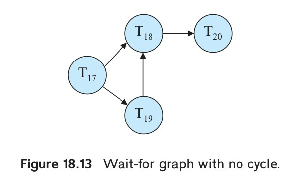
*Figure 18.13 — Wait-for graph with no cycle.*

Since the graph has no cycle, the system is not in a deadlock state.

Suppose now that transaction $T_{20}$ is requesting a data item held by $T_{19}$. The edge $T_{20} \to T_{19}$ is added to the wait-for graph, resulting in the wait-for graph of Figure 18.14. This new wait-for graph contains the cycle:

$$T_{18} \to T_{20} \to T_{19} \to T_{18}$$

implying that transactions $T_{18}, T_{19}$, and $T_{20}$ are deadlocked.

Consequently, the question arises: When should the deadlock-detection algorithm be invoked? The answer depends on two factors:

1. How often does a deadlock occur?
2. How many transactions will be affected by the deadlock?

If deadlocks occur frequently, then the detection algorithm should be invoked frequently. Data items allocated to deadlocked transactions will be unavailable to other transactions until the deadlock can be broken. In addition, the number of cycles in the graph may grow. In the worst case, we would invoke the detection algorithm every time a lock request is made that cannot be granted immediately.

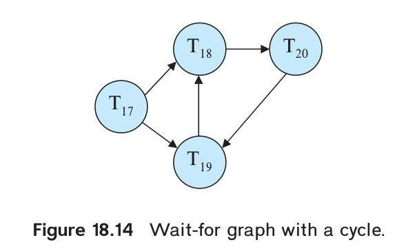
*Figure 18.14 — Wait-for graph with a cycle.*

<!-- Page 853 -->

#### 18.2.2.2 Recovery from Deadlock

When a detection algorithm determines that a deadlock exists, the system must recover from the deadlock. The most common solution is to roll back one or more transactions to break the deadlock. Three actions need to be taken:

1. **Selection of a victim**. Given a set of deadlocked transactions, we must determine which transaction (or transactions) to roll back to break the deadlock. We should roll back those transactions that will incur the minimum cost. Unfortunately, the term *cost* is not easily defined. Many factors determine the cost of a rollback, including:
   - How long the transaction has computed, and how much longer the transaction will compute before it finishes its designated task.
   - How many data items the transaction has used.
   - How many more data items the transaction needs for it to complete.
   - How many transactions will be involved in the rollback.
2. **Rollback**. Once we have decided that a particular transaction must be rolled back, we must determine how far this transaction should be rolled back.
   The simplest solution is a **total rollback**: Abort the transaction and then restart it. However, it is more effective to roll back transaction only as far as necessary to break the deadlock. Such **partial rollback** requires the system to maintain additional information about the state of all running transactions, specifically the sequence of lock requests made by each transaction. Then, when a deadlock occurs, the system can determine what locks held by the victim transaction must be released to break the cycle, and it can roll back the transaction to the point just before it acquired those locks.
   Partial rollback also requires the support of the recovery system, which must be able to roll back only the updates performed by a transaction after a specified point. We discuss the recovery system in Chapter 19.
3. **Starvation**. In a system where the selection of victims is based primarily on cost factors, it may happen that the same transaction is always picked as a victim. As a result, this transaction never completes its designated task, thus there is **starvation**. We must ensure that transaction can be picked as a victim only a (small) finite number of times. The most common solution is to include the number of rollbacks in the cost factor.

## 18.3 Multiple Granularity

In the concurrency-control schemes described so far, we have used each individual data item as the unit on which synchronization is performed.

<!-- Page 854 -->

There are circumstances, however, where it would be advantageous to group several data items, and to treat them as a single synchronization unit. For example, if a transaction $T_i$ reads an entire relation $r$, it will have to lock each tuple of $r$ separately, if the only lockable unit is a tuple. Thus, $T_i$ will have to acquire a large number of locks. Acquiring this large number of locks is not only time-consuming, but also consumes a significant amount of space in the lock table. It would be much better if $T_i$ could lock the entire relation $r$ using a single lock.

What is needed is a mechanism to allow the system to select the unit of data to be locked, which we call the **granularity** of data items. We can define a hierarchy of data granularities, where the small granularities are nested within larger ones. Such a hierarchy can be represented graphically as a tree.

As an illustration, consider the tree of Figure 18.15, which consists of four levels of granularity. The highest level represents the entire database. Below it are nodes of type *area*; the database consists of several areas. Each area, in turn, contains several files. Finally, each file contains several records.

Each node in the tree can be locked individually. As we did for two-phase locking, we shall use shared and exclusive lock modes. When a transaction locks a node, in either shared or exclusive mode, the transaction also implicitly locks all the descendants of that node in the same lock mode. For example, if transaction $T_i$ locks area $A_1$ of Figure 18.15, in exclusive mode, then it has an implicit

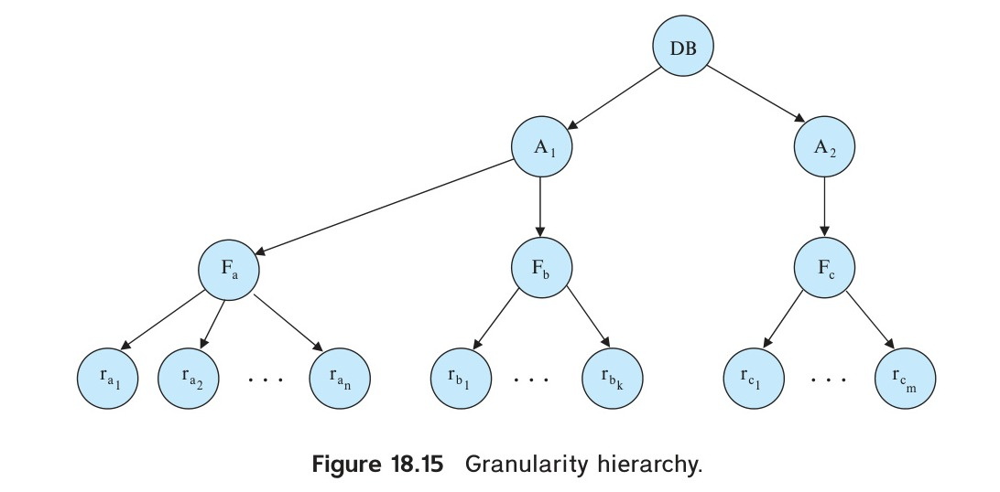
*Figure 18.15 — Granularity hierarchy.*

<!-- Page 855 -->

exclusive lock on file $F_a$ and on all the records $r_{a1}, r_{a2}, \ldots, r_{an}$ contained in $F_a$. It does not need to lock explicitly any of these nodes.

Suppose that transaction $T_j$ wants to lock record $r_{a1}$ of file $F_a$. Since $T_i$ has an implicit lock on $r_{a1}$, transaction $T_j$ cannot be granted the lock. How does the system determine whether $r_{a1}$ is locked? $T_j$ could check all nodes from $r_{a1}$ to the root of the tree, to see if any of its ancestors is locked. However, this traversal defeats the purpose of multiple granularity: namely, to minimize the locking overhead.

What if transaction $T_i$ locks record $r_{a1}$, and then transaction $T_j$ wants to lock area $A_1$? $T_j$ would have to search the entire subtree rooted at $A_1$ to see if any node in the subtree is locked. Again, this search defeats the purpose of multiple granularity.

To deal with these issues, we introduce a new class of lock modes, called **intention lock modes**. If a node is locked in an intention mode, explicit locking is being done at a lower level of the tree (that is, at a finer granularity). Intention locks are put on all the ancestors of a node before that node is locked explicitly. Thus, a transaction wanting to lock a node can determine if any of its descendants is locked, without searching the entire subtree, by checking if the node itself has an intention lock.

There are three intention modes:

1. **Intention-shared (IS) mode**. If a node is locked in intention-shared mode, explicit locking is being done at a lower level of the tree, but only with shared-mode locks.
2. **Intention-exclusive (IX) mode**. If a node is locked in intention-exclusive mode, explicit locking is being done at a lower level of the tree, with exclusive-mode or shared-mode locks.
3. **Shared and intention-exclusive (SIX) mode**. If a node is locked in shared and intention-exclusive mode, the subtree rooted by that node is locked explicitly in shared mode, and that explicit locking is being done at a lower level with exclusive-mode locks.

The compatibility function for these three modes, and for the shared (S) and exclusive (X) modes, is given in the table of Figure 18.16.

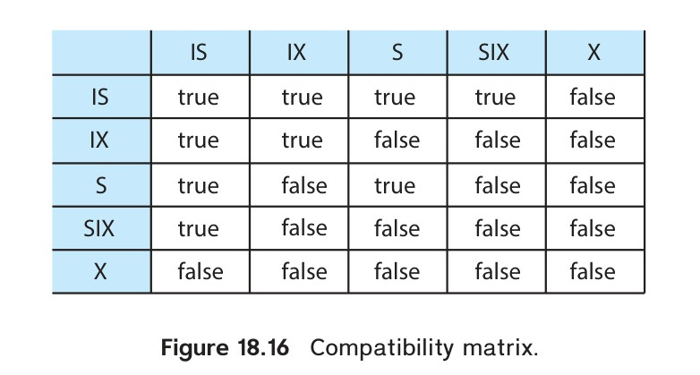
*Figure 18.16 — Compatibility matrix.*

<!-- Page 856 -->

The multiple-granularity locking protocol uses these lock modes to ensure serializability. Each transaction $T_i$ can lock a node $Q$, using the following rules:

1. The lock-compatibility matrix of Figure 18.16 must be observed.
2. The root of the tree must be locked first, and may be locked in any mode.
3. A node $Q$ can be locked by $T_i$ in S or IS mode only if the parent of $Q$ is currently locked by $T_i$ in either IX or IS mode.
4. A node $Q$ can be locked by $T_i$ in X, SIX, or IX mode only if the parent of $Q$ is currently locked by $T_i$ in either IX or SIX mode.
5. A transaction $T_i$ can lock a node only if it has not previously unlocked any node (that is, $T_i$ is two-phase).
6. A transaction $T_i$ can unlock a node $Q$ only if none of the children of $Q$ are currently locked by $T_i$.

Observe that the multiple-granularity protocol requires that locks be acquired in top-down (root-to-leaf) order, whereas locks must be released in bottom-up (leaf-to-root) order.

To illustrate the protocol, consider the tree of Figure 18.15 and these transactions:

- Suppose that transaction $T_{25}$ reads record $r_{a2}$ in file $F_a$. Then, according to the protocol, $T_{25}$ must lock the database, area $A_1$, and file $F_a$ in IS mode (and in that order). Finally, $T_{25}$ must lock $r_{a2}$ in S mode.
- Suppose that transaction $T_{26}$ modifies record $r_{a9}$ in file $F_a$. Then, $T_{26}$ must lock the database, area $A_1$, and file $F_a$ in IX mode. Finally, $T_{26}$ must lock $r_{a9}$ in X mode.
- Suppose that transaction $T_{27}$ reads all the records in file $F_a$. Then, $T_{27}$ must lock the database and area $A_1$ in IS mode. Finally, $T_{27}$ must lock $F_a$ in S mode.
- Suppose that transaction $T_{28}$ reads the entire database. Then, $T_{28}$ can do so by locking the database in S mode.

Transactions $T_{25}, T_{26}$, and $T_{27}$ can access the database concurrently. Transaction $T_{28}$ can execute concurrently with $T_{25}$ and $T_{27}$, but not with $T_{26}$.

Deadlock is possible in the multiple-granularity protocol, as it is in the two-phase locking protocol. These deadlocks can be handled by using either the deadlock-prevention or the deadlock-detection algorithms of Section 18.2.

There are cases where multiple granularity can be applied even if the data are not organized in the form of a tree:

- In a relational database, we may define a hierarchy consisting of the database, relations, and tuples, where the relations in the database are not organized in the form of a tree.
- Long transactions that produce reports often read several relations, while other transactions update only small parts of the database.

<!-- Page 857 -->

The number of locks that an SQL query may need to acquire can usually be estimated based on the relation scan operations performed by a query. A relation scan, for example, would acquire a lock at a relation level, while an index scan that is expected to fetch only a few records may acquire an intention lock at the relation level and regular locks at the tuple level. In case a transaction acquires a large number of tuple locks, the lock table may become overfull. To deal with this situation, the lock manager may perform **lock escalation**, replacing many lower-level locks by a single higher-level lock; in our example, a single relation lock could replace a large number of tuple locks.

## 18.4 Insert Operations, Delete Operations, and Predicate Reads

Until now, we have restricted our attention to read and write operations. This restriction limits transactions to data items already in the database. Some transactions require not only access to existing data items, but also the ability to create new data items. Others require the ability to delete data items. To examine how such transactions affect concurrency control, we introduce these additional operations:

- `delete(Q)` deletes data item $Q$ from the database.
- `insert(Q)` inserts a new data item $Q$ into the database and assigns $Q$ an initial value.

An attempt by a transaction $T_i$ to perform a `read(Q)` operation after $Q$ has been deleted results in a logical error in $T_i$. Likewise, an attempt by a transaction $T_i$ to perform a `read(Q)` operation before $Q$ has been inserted results in a logical error in $T_i$. It is also a logical error to attempt to delete a nonexistent data item.

### 18.4.1 Deletion

To understand how the presence of delete instructions affects concurrency control, we must decide when a delete instruction conflicts with another instruction. Let $I_i$ and $I_j$ be instructions of $T_i$ and $T_j$, respectively, that appear in schedule $S$ in consecutive order. Let $I_i = \text{delete}(Q)$. We consider several instructions $I_j$:

- $I_j = \text{read}(Q)$. $I_i$ and $I_j$ conflict. If $I_i$ comes before $I_j$, $T_j$ will have a logical error. If $I_j$ comes before $I_i$, $T_j$ can execute the read operation successfully.
- $I_j = \text{write}(Q)$. $I_i$ and $I_j$ conflict. If $I_i$ comes before $I_j$, $T_j$ will have a logical error. If $I_j$ comes before $I_i$, $T_j$ can execute the write operation successfully.
- $I_j = \text{delete}(Q)$. $I_i$ and $I_j$ conflict. If $I_i$ comes before $I_j$, $T_j$ will have a logical error. If $I_j$ comes before $I_i$, $T_i$ will have a logical error.
- $I_j = \text{insert}(Q)$. $I_i$ and $I_j$ conflict. Suppose that data item $Q$ did not exist prior to the execution of $I_i$ and $I_j$. Then, if $I_i$ comes before $I_j$, a logical error results for $T_i$. If $I_j$ comes before $I_i$, then no logical error results. Likewise, if $Q$ existed prior to the execution of $I_i$ and $I_j$, then a logical error results if $I_j$ comes before $I_i$, but not otherwise.

<!-- Page 858 -->

We can conclude the following:

- Under the two-phase locking protocol, an exclusive lock is required on a data item before that item can be deleted.
- Under the timestamp-ordering protocol, a test similar to that for a write must be performed. Suppose that transaction $T_i$ issues $\text{delete}(Q)$.
  - If $\text{TS}(T_i) < \text{R-timestamp}(Q)$, then the value of $Q$ that $T_i$ was to delete has already been read by a transaction $T_j$ with $\text{TS}(T_j) > \text{TS}(T_i)$. Hence, the delete operation is rejected, and $T_i$ is rolled back.
  - If $\text{TS}(T_i) < \text{W-timestamp}(Q)$, then a transaction $T_j$ with $\text{TS}(T_j) > \text{TS}(T_i)$ has written $Q$. Hence, this delete operation is rejected, and $T_i$ is rolled back.
  - Otherwise, the delete is executed.

### 18.4.2 Insertion

We have already seen that an $\text{insert}(Q)$ operation conflicts with a $\text{delete}(Q)$ operation. Similarly, $\text{insert}(Q)$ conflicts with a $\text{read}(Q)$ operation or a $\text{write}(Q)$ operation; no read or write can be performed on a data item before it exists.

Since an $\text{insert}(Q)$ assigns a value to data item $Q$, an insert is treated similarly to a write for concurrency-control purposes:

- Under the two-phase locking protocol, if $T_i$ performs an $\text{insert}(Q)$ operation, $T_i$ is given an exclusive lock on the newly created data item $Q$.
- Under the timestamp-ordering protocol, if $T_i$ performs an $\text{insert}(Q)$ operation, the values $\text{R-timestamp}(Q)$ and $\text{W-timestamp}(Q)$ are set to $\text{TS}(T_i)$.

### 18.4.3 Predicate Reads and The Phantom Phenomenon

Consider transaction $T_{30}$ that executes the following SQL query on the university database:

```sql
select count(*)
from instructor
where dept_name = 'Physics';
```

Transaction $T_{30}$ requires access to all tuples of the *instructor* relation pertaining to the Physics department.

<!-- Page 859 -->

Let $T_{31}$ be a transaction that executes the following SQL insertion:

```sql
insert into instructor
values (11111, 'Feynman', 'Physics', 94000);
```

Let $S$ be a schedule involving $T_{30}$ and $T_{31}$. We expect there to be potential for a conflict for the following reasons:

- If $T_{30}$ uses the tuple newly inserted by $T_{31}$ in computing `count(*)`, then $T_{30}$ reads a value written by $T_{31}$. Thus, in a serial schedule equivalent to $S$, $T_{31}$ must come before $T_{30}$.
- If $T_{30}$ does not use the tuple newly inserted by $T_{31}$ in computing `count(*)`, then in a serial schedule equivalent to $S$, $T_{30}$ must come before $T_{31}$.

The second of these two cases is curious. $T_{30}$ and $T_{31}$ do not access any tuple in common, yet they conflict with each other! In effect, $T_{30}$ and $T_{31}$ conflict on a **phantom tuple**. If concurrency control is performed at the tuple granularity, this conflict would go undetected. As a result, the system could fail to prevent a nonserializable schedule. This problem is an instance of the **phantom phenomenon**.

Phantom phenomena can occur not just with inserts, but also with updates. Consider the situation we saw in Section 17.10, where a transaction $T_i$ used an index to find only tuples with `dept_name` = 'Physics', and as a result did not read any tuples with other department names. If another transaction $T_j$ updates one of these tuples, changing its department name to Physics, a problem similar to the above problem occurs: even though $T_i$ and $T_j$ have not accessed any tuples in common, they do conflict with each other. This problem too is an instance of the phantom phenomenon. In general, the phantom phenomenon is rooted in predicate reads that conflict with inserts or updates that result in new/updated tuples that satisfy the predicate.

We can prevent these problems by allowing transaction $T_{30}$ to prevent other transactions from creating new tuples in the *instructor* relation with `dept_name` = 'Physics', and from updating the department name of an existing instructor tuple to Physics.

To find all instructor tuples with `dept_name` = 'Physics', $T_{30}$ must search either the whole *instructor* relation, or at least an index on the relation. Up to now, we have assumed implicitly that the only data items accessed by a transaction are tuples. However, $T_{30}$ is an example of a transaction that reads information about what tuples are in a relation, and $T_{31}$ is an example of a transaction that updates that information.

Clearly, it is not sufficient merely to lock the tuples that are accessed; the information used to find the tuples that are accessed by the transaction must also be locked.

<!-- Page 860 -->

Locking of information used to find tuples can be implemented by associating a data item with the relation; the data item represents the information used to find the tuples in the relation. Transactions, such as $T_{30}$, that read the information about what tuples are in a relation would then have to lock the data item corresponding to the relation in shared mode. Transactions, such as $T_{31}$, that update the information about what tuples are in a relation would have to lock the data item in exclusive mode. Thus, $T_{30}$ and $T_{31}$ would conflict on a real data item, rather than on a phantom. Similarly, transactions that use an index to retrieve tuples must lock the index itself.

Do not confuse the locking of an entire relation, as in multiple-granularity locking, with the locking of the data item corresponding to the relation. By locking the data item, a transaction only prevents other transactions from updating information about what tuples are in the relation. Locking is still required on tuples. A transaction that directly accesses a tuple can be granted a lock on the tuples even when another transaction has an exclusive lock on the data item corresponding to the relation itself.

The major disadvantage of locking a data item corresponding to the relation, or locking an entire index, is the low degree of concurrency—two transactions that insert different tuples into a relation are prevented from executing concurrently.

A better solution is an **index-locking** technique that avoids locking the whole index. Any transaction that inserts a tuple into a relation must insert information into every index maintained on the relation. We eliminate the phantom phenomenon by imposing a locking protocol for indices. For simplicity we shall consider only $\text{B}^+$-tree indices.

As we saw in Chapter 14, every search-key value is associated with an index leaf node. A query will usually use one or more indices to access a relation. An insert must insert the new tuple in all indices on the relation. In our example, we assume that there is an index on *instructor* for attribute *dept_name*. Then, $T_{30}$ must modify the leaf containing the key "Physics". If $T_{29}$ reads the same leaf node to locate all tuples pertaining to the Physics department, then $T_{29}$ and $T_{30}$ conflict on that leaf node.

The **index-locking protocol** takes advantage of the availability of indices on a relation, by turning instances of the phantom phenomenon into conflicts on locks on index leaf nodes. The protocol operates as follows:

- Every relation must have at least one index.
- A transaction $T_i$ can access tuples of a relation only after first finding them through one or more of the indices on the relation. For the purpose of the index-locking protocol, a relation scan is treated as a scan through all the leaves of one of the indices.
- A transaction $T_i$ that performs a lookup (whether a range lookup or a point lookup) must acquire a shared lock on all the index leaf nodes that it accesses.
- A transaction $T_i$ may not insert, delete, or update a tuple $t_i$ in a relation $r$ without updating all indices on $r$. The transaction must obtain exclusive locks on all index leaf nodes that are affected by the insertion, deletion, or update. For insertion and deletion, the leaf nodes affected are those that contain (after insertion) or contained (before deletion) the search-key value of the tuple. For updates, the leaf nodes affected are those that (before the modification) contained the old value of the search key, and nodes that (after the modification) contain the new value of the search key.

<!-- Page 861 -->

- Locks are obtained on tuples as usual.
- The rules of the two-phase locking protocol must be observed.

Note that the index-locking protocol does not address concurrency control on internal nodes of an index; techniques for concurrency control on indices, which minimize lock conflicts, are presented in Section 18.10.2.

Locking an index leaf node prevents any update to the node, even if the update did not actually conflict with the predicate. A variant called key-value locking, which minimizes such false lock conflicts, is presented in Section 18.10.2 as part of index concurrency control.

As noted in Section 17.10, it would appear that the existence of a conflict between transactions depends on a low-level query-processing decision by the system that is unrelated to a user-level view of the meaning of the two transactions. An alternative approach to concurrency control acquires shared locks on predicates in a query, such as the predicate “*salary* > 90000” on the *instructor* relation. Inserts and deletes of the relation must then be checked to see if they satisfy the predicate; if they do, there is a lock conflict, forcing the insert or delete to wait till the predicate lock is released. For updates, both the initial value and the final value of the tuple must be checked against the predicate. Such conflicting inserts, deletes, and updates affect the set of tuples selected by the predicate, and they cannot be allowed to execute concurrently with the query that acquired the (shared) predicate lock. We call this protocol **predicate locking**;[^1] predicate locking is not used in practice since it is more expensive to implement than the index-locking protocol and does not give significant additional benefits.

[^1]: The term *predicate locking* was used for a version of the protocol that used shared and exclusive locks on predicates, and was thus more complicated. The version we present here, with only shared locks on predicates, is also referred to as **precision locking**.

## 18.5 Timestamp-Based Protocols

The locking protocols that we have described thus far determine the order between every pair of conflicting transactions at execution time by the first lock that both members of the pair request that involves incompatible modes. Another method for determining the serializability order is to select an ordering among transactions in advance. The most common method for doing so is to use a *timestamp-ordering* scheme.

### 18.5.1 Timestamps

With each transaction $T_i$ in the system, we associate a unique fixed timestamp, denoted by $\text{TS}(T_i)$. This timestamp is assigned by the database system before the transaction $T_i$ starts execution. If a transaction $T_i$ has been assigned timestamp $\text{TS}(T_i)$, and a new transaction $T_j$ enters the system, then $\text{TS}(T_i) < \text{TS}(T_j)$. There are two simple methods for implementing this scheme:

<!-- Page 862 -->

1. Use the value of the **system clock** as the timestamp; that is, a transaction's timestamp is equal to the value of the clock when the transaction enters the system.
2. Use a **logical counter** that is incremented after a new timestamp has been assigned; that is, a transaction's timestamp is equal to the value of the counter when the transaction enters the system.

The timestamps of the transactions determine the serializability order. Thus, if $\text{TS}(T_i) < \text{TS}(T_j)$, then the system must ensure that the produced schedule is equivalent to a serial schedule in which transaction $T_i$ appears before transaction $T_j$.

To implement this scheme, we associate with each data item $Q$ two timestamp values:

1. **W-timestamp**($Q$) denotes the largest timestamp of any transaction that executed `write`($Q$) successfully.
2. **R-timestamp**($Q$) denotes the largest timestamp of any transaction that executed `read`($Q$) successfully.

These timestamps are updated whenever a new `read`($Q$) or `write`($Q$) instruction is executed.

### 18.5.2 The Timestamp-Ordering Protocol

The **timestamp-ordering protocol** ensures that any conflicting `read` and `write` operations are executed in timestamp order. This protocol operates as follows:

1. Suppose that transaction $T_i$ issues a `read`($Q$):
   a. If $\text{TS}(T_i) < \text{W-timestamp}(Q)$, then $T_i$ needs to read a value of $Q$ that was already overwritten. Hence, the `read` operation is rejected, and $T_i$ is rolled back.
   b. If $\text{TS}(T_i) \geq \text{W-timestamp}(Q)$, then the `read` operation is executed, and $\text{R-timestamp}(Q)$ is set to $\max(\text{R-timestamp}(Q), \text{TS}(T_i))$.
2. Suppose that transaction $T_i$ issues a `write`($Q$):
   a. If $\text{TS}(T_i) < \text{R-timestamp}(Q)$, then the value of $Q$ that $T_i$ is producing was needed previously, and the system assumed that that value would never be produced. Hence, the `write` operation is rejected, and $T_i$ is rolled back.
   b. If $\text{TS}(T_i) < \text{W-timestamp}(Q)$, then $T_i$ is attempting to write an obsolete value of $Q$. Hence, this `write` operation is rejected, and $T_i$ is rolled back.
   c. Otherwise, the `write` operation is executed, and $\text{W-timestamp}(Q)$ is set to $\text{TS}(T_i)$.

If a transaction $T_i$ is rolled back by the concurrency-control scheme as result of either a `read` or `write` operation, the system assigns it a new timestamp and restarts it.

<!-- Page 863 -->

To illustrate this protocol, consider schedule 3 of Figure 18.17, which involves transactions $T_{25}$ and $T_{26}$. We assume that a transaction is assigned a timestamp immediately before its first instruction. Thus, in schedule 3, $\text{TS}(T_{25}) < \text{TS}(T_{26})$, and the schedule is possible under the timestamp protocol.

We can see that the timestamp-ordering protocol ensures conflict serializability, because in any conflicting operations, the operations are executed in timestamp order. For example, if transaction $T_i$ writes $Q$ and transaction $T_j$ reads $Q$, and $\text{TS}(T_i) < \text{TS}(T_j)$, then the write must precede the read. If the write were attempted after the read, the write would be rejected, and $T_i$ would be rolled back.

The timestamp-ordering protocol also ensures freedom from deadlock, since no transaction ever waits.

However, the timestamp-ordering protocol has the following disadvantages:

- A schedule that is not conflict serializable is guaranteed to result in the rollback of one or more transactions.
- There are schedules that are conflict serializable, but that cannot be generated by the timestamp-ordering protocol.
- The schedule may not be cascade-free, and may not even be recoverable.

To see that nonrecoverable schedules are possible under the timestamp-ordering protocol, consider transactions $T_{27}$ and $T_{28}$, where $T_{27}$ has timestamp 10 and $T_{28}$ has timestamp 20. Suppose that $T_{27}$ writes $Q$ and then $T_{28}$ reads $Q$. This sequence of operations is valid under the timestamp-ordering protocol. If $T_{28}$ now commits, and subsequently $T_{27}$ aborts, we have a nonrecoverable schedule, since $T_{28}$ read data written by an uncommitted transaction $T_{27}$, and committed before $T_{27}$ committed.

Similarly, cascading rollbacks are possible. If $T_{27}$ aborts before $T_{28}$ commits, then $T_{28}$ must be rolled back, since it read a value written by $T_{27}$.

Recoverability and cascadelessness can be ensured under timestamp ordering by using one of several techniques:

- Commits are delayed until all transactions that wrote values that the committing transaction read have committed.
- A transaction that writes a data item $Q$ locks $Q$ in exclusive mode until it commits, preventing any other transaction from reading $Q$ until the writing transaction commits.

<!-- Page 864 -->


*Figure 18.17 — Schedule 3.*

- Recoverability and cascadelessness can also be guaranteed by using a commit-dependency technique, which we discuss in Section 18.8.2.

Another problem with timestamp ordering is starvation. A long transaction may be repeatedly rolled back if it conflicts with short transactions that enter the system later. Starvation can be avoided by delaying transactions that have been rolled back multiple times, until older transactions have completed.

### 18.5.3 Thomas’ Write Rule

We now present a modification to the timestamp-ordering protocol that allows greater concurrency. The modification, called **Thomas’ write rule**, relaxes the check for the `write` operation.

Suppose that transaction $T_i$ issues a `write`($Q$).

1. If $\text{TS}(T_i) < \text{R-timestamp}(Q)$, then the value of $Q$ that $T_i$ is producing was needed previously, and the system assumed that that value would never be produced. Hence, the `write` operation is rejected, and $T_i$ is rolled back.
2. If $\text{TS}(T_i) < \text{W-timestamp}(Q)$, then $T_i$ is attempting to write an obsolete value of $Q$. Hence, this `write` operation can be ignored.
3. Otherwise, the `write` operation is executed, and $\text{W-timestamp}(Q)$ is set to $\text{TS}(T_i)$.

The difference between Thomas' write rule and the timestamp-ordering protocol is in rule 2. Under the timestamp-ordering protocol, a `write` operation is rejected if $\text{TS}(T_i) < \text{W-timestamp}(Q)$. Under Thomas' write rule, the `write` operation is simply ignored (that is, not executed), and $T_i$ is allowed to proceed.

To see why this modification is sound, consider schedule 4 of Figure 18.18. In that schedule, $\text{TS}(T_{27}) < \text{TS}(T_{28})$. When $T_{27}$ executes `write`($Q$),

<!-- Page 865 -->


*Figure 18.18 — Schedule 4.*

we find that $\text{TS}(T_{27}) < \text{W-timestamp}(Q)$, since $\text{W-timestamp}(Q) = \text{TS}(T_{28})$. Under the timestamp-ordering protocol, the `write` operation of $T_{27}$ would be rejected, and $T_{27}$ would be rolled back.

However, under Thomas' write rule, the `write` operation of $T_{27}$ is ignored. The value that $T_{27}$ was attempting to write was overwritten by the `write` of $T_{28}$. Since no transaction read the value that $T_{27}$ was attempting to write, ignoring the `write` operation of $T_{27}$ has the same effect as executing the write of $T_{27}$ and then immediately executing the write of $T_{28}$.

Thomas' write rule allows schedules that are not conflict serializable, but that are nevertheless view serializable. For example, schedule 4 of Figure 18.18 is not conflict serializable, but it is view equivalent to the serial schedule $\langle T_{27}, T_{28} \rangle$.

Thomas' write rule makes use of view serializability. It is significant because it is one of the few concurrency-control protocols that allows schedules that are view serializable but not conflict serializable.

## 18.6 Validation-Based Protocols

In cases where a majority of transactions are read-only transactions, the rate of conflicts among transactions may be low. Thus, many of these transactions, if executed without the supervision of a concurrency-control scheme, would nevertheless leave the database in a consistent state. A concurrency-control scheme that incurs overhead for every read and write operation (such as two-phase locking or timestamp ordering) may be inefficient for such workloads.

What is needed is a concurrency-control scheme that imposes minimal overhead when conflicts are rare, and delays conflict checking until the end of the transaction. Such a scheme is called an **optimistic concurrency-control** scheme, or a **validation-based protocol**.

<!-- Page 866 -->

Under the validation-based protocol, the execution of transaction $T_i$ is done in two or three phases, depending on whether $T_i$ is a read-only or an update transaction:

1. **Read and execution phase**. During this phase, the transaction reads the values of the various data items and executes its operations. All updates are performed on local copies of the data items, and no actual updates are performed on the database.
2. **Validation phase**. Transaction $T_i$ performs a **validation test** to determine whether it can copy to the database the temporary local copies without violating serializability.
3. **Write phase**. If transaction $T_i$ succeeds in validation, the temporary local copies are copied to the database. If validation fails, the transaction is aborted and rolled back. All local copies are discarded.

If $T_i$ is a read-only transaction, then the write phase is omitted.

To perform the validation test, we need to know when the various phases of transactions occurred. We therefore associate three timestamps with each transaction $T_i$:

1. $\text{StartTS}(T_i)$, the time when $T_i$ started its execution.
2. $\text{ValidationTS}(T_i)$, the time when $T_i$ finished its read phase and started its validation phase.
3. $\text{FinishTS}(T_i)$, the time when $T_i$ finished its write phase.

We determine the serializability order by the timestamp-assignment technique, using the value of the timestamp $\text{ValidationTS}(T_i)$. Thus, the value $\text{TS}(T_i) = \text{ValidationTS}(T_i)$ and if $\text{ValidationTS}(T_i) < \text{ValidationTS}(T_j)$, then the produced schedule must be equivalent to the serial schedule in which transaction $T_i$ appears before transaction $T_j$.

The validation test for transaction $T_j$ requires that for all transactions $T_i$ with $\text{TS}(T_i) < \text{TS}(T_j)$, one of the following two conditions must hold:

1. $\text{FinishTS}(T_i) < \text{StartTS}(T_j)$. Since $T_i$ completes its execution before $T_j$ started, the serializability order is indeed maintained.
2. The set of data items written by $T_i$ does not intersect with the set of data items read by $T_j$, and $T_i$ completes its write phase before $T_j$ starts its validation phase ($\text{StartTS}(T_j) < \text{FinishTS}(T_i) < \text{ValidationTS}(T_j)$). This condition ensures that $T_i$ does not overwrite any value read by $T_j$, and that $T_i$ does not read any value written by $T_j$.

<!-- Page 867 -->

> [!NOTE] Note 18.1: VIEW SERIALIZABILITY
> There is another form of equivalence that is less stringent than conflict equivalence, but that, like conflict equivalence, is based on only the read and write operations of transactions.
> 
> Consider two schedules $S$ and $S'$, where the same set of transactions participates in both schedules. The schedules $S$ and $S'$ are said to be **view equivalent** if three conditions are met:
> 1. For each data item $Q$, if transaction $T_i$ reads the initial value of $Q$ in schedule $S$, then transaction $T_i$ must, in schedule $S'$, also read the initial value of $Q$.
> 2. For each data item $Q$, if transaction $T_i$ executes $\text{read}(Q)$ in schedule $S$, and if that value was produced by a $\text{write}(Q)$ operation executed by transaction $T_j$, then the $\text{read}(Q)$ operation of transaction $T_i$ must, in schedule $S'$, also read the value of $Q$ that was produced by the same $\text{write}(Q)$ operation of transaction $T_j$.
> 3. For each data item $Q$, the transaction (if any) that performs the final $\text{write}(Q)$ operation in schedule $S$ must perform the final $\text{write}(Q)$ in schedule $S'$.
> 
> Conditions 1 and 2 ensure that each transaction reads the same values in both schedules and, therefore, performs the same computation. Condition 3, coupled with conditions 1 and 2, ensures that both schedules result in the same final system state.
> 
> The concept of view equivalence leads to the concept of **view serializability**. We say that a schedule $S$ is **view serializable** if it is view equivalent to a serial schedule.
> 
> As an illustration, suppose that we augment schedule 4 with transaction $T_{29}$ and obtain the following view-serializable schedule (schedule 5):
> 
> | $T_{27}$ | $T_{28}$ | $T_{29}$ |
> | :--- | :--- | :--- |
> | $\text{read}(Q)$ | | |
> | | $\text{write}(Q)$ | |
> | $\text{write}(Q)$ | | |
> | | | $\text{write}(Q)$ |
> 
> Indeed, schedule 5 is view equivalent to the serial schedule $\langle T_{27}, T_{28}, T_{29} \rangle$, since the one $\text{read}(Q)$ instruction reads the initial value of $Q$ in both schedules and $T_{29}$ performs the final write of $Q$ in both schedules.
> 
> Every conflict-serializable schedule is also view serializable, but there are view-serializable schedules that are not conflict serializable. Indeed, schedule 5 is not conflict serializable, since every pair of consecutive instructions conflicts, and, thus, no swapping of instructions is possible.
> 
> Observe that, in schedule 5, transactions $T_{28}$ and $T_{29}$ perform $\text{write}(Q)$ operations without having performed a $\text{read}(Q)$ operation. Writes of this sort are called **blind writes**. Blind writes appear in any view-serializable schedule that is not conflict serializable.


Condition 2 allows $T_i$ and $T_j$ to execute their read phases concurrently. However, since $T_i$ finishes its write phase before $T_j$ starts its validation phase, $T_j$ can observe any updates made by $T_i$.

As an illustration, consider transactions $T_{29}$ and $T_{30}$ executing concurrently. Suppose that $\text{TS}(T_{29}) < \text{TS}(T_{30})$. Then, condition 2 is satisfied, and the execution is valid, if $T_{29}$ writes only after $T_{30}$ has completed its read phase, but before $T_{30}$ starts its validation phase.

Now consider schedule 5, shown below:

| $T_{29}$ | $T_{30}$ |
| :--- | :--- |
| $\text{read}(B)$ | |
| | $\text{read}(B)$ |
| | $B := B - 50$ |
| | $\text{read}(A)$ |
| | $A := A + 50$ |
| $\text{read}(A)$ | |
| $\langle\text{validate}\rangle$ | |
| $\text{display}(A + B)$ | |
| | $\langle\text{validate}\rangle$ |
| | $\text{write}(B)$ |
| | $\text{write}(A)$ |

In this schedule, transaction $T_{29}$ is a read-only transaction that displays $A + B$. Transaction $T_{30}$ transfers \$50 from account $B$ to account $A$. Transaction $T_{29}$ starts execution before $T_{30}$, and finishes its read phase before $T_{30}$ finishes its read phase.

When $T_{29}$ executes its validation test, the only other transaction in the system is $T_{30}$, and $\text{ValidationTS}(T_{29}) < \text{ValidationTS}(T_{30})$. The validation test for $T_{29}$ succeeds trivially, since there is no transaction $T_i$ with $\text{TS}(T_i) < \text{TS}(T_{29})$.

When $T_{30}$ executes its validation test, $T_{29}$ has already completed its validation test. However, $T_{29}$ is a read-only transaction, so its write set is empty. Therefore, condition 2 is satisfied, and the validation test for $T_{30}$ also succeeds.

Thus, schedule 5 is accepted by the validation scheme. Schedule 5 is conflict serializable; its equivalent serial schedule is $\langle T_{29}, T_{30} \rangle$.

Notice that, in schedule 5, transaction $T_{29}$ reads the old values of $A$ and $B$, while transaction $T_{30}$ writes new values of $A$ and $B$. Since $T_{29}$ is serialized before $T_{30}$, this execution is correct.

Now consider schedule 6 of Figure 18.19. In this schedule, $T_{25}$ and $T_{26}$ are modified versions of $T_{29}$ and $T_{30}$, respectively. In schedule 6, transaction $T_{26}$ executes its operations, and completes its validation and write phases before $T_{25}$ finishes its read phase.

<!-- Page 868 -->

When $T_{25}$ validates, we find that $\text{TS}(T_{26}) < \text{TS}(T_{25})$. The write set of $T_{26}$ is $\{A, B\}$, and the read set of $T_{25}$ is $\{A, B\}$. Thus, the intersection of the write set of $T_{26}$ and the read set of $T_{25}$ is not empty, and condition 2 is not satisfied. Condition 1 is also not satisfied, since $T_{26}$ did not complete its write phase before $T_{25}$ started its read phase.

Therefore, the validation test for $T_{25}$ fails, and $T_{25}$ is rolled back.

The validation scheme guarantees conflict serializability. Like the timestamp-ordering protocol, the validation scheme ensures freedom from deadlock, since transactions never wait for locks. However, cascading rollbacks are possible under the validation scheme, if an aborted transaction's updates were made visible to other transactions. This possibility can be avoided by delaying the write phase of a transaction until all transactions whose updates it has read have committed.

In typical implementations of the validation protocol, validation of all transactions is done sequentially, by a single process. Since the validation test involves only examining timestamps and read and write sets, it can be executed very quickly.

Like the timestamp-ordering protocol, the validation protocol can cause starvation of long transactions. If a long transaction conflicts with short transactions that execute concurrently, the long transaction may fail validation repeatedly.

To avoid starvation, when a transaction is rolled back multiple times, the system can assign it a lower timestamp, or can fall back on locking for that transaction.

<!-- Page 869 -->

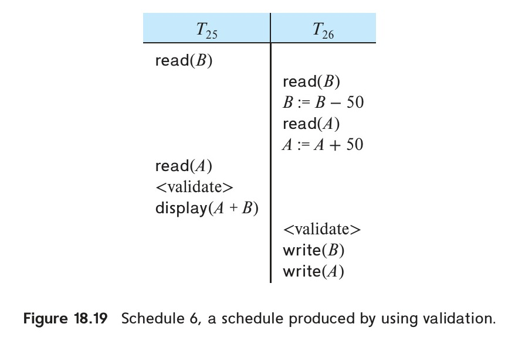
*Figure 18.19 — Schedule 6, a schedule produced by using validation.*

## 18.7 Multiversion Schemes

The concurrency-control schemes that we have discussed so far maintain a single copy of each data item. In this section, we study concurrency-control schemes that maintain multiple versions of each data item.

In **multiversion concurrency-control** schemes, each `write`($Q$) operation creates a new version of $Q$. When a `read`($Q$) operation is issued, the system selects one of the versions of $Q$ to be read. The concurrency-control scheme ensures that the version to be read is selected in a manner that ensures serializability.

The major advantage of multiversion schemes is that `read` requests never have to wait, and are never rejected. This feature is especially important for database systems where read-only transactions are frequent and long-running.

We describe two multiversion schemes: multiversion timestamp ordering, and multiversion two-phase locking.

### 18.7.1 Multiversion Timestamp Ordering

In the **multiversion timestamp-ordering scheme**, each transaction $T_i$ is assigned a timestamp $\text{TS}(T_i)$ when it begins execution.

With each data item $Q$, a sequence of versions $\langle Q_1, Q_2, \ldots, Q_m \rangle$ is associated. Each version $Q_k$ contains three fields:

1. **Content**, which is the value of version $Q_k$.
2. **W-timestamp**($Q_k$), which is the timestamp of the transaction that created version $Q_k$.
3. **R-timestamp**($Q_k$), which is the largest timestamp of any transaction that read version $Q_k$ successfully.

A new version $Q_k$ of a data item $Q$ is created on a `write` operation. When transaction $T_i$ creates a new version $Q_k$, the fields $\text{W-timestamp}(Q_k)$ and $\text{R-timestamp}(Q_k)$ are both initialized to $\text{TS}(T_i)$.

<!-- Page 870 -->

The multiversion timestamp-ordering scheme operates as follows:

1. Suppose that transaction $T_i$ issues a `read`($Q$). Let $Q_k$ denote the version of $Q$ whose W-timestamp is the largest timestamp that is less than or equal to $\text{TS}(T_i)$. The value of version $Q_k$ is returned to transaction $T_i$. The $\text{R-timestamp}(Q_k)$ is updated to $\max(\text{R-timestamp}(Q_k), \text{TS}(T_i))$.
2. Suppose that transaction $T_i$ issues a `write`($Q$):
   a. If $\text{TS}(T_i) < \text{R-timestamp}(Q_k)$, where $Q_k$ is the version of $Q$ whose W-timestamp is the largest timestamp less than or equal to $\text{TS}(T_i)$, then the value that $T_i$ is producing was needed previously by another transaction, but $T_i$ was too late in producing it. Hence, the `write` operation is rejected, and $T_i$ is rolled back.
   b. If $\text{TS}(T_i) = \text{W-timestamp}(Q_k)$, then the transaction $T_i$ has already created a version of $Q$. In this case, the contents of version $Q_k$ are overwritten.
   c. Otherwise (that is, if $\text{TS}(T_i) > \text{R-timestamp}(Q_k)$), a new version $Q_{m+1}$ of $Q$ is created, with $\text{W-timestamp}(Q_{m+1}) = \text{TS}(T_i)$ and $\text{R-timestamp}(Q_{m+1}) = \text{TS}(T_i)$.

The justification for rule 1 is clear. A transaction reads the most recent version that comes before it in time. The second rule forces a transaction to abort if it is “too late” in doing a write. More precisely, if $T_i$ attempts to write a version that some other transaction would have read, then we cannot allow that write to succeed.

The **valid interval** of a version $Q_i$ of $Q$ with W-timestamp $t$ is defined as follows: if $Q_i$ is the latest version of $Q$, the interval is $[t, \infty]$; otherwise let the next version of $Q$ have timestamp $s$; then the valid interval is $[t, s)$. You can easily verify that reads by a transaction with timestamp $t_i$ return the content of the version whose valid interval contains $t_i$.

Versions that are no longer needed are removed according to the following rule: Suppose that there are two versions, $Q_k$ and $Q_j$, of a data item, and that both versions

<!-- Page 871 -->

have a W-timestamp less than the timestamp of the oldest transaction in the system. Then, the older of the two versions $Q_k$ and $Q_j$ will not be used again, and can be deleted.

The multiversion timestamp-ordering scheme has the desirable property that a read request never fails and is never made to wait. In typical database systems, where reading is a more frequent operation than is writing, this advantage may be of major practical significance.

The scheme, however, suffers from two undesirable properties. First, the reading of a data item also requires the updating of the R-timestamp field, resulting in two potential disk accesses, rather than one. Second, the conflicts between transactions are resolved through rollbacks, rather than through waits. This alternative may be expensive. Section 18.7.2 describes an algorithm to alleviate this problem.

This multiversion timestamp-ordering scheme does not ensure recoverability and cascadelessness. It can be extended in the same manner as the basic timestamp-ordering scheme to make it recoverable and cascadeless.

### 18.7.2 Multiversion Two-Phase Locking

The **multiversion two-phase locking protocol** attempts to combine the advantages of multiversion concurrency control with the advantages of two-phase locking. This protocol differentiates between **read-only transactions** and **update transactions**.

Update transactions perform rigorous two-phase locking; that is, they hold all locks up to the end of the transaction. Thus, they can be serialized according to their commit order. Each version of a data item has a single timestamp. The timestamp in this case is not a real clock-based timestamp, but rather is a counter, which we will call the *ts-counter*, that is incremented during commit processing.

The database system assigns read-only transactions a timestamp by reading the current value of *ts-counter* before they start execution; they follow the multiversion timestamp-ordering protocol for performing reads. Thus, when a read-only transaction $T_i$ issues a `read`($Q$), the value returned is the contents of the version whose timestamp is the largest timestamp less than or equal to $\text{TS}(T_i)$.

When an update transaction reads an item, it gets a shared lock on the item and reads the latest version of that item. When an update transaction wants to write an item, it first gets an exclusive lock on the item and then creates a new version of the data item. The write is performed on the new version, and the timestamp of the new version is initially set to a value $\infty$, a value greater than that of any possible timestamp.

When the update transaction $T_i$ completes its actions, it carries out commit processing; only one update transaction is allowed to perform commit processing at a time. First, $T_i$ sets the timestamp on every version it has created to 1 more than the value of *ts-counter*; then, $T_i$ increments *ts-counter* by 1, and commits.

Read-only transactions see the old value of *ts-counter* until $T_i$ has successfully committed. As a result, read-only transactions that start after $T_i$ commits will see the values updated by $T_i$, whereas those that start before $T_i$ commits will see the value before the updates by $T_i$. In either case, read-only transactions never need to wait for

<!-- Page 872 -->

locks. Multiversion two-phase locking also ensures that schedules are recoverable and cascadeless.

Versions are deleted in a manner like that of multiversion timestamp ordering. Suppose there are two versions, $Q_k$ and $Q_j$, of a data item, and that both versions have a timestamp less than or equal to the timestamp of the oldest read-only transaction in the system. Then, the older of the two versions $Q_k$ and $Q_j$ will not be used again and it can be deleted.

> [!NOTE] Note 18.2: MULTIVERSIONING AND DATABASE IMPLEMENTATION
> Consider a database system that implements a primary key constraint by ensuring that only one tuple exists for any value of the primary key attribute. The creation of a second version of the record with the same primary key would appear to be a violation of the primary key constraint. However, it is logically not a violation, since the two versions do not coexist at any time in the database. Therefore, primary constraint enforcement must be modified to allow multiple records with the same primary key, as long as they are different versions of the same record.
> 
> Next, consider the issue of deletion of tuples. This can be implemented by creating a new version of the tuple, with timestamps created as usual, but with a special marker denoting that the tuple has been deleted. Transactions that read such a tuple simply skip it, since it has been deleted.
> 
> Further, consider the issue of enforcing foreign-key dependencies. Consider the case of a relation $r$ whose attribute $r.B$ is a foreign-key referencing attribute $s.B$ of relation $s$. In general, deletion of a tuple $t_s$ in $s$ or update of a primary key attribute of tuple $t_s$ in $s$ causes a foreign-key violation if there is an $r$ tuple $t_r$ such that $t_r.B = t_s.B$. With multiversioning, if the timestamp of the transaction performing the deletion/update is $ts_i$, the corresponding condition for violation is the existence of such a tuple version $t_r$, with the additional condition that the valid interval of $t_r$ contains $ts_i$.
> 
> Finally, consider the case of an index on attribute $r.B$ of relation $r$. If there are multiple versions of a record $t_i$ with the same value for $B$, the index could point to the latest version of the record, and the latest version could have pointers to earlier versions. However, if an update was made to attribute $t_i.B$, the index would need to contain separate entries for different versions of record $t_i$; one entry for the old value of $t_i.B$ and another for the new value of $t_i.B$. When old versions of a record are deleted, any entry in the index for the old version must also be deleted.

## 18.8 Snapshot Isolation

Snapshot isolation is a particular type of concurrency-control scheme that has gained wide acceptance in commercial and open-source systems, including Oracle,

<!-- Page 873 -->

PostgreSQL, and SQL Server. We introduced snapshot isolation in Section 17.9.3. Here, we take a more detailed look into how it works.

Conceptually, snapshot isolation involves giving a transaction a “snapshot” of the database at the time when it begins its execution. It then operates on that snapshot in complete isolation from concurrent transactions. The data values in the snapshot consist only of values written by committed transactions. This isolation is ideal for read-only transactions since they never wait and are never aborted by the concurrency manager.

Transactions that update the database potentially have conflicts with other transactions that update the database. Updates performed by a transaction must be validated before the transaction is allowed to commit. We describe how validation is performed, later in this section. Updates are kept in the transaction's private workspace until the transaction is validated, at which point the updates are written to the database.[^2]

When a transaction $T$ is allowed to commit, the transition of $T$ to the committed state and the assignment of a commit timestamp to $T$ must be done atomically with respect to other committing transactions.

### 18.8.1 Multiversioning in Snapshot Isolation

Snapshot isolation is implemented by using a multiversion data structure, where each write of a tuple creates a new version of the tuple. Each version of a tuple has a timestamp, which is the commit timestamp of the transaction that created the version. (A transaction that has not yet committed does not have a commit timestamp; versions created by such transactions are marked with a special uncommitted marker.)

A transaction $T_i$ is assigned a start timestamp, denoted $\text{StartTS}(T_i)$, when it starts execution. For read-only transactions, the start timestamp may be assigned when the transaction issues its first read operation.

When transaction $T_i$ reads a data item $Q$, the system returns the version of $Q$ whose timestamp is the largest timestamp less than or equal to $\text{StartTS}(T_i)$. If $T_i$ has updated $Q$, the version returned is the uncommitted version created by $T_i$ itself.[^3]

[^2]: Many implementations create versions even before the transaction starts validation; since the version is marked with a timestamp greater than that of any possible transaction, other transactions will not see the uncommitted version. If the transaction aborts, the newly created version is marked as invalid, and can be removed later by garbage collection.

[^3]: To efficiently find the correct version of a data item for a given timestamp, many systems keep versions organized as a reverse linked list, with the most recent version first, and each version pointing to the immediately preceding version. A transaction traverses the linked list until it finds the first version that has a timestamp less than or equal to the transaction's timestamp.

<!-- Page 874 -->

As a result, transactions always read a consistent snapshot of the database, consisting of all updates committed before the start of the transaction. Updates committed by other transactions after $\text{StartTS}(T_i)$ are ignored by $T_i$.

Updates performed by transaction $T_i$ are kept private to $T_i$, and are not visible to other transactions until $T_i$ commits. When $T_i$ commits, it is assigned a commit timestamp, denoted $\text{CommitTS}(T_i)$. All versions created by $T_i$ are then stamped with $\text{CommitTS}(T_i)$.

### 18.8.2 Validation Steps for Update Transactions

When transaction $T_i$ completes its execution, it performs a validation test before it is allowed to commit. The validation test ensures that no two concurrent transactions update the same data item. Two transactions $T_i$ and $T_j$ are said to be **concurrent** if the execution interval $[\text{StartTS}(T_i), \text{CommitTS}(T_i)]$ overlaps with the execution interval $[\text{StartTS}(T_j), \text{CommitTS}(T_j)]$.

There are two main variants of the validation rule used in snapshot isolation:

1. **First-committer-wins**. When transaction $T_i$ completes, it checks if any of the data items it has updated has been updated by another transaction $T_j$ that committed after $\text{StartTS}(T_i)$. If so, $T_i$ is aborted and rolled back. Otherwise, $T_i$ is allowed to commit.
   This rule is called first-committer-wins because if two concurrent transactions update the same data item, the one that completes and attempts to commit first will succeed, while the second one will be aborted.
2. **First-updater-wins**. In this variant, when transaction $T_i$ attempts to update a data item $Q$, it first obtains an exclusive lock on $Q$. If another transaction $T_j$ already holds a lock on $Q$, $T_i$ waits for $T_j$ to commit or abort.
   If $T_j$ commits, then $T_i$ aborts, because $T_j$ was an earlier updater that committed while $T_i$ was running. If $T_j$ aborts, $T_i$ acquires the lock on $Q$, and continues execution.
   This variant detects conflicts early, at the time of the update, rather than at commit time. It is called first-updater-wins because the first transaction to update an item obtains the lock, and subsequent concurrent updaters are forced to wait and eventually abort if the first transaction commits.

The first-updater-wins variant is used by several database systems, including Oracle and PostgreSQL.[^4]

[^4]: There are alternative implementations, based on keeping track of read and write sets for transactions and checking for conflicts at validation time, or using commit-dependency tracking; we discuss these alternative techniques in Section 18.8.2.

<!-- Page 875 -->

### 18.8.3 Serializability Issues and Solutions

Snapshot isolation guarantees that transactions never read uncommitted data, that reads are repeatable, and that lost updates never occur. However, snapshot isolation does *not* guarantee serializability.

The most common situation where snapshot isolation produces non-serializable executions is **write skew**. Write skew occurs when two concurrent transactions read overlapping sets of data items, make updates based on the values they read, but update *disjoint* sets of data items. Since each transaction updates a different set of data items, neither the first-committer-wins nor the first-updater-wins rule detects any conflict between the transactions, and both transactions are allowed to commit.

As an illustration, consider a banking application that maintains two accounts, $A$ and $B$, for a customer. The bank requires that the balance of each account be non-negative, but permits an overdraft on one account as long as the combined balance of the two accounts is non-negative; that is, the consistency constraint is:

$$A + B \geq 0$$

Suppose that initially $A = \$100$ and $B = \$100$.

Now suppose that transaction $T_{30}$ attempts to withdraw \$150 from account $A$. $T_{30}$ reads $A$ (\$100) and $B$ (\$100), checks that $A + B = \$200 \geq \$150$, and decides that the withdrawal is permissible. It then sets $A := A - 150 = -\$50$.

Concurrently, transaction $T_{31}$ attempts to withdraw \$150 from account $B$. $T_{31}$ also reads $A$ (\$100) and $B$ (\$100), checks that $A + B = \$200 \geq \$150$, and decides that the withdrawal is permissible. It then sets $B := B - 150 = -\$50$.

Under snapshot isolation, both $T_{30}$ and $T_{31}$ operate on their initial snapshots where $A = \$100$ and $B = \$100$. $T_{30}$ updates only $A$, and $T_{31}$ updates only $B$. Since their write sets are disjoint, both transactions pass validation and commit.

After both transactions commit, the database state is $A = -\$50$ and $B = -\$50$, so $A + B = -\$100$, violating the consistency constraint $A + B \geq 0$.

In any serial execution of $T_{30}$ and $T_{31}$, one transaction would execute first and reduce the combined balance to \$50, causing the second transaction's check to fail, so the second transaction would not execute the withdrawal. Thus, the concurrent execution under snapshot isolation is not serializable.

<!-- Page 876 -->

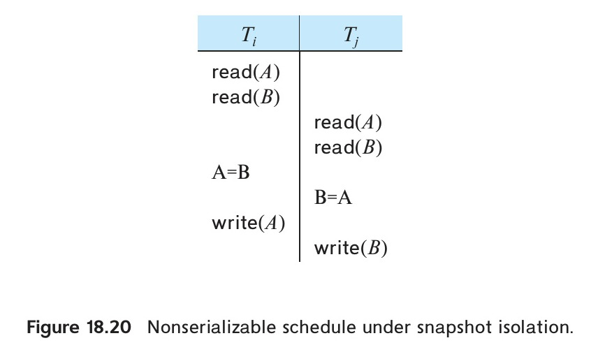
*Figure 18.20 — Nonserializable schedule under snapshot isolation.*

Consider another example of write skew, shown in schedule 7 of Figure 18.20. In this schedule, the consistency constraint is $A = 0 \lor B = 0$. Initially $A = 0$ and $B = 0$.

- Transaction $T_i$ reads $A$ and $B$, finds that $B = 0$, and sets $A := 1$.
- Concurrently, transaction $T_j$ reads $A$ and $B$, finds that $A = 0$, and sets $B := 1$.

Both transactions commit under snapshot isolation, resulting in $A = 1$ and $B = 1$, violating the constraint.

Another example of write skew occurs in hospital doctor-on-call scheduling:

- The hospital requires that at least one doctor be on call at all times.
- Suppose doctors $D_1$ and $D_2$ are currently on call.
- Doctor $D_1$ asks to be taken off call. Transaction $T_1$ checks if at least one other doctor is on call. Since $D_2$ is on call, $T_1$ removes $D_1$ from the on-call list.
- Concurrently, doctor $D_2$ asks to be taken off call. Transaction $T_2$ checks if at least one other doctor is on call. Since $D_1$ is on call in $T_2$'s snapshot, $T_2$ removes $D_2$ from the on-call list.
- Both transactions update different records, so both commit. As a result, no doctor is left on call!

<!-- Page 877 -->

Yet another manifestation of nonserializability under snapshot isolation involves phantom updates.[^5] Suppose a transaction $T_{32}$ finds all instructors in the Physics department with salary greater than \$90,000, and gives them a 10% raise. Concurrently, transaction $T_{33}$ inserts a new instructor into the Physics department with salary \$100,000. Under snapshot isolation, $T_{32}$ does not see the newly inserted instructor, so that instructor does not get a raise. In a serial schedule $\langle T_{33}, T_{32} \rangle$, the new instructor would have received the raise.

[^5]: The SQL standard uses the term phantom problem to refer to nonrepeatable predicate reads, leading some database manuals to claim that snapshot isolation avoids the phantom problem because all reads in snapshot isolation are repeatable. However, as our example shows, phantom updates can still occur under snapshot isolation.

To avoid nonserializable executions under snapshot isolation, several approaches can be used:

1. **Explicit locking**. The application programmer can use explicit `select ... for update` queries to acquire exclusive locks on data items that are read, preventing concurrent updates. For example, in our bank overdraft example, if both $T_{30}$ and $T_{31}$ use `select for update` when reading $A$ and $B$, one transaction will acquire the locks first, and the other will be forced to wait, preventing write skew.
2. **Promotion of reads to writes**. An application can artificially turn a read into a write, by updating a dummy column or updating a shared control record. For example, if both $T_{30}$ and $T_{31}$ update a common customer record, their write sets will overlap, and snapshot isolation's first-committer-wins rule will detect the conflict and abort one of them.
3. **Serializable Snapshot Isolation (SSI)**. A major advance in concurrency control is the development of techniques that automatically detect and prevent nonserializable executions under snapshot isolation, without requiring any manual intervention by the programmer. Systems supporting SSI provide true serializability with performance close to standard snapshot isolation. PostgreSQL implemented SSI starting in version 9.1.

We now describe the principles behind Serializable Snapshot Isolation (SSI).

In snapshot isolation, every nonserializable execution involves a cycle in the dependency graph that contains a specific pattern called an **rw-antidependency**, denoted by a dashed arrow $\dashrightarrow$.

<!-- Page 878 -->

An rw-antidependency $T_i \dashrightarrow T_j$ occurs when transaction $T_i$ reads a version of a data item $Q$, and transaction $T_j$ writes a newer version of $Q$ such that $T_j$ is serialized after $T_i$. That is, $T_i$ does not see the update made by $T_j$ because $T_i$ read an older version.

It has been proven mathematically that for any non-serializable schedule under snapshot isolation, the dependency graph must contain a cycle with at least two consecutive rw-antidependency edges:

$$T_{in} \dashrightarrow T_{mid} \dashrightarrow T_{out}$$

That is, there must be a transaction $T_{mid}$ that has both an incoming rw-antidependency edge ($T_{in} \dashrightarrow T_{mid}$) and an outgoing rw-antidependency edge ($T_{mid} \dashrightarrow T_{out}$).

Serializable Snapshot Isolation (SSI) exploits this theoretical result:

- The system tracks rw-antidependencies among active transactions.
- Whenever it detects two consecutive rw-antidependency edges $T_{in} \dashrightarrow T_{mid} \dashrightarrow T_{out}$ involving concurrent transactions, it aborts one of the transactions (typically $T_{out}$ or $T_{mid}$) to break the potential cycle.

Tracking rw-antidependencies is implemented efficiently using **SIREAD locks** (also called **predicate locks for SSI**):

- When a transaction reads a data item (or index page), the system records an SIREAD lock. Unlike traditional shared locks, SIREAD locks are non-blocking: they never cause any transaction to wait.
- When another transaction writes the data item, the presence of the SIREAD lock indicates an rw-antidependency edge.
- If a transaction is found to have both an incoming and an outgoing rw-antidependency edge, it is flagged, and one of the transactions involved is aborted.

SSI provides full serializability, guarantees freedom from write skew, and incurs only minimal overhead compared to standard snapshot isolation.

<!-- Page 879 -->

As a result, Serializable Snapshot Isolation has been adopted in modern database engines such as PostgreSQL (where it is the default implementation for the `serializable` transaction isolation level).

In Figure 18.20, if the `for update` clause were appended to the `select` queries:

```sql
select balance
from account
where account_number = 'A'
for update;
```

the transactions would acquire exclusive locks on the accounts, forcing one transaction to wait for the other, and thus preventing write skew.

<!-- Page 880 -->

## 18.9 Weak Levels of Consistency in Practice

In Section 17.8, we discussed the isolation levels defined by the SQL standard: serializable, repeatable read, read committed, and read uncommitted. In this section, we examine weak levels of consistency that are used in commercial database systems to increase concurrency.

### 18.9.1 Degree-Two Consistency

The purpose of degree-two consistency is to avoid cascading rollbacks without requiring full two-phase locking. In degree-two consistency, transaction locking follows these rules:

1. Exclusive locks must be two-phase: all exclusive locks must be acquired before any lock is released, and exclusive locks are held until the transaction commits.
2. Shared locks may be released at any time, and can be acquired at any time.

In contrast to the situation in two-phase locking, shared locks do not need to be two-phase. A transaction may acquire a shared lock on a data item, read the data item, and immediately release the shared lock.

Reads are not repeatable, but since exclusive locks are held until commit time, degree-two consistency ensures that transactions never read uncommitted data, preventing cascading aborts.

It is interesting to note that with degree-two consistency, schedules may not be serializable. Consider the schedule of Figure 18.21. In this schedule, transaction $T_{32}$ reads $Q$ twice, while transaction $T_{33}$ modifies $Q$ between the two reads of $T_{32}$. This schedule is not serializable.

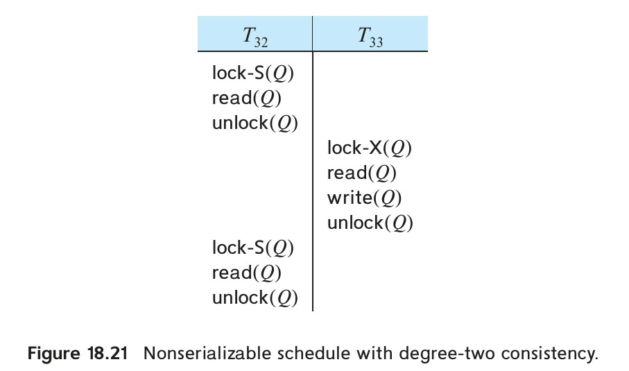
*Figure 18.21 — Nonserializable schedule with degree-two consistency.*

<!-- Page 881 -->

### 18.9.2 Cursor Stability

**Cursor stability** is a form of degree-two consistency designed for programs that browse through relations using cursors.

When a transaction opens a cursor on a relation, it reads tuples one at a time. Under cursor stability:

- A shared lock is acquired only on the tuple currently pointed to by the cursor.
- When the cursor moves to the next tuple, the shared lock on the previous tuple is released, and a shared lock on the new tuple is acquired.
- Any modified tuples are locked in exclusive mode until the transaction commits.

These rules ensure that degree-two consistency is obtained. But locking is not done in a two-phase manner, and serializability is not guaranteed. Cursor stability is used in practice on heavily accessed relations as a means of increasing concurrency and improving system performance. Applications that use cursor stability must be coded in a way that ensures database consistency despite the possibility of nonserializable schedules. Thus, the use of cursor stability is limited to specialized situations with simple consistency constraints.

When supported by the database, snapshot isolation is a better alternative to degree-two consistency as well as cursor stability, since it offers a similar or even better level of concurrency while reducing the risk of nonserializable executions.

### 18.9.3 Concurrency Control Across User Interactions

Concurrency-control protocols usually consider transactions that do not involve user interaction. Consider the airline seat selection example from Section 17.8, which involved user interaction. Suppose we treat all the steps from when the seat availability is initially shown to the user, until the seat selection is confirmed, as a single transaction. If two-phase locking is used, the entire set of seats on a flight would be locked in shared mode until the user has completed the seat selection, and no other transaction would be able to update the seat allocation information in this period. Such locking

<!-- Page 882 -->

would be a very bad idea since a user may take a long time to make a selection, or even just abandon the transaction without explicitly cancelling it. Timestamp protocols or validation could be used instead, which avoid the problem of locking, but both these protocols would abort the transaction for a user $A$ if any other user $B$ has updated the seat allocation information, even if the seat selected by $B$ does not conflict with the seat selected by user $A$. Snapshot isolation is a good option in this situation, since it would not abort the transaction of user $A$ as long as $B$ did not select the same seat as $A$.

However, snapshot isolation requires the database to remember information about updates performed by a transaction even after it has committed, as long as any other concurrent transaction is still active, which can be problematic for long-duration transactions.

Another option is to split a transaction that involves user interaction into two or more transactions, such that no transaction spans a user interaction. If our seat selection transaction is split thus, the first transaction would read the seat availability, while the second transaction would complete the allocation of the selected seat. If the second transaction is written carelessly, it could assign the selected seat to the user, without checking if the seat was meanwhile assigned to some other user, resulting in a lost-update problem. To avoid the problem, as we outlined in Section 17.8, the second transaction should perform the seat allocation only if the seat was not meanwhile assigned to some other user.

The above idea has been generalized in an alternative concurrency control scheme, which uses version numbers stored in tuples to avoid lost updates. The schema of each relation is altered by adding an extra *version_number* attribute, which is initialized to 0 when the tuple is created. When a transaction reads (for the first time) a tuple that it intends to update, it remembers the version number of that tuple. The read is performed as a stand-alone transaction on the database, and hence any locks that may be obtained are released immediately. Updates are done locally and copied to the database as part of commit processing, using the following steps which are executed atomically (i.e., as part of a single database transaction):

- For each updated tuple, the transaction checks if the current version number is the same as the version number of the tuple when it was first read by the transaction.
  1. If the version numbers match, the update is performed on the tuple in the database, and its version number is incremented by 1.
  2. If the version numbers do not match, the transaction is aborted, rolling back all the updates it performed.
- If the version number check succeeds for all updated tuples, the transaction commits. It is worth noting that a timestamp could be used instead of the version number without impacting the scheme in any way.

<!-- Page 883 -->

Observe the close similarity between the preceding scheme and snapshot isolation. The version number check implements the first-committer-wins rule used in snapshot isolation, and it can be used even if the transaction was active for a very long time. However, unlike snapshot isolation, the reads performed by a transaction may not correspond to a snapshot of the database; and unlike the validation-based protocol, reads performed by the transaction are not validated.

We refer to the above scheme as **optimistic concurrency control without read validation**. Optimistic concurrency control without read validation provides a weak level of serializability, and it does not ensure serializability. A variant of this scheme uses version numbers to validate reads at the time of commit, in addition to validating writes, to ensure that the tuples read by the transaction were not updated subsequent to the initial read; this scheme is equivalent to the optimistic concurrency-control scheme which we saw earlier.

This scheme has been widely used by application developers to handle transactions that involve user interaction. An attractive feature of the scheme is that it can be implemented easily on top of a database system. The validation and update steps performed as part of commit processing are then executed as a single transaction in the database, using the concurrency-control scheme of the database to ensure atomicity for commit processing. The scheme is also used by the Hibernate object-relational mapping system (Section 9.6.2), and other object-relational mapping systems, where it is referred to as optimistic concurrency control (even though reads are not validated by default). Hibernate and other object-relational mapping systems therefore perform the version number checks transparently as part of commit processing. (Transactions that involve user interaction are called **conversations** in Hibernate to differentiate them from regular transactions; validation using version numbers is particularly useful for such transactions.)

Application developers must, however, be aware of the potential for non-serializable execution, and they must restrict their usage of the scheme to applications where non-serializability does not cause serious problems.

## 18.10 Advanced Topics in Concurrency Control

Instead of using two-phase locking, special-purpose concurrency control techniques can be used for index structures, resulting in improved concurrency. When using main-memory databases, conversely, index concurrency control can be simplified. Further, concurrency control actions often become bottlenecks in main-memory databases, and techniques such as latch-free data structures have been designed to reduce concurrency control overheads. Instead of detecting conflicts at the level of reads and writes, it is possible to consider operations, such as increment of a counter, as basic operations, and perform concurrency control on the basis of conflicts between operations. Certain applications require guarantees on transaction completion time. Specialized concurrency control techniques have been developed for such applications.

<!-- Page 884 -->

### 18.10.1 Online Index Creation

When we are dealing with large volumes of data (ranging in the terabytes), operations such as creating an index can take a long time—perhaps hours or even days. When the operation finishes, the index contents must be consistent with the contents of the relation, and all further updates to the relation must maintain the index.

One way of ensuring that the data and the index are consistent is to block all updates to the relation while the index is created, for example by getting a shared lock on the relation. After the index is created, and the relation metadata are updated to reflect the existence of the index locks can be released. Subsequent update transactions will find the index, and carry out index maintenance as part of the transaction.

However, the above approach would make the system unavailable for updates to the relation for a very long time, which is unacceptable. Instead, most database systems support **online index creation**, which allows relation updates to occur even as the index is being created. Online index creation can be carried out as follows:

1. Index creation gets a snapshot of the relation and uses it to create the index; meanwhile, the system logs all updates to the relation that happen after the snapshot is created.
2. When the index on the snapshot data is complete, it is not yet ready for use, since subsequent updates are missing. At this point, the log of updates to the relation is used to update the index. But while the index update is being carried out, further updates may be happening on the relation.
3. The index update then obtains a shared lock on the relation to prevent further updates and applies all remaining updates to the index. At this point, the index is consistent with the contents of the relation. The relation metadata are then updated to indicate the existence of the new index. Subsequently all locks are released.

Any transaction that executes after this will see the existence of the index; if the transaction updates the relation, it will also update the index.

Creation of materialized views that are maintained immediately, as part of the transaction that updates any of the relations used in the view, can also benefit from online construction techniques that are similar to online index construction. The query defining the view is executed on a snapshot of the participating relations, and subsequent updates are logged. The updates are applied to the materialized view, with a final phase of locking and catching up similar to the case of online index creation.

Schema changes such as adding or deleting attributes or constraints can also have a significant impact if relations are locked while the schema change is implemented on all tuples.

- For adding or deleting attributes, a version number can be kept with each tuple, and tuples can be updated in the background, or whenever they are accessed; the version number is used to determine if the schema change has already been applied

<!-- Page 885 -->

to the tuple, and the schema change is applied to the tuple if it has not already been applied.
- Adding of constraints requires that existing data must be checked to ensure that the constraint is satisfied. For example, adding a primary or unique key constraint on an attribute *ID* requires checking of existing tuples to ensure that no two tuples have the same *ID* value. Online addition of such constraints is done in a manner similar to online index construction, by checking the constraints on a relation snapshot, while keeping a log of updates that occur after the snapshot. The updates in the log must then be checked to ensure that they do not violate the constraint. In a final catch-up phase, the constraint is checked on any remaining updates in the log and added to the relation metadata while holding a shared lock on the relation.

### 18.10.2 Concurrency in Index Structures

It is possible to treat access to index structures like any other database structure and to apply the concurrency-control techniques discussed earlier. However, since indices are accessed frequently, they would become a point of great lock contention, leading to a low degree of concurrency. Luckily, indices do not have to be treated like other database structures; it is desirable to release index locks early, in a non-two-phase manner, to maximize concurrency. In fact, it is perfectly acceptable for a transaction to perform a lookup on an index twice and to find that the structure of the index has changed in between, as long as the index lookup returns the correct set of tuples. Informally, it is acceptable to have nonserializable concurrent access to an index, as long as the accuracy of the index is maintained; we formalize this notion next.

Operation serializability for index operations is defined as follows: A concurrent execution of index operations on an index is said to be serializable if there is a serialization order of the operations that is consistent with the results that each index operation in the concurrent execution sees, as well as with the final state of the index after all the operations have been executed. Index concurrency control techniques must ensure that any concurrent execution of index operations is serializable.

We outline two techniques for managing concurrent access to $\text{B}^+$-trees as well as an index-concurrency control technique to prevent the phantom phenomenon. The online bibliographical notes reference other techniques for $\text{B}^+$-trees as well as techniques for other index structures. The techniques that we present for concurrency control on $\text{B}^+$-trees are based on locking, but neither two-phase locking nor the tree protocol is employed. The algorithms for lookup, insertion, and deletion are those used in Chapter 14, with only minor modifications.

The first technique is called the **crabbing protocol**:

- When searching for a key value, the crabbing protocol first locks the root node in shared mode. When traversing down the tree, it acquires a shared lock on the child node to be traversed further. After acquiring the lock on the child node, it releases the lock on the parent node. It repeats this process until it reaches a leaf node.

<!-- Page 886 -->

- When inserting or deleting a key value, the crabbing protocol takes these actions:
  - It follows the same protocol as for searching until it reaches the desired leaf node. Up to this point, it obtains (and releases) only shared locks.
  - It locks the leaf node in exclusive mode and inserts or deletes the key value.
  - If it needs to split a node or coalesce it with its siblings, or redistribute key values between siblings, the crabbing protocol locks the parent of the node in exclusive mode. After performing these actions, it releases the locks on the node and siblings.
  If the parent requires splitting, coalescing, or redistribution of key values, the protocol retains the lock on the parent, and splitting, coalescing, or redistribution propagates further in the same manner. Otherwise, it releases the lock on the parent.

The protocol gets its name from the way in which crabs advance by moving sideways, moving the legs on one side, then the legs on the other, and so on alternately. The progress of locking while the protocol both goes down the tree and goes back up (in case of splits, coalescing, or redistribution) proceeds in a similar crab-like manner.

Once a particular operation releases a lock on a node, other operations can access that node. There is a possibility of deadlocks between search operations coming down the tree, and splits, coalescing, or redistribution propagating up the tree. The system can easily handle such deadlocks by restarting the search operation from the root, after releasing the locks held by the operation.

Locks that are held for a short duration, instead of being held in a two-phase manner, are often referred to as **latches**. Latches are used internally in databases to achieve mutual exclusion on shared data structures. In the above case, locks are held in a way that does not ensure mutual exclusion during an insert or delete operation, yet the resultant execution of index operations is serializable.

The second technique achieves even more concurrency, avoiding even holding the lock on one node while acquiring the lock on another node; thereby, deadlocks are avoided, and concurrency is increased. This technique uses a modified version of $\text{B}^+$-trees called **B-link trees**; B-link trees require that every node (including internal nodes, not just the leaves) maintain a pointer to its right sibling. This pointer is required because a lookup that occurs while a node is being split may have to search not only that node but also that node's right.

Unlike the crabbing protocol, the B-link-tree locking protocol holds locks on only one internal node at a time. The protocol releases the lock on the current internal node before requesting a lock on a child node (when traversing downwards), or on a parent node (while traversing upwards during a split or merge). Doing so can result in anomalies: for example, between the time the lock on a node is released and the lock on a parent is requested, a concurrent insert or delete on a sibling may cause a split or merge on the parent, and the original parent node may no longer be a parent of the

<!-- Page 887 -->

child node when it is locked. The protocol detects and handles such situations, ensuring operation serializability while avoiding deadlocks between operations and increasing concurrency compared to the crabbing protocol.

The phantom phenomenon, where conflicts between a predicate read and an insert or update are not detected, can allow nonserializable executions to occur. The index-locking technique, which we saw in Section 18.4.3, prevents the phantom phenomenon by locking index leaf nodes in a two-phase manner. Instead of locking an entire index leaf node, some index concurrency-control schemes use **key-value locking** on individual key values, allowing other key values to be inserted or deleted from the same leaf. Key-value locking thus provides increased concurrency.

Using key-value locking naïvely, however, would allow the phantom phenomenon to occur; to prevent the phantom phenomenon, the **next-key locking** technique is used. In this technique, every index lookup must lock not only the keys found within the range (or the single key, in case of a point lookup) but also the next-key value—that is, the key value just greater than the last key value that was within the range. Also, every insert must lock not only the value that is inserted, but also the next-key value. Thus, if a transaction attempts to insert a value that was within the range of the index lookup of another transaction, the two transactions would conflict on the key value next to the inserted key value. Similarly, deletes must also lock the next-key value to the value being deleted to ensure that conflicts with subsequent range lookups of other queries are detected.

### 18.10.3 Concurrency Control in Main-Memory Databases

With data stored on hard disk, the cost of I/O operations often dominates the cost of transaction processing. When disk I/O is the bottleneck cost in a system, there is little benefit from optimizing other smaller costs, such as the cost of concurrency control. However, in a main-memory database, with disk I/O no longer the bottleneck, systems benefit from reducing other costs, such as query processing costs, as we saw in Section 15.8; we now consider how to reduce the cost of concurrency control in main-memory databases.

As we saw in Section 18.10.2, concurrency-control techniques for operations on disk-based index structures acquire locks on individual nodes, to increase the potential for concurrent access to the index. However, such locking comes at the increased cost of acquiring the locks. In a main-memory database, where data are in memory, index operations take very little time for execution. Thus, it may be acceptable to perform locking at a coarse granularity: for example, the entire index could be locked using a single latch (i.e., short duration lock), the operation performed, and the latch released. The reduced overhead of locking has been found to make up for the slightly reduced concurrency, and to improve overall performance.

There is another way to improve performance with in-memory indices, using atomic instructions to carry out index updates without acquiring any latches at all.

<!-- Page 888 -->

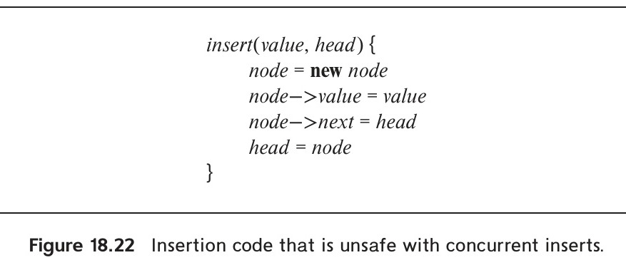
*Figure 18.22 — Insertion code that is unsafe with concurrent inserts.*

Data structures implementations that support concurrent operations without requiring latches are called **latch-free data structure implementations**.

Consider a linked list, where each node has a value *value* and a *next* pointer, and the head of the linked list is stored in the variable *head*. The function `insert()` shown in Figure 18.22 would work correctly to insert a node at the head of the list, if there are no concurrent invocations of the code for the same list.[^7]

However, if two processes execute the `insert()` function concurrently on the same list, it is possible that both of them would read the same value of variable *head*, and then both would update the variable after that. The final result would contain one of the two nodes being inserted, while the other node being inserted would be lost.

One way of preventing such a problem is to get an exclusive latch (short term lock) on the linked list, perform the `insert()` function, and then release the latch. The `insert()` function can be modified to acquire and release a latch on the list.

An alternative implementation, which is faster in practice, is to use an atomic **compare-and-swap()** instruction, abbreviated to **CAS**, which works as follows: The instruction `CAS(var, oldval, newval)` takes three arguments: a variable *var* and two values, *oldval* and *newval*. The instruction does the following atomically: check if the value of *var* is equal to *oldval*, and if so, set *var* to *newval*, and return success. If the value is not equal, it returns failure. The instruction is supported by most modern processor architectures, and it executes very quickly.

The function `insert_latchfree()`, shown in Figure 18.23 is a modification of `insert()` that works correctly even with concurrent inserts on the same list, without obtaining any latches. With this code, if two processes concurrently read the old value of *head*, and then both execute the CAS instruction, one of them will find the CAS instruction returning success, while the other one will find it returning failure since the value of *head* changes between the time it is read and when the CAS instruction is executed. The repeat loop then retries the insert using the new value of *head*, until it succeeds.

Function `delete_latchfree()`, shown in Figure 18.23, similarly implements deletion from the head of the list using the compare and swap instruction, without requiring latches. (In this case, the list is used as a stack, since deletion occurs at the head of

[^7]: We assume all parameters are passed by reference.

<!-- Page 889 -->

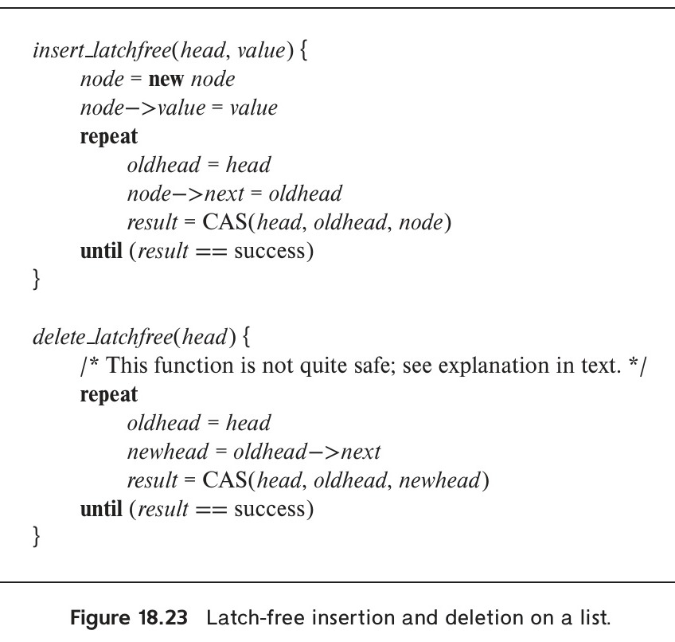
*Figure 18.23 — Latch-free insertion and deletion on a list.*

the list.) However, it has a problem: it does not work correctly in some rare cases. The problem can occur when a process $P_1$ is performing a delete, with node $n_1$ at the head of the list, and concurrently a second process $P_2$ deletes the first two elements, $n_1$ and $n_2$, and then reinserts $n_1$ at the head of the list, with some other element, say $n_3$ as the next element. If $P_1$ read $n_1$ before $P_2$ deleted it, but performs the CAS after $P_2$ has reinserted $n_1$, the CAS operation of $P_1$ will succeed, but set the head of the list to point to $n_2$, which has been deleted, leaving the list in an inconsistent state. This problem is known as the **ABA problem**.

One solution is to keep a counter along with each pointer, which is incremented every time the pointer is updated. The CAS instruction is applied on the (pointer, counter) pair; most CAS implementations on 64 bit processors support such a double compare-and-swap on 128 bits. The ABA problem can then be avoided since although the reinsert of $n_1$ would result in the head pointing to $n_1$, the counter would be different, resulting in the CAS operation of $P_1$ failing. See the online solutions to Practice Exercise 18.16 for more details of the ABA problem and the above solution. With such a modification, both inserts and deletes can be executed concurrently without acquiring latches. There are other solutions that do not require a double compare-and-swap, but are more complicated.

Deletion from the tail of the list (to implement a queue) as well as more complex data structures such as hash indices

<!-- Page 890 -->

and $\text{B}^+$-trees can also be implemented without latches. However, the details of such implementations are rather complicated. For example, in a $\text{B}^+$-tree, a split of a node requires multiple updates, such as creating a new node, copying half the entries to the new node, and updating the parent node to point to the new node. If these updates are performed without latches, concurrent operations may see intermediate states where the split is only partially complete. Latch-free $\text{B}^+$-tree algorithms use techniques such as cooperative split, where any operation that encounters a partially split node helps complete the split before proceeding with its own operation.

Although latch-free data structures avoid latch contention, they can be difficult to implement correctly. In addition, when memory is freed by one thread, other threads may still hold pointers to that memory; freeing the memory immediately could cause other threads to access invalid memory (the **use-after-free** problem). Safe memory reclamation techniques, such as **epoch-based reclamation** or **hazard pointers**, must be used to ensure that memory is freed only after all threads that could access it have finished their operations.

It is best to use latch-free data structure implementations (more often referred to as lock-free data structure implementations) that are provided by standard libraries, such as the Boost library for C++, or the `ConcurrentLinkedQueue` class in Java; do not build your own, since you may introduce bugs due to “race conditions” between concurrent accesses, that can be very hard to detect or debug.

Since today's multiprocessor CPUs have a large number of cores, latch-free implementations have been found to significantly outperform implementations that obtain latches, in the context of in-memory indices and other in-memory data structures.

### 18.10.4 Long-Duration Transactions

The transaction concept developed initially in the context of data-processing applications, in which most transactions are noninteractive and of short duration. Serious problems arise when this concept is applied to database systems that involve human interaction. Such transactions have these key properties:

- **Long duration**. Once a human interacts with an active transaction, that transaction becomes a long-duration transaction from the perspective of the computer, since human response time is slow relative to computer speed. Furthermore, in design applications, the human activity may involve hours, days, or an even longer period. Thus, transactions may be of long duration in human terms, as well as in machine terms.
- **Exposure of uncommitted data**. Data generated and displayed to a user by a long-duration transaction are uncommitted, since the transaction may abort. Thus, users—and, as a result, other transactions—may be forced to read uncommitted data. If several users are cooperating on a project, user transactions may need to exchange data prior to transaction commit.
- **Subtasks**. An interactive transaction may consist of a set of subtasks initiated by the user. The user may wish to abort a subtask without necessarily causing the entire transaction to abort.
- **Recoverability**. It is unacceptable to abort a long-duration interactive transaction because of a system crash. The active transaction must be recovered to a state that existed shortly before the crash so that relatively little human work is lost.
- **Performance**. Good performance in an interactive transaction system is defined as fast response time. This definition is in contrast to that in a noninteractive system, in which high throughput (number of transactions per second) is the goal. Systems with high throughput make efficient use of system resources. However, in the case of interactive transactions, the most costly resource is the user. If the efficiency and satisfaction of the user are to be optimized, response time should be fast (from a human perspective). In those cases where a task takes a long time, response time

<!-- Page 891 -->

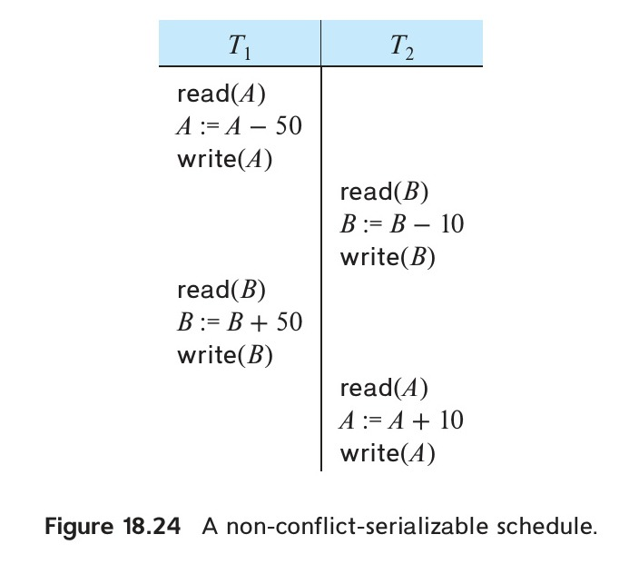
*Figure 18.24 — A non-conflict-serializable schedule.*

should be predictable (i.e., the variance in response times should be low) so that users can manage their time well.

Snapshot isolation, described in Section 18.8, can provide a partial solution to these issues, as can the optimistic concurrency control without read validation protocol described in Section 18.9.3. The latter protocol was in fact designed specifically to deal with long-duration transactions that involve user interaction. Although it does not guarantee serializability, optimistic concurrency control without read validation is quite widely used.

However, when transactions are of long duration, conflicting updates are more likely, resulting in additional waits or aborts. These considerations are the basis for the alternative concepts of correctness of concurrent executions and transaction recovery that we consider in the remainder of this section.

### 18.10.5 Concurrency Control with Operations

Consider a bank database consisting of two accounts $A$ and $B$, with the consistency requirement that the sum $A + B$ be preserved. Consider the schedule of Figure 18.24. Although the schedule is not conflict serializable, it nevertheless preserves the sum of $A + B$. It also illustrates two important points about the concept of correctness without serializability.

1. Correctness depends on the specific consistency constraints for the database.
2. Correctness depends on the properties of operations performed by each transaction.

<!-- Page 892 -->

While two-phase locking ensures serializability, it can result in poor concurrency in case a large number of transactions conflict on a particular data item. For example, if a large number of transactions update a shared counter, such as a ticket sales counter or an account balance, two-phase locking would force all transactions to execute serially on the counter, severely limiting throughput.

Concurrency can be increased if we consider higher-level operations on data items, rather than raw read and write operations. For example, consider an `increment(Q, n)` operation that adds $n$ to data item $Q$. Two increment operations commute with each other: that is, `increment`($Q, n_1$) followed by `increment`($Q, n_2$) produces the same result on $Q$ as `increment`($Q, n_2$) followed by `increment`($Q, n_1$).

We can take advantage of commutativity by defining a new lock mode, called the **increment lock mode** (denoted by I). The compatibility relation between shared mode, exclusive mode, and increment mode is shown in the matrix of Figure 18.25.

Observe that increment mode is compatible with itself, but not with shared or exclusive mode. Thus, several transactions can hold increment locks on the same data item simultaneously, and execute increment operations concurrently!

A transaction requesting an increment lock on $Q$ does not need to wait for other transactions holding increment locks on $Q$. A transaction requesting a shared or exclusive lock on $Q$, however, must wait until all currently held increment locks on $Q$ are released.

The two-phase locking protocol can be extended to include the increment mode. The extended protocol ensures that transactions are serializable, provided that all operations executed by transactions are commutative operations.

Operation-level concurrency control can be extended to other commutative operations as well, such as insertions into sets.

In addition to using operation-level concurrency in a way that ensures serializability, in some cases it may even be used in a way that does not guarantee serializability, but where violations may be acceptable. Consider the case of concert tickets, where every transaction needs to access and update the total ticket sales. We can have an operation `increment_conditional(v, n)` which increments $v$ by $n$, provided the resultant value would be $\geq 0$; the operation returns a status of success in case the resultant value is $\geq 0$ and returns failure otherwise. Consider a transaction $T_i$ executed to purchase tickets. To book three tickets, where variable *avail_tickets* indicates the number of available tickets, the transaction can execute `increment_conditional(avail_tickets, -3)`. A return value of success indicates that there were enough tickets available, and decrements the available tickets, while failure indicates insufficient availability of tickets.

If the variable *avail_tickets* is locked in a two-phase manner, concurrency would be very poor, with customers being forced to wait for bookings while an earlier transaction commits, even when there are many tickets available. Concurrency can be greatly increased by executing the `increment_conditional` operation, without holding any locks on *avail_tickets* in a two-phase manner; instead, an exclusive lock is obtained on the variable, the operation is performed, and the lock is then released.

The transaction $T_i$ also needs to carry out other steps, such as collecting the payment; if one of the subsequent steps, such as payment, fails, the increment operation must be rolled back by executing a compensating operation; if the original operation added $-n$ to *avail_tickets*, the compensating operation adds $+n$ to *avail_tickets*.

It may appear that two `increment_conditional` operations are compatible with each other, similar to the increment operation that we saw earlier. But that is not

<!-- Page 893 -->

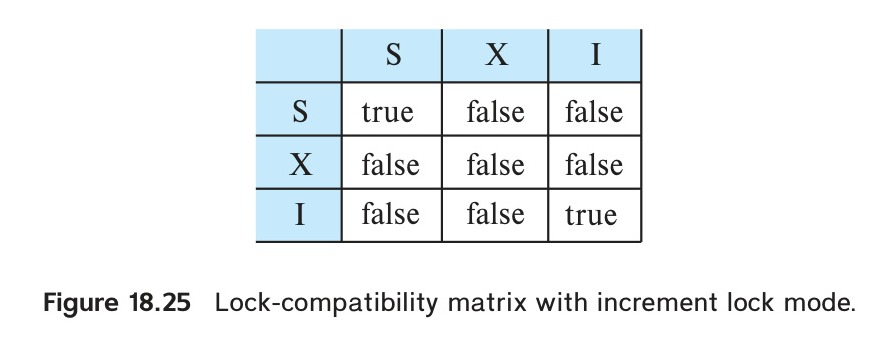
*Figure 18.25 — Lock-compatibility matrix with increment lock mode.*

the case. Consider two concurrent transactions to purchase a single ticket, and assume that there is only one ticket left. The order in which the operations are executed has an obvious impact on which one succeeds and which one fails. Nevertheless, many real-world applications allow operations that hold short-term locks while they execute and release them at the end of the operation to increase concurrency, even at the cost of loss of serializability in some situations.

<!-- Page 894 -->

### 18.10.6 Real-Time Transaction Systems

In certain applications, the constraints include deadlines by which a task must be completed. Examples of such applications include plant management, traffic control, and scheduling. When deadlines are included, correctness of an execution is no longer solely an issue of database consistency. Rather, we are concerned with how many deadlines are missed, and by how much time they are missed. Deadlines are characterized as follows:

- **Hard deadline**. Serious problems, such as system crash, may occur if a task is not completed by its deadline.
- **Firm deadline**. The task has zero value if it is completed after the deadline.
- **Soft deadlines**. The task has diminishing value if it is completed after the deadline, with the value approaching zero as the degree of lateness increases.

Systems with deadlines are called **real-time systems**.

Transaction management in real-time systems must take deadlines into account. If the concurrency-control protocol determines that a transaction $T_i$ must wait, it may cause $T_i$ to miss the deadline. In such cases, it may be preferable to pre-empt the transaction holding the lock, and to allow $T_i$ to proceed. Pre-emption must be used with care, however, because the time lost by the pre-empted transaction (due to rollback and restart) may cause the pre-empted transaction to miss its deadline. Unfortunately, it is difficult to determine whether rollback or waiting is preferable in a given situation.

Due to the unpredictable nature of delays when reading data from disk, main-memory databases are often used if real-time constraints have to be met. However, even if data are resident in main memory, variances in execution time arise from lock waits, transaction aborts, and so on. Researchers have devoted considerable effort to concurrency control for real-time databases. They have extended locking protocols to provide higher priority for transactions with early deadlines. They have found that optimistic concurrency protocols perform well in real-time databases; that is, these protocols result in fewer missed deadlines than even the extended locking protocols. The online bibliographical notes provide references to research in the area of real-time databases.

## 18.11 Summary

- When several transactions execute concurrently in the database, the consistency of data may no longer be preserved. It is necessary for the system to control the interaction among the concurrent transactions. This control is achieved through one of a variety of mechanisms called **concurrency-control schemes**.
- To ensure isolation, we can require that data items be accessed in a mutually exclusive manner. The most common method used to implement this requirement is to allow a transaction to access a data item only if it is currently holding a lock on that item.
- There are various modes in which a data item may be locked. In **shared mode**, data can be read, but not written; in **exclusive mode**, data can be both read and written.
- In **two-phase locking**, transactions issue lock and unlock requests in two phases: the growing phase (where locks can be acquired) and the shrinking phase (where locks can be released). Two-phase locking ensures conflict serializability.
- The **strict two-phase locking protocol** permits release of exclusive locks only at the end of transaction, in order to ensure recoverability and cascadelessness of the resulting schedules. The **rigorous two-phase locking protocol** releases all locks only at the end of the transaction.

<!-- Page 895 -->

- Various locking protocols do not guard against deadlocks. One way to prevent deadlock is to use an ordering of data items and to request locks in a sequence consistent with the ordering.
- Another way to prevent deadlock is to use preemption and transaction rollbacks. To control the preemption, we assign a unique timestamp to each transaction. The system uses these timestamps to decide whether a transaction should wait or roll back. The wound–wait scheme is a preemptive scheme.
- If deadlocks are not prevented, the system must deal with them by using a deadlock detection and recovery scheme. To do so, the system constructs a wait-for graph. A system is in a deadlock state if and only if the wait-for graph contains a cycle. When the deadlock detection algorithm determines that a deadlock exists, the system rolls back one or more transactions to break the deadlock.
- There are circumstances where it would be advantageous to group several data items and to treat them as one aggregate data item for purposes of working, resulting in multiple levels of granularity. We allow data items of various sizes, and we define a hierarchy of data items where the small items are nested within larger ones. Such a hierarchy can be represented graphically as a tree. In such multi-granularity locking protocols, locks are acquired in root-to-leaf order; they are released in leaf-to-root order. Intention lock modes are used at higher levels to get better concurrency, without affecting serializability.

<!-- Page 896 -->

- A **timestamp-ordering** scheme ensures serializability by selecting an ordering in advance between every pair of transactions. A unique fixed timestamp is associated with each transaction in the system. The timestamps of the transactions determine the serializability order. Thus, if the timestamp of transaction $T_i$ is smaller than the timestamp of transaction $T_j$, then the scheme ensures that the produced schedule is equivalent to a serial schedule in which transaction $T_i$ appears before transaction $T_j$. It does so by rolling back a transaction whenever such an order is violated.
- A **validation scheme** is an appropriate concurrency-control method in cases where a majority of transactions are read-only transactions, and thus the rate of conflicts among these transactions is low. A unique fixed timestamp is associated with each transaction in the system. The serializability order is determined by the timestamp of the transaction. A transaction in this scheme is never delayed. It must, however, pass a validation test to complete. If it does not pass the validation test, the system rolls it back to its initial state.
- A **multiversion concurrency-control** scheme is based on the creation of a new version of a data item for each transaction that writes that item. When a read operation is issued, the system selects one of the versions to be read. The concurrency-control scheme ensures that the version to be read is selected in a manner that ensures serializability by using timestamps. A read operation always succeeds.
  - In multiversion timestamp ordering, a write operation may result in the rollback of the transaction.
  - In multiversion two-phase locking, write operations may result in a lock wait or, possibly, in deadlock.
- **Snapshot isolation** is a multiversion concurrency-control protocol based on validation, which, unlike multiversion two-phase locking, does not require transactions to be declared as read-only or update. Snapshot isolation does not guarantee serializability but is nevertheless supported by many database systems. **Serializable snapshot isolation** is an extension of snapshot isolation which guarantees serializability.
- A **delete** operation may be performed only if the transaction deleting the tuple has an exclusive lock on the tuple to be deleted. A transaction that inserts a new tuple into the database is given an exclusive lock on the tuple.
- Insertions can lead to the **phantom phenomenon**, in which an insertion logically conflicts with a query even though the two transactions may access no tuple in common. Such conflict cannot be detected if locking is done only on tuples accessed by the transactions. Locking is required on the data used to find the tuples in the relation. The **index-locking technique** solves this problem by requiring locks on certain index nodes. These locks ensure that all conflicting transactions conflict on a real data item, rather than on a phantom.

<!-- Page 897 -->

- Weak levels of consistency are used in some applications where consistency of query results is not critical, and using serializability would result in queries adversely affecting transaction processing. Degree-two consistency is one such weaker level of consistency; cursor stability is a special case of degree-two consistency and is widely used.
- Concurrency control is a challenging task for transactions that span user interactions. Applications often implement a scheme based on validation of writes using version numbers stored in tuples; this scheme provides a weak level of serializability and can be implemented at the application level without modifications to the database.
- Special concurrency-control techniques can be developed for special data structures. Often, special techniques are applied in $\text{B}^+$-trees to allow greater concurrency. These techniques allow nonserializable access to the $\text{B}^+$-tree, but they ensure that the $\text{B}^+$-tree structure is correct, and they ensure that accesses to the database itself are serializable. Latch-free data structures are used to implement high-performance indices and other data structures in main-memory databases.

## Review Terms

- Concurrency control
- Lock types
  - Shared-mode (S) lock
  - Exclusive-mode (X) lock
- Lock
  - Compatibility
  - Request
  - Wait
  - Grant
- Deadlock
- Starvation
- Locking protocol
- Legal schedule
- Two-phase locking protocol
  - Growing phase
  - Shrinking phase
  - Lock point
  - Strict two-phase locking
  - Rigorous two-phase locking
- Lock conversion
  - Upgrade
  - Downgrade
- Graph-based protocols
  - Tree protocol
  - Commit dependency
- Deadlock handling
  - Prevention
  - Detection
  - Recovery
- Deadlock prevention
  - Ordered locking
  - Preemption of locks
  - Wait–die scheme

<!-- Page 898 -->

  - Wound–wait scheme
  - Timeout-based schemes
- Deadlock detection
  - Wait-for graph
- Deadlock recovery
  - Total rollback
  - Partial rollback
- Multiple granularity
  - Explicit locks
  - Implicit locks
  - Intention locks
- Intention lock modes
  - Intention-shared (IS)
  - Intention-exclusive (IX)
  - Shared and intention-exclusive (SIX)
- Multiple-granularity locking protocol
- Timestamp
  - System clock
  - Logical counter
  - $\text{W-timestamp}(Q)$
  - $\text{R-timestamp}(Q)$
- Timestamp-ordering protocol
  - Thomas’ write rule
- Validation-based protocols
  - Read phase
  - Validation phase
  - Write phase
  - Validation test
- Multiversion timestamp ordering
- Multiversion two-phase locking
  - Read-only transactions
  - Update transactions
- Snapshot isolation
  - Lost update
  - First committer wins
  - First updater wins
  - Write skew
  - Select for update
- Insert and delete operations
- Phantom phenomenon
- Index-locking protocol
- Predicate locking
- Weak levels of consistency
  - Degree-two consistency
  - Cursor stability
- Optimistic concurrency control without read validation
- Conversations
- Concurrency in indices
  - Crabbing protocol
  - B-link trees
  - B-link-tree locking protocol
  - Next-key locking
- Latch-free data structures
- Compare-and-swap (CAS) instruction

<!-- Page 899 -->

## Practice Exercises

**18.1** Show that the two-phase locking protocol ensures conflict serializability and that transactions can be serialized according to their lock points.

**18.2** Consider the following two transactions:

$$
\begin{aligned}
T_{34}\text{:} &\quad \text{read}(A); \\
&\quad \text{read}(B); \\
&\quad \textbf{if } A = 0 \textbf{ then } B := B + 1; \\
&\quad \text{write}(B). \\
T_{35}\text{:} &\quad \text{read}(B); \\
&\quad \text{read}(A); \\
&\quad \textbf{if } B = 0 \textbf{ then } A := A + 1; \\
&\quad \text{write}(A).
\end{aligned}
$$

Add lock and unlock instructions to transactions $T_{31}$ and $T_{32}$ so that they observe the two-phase locking protocol. Can the execution of these transactions result in a deadlock?

**18.3** What benefit does rigorous two-phase locking provide? How does it compare with other forms of two-phase locking?

**18.4** Consider a database organized in the form of a rooted tree. Suppose that we insert a dummy vertex between each pair of vertices. Show that, if we follow the tree protocol on the new tree, we get better concurrency than if we follow the tree protocol on the original tree.

**18.5** Show by example that there are schedules possible under the tree protocol that are not possible under the two-phase locking protocol, and vice versa.

**18.6** Locking is not done explicitly in persistent programming languages. Rather, objects (or the corresponding pages) must be locked when the objects are accessed. Most modern operating systems allow the user to set access protections (no access, read, write) on pages, and memory access that violate the access protections result in a protection violation (see the Unix `mprotect` command, for example). Describe how the access-protection mechanism can be used for page-level locking in a persistent programming language.

**18.7** Consider a database system that includes an atomic **increment** operation, in addition to the read and write operations. Let $V$ be the value of data item $X$. The operation

$$\textbf{increment}(X) \text{ by } C$$

<!-- Page 900 -->

sets the value of $X$ to $V + C$ in an atomic step. The value of $X$ is not available to the transaction unless the latter executes a $\text{read}(X)$.

Assume that increment operations lock the item in increment mode using the compatibility matrix in Figure 18.25.

a. Show that, if all transactions lock the data that they access in the corresponding mode, then two-phase locking ensures serializability.
b. Show that the inclusion of **increment** mode locks allows for increased concurrency.

**18.8** In timestamp ordering, $\text{W-timestamp}(Q)$ denotes the largest timestamp of any transaction that executed $\text{write}(Q)$ successfully. Suppose that, instead, we defined it to be the timestamp of the most recent transaction to execute $\text{write}(Q)$ successfully. Would this change in wording make any difference? Explain your answer.

**18.9** Use of multiple-granularity locking may require more or fewer locks than an equivalent system with a single lock granularity. Provide examples of both situations, and compare the relative amount of concurrency allowed.

**18.10** For each of the following protocols, describe aspects of practical applications that would lead you to suggest using the protocol, and aspects that would suggest not using the protocol:

- Two-phase locking
- Two-phase locking with multiple-granularity locking.
- The tree protocol
- Timestamp ordering
- Validation
- Multiversion timestamp ordering
- Multiversion two-phase locking

**18.11** Explain why the following technique for transaction execution may provide better performance than just using strict two-phase locking: First execute the transaction without acquiring any locks and without performing any writes to the database as in the validation-based techniques, but unlike the validation techniques do not perform either validation or writes on the database. Instead, rerun the transaction using strict two-phase locking. (Hint: Consider waits for disk I/O.)

**18.12** Consider the timestamp-ordering protocol, and two transactions, one that writes two data items $p$ and $q$, and another that reads the same two data items.

<!-- Page 901 -->

Give a schedule whereby the timestamp test for a write operation fails and causes the first transaction to be restarted, in turn causing a cascading abort of the other transaction. Show how this could result in starvation of both transactions. (Such a situation, where two or more processes carry out actions, but are unable to complete their task because of interaction with the other processes, is called a **livelock**.)

**18.13** Devise a timestamp-based protocol that avoids the phantom phenomenon.

**18.14** Suppose that we use the tree protocol of Section 18.1.5 to manage concurrent access to a $\text{B}^+$-tree. Since a split may occur on an insert that affects the root, it appears that an insert operation cannot release any locks until it has completed the entire operation. Under what circumstances is it possible to release a lock earlier?

**18.15** The snapshot isolation protocol uses a validation step which, before performing a write of a data item by transaction $T$, checks if a transaction concurrent with $T$ has already written the data item.

a. A straightforward implementation uses a start timestamp and a commit timestamp for each transaction, in addition to an *update set*, that, is the set of data items updated by the transaction. Explain how to perform validation for the first-committer-wins scheme by using the transaction timestamps along with the update sets. You may assume that validation and other commit processing steps are executed serially, that is, for one transaction at a time,
b. Explain how the validation step can be implemented as part of commit processing for the first-committer-wins scheme, using a modification of the above scheme, where instead of using update sets, each data item has a write timestamp associated with it. Again, you may assume that validation and other commit processing steps are executed serially.
c. The first-updater-wins scheme can be implemented using timestamps as described above, except that validation is done immediately after acquiring an exclusive lock, instead of being done at commit time.
   i. Explain how to assign write timestamps to data items to implement the first-updater-wins scheme.
   ii. Show that as a result of locking, if the validation is repeated at commit time the result would not change.
   iii. Explain why there is no need to perform validation and other commit processing steps serially in this case.

**18.16** Consider functions $\text{insert\_latchfree}()$ and $\text{delete\_latchfree}()$, shown in Figure 18.23.

<!-- Page 902 -->

a. Explain how the ABA problem can occur if a deleted node is reinserted.
b. Suppose that adjacent to *head* we store a counter *cnt*. Also suppose that $\text{DCAS}((head, cnt), (oldhead, oldcnt), (newhead, newcnt))$ atomically performs a compare-and-swap on the 128 bit value $(head, cnt)$. Modify the $\text{insert\_latchfree}()$ and $\text{delete\_latchfree}()$ to use the DCAS operation to avoid the ABA problem.
c. Since most processors use only 48 bits of a 64 bit address to actually address memory, explain how the other 16 bits can be used to implement a counter, in case the DCAS operation is not supported.

## Exercises

**18.17** What benefit does strict two-phase locking provide? What disadvantages result?

**18.18** Most implementations of database systems use strict two-phase locking. Suggest three reasons for the popularity of this protocol.

**18.19** Consider a variant of the tree protocol called the *forest* protocol. The database is organized as a forest of rooted trees. Each transaction $T_i$ must follow the following rules:

- The first lock in each tree may be on any data item.
- The second, and all subsequent, locks in a tree may be requested only if the parent of the requested node is currently locked.
- Data items may be unlocked at any time.
- A data item may not be relocked by $T_i$ after it has been unlocked by $T_i$.

Show that the forest protocol does *not* ensure serializability.

**18.20** Under what conditions is it less expensive to avoid deadlock than to allow deadlocks to occur and then to detect them?

**18.21** If deadlock is avoided by deadlock-avoidance schemes, is starvation still possible? Explain your answer.

**18.22** In multiple-granularity locking, what is the difference between implicit and explicit locking?

**18.23** Although SIX mode is useful in multiple-granularity locking, an exclusive and intention-shared (XIS) mode is of no use. Why is it useless?

**18.24** The multiple-granularity protocol rules specify that a transaction $T_i$ can lock a node $Q$ in S or IS mode only if $T_i$ currently has the parent of $Q$ locked in either

<!-- Page 903 -->

IX or IS mode. Given that SIX and S locks are stronger than IX or IS locks, why does the protocol not allow locking a node in S or IS mode if the parent is locked in either SIX or S mode?

**18.25** Suppose the lock hierarchy for a database consists of database, relations, and tuples.

a. If a transaction needs to read a lot of tuples from a relation $r$, what locks should it acquire?
b. Now suppose the transaction wants to update a few of the tuples in $r$ after reading a lot of tuples. What locks should it acquire?
c. If at run-time the transaction finds that it needs to actually update a very large number of tuples (after acquiring locks assuming only a few tuples would be updated). What problems would this cause to the lock table, and what could the database do to avoid the problem?

**18.26** When a transaction is rolled-back under timestamp ordering, it is assigned a new timestamp. Why can it not simply keep its old timestamp?

**18.27** Show that there are schedules that are possible under the two-phase locking protocol but not possible under the timestamp protocol, and vice versa.

**18.28** Under a modified version of the timestamp protocol, we require that a commit bit be tested to see whether a read request must wait. Explain how the commit bit can prevent cascading abort. Why is this test not necessary for write requests?

**18.29** As discussed in Exercise 18.15, snapshot isolation can be implemented using a form of timestamp validation. However, unlike the multiversion timestamp-ordering scheme, which guarantees serializability, snapshot isolation does not guarantee serializability. Explain the key difference between the protocols that results in this difference.

**18.30** Outline the key similarities and differences between the timestamp-based implementation of the first-committer-wins version of snapshot isolation, described in Exercise 18.15, and the optimistic-concurrency control-without-read-validation scheme, described in Section 18.9.3.

**18.31** Consider a relation $r(A, B, C)$ and a transaction $T$ that does the following: find the maximum $A$ value in $r$, and insert a new tuple in $r$ whose $A$ value is 1+ the maximum $A$ value. Assume that an index is used to find the maximum $A$ value.

a. Suppose that the transaction locks each tuple it reads in S mode, and the tuple it creates in X mode, and performs no other locking. Now suppose two instances of $T$ are run concurrently. Explain how the resultant execution could be non-serializable.

<!-- Page 904 -->

b. Now suppose that $r.A$ is declared as a primary key. Can the above non-serializable execution occur in this case? Explain why or why not.

**18.32** Explain the phantom phenomenon. Why may this phenomenon lead to an incorrect concurrent execution despite the use of the two-phase locking protocol?

**18.33** Explain the reason for the use of degree-two consistency. What disadvantages does this approach have?

**18.34** Give example schedules to show that with key-value locking, if lookup, insert, or delete does not lock the next-key value, the phantom phenomenon could go undetected.

**18.35** Many transactions update a common item (e.g., the cash balance at a branch) and private items (e.g., individual account balances). Explain how you can increase concurrency (and throughput) by ordering the operations of the transaction.

**18.36** Consider the following locking protocol: All items are numbered, and once an item is unlocked, only higher-numbered items may be locked. Locks may be released at any time. Only X-locks are used. Show by an example that this protocol does not guarantee serializability.

## Further Reading

[Gray and Reuter (1993)] provides detailed textbook coverage of transaction-processing concepts, including concurrency-control concepts and implementation details. [Bernstein and Newcomer (2009)] provides textbook coverage of various aspects of transaction processing including concurrency control.

The two-phase locking protocol was introduced by [Eswaran et al. (1976)]. The locking protocol for multiple-granularity data items is from [Gray et al. (1975)]. The timestamp-based concurrency-control scheme is from [Reed (1983)]. The validation concurrency-control scheme is from [Kung and Robinson (1981)]. Multiversion timestamp order was introduced in [Reed (1983)]. A multiversion tree-locking algorithm appears in [Silberschatz (1982)].

Degree-two consistency was introduced in [Gray et al. (1975)]. The levels of consistency—or isolation—offered in SQL are explained and critiqued in [Berenson et al. (1995)]; the snapshot isolation technique was also introduced in the same paper. Serializable snapshot-isolation was introduced by [Cahill et al. (2009)]; [Ports and Grittner (2012)] describes the implementation of serializable snapshot isolation in PostgreSQL.

Concurrency in $\text{B}^+$-trees was studied by [Bayer and Schkolnick (1977)] and [Johnson and Shasha (1993)]. The crabbing and B-link tree techniques were introduced by [Kung and Lehman (1980)] and [Lehman and Yao (1981)]. The technique of key-value locking used in ARIES provides for very high concurrency on $\text{B}^+$-tree access and is

<!-- Page 905 -->

described in [Mohan (1990)] and [Mohan and Narang (1992)]. [Faerber et al. (2017)] provide a survey of main-memory databases, including coverage of concurrency control in main-memory databases. The ABA problem with latch-free data structures as well as solutions for the problem are discussed in [Dechev et al. (2010)].

## Bibliography

- **[Bayer and Schkolnick (1977)]** R. Bayer and M. Schkolnick, “Concurrency of Operating on B-trees”, *Acta Informatica*, Volume 9, Number 1 (1977), pages 1–21.
- **[Berenson et al. (1995)]** H. Berenson, P. Bernstein, J. Gray, J. Melton, E. O’Neil, and P. O’Neil, “A Critique of ANSI SQL Isolation Levels”, In *Proc. of the ACM SIGMOD Conf. on Management of Data* (1995), pages 1–10.
- **[Bernstein and Newcomer (2009)]** P. A. Bernstein and E. Newcomer, *Principles of Transaction Processing*, 2nd edition, Morgan Kaufmann (2009).
- **[Cahill et al. (2009)]** M. J. Cahill, U. Röhm, and A. D. Fekete, “Serializable isolation for snapshot databases”, *ACM Transactions on Database Systems*, Volume 34, Number 4 (2009), pages 20:1–20:42.
- **[Dechev et al. (2010)]** D. Dechev, P. Pirkelbauer, and B. Stroustrup, “Understanding and Effectively Preventing the ABA Problem in Descriptor-Based Lock-Free Designs”, In *IEEE Int’l Symp. on Object/Component/Service-Oriented Real-Time Distributed Computing, (ISORC)* (2010), pages 185–192.
- **[Eswaran et al. (1976)]** K. P. Eswaran, J. N. Gray, R. A. Lorie, and I. L. Traiger, “The Notions of Consistency and Predicate Locks in a Database System”, *Communications of the ACM*, Volume 19, Number 11 (1976), pages 624–633.
- **[Faerber et al. (2017)]** F. Faerber, A. Kemper, P.-A. Larson, J. Levandoski, T. Neumann, and A. Pavlo, “Main Memory Database Systems”, *Foundations and Trends in Databases*, Volume 8, Number 1-2 (2017), pages 1–130.
- **[Gray and Reuter (1993)]** J. Gray and A. Reuter, *Transaction Processing: Concepts and Techniques*, Morgan Kaufmann (1993).
- **[Gray et al. (1975)]** J. Gray, R. A. Lorie, and G. R. Putzolu, “Granularity of Locks and Degrees of Consistency in a Shared Data Base”, In *Proc. of the International Conf. on Very Large Databases* (1975), pages 428–451.
- **[Johnson and Shasha (1993)]** T. Johnson and D. Shasha, “The Performance of Concurrent B-Tree Algorithms”, *ACM Transactions on Database Systems*, Volume 18, Number 1 (1993), pages 51–101.
- **[Kung and Lehman (1980)]** H. T. Kung and P. L. Lehman, “Concurrent Manipulation of Binary Search Trees”, *ACM Transactions on Database Systems*, Volume 5, Number 3 (1980), pages 339–353.

<!-- Page 906 -->

- **[Kung and Robinson (1981)]** H. T. Kung and J. T. Robinson, “Optimistic Concurrency Control”, *ACM Transactions on Database Systems*, Volume 6, Number 2 (1981), pages 312–326.
- **[Lehman and Yao (1981)]** P. L. Lehman and S. B. Yao, “Efficient Locking for Concurrent Operations on B-trees”, *ACM Transactions on Database Systems*, Volume 6, Number 4 (1981), pages 650–670.
- **[Mohan (1990)]** C. Mohan, “ARIES/KVL: A Key-Value Locking Method for Concurrency Control of Multiaction Transactions Operations on B-Tree indexes”, In *Proc. of the International Conf. on Very Large Databases* (1990), pages 392–405.
- **[Mohan and Narang (1992)]** C. Mohan and I. Narang, “Efficient Locking and Caching of Data in the Multisystem Shared Disks Transaction Environment”, In *Proc. of the International Conf. on Extending Database Technology* (1992), pages 453–468.
- **[Ports and Grittner (2012)]** D. R. K. Ports and K. Grittner, “Serializable Snapshot Isolation in PostgreSQL”, *Proceedings of the VLDB Endowment*, Volume 5, Number 12 (2012), pages 1850–1861.
- **[Reed (1983)]** D. Reed, “Implementing Atomic Actions on Decentralized Data”, *Transactions on Computer Systems*, Volume 1, Number 1 (1983), pages 3–23.
- **[Silberschatz (1982)]** A. Silberschatz, “A Multi-Version Concurrency Control Scheme With No Rollbacks”, In *Proc. of the ACM Symposium on Principles of Distributed Computing* (1982), pages 216–223.

## Credits

The photo of the sailboats in the beginning of the chapter is due to ©Pavel Nesvadba/Shutterstock.
