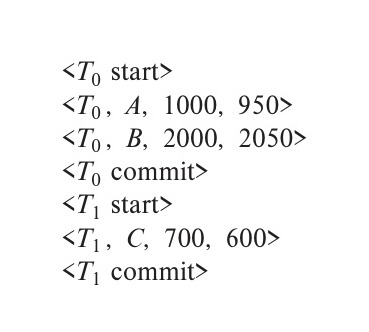
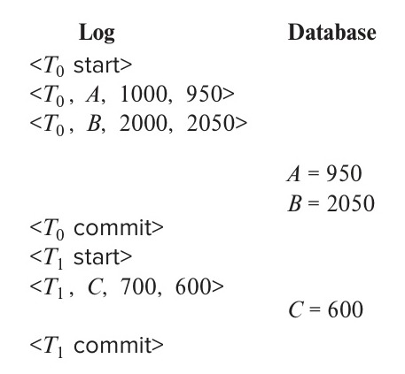
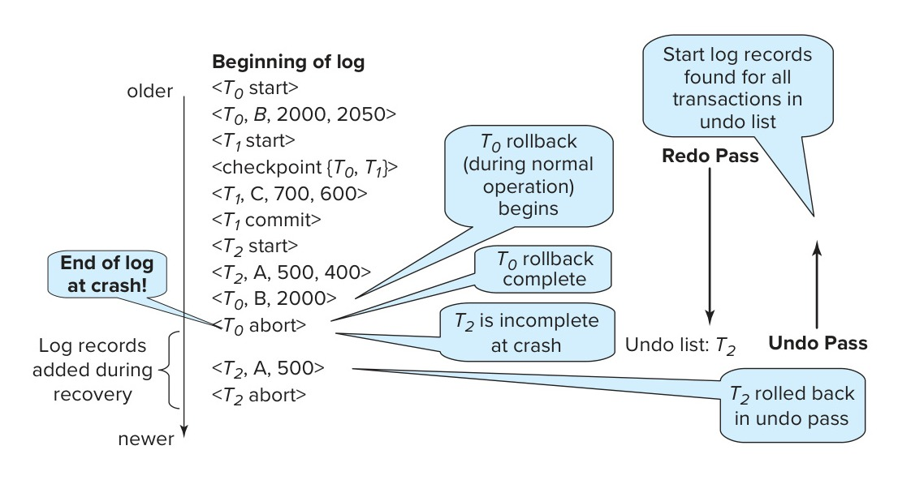
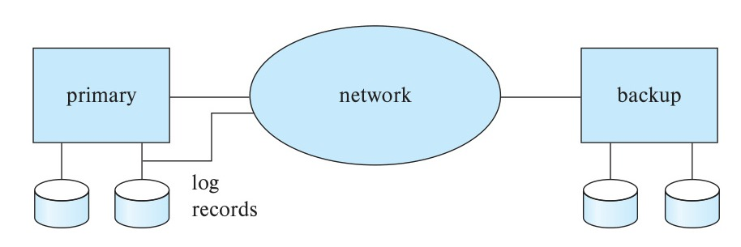
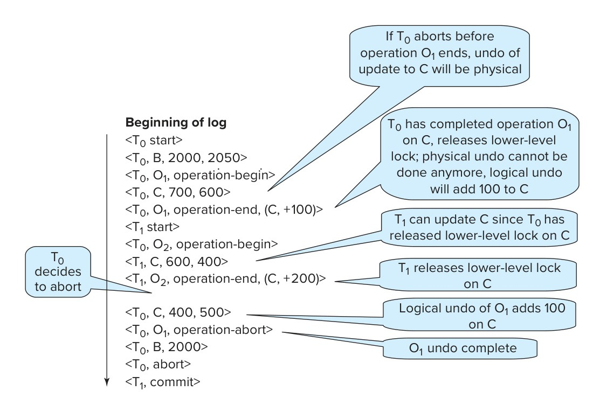
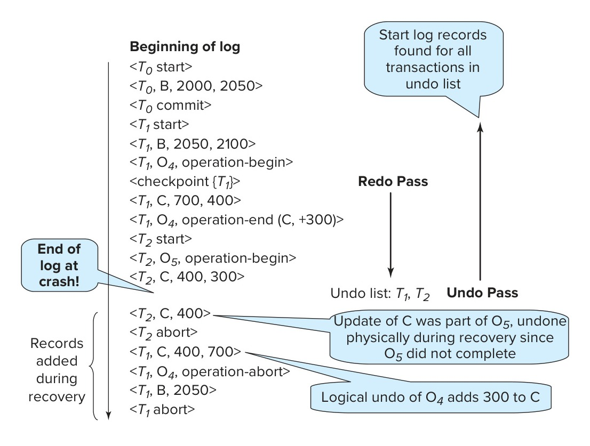
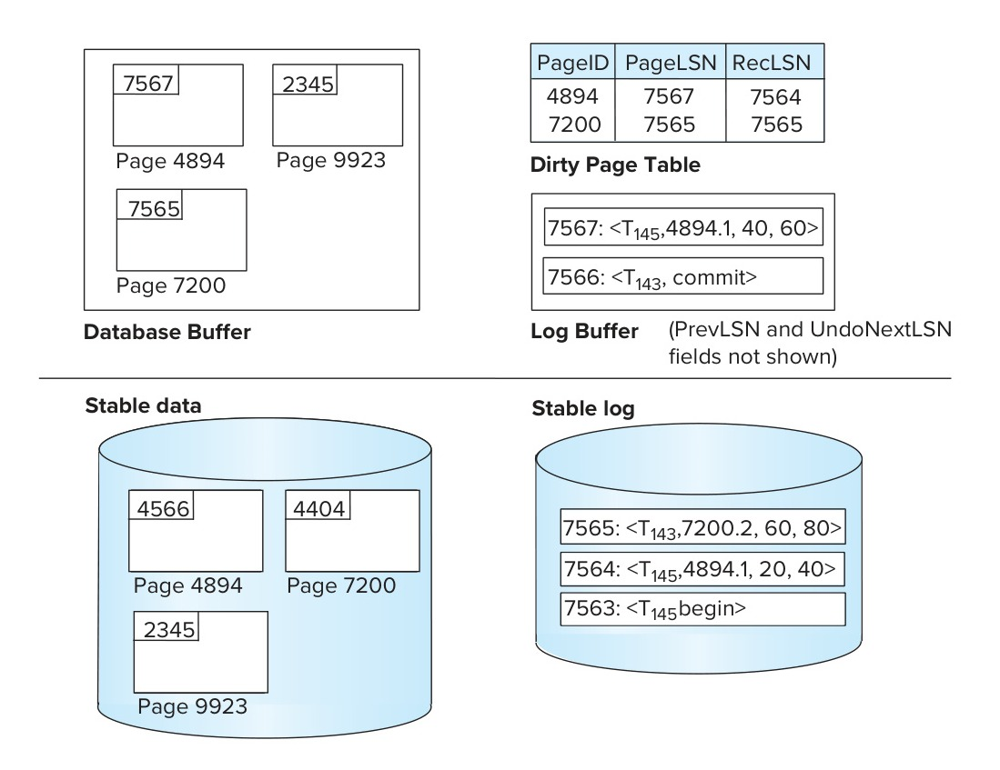
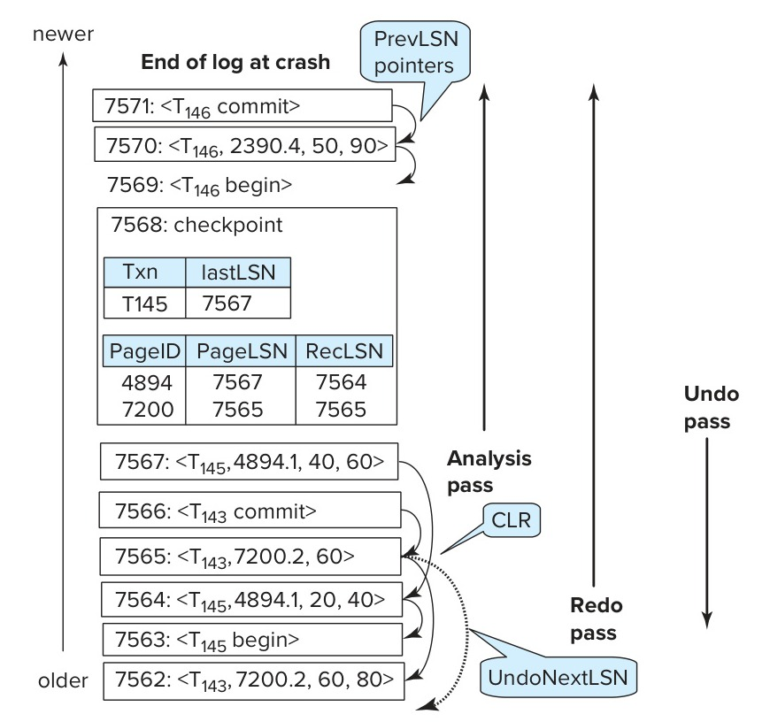

<!-- Page 907 -->

# Chapter 19: Recovery System

A computer system, like any other device, is subject to failure from a variety of causes: disk crash, power outage, software error, a fire in the machine room, even sabotage. In any failure, information may be lost. Therefore, the database system must take actions in advance to ensure that the atomicity and durability properties of transactions, introduced in Chapter 17, are preserved. An integral part of a database system is a **recovery scheme** that can restore the database to the consistent state that existed before the failure.

The recovery scheme must also support **high availability**, that is, the database should be usable for a very high percentage of time. To support high availability in the face of machine failure (as also planned machine shutdowns for hardware/software upgrades and maintenance), the recovery scheme must support the ability to keep a backup copy of the database synchronized with the current contents of the primary copy of the database. If the machine with the primary copy fails, transaction processing can continue on the backup copy.

## 19.1 Failure Classification

There are various types of failure that may occur in a system, each of which needs to be dealt with in a different manner. In this chapter, we shall consider only the following types of failure:

- **Transaction failure.** There are two types of errors that may cause a transaction to fail:
  - **Logical error.** The transaction can no longer continue with its normal execution because of some internal condition, such as bad input, data not found, overflow, or resource limit exceeded.
  - **System error.** The system has entered an undesirable state (e.g., deadlock), as a result of which a transaction cannot continue with its normal execution. The transaction, however, can be reexecuted at a later time.

<!-- Page 908 -->

- **System crash.** There is a hardware malfunction, or a bug in the database software or the operating system, that causes the loss of the content of volatile storage and brings transaction processing to a halt. The content of non-volatile storage remains intact and is not corrupted.

  The assumption that hardware errors and bugs in the software bring the system to a halt, but do not corrupt the non-volatile storage contents, is known as the **fail-stop assumption**. Well-designed systems have numerous internal checks, at the hardware and the software level, that bring the system to a halt when there is an error. Hence, the fail-stop assumption is a reasonable one.

- **Disk failure.** A disk block loses its content as a result of either a head crash or failure during a data-transfer operation. Copies of the data on other disks, or archival backups on tertiary media, such as DVD or tapes, are used to recover from the failure.

To determine how the system should recover from failures, we need to identify the failure modes of those devices used for storing data. Next, we must consider how these failure modes affect the contents of the database. We can then propose algorithms to ensure database consistency and transaction atomicity despite failures. These algorithms, known as **recovery algorithms**, have two parts:

1. Actions taken during normal transaction processing to ensure that enough information exists to allow recovery from failures.
2. Actions taken after a failure to recover the database contents to a state that ensures database consistency, transaction atomicity, and durability.

## 19.2 Storage

As we saw in Chapter 13, the various data items in the database may be stored and accessed in a number of different storage media. In Section 17.3, we saw that storage media can be distinguished by their relative speed, capacity, and resilience against failure. We identified three categories of storage:

1. **Volatile storage**
2. **Non-Volatile storage**
3. **Stable storage**

Stable storage or, more accurately, an approximation thereof, plays a critical role in recovery algorithms.

<!-- Page 909 -->

### 19.2.1 Stable-Storage Implementation

To implement stable storage, we need to replicate the needed information in several non-volatile storage media (usually disk) with independent failure modes and to update the information in a controlled manner to ensure that failure during data transfer does not damage the needed information.

Recall (from Chapter 12) that RAID systems guarantee that the failure of a single disk (even during data transfer) will not result in loss of data. The simplest and fastest form of RAID is the mirrored disk, which keeps two copies of each block on separate disks. Other forms of RAID offer lower costs, but at the expense of lower performance.

RAID systems, however, cannot guard against data loss due to disasters such as fires or flooding. Many systems store archival backups of tapes off-site to guard against such disasters. However, since tapes cannot be carried off-site continually, updates since the most recent time that tapes were carried off-site could be lost in such a disaster. More secure systems keep a copy of each block of stable storage at a remote site, writing it out over a computer network, in addition to storing the block on a local disk system. Since the blocks are output to a remote system as and when they are output to local storage, once an output operation is complete, the output is not lost, even in the event of a disaster such as a fire or flood. We study such *remote backup* systems in Section 19.7.

In the remainder of this section, we discuss how storage media can be protected from failure during data transfer. Block transfer between memory and disk storage can result in:

- **Successful completion.** The transferred information arrived safely at its destination.
- **Partial failure.** A failure occurred in the midst of transfer, and the destination block has incorrect information.
- **Total failure.** The failure occurred sufficiently early during the transfer that the destination block remains intact.

We require that, if a **data-transfer failure** occurs, the system detects it and invokes a recovery procedure to restore the block to a consistent state. To do so, the system must maintain two physical blocks for each logical database block; in the case of mirrored disks, both blocks are at the same location; in the case of remote backup, one of the blocks is local, whereas the other is at a remote site. An output operation is executed as follows:

1. Write the information onto the first physical block.
2. When the first write completes successfully, write the same information onto the second physical block.
3. The output is completed only after the second write completes successfully.

<!-- Page 910 -->

If the system fails while blocks are being written, it is possible that the two copies of a block could be inconsistent with each other. During recovery, for each block, the system would need to examine two copies of the blocks. If both are the same and no detectable error exists, then no further actions are necessary. (Recall that errors in a disk block, such as a partial write to the block, are detected by storing a checksum with each block.) If the system detects an error in one block, then it replaces its content with the content of the other block. If both blocks contain no detectable error, but they differ in content, then the system can either replace the content of the first block with the value of the second, or replace the content of the second block with the value of the first. Either way, the recovery procedure ensures that a write to stable storage either succeeds completely (i.e., updates all copies) or results in no change.

The requirement of comparing every corresponding pair of blocks during recovery is expensive to meet. We can reduce the cost greatly by keeping track of block writes that are in progress, using a small amount of non-volatile RAM. On recovery, only blocks for which writes were in progress need to be compared.

The protocols for writing out a block to a remote site are similar to the protocols for writing blocks to a mirrored disk system, which we examined in Chapter 12, and particularly in Practice Exercise 12.6.

We can extend this procedure easily to allow the use of an arbitrarily large number of copies of each block of stable storage. Although a large number of copies reduces the probability of a failure to even lower than two copies do, it is usually reasonable to simulate stable storage with only two copies.

### 19.2.2 Data Access

As we saw in Chapter 12, the database system resides permanently on non-volatile storage (usually disks), and only parts of the database are in memory at any time. (In main-memory databases, the entire database resides in memory, but a copy still resides on non-volatile storage so data can survive the loss of main-memory contents.) The database is partitioned into fixed-length storage units called **blocks**. Blocks are the units of data transfer to and from disk and may contain several data items. We shall assume that no data item spans two or more blocks. This assumption is realistic for most data-processing applications, such as a bank or a university.

Transactions input information from the disk into main memory and then output the information back onto the disk. The input and output operations are done in block units. The blocks residing on the disk are referred to as **physical blocks**; the blocks residing temporarily in main memory are referred to as **buffer blocks**. The area of memory where blocks reside temporarily is called the **disk buffer**.

Block movements between disk and main memory are initiated through the following two operations:

1. $\text{input}(B)$ transfers the physical block $B$ to main memory.

<!-- Page 911 -->

2. $\text{output}(B)$ transfers the buffer block $B$ to the disk and replaces the appropriate physical block there.

Figure 19.1 illustrates this scheme.

Conceptually, each transaction $T_i$ has a private work area in which copies of data items accessed and updated by $T_i$ are kept. The system creates this work area when the transaction is initiated; the system removes it when the transaction either commits or aborts. Each data item $X$ kept in the work area of transaction $T_i$ is denoted by $x_i$. Transaction $T_i$ interacts with the database system by transferring data to and from its work area to the system buffer. We transfer data by these two operations:

1. $\text{read}(X)$ assigns the value of data item $X$ to the local variable $x_i$. It executes this operation as follows:
   a. If block $B_X$ on which $X$ resides is not in main memory, it issues $\text{input}(B_X)$.
   b. It assigns to $x_i$ the value of $X$ from the buffer block.
2. $\text{write}(X)$ assigns the value of local variable $x_i$ to data item $X$ in the buffer block. It executes this operation as follows:
   a. If block $B_X$ on which $X$ resides is not in main memory, it issues $\text{input}(B_X)$.
   b. It assigns the value of $x_i$ to $X$ in buffer $B_X$.

Note that both operations may require the transfer of a block from disk to main memory. They do not, however, specifically require the transfer of a block from main memory to disk.

A buffer block is eventually written out to the disk either because the buffer manager needs the memory space for other purposes or because the database system wishes

*Figure 19.1 — Block storage operations.*

<!-- Page 912 -->

to reflect the change to $B$ on the disk. We shall say that the database system performs a **force-output** of buffer $B$ if it issues an $\text{output}(B)$.

When a transaction needs to access a data item $X$ for the first time, it must execute $\text{read}(X)$. The transaction then performs all updates to $X$ on $x_i$. At any point during its execution a transaction may execute $\text{write}(X)$ to reflect the change to $X$ in the database itself; $\text{write}(X)$ must certainly be done after the final write to $x_i$.

The $\text{output}(B_X)$ operation for the buffer block $B_X$ on which $X$ resides does not need to take effect immediately after $\text{write}(X)$ is executed, since the block $B_X$ may contain other data items that are still being accessed. Thus, the actual output may take place later. Notice that, if the system crashes after the $\text{write}(X)$ operation was executed but before $\text{output}(B_X)$ was executed, the new value of $X$ is never written to disk and, thus, is lost. As we shall see shortly, the database system executes extra actions to ensure that updates performed by committed transactions are not lost even if there is a system crash.

## 19.3 Recovery and Atomicity

Consider again our simplified banking system and a transaction $T_i$ that transfers \$50 from account $A$ to account $B$, with initial values of $A$ and $B$ being \$1000 and \$2000, respectively. Suppose that a system crash has occurred during the execution of $T_i$, after $\text{output}(B_A)$ has taken place, but before $\text{output}(B_B)$ was executed, where $B_A$ and $B_B$ denote the buffer blocks on which $A$ and $B$ reside. Since the memory contents were lost, we do not know the fate of the transaction.

When the system restarts, the value of $A$ would be \$950, while that of $B$ would be \$2000, which is clearly inconsistent with the atomicity requirement for transaction $T_i$. Unfortunately, there is no way to find out by examining the database state what blocks had been output and what had not before the crash. It is possible that the transaction completed, updating the database on stable storage from an initial state with the values of $A$ and $B$ being \$1000 and \$1950; it is also possible that the transaction did not affect the stable storage at all, and the values of $A$ and $B$ were \$950 and \$2000 initially; or that the updated $B$ was output but not the updated $A$; or that the updated $A$ was output but the updated $B$ was not.

Our goal is to perform either all or no database modifications made by $T_i$. However, if $T_i$ performed multiple database modifications, several output operations may be required, and a failure may occur after some of these modifications have been made, but before all of them are made.

To achieve our goal of atomicity, we must first output to stable storage information describing the modifications, without modifying the database itself. As we shall see, this information can help us ensure that all modifications performed by committed transactions are reflected in the database (perhaps during the course of recovery actions after a crash). We also need to store information about the old value of any item updated by a modification in case the transaction performing the modification

<!-- Page 913 -->

fails (aborts). This information can help us undo the modifications made by the failed transaction.

The most commonly used technique for recovery is based on log records, and we study **log-based recovery** in detail in this chapter. An alternative, called shadow copying, is used by text editors but is not used in database systems; this approach is summarized in Note 19.1 on page 914.

### 19.3.1 Log Records

The most widely used structure for recording database modifications is the **log**. The log is a sequence of **log records**, recording all the update activities in the database.

There are several types of log records. An **update log record** describes a single database write. It has these fields:

- **Transaction identifier**, which is the unique identifier of the transaction that performed the write operation.
- **Data-item identifier**, which is the unique identifier of the data item written. Typically, it is the location on disk of the data item, consisting of the block identifier of the block on which the data item resides and an offset within the block.
- **Old value**, which is the value of the data item prior to the write.
- **New value**, which is the value that the data item will have after the write.

We represent an update log record as $\langle T_i, X_j, V_1, V_2 \rangle$, indicating that transaction $T_i$ has performed a write on data item $X_j$. $X_j$ had value $V_1$ before the write and has value $V_2$ after the write. Other special log records exist to record significant events during transaction processing, such as the start of a transaction and the commit or abort of a transaction. Among the types of log records are:

- $\langle T_i\text{ start} \rangle$. Transaction $T_i$ has started.
- $\langle T_i\text{ commit} \rangle$. Transaction $T_i$ has committed.
- $\langle T_i\text{ abort} \rangle$. Transaction $T_i$ has aborted.

We shall introduce several other types of log records later.

Whenever a transaction performs a write, it is essential that the log record for that write be created and added to the log, before the database is modified. Once a log record exists, we can output the modification to the database if that is desirable. Also, we have the ability to *undo* a modification that has already been output to the database. We undo it by using the old-value field in log records.

For log records to be useful for recovery from system and disk failures, the log must reside in stable storage. For now, we assume that every log record is written to the end

<!-- Page 914 -->

> ### Note 19.1: Shadow Copies and Shadow Paging
>
> In the **shadow-copy** scheme, a transaction that wants to update the database first creates a complete copy of the database. All updates are done on the new database copy, leaving the original copy, the shadow copy, untouched. If at any point the transaction has to be aborted, the system merely deletes the new copy. The old copy of the database has not been affected. The current copy of the database is identified by a pointer, called db-pointer, which is stored on disk.
>
> If the transaction partially commits (i.e., executes its final statement) it is committed as follows: First, the operating system is asked to make sure that all pages of the new copy of the database have been written out to disk. (Unix systems use the `fsync` command for this purpose.) After the operating system has written all the pages to disk, the database system updates the pointer db-pointer to point to the new copy of the database; the new copy then becomes the current copy of the database. The old copy of the database is then deleted. The transaction is said to have been *committed* at the point where the updated db-pointer is written to disk.
>
> The implementation actually depends on the write to db-pointer being atomic; that is, either all its bytes are written or none of its bytes are written. Disk systems provide atomic updates to entire blocks, or at least to a disk sector. In other words, the disk system guarantees that it will update db-pointer atomically, as long as we make sure that db-pointer lies entirely in a single sector, which we can ensure by storing db-pointer at the beginning of a block.
>
> Shadow-copy schemes are commonly used by text editors (saving the file is equivalent to transaction commit, while quitting without saving the file is equivalent to transaction abort). Shadow copying can be used for small databases, but copying a large database would be extremely expensive. A variant of shadow copying, called **shadow paging**, reduces copying as follows: the scheme uses a page table containing pointers to all pages; the page table itself and all updated pages are copied to a new location. Any page which is not updated by a transaction is not copied, but instead the new page table just stores a pointer to the original page. When a transaction commits, it atomically updates the pointer to the page table, which acts as db-pointer to point to the new copy.
>
> Shadow paging unfortunately does not work well with concurrent transactions and is not widely used in databases.

of the log on stable storage as soon as it is created. In Section 19.5, we shall see when it is safe to relax this requirement so as to reduce the overhead imposed by logging. Observe that the log contains a complete record of all database activity. As a result, the volume of data stored in the log may become unreasonably large. In Section 19.3.6, we shall show when it is safe to erase log information.

<!-- Page 915 -->

### 19.3.2 Database Modification

As we noted earlier, a transaction creates a log record prior to modifying the database. The log records allow the system to undo changes made by a transaction in the event that the transaction must be aborted; they allow the system also to redo changes made by a transaction if the transaction has committed but the system crashed before those changes could be stored in the database on disk. In order for us to understand the role of these log records in recovery, we need to consider the steps a transaction takes in modifying a data item:

1. The transaction performs some computations in its own private part of main memory.
2. The transaction modifies the data block in the disk buffer in main memory holding the data item.
3. The database system executes the output operation that writes the data block to disk.

We say a transaction *modifies the database* if it performs an update on a disk buffer, or on the disk itself; updates to the private part of main memory do not count as database modifications. If a transaction does not modify the database until it has committed, it is said to use the **deferred-modification** technique. If database modifications occur while the transaction is still active, the transaction is said to use the **immediate-modification** technique. Deferred modification has the overhead that transactions need to make local copies of all updated data items; further, if a transaction reads a data item that it has updated, it must read the value from its local copy.

The recovery algorithms we describe in this chapter support immediate modification. As described, they work correctly even with deferred modification, but they can be optimized to reduce overhead when used with deferred modification; we leave details as an exercise.

A recovery algorithm must take into account a variety of factors, including:

- The possibility that a transaction may have committed although some of its database modifications exist only in the disk buffer in main memory and not in the database on disk.
- The possibility that a transaction may have modified the database while in the active state and, as a result of a subsequent failure, may need to abort.

Because all database modifications must be preceded by the creation of a log record, the system has available both the old value prior to the modification of the data item and the new value that is to be written for the data item. This allows the system to perform *undo* and *redo* operations as appropriate.

<!-- Page 916 -->

- The **undo** operation using a log record sets the data item specified in the log record to the old value contained in the log record.
- The **redo** operation using a log record sets the data item specified in the log record to the new value contained in the log record.

### 19.3.3 Concurrency Control and Recovery

If the concurrency control scheme allows a data item $X$ that has been modified by a transaction $T_1$ to be further modified by another transaction $T_2$ before $T_1$ commits, then undoing the effects of $T_1$ by restoring the old value of $X$ (before $T_1$ updated $X$) would also undo the effects of $T_2$. To avoid such situations, recovery algorithms usually require that if a data item has been modified by a transaction, no other transaction can modify the data item until the first transaction commits or aborts.

This requirement can be ensured by acquiring an exclusive lock on any updated data item and holding the lock until the transaction commits; in other words, by using strict two-phase locking. Snapshot isolation and validation-based concurrency-control techniques also acquire exclusive locks on data items at the time of validation, before modifying the data items, and hold the locks until the transaction is committed; as a result the above requirement is satisfied even by these concurrency control protocols.

We discuss in Section 19.8 how the above requirement can be relaxed in certain cases.

When either snapshot isolation or validation is used for concurrency control, database updates of a transaction are (conceptually) deferred until the transaction is partially committed; the deferred-modification technique is a natural fit with these concurrency control schemes. However, it is worth noting that some implementations of snapshot isolation use immediate modification but provide a logical snapshot on demand: when a transaction needs to read an item that a concurrent transaction has updated, a copy of the (already updated) item is made, and updates made by concurrent transactions are rolled back on the copy of the item. Similarly, immediate modification of the database is a natural fit with two-phase locking, but deferred modification can also be used with two-phase locking.

*Figure 19.2 — Portion of the system log corresponding to $T_0$ and $T_1$.*

<!-- Page 917 -->

### 19.3.4 Transaction Commit

We say that a transaction has committed when its commit log record, which is the last log record of the transaction, has been output to stable storage; at that point all earlier log records have already been output to stable storage. Thus, there is enough information in the log to ensure that even if there is a system crash, the updates of the transaction can be redone. If a system crash occurs before a log record $\langle T_i\text{ commit} \rangle$ is output to stable storage, transaction $T_i$ will be rolled back. Thus, the output of the block containing the commit log record is the single atomic action that results in a transaction getting committed.[^1]

With most log-based recovery techniques, including the ones we describe in this chapter, blocks containing the data items modified by a transaction do not have to be output to stable storage when the transaction commits but can be output some time later. We discuss this issue further in Section 19.5.2.

### 19.3.5 Using the Log to Redo and Undo Transactions

We now provide an overview of how the log can be used to recover from a system crash and to roll back transactions during normal operation. However, we postpone details of the procedures for failure recovery and rollback to Section 19.4.

Consider our simplified banking system. Let $T_0$ be a transaction that transfers \$50 from account $A$ to account $B$:

$$
\begin{aligned}
T_0\text{:} &\quad \text{read}(A); \\
&\quad A := A - 50; \\
&\quad \text{write}(A); \\
&\quad \text{read}(B); \\
&\quad B := B + 50; \\
&\quad \text{write}(B).
\end{aligned}
$$

Let $T_1$ be a transaction that withdraws \$100 from account $C$:

$$
\begin{aligned}
T_1\text{:} &\quad \text{read}(C); \\
&\quad C := C - 100; \\
&\quad \text{write}(C).
\end{aligned}
$$

The portion of the log containing the relevant information concerning these two transactions appears in Figure 19.2.

Figure 19.3 shows one possible order in which the actual outputs took place in both the database system and the log as a result of the execution of $T_0$ and $T_1$.[^2]

[^1]: The output of a block can be made atomic by techniques for dealing with data-transfer failure, as described in Section 19.2.1.
[^2]: Notice that this order could not be obtained using the deferred-modification technique, because the database is modified by $T_0$ before it commits, and likewise for $T_1$.

<!-- Page 918 -->

*Figure 19.3 — State of system log and database corresponding to $T_0$ and $T_1$.*

Using the log, the system can handle any failure that does not result in the loss of information in non-volatile storage. The recovery scheme uses two recovery procedures. Both these procedures make use of the log to find the set of data items updated by each transaction $T_i$ and their respective old and new values.

- $\text{redo}(T_i)$. The procedure sets the value of all data items updated by transaction $T_i$ to the new values. The order in which updates are carried out by **redo** is important; when recovering from a system crash, if updates to a particular data item are applied in an order different from the order in which they were applied originally, the final state of that data item will have a wrong value. Most recovery algorithms, including the one we describe in Section 19.4, do not perform redo of each transaction separately; instead they perform a single scan of the log, during which redo actions are performed for each log record as it is encountered. This approach ensures the order of updates is preserved, and it is more efficient since the log needs to be read only once overall, instead of once per transaction.
- $\text{undo}(T_i)$. The procedure restores the value of all data items updated by transaction $T_i$ to the old values. In the recovery scheme that we describe in Section 19.4:
  - The undo operation not only restores the data items to their old value, but also writes log records to record the updates performed as part of the undo process. These log records are special **redo-only** log records, since they do not need to contain the old value of the updated data item; note that when such log records are used during undo, the “old value” is actually the value written by the transaction that is being rolled back, and the “new value” is the original value that is being restored by the undo operation.

    As with the redo procedure, the order in which undo operations are performed is important; again we postpone details to Section 19.4.

<!-- Page 919 -->

  - When the undo operation for transaction $T_i$ completes, it writes a $\langle T_i\text{ abort} \rangle$ log record, indicating that the undo has completed.

    As we shall see in Section 19.4, the $\text{undo}(T_i)$ procedure is executed only once for a transaction, if the transaction is rolled back during normal processing or if on recovering from a system crash, neither a commit nor an abort record is found for transaction $T_i$. As a result, every transaction will eventually have either a commit or an abort record in the log.

After a system crash has occurred, the system consults the log to determine which transactions need to be redone and which need to be undone so as to ensure atomicity.

- Transaction $T_i$ needs to be undone if the log contains the record $\langle T_i\text{ start} \rangle$ but does not contain either the record $\langle T_i\text{ commit} \rangle$ or the record $\langle T_i\text{ abort} \rangle$.
- Transaction $T_i$ needs to be redone if the log contains the record $\langle T_i\text{ start} \rangle$ and either the record $\langle T_i\text{ commit} \rangle$ or the record $\langle T_i\text{ abort} \rangle$. It may seem strange to redo $T_i$ if the record $\langle T_i\text{ abort} \rangle$ is in the log. To see why this works, note that if $\langle T_i\text{ abort} \rangle$ is in the log, so are the redo-only records written by the undo operation. Thus, the end result will be to undo $T_i$’s modifications in this case. This slight redundancy simplifies the recovery algorithm and enables faster overall recovery time.

As an illustration, return to our banking example, with transaction $T_0$ and $T_1$ executed one after the other in the order $T_0$ followed by $T_1$. Suppose that the system crashes before the completion of the transactions. We shall consider three cases. The state of the logs for each of these cases appears in Figure 19.4.

First, let us assume that the crash occurs just after the log record for the step:

$$\text{write}(B)$$

of transaction $T_0$ has been written to stable storage (Figure 19.4a). When the system comes back up, it finds the record $\langle T_0\text{ start} \rangle$ in the log, but no corresponding $\langle T_0\text{ commit} \rangle$ or $\langle T_0\text{ abort} \rangle$ record. Thus, transaction $T_0$ must be undone, so an $\text{undo}(T_0)$ is performed. As a result, the values in accounts $A$ and $B$ (on the disk) are restored to \$1000 and \$2000, respectively.

Next, let us assume that the crash comes just after the log record for the step:

$$\text{write}(C)$$

of transaction $T_1$ has been written to stable storage (Figure 19.4b). When the system comes back up, two recovery actions need to be taken. The operation $\text{undo}(T_1)$ must be performed, since the record $\langle T_1\text{ start} \rangle$ appears in the log, but there is no record $\langle T_1\text{ commit} \rangle$ or $\langle T_1\text{ abort} \rangle$. The operation $\text{redo}(T_0)$ must be performed, since the log contains both the record $\langle T_0\text{ start} \rangle$ and the record $\langle T_0\text{ commit} \rangle$. At the end of

<!-- Page 920 -->

*Figure 19.4 — The same log, shown at three different times.*

the entire recovery procedure, the values of accounts $A$, $B$, and $C$ are \$950, \$2050, and \$700, respectively.

Finally, let us assume that the crash occurs just after the log record:

$$\langle T_1\text{ commit} \rangle$$

has been written to stable storage (Figure 19.4c). When the system comes back up, both $T_0$ and $T_1$ need to be redone, since the records $\langle T_0\text{ start} \rangle$ and $\langle T_0\text{ commit} \rangle$ appear in the log, as do the records $\langle T_1\text{ start} \rangle$ and $\langle T_1\text{ commit} \rangle$. After the system performs the recovery procedures $\text{redo}(T_0)$ and $\text{redo}(T_1)$, the values in accounts $A$, $B$, and $C$ are \$950, \$2050, and \$600, respectively.

### 19.3.6 Checkpoints

When a system crash occurs, we must consult the log to determine those transactions that need to be redone and those that need to be undone. In principle, we need to search the entire log to determine this information. There are two major difficulties with this approach:

1. The search process is time-consuming.
2. Most of the transactions that, according to our algorithm, need to be redone have already written their updates into the database. Although redoing them will cause no harm, it will nevertheless cause recovery to take longer.

To reduce these types of overhead, we introduce **checkpoints**.

We describe below a simple checkpoint scheme that (a) does not permit any updates to be performed while the checkpoint operation is in progress, and (b) outputs all modified buffer blocks to disk when the checkpoint is performed. We discuss later how to modify the checkpointing and recovery procedures to provide more flexibility by relaxing both these requirements.

A checkpoint is performed as follows:

<!-- Page 921 -->

1. Output onto stable storage all log records currently residing in main memory.
2. Output to the disk all modified buffer blocks.
3. Output onto stable storage a log record of the form $\langle\text{checkpoint } L\rangle$, where $L$ is a list of transactions active at the time of the checkpoint.

Transactions are not allowed to perform any update actions, such as writing to a buffer block or writing a log record, while a checkpoint is in progress. We discuss how this requirement can be enforced in Section 19.5.2.

The presence of a $\langle\text{checkpoint } L\rangle$ record in the log allows the system to streamline its recovery procedure. Consider a transaction $T_i$ that completed prior to the checkpoint. For such a transaction, the $\langle T_i\text{ commit} \rangle$ record (or $\langle T_i\text{ abort} \rangle$ record) appears in the log before the $\langle\text{checkpoint}\rangle$ record. Any database modifications made by $T_i$ must have been written to the database either prior to the checkpoint or as part of the checkpoint itself. Thus, at recovery time, there is no need to perform a redo operation on $T_i$.

After a system crash has occurred, the system examines the log to find the last $\langle\text{checkpoint } L\rangle$ record (this can be done by searching the log backward, from the end of the log, until the first $\langle\text{checkpoint } L\rangle$ record is found).

The redo or undo operations need to be applied only to transactions in $L$, and to all transactions that started execution after the $\langle\text{checkpoint } L\rangle$ record was written to the log. Let us denote this set of transactions as $T$.

- For all transactions $T_k$ in $T$ that have no $\langle T_k\text{ commit} \rangle$ record or $\langle T_k\text{ abort} \rangle$ record in the log, execute $\text{undo}(T_k)$.
- For all transactions $T_k$ in $T$ such that either the record $\langle T_k\text{ commit} \rangle$ or the record $\langle T_k\text{ abort} \rangle$ appears in the log, execute $\text{redo}(T_k)$.

Note that we need only examine the part of the log starting with the last checkpoint log record to find the set of transactions $T$ and to find out whether a commit or abort record occurs in the log for each transaction in $T$.

As an illustration, consider the set of transactions $\{T_0, T_1, \ldots , T_{100}\}$. Suppose that the most recent checkpoint took place during the execution of transaction $T_{67}$ and $T_{69}$, while $T_{68}$ and all transactions with subscripts lower than 67 completed before the checkpoint. Thus, only transactions $T_{67}, T_{69}, \ldots , T_{100}$ need to be considered during the recovery scheme. Each of them needs to be redone if it has completed (i.e., either committed or aborted); otherwise, it was incomplete and needs to be undone.

Consider the set of transactions $L$ in a checkpoint log record. For each transaction $T_i$ in $L$, log records of the transaction that occur prior to the checkpoint log record may be needed to undo the transaction, in case it does not commit. However, all log records prior to the earliest of the $\langle T_i\text{ start} \rangle$ log records, among transactions $T_i$ in $L$,

<!-- Page 922 -->

are not needed once the checkpoint has completed. These log records can be erased whenever the database system needs to reclaim the space occupied by these records.

The requirement that transactions must not perform any updates to buffer blocks or to the log during checkpointing can be bothersome, since transaction processing has to halt while a checkpoint is in progress. A **fuzzy checkpoint** is a checkpoint where transactions are allowed to perform updates even while buffer blocks are being written out. Section 19.5.4 describes fuzzy-checkpointing schemes. Later in Section 19.9 we describe a checkpoint scheme that is not only fuzzy, but does not even require all modified buffer blocks to be output to disk at the time of the checkpoint.

## 19.4 Recovery Algorithm

Until now, in discussing recovery, we have identified transactions that need to be redone and those that need to be undone, but we have not given a precise algorithm for performing these actions. We are now ready to present the full recovery algorithm using log records for recovery from transaction failure and a combination of the most recent checkpoint and log records to recover from a system crash.

The recovery algorithm described in this section requires that a data item that has been updated by an uncommitted transaction cannot be modified by any other transaction, until the first transaction has either committed or aborted. Recall that this restriction was discussed in Section 19.3.3.

### 19.4.1 Transaction Rollback

First consider transaction rollback during normal operation (i.e., not during recovery from a system crash). Rollback of a transaction $T_i$ is performed as follows:

1. The log is scanned backward, and for each log record of $T_i$ of the form $\langle T_i, X_j, V_1, V_2 \rangle$ that is found:
   a. The value $V_1$ is written to data item $X_j$, and
   b. A special redo-only log record $\langle T_i, X_j, V_1 \rangle$ is written to the log, where $V_1$ is the value being restored to data item $X_j$ during the rollback. These log records are sometimes called **compensation log records**. Such records do not need undo information, since we never need to undo such an undo operation. We shall explain later how they are used.
2. Once the log record $\langle T_i\text{ start} \rangle$ is found, the backward scan is stopped, and a log record $\langle T_i\text{ abort} \rangle$ is written to the log.

Observe that every update action performed by the transaction or on behalf of the transaction, including actions taken to restore data items to their old value, have now been recorded in the log. In Section 19.4.2 we shall see why this is a good idea.

<!-- Page 923 -->

### 19.4.2 Recovery After a System Crash

Recovery actions, when the database system is restarted after a crash, take place in two phases:

1. In the **redo phase**, the system replays updates of all transactions by scanning the log forward from the last checkpoint. The log records that are replayed include log records for transactions that were rolled back before system crash, and those that had not committed when the system crash occurred.

   This phase also determines all transactions that were incomplete at the time of the crash, and must therefore be rolled back. Such incomplete transactions would either have been active at the time of the checkpoint, and thus would appear in the transaction list in the checkpoint record, or would have started later; further, such incomplete transactions would have neither a $\langle T_i\text{ abort} \rangle$ nor a $\langle T_i\text{ commit} \rangle$ record in the log.

   The specific steps taken while scanning the log are as follows:
   a. The list of transactions to be rolled back, **undo-list**, is initially set to the list $L$ in the $\langle\text{checkpoint } L\rangle$ log record.
   b. Whenever a normal log record of the form $\langle T_i, X_j, V_1, V_2 \rangle$, or a redo-only log record of the form $\langle T_i, X_j, V_2 \rangle$ is encountered, the operation is redone; that is, the value $V_2$ is written to data item $X_j$.
   c. Whenever a log record of the form $\langle T_i\text{ start} \rangle$ is found, $T_i$ is added to **undo-list**.
   d. Whenever a log record of the form $\langle T_i\text{ abort} \rangle$ or $\langle T_i\text{ commit} \rangle$ is found, $T_i$ is removed from **undo-list**.

   At the end of the redo phase, **undo-list** contains the list of all transactions that are incomplete, that is, they neither committed nor completed rollback before the crash.

2. In the **undo phase**, the system rolls back all transactions in the **undo-list**. It performs rollback by scanning the log backward from the end.
   a. Whenever it finds a log record belonging to a transaction in the **undo-list**, it performs undo actions just as if the log record had been found during the rollback of a failed transaction.
   b. When the system finds a $\langle T_i\text{ start} \rangle$ log record for a transaction $T_i$ in **undo-list**, it writes a $\langle T_i\text{ abort} \rangle$ log record to the log and removes $T_i$ from **undo-list**.
   c. The undo phase terminates once **undo-list** becomes empty, that is, the system has found $\langle T_i\text{ start} \rangle$ log records for all transactions that were initially in **undo-list**.

<!-- Page 924 -->

After the undo phase of recovery terminates, normal transaction processing can resume.

Observe that the redo phase replays every log record since the most recent checkpoint record. In other words, this phase of restart recovery repeats all the update actions that were executed after the checkpoint, and whose log records reached the stable log. The actions include actions of incomplete transactions and the actions carried out to roll back failed transactions. The actions are repeated in the same order in which they were originally carried out; hence, this process is called **repeating history**. Although it may appear wasteful, repeating history even for failed transactions simplifies recovery schemes.

Figure 19.5 shows an example of actions logged during normal operation and actions performed during failure recovery. In the log shown in the figure, transaction $T_1$ had committed, and transaction $T_0$ had been completely rolled back, before the system crashed. Observe how the value of data item $B$ is restored during the rollback of $T_0$. Observe also the checkpoint record, with the list of active transactions containing $T_0$ and $T_1$.

When recovering from a crash, in the redo phase, the system performs a redo of all operations after the last checkpoint record. In this phase, the list undo-list initially contains $T_0$ and $T_1$; $T_1$ is removed first when its commit log record is found, while $T_2$ is added when its start log record is found. Transaction $T_0$ is removed from undo-list when its abort log record is found, leaving only $T_2$ in undo-list. The undo phase scans the log backwards from the end, and when it finds a log record of $T_2$ updating $A$, the old value of $A$ is restored, and a redo-only log record is written to the log. When the

*Figure 19.5 — Example of logged actions and actions during recovery.*

<!-- Page 925 -->

start record for $T_2$ is found, an abort record is added for $T_2$. Since undo-list contains no more transactions, the undo phase terminates, completing recovery.

### 19.4.3 Optimizing Commit Processing

Committing a transaction requires that its log records have been forced to disk. If a separate log flush is done for each transaction, each commit incurs a significant log write overhead. The rate of transaction commit can be increased using the **group-commit** technique. With this technique, instead of attempting to force the log as soon as a transaction completes, the system waits until several transactions have completed, or a certain period of time has passed since a transaction completed execution. It then commits the group of transactions that are waiting, together. Blocks written to the log on stable storage would contain records of several transactions. By careful choice of group size and maximum waiting time, the system can ensure that blocks are full when they are written to stable storage without making transactions wait excessively. This technique results, on average, in fewer output operations per committed transaction.

If logging is done to hard disk, writing a block of data can take about 5 to 10 milliseconds. As a result, without group commit, at most 100 to 200 transactions can be committed per second. If records of 10 transactions fit in a disk block, group commit will allow 1000 to 2000 transactions to be committed per second.

If logging is done to flash, writing a block can take about 100 microseconds, allowing 10,000 transactions to be committed per second without group commit. If records of 10 transactions fit in a disk block, group commit will allow 100,000 transactions to be committed per second on flash. A further benefit of group commit with flash is that it minimizes the number of times the same page is written, which in turn minimizes the number of erase operations, which can be expensive. (Recall that flash storage systems remap logical pages to a pre-erased physical page, avoiding delay at the time a page is written, but the erase operation must be performed eventually as part of garbage collection of old versions of pages.)

Although group commit reduces the overhead imposed by logging, it results in a slight delay in commit of transactions that perform updates. When the rate of commits is low, the delay may not be worth the benefit, but with high rates of transaction commit, the overall delay in commit is actually reduced by using group commit.

In addition to optimizations done at the database, programmers can also take some steps to improve transaction commit performance. For example, consider an application that loads data into a database. If the application performs each insert as a separate transaction, the number of inserts that can be performed per second is limited by the number of blocks writes that can be performed per second. If the application waits for one insert to finish before starting the next one, group commit does not offer any benefits and in fact may slow the system down. However, in such a case, performance can be significantly improved by performing a batch of inserts as a single transaction. The log records corresponding to multiple inserts are then written together in one page. The number of inserts that can be performed per second then increases correspondingly.

<!-- Page 926 -->

## 19.5 Buffer Management

In this section, we consider several subtle details that are essential to the implementation of a crash-recovery scheme that ensures data consistency and imposes a minimal amount of overhead on interactions with the database.

### 19.5.1 Log-Record Buffering

So far, we have assumed that every log record is output to stable storage at the time it is created. This assumption imposes a high overhead on system execution for several reasons: Typically, output to stable storage is in units of blocks. In most cases, a log record is much smaller than a block. Thus, the output of each log record translates to a much larger output at the physical level. Furthermore, as we saw in Section 19.2.1, the output of a block to stable storage may involve several output operations at the physical level.

The cost of outputting a block to stable storage is sufficiently high that it is desirable to output multiple log records at once. To do so, we write log records to a **log buffer** in main memory, where they stay temporarily until they are output to stable storage. Multiple log records can be gathered in the log buffer and output to stable storage in a single output operation. The order of log records in the stable storage must be exactly the same as the order in which they were written to the log buffer.

As a result of log buffering, a log record may reside in only main memory (volatile storage) for a considerable time before it is output to stable storage. Since such log records are lost if the system crashes, we must impose additional requirements on the recovery techniques to ensure transaction atomicity:

- Transaction $T_i$ enters the commit state after the $\langle T_i\text{ commit} \rangle$ log record has been output to stable storage.
- Before the $\langle T_i\text{ commit} \rangle$ log record can be output to stable storage, all log records pertaining to transaction $T_i$ must have been output to stable storage.
- Before a block of data in main memory can be output to the database (in non-volatile storage), all log records pertaining to data in that block must have been output to stable storage.

This rule is called the **write-ahead logging** (**WAL**) rule. (Strictly speaking, the WAL rule requires only that the undo information in the log has been output to stable storage, and it permits the redo information to be written later. The difference is relevant in systems where undo information and redo information are stored in separate log records.)

The three rules state situations in which certain log records must have been output to stable storage. There is no problem resulting from the output of log records earlier than necessary. Thus, when the system finds it necessary to output a log record to

<!-- Page 927 -->

stable storage, it outputs an entire block of log records, if there are enough log records in main memory to fill a block. If there are insufficient log records to fill the block, all log records in main memory are combined into a partially full block and are output to stable storage.

Writing the buffered log to disk is sometimes referred to as a **log force**.

### 19.5.2 Database Buffering

In Section 19.2.2, we described the use of a two-level storage hierarchy. The system stores the database in non-volatile storage (disk), and brings blocks of data into main memory as needed. Since main memory is typically much smaller than the entire database, it may be necessary to overwrite a block $B_1$ in main memory when another block $B_2$ needs to be brought into memory. If $B_1$ has been modified, $B_1$ must be output prior to the input of $B_2$. As discussed in Section 13.5.1 this storage hierarchy is similar to the standard operating-system concept of virtual memory.

One might expect that transactions would force-output all modified blocks to disk when they commit. Such a policy is called the **force policy**. The alternative, the **no-force policy**, allows a transaction to commit even if it has modified some blocks that have not yet been written back to disk. All the recovery algorithms described in this chapter work correctly even with the no-force policy. The no-force policy allows faster commit of transactions; moreover it allows multiple updates to accumulate on a block before it is output to stable storage, which can reduce the number of output operations greatly for frequently updated blocks. As a result, the standard approach taken by most systems is the no-force policy.

Similarly, one might expect that blocks modified by a transaction that is still active should not be written to disk. This policy is called the **no-steal policy**. The alternative, the **steal policy**, allows the system to write modified blocks to disk even if the transactions that made those modifications have not all committed. As long as the write-ahead logging rule is followed, all the recovery algorithms we study in the chapter work correctly even with the steal policy. Further, the no-steal policy does not work with transactions that perform a large number of updates, since the buffer may get filled with updated pages that cannot be evicted to disk, and the transaction cannot then proceed. As a result, the standard approach taken by most systems is the steal policy.

To illustrate the need for the write-ahead logging requirement, consider our banking example with transactions $T_0$ and $T_1$. Suppose that the state of the log is:

$$\langle T_0\text{ start} \rangle$$
$$\langle T_0, A, 1000, 950 \rangle$$

and that transaction $T_0$ issues a $\text{read}(B)$. Assume that the block on which $B$ resides is not in main memory and that main memory is full. Suppose that the block on which $A$ resides is chosen to be output to disk. If the system outputs this block to disk and then a crash occurs, the values in the database for accounts $A$, $B$, and $C$ are \$950, \$2000, and

<!-- Page 928 -->

\$700, respectively. This database state is inconsistent. However, because of the WAL requirements, the log record:

$$\langle T_0, A, 1000, 950 \rangle$$

must be output to stable storage prior to output of the block on which $A$ resides. The system can use the log record during recovery to bring the database back to a consistent state.

When a block $B_1$ is to be output to disk, all log records pertaining to data in $B_1$ must be output to stable storage before $B_1$ is output. It is important that no writes to the block $B_1$ be in progress while the block is being output, since such a write could violate the write-ahead logging rule. We can ensure that there are no writes in progress by using a special means of locking:

- Before a transaction performs a write on a data item, it acquires an exclusive lock on the block in which the data item resides. The lock is released immediately after the update has been performed.
- The following sequence of actions is taken when a block is to be output:
  - Obtain an exclusive lock on the block, to ensure that no transaction is performing a write on the block.
  - Output log records to stable storage until all log records pertaining to block $B_1$ have been output.
  - Output block $B_1$ to disk.
  - Release the lock once the block output has completed.

Locks on buffer blocks are unrelated to locks used for concurrency control of transactions, and releasing them in a non-two-phase manner does not have any implications on transaction serializability. These locks, and other similar locks that are held for a short duration, are often referred to as **latches**.

Locks on buffer blocks can also be used to ensure that buffer blocks are not updated, and log records are not generated, while a checkpoint is in progress. This restriction may be enforced by acquiring exclusive locks on all buffer blocks, as well as an exclusive lock on the log, before the checkpoint operation is performed. These locks can be released as soon as the checkpoint operation has completed.

Database systems usually have a process that continually cycles through the buffer blocks, outputting modified buffer blocks back to disk. The above locking protocol must of course be followed when the blocks are output. As a result of continuous output of modified blocks, the number of **dirty blocks** in the buffer, that is, blocks that have been modified in the buffer but have not been subsequently output, is minimized. Thus, the number of blocks that have to be output during a checkpoint is minimized; further,

<!-- Page 929 -->

when a block needs to be evicted from the buffer, it is likely that there will be a non-dirty block available for eviction, allowing the input to proceed immediately instead of waiting for an output to complete.

### 19.5.3 Operating System Role in Buffer Management

We can manage the database buffer by using one of two approaches:

1. The database system reserves part of main memory to serve as a buffer that it, rather than the operating system, manages. The database system manages data-block transfer in accordance with the requirements in Section 19.5.2.

   This approach has the drawback of limiting flexibility in the use of main memory. The buffer must be kept small enough that other applications have sufficient main memory available for their needs. However, even when the other applications are not running, the database will not be able to make use of all the available memory. Likewise, non-database applications may not use that part of main memory reserved for the database buffer, even if some of the pages in the database buffer are not being used.

2. The database system implements its buffer within the virtual memory provided by the operating system. Since the operating system knows about the memory requirements of all processes in the system, ideally it should be in charge of deciding what buffer blocks must be force-output to disk, and when. But, to ensure the write-ahead logging requirements in Section 19.5.1, the operating system should not write out the database buffer pages itself, but instead should request the database system to force-output the buffer blocks. The database system in turn would force-output the buffer blocks to the database, after writing relevant log records to stable storage.

   Unfortunately, almost all current-generation operating systems retain complete control of virtual memory. The operating system reserves space on disk for storing virtual-memory pages that are not currently in main memory; this space is called **swap space**. If the operating system decides to output a block $B_x$, that block is output to the swap space on disk, and there is no way for the database system to get control of the output of buffer blocks.

   Therefore, if the database buffer is in virtual memory, transfers between database files and the buffer in virtual memory must be managed by the database system, which enforces the write-ahead logging requirements that we discussed.

   This approach may result in extra output of data to disk. If a block $B_x$ is output by the operating system, that block is not output to the database. Instead, it is output to the swap space for the operating system’s virtual memory. When the database system needs to output $B_x$, the operating system may need first to input $B_x$ from its swap space. Thus, instead of a single output of $B_x$, there may be two outputs of $B_x$ (one by the operating system, and one by the database system) and one extra input of $B_x$.

<!-- Page 930 -->

Although both approaches suffer from some drawbacks, one or the other must be chosen unless the operating system is designed to support the requirements of database logging.

### 19.5.4 Fuzzy Checkpointing

The checkpointing technique described in Section 19.3.6 requires that all updates to the database be temporarily suspended while the checkpoint is in progress. If the number of pages in the buffer is large, a checkpoint may take a long time to finish, which can result in an unacceptable interruption in processing of transactions.

To avoid such interruptions, the checkpointing technique can be modified to permit updates to start once the checkpoint record has been written, but before the modified buffer blocks are written to disk. The checkpoint thus generated is a **fuzzy checkpoint**.

Since pages are output to disk only after the checkpoint record has been written, it is possible that the system could crash before all pages are written. Thus, a checkpoint on disk may be incomplete. One way to deal with incomplete checkpoints is this: The location in the log of the checkpoint record of the last completed checkpoint is stored in a fixed position, *last-checkpoint*, on disk. The system does not update this information when it writes the checkpoint record. Instead, before it writes the checkpoint record, it creates a list of all modified buffer blocks. The *last-checkpoint* information is updated only after all buffer blocks in the list of modified buffer blocks have been output to disk.

Even with fuzzy checkpointing, a buffer block must not be updated while it is being output to disk, although other buffer blocks may be updated concurrently. The write-ahead log protocol must be followed so that (undo) log records pertaining to a block are on stable storage before the block is output.

## 19.6 Failure with Loss of Non-Volatile Storage

Until now, we have considered only the case where a failure results in the loss of information residing in volatile storage while the content of the non-volatile storage remains intact. Although failures in which the content of non-volatile storage is lost are rare, we nevertheless need to be prepared to deal with this type of failure. In this section, we discuss only disk storage. Our discussions apply as well to other non-volatile storage types.

The basic scheme is to dump the entire contents of the database to stable storage periodically—say, once per day. For example, we may dump the database to one or more magnetic tapes. If a failure occurs that results in the loss of physical database blocks, the system uses the most recent dump in restoring the database to a previous consistent state. Once this restoration has been accomplished, the system uses the log to bring the database system to the most recent consistent state.

One approach to database dumping requires that no transaction may be active during the dump procedure, and it uses a procedure similar to checkpointing:

<!-- Page 931 -->

1. Output all log records currently residing in main memory onto stable storage.
2. Output all buffer blocks onto the disk.
3. Copy the contents of the database to stable storage.
4. Output a log record $\langle\text{dump}\rangle$ onto the stable storage.

Steps 1, 2, and 4 correspond to the three steps used for checkpoints in Section 19.3.6.

To recover from the loss of non-volatile storage, the system restores the database to disk by using the most recent dump. Then, it consults the log and redoes all the actions since the most recent dump occurred. Notice that no undo operations need to be executed.

In case of a partial failure of non-volatile storage, such as the failure of a single block or a few blocks, only those blocks need to be restored, and redo actions performed only for those blocks.

A dump of the database contents is also referred to as an **archival dump**, since we can archive the dumps and use them later to examine old states of the database. Dumps of a database and checkpointing of buffers are similar.

Most database systems also support an **SQL dump**, which writes out SQL DDL statements and SQL insert statements to a file, which can then be reexecuted to re-create the database. Such dumps are useful when migrating data to a different instance of the database, or to a different version of the database software, since the physical locations and layout may be different in the other database instance or database software version.

The simple dump procedure described here is costly for the following two reasons. First, the entire database must be copied to stable storage, resulting in considerable data transfer. Second, since transaction processing is halted during the dump procedure, CPU cycles are wasted. Fuzzy dump schemes have been developed that allow transactions to be active while the dump is in progress. They are similar to fuzzy-checkpointing schemes; see the bibliographical notes for more details.

## 19.7 High Availability Using Remote Backup Systems

Traditional transaction-processing systems are centralized or client–server systems. Such systems are vulnerable to environmental disasters such as fire, flooding, or earthquakes. Today’s applications need transaction-processing systems that can function in spite of system failures or environmental disasters. Such systems must provide **high availability**; that is, the time for which the system is unusable must be extremely short.

We can achieve high availability by performing transaction processing at one site, called the **primary site**, and having a **remote backup site** where all the data from the primary site are replicated. The remote backup site is sometimes also called the **secondary site**. The remote site must be kept synchronized with the primary site as updates are performed at the primary. We achieve synchronization by sending all log records from the primary site to the remote backup site. The remote backup site must be physically

<!-- Page 932 -->

*Figure 19.6 — Architecture of remote backup system.*

separated from the primary—for example, we can locate it in a different state—so that a disaster such as a fire, flood or an earthquake at the primary does not also damage the remote backup site.[^3] Figure 19.6 shows the architecture of a remote backup system.

When the primary site fails, the remote backup site takes over processing. First, however, it performs recovery, using its (perhaps outdated) copy of the data from the primary and the log records received from the primary. In effect, the remote backup site is performing recovery actions that would have been performed at the primary site when the latter recovered. Standard recovery algorithms, with minor modifications, can be used for recovery at the remote backup site. Once recovery has been performed, the remote backup site starts processing transactions.

Availability is greatly increased over a single-site system, since the system can recover even if all data at the primary site are lost.

Several issues must be addressed in designing a remote backup system:

- **Detection of failure.** It is important for the remote backup system to detect when the primary has failed. Failure of communication lines can fool the remote backup into believing that the primary has failed. To avoid this problem, we maintain several communication links with independent modes of failure between the primary and the remote backup. For example, several independent network connections, including perhaps a modem connection over a telephone line, may be used. These connections may be backed up via manual intervention by operators, who can communicate over the telephone system.
- **Transfer of control.** When the primary fails, the backup site takes over processing and becomes the new primary. The decision to transfer control can be done manually or can be automated using software provided by database system vendors.

  Queries must now be sent to the new primary. To do so automatically, many systems assign the IP address of the old primary to the new primary. Existing database connections will fail, but when an application tries to reopen a connection it gets connected to the new primary. Some systems instead use a **high availability proxy**

[^3]: Since earthquakes can cause damage over a wide area, the backup is generally required to be in a different seismic zone.

<!-- Page 933 -->

machine. Application clients do not connect to the database directly, but connect through the proxy. The proxy transparently routes application requests to the current primary. (There can be more than one machine acting as proxy at the same time, to deal with a situation where a proxy machine fails; requests can be routed through any active proxy machine.)

When the original primary site recovers, it can either play the role of remote backup or it can take over the role of primary site again. In either case, the old primary must receive a log of updates carried out by the backup site while the old primary was down. The old primary must catch up with the updates in the log by applying them locally. The old primary can then act as a remote backup site. If control must be transferred back, the new primary (which is the old backup site) can pretend to have failed, resulting in the old primary taking over.

- **Time to recover**. If the log at the remote backup grows large, recovery will take a long time. The remote backup site can periodically process the redo log records that it has received and can perform a checkpoint so that earlier parts of the log can be deleted. The delay before the remote backup takes over can be significantly reduced as a result.

  A **hot-spare configuration** can make takeover by the backup site almost instantaneous. In this configuration, the remote backup site continually processes redo log records as they arrive, applying the updates locally. As soon as the failure of the primary is detected, the backup site completes recovery by rolling back incomplete transactions; it is then ready to process new transactions.
- **Time to commit**. To ensure that the updates of a committed transaction are durable, a transaction must not be declared committed until its log records have reached the backup site. This delay can result in a longer wait to commit a transaction, and some systems therefore permit lower degrees of durability. The degrees of durability can be classified as follows:
  - **One-safe**. A transaction commits as soon as its commit log record is written to stable storage at the primary site.

    The problem with this scheme is that the updates of a committed transaction may not have made it to the backup site when the backup site takes over processing. Thus, the updates may appear to be lost. When the primary site recovers, the lost updates cannot be merged in directly, since the updates may conflict with later updates performed at the backup site. Thus, human intervention may be required to bring the database to a consistent state.
  - **Two-very-safe**. A transaction commits as soon as its commit log record is written to stable storage at the primary and the backup site.

    The problem with this scheme is that transaction processing cannot proceed if either the primary or the backup site is down. Thus, availability is actually less than in the single-site case, although the probability of data loss is much less.

<!-- Page 934 -->

  - **Two-safe**. This scheme is the same as two-very-safe if both primary and backup sites are active. If only the primary is active, the transaction is allowed to commit as soon as its commit log record is written to stable storage at the primary site.

    This scheme provides better availability than does two-very-safe, while avoiding the problem of lost transactions faced by the one-safe scheme. It results in a slower commit than the one-safe scheme, but the benefits generally outweigh the cost.

Most database systems today provide support for replication to a backup copy, along with support for hot spares and quick switchover from the primary to the backup. Many database systems also allow replication to more than one backup; such a feature can be used to provide a local backup to deal with machine failures, along with a remote backup to deal with disasters.

Although update transactions cannot be executed at a backup server, many database systems allow read-only queries to be executed at backup servers. The load at the primary can be reduced by executing at least some of the read-only transactions at the backup. Snapshot-isolation can be used at the backup server to give readers a transaction consistent view of the data, while ensuring that updates are never blocked from being applied at the backup.

Remote backup is also supported at the level of file systems, typically by network file system or NAS implementations, as well as at the disk level, typically by storage area network (SAN) implementations. Remote backups are kept synchronized with the primary by ensuring that all block writes performed at the primary are also replicated at the backup. File-system level and disk level backups can be used to replicate the database data as well as log files. If the primary fails, the backup system can recover using its replica of the data and log files. However, to ensure that recovery will work correctly at the backup site, the file system level replication must be done in a way that ensures that the write-ahead logging (WAL) rule continues to hold. To do so, if the database forces a block to disk and then performs some other update actions at the primary, the block must also be forced to disk at the backup, before subsequent updates are performed at the backup system.

An alternative way of achieving high availability is to use a *distributed database*, with data replicated at more than one site. Transactions are then required to update all replicas of any data item that they update. We study distributed databases, including replication, in Chapter 23. When properly implemented, distributed databases can provide a higher level of availability than remote backup systems, but are more complex and expensive to implement and maintain.

End-users typically interact with applications, rather than directly with database. To ensure availability of an application, as well as to support handling of a large number of requests per second, applications may run on multiple application servers. Requests from clients are **load-balanced** across the servers. The load-balancer ensures that all requests from a particular client are sent to a single application server, as long as the

<!-- Page 935 -->

application server is functional. If an application server fails, client requests are routed to other application servers, so users can continue to use the application. Although users may notice a small interruption, application servers can ensure that a user is not forced to login again, by sharing session information across application servers.

## 19.8 Early Lock Release and Logical Undo Operations

Any index used in processing a transaction, such as a $\text{B}^+$-tree, can be treated as normal data, but to increase concurrency, we can use the $\text{B}^+$-tree concurrency-control algorithm described in Section 18.10.2 to allow locks to be released early, in a non-two-phase manner. As a result of early lock release, it is possible that a value in a $\text{B}^+$-tree node is updated by one transaction $T_1$, which inserts an entry $(V_1, R_1)$, and subsequently by another transaction $T_2$, which inserts an entry $(V_2, R_2)$ in the same node, moving the entry $(V_1, R_1)$ even before $T_1$ completes execution.[^4] At this point, we cannot undo transaction $T_1$ by replacing the contents of the node with the old value prior to $T_1$ performing its insert, since that would also undo the insert performed by $T_2$; transaction $T_2$ may still commit (or may have already committed). In this example, the only way to undo the effect of insertion of $(V_1, R_1)$ is to execute a corresponding delete operation.

In the rest of this section, we see how to extend the recovery algorithm of Section 19.4 to support early lock release.

### 19.8.1 Logical Operations

The insertion and deletion operations are examples of a class of operations that require logical undo operations since they release locks early; we call such operations **logical operations**. Such early lock release is important not only for indices, but also for operations on other system data structures that are accessed and updated very frequently; examples include data structures that track the blocks containing records of a relation, the free space in a block, and the free blocks in a database. If locks were not released early after performing operations on such data structures, transactions would tend to run serially, affecting system performance.

The theory of conflict serializability has been extended to operations, based on what operations conflict with what other operations. For example, two insert operations on a $\text{B}^+$-tree do not conflict if they insert different key values, even if they both update overlapping areas of the same index page. However, insert and delete operations conflict with other insert and delete operations, as well as with read operations, if they use the same key value. See the bibliographical notes for references to more information on this topic.

Operations acquire *lower-level locks* while they execute but release them when they complete; the corresponding transaction must however retain a *higher-level lock* in a

[^4]: Recall that an entry consists of a key value and a record identifier, or a key value and a record in the case of the leaf level of a $\text{B}^+$-tree file organization.

<!-- Page 936 -->

two-phase manner to prevent concurrent transactions from executing conflicting actions. For example, while an insert operation is being performed on a $\text{B}^+$-tree page, a short-term lock is obtained on the page, allowing entries in the page to be shifted during the insert; the short-term lock is released as soon as the page has been updated. Such early lock release allows a second insert to execute on the same page. However, each transaction must obtain a lock on the key values being inserted or deleted and retain it in a two-phase manner, to prevent a concurrent transaction from executing a conflicting read, insert, or delete operation on the same key value.

Once the lower-level lock is released, the operation cannot be undone by using the old values of updated data items and must instead be undone by executing a compensating operation; such an operation is called a **logical undo operation**. It is important that the lower-level locks acquired during an operation are sufficient to perform a subsequent logical undo of the operation, for reasons explained later in Section 19.8.4.

### 19.8.2 Logical Undo Log Records

To allow logical undo of operations, before an operation is performed to modify an index, the transaction creates a log record $\langle T_i, O_j\text{, operation-begin}\rangle$, where $O_j$ is a unique identifier for the operation instance.[^5] While the system is executing the operation, it creates update log records in the normal fashion for all updates performed by the operation. Thus, the usual old-value and new-value information is written out as usual for each update performed by the operation; the old-value information is required in case the transaction needs to be rolled back before the operation completes. When the operation finishes, it writes an operation-end log record of the form $\langle T_i, O_j\text{, operation-end}, U\rangle$, where the $U$ denotes undo information.

For example, if the operation inserted an entry in a $\text{B}^+$-tree, the undo information $U$ would indicate that a deletion operation is to be performed and would identify the $\text{B}^+$-tree and what entry to delete from the tree. Such logging of information about operations is called **logical logging**. In contrast, logging of old-value and new-value information is called **physical logging**, and the corresponding log records are called **physical log records**.

Note that in the above scheme, logical logging is used only for undo, not for redo; redo operations are performed exclusively using physical log record. This is because the state of the database after a system failure may reflect some updates of an operation and not other operations, depending on what buffer blocks had been written to disk before the failure. Data structures such as $\text{B}^+$-trees would not be in a consistent state, and neither logical redo nor logical undo operations can be performed on an inconsistent data structure. To perform logical redo or undo, the database state on disk must be **operation consistent**, that is, it should not have partial effects of any operation. However, as we shall see, the physical redo processing in the redo phase of the recovery scheme, along with undo processing using physical log records, ensures that the parts of the

[^5]: The position in the log of the operation-begin log record can be used as the unique identifier.

<!-- Page 937 -->

database accessed by a logical undo operation are in an operation consistent state before the logical undo operation is performed.

An operation is said to be **idempotent** if executing it several times in a row gives the same result as executing it once. Operations such as inserting an entry into a $\text{B}^+$-tree may not be idempotent, and the recovery algorithm must therefore make sure that an operation that has already been performed is not performed again. On the other hand, a physical log record is idempotent, since the corresponding data item would have the same value regardless of whether the logged update is executed one or multiple times.

### 19.8.3 Transaction Rollback with Logical Undo

When rolling back a transaction $T_i$, the log is scanned backwards, and log records corresponding to $T_i$ are processed as follows:

1. Physical log records encountered during the scan are handled as described earlier, except those that are skipped as described shortly. Incomplete logical operations are undone using the physical log records generated by the operation.
2. Completed logical operations, identified by operation-end records, are rolled back differently. Whenever the system finds a log record $\langle T_i, O_j\text{, operation-end}, U\rangle$, it takes special actions:
   a. It rolls back the operation by using the undo information $U$ in the log record. It logs the updates performed during the rollback of the operation just like updates performed when the operation was first executed.

      At the end of the operation rollback, instead of generating a log record $\langle T_i, O_j\text{, operation-end}, U\rangle$, the database system generates a log record $\langle T_i, O_j\text{, operation-abort}\rangle$.
   b. As the backward scan of the log continues, the system skips all log records of transaction $T_i$ until it finds the log record $\langle T_i, O_j\text{, operation-begin}\rangle$. After it finds the operation-begin log record, it processes log records of transaction $T_i$ in the normal manner again.

Observe that the system logs physical undo information for the updates performed during rollback, instead of using redo-only compensation log records. This is because a crash may occur while a logical undo is in progress, and on recovery the system has to complete the logical undo; to do so, restart recovery will undo the partial effects of the earlier undo, using the physical undo information, and then perform the logical undo again.

Observe also that skipping over physical log records when the operation-end log record is found during rollback ensures that the old values in the physical log record are not used for rollback once the operation completes.

<!-- Page 938 -->

3. If the system finds a record $\langle T_i, O_j\text{, operation-abort}\rangle$, it skips all preceding records (including the operation-end record for $O_j$) until it finds the record $\langle T_i, O_j\text{, operation-begin}\rangle$.

   An operation-abort log record would be found only if a transaction that is being rolled back had been partially rolled back earlier. Recall that logical operations may not be idempotent, and hence a logical undo operation must not be performed multiple times. These preceding log records must be skipped to prevent multiple rollback of the same operation in case there had been a crash during an earlier rollback and the transaction had already been partly rolled back.
4. As before, when the $\langle T_i\text{ start}\rangle$ log record has been found, the transaction rollback is complete, and the system adds a record $\langle T_i\text{ abort}\rangle$ to the log.

If a failure occurs while a logical operation is in progress, the operation-end log record for the operation will not be found when the transaction is rolled back. However, for every update performed by the operation, undo information—in the form of the old value in the physical log records—is available in the log. The physical log records will be used to roll back the incomplete operation.

Now suppose an operation undo was in progress when the system crash occurred, which could happen if a transaction was being rolled back when the crash occurred.

*Figure 19.7 — Transaction rollback with logical undo operations.*

<!-- Page 939 -->

Then the physical log records written during operation undo would be found, and the partial operation undo would itself be undone using these physical log records. Continuing in the backward scan of the log, the original operation’s operation-end record would then be found, and the operation undo would be executed again. Rolling back the partial effects of the earlier undo operation using the physical log records brings the database to a consistent state, allowing the logical undo operation to be executed again.

Figure 19.7 shows an example of a log generated by two transactions, which add or subtract a value from a data item. Early lock release on the data item $C$ by transaction $T_0$ after operation $O_1$ completes allows transaction $T_1$ to update the data item using $O_2$, even before $T_0$ completes, but necessitates logical undo. The logical undo operation needs to add or subtract a value from the data item instead of restoring an old value to the data item.

The annotations on the figure indicate that before an operation completes, rollback can perform physical undo; after the operation completes and releases lower-level locks, the undo must be performed by subtracting or adding a value, instead of restoring the old value. In the example in the figure, $T_0$ rolls back operation $O_1$ by adding 100 to $C$; on the other hand, for data item $B$, which was not subject to early lock release, undo is performed physically. Observe that $T_1$, which had performed an update on $C$, commits, and its update $O_2$, which added 200 to $C$ and was performed before the undo of $O_1$, has persisted even though $O_1$ has been undone.

Figure 19.8 shows an example of recovery from a crash with logical undo logging. In this example, operation $T_1$ was active and executing operation $O_4$ at the time of checkpoint. In the redo pass, the actions of $O_4$ that are after the checkpoint log record are redone. At the time of crash, operation $O_5$ was being executed by $T_2$, but the operation was not complete. The undo-list contains $T_1$ and $T_2$ at the end of the redo pass. During the undo pass, the undo of operation $O_5$ is carried out using the old value in the physical log record, setting $C$ to 400; this operation is logged using a redo-only log record. The start record of $T_2$ is encountered next, resulting in the addition of $\langle T_2\text{ abort}\rangle$ to the log and removal of $T_2$ from undo-list.

The next log record encountered is the operation-end record of $O_4$; logical undo is performed for this operation by adding 300 to $C$, which is logged physically, and an operation-abort log record is added for $O_4$. The physical log records that were part of $O_4$ are skipped until the operation-begin log record for $O_4$ is encountered. In this example, there are no other intervening log records, but in general log records from other transactions may be found before we reach the operation-begin log record; such log records should of course not be skipped (unless they are part of a completed operation for the corresponding transaction and the algorithm skips those records). After the operation-begin log record is found for $O_4$, a physical log record is found for $T_1$, which is rolled back physically. Finally the start log record for $T_1$ is found; this results in $\langle T_1\text{ abort}\rangle$ being added to the log and $T_1$ being deleted from undo-list. At this point undo-list is empty, and the undo phase is complete.

<!-- Page 940 -->

*Figure 19.8 — Failure recovery actions with logical undo operations.*

### 19.8.4 Concurrency Issues in Logical Undo

As mentioned earlier, it is important that the lower-level locks acquired during an operation are sufficient to perform a subsequent logical undo of the operation; otherwise concurrent operations that execute during normal processing may cause problems in the undo phase. For example, suppose the logical undo of operation $O_1$ of transaction $T_1$ can conflict at the data item level with a concurrent operation $O_2$ of transaction $T_2$, and $O_1$ completes while $O_2$ does not. Assume also that neither transaction had committed when the system crashed. The physical update log records of $O_2$ may appear before and after the operation-end record for $O_1$, and during recovery updates done during the logical undo of $O_1$ may get fully or partially overwritten by old values during the physical undo of $O_2$. This problem cannot occur if $O_1$ had obtained all the lower-level locks required for the logical undo of $O_1$, since then there cannot be such a concurrent $O_2$.

If both the original operation and its logical undo operation access a single page (such operations are called physiological operations and are discussed in Section 19.9), the locking requirement above is met easily. Otherwise the details of the specific operation need to be considered when deciding on what lower-level locks need to be obtained. For example, update operations on a $\text{B}^+$-tree could obtain a short-term lock on the root,

<!-- Page 941 -->

to ensure that operations execute serially. See the bibliographical notes for references on $\text{B}^+$-tree concurrency control and recovery exploiting logical undo logging. See the bibliographical notes also for references to an alternative approach, called multilevel recovery, which relaxes this locking requirement.

## 19.9 ARIES

The state of the art in recovery methods is best illustrated by the **ARIES** recovery method. The recovery technique that we described in Section 19.4, along with the logical undo logging techniques described in Section 19.8, are modeled after ARIES, but they have been simplified significantly to bring out key concepts and make them easier to understand. In contrast, ARIES uses a number of techniques to reduce the time taken for recovery and to reduce the overhead of checkpointing. In particular, ARIES is able to avoid redoing many logged operations that have already been applied and to reduce the amount of information logged. The price paid is greater complexity; the benefits are worth the price.

The four major differences between ARIES and the recovery algorithm presented earlier are that ARIES:

1. Uses a **log sequence number** (**LSN**) to identify log records and stores LSNs in database pages to identify which operations have been applied to a database page.
2. Supports **physiological redo** operations, which are physical in that the affected page is physically identified but can be logical within the page.

   For instance, the deletion of a record from a page may result in many other records in the page being shifted, if a slotted page structure (Section 13.2.2) is used. With physical redo logging, all bytes of the page affected by the shifting of records must be logged. With physiological logging, the deletion operation can be logged, resulting in a much smaller log record. Redo of the deletion operation would delete the record and shift other records as required.
3. Uses a **dirty page table** to minimize unnecessary redos during recovery. As mentioned earlier, dirty pages are those that have been updated in memory, and the disk version is not up-to-date.
4. Uses a fuzzy-checkpointing scheme that records only information about dirty pages and associated information and does not even require writing of dirty pages to disk. It flushes dirty pages in the background, continuously, instead of writing them during checkpoints.

In the rest of this section, we provide an overview of ARIES. The bibliographical notes list some references that provide a complete description of ARIES.

<!-- Page 942 -->

### 19.9.1 Data Structures

Each log record in ARIES has a log sequence number (LSN) that uniquely identifies the record. The number is conceptually just a logical identifier whose value is greater for log records that occur later in the log. In practice, the LSN is generated in such a way that it can also be used to locate the log record on disk. Typically, ARIES splits a log into multiple log files, each of which has a file number. When a log file grows to some limit, ARIES appends further log records to a new log file; the new log file has a file number that is higher by 1 than the previous log file. The LSN then consists of a file number and an offset within the file.

Each page also maintains an identifier called the **PageLSN**. Whenever an update operation (whether physical or physiological) occurs on a page, the operation stores the LSN of its log record in the PageLSN field of the page. During the redo phase of recovery, any log records with LSN less than or equal to the PageLSN of a page should not be executed on the page, since their actions are already reflected on the page. In combination with a scheme for recording PageLSNs as part of checkpointing, which we present later, ARIES can avoid even reading many pages for which logged operations are already reflected on disk. Thereby, recovery time is reduced significantly.

The PageLSN is essential for ensuring idempotence in the presence of physiological redo operations, since reapplying a physiological redo that has already been applied to a page could cause incorrect changes to a page.

Pages should not be flushed to disk while an update is in progress, since physiological operations cannot be redone on the partially updated state of the page on disk. Therefore, ARIES uses latches on buffer pages to prevent them from being written to disk while they are being updated. It releases the buffer page latch only after the update is completed and the log record for the update has been written to the log.

Each log record also contains the LSN of the previous log record of the same transaction. This value, stored in the PrevLSN field, permits log records of a transaction to be fetched backward, without reading the whole log. There are special redo-only log records generated during transaction rollback, called **compensation log records** (**CLRs**) in ARIES. These serve the same purpose as the redo-only log records in our earlier recovery scheme. In addition, CLRs serve the role of the operation-abort log records in our scheme. The CLRs have an extra field, called the UndoNextLSN, that records the LSN of the log that needs to be undone next, when the transaction is being rolled back. This field serves the same purpose as the operation identifier in the operation-abort log record in our earlier recovery scheme, which helps to skip over log records that have already been rolled back.

The **DirtyPageTable** contains a list of pages that have been updated in the database buffer. For each page, it stores the PageLSN and a field called the RecLSN, which helps identify log records that have been applied already to the version of the page on disk. When a page is inserted into the DirtyPageTable (when it is first modified in the buffer pool), the value of RecLSN is set to the current end of log. Whenever the page is flushed to disk, the page is removed from the DirtyPageTable.

<!-- Page 943 -->

A **checkpoint log record** contains the DirtyPageTable and a list of active transactions. For each transaction, the checkpoint log record also notes LastLSN, the LSN of the last log record written by the transaction. A fixed position on disk also notes the LSN of the last (complete) checkpoint log record.

Figure 19.9 illustrates some of the data structures used in ARIES. The log records shown in the figure are prefixed by their LSN; these may not be explicitly stored, but inferred from the position in the log, in an actual implementation. The data item identifier in a log record is shown in two parts, for example, 4894.1; the first identifies the page, and the second part identifies a record within the page (we assume a slotted page record organization within a page). Note that the log is shown with the newest records on top, since older log records, which are on disk, are shown lower in the figure.

Each page (whether in the buffer or on disk) has an associated PageLSN field. You can verify that the LSN for the last log record that updated page 4894 is 7567. By comparing PageLSNs for the pages in the buffer with the PageLSNs for the corresponding pages in stable storage, you can observe that the DirtyPageTable contains entries for all pages in the buffer that have been modified since they were fetched from stable storage. The RecLSN entry in the DirtyPageTable reflects the LSN at the end of the log

*Figure 19.9 — Data structures used in ARIES.*

<!-- Page 944 -->

when the page was added to DirtyPageTable and would be greater than or equal to the PageLSN for that page on stable storage.

### 19.9.2 Recovery Algorithm

ARIES recovers from a system crash in three passes.

- **Analysis pass**: This pass determines which transactions to undo, which pages were dirty at the time of the crash, and the LSN from which the redo pass should start.
- **Redo pass**: This pass starts from a position determined during analysis and performs a redo, repeating history, to bring the database to a state it was in before the crash.
- **Undo pass**: This pass rolls back all transactions that were incomplete at the time of crash.

#### 19.9.2.1 Analysis Pass

The analysis pass finds the last complete checkpoint log record and reads in the DirtyPageTable from this record. It then sets RedoLSN to the minimum of the RecLSNs of the pages in the DirtyPageTable. If there are no dirty pages, it sets RedoLSN to the LSN of the checkpoint log record. The redo pass starts its scan of the log from RedoLSN. All the log records earlier than this point have already been applied to the database pages on disk. The analysis pass initially sets the list of transactions to be undone, undo-list, to the list of transactions in the checkpoint log record. The analysis pass also reads from the checkpoint log record the LSNs of the last log record for each transaction in undo-list.

The analysis pass continues scanning forward from the checkpoint. Whenever it finds a log record for a transaction not in the undo-list, it adds the transaction to undo-list. Whenever it finds a transaction end log record, it deletes the transaction from undo-list. All transactions left in undo-list at the end of analysis have to be rolled back later, in the undo pass. The analysis pass also keeps track of the last record of each transaction in undo-list, which is used in the undo pass.

The analysis pass also updates DirtyPageTable whenever it finds a log record for an update on a page. If the page is not in DirtyPageTable, the analysis pass adds it to DirtyPageTable and sets the RecLSN of the page to the LSN of the log record.

#### 19.9.2.2 Redo Pass

The redo pass repeats history by replaying every action that is not already reflected in the page on disk. The redo pass scans the log forward from RedoLSN. Whenever it finds an update log record, it takes this action:

<!-- Page 945 -->

- If the page is not in DirtyPageTable or if the LSN of the update log record is less than the RecLSN of the page in DirtyPageTable, then the redo pass skips the log record.
- Otherwise the redo pass fetches the page from disk, and if the PageLSN is less than the LSN of the log record, it redoes the log record.

Note that if either of the tests is negative, then the effects of the log record have already appeared on the page; otherwise the effects of the log record are not reflected on the page. Since ARIES allows non-idempotent physiological log records, a log record should not be redone if its effect is already reflected on the page. If the first test is negative, it is not even necessary to fetch the page from disk to check its PageLSN.

#### 19.9.2.3 Undo Pass and Transaction Rollback

The undo pass is relatively straightforward. It performs a single backward scan of the log, undoing all transactions in undo-list. The undo pass examines only log records of transactions in undo-list; the last LSN recorded during the analysis pass is used to find the last log record for each transaction in undo-list.

Whenever an update log record is found, it is used to perform an undo (whether for transaction rollback during normal processing, or during the restart undo pass). The undo pass generates a CLR containing the undo action performed (which must be physiological). It sets the UndoNextLSN of the CLR to the PrevLSN value of the update log record.

If a CLR is found, its UndoNextLSN value indicates the LSN of the next log record to be undone for that transaction; later log records for that transaction have already been rolled back. For log records other than CLRs, the PrevLSN field of the log record indicates the LSN of the next log record to be undone for that transaction. The next log record to be processed at each stop in the undo pass is the maximum, across all transactions in undo-list, of next log record LSN.

Figure 19.10 illustrates the recovery actions performed by ARIES on an example log. We assume that the last completed checkpoint pointer on disk points to the checkpoint log record with LSN 7568. The PrevLSN values in the log records are shown using arrows in the figure, while the UndoNextLSN value is shown using a dashed arrow for the one compensation log record, with LSN 7565, in the figure. The analysis pass would start from LSN 7568, and when it is complete, RedoLSN would be 7564. Thus, the redo pass must start at the log record with LSN 7564. Note that this LSN is less than the LSN of the checkpoint log record, since the ARIES checkpointing algorithm does not flush modified pages to stable storage. The DirtyPageTable at the end of analysis would include pages 4894, 7200 from the checkpoint log record, and 2390 which is updated by the log record with LSN 7570. At the end of the analysis pass, the list of transactions to be undone consists of only $T_{145}$ in this example.

The redo pass for the preceding example starts from LSN 7564 and performs redo of log records whose pages appear in DirtyPageTable. The undo pass needs to undo

<!-- Page 946 -->

*Figure 19.10 — Recovery actions in ARIES.*

only transaction $T_{145}$, and hence it starts from its LastLSN value 7567 and continues backwards until the record $\langle T_{145}\text{ start}\rangle$ is found at LSN 7563.

### 19.9.3 Other Features

Among other key features that ARIES provides are:

- **Nested top actions**: ARIES allows the logging of operations that should not be undone even if a transaction gets rolled back; for example, if a transaction allocates a page to a relation, even if the transaction is rolled back, the page allocation should not be undone since other transactions may have stored records in the page. Such operations that should not be undone are called nested top actions. Such operations can be modeled as operations whose undo action does nothing. In ARIES, such operations are implemented by creating a dummy CLR whose UndoNextLSN is set such that transaction rollback skips the log records generated by the operation.
- **Recovery independence**: Some pages can be recovered independently from others so that they can be used even while other pages are being recovered. If some pages

<!-- Page 947 -->

  of a disk fail, they can be recovered without stopping transaction processing on other pages.
- **Savepoints**: Transactions can record savepoints and can be rolled back partially up to a savepoint. This can be quite useful for deadlock handling, since transactions can be rolled back up to a point that permits release of required locks and then restarted from that point.

  Programmers can also use savepoints to undo a transaction partially, and then continue execution; this approach can be useful to handle certain kinds of errors detected during the transaction execution.
- **Fine-grained locking**: The ARIES recovery algorithm can be used with index concurrency-control algorithms that permit tuple-level locking on indices, instead of page-level locking, which improves concurrency significantly.
- **Recovery optimizations**: The DirtyPageTable can be used to prefetch pages during redo, instead of fetching a page only when the system finds a log record to be applied to the page. Out-of-order redo is also possible: Redo can be postponed on a page being fetched from disk and performed when the page is fetched. Meanwhile, other log records can continue to be processed.

In summary, the ARIES algorithm is a state-of-the-art recovery algorithm, incorporating a variety of optimizations designed to improve concurrency, reduce logging overhead, and reduce recovery time.

## 19.10 Recovery in Main-Memory Databases

Main-memory databases support fast querying and updates, since main memory supports very fast random access. However, the contents of main memory are lost on system failure, as well as on system shutdown. Thus, data must be additionally stored on persistent or stable storage to allow recovery of data when the system comes back up.

Traditional recovery algorithms can be used with main-memory databases. Log records for updates have to be output to stable storage. On recovery, the database has to be reloaded from disk and log records applied to restore the database state. Data blocks that have been modified by committed transactions still have to be written to disk, and checkpoints have to be performed, so that the amount of log that has to be replayed at recovery time is reduced.

However, some optimizations are possible with main-memory databases.

- With main-memory databases, indices can be rebuilt very quickly after the underlying relation is brought into memory and recovery has been performed on the relation. Thus, many systems do not perform any redo logging actions for index updates. Undo logging to support transaction abort is still required, but such undo

<!-- Page 948 -->

> ### Note 19.2: Non-Volatile RAM
>
> Some newly launched non-volatile storage systems support direct access to individual words, instead of requiring that an entire page must be read or written. Such non-volatile RAM systems, also called **storage class memory** (**SCM**), support very fast random access, with latency and bandwidth comparable to RAM access. The contents of such non-volatile RAM survive power failures, like flash, but offer direct access, like RAM. In terms of capacity and cost per megabyte, current generation non-volatile storage lies between RAM and flash storage.
>
> Recovery techniques have been specialized to deal with NVRAM storage. In particular, redo logging can be avoided, although undo logging may be used to deal with transaction aborts. Issues such as atomic updates to NVRAM have to be taken into consideration when designing such recovery techniques.

  log records can be kept in memory, and they need not be written to the log on stable storage.

- Several main-memory databases reduce logging overhead by performing only redo logging. Checkpoints are taken periodically, either ensuring that uncommitted data are not written to disk or avoiding in-place updates of records by creating multiple versions of records. Recovery consists of reloading the checkpoint and then performing redo operations. (Record versions created by uncommitted transactions must be garbage collected eventually.)
- Fast recovery is crucial for main-memory databases, since the entire database has to be loaded and recovery actions performed before any transaction processing can be done.

  Several main-memory databases therefore perform recovery in parallel using multiple cores, to minimize recovery time. To do so, data and log records may be partitioned, with log records of a partition affecting only data in the corresponding data partition. Each core is then responsible for performing recovery operations for a particular partition, and it can perform recovery operations in parallel with other cores.

## 19.11 Summary

- A computer system, like any other mechanical or electrical device, is subject to failure. There are a variety of causes of such failure, including disk crash, power failure, and software errors. In each of these cases, information concerning the database system is lost.

<!-- Page 949 -->

- In addition to system failures, transactions may also fail for various reasons, such as violation of integrity constraints or deadlocks.
- An integral part of a database system is a recovery scheme that is responsible for the detection of failures and for the restoration of the database to a state that existed before the occurrence of the failure.
- The various types of storage in a computer are volatile storage, non-volatile storage, and stable storage. Data in volatile storage, such as in RAM, are lost when the computer crashes. Data in non-volatile storage, such as disk, are not lost when the computer crashes but may occasionally be lost because of failures such as disk crashes. Data in stable storage are never lost.
- Stable storage that must be accessible online is approximated with mirrored disks, or other forms of RAID, which provide redundant data storage. Offline, or archival, stable storage may consist of multiple tape copies of data stored in a physically secure location.
- In case of failure, the state of the database system may no longer be consistent; that is, it may not reflect a state of the world that the database is supposed to capture. To preserve consistency, we require that each transaction be atomic. It is the responsibility of the recovery scheme to ensure the atomicity and durability property.
- In log-based schemes, all updates are recorded on a log, which must be kept in stable storage. A transaction is considered to have committed when its last log record, which is the commit log record for the transaction, has been output to stable storage.
- Log records contain old values and new values for all updated data items. The new values are used in case the updates need to be redone after a system crash. The old values are used to roll back the updates of the transaction if the transaction aborts during normal operation, as well as to roll back the updates of the transaction in case the system crashed before the transaction committed.
- In the deferred-modifications scheme, during the execution of a transaction, all the write operations are deferred until the transaction has been committed, at which time the system uses the information on the log associated with the transaction in executing the deferred writes. With deferred modification, log records do not need to contain old values of updated data items.
- To reduce the overhead of searching the log and redoing transactions, we can use checkpointing techniques.
- Modern recovery algorithms are based on the concept of repeating history, whereby all actions taken during normal operation (since the last completed checkpoint) are replayed during the redo pass of recovery. Repeating history restores

<!-- Page 950 -->

  the system state to what it was at the time the last log record was output to stable storage before the system crashed. Undo is then performed from this state by executing an undo pass that processes log records of incomplete transactions in reverse order.
- Undo of an incomplete transaction writes out special redo-only log records and an abort log record. After that, the transaction can be considered to have completed, and it will not be undone again.
- Transaction processing is based on a storage model in which main memory holds a log buffer, a database buffer, and a system buffer. The system buffer holds pages of system object code and local work areas of transactions.
- Efficient implementation of a recovery scheme requires that the number of writes to the database and to stable storage be minimized. Log records may be kept in volatile log buffer initially, but they must be written to stable storage when one of the following conditions occurs:
  - Before the $\langle T_i\text{ commit}\rangle$ log record may be output to stable storage, all log records pertaining to transaction $T_i$ must have been output to stable storage.
  - Before a block of data in main memory is output to the database (in non-volatile storage), all log records pertaining to data in that block must have been output to stable storage.
- Remote backup systems provide a high degree of availability, allowing transaction processing to continue even if the primary site is destroyed by a fire, flood, or earthquake. Data and log records from a primary site are continually backed up to a remote backup site. If the primary site fails, the remote backup site takes over transaction processing, after executing certain recovery actions.
- Modern recovery techniques support high-concurrency locking techniques, such as those used for $\text{B}^+$-tree concurrency control. These techniques allow early release of lower-level locks obtained by operations such as inserts or deletes, which allows other such operations to be performed by other transactions. After lower-level locks are released, physical undo is not possible, and instead logical undo, such as a deletion to undo an insertion, is required. Transactions retain higher-level locks that ensure that concurrent transactions cannot perform actions that could make logical undo of an operation impossible.
- To recover from failures that result in the loss of non-volatile storage, we must dump the entire contents of the database onto stable storage periodically—say, once per day. If a failure occurs that results in the loss of physical database blocks, we use the most recent dump in restoring the database to a previous consistent state. Once this restoration has been accomplished, we use the log to bring the database system to the most recent consistent state.

<!-- Page 951 -->

- The ARIES recovery scheme is a state-of-the-art scheme that supports a number of features to provide greater concurrency, reduce logging overheads, and minimize recovery time. It is also based on repeating history, and it allows logical undo operations. The scheme flushes pages on a continuous basis and does not need to flush all pages at the time of a checkpoint. It uses log sequence numbers (LSNs) to implement a variety of optimizations that reduce the time taken for recovery.

## Review Terms

- Recovery scheme
- Failure classification
  - Transaction failure
  - Logical error
  - System error
  - System crash
  - Data-transfer failure
- Fail-stop assumption
- Disk failure
- Storage types
  - Volatile storage
  - Non-Volatile storage
  - Stable storage
- Blocks
  - Physical blocks
  - Buffer blocks
- Disk buffer
- Force-output
- Log-based recovery
- Log
- Log records
- Update log record
- Deferred modification
- Immediate modification
- Uncommitted modifications
- Checkpoints
- Recovery algorithm
- Restart recovery
- Transaction rollback
- Physical undo
- Physical logging
- Transaction rollback
- Restart recovery
- Redo phase
- Undo phase
- Repeating history
- Buffer management
- Log-record buffering
- Write-ahead logging (WAL)
- Log force
- Database buffering
- Latches
- Operating system and buffer management
- Fuzzy checkpointing
- High availability
- Remote backup systems
  - Primary site
  - Remote backup site
  - Secondary site

<!-- Page 952 -->

- Detection of failure
- Transfer of control
- Time to recover
- Hot-spare configuration
- Time to commit
  - One-safe
  - Two-very-safe
  - Two-safe
- Early lock release
- Logical operations
- Logical logging
- Logical undo
- Loss of non-volatile storage
- Archival dump
- Fuzzy dump
- ARIES
  - Log sequence number (LSN)
  - PageLSN
  - Physiological redo
  - Compensation log record (CLR)
  - DirtyPageTable
  - Checkpoint log record
  - Analysis pass
  - Redo pass
  - Undo pass

## Practice Exercises

**19.1** Explain why log records for transactions on the undo-list must be processed in reverse order, whereas redo is performed in a forward direction.

**19.2** Explain the purpose of the checkpoint mechanism. How often should checkpoints be performed? How does the frequency of checkpoints affect:

- System performance when no failure occurs?
- The time it takes to recover from a system crash?
- The time it takes to recover from a media (disk) failure?

**19.3** Some database systems allow the administrator to choose between two forms of logging: *normal logging*, used to recover from system crashes, and *archival logging*, used to recover from media (disk) failure. When can a log record be deleted, in each of these cases, using the recovery algorithm of Section 19.4?

**19.4** Describe how to modify the recovery algorithm of Section 19.4 to implement savepoints and to perform rollback to a savepoint. (Savepoints are described in Section 19.9.3.)

**19.5** Suppose the deferred modification technique is used in a database.

a. Is the old value part of an update log record required any more? Why or why not?

<!-- Page 953 -->

b. If old values are not stored in update log records, transaction undo is clearly not feasible. How would the redo phase of recovery have to be modified as a result?
c. Deferred modification can be implemented by keeping updated data items in local memory of transactions and reading data items that have not been updated directly from the database buffer. Suggest how to efficiently implement a data item read, ensuring that a transaction sees its own updates.
d. What problem would arise with the above technique if transactions perform a large number of updates?

**19.6** The shadow-paging scheme requires the page table to be copied. Suppose the page table is represented as a $\text{B}^+$-tree.

a. Suggest how to share as many nodes as possible between the new copy and the shadow copy of the $\text{B}^+$-tree, assuming that updates are made only to leaf entries, with no insertions or deletions.
b. Even with the above optimization, logging is much cheaper than a shadow copy scheme, for transactions that perform small updates. Explain why.

**19.7** Suppose we (incorrectly) modify the recovery algorithm of Section 19.4 to note log actions taken during transaction rollback. When recovering from a system crash, transactions that were rolled back earlier would then be included in undo-list and rolled back again. Give an example to show how actions taken during the undo phase of recovery could result in an incorrect database state. (Hint: Consider a data item updated by an aborted transaction and then updated by a transaction that commits.)

**19.8** Disk space allocated to a file as a result of a transaction should not be released even if the transaction is rolled back. Explain why, and explain how ARIES ensures that such actions are not rolled back.

**19.9** Suppose a transaction deletes a record, and the free space generated thus is allocated to a record inserted by another transaction, even before the first transaction commits.

a. What problem can occur if the first transaction needs to be rolled back?
b. Would this problem be an issue if page-level locking is used instead of tuple-level locking?
c. Suggest how to solve this problem while supporting tuple-level locking, by logging post-commit actions in special log records, and executing

<!-- Page 954 -->

   them after commit. Make sure your scheme ensures that such actions are performed exactly once.

**19.10** Explain the reasons why recovery of interactive transactions is more difficult to deal with than is recovery of batch transactions. Is there a simple way to deal with this difficulty? (Hint: Consider an automatic teller machine transaction in which cash is withdrawn.)

**19.11** Sometimes a transaction has to be undone after it has committed because it was erroneously executed—for example, because of erroneous input by a bank teller.

a. Give an example to show that using the normal transaction undo mechanism to undo such a transaction could lead to an inconsistent state.
b. One way to handle this situation is to bring the whole database to a state prior to the commit of the erroneous transaction (called *point-in-time* recovery). Transactions that committed later have their effects rolled back with this scheme.

   Suggest a modification to the recovery algorithm of Section 19.4 to implement point-in-time recovery using database dumps.
c. Later nonerroneous transactions can be reexecuted logically, if the updates are available in the form of SQL but cannot be reexecuted using their log records. Why?

**19.12** The recovery techniques that we described assume that blocks are written atomically to disk. However, a block may be partially written when power fails, with some sectors written, and others not yet written.

a. What problems can partial block writes cause?
b. Partial block writes can be detected using techniques similar to those used to validate sector reads. Explain how.
c. Explain how RAID 1 can be used to recover from a partially written block, restoring the block to either its old value or to its new value.

**19.13** The Oracle database system uses undo log records to provide a snapshot view of the database under snapshot isolation. The snapshot view seen by transaction $T_i$ reflects updates of all transactions that had committed when $T_i$ started and the updates of $T_i$; updates of all other transactions are not visible to $T_i$.

Describe a scheme for buffer handling whereby transactions are given a snapshot view of pages in the buffer. Include details of how to use the log to generate the snapshot view. You can assume that operations as well as their undo actions affect only one page.

<!-- Page 955 -->

## Exercises

**19.14** Explain the difference between the three storage types—volatile, nonvolatile, and stable—in terms of I/O cost.

**19.15** Stable storage cannot be implemented.

a. Explain why it cannot be.
b. Explain how database systems deal with this problem.

**19.16** Explain how the database may become inconsistent if some log records pertaining to a block are not output to stable storage before the block is output to disk.

**19.17** Outline the drawbacks of the no-steal and force buffer management policies.

**19.18** Suppose two-phase locking is used, but exclusive locks are released early, that is, locking is not done in a strict two-phase manner. Give an example to show why transaction rollback can result in a wrong final state, when using the log-based recovery algorithm.

**19.19** Physiological redo logging can reduce logging overheads significantly, especially with a slotted page record organization. Explain why.

**19.20** Explain why logical undo logging is used widely, whereas logical redo logging (other than physiological redo logging) is rarely used.

**19.21** Consider the log in Figure 19.5. Suppose there is a crash just before the log record $\langle T_0\text{ abort}\rangle$ is written out. Explain what would happen during recovery.

**19.22** Suppose there is a transaction that has been running for a very long time but has performed very few updates.

a. What effect would the transaction have on recovery time with the recovery algorithm of Section 19.4, and with the ARIES recovery algorithm?
b. What effect would the transaction have on deletion of old log records?

**19.23** Consider the log in Figure 19.7. Suppose there is a crash during recovery, just before the operation abort log record is written for operation $O_1$. Explain what will happen when the system recovers again.

**19.24** Compare log-based recovery with the shadow-copy scheme in terms of their overheads for the case when data are being added to newly allocated disk pages (in other words, there is no old value to be restored in case the transaction aborts).

**19.25** In the ARIES recovery algorithm:

<!-- Page 956 -->

a. If at the beginning of the analysis pass, a page is not in the checkpoint dirty page table, will we need to apply any redo records to it? Why?
b. What is RecLSN, and how is it used to minimize unnecessary redos?

**19.26** Explain the difference between a system crash and a “disaster.”

**19.27** For each of the following requirements, identify the best choice of degree of durability in a remote backup system:

a. Data loss must be avoided, but some loss of availability may be tolerated.
b. Transaction commit must be accomplished quickly, even at the cost of loss of some committed transactions in a disaster.
c. A high degree of availability and durability is required, but a longer running time for the transaction commit protocol is acceptable.

## Further Reading

[Gray and Reuter (1993)] is an excellent textbook source of information about recovery, including interesting implementation and historical details. [Bernstein and Goodman (1981)] is an early textbook source of information on concurrency control and recovery. [Faerber et al. (2017)] provide an overview of main-memory databases, including recovery techniques.

An overview of the recovery scheme of System R is presented by [Gray (1978)] (which also includes extensive coverage of concurrency control and other aspects of System R), and [Gray et al. (1981)]. A comprehensive presentation of the principles of recovery is offered by [Haerder and Reuter (1983)]. The ARIES recovery method is described in [Mohan et al. (1992)]. Many databases support high-availability features; more details may be found in their online manuals.

## Bibliography

- **[Bayer et al. (1978)]** R. Bayer, R. M. Graham, and G. Seegmuller, editors, *Operating Systems: An Advanced Course*, volume 60 of *Lecture Notes in Computer Science*, Springer Verlag (1978).
- **[Bernstein and Goodman (1981)]** P. A. Bernstein and N. Goodman, “Concurrency Control in Distributed Database Systems”, *ACM Computing Surveys*, Volume 13, Number 2 (1981), pages 185–221.
- **[Faerber et al. (2017)]** F. Faerber, A. Kemper, P.-A. Larson, J. Levandoski, T. Neumann, and A. Pavlo, “Main Memory Database Systems”, *Foundations and Trends in Databases*, Volume 8, Number 1-2 (2017), pages 1–130.
- **[Gray (1978)]** J. Gray. “Notes on Data Base Operating System”, In *[Bayer et al. (1978)]*, pages 393–481. Springer Verlag (1978).

<!-- Page 957 -->

- **[Gray and Reuter (1993)]** J. Gray and A. Reuter, *Transaction Processing: Concepts and Techniques*, Morgan Kaufmann (1993).
- **[Gray et al. (1981)]** J. Gray, P. R. McJones, and M. Blasgen, “The Recovery Manager of the System R Database Manager”, *ACM Computing Surveys*, Volume 13, Number 2 (1981), pages 223–242.
- **[Haerder and Reuter (1983)]** T. Haerder and A. Reuter, “Principles of Transaction-Oriented Database Recovery”, *ACM Computing Surveys*, Volume 15, Number 4 (1983), pages 287–318.
- **[Mohan et al. (1992)]** C. Mohan, D. Haderle, B. Lindsay, H. Pirahesh, and P. Schwarz, “ARIES: A Transaction Recovery Method Supporting Fine-Granularity Locking and Partial Rollbacks Using Write-Ahead Logging”, *ACM Transactions on Database Systems*, Volume 17, Number 1 (1992), pages 94–162.

## Credits

The photo of the sailboats in the beginning of the chapter is due to ©Pavel Nesvadba/Shutterstock.

<!-- Page 958: Intentionally Blank (Verso page) -->
