<!-- Page 959 -->

# Part 8: Parallel and Distributed Databases

Database systems can be centralized, where one server machine executes operations on the database. Database systems can also be designed to exploit parallel computer architectures. Distributed databases span multiple geographically separated machines.

Chapter 20 first outlines the architectures of database systems running on server systems, which are used in centralized and client–server architectures. The chapter then outlines parallel computer architectures, and parallel database architectures designed for different types of parallel computers. Finally, the chapter outlines architectural issues in building a distributed database system.

Chapter 21 discusses techniques for data storage and indexing in parallel and distributed database systems. These include data partitioning and replication. Key-value stores, which offer some but not all features of a full database system, are discussed along with their benefits and drawbacks.

Chapter 22 discusses algorithms for query processing in parallel and distributed database systems. This chapter focuses on query processing in decision-support systems. Such systems need to execute queries on very large amounts of data, and parallel processing of the query across multiple nodes is critical for processing queries within acceptable response times. The chapter covers parallel sort and join, pipelining, the implementation of MapReduce systems, and parallel stream processing.

Chapter 23 discusses how to carry out transaction processing in parallel and distributed database systems. In addition to supporting concurrency control and recovery, the system must deal with issues pertaining to replication of data and with failures that involve some, but not all, nodes. The chapter covers atomic commit protocols and consensus protocols designed for distributed databases, distributed concurrency control, replica consistency, and trade-offs of consistency for the sake of performance and availability.

<!-- Page 960: Intentionally Blank (Verso of Part 8 divider) -->

<!-- Page 961 -->

# Chapter 20: Database-System Architectures

The architecture of a database system is greatly influenced by the underlying computer system on which it runs, in particular by such aspects as processor and memory architecture, and networking, as well as by requirements of parallelism and distribution. In this chapter, we provide a high-level view of database architectures, with a focus on how they are influenced by the underlying hardware, as well as by requirements of parallel and distributed processing.

## 20.1 Overview

The earliest databases were built to run on a single physical machine supporting multitasking; such *centralized database systems* are still widely used. An enterprise-scale application that runs on a centralized database system today may have from tens to thousands of users and database sizes ranging from megabytes to hundreds of gigabytes.

*Parallel database systems* were developed, starting in the late 1980s to execute tasks in parallel on a large number of machines. These were developed to handle high-end enterprise applications whose requirements in terms of transaction processing performance, time to process decision support queries, and storage capacity could not be met by centralized databases. These databases were designed to run in parallel on hundreds of machines. Today, the growth of parallel databases is driven not just by enterprise applications, but even more so by web-scale applications, which may have millions to even hundreds of millions of users and may need to deal with many petabytes of data.

*Parallel data storage systems* are designed primarily to store and retrieve data based on keys. Unlike parallel databases, data storage systems typically provide very limited support for transactions, and they lack support for declarative querying. On the other hand, such systems can be run in parallel on very large numbers of machines (thousands to tens of thousands), a scale that most parallel databases cannot handle.

Further, data are often generated and stored on different database systems, and there is a need to execute queries and update transactions across multiple databases. This need led to the development of *distributed database systems*. Techniques developed for fault tolerance in the context of distributed databases today also play a key role in

<!-- Page 962 -->

ensuring the extremely high reliability and availability of massively parallel database and data storage systems.

We study the architecture of database systems in this chapter, starting with the traditional centralized architectures and covering parallel and distributed database architectures. We cover issues of parallel and distributed data storage and indexing in Chapter 21. Chapter 22 covers issues of parallel and distributed query processing, while Chapter 23 covers issues of parallel and distributed transaction processing.

## 20.2 Centralized Database Systems

Centralized database systems are those that run on a single computer system. Such database systems span a range from single-user database systems running on mobile devices or personal computers to high-performance database systems running on a server with multiple CPU cores and disks and a large amount of main memory that can be accessed by any of the CPU cores. Centralized database systems are widely used for enterprise-scale applications.

We distinguish two ways in which computers are used: as single-user systems and as multiuser systems. Smartphones and personal computers fall into the first category. A typical **single-user system** is a system used by a single person, usually with only one processor (usually with multiple cores), and one or two disks.[^1] A typical **multiuser system**, on the other hand, has multiple disks, a large amount of memory, and multiple processors. Such systems serve a large number of users who are connected to the system remotely, and they are called **server systems**.

Database systems designed for single-user systems usually do not provide many of the facilities that a multiuser database provides. In particular, they may support very simple concurrency control schemes, since highly concurrent access to the database is very unlikely. Provisions for crash recovery in such systems may also be either very basic (e.g., making a copy of data before updating it), or even absent in some cases. Such database systems are referred to as **embedded databases**, since they are usually designed to be linked to a single application program and are accessible only from that application.

In contrast, multiuser database systems support the full transactional features that we have studied earlier. Such databases are usually designed as **servers**, which service requests received from application programs; the requests could be in the form of SQL queries, or they could be requests for retrieving, storing, or updating data specified using an API.

Most general-purpose computer systems in use today have a few multicore processors (typically one to four), with each multicore processor having a few cores (typically

<!-- Page 963 -->

4 to 8). Main memory is shared across all the processors. Parallelism with such a small number of cores, and with shared memory, is referred to as **coarse-grained parallelism**.

Operating systems that run on single-processor systems support multitasking, allowing multiple processes to run on the same processor in a time-shared manner. Actions of different processes may thus be interleaved. Databases designed for single-processor machines have long been designed to allow multiple processes or threads to access shared database structures concurrently. Thus, many of the issues in handling multiple processes running truly in parallel, such as concurrent access to data, are already addressed by databases designed for single-processor machines. As a result, database systems designed for time-shared single-processor machines could be adapted relatively easily to run on coarse-grained parallel systems.

Databases running on coarse-grained parallel machines traditionally did not attempt to partition a single query among the processors; instead, they ran each query on a single processor, allowing multiple queries to run concurrently. Thus, such systems support a higher throughput; that is, they allow a greater number of transactions to run per second, although individual transactions do not run any faster. In recent years, with even mobile phones supporting multiple cores, such systems are evolving to support parallel processing of individual queries.

In contrast, machines with **fine-grained parallelism** have a large number of processors, and database systems running on such machines attempt to parallelize single tasks (queries, for example) submitted by users.

Parallelism has emerged as a critical issue in the design of software systems in general, and in particular in the design of database systems. As a result, parallel database systems, which once were specialized systems running on specially designed hardware, are increasingly becoming the norm. We study the architecture of parallel database systems in Section 20.4.

## 20.3 Server System Architectures

Server systems can be broadly categorized as transaction servers and data servers.

- **Transaction-server** systems, also called **query-server** systems, provide an interface to which clients can send requests to perform an action, in response to which they execute the action and send back results to the client. Usually, client machines ship transactions to the server systems, where those transactions are executed, and results are shipped back to clients that are in charge of displaying the data. Requests may be specified through the use of SQL or through a specialized application program interface.
- **Data-server systems** allow clients to interact with the servers by making requests to read or update data, in units such as files, pages, or objects. For example, file servers provide a file-system interface where clients can create, update, read, and

<!-- Page 964 -->

delete files. Data servers for database systems offer much more functionality; they support units of data—such as pages, tuples, or objects—that are smaller than a file. They provide indexing facilities for data, and they provide transaction facilities so that the data are never left in an inconsistent state if a client machine or process fails.

Of these, the transaction-server architecture is by far the more widely used architecture, although parallel data servers are widely used to handle traffic at web scale. We shall elaborate on the transaction-server and data-server architectures in Section 20.3.1 and Section 20.3.2.

### 20.3.1 Transaction-Server Architecture

A typical transaction-server system today consists of multiple processes accessing data in shared memory, as in Figure 20.1. The processes that form part of the database system include:

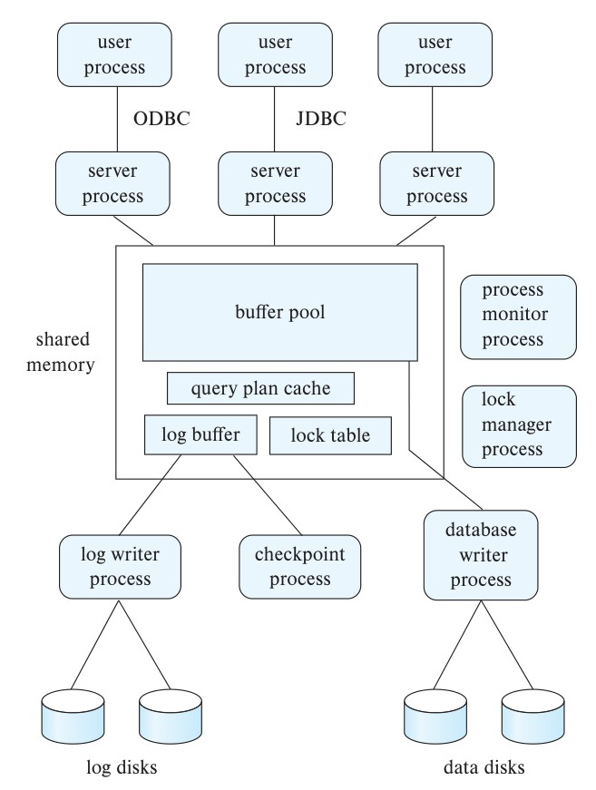
*Figure 20.1 — Shared memory and process structure.*

<!-- Page 965 -->

- **Server processes:** These are processes that receive user queries (transactions), execute them, and send the results back. The queries may be submitted to the server processes from a user interface, or from a user process running embedded SQL, or via JDBC, ODBC, or similar protocols. Some database systems use a separate process for each user session, and a few use a single database process for all user sessions, but with multiple threads so that multiple queries can execute concurrently. (A **thread** is similar to a process, but multiple threads execute as part of the same process, and all threads within a process run in the same virtual-memory space. Multiple threads within a process can execute concurrently.) Many database systems use a hybrid architecture, with multiple processes, each one running multiple threads.
- **Lock manager process:** This process implements lock manager functionality, which includes lock grant, lock release, and deadlock detection.
- **Database writer process:** There are one or more processes that output modified buffer blocks back to disk on a continuous basis.
- **Log writer process:** This process outputs log records from the log record buffer to stable storage. Server processes simply add log records to the log record buffer in shared memory, and if a log force is required, they request the log writer process to output log records (recall that a log force causes the log contents in memory to be output to stable storage).
- **Checkpoint process:** This process performs periodic checkpoints.
- **Process monitor process:** This process monitors other processes, and if any of them fails, it takes recovery actions for the process, such as aborting any transaction being executed by the failed process and then restarting the process.

The shared memory contains all shared data, such as:

- Buffer pool.
- Lock table.
- Log buffer, containing log records waiting to be output to the log on stable storage.
- Cached query plans, which can be reused if the same query is submitted again.

All database processes can access the data in shared memory. Since multiple processes may read or perform updates on data structures in shared memory, there must be a mechanism to ensure **mutual exclusion**, that is, to ensure that a data structure is modified by at most one process at a time, and no process is reading a data structure while it is being written by other processes.

Such mutual exclusion can be implemented by means of operating system functions called semaphores. Alternative implementations, with less overhead, use one of

<!-- Page 966 -->

> [!note] Note 20.1: ATOMIC INSTRUCTIONS
>
> 1. The instruction **test-and-set** ($M$) performs the following two actions atomically: (i) test, that is, read the value of memory location $M$, and then (ii) set it to 1; the test-and-set instruction returns the value that it read in step (i).
>
>    Suppose a memory location $M$ representing an exclusive lock is initially set to 0. A process that wishes to get the lock executes the test-and-set ($M$). If it is the only process executing the instruction on $M$, the value that is read and returned would be 0, indicating to the process that it has acquired the lock, and $M$ would be set to 1. When the process is done using the lock, it releases the lock by setting $M$ back to 0.
>
>    If a second process executes test-and-set ($M$) before the lock is released, the value returned would be 1, indicating that some other process already has the lock. The process could repeat the execution of test-and-set on $M$ periodically, until it gets a return value of 0, indicating that it has acquired the lock after it was released by another process.
>
>    Now, if two processes execute test-and-set ($M$) concurrently, one of them would see a return value of 0, while the other would see a return value of 1; this is because the read operation and the set operation are executed together, atomically. The first process to read the value would also set it to 1, and the second process would find that $M$ is already set to 1. Thus, only one process acquires the lock, ensuring mutual execution.
>
> 2. The **compare-and-swap** instruction is another atomic instruction similar to the test-and-set instruction, but it takes the following operands: ($M, V_o, V_n$), where $M$ is a memory location, and value $V_o$ and $V_n$ are two values (referred to as the old and new values). The instruction does the following atomically: it compares the value at $M$ with $V_o$, and if it matches, it updates the value to $V_n$ and returns success. If the values do not match, it does not update $M$, and it returns failure.
>
>    Similar to the case of test-and-set, we have a memory location $M$ representing a lock, which is initially set to 0. A process that wants to acquire the lock executes compare-and-swap ($M, 0, id$) where $id$ can be any nonzero value and is typically the process identifier. If no process has the lock, the compare-and-swap operation returns success, after storing the process identifier in $M$; otherwise, the operation returns failure.
>
>    A benefit of compare-and-swap over the test-and-set implementation is that it is easy to find out which process has acquired the lock by just reading the content of $M$, if the process identifier is used as $V_n$.

<!-- Page 967 -->

the **atomic instructions**, test-and-set, or compare-and-swap, which are supported by the computer hardware. See Note 20.1 on page 966 for details of these instructions. All multiprocessor systems today support either the test-and-set or the compare-and-swap atomic instructions. Further details on these instructions may be found in operating systems textbooks.

Note that the atomic instructions can be used for mutual exclusion, which is equivalent to supporting exclusive locks, but they do not directly support shared locks. Thus, they cannot be used directly to implement general-purpose locking in databases. Atomic instructions are, however, used to implement short-duration locks, also known as latches, which are used for mutual exclusion in databases.

To avoid the overhead of message passing, in many database systems, server processes implement locking by directly updating the lock table (which is in shared memory) instead of sending lock request messages to a lock manager process. (The lock table is shown in Figure 18.10.)

Since multiple server processes may access the lock table in shared memory concurrently, processes must ensure mutual exclusion on access to the lock table. This is typically done by acquiring a mutex (also referred to as a latch) on the lock table, using the test-and-set or compare-and-swap instructions on a memory location representing a lock on the lock table.

A transaction that wants to acquire a lock by directly updating the lock table in shared memory executes the following steps.

1. Acquire a mutex (latch) on the lock table.
2. Check if the requested lock can be allocated, using the procedure we saw in Section 18.1.4. If it can, update the lock table to indicate the lock is allocated. Otherwise, update the lock table to indicate that the lock request is in the queue for that lock.
3. Release the mutex on the lock table.

If a lock cannot be obtained immediately because of a lock conflict, the transaction may periodically read the lock table to check if the lock has been allocated to it due to a lock release, which is described next.

Lock release is done as follows:

1. Acquire a mutex on the lock table.
2. Remove the entry in the lock table for the lock being released.
3. If there are any other lock requests pending for the data item that can now be allocated to the lock, the lock table is updated to mark those requests as allocated. The rules on which lock requests may be granted are as described in Section 18.1.4.
4. Release the mutex on the lock table.

<!-- Page 968 -->

To avoid repeated checks on the lock table (an example of the phenomenon of *busy waiting*), operating system semaphores can be used by the lock request code to wait for a lock grant notification. The lock release code must then use the semaphore mechanism to notify waiting transactions that their locks have been granted.

Even if the system handles lock requests through shared memory, it still uses the lock manager process for deadlock detection.

### 20.3.2 Data Servers and Data Storage Systems

Data-server systems were originally developed to support data access from object-oriented databases; object-oriented databases allow programmers to use a programming language that allows creation, retrieval, and update of persistent objects.

Many of the target applications of object-oriented databases, such as computer-aided design (CAD) systems, required extensive computation on the retrieved data. For example, the CAD system may store a model of a computer chip or a building, and it may perform computations such as simulations on the retrieved model, which may be expensive in terms of CPU time.

If all the computation were done at the server, the server would be overloaded. Instead, in such an environment, it makes sense to store data on a separate data server machine, fetch data to client machines when needed, perform all processing at the client machines, and then to store new or updated data back on the data server machine. Thus, the processing power of client machines can be used to carry out the computation, while the server needs only to store and fetch data, without performing any computation.

More recently, a number of parallel data storage systems have been developed for handling very high volumes of data and transactions. Such systems do not necessarily support SQL, but instead provide APIs for storing, retrieving, and updating data items. Data items stored in such systems they could be tuples, or could be objects represented in formats such as JSON or XML, or they could even be files or documents.

We use the term **data item** to refer to tuples, objects, files, and documents. We also use the terms *data server* and *data storage system* interchangeably.

Data servers support communication of entire data items; in the case of very large data items, they may also support communication of only specified parts of the data item, for instance, specified blocks, instead of requiring that the entire data item be fetched or stored.

Data servers in earlier generations of storage systems supported a concept called *page shipping*, where the unit of communication is a database page that may potentially contain multiple data items. Page shipping is not used today, since storage systems do not expose the underlying storage layout to clients.

### 20.3.3 Caching at Clients

The time cost of communication between a client application and a server (whether a transaction server, or a data server) is high compared to that of a local memory

<!-- Page 969 -->

reference (milliseconds, versus less than 100 nanoseconds). The time to send a message over a network, and get a response back, called the *network round-trip time*, or *network latency*, can be nearly a millisecond even if the data server is in the same location as the client.

As a result, applications running at the clients adopt several optimization strategies to reduce the effects of network latency. The same strategies can also be useful in parallel database systems, where some of the data required for processing a query may be stored on a different machine from where it is consumed. The optimization strategies include the following:

- **Prefetching.** If the unit of communication is a single small item, the overhead of message passing is high compared to the amount of data transmitted. In particular, network latency can cause significant delays if a transaction makes repeated requests for data items across a network.
  Thus, when an item is requested, it may make sense to also send other items that are likely to be used in the near future. Fetching items even before they are requested is called **prefetching**.
- **Data caching.** Data that are shipped to a client on behalf of a transaction can be **cached** at the client within the scope of a single transaction. Data can be cached even after the transaction completes, allowing successive transactions at the same client to make use of the cached data.
  However, **cache coherency** is an issue: Even if a transaction finds cached data, it must make sure that those data are up to date, since they may have been updated, or even deleted, by a different client after they were cached. Thus, a message must still be exchanged with the server to check validity of the data and to acquire a lock on the data, unless the application is willing to live with potentially stale data. Further, new tuples may have been inserted after a transaction caches data, which may not be in the cache. The transaction may have to contact the server to find such tuples.
- **Lock caching.** If the usage of data is mostly partitioned among the clients, with clients rarely requesting data that are also requested by other clients, locks can also be cached at the client machine. Suppose that a client finds a data item in the cache, and that it also finds the lock required for an access to the data item in the cache. Then, the access can proceed without any communication with the server. However, the server must keep track of cached locks; if a client requests a lock from the server, the server must **call back** all conflicting locks on the data item from any other client machines that have cached the locks. The task becomes more complicated when machine failures are taken into account.
- **Adaptive lock granularity.** If a transaction requires locks on multiple data items, discovered in the course of a transaction, and each lock acquisition requires a round trip to a data server, the transaction may waste a good deal of time on

<!-- Page 970 -->

just lock acquisition. In such a situation, multi-granularity locking can be used to avoid multiple requests. For example, if multiple data items are stored in a page, a single page lock (which is at a coarser granularity) can avoid the need to acquire multiple data-item locks (which are at a finer granularity). This strategy works well if there is very little lock contention, but with higher contention, acquiring a coarse granularity lock can affect concurrency significantly.

**Lock de-escalation**, is a way of adaptively decreasing the lock granularity if there is higher contention. Lock de-escalation is initiated by the data server sending a request to the client to de-escalate a lock, and the client responds by acquiring finer-granularity locks and then releasing the coarser-granularity lock.

When switching to a finer granularity, if some of the locks were for cached data items that are not currently locked by any transaction at a client, the data item can be removed from the cache instead of acquiring a finer-granularity lock on it.

## 20.4 Parallel Systems

Parallel systems improve processing and I/O speeds by using a large number of computers in parallel. Parallel machines are becoming increasingly common, making the study of parallel database systems correspondingly more important.

In parallel processing, many operations are performed simultaneously, as opposed to serial processing, in which the computational steps are performed sequentially. A **coarse-grain** parallel machine consists of a small number of powerful processors; a **massively parallel** or **fine-grain parallel** machine uses thousands of smaller processors. Virtually all high-end server machines today offer some degree of coarse-grain parallelism, with up to two or four processors each of which may have 20 to 40 cores.

Massively parallel computers can be distinguished from the coarse-grain parallel machines by the much larger degree of parallelism that they support. It is not practical to share memory between a large number of processors. As a result, massively parallel computers are typically built using a large number of computers, each of which has its own memory, and often, its own set of disks. Each such computer is referred to as a **node** in the system.

Parallel systems at the scale of hundreds to thousands of nodes or more are housed in a **data center**, which is a facility that houses a large number of servers. Data centers provide high-speed network connectivity within the data center, as well as to the outside world. The numbers and sizes of data centers have grown tremendously in the last decade, and modern data centers may have several hundred thousand servers.

### 20.4.1 Motivation for Parallel Databases

The transaction requirements of organizations have grown with the increasing use of computers. Moreover, the growth of the World Wide Web has created many sites with millions of viewers, and the increasing amounts of data collected from these viewers has produced extremely large databases at many companies.

<!-- Page 971 -->

The driving force behind parallel database systems is the demands of applications that have to query extremely large databases (of the order of petabytes—that is, 1000 terabytes, or equivalently, $10^{15}$ bytes) or that have to process an extremely large number of transactions per second (of the order of thousands of transactions per second). Centralized and client–server database systems are not powerful enough to handle such applications.

Web-scale applications today often require hundreds to thousands of nodes (and in some cases, tens of thousands of nodes) to handle the vast number of users on the web.

Organizations are using these increasingly large volumes of data—such as data about what items people buy, what web links users click on, and when people make telephone calls—to plan their activities and pricing. Queries used for such purposes are called **decision-support queries**, and the data requirements for such queries may run into terabytes. Single-node systems are not capable of handling such large volumes of data at the required rates.

The set-oriented nature of database queries naturally lends itself to parallelization. A number of commercial and research systems have demonstrated the power and scalability of parallel query processing.

As the cost of computing systems has reduced significantly over the years, parallel machines have become common and relatively inexpensive. Individual computers have themselves become parallel machines using multicore architectures. Parallel databases are thus quite affordable even for small organizations.

Parallel database systems which can support hundreds of nodes have been available commercially for several decades, but the number of such products has seen a significant increase since the mid 2000s. Open-source platforms for parallel data storage such as the Hadoop File System (HDFS), and HBase, and for query processing, such as Hadoop Map-Reduce and Hive (among many others), have also seen extensive adoption.

It is worth noting that application programs are typically built such that they can be executed in parallel on a number of application servers, which communicate over a network with a database server, which may itself be a parallel system. The parallel architectures described in this section can be used not only for data storage and query processing in the database but also for parallel processing of application programs.

### 20.4.2 Measures of Performance for Parallel Systems

There are two main measures of performance of a database system: (1) **throughput**, the number of tasks that can be completed in a given time interval, and (2) **response time**, the amount of time it takes to complete a single task from the time it is submitted. A system that processes a large number of small transactions can improve throughput by processing many transactions in parallel. A system that processes large transactions can improve response time as well as throughput by performing subtasks of each transaction in parallel.

<!-- Page 972 -->

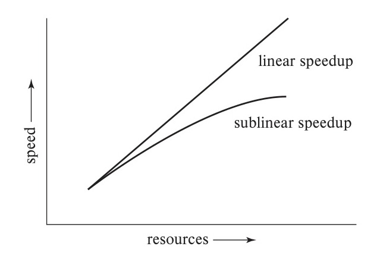
*Figure 20.2 — Speedup with increasing resources.*

Parallel processing within a computer system allows database-system activities to be speeded up, allowing faster response to transactions, as well as more transactions to be executed per second. Queries can be processed in a way that exploits the parallelism offered by the underlying computer system.

Two important issues in studying parallelism are speedup and scaleup. Running a given task in less time by increasing the degree of parallelism is called **speedup**. Handling larger tasks by increasing the degree of parallelism is called **scaleup**.

Consider a database application running on a parallel system with a certain number of processors and disks. Now suppose that we increase the size of the system by increasing the number of processors, disks, and other components of the system. The goal is to process the task in time inversely proportional to the number of processors and disks allocated. Suppose that the execution time of a task on the larger machine is $T_L$, and that the execution time of the same task on the smaller machine is $T_S$. The speedup due to parallelism is defined as $T_S/T_L$. The parallel system is said to demonstrate **linear speedup** if the speedup is $N$ when the larger system has $N$ times the resources (processors, disk, and so on) of the smaller system. If the speedup is less than $N$, the system is said to demonstrate **sublinear speedup**. Figure 20.2 illustrates linear and sublinear speedup.[^2]

Scaleup relates to the ability to process larger tasks in the same amount of time by providing more resources. Let $Q$ be a task, and let $Q_N$ be a task that is $N$ times bigger than $Q$. Suppose that the execution time of task $Q$ on a given machine $M_S$ is $T_S$, and the execution time of task $Q_N$ on a parallel machine $M_L$ that is $N$ times larger than $M_S$ is $T_L$. The scaleup is then defined as $T_S/T_L$. The parallel system $M_L$ is said to demonstrate **linear scaleup** on task $Q$ if $T_L = T_S$. If $T_L > T_S$, the system is said

<!-- Page 973 -->

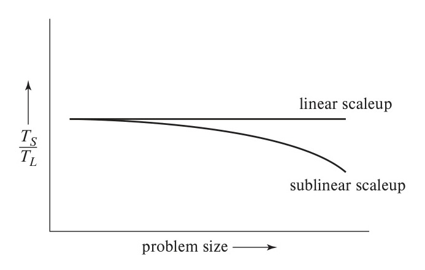
*Figure 20.3 — Scaleup with increasing problem size and resources.*

to demonstrate **sublinear scaleup**. Figure 20.3 illustrates linear and sublinear scaleups (where the resources increase in proportion to problem size). There are two kinds of scaleup that are relevant in parallel database systems, depending on how the size of the task is measured:

- In **batch scaleup**, the size of the database increases, and the tasks are large jobs whose runtime depends on the size of the database. An example of such a task is a scan of a relation whose size is proportional to the size of the database. Thus, the size of the database is the measure of the size of the problem. Batch scaleup also applies in scientific applications, such as executing a weather simulation at an $N$-times finer resolution,[^3] or performing the simulation for an $N$-times longer period of time.
- In **transaction scaleup**, the rate at which transactions are submitted to the database increases, and the size of the database increases proportionally to the transaction rate. This kind of scaleup is what is relevant in transaction-processing systems where the transactions are small updates—for example, a deposit or withdrawal from an account—and transaction rates grow as more accounts are created. Such transaction processing is especially well adapted for parallel execution, since transactions can run concurrently and independently on separate nodes, and each transaction takes roughly the same amount of time, even if the database grows.

Scaleup is usually the more important metric for measuring the efficiency of parallel database systems. The goal of parallelism in database systems is usually to make sure that the database system can continue to perform at an acceptable speed, even as the size of the database and the number of transactions increases. Increasing the ca-

<!-- Page 974 -->

pacity of the system by increasing the parallelism provides a smoother path for growth for an enterprise than does replacing a centralized system with a faster machine (even assuming that such a machine exists). However, we must also look at absolute performance numbers when using scaleup measures; a machine that scales up linearly may perform worse than a machine that scales less than linearly, simply because the latter machine is much faster to start off with.

A number of factors work against efficient parallel operation and can diminish both speedup and scaleup.

- **Sequential computation.** Many tasks have some components that can benefit from parallel processing, and some components that have to be executed sequentially. Consider a task that takes time $T$ to run sequentially. Suppose the fraction of the total execution time that can benefit from parallelization is $p$, and that part is executed by $n$ nodes in parallel. Then the total time taken would be $(1 - p)T + (p/n)T$, and the speedup would be $\frac{1}{(1-p)+(p/n)}$. (This formula is referred to as **Amdahl’s law**.) If the fraction $p$ is, say $\frac{9}{10}$, then the maximum speedup possible, even with very large $n$, would be 10.
  Now consider scaleup, where the problem size increases. If the time taken by the sequential part of a task increases along with the problem size, scaleup will be similarly limited. Suppose fraction $p$ of the execution time of a problem benefits from increasing resources, while fraction $(1 - p)$ is sequential and does not benefit from increasing resources. Then the scaleup with $n$ times more resources on a problem that is $n$ times larger will be $\frac{1}{n(1-p)+p}$. (This formula is referred to as **Gustafson’s law**.) However, if the time taken by the sequential part does not increase with problem size, its impact on scaleup will be less as the problem sizes.
  **Start-up costs.** There is a start-up cost associated with initiating a single process. In a parallel operation consisting of thousands of processes, the *start-up time* may overshadow the actual processing time, affecting speedup adversely.
- **Interference.** Since processes executing in a parallel system often access shared resources, a slowdown may result from the *interference* of each new process as it competes with existing processes for commonly held resources, such as a system bus, or shared disks, or even locks. Both speedup and scaleup are affected by this phenomenon.
- **Skew.** By breaking down a single task into a number of parallel steps, we reduce the size of the average step. Nonetheless, the service time for the single slowest step will determine the service time for the task as a whole. It is often difficult to divide a task into exactly equal-sized parts, and the way that the sizes are distributed is therefore *skewed*. For example, if a task of size 100 is divided into 10 parts, and the division is skewed, there may be some tasks of size less than 10 and some tasks of size more than 10; if even one task happens to be of size 20, the speedup obtained by running the tasks in parallel is only 5, instead of 10 as we would have hoped.

<!-- Page 975 -->

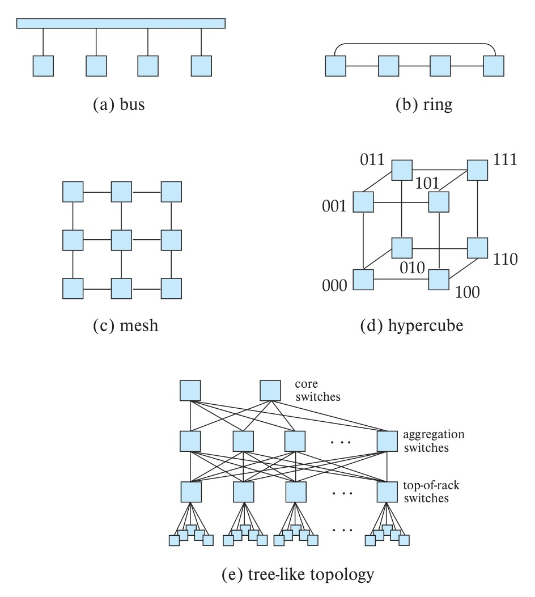
*Figure 20.4 — Interconnection networks.*

### 20.4.3 Interconnection Networks

Parallel systems consist of a set of components (processors, memory, and disks) that can communicate with each other via an **interconnection network**. Figure 20.4 shows several commonly used types of interconnection networks:

- **Bus.** All the system components can send data on and receive data from a single communication bus. This type of interconnection is shown in Figure 20.4a. Bus interconnects were used in earlier days to connect multiple nodes in a network, but they are no longer used for this task. However, bus interconnections are still used for connecting multiple CPUs and memory units within a single node, and they work well for small numbers of processors. However, they do not scale well

<!-- Page 976 -->

with increasing parallelism, since the bus can handle communication from only one component at a time; with increasing numbers of CPUs and memory banks in a node, other interconnection mechanisms such as ring or mesh interconnections are now used even within a single node.
- **Ring.** The components are nodes arranged in a ring (circle), and each node is connected to its two adjacent nodes in the ring, as shown in Figure 20.4b. Unlike a bus, each link can transmit data concurrently with other links in the ring, leading to better scalability. However, to transmit data from one node to another node on the ring may require a large number of hops; specifically, up to $n/2$ hops may be needed on a ring with $n$ nodes, assuming communication can be done in either direction on the ring. Furthermore, the transmission delay increases if the number of nodes in the ring is increased.
- **Mesh.** The components are nodes in a grid, and each component connects to all its adjacent components in the grid. In a two-dimensional mesh, each node connects to (up to) four adjacent nodes, while in a three-dimensional mesh, each node connects to (up to) six adjacent nodes. Figure 20.4c shows a two-dimensional mesh. Nodes that are not directly connected can communicate with one another by routing messages via a sequence of intermediate nodes that are directly connected to one another. The number of communication links grows as the number of components grows, and the communication capacity of a mesh therefore scales better with increasing parallelism.
  Mesh interconnects are used to connect multiple cores in a processor, or processors in a single server, to each other; each processor core has direct access to a bank of memory connected to the processor core, but the system transparently fetches data from other memory banks by sending messages over the mesh interconnects.
  However, mesh interconnects are no longer used for interconnecting nodes, since the number of hops required to transmit data increases significantly with the number of nodes (the number of hops required to transmit data from one node to another node in a mesh is proportional in the worst case to the square root of the number of nodes). Parallel systems today have very large numbers of nodes, and mesh interconnects would thus be impracticably slow.
- **Hypercube.** The components are numbered in binary, and a component is connected to another if the binary representations of their numbers differ in exactly one bit. Thus, each of the $n$ components is connected to $\log(n)$ other components. Figure 20.4d shows a hypercube with eight nodes. In a hypercube interconnection, a message from a component can reach any other component by going through at most $\log(n)$ links. In contrast, in a mesh architecture a component may be $2(\sqrt{n}-1)$ links away from some of the other components (or $\sqrt{n}$ links away, if the mesh interconnection wraps around at the edges of the grid). Thus communication delays in a hypercube are significantly lower than in a mesh.

<!-- Page 977 -->

Hypercubes have been used to interconnect nodes in massively parallel computers in earlier days, but they are no longer commonly used.
- **Tree-like.** Server systems in a data center are typically mounted in racks, with each rack holding up to about 40 nodes. Multiple racks are used to build systems with larger numbers of nodes. A key issue is how to interconnect such nodes.
  To connect nodes within a rack, there is typically a network switch mounted at the top of the rack; 48 port switches are commonly used, so a single switch can be used to connect all the servers in a rack. Current-generation network switches typically support a bandwidth of 1 to 10 gigabits per second (Gbps) simultaneously from/to each of the servers connected to the switch, although more expensive network interconnects with 40 to 100 Gbps bandwidths are available.
  Multiple top-of-rack switches (also referred to as **edge switches**) can in turn be connected to another switch, called an **aggregation switch**, allowing interconnection between racks. If there are a large number of racks, the racks may be divided into groups, with one aggregation switch connecting a group of racks, and all the aggregation switches in turn connected to a **core switch**. Such an architecture is a **tree topology** with three tiers. The core switch at the top of the tree also provides connectivity to outside networks.
  A problem with this basic tree structure, which is frequently used in local-area networks within organizations, is that the available bandwidth between racks is often not sufficient if multiple machines in a rack try to communicate significant amounts of data with machines from other racks. Typically, the interconnects of the aggregation switches support higher bandwidths of 10 to 40 Gbps, although interconnects of 100 Gbps are available. Interconnects of even higher capacity can be created by using multiple interconnects in parallel. However, even such high-speed links can be saturated if a large enough number of servers in a rack attempt to communicate at their full connection bandwidth to servers in other racks.
  To avoid the bandwidth bottleneck of a tree structure, data centers typically connect each top-of-rack (edge) switch to multiple aggregation switches. Each aggregation switch in turn is linked to a number of core switches at the next layer. Such an interconnection topology is called a **tree-like topology**; Figure 20.4e shows a tree-like topology with three tiers. The tree-like topology is also referred to as a **fat-tree topology**, although originally the fat-tree topology referred to a tree topology where edges higher in the tree have a higher bandwidth than edges lower in the tree.
  The benefit of the tree-like architecture is that each top-of-rack switch can route its messages through any of the aggregation switches that it is connected to, increasing the inter-rack bandwidth greatly as compared to the tree topology. Similarly, each aggregation switch can communicate with another aggregation switch via any of the core switches that it is connected to, increasing the bandwidth available between the aggregation switches. Further, even if an aggregation or edge switch fails, there are alternative paths through other switches. With appropriate

<!-- Page 978 -->

routing algorithms, the network can continue functioning even if a switch fails, making the network *fault-tolerant*, at least to failures of one or a few switches.

A tree-like architecture with three tiers can handle a **cluster** of tens of thousands of machines. Although a tree-like topology improves the inter-rack bandwidth greatly compared to a tree topology, parallel processing applications, including parallel storage and parallel database systems, perform best if they are designed in a way that reduces inter-rack traffic.

The tree-like topology and variants of it are widely used in data centers today. The complex interconnection networks in a data center are referred to as a **data center fabric**.

While network topologies are very important for scalability, a key to network performance is network technology used for individual links. The popular technologies include:

- **Ethernet:** The dominant technology for network connections today is the Ethernet technology. Ethernet standards have evolved over time, and the predominant versions used today are 1-gigabit Ethernet and 10-gigabit Ethernet, which support bandwidths of 1 and 10 gigabits per second respectively. Forty-gigabit Ethernet and 100-gigabit Ethernet technologies are also available at a higher cost and are seeing increasing usage. Ethernet protocols can be used over cheaper copper cables for short distances, and over optical fiber for longer distances.
- **Fiber channel:** The Fiber Channel Protocol standard was designed for high-speed interconnection between storage systems and computers, and it is predominantly used to implement storage area networks (described in Section 20.4.6). The different versions of the standard have supported increasing bandwidth over the years, with 16 gigabits per second available as of 2011, and 32 and 128 gigabits per second supported from 2016.
- **Infiniband:** The Infiniband standard was designed for interconnections with a data center; it was specifically designed for high-performance computing applications which need not just very high bandwidth, but also very low latency. The Infiniband standard has evolved, with link speeds of 8-gigabits per second available by 2007 and 24-gigabits per second available by 2014. Multiple links can be aggregated to give a bandwidth of 120 to 290-gigabits per second.
  The latency associated with message delivery is as important as bandwidth for many applications. A key benefit of Infiniband is that it supports latencies as low as 0.7 to 0.5 microseconds. In contrast, Ethernet latencies can be up to hundreds of microseconds in an unoptimized local-area network, while latency-optimized Ethernet implementations still have latencies of several microseconds.

One of the important techniques used to reduce latency is to allow applications to send and receive messages by directly interfacing with the hardware, bypassing the operating system. With the standard implementations of the networking stack, applications

<!-- Page 979 -->

send messages to the operating system, which in turn interfaces with the hardware, which in turn delivers the message to the other computer, where again the hardware interfaces with the operating system, which then interfaces with the application to deliver the message. Support for direct access to the network interface, bypassing the operating system, reduces the communication latency significantly.

Another approach to reducing latency is to use **remote direct memory access** (**RDMA**), a technology which allows a process on one node to directly read or write to memory on another node, without explicit message passing. Hardware support ensures that RDMA can transfer data at very high rates with very low latency. RDMA implementations can use Infiniband, Ethernet, or other networking technologies for physical communication between nodes.

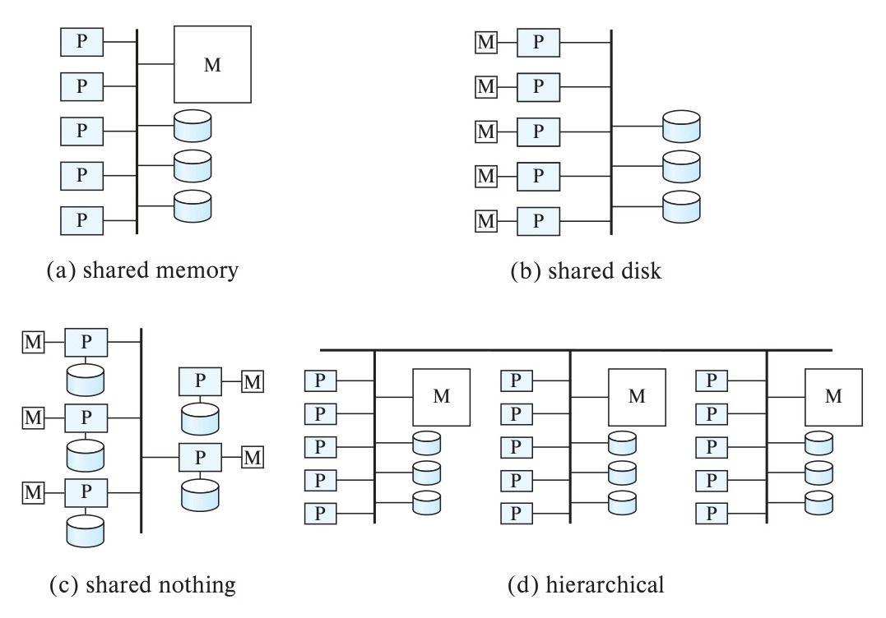
*Figure 20.5 — Parallel database architectures.*

### 20.4.4 Parallel Database Architectures

There are several architectural models for parallel machines. Among the most prominent ones are those in Figure 20.5 (in the figure, M denotes memory, P denotes a processor, and disks are shown as cylinders):

- **Shared memory.** All the processors share a common memory (Figure 20.5a).

<!-- Page 980 -->

- **Shared disk.** A set of nodes that share a common set of disks; each node has its own processor and memory (Figure 20.5b). Shared-disk systems are sometimes called **clusters**.
- **Shared nothing.** A set of nodes that share neither a common memory nor common disk (Figure 20.5c).
- **Hierarchical.** This model is a hybrid of the preceding three architectures (Figure 20.5d). This model is the most widely used model today.

In Section 20.4.5 through Section 20.4.8, we elaborate on each of these models.

Note that the interconnection networks are shown in an abstract manner in Figure 20.5. Do not interpret the interconnection networks shown in the figures as necessarily being a bus; in fact other interconnection networks are used in practice. For example, mesh networks are used within a processor, and tree-like networks are often used to interconnect nodes.

### 20.4.5 Shared Memory

In a **shared-memory** architecture, the processors have access to a common memory, typically through an interconnection network. Disks are also shared by the processors. The benefit of shared memory is extremely efficient communication between processes—data in shared memory can be accessed by any process without being moved with software. A process can send messages to other processes much faster by using memory writes (which usually take less than a microsecond) than by sending a message through a communication mechanism.

Multicore processors with 4 to 8 cores are now common not just in desktop computers, but even in mobile phones. High-end processing systems such as Intel’s Xeon processor have up to 28 cores per CPU, with up to 8 CPUs on a board, while the Xeon Phi coprocessor systems contain around 72 cores, as of 2018, and these numbers have been increasing steadily. The reason for the increasing number of cores is that the sizes of features such as logic gates in integrated circuits has been decreasing steadily, allowing more gates to be packed in a single chip. The number of transistors that can be accommodated on a given area of silicon has been doubling approximately every $1\frac{1}{2}$ to 2 years.[^4]

Since the number of gates required for a processor core has not increased correspondingly, it makes sense to have multiple processors on a single chip. To maintain a distinction between on-chip multiprocessors and traditional processors, the term **core** is used for an on-chip processor. Thus, we say that a machine has a multicore processor.

<!-- Page 981 -->

All the cores on a single processor typically access a shared memory. Further, a system can have multiple processors which can share memory. Another effect of the increasing number of gates has been the steady increase in the size of main memory as well as a decrease in cost, per-byte, of main memory.

Given the availability of multicore processors at a low cost, as well as the concurrent availability of very large amounts of memory at a low cost, shared-memory parallel processing has become increasingly important in recent years.

#### 20.4.5.1 Shared-Memory Architectures

In earlier generation architectures, processors were connected to memory via a bus, with all processor cores and memory banks sharing a single bus. A downside of shared-memory accessed via a common bus is that the bus or the interconnection network becomes a bottleneck, since it is shared by all processors. Adding more processors does not help after a point, since the processors will spend most of their time waiting for their turn on the bus to access memory.

As a result, modern shared-memory architectures associate memory directly with processors; each processor has locally connected memory, which can be accessed very quickly; however, each processor can also access memory associated with other processors; a fast interprocessor communication network ensures that data are fetched with relatively low overhead. Since there is a difference in memory access speed depending on which part of memory is accessed, such an architecture is often referred to as **non-uniform memory architecture** (**NUMA**).

Figure 20.6 shows a conceptual architecture of a modern shared-memory system with multiple processors; note that each processor has a bank of memory directly connected to it, and the processors are linked by a fast interconnect system; processors are also connected to I/O controllers which interface with external storage.

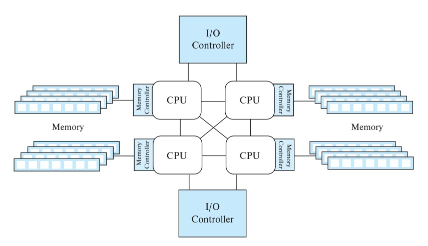
*Figure 20.6 — Architecture of a modern shared-memory system.*

<!-- Page 982 -->

Because shared-memory architectures require specialized high-speed interconnects between cores and between processors, the number of cores/processors that can be interconnected in a shared-memory system is relatively small. As a result, the scalability of shared-memory parallelism is limited to at most a few hundred cores.

Processor architectures include cache memory, since access to cache memory is much faster than access to main memory (cache can be accessed in a few nanoseconds compared to nearly a hundred nanoseconds for main memory). Large cache memory is particularly important in shared-memory architectures, since a large cache can help minimize the number of accesses to shared memory.

If an instruction needs to access a data item that is not in cache, it must be fetched from main memory. Because main memory is much slower than processors, a significant amount of potential processing speed may be lost while a core waits for data from main memory. These waits are referred to as **cache misses**.

Many processor architectures support a feature called **hyper-threading**, or **hardware threads**, where a single physical core appears as two or more logical cores or threads. Different processes could be mapped to different logical cores. Only one of the logical cores corresponding to a single physical core can actually execute at any time. But the motivation for logical cores is that if the code running on one logical core blocks on a cache miss, waiting for data to be fetched from memory, the hardware of the physical core can start execution of one of the other logical cores instead of idling while waiting for data to be fetched from memory.

A typical multicore processor has multiple levels of cache, with the L1 cache being fastest to access, but also the smallest; lower cache levels such as L2 and L3 are slower (although still much faster than main memory) but considerably larger than the L1 cache. Lower cache levels are usually shared between multiple cores on a single processor. In the cache architecture shown in Figure 20.7, the L1 and L2 caches are local to each of the 4 cores, while the L3 cache is shared by all cores of the processor. data are read into, or written from, cache in units of a **cache line**, which typically consists of 64 consecutive bytes.

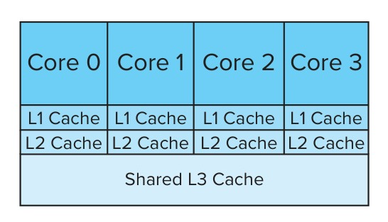
*Figure 20.7 — Multilevel cache system.*

<!-- Page 983 -->

#### 20.4.5.2 Cache Coherency

**Cache coherency** is an issue whenever there are multiple cores or processors, each with its own cache. An update done on one core may not be seen by another core, if the local cache on the second core contains an old value of the affected memory location. Thus, whenever an update occurs to a memory location, copies of the content of that memory location that are cached on other caches must be invalidated.

Such invalidation is done lazily in many processor architectures; that is, there may be some time lag between a write to a cache and the dispatch of invalidation messages to other caches; in addition there may be a further lag in processing invalidation messages that are received at a cache. (Requiring immediate invalidation to be done always can cause a significant performance penalty, and thus it is not done in current-generation systems.) Thus, it is quite possible for a write to happen on one processor, and a subsequent read on another processor may not see the updated value.

Such a lack of cache coherency can cause problems if a process expects to see an updated memory location but does not. Modern processors therefore support **memory barrier** instructions, which ensure certain orderings between load/store operations before the barrier and those after the barrier. For example, the **store barrier** instruction (**sfence**) on the x86 architecture forces the processor to wait until invalidation messages are sent to all caches for all updates done prior to the instruction, before any further load/store operations are issued. Similarly, the **load barrier** instruction (**lfence**) ensures all received invalidation messages have been applied before any further load/store operations are issued. The **mfence** instruction does both of these tasks.

Memory barrier instructions must be used with interprocess synchronization protocols to ensure that the protocols execute correctly. Without the use of memory barriers, if the caches are not “strongly” coherent, the following scenario can happen. Consider a situation where a process $P1$ updates memory location $A$ first, then location $B$; a concurrent process $P2$ running on a different core or processor reads $B$ first and then reads $A$. With a coherent cache, if $P2$ sees the updated value of $B$, it must also see the updated value of $A$. However, in the absence of cache coherence, the writes may be propagated out of order, and $P2$ may thus see the updated value of $B$ but the old value of $A$. While many architectures disallow out-of-order propagation of writes, there are other subtle errors that can occur due to lack of cache coherency. However, executing sfence instructions after each of these writes and lfence before each of the reads will always ensure that reads see a cache coherent state. As a result, in the above example, the updated value of $B$ will be seen only if the updated value of $A$ is seen.

It is worth noting that programs do not need to include any extra code to deal with cache coherency, as long as they acquire locks before accessing data, and release locks only after performing updates, since lock acquire and release functions typically include the required memory barrier instructions. Specifically, an sfence instruction is executed as part of the lock release code, before the data item is actually unlocked. Similarly an lfence is executed right after locking a data item, as part of the lock acquisition

<!-- Page 984 -->

function, and is thus executed before the item is read. Thus, the reader is guaranteed to see the most recent value written to the data item.

Synchronization primitives supported in a variety of languages also internally execute memory barrier instructions; as a result, programmers who use these primitives need not be concerned about lack of cache coherency.

It is also interesting to note that many processor architectures use a form of hardware-level shared and exclusive locking of memory locations to ensure cache coherency. A widely used protocol, called the MESI protocol, can be understood as follows: Locking is done at the level of cache lines, containing multiple memory locations, instead of supporting locks on individual memory locations, since cache lines are the units of cache access. Locking is implemented in the hardware, rather than in software, to provide the required high performance.

The MESI protocol keeps track of the state of each cache line, which can be Modified (updated after exclusive locking), Exclusive locked (locked but not yet modified, or already written back to memory), Share locked, or Invalid. A read of a memory location automatically acquires a shared lock on the cache line containing that location, while a memory write gets an exclusive lock on the cache line before performing the write. In contrast to database locks, memory lock requests do not wait; instead they immediately revoke conflicting locks. Thus, an exclusive lock request automatically invalidates all cached copies of the cache line and revokes all shared locks on the cache line. Symmetrically, a shared lock request causes any existing exclusive lock to be revoked and then fetches the latest copy of the memory location into cache.

In principle, it is possible to ensure “strong” cache coherency with such a locking-based cache coherence protocol, making memory barrier instructions redundant. However, many implementations include some optimizations that speed up processing, such as allowing delayed delivery of invalidation messages, at the cost of not guaranteeing cache coherence. As a result, memory barrier instructions are required on many processor architectures to ensure cache coherency.

### 20.4.6 Shared Disk

In the **shared-disk** model, each node has its own processors and memory, but all nodes can access all disks directly via an interconnection network. There are two advantages of this architecture over a shared-memory architecture. First, a shared-disk system can scale to a larger number of processors than a shared-memory system. Second, it offers a cheap way to provide a degree of **fault tolerance**: If a node fails, the other nodes can take over its tasks, since the database is resident on disks that are accessible from all nodes.

We can make the disk subsystem itself fault tolerant by using a RAID architecture, as described in Chapter 12, allowing the system to function even if individual disks fail. The presence of a large number of storage devices in a RAID system also provides some degree of I/O parallelism.

<!-- Page 985 -->

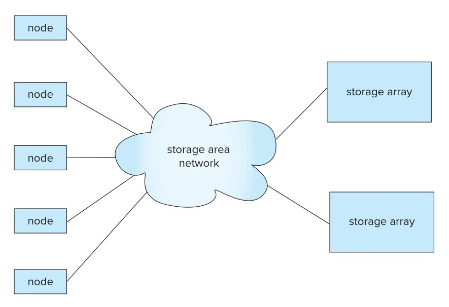
*Figure 20.8 — Storage-area network.*

A **storage-area network** (**SAN**) is a high-speed local-area network designed to connect large banks of storage devices (disks) to nodes that use the data (see Figure 20.8). The storage devices physically consist of an array of multiple disks but provide a view of a logical disk, or set of disks, that hides the details of the underlying disks. For example, a logical disk may be much larger than any of the physical disks, and a logical disk’s size can be increased by adding more physical disks. The processing nodes can access disks as if they are local disks, even though they are physically separate.

Storage-area networks are usually built with redundancy, such as multiple paths between nodes, so if a component such as a link or a connection to the network fails, the network continues to function.

Storage-area networks are well suited for building shared-disk systems. The shared-disk architecture with storage-area networks has found acceptance in applications that do not need a very high degree of parallelism but do require high availability.

Compared to shared-memory systems, shared-disk systems can scale to a larger number of processors, but communication across nodes is slower (up to a few milliseconds in the absence of special-purpose hardware for communication), since it has to go through a communication network.

One limitation of shared-disk systems is that the bandwidth of the network connection to storage in a shared-disk system is usually less than the bandwidth available to access local storage. Thus, storage access can become a bottleneck, limiting scalability.

### 20.4.7 Shared Nothing

In a **shared-nothing** system, each node consists of a processor, memory, and one or more disks. The nodes communicate by a high-speed interconnection network. A node

<!-- Page 986 -->

functions as the server for the data on the disk or disks that the node owns. Since local disk references are serviced by local disks at each node, the shared-nothing model overcomes the disadvantage of requiring all I/O to go through a single interconnection network.

Moreover, the interconnection networks for shared-nothing systems, such as the tree-like interconnection network, are usually designed to be scalable, so their transmission capacity increases as more nodes are added. Consequently, shared-nothing architectures are more scalable and can easily support a very large number of nodes.

The main drawbacks of shared-nothing systems are the costs of communication and of nonlocal disk access, which are higher than in a shared-memory or shared-disk architecture since sending data involves software interaction at both ends.

Due to their high scalability, shared-nothing architectures are widely used to deal with very large data volumes, supporting scalability to thousands of nodes, or in extreme cases, even to tens of thousands of nodes.

### 20.4.8 Hierarchical

The **hierarchical architecture** combines the characteristics of shared-memory, shared-disk, and shared-nothing architectures. At the top level, the system consists of nodes that are connected by an interconnection network and do not share disks or memory with one another. Thus, the top level is a shared-nothing architecture. Each node of the system could actually be a shared-memory system with a few processors. Alternatively, each node could be a shared-disk system, and each of the systems sharing a set of disks could be a shared-memory system. Thus, a system could be built as a hierarchy, with shared-memory architecture with a few processors at the base, and a shared-nothing architecture at the top, with possibly a shared-disk architecture in the middle. Figure 20.5d illustrates a hierarchical architecture with shared-memory nodes connected together in a shared-nothing architecture.

Parallel database systems today typically run on a hierarchical architecture, where each node supports shared-memory parallelism, with multiple nodes interconnected in a shared-nothing manner.

## 20.5 Distributed Systems

In a **distributed database system**, the database is stored on nodes located at geographically separated **sites**. The nodes in a distributed system communicate with one another through various communication media, such as high-speed private networks or the internet. They do not share main memory or disks. The general structure of a distributed system appears in Figure 20.9.

The main differences between shared-nothing parallel databases and distributed databases include the following:

<!-- Page 987 -->

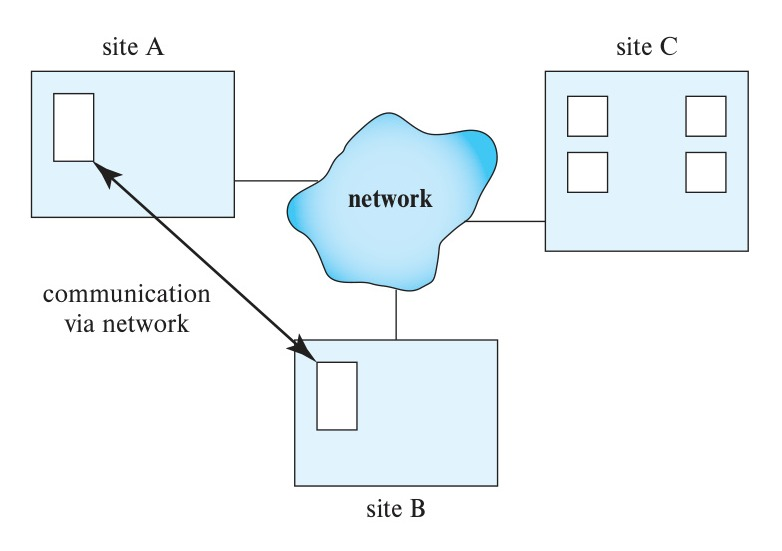
*Figure 20.9 — A distributed system.*

- Distributed databases have sites that are geographically separated. As a result, the network connections have lower bandwidth, higher latency, and greater probability of failures, as compared to networks within a single data center.
  Systems built on distributed databases therefore need to be aware of network latency, and failures, as well as of physical data location. We discuss these issues later in this section. In particular, it is often desirable to keep a copy of the data at a data center close to the end user.
- Parallel database systems address the problem of node failure. However, some failures, particularly those due to earthquakes, fires, or other natural disasters, may affect an entire data center, causing failure of a large number of nodes. Distributed database systems need to continue working even in the event of failure of an entire data center, to ensure high availability. This requires replication of data across geographically separated data centers, to ensure that a common natural disaster does not affect all the data centers. Replication and other techniques to ensure high availability are similar in both parallel and distributed databases, although implementation details may differ.
- Distributed databases may be separately administered, with each site retaining some degree of autonomy of operation. Such databases are often the result of the integration of existing databases to allow queries and transactions to cross database boundaries. However, distributed databases that are built for providing geographic distribution, versus those built by integrating existing databases, may be centrally administered.
- Nodes in a distributed database tend to vary more in size and function, whereas parallel databases tend to have nodes that are of similar capacity.

<!-- Page 988 -->

- In a distributed database system, we differentiate between local and global transactions. A **local transaction** is one that accesses data only from nodes where the transaction was initiated. A **global transaction**, on the other hand, is one that either accesses data in a node different from the one at which the transaction was initiated, or accesses data in several different nodes.

Web-scale applications today run on data management systems that combine support for parallelism and distribution. Parallelism is used within a data center to handle high loads, while distribution across data centers is used to ensure high availability even in the event of natural disasters. At the lower end of functionality, such systems may be distributed data storage systems that support only limited functionality such as storage and retrieval of data by key, and they may not support schemas, query languages, or transactions; all such higher-level functionality has to be managed by the applications. At the higher end of functionality, there are distributed database systems that support schemas, query language, and transactions. However, one characteristic of such systems is that they are centrally administered.

In contrast, distributed databases that are built by integrating existing database systems have somewhat different characteristics.

- **Sharing data.** The major advantage in building a distributed database system is the provision of an environment where users at one site may be able to access the data residing at other sites. For instance, in a distributed university system, where each campus stores data related to that campus, it is possible for a user in one campus to access data in another campus. Without this capability, the transfer of student records from one campus to another campus would have to rely on some external mechanism.
- **Autonomy.** The primary advantage of sharing data by means of data distribution is that each site can retain a degree of control over data that are stored locally. In a centralized system, the database administrator of the central site controls the database. In a distributed system, there is a global database administrator responsible for the entire system. A part of these responsibilities is delegated to the local database administrator for each site. Depending on the design of the distributed database system, each administrator may have a different degree of **local autonomy**.

In a **homogeneous distributed database** system, nodes share a common global schema (although some relations may be stored only at some nodes), all nodes run the same distributed database-management software, and the nodes actively cooperate in processing transactions and queries.

However, in many cases a distributed database has to be constructed by linking together multiple already-existing database systems, each with its own schema and possibly running different database-management software. The sites may not be aware of one another, and they may provide only limited facilities for cooperation in query and transaction processing. Such systems are sometimes called **federated database systems** or **heterogeneous distributed database systems**.

<!-- Page 989 -->

Nodes in a distributed database communicate over *wide-area networks* (WAN). Although wide-area networks have bandwidth much greater than local-area networks, the bandwidth is usually shared by multiple users/applications and is expensive relative to local-area network bandwidth. Thus, applications that communicate across wide-area networks usually have a lower bandwidth.

Communication in a WAN must also contend with significant **latency**: a message may take up to a few hundred milliseconds to be delivered across the world, both due to speed-of-light delays, and due to queuing delays at a number of routers in the path of the message. Latency in a wide-area setting is a fundamental problem that cannot be reduced beyond a point. Thus, applications whose data and computing resources are distributed geographically have to be carefully designed to ensure that latency does not affect system performance excessively.

Wide-area networks also have to contend with network-link failures, a problem that is relatively rare in local-area networks. In particular, network-link failures may result in two sites that are both alive having no way to communicate with each other, a situation referred to as a **network partition**.[^5] In the event of a partition, it may not be possible for a user or an application to access required data. Thus, network partitioning affects the **availability** of a system. Tradeoffs between availability and consistency of data in the event of network partitions are discussed in Section 23.4.

## 20.6 Transaction Processing in Parallel and Distributed Systems

Atomicity of transactions is an important issue in building a parallel and distributed database system. If a transaction runs across two nodes, unless the system designers are careful, it may commit at one node and abort at another, leading to an inconsistent state. Transaction commit protocols ensure such a situation cannot arise. The *two-phase commit protocol* (2PC) is the most widely used of these protocols.

The 2PC protocol is described in detail in Section 23.2.1, but the key ideas are as follows: The basic idea behind 2PC is for each node to execute the transaction until it enters the partially committed state, and then leave the commit decision to a single coordinator node; the transaction is said to be in the *ready* state at a node at this point. The coordinator decides to commit the transaction only if the transaction reaches the ready state at every node where it executed; otherwise (e.g., if the transaction aborts at any node), the coordinator decides to abort the transaction. Every node where the transaction executed must follow the decision of the coordinator. If a node fails when a transaction is in ready state, when the node recovers from failure it should be in a position to either commit or abort the transaction, depending on the decision of the coordinator.

<!-- Page 990 -->

Concurrency control is another issue in parallel and distributed databases. Since a transaction may access data items at several nodes, transaction managers at several nodes may need to coordinate to implement concurrency control. If locking is used, locking can be performed locally at the nodes containing accessed data items, but there is also a possibility of deadlock involving transactions originating at multiple nodes. Therefore deadlock detection needs to be carried out across multiple nodes. Failures are more common in distributed systems since not only may computers fail, but communication links may also fail. Replication of data items, which is the key to the continued functioning of distributed databases when failures occur, further complicates concurrency control. We describe concurrency-control techniques for distributed databases in Section 23.3 (which describes techniques based on locking) and Section 23.3.4 (which describes techniques based on timestamps).

The standard transaction models, based on multiple actions carried out by a single program unit, are often inappropriate for carrying out tasks that cross the boundaries of databases that cannot or will not cooperate to implement protocols such as 2PC. Alternative approaches, based on *persistent messaging* for communication, are generally used for such tasks; persistent messaging is discussed in Section 23.2.3.

When the tasks to be carried out are complex, involving multiple databases and/or multiple interactions with humans, coordination of the tasks and ensuring transaction properties for the tasks become more complicated. *Workflow management systems* are systems designed to help with carrying out such tasks.

## 20.7 Cloud-Based Services

Traditionally, enterprises purchased and ran servers that execute the database as well as the applications. There is a high cost to maintaining servers, including setting up server room infrastructure dealing with all kinds of failures such as air conditioning and power failures, not to mention failures of CPUs, disks, and other components of the servers. Further, if there is a sudden increase in demand, it is very difficult to add infrastructure to service the demand, and if demand falls, the infrastructure may lie idle.

In contrast, in the **cloud computing** model, applications of an enterprise are executed on an infrastructure that is managed by another company, typically at a data center that hosts a large number of machines used by many different enterprises/users. The service provider may provide not just hardware, but also support platforms such as databases, and application software.

A variety of vendors offer cloud services; these include major vendors such as Amazon, Microsoft, IBM, and Google, and a number of smaller vendors. One of the pioneers of cloud services, Amazon, originally built a large computing infrastructure purely for its internal use; then, seeing a business opportunity, it offered computing infrastructure as a service to other users. Cloud services became very popular within just a few years.

<!-- Page 991 -->

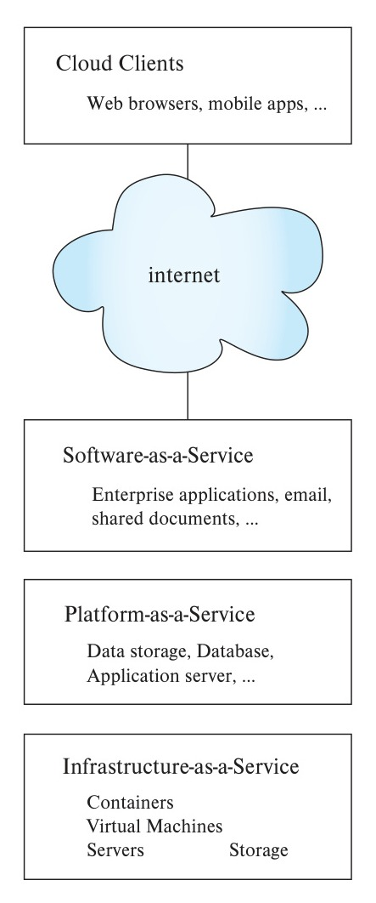
*Figure 20.10 — Cloud service models.*

### 20.7.1 Cloud Service Models

There are several ways in which cloud computing can be utilized, which are summarized in Figure 20.10. These include infrastructure-as-a-service, platform-as-a-service, and software-as-a-service models.

- In the **infrastructure-as-a-service** model, an enterprise rents computing facilities; for example, an enterprise may rent one or more physical machines, along with disk storage space.
  More frequently, cloud computing providers provide an abstraction of a **virtual machine** (**VM**), which appears to the user to be a real machine. These machines are not “real” machines, but rather are simulated by software that allows a single

<!-- Page 992 -->

real computer to simulate several independent computers. *Containers* are a lower cost alternative to VMs and are described later in this section. Multiple VMs can run on a single server machine, and multiple containers can run on a single VM or server.
  By running a very large data center with many machines, cloud-service providers can exploit economies of scale and deliver computing power at much lower cost than an enterprise can do using its own infrastructure.
  Another major advantage of cloud computing is that the cloud-service provider usually has a large number of machines, with spare capacity, and thus an enterprise can rent more (virtual) machines as needed to meet demand and release them at times of light load. The ability to expand or contract capacity at short notice is often referred to as **elasticity**.
  The above benefits of on-demand elastic provisioning of server systems have led to the widespread adoption of infrastructure-as-service platforms, especially by companies that anticipate rapid growth in their computing usage. However, due to the potential security risks of storing data outside the enterprise, the use of cloud computing is still limited in high-security enterprise needs, such as banking.
  In the infrastructure-as-service model, the client enterprise runs its own software, including database systems, on virtual machines provided by the cloud-service provider; the client has to install the database system and deal with maintenance issues such as backup and restore.
- In the **platform-as-a-service** model, the service provider not only provides computing infrastructure, but it also deploys and manages platforms, such as data storage, databases, and application servers, that are used by application software. The client has to install and maintain application software, such as *enterprise resource planning* (*ERP*) systems, which run on such platform-provided services as application servers, database services, or data storage services.
  - **Cloud-based data storage** platforms provide a service that applications can use to store and retrieve data. The service provider takes care of provisioning sufficient amount of storage and computing power to support the load on the data storage platform. Such storage systems could support files, which are typically large, ranging in size from a few megabytes to thousands of megabytes, supporting millions of such files. Or such storage systems could support data items, which are typically small, ranging from hundreds of bytes to a few megabytes, but supporting billions of such data items. Such distributed file systems and data storage systems are discussed in Section 21.6 and Section 21.7. Database applications using cloud-based storage may run on the same cloud (i.e., the same set of machines), or on another cloud.
    One of the main attractions of cloud-based storage is that it can be used by paying a fee without worrying about purchasing, maintaining, and managing the computer systems on which such a service runs. Further, if there is an

<!-- Page 993 -->

increase in demand, the number of servers on which the service runs can be increased by paying a larger fee, without having to actually purchase and deploy more servers. The service provider would of course have to deploy extra servers, but they benefit from economies of scale; the cost of deployment, and especially the time to deployment, are greatly reduced compared to what they would be if the end-users did it on their own.
    The fees for cloud-based data storage are typically based on the amount of data stored, and amount of data input to, and the amount of data output from, the data storage system.
  - **Database-as-a-service** platforms provide a database that can be accessed and queried by clients. Unlike storage services, database-as-a-service platforms provide database functionality such as querying using SQL or other query languages, which data storage systems do not provide. Early offerings of database-as-a-service only supported databases that run on a single node, although the node itself can have a substantial number of processors, memory, and storage. More recently, parallel database systems are being offered as a service on the cloud.
- In the **software-as-a-service** model, the service provider provides the application software as a service. The client does not need to deal with issues such as software installation or upgrades; these tasks are left to the service provider. The client can directly use interfaces provided by the software-as-a-service provider, such as web interfaces, or mobile app interfaces that provide a front end, with the application software acting as the back end.

The concept of virtual machines was developed in the 1960s to allow an expensive mainframe computer to be shared concurrently by users running different operating systems. Although computers are now much cheaper, there is still a cost associated with supplying electrical power to the computers and maintaining them; virtual machines allow this cost to be shared by multiple concurrent users. Virtual machines also ease the task of moving services to new machines: a virtual machine can be shut down on one physical server and restarted on another physical server with very little delay or downtime. This feature is particularly important for quick recovery in the event of hardware failure or upgrade.

Although multiple virtual machines can run on a single real machine, each VM has a high overhead, since it runs an entire operating system internally. When a single organization wishes to run a number of services, if it creates a separate VM for each service, the overhead can be very high. If multiple applications are run on one machine (or VM), two problems often arise: (1) applications conflict on network ports by each trying to listen to the same network port, and (2) applications require different versions of shared libraries, causing conflicts.

**Containers** solve both these problems; applications run in a container, which has its own IP address and its own set of shared libraries. Each application can consist of

<!-- Page 994 -->

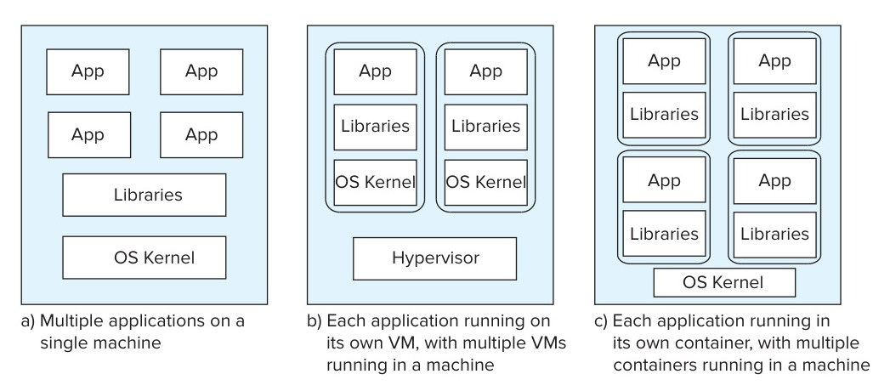
*Figure 20.11 — Application deployment alternatives.*

multiple processes, all running within the same container. The cost of using containers to run applications is much less than the alternative of running each application in its own VM, since many containers can share the same operating system kernel. Each container appears to have its own file system, but the files are all stored in a common underlying file system across all containers. Processes within a container can interact with each other through the file system as well as interprocess communication, but they can interact with processes from other containers only via network connections.

Figure 20.11 depicts the different deployment alternatives for a set of applications. Figure 20.11a shows the alternative of multiple applications running in a single machine, sharing libraries and operating-system kernel. Figure 20.11b shows the alternative of running each application in its own VM, with multiple VMs running on a single machine. The different VMs running on a single real machine are managed by a software layer called the *hypervisor*. Figure 20.11c shows the alternative of using containers, with each container having its own libraries, and multiple containers running on a single machine. Since containers have lower overheads, a single machine can support more containers than VMs.

Containers provide low-cost support for elasticity, since more containers can be deployed very quickly on existing virtual machines, instead of starting up fresh virtual machines.

Many applications today are built as a collection of multiple **services**, each of which runs as a separate process, offering a network API; that is, the functions provided by the service are invoked by creating a network connection to the process and sending a service request over the network connection. Such an application architecture, which builds an application as a collection of small services, is called a **microservices architecture**. Containers fit the microservices architecture very well, since they provide a very low overhead mechanism to execute processes supporting each service.

<!-- Page 995 -->

**Docker** is a very widely used container platform, while **Kubernetes** is a very popular platform that provides not only containers, but also a microservices platform. Kubernetes allows applications to specify declaratively their container needs, and it automatically deploys and links multiple containers to execute the application. It can also manage a number of pods, which allow multiple containers to share storage (file system) and network (IP address) while allowing containers to retain their own copies of shared libraries. Furthermore, it can manage elasticity by controlling the deployment of additional containers when required. Kubernetes can support application scalability by load-balancing API requests across a collection of containers that all run copies of the same application. Users of the API do not need to know what IP addresses (each corresponding to a container) the service is running on, and they can instead connect to a single IP address. The load balancer distributes the requests from the common IP address to a set of containers (each with its own IP address) running the service.

### 20.7.2 Benefits and Limitations of Cloud Services

Many enterprises are finding the model of cloud computing and services beneficial. The cloud model saves client enterprises the need to maintain a large system-support staff and allows new enterprises to begin operation without having to make a large, upfront capital investment in computing systems. Further, as the needs of the enterprise grow, more resources (computing and storage) can be added as required; the cloud-computing vendor generally has very large clusters of computers, making it easy for the vendor to allocate resources on demand.

Users of cloud computing must be willing to accept that their data are held by another organization. This may present a variety of risks in terms of security and legal liability. If the cloud vendor suffers a security breach, client data may be divulged, causing the client to face legal challenges from its customers. Yet the client has no direct control over cloud-vendor security. These issues become more complex if the cloud vendor chooses to store data (or replicas of data) in a foreign country. Various legal jurisdictions differ in their privacy laws. So, for example, if a German company’s data are replicated on a server in New York, then the privacy laws of the United States may apply instead of or in addition to those of Germany or the European Union. The cloud vendor might be required to release client data to the U.S. government even though the client never knew that its data would be stored in a location under U.S. jurisdiction. Specific cloud vendors offer their clients varying degrees of control over how their data are distributed geographically and replicated.

Despite the drawbacks, the benefits of cloud services are great enough that there is a rapidly growing market for such services.

## 20.8 Summary

- Centralized database systems run entirely on a single computer. Database systems designed for multiuser systems need to support the full set of transaction features.

<!-- Page 996 -->

  Such systems are usually designed as servers that accept requests from applications via SQL or their own APIs.
- Parallelism with a small number of cores is referred to as coarse-grained parallelism. Parallelism with a large number of processors is referred to as fine-grained parallelism.
- Transaction servers have multiple processes, possibly running on multiple processors. So that these processes have access to common data, such as the database buffer, systems store such data in shared memory. In addition to processes that handle queries, there are system processes that carry out tasks such as lock and log management and checkpointing.
- Access to shared memory is controlled by a mutual-exclusion mechanism based on machine-level atomic instructions (test-and-set or compare-and-swap).
- Data-server systems supply raw data to clients. Such systems strive to minimize communication between clients and servers by caching data and locks at the clients. Parallel database systems use similar optimizations.
- Parallel database systems consist of multiple processors and multiple disks connected by a fast interconnection network. Speedup measures how much we can increase processing speed by increasing parallelism for a single transaction. Scaleup measures how well we can handle an increased number of transactions by increasing parallelism. Interference, skew, and start-up costs act as barriers to getting ideal speedup and scaleup.
- The components of a parallel system are connected via several possible types of interconnection networks: bus, ring, mesh, hypercube, or a tree-like topology.
- Parallel database architectures include the shared-memory, shared-disk, shared-nothing, and hierarchical architectures. These architectures have different trade-offs of scalability versus communication speed.
- Modern shared-memory architectures associate some memory with each processor, resulting in a non-uniform memory architecture (NUMA). Since each processor has its own cache, there is a problem of ensuring cache coherency, that is, consistency of data across the caches of multiple processors.
- Storage-area networks are a special type of local-area network designed to provide fast interconnection between large banks of storage devices and multiple computers.
- A distributed database system is a collection of partially independent database systems that (ideally) share a common schema and coordinate processing of transactions that access nonlocal data.

<!-- Page 997 -->

- Cloud services may be provided at a variety of levels: The infrastructure-as-a-service model provides clients with a virtual machine on which clients install their own software. The platform-as-a-service model provides data-storage, database, and application servers in addition to virtual machines, but the client needs to install and maintain application software. The software-as-a-service model provides that application software plus the underlying platform.
- Organizations using cloud services have to consider a wide variety of technical, economic, and legal issues in order to ensure the privacy and security of data and adequate performance despite the likelihood of data being stored at a remote location.

## Review Terms

- Centralized Database Systems
  - Single-user system
  - Multiuser system
  - Server systems
  - Embedded databases
  - Servers
  - Coarse-grained parallelism
  - Fine-grained parallelism
- Server System Architectures
  - Transaction-server
  - Query-server
  - Data-server systems
  - Server processes
- Mutual exclusion
- Atomic instructions
- Data caching
- Parallel Systems
  - Coarse-grain parallel machine
  - Massively parallel machine
  - Fine-grain parallel machine
  - Data center
- Decision-support queries
- Measure of performance
  - Throughput
  - Response time
  - Linear speedup
  - Sublinear speedup
  - Linear scaleup
  - Sublinear scaleup
- Sequential computation
- Amdahl’s law
- Start-up costs
- Interconnection network
  - Bus
  - Ring
  - Mesh
  - Hypercube
  - Tree-like
  - Edge switches
- Aggregation switch

<!-- Page 998 -->

- Ethernet
- Fiber channel
- Infiniband
- Remote direct memory access (RDMA)
- Parallel Database Architectures
  - Shared memory
  - Shared disk
  - Clusters
  - Shared nothing
  - Hierarchical
- Moore’s law
- NUMA
- Cache misses
- Hyper-threading
- Hardware threads
- Cache
- Shared-disk
- Fault tolerance
- Storage-area network (SAN)
- Distributed database system
- Local autonomy
- Homogeneous distributed database
- Federated database systems
- Heterogeneous distributed database systems
- Latency
- Network partition
- Availability
- Cloud computing
- Infrastructure-as-a-service
- Platform-as-a-service
- Cloud-based data storage
- Database-as-a-service
- Software-as-a-service
- Microservices architecture

## Practice Exercises

**20.1** Is a multiuser system necessarily a parallel system? Why or why not?

**20.2** Atomic instructions such as compare-and-swap and test-and-set also execute a memory fence as part of the instruction on many architectures. Explain what is the motivation for executing the memory fence, from the viewpoint of data in shared memory that is protected by a mutex implemented by the atomic instruction. Also explain what a process should do before releasing a mutex.

**20.3** Instead of storing shared structures in shared memory, an alternative architecture would be to store them in the local memory of a special process and access the shared data by interprocess communication with the process. What would be the drawback of such an architecture?

**20.4** Explain the distinction between a *latch* and a *lock* as used for transactional concurrency control.

**20.5** Suppose a transaction is written in C with embedded SQL, and about 80 percent of the time is spent in the SQL code, with the remaining 20 percent spent

<!-- Page 999 -->

in C code. How much speedup can one hope to attain if parallelism is used only for the SQL code? Explain.

**20.6** Consider a pair of processes in a shared memory system such that process $A$ updates a data structure, and then sets a flag to indicate that the update is completed. Process $B$ monitors the flag, and starts processing the data structure only after it finds the flag is set.
   Explain the problems that could arise in a memory architecture where writes may be reordered, and explain how the **sfence** and **lfence** instructions can be used to ensure the problem does not occur.

**20.7** In a shared-memory architecture, why might the time to access a memory location vary depending on the memory location being accessed?

**20.8** Most operating systems for parallel machines (i) allocate memory in a local memory area when a process requests memory, and (ii) avoid moving a process from one core to another. Why are these optimizations important with a NUMA architecture?

**20.9** Some database operations such as joins can see a significant difference in speed when data (e.g., one of the relations involved in a join) fits in memory as compared to the situation where the data do not fit in memory. Show how this fact can explain the phenomenon of **superlinear speedup**, where an application sees a speedup greater than the amount of resources allocated to it.

**20.10** What is the key distinction between homogeneous and federated distributed database systems?

**20.11** Why might a client choose to subscribe only to the basic infrastructure-as-a-service model rather than to the services offered by other cloud service models?

**20.12** Why do cloud-computing services support traditional database systems best by using a virtual machine, instead of running directly on the service provider’s actual machine, assuming that data is on external storage?

## Exercises

**20.13** Consider a bank that has a collection of sites, each running a database system. Suppose the only way the databases interact is by electronic transfer of money between themselves, using persistent messaging. Would such a system qualify as a distributed database? Why?

**20.14** Assume that a growing enterprise has outgrown its current computer system and is purchasing a new parallel computer. If the growth has resulted in many more transactions per unit time, but the length of individual transactions has

<!-- Page 1000 -->

not changed, what measure is most relevant—speedup, batch scaleup, or transaction scaleup? Why?

**20.15** Database systems are typically implemented as a set of processes (or threads) accessing shared memory.
   a. How is access to the shared-memory area controlled?
   b. Is two-phase locking appropriate for serializing access to the data structures in shared memory? Explain your answer.

**20.16** Is it wise to allow a user process to access the shared-memory area of a database system? Explain your answer.

**20.17** What are the factors that can work against linear scale up in a transaction processing system? Which of the factors are likely to be the most important in each of the following architectures: shared-memory, shared disk, and shared nothing?

**20.18** Memory systems today are divided into multiple modules, each of which can be serving a separate request at a given time, in contrast to earlier architectures where there was a single interface to memory. What impact has such a memory architecture have on the number of processors that can be supported in a shared-memory system?

**20.19** Assume we have data items $d_1, d_2, \dots, d_n$ with each $d_i$ protected by a lock stored in memory location $M_i$.
   a. Describe the implementation of **lock-X**($d_i$) and **unlock**($d_i$) via the use of the test-and-set instruction.
   b. Describe the implementation of **lock-X**($d_i$) and **unlock**($d_i$) via the use of the compare-and-swap instruction.

**20.20** In a shared-nothing system data access from a remote node can be done by remote procedure calls, or by sending messages. But remote direct memory access (RDMA) provides a much faster mechanism for such data access. Explain why.

**20.21** Suppose that a major database vendor offers its database system (e.g., Oracle, SQL Server DB2) as a cloud service. Where would this fit among the cloud-service models? Why?

**20.22** If an enterprise uses its own ERP application on a cloud service under the platform-as-a-service model, what restrictions would there be on when that enterprise may upgrade the ERP system to a new version?

<!-- Page 1001 -->

## Further Reading

[Hennessy et al. (2017)] provides an excellent introduction to the area of computer architecture, including the topics of shared-memory architectures and cache coherency, parallel computing architectures, and cloud computing, which we covered in this chapter. [Gray and Reuter (1993)] provides the classic textbook description of transaction processing, including the architecture of client–server and distributed systems. [Ozsu and Valduriez (2010)] provides textbook coverage of distributed database systems. [Abts and Felderman (2012)] provides an overview of data center networking.

## Bibliography

- **[Abts and Felderman (2012)]** D. Abts and B. Felderman, “A Guided Tour of Datacenter Networking”, *Communications of the ACM*, Volume 55, Number 6 (2012), pages 44–51.
- **[Gray and Reuter (1993)]** J. Gray and A. Reuter, *Transaction Processing: Concepts and Techniques*, Morgan Kaufmann (1993).
- **[Hennessy et al. (2017)]** J. L. Hennessy, D. A. Patterson, and D. Goldberg, *Computer Architecture: A Quantitative Approach*, 6th edition, Morgan Kaufmann (2017).
- **[Ozsu and Valduriez (2010)]** T. Ozsu and P. Valduriez, *Principles of Distributed Database Systems*, 3rd edition, Prentice Hall (2010).

## Credits

The photo of the sailboats in the beginning of the chapter is due to ©Pavel Nesvadba/Shutterstock.

[^1]: Recall that we use the term *disk* to refer to hard disks as well as solid-state drives.
[^2]: In some cases, a parallel system may provide superlinear speedup, that is, an $N$ times larger system may provide speedup greater than $N$. This could happen, for example, because data that did not fit in the main memory of a smaller system do fit in the main memory of a larger system, avoiding disk I/O. Similarly, data may fit in the cache of a larger system, reducing memory accesses compared to a smaller system, which could lead to superlinear speedup.
[^3]: For example, a weather simulation that divides the atmosphere in a particular region into cubes of side 200 meters may need to be modified to use a finer resolution, with cubes of side 100 meters; the number of cubes would thus be scaled up by a factor of 8.
[^4]: Gordon Moore, cofounder of Intel, predicted such an exponential growth in the number of transistors back in the 1960s; his prediction is popularly known as **Moore’s law**, even though, technically, it is not a *law*, but rather an observation and a prediction. In earlier decades, processor speeds also increased along with the decrease in the feature sizes, but that trend ended in the mid-2000s since processor clock frequencies beyond a few gigahertz could not be attained without unreasonable increase in power consumption and heat generation. Moores’s law is sometimes erroneously interpreted to have predicted exponential increases in processor speeds.
[^5]: Do not confuse the term *network partitioning* with the term *data partitioning*; data partitioning refers to dividing up of data items into partitions, which may be stored at different nodes.
