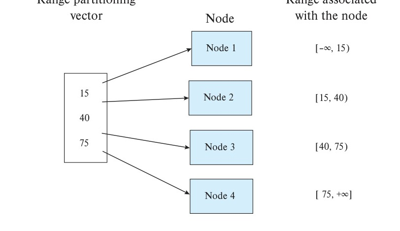
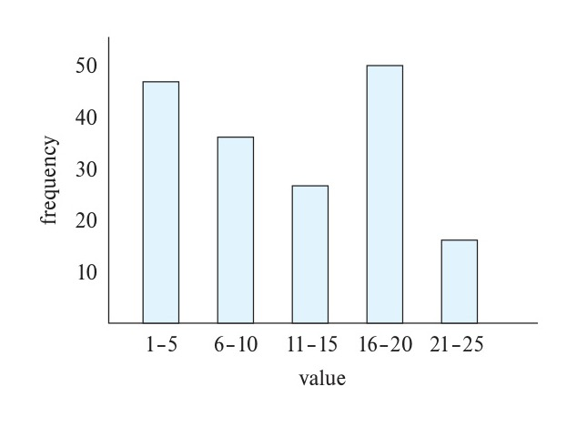
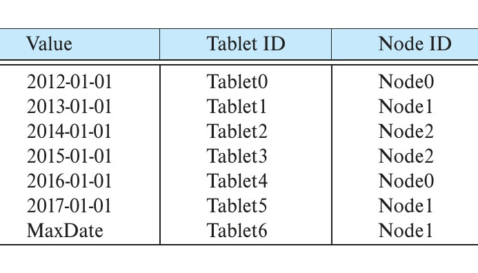
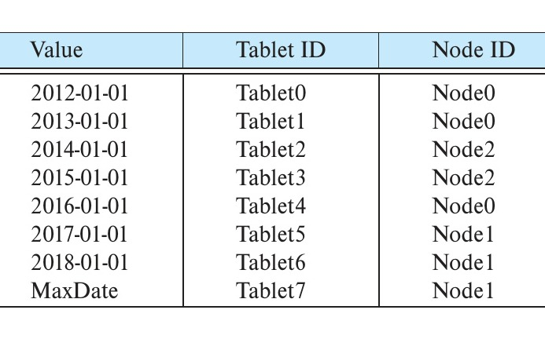
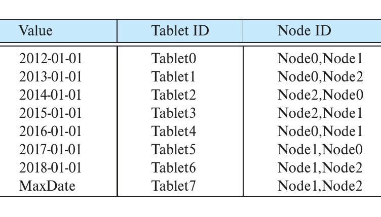
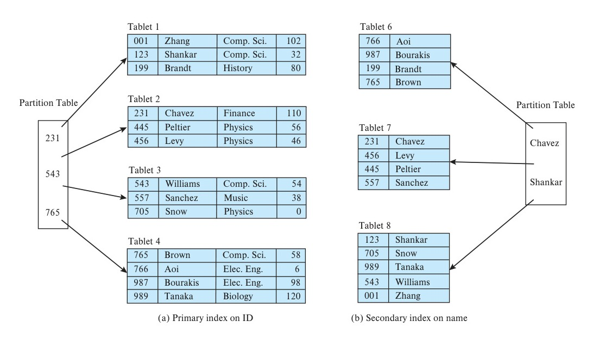
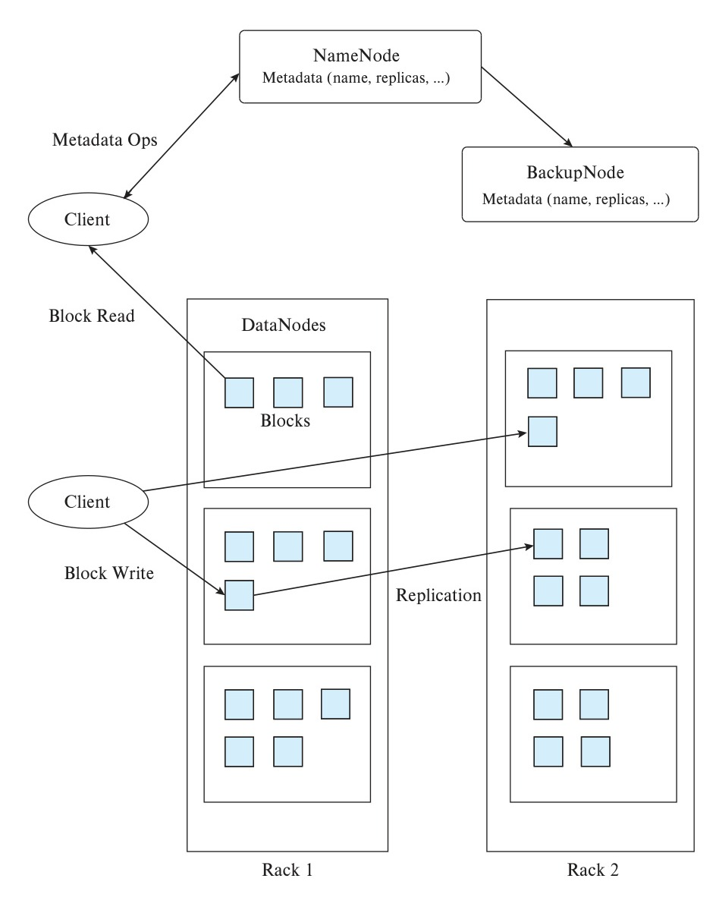
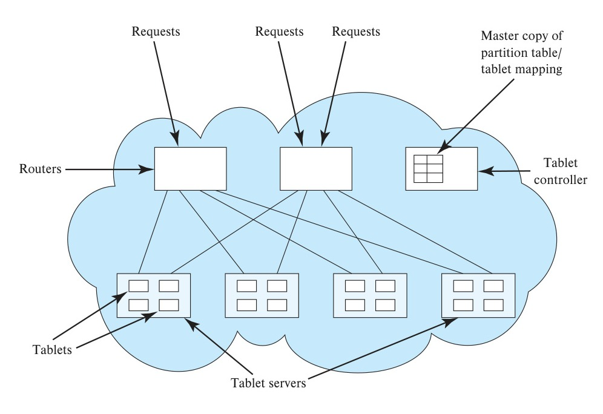

<!-- Page 1003 -->

# Chapter 21: Parallel and Distributed Storage

As we discussed in Chapter 20, parallelism is used to provide speedup, where queries are executed faster because more resources, such as processors and disks, are provided. Parallelism is also used to provide scaleup, where increasing workloads are handled without increased response time, via an increase in the degree of parallelism.

In this chapter, we discuss techniques for data storage and indexing in parallel database systems.

## 21.1 Overview

We first describe, in Section 21.2 and Section 21.3, how to partition data amongst multiple nodes. We then discuss, in Section 21.4, replication of data and parallel indexing (in Section 21.5). Our description focuses on shared-nothing parallel database systems, but the techniques we describe are also applicable to distributed database systems, where data are stored in a geographically distributed manner.

File systems that run on a large number of nodes, called distributed file systems, are a widely used way to store data in a parallel system. We discuss distributed file systems in Section 21.6.

In recent years parallel data storage and indexing techniques have been extensively used for storage of nonrelational data, including unstructured text data, and semistructured data in XML, JSON, or other formats. Such data are often stored in parallel **key-value stores**, which store data items with an associated key. The techniques we describe for parallel storage of relational data can also be used for key-value stores which are discussed in Section 21.7. We use the term **data storage system** to refer to both key-value stores, and the data storage and access layer of parallel database systems.

Query processing in parallel and distributed databases is discussed in Chapter 22, while and transaction processing in parallel and distributed databases is discussed in Chapter 23.

<!-- Page 1004 -->

## 21.2 Data Partitioning

In its simplest form, **I/O parallelism** refers to reducing the time required to retrieve data from disk by partitioning the data over multiple disks.[^1]

At the lowest level, RAID systems allow blocks to be partitioned across multiple disks, allowing them to be accessed in parallel. Blocks are usually allocated to different disks in a round-robin fashion, as we saw in Section 12.5. For example, if there are $n$ disks numbered $0$ to $n - 1$, round-robin allocation assigns block $i$ to disk $i \bmod n$. However, the block-level partitioning techniques supported by RAID systems do not offer any control in terms of which tuples of a relation are stored on which disk or node. Therefore, parallel database systems typically do not use block-level partitioning and instead perform partitioning at the level of tuples.

In systems with multiple nodes (computers), each with multiple disks, partitioning can potentially be specified to the level of individual disks. However, parallel database systems typically focus on partitioning data across nodes and leave it to the operating system on each node to decide on assigning blocks to disks within the node.

In a parallel storage system, the tuples of a relation are partitioned (divided) among many nodes, so that each tuple resides on one node; such partitioning is referred to as **horizontal partitioning**. Several partitioning strategies have been proposed for horizontal partitioning, which we study next.

We note that *vertical partitioning*, discussed in Section 13.6 in the context of columnar storage, is orthogonal to horizontal partitioning. (As an example of vertical partitioning, a relation $r(A, B, C, D)$ where $A$ is a primary key, may be vertically partitioned into $r(A, B)$ and $r(A, C, D)$, if many queries require $B$ values, while $C$ and $D$ values are large in size and not required for many queries.) Once tuples are horizontally partitioned, they may be stored in a vertically partitioned manner at each node.

We also note that several database vendors use the term *partitioning* to denote the partitioning of tuples of a relation $r$ into multiple physical relations $r_1, r_2, \ldots, r_n$, where all the physical relations $r_i$ are stored in a single node. The relation $r$ is not stored, but treated as a view defined by the query $r_1 \cup r_2 \cup \ldots \cup r_n$. Such *intra-node partitioning* of a relation is typically used to ensure that frequently accessed tuples are stored separately from infrequently accessed tuples and is different from horizontal partitioning across nodes. Intra-node partitioning is described in more detail in Section 25.1.4.3.

In the rest of this chapter, as well as in subsequent chapters, we use the term *partitioning* to refer to *horizontal partitioning* across multiple nodes.

### 21.2.1 Partitioning Strategies

We present three basic *data-partitioning strategies* for partitioning tuples. Assume that there are $n$ nodes, $N_1, N_1, \ldots, N_n$, across which the data are to be partitioned.

[^1]: As in earlier chapters, we use the term *disk* to refer to persistent storage devices, such as magnetic hard disks and solid-state drives.

<!-- Page 1005 -->


*Figure 21.1 — Example of range partitioning vector.*

- **Round-robin**. This strategy scans the relation in any order and sends the $i$th tuple fetched during the scan to node number $N_{((i-1) \bmod n)+1}$. The round-robin scheme ensures an even distribution of tuples across nodes; that is, each node has approximately the same number of tuples as the others.
- **Hash partitioning**. This declustering strategy designates one or more attributes from the given relation’s schema as the partitioning attributes. A hash function is chosen whose range is $\{1, 2, \ldots, n\}$. Each tuple of the original relation is hashed on the partitioning attributes. If the hash function returns $i$, then the tuple is placed on node $N_i$.[^2]
- **Range partitioning**. This strategy distributes tuples by assigning contiguous attribute-value ranges to each node. It chooses a partitioning attribute, $A$, and a **partitioning vector** $[v_1, v_2, \ldots, v_{n-1}]$, such that, if $i < j$, then $v_i < v_j$. The relation is partitioned as follows: Consider a tuple $t$ such that $t[A] = x$. If $x < v_1$, then $t$ goes on node $N_1$. If $x \ge v_{n-1}$, then $t$ goes on node $N_n$. If $v_i \le x < v_{i+1}$, then $t$ goes on node $N_{i+1}$.

Figure 21.1 shows an example of a range partitioning vector. In the example in the figure, values less than 15 are mapped to Node 1. Values in the range $[15, 40)$, i.e., values $\ge 15$ but $< 40$. are mapped to Node 2; Values in the range $[40, 75)$, i.e., values $\ge 40$ but $< 75$, are mapped to Node 3, while values $> 75$ are mapped to Node 4.

We now consider how partitioning is maintained when a relation is updated.

1. When a tuple is inserted into a relation, it is sent to the appropriate node based on the partitioning strategy.

[^2]: Hash-function design is discussed in Section 24.5.1.1.

<!-- Page 1006 -->

2. If a tuple is deleted, its location is first found based on the value of its partitioning attribute (for round-robin, all partitions are searched). The tuple is then deleted from wherever it is located.
3. If a tuple is updated, its location is not affected if either round-robin partitioning is used or if the update does not affect a partitioning attribute.

   However, if range partitioning or hash partitioning is used, and the update affects a partitioning attribute, the location of the tuple may be affected. In this case:
   a. The original tuple is deleted from the original location, and
   b. The updated tuple is inserted and sent to the appropriate node based on the partitioning strategy used.

### 21.2.2 Comparison of Partitioning Techniques

Once a relation has been partitioned among several nodes, we can retrieve it in parallel, using all the nodes. Similarly, when a relation is being partitioned, it can be written to multiple nodes in parallel. Thus, the transfer rates for reading or writing an entire relation are much faster with I/O parallelism than without it. However, reading an entire relation, or *scanning a relation*, is only one kind of access to data. Access to data can be classified as follows:

1. Scanning the entire relation.
2. Locating a tuple associatively (e.g., *employee_name* = “Campbell”); these queries, called **point queries**, seek tuples that have a specified value for a specific attribute.
3. Locating all tuples for which the value of a given attribute lies within a specified range (e.g., $10000 < salary < 20000$); these queries are called **range queries**.

The different partitioning techniques support these types of access at different levels of efficiency:

- **Round-robin**. The scheme is ideally suited for applications that wish to read the entire relation sequentially for each query. With this scheme, both point queries and range queries are complicated to process, since each of the $n$ nodes must be used for the search.
- **Hash partitioning**. This scheme is best suited for point queries based on the partitioning attribute. For example, if a relation is partitioned on the *telephone_number* attribute, then we can answer the query “Find the record of the employee with *telephone_number* = 555-3333” by applying the partitioning hash function to 555-3333 and then searching that node. Directing a query to a single node saves the start-up cost of initiating a query on multiple nodes and leaves the other nodes free to process other queries.

<!-- Page 1007 -->

Hash partitioning is also useful for sequential scans of the entire relation. If the hash function is a good randomizing function, and the partitioning attributes form a key of the relation, then the number of tuples in each of the nodes is approximately the same, without much variance. Hence, the time taken to scan the relation is approximately $1/n$ of the time required to scan the relation in a single node system.

The scheme, however, is not well suited for point queries on nonpartitioning attributes. Hash-based partitioning is also not well suited for answering range queries, since, typically, hash functions do not preserve proximity within a range. Therefore, all the nodes need to be scanned for range queries to be answered.

- **Range partitioning**. This scheme is well suited for point and range queries on the partitioning attribute. For point queries, we can consult the partitioning vector to locate the node where the tuple resides. For range queries, we consult the partitioning vector to find the range of nodes on which the tuples may reside. In both cases, the search narrows to exactly those nodes that might have any tuples of interest.

  An advantage of this feature is that, if there are only a few tuples in the queried range, then the query is typically sent to one node, as opposed to all the nodes. Since other nodes can be used to answer other queries, range partitioning results in higher throughput while maintaining good response time. On the other hand, if there are many tuples in the queried range (as there are when the queried range is a larger fraction of the domain of the relation), many tuples have to be retrieved from a few nodes, resulting in an I/O bottleneck (hot spot) at those nodes. In this example of **execution skew**, all processing occurs in one—or only a few—partitions. In contrast, hash partitioning and round-robin partitioning would engage all the nodes for such queries, giving a faster response time for approximately the same throughput.

The type of partitioning also affects other relational operations, such as joins, as we shall see in Section 22.3 and Section 22.4.1.

Thus, the choice of partitioning technique also depends on the operations that need to be executed. In general, hash partitioning or range partitioning are preferred to round-robin partitioning.

Partitioning is important for large relations. Large databases that benefit from parallel storage often have some small relations. Partitioning is not a good idea for such small relations, since each node would end up with just a few tuples. Partitioning is worthwhile only if each node would contain at least a few disk blocks worth of data. Small relations are best left unpartitioned, while medium-sized relations could be partitioned across some of the nodes, rather than across all the nodes, in a large system.

## 21.3 Dealing with Skew in Partitioning

When a relation is partitioned (by a technique other than round-robin), there may be a skew in the distribution of tuples, with a high percentage of tuples placed in some

<!-- Page 1008 -->

partitions and fewer tuples in other partitions. Such an imbalance in the distribution of data is called **data distribution skew**. Data distribution skew may be caused by one of two factors.

- **Attribute-value skew**, which refers to the fact that some values appear in the partitioning attributes of many tuples. All the tuples with the same value for the partitioning attribute end up in the same partition, resulting in skew.
- **Partition skew**, which refers to the fact that there may be load imbalance in the partitioning, even when there is no attribute skew.

Attribute-value skew can result in skewed partitioning regardless of whether range partitioning or hash partitioning is used. If the partition vector is not chosen carefully, range partitioning may result in partition skew. Partition skew is less likely with hash partitioning if a good hash function is chosen.

As Section 20.4.2 noted, even a small skew can result in a significant decrease in performance. Skew becomes an increasing problem with a higher degree of parallelism. For example, if a relation of 1000 tuples is divided into 10 parts, and the division is skewed, then there may be some partitions of size less than 100 and some partitions of size more than 100; if even one partition happens to be of size 200, the speedup that we would obtain by accessing the partitions in parallel is only 5, instead of the 10 for which we would have hoped. If the same relation has to be partitioned into 100 parts, a partition will have 10 tuples on an average. If even one partition has 40 tuples (which is possible, given the large number of partitions) the speedup that we would obtain by accessing them in parallel would be 25, rather than 100. Thus, we see that the loss of speedup due to skew increases with parallelism.

In addition to skew in the distribution of tuples, there may be **execution skew** even if there is no skew in the distribution of tuples, if queries tend to access some partitions more often than others. For example, suppose a relation is partitioned by the timestamp of the tuples, and most queries refer to recent tuples; then, even if all partitions contain the same number of tuples, the partition containing recent tuples would experience a significantly higher load.

In the rest of this section, we consider several approaches to handling skew.

### 21.3.1 Balanced Range-Partitioning Vectors

Data distribution skew in range partitioning can be avoided by choosing a **balanced range-partitioning vector**, which evenly distributes tuples across all nodes.

A balanced range-partitioning vector can be constructed by sorting, as follows: The relation is first sorted on the partitioning attributes. The relation is then scanned in sorted order. After every $1/n$ of the relation has been read, the value of the partitioning attribute of the next tuple is added to the partition vector. Here, $n$ denotes the number of partitions to be constructed.

<!-- Page 1009 -->

The main disadvantage of this method is the extra I/O overhead incurred in doing the initial sort. The I/O overhead for constructing balanced range-partitioning vectors can be reduced by using a precomputed frequency table, or **histogram**, of the attribute values for each attribute of each relation. Figure 21.2 shows an example of a histogram for an integer-valued attribute that takes values in the range 1 to 25. It is straightforward to construct a balanced range-partitioning function given a histogram on the partitioning attributes. A histogram takes up only a little space, so histograms on several different attributes can be stored in the system catalog. If the histogram is not stored, it can be computed approximately by sampling the relation, using only tuples from a randomly chosen subset of the disk blocks of the relation. Using a random sample allows the histogram to be constructed in much less time than it would take to sort the relation.

The preceding approach for creating range-partitioning vectors addresses data-distribution skew; extensions to handle execution skew are left as an exercise for the reader (Exercise 21.3).

A drawback of the above approach is that it is *static*: the partitioning is decided at some point and is not automatically updated as tuples are inserted, deleted, or updated. The partitioning vectors can be recomputed, and the data repartitioned, whenever the system detects skew in data distribution. However, the cost of repartitioning can be quite large, and doing it periodically would introduce a high load which can affect normal processing. Dynamic techniques for avoiding skew, which can adapt in a continuous and less disruptive fashion, are discussed in Section 21.3.2 and in Section 21.3.3.

### 21.3.2 Virtual Node Partitioning

Another approach to minimizing the effect of skew is to use *virtual nodes*. In the **virtual nodes** approach, we pretend there are several times as many *virtual nodes* as the number


*Figure 21.2 — Example of histogram.*

<!-- Page 1010 -->

of real nodes. Any of the partitioning techniques described earlier can be used, but to map tuples and work to virtual nodes instead of to real nodes.[^3]

Virtual nodes, in turn, are mapped to real nodes. One way to map virtual nodes to real nodes is round-robin allocation; thus, if there are $n$ real nodes numbered 1 to $n$, virtual node $i$ is mapped to real node $((i - 1) \bmod n) + 1$. The idea is that even if one range had many more tuples than the others because of skew, these tuples would get split across multiple virtual nodes ranges. Round-robin allocation of virtual nodes to real nodes would distribute the extra work among multiple real nodes, so that one node does not have to bear all the burden.

A more sophisticated way of doing the mapping is by tracking the number of tuples in each virtual node, and the load (e.g., the number of accesses per second) on each virtual node. Virtual nodes are then mapped to real nodes in a way that balances the number of stored tuples as well as the load across the real nodes. Thus, data-distribution skew and execution skew can be minimized.

The system must then record this mapping and use it to route accesses to the correct real node. If virtual nodes are numbered by consecutive integers, this mapping can be stored as an array *virtual_to_real_map[]*, with $m$ entries, where there are $m$ virtual nodes; the $i$th element of this array stores the real node to which virtual node $i$ is mapped.

Yet another benefit of the virtual node approach is that it allows **elasticity of storage**, that is, as the load on the system increases it is possible to add more resources (nodes) to the system to handle the load. When a new node is added, some of the virtual nodes are *migrated* to the new real node, which can be done without affecting any of the other virtual nodes. If the amount of data mapped to each virtual node is small, the migration of a virtual node from one node to another can be done relatively fast, minimizing disruption.

### 21.3.3 Dynamic Repartitioning

While the virtual-node approach can reduce skew with range partitioning as well as hash partitioning, it does not work very well if the data distribution changes over time, resulting in some virtual nodes having a very large number of tuples, or a very high execution load. For example, if partitioning was done by timestamps of records, the last timestamp range would get an increasing number of records, as more records are inserted, while other ranges would not get any new records. Thus, even if the initial partitioning is balanced, it could become increasingly skewed over time.

Skew can be dealt with by recomputing the partitioning scheme entirely. However, repartitioning the data based on the new partitioning scheme would, in general, be a very expensive operation. In the preceding example, we would end up moving a significant number of records from each partition to a partition that precedes it in timestamp

[^3]: The virtual node approach is also called the **virtual processor** approach, a term used in earlier editions of this book; since the term *virtual processor* is now commonly used in a different sense in the context of virtual machines, we now use the term *virtual node*.

<!-- Page 1011 -->

order. When dealing with large amounts of data, such repartitioning would be unreasonably expensive.

Dynamic repartitioning can be done in an efficient manner by instead exploiting the virtual node scheme. The basic idea is to split a virtual node into two virtual nodes when it has too many tuples, or too much load; the idea is very similar to a $\text{B}^+$-tree node being split into two nodes when it is overfull. One of the newly created virtual nodes can then be migrated to a different node to rebalance the data stored at each node, or the load at each node.

Considering the preceding example, if the virtual node corresponding to a range of timestamps 2017-01-01 to *MaxDate* were to become overfull, the partition could be split into two partitions. For example, if half the tuples in this range have timestamps less than 2018-01-01, one partition would have timestamps from 2017-01-01 to less than 2018-01-01, and the other would have tuples with timestamps from 2018-01-01 to *MaxDate*. To rebalance the number of tuples in a real node, we would just need to move one of the virtual nodes to a new real node.

Dynamic repartitioning in this way is very widely used in parallel databases and parallel data storage systems today. In data storage systems, the term **table** refers to a collection of data items. Tables are partitioned into multiple **tablets**. The number of tablets into which a table is divided is much larger than the number of real nodes in the system; thus tablets correspond to virtual nodes.

The system needs to maintain a **partition table**, which provides a mapping from the partitioning key ranges to a tablet identifier, as well as the real node on which the tablet data reside. Figure 21.3 shows an example of a partition table, where the partition key is a date. Tablet0 stores records with key value < 2012-01-01. Tablet1 stores records with key values $\ge$ 2012-01-01, but < 2013-01-01. Tablet2 stores records with key values $\ge$ 2013-01-01, but < 2014-01-01, and so on. Finally, Tablet6 stores values $\ge$ 2017-01-01.

Read requests must specify a value for the partitioning attribute, which is used to identify the tablet which could contain a record with that key value; a request that does not specify a value for the partitioning attribute would have to be sent to all tablets. A read request is processed by using the partitioning key value $v$ to identify the tablet


*Figure 21.3 — Example of a partition table.*

<!-- Page 1012 -->

whose range of keys contains $v$, and then sending the request to the real node where the tablet resides. The request can be handled efficiently at that node by maintaining, for each tablet, an index on the partitioning key attribute.

Write, insert, and delete requests are processed similarly, by routing the requests to the correct tablet and real node, using the mechanism described above for reads.

The above scheme allows tablets to be split if they become too big; the key range corresponding to the tablet is split into two, with a newly created tablet getting half the key range. Records whose key range is mapped to the new tablet are then moved from the original tablet to the new tablet. The partition table is updated to reflect the split, so requests are then correctly directed to the appropriate tablet.

If a real node gets overloaded, either due to a large number of requests or due to too much data at the node, some of the tablets from the node can be moved to a different real node that has a lower load. Tablets can also be moved similarly in case one of the real nodes has a large amount of data, while another real node has less data. Finally, if a new real node joins a system, some tables can be moved from existing nodes to the new node. Whenever a tablet is moved to a different real node, the partition table is updated; subsequent requests will then be sent to the correct real node.

Figure 21.4 shows the partition table from Figure 21.3 after Tablet6, which had values $\ge$ 2017-01-01, has been split into two: Tablet6 now has values $\ge$ 2017-01-01, but < 2018-01-01, while the new tablet, Tablet7, has values $\ge$ 2018-01-01. Such a split could be caused by a large number of inserts into Tablet6, making it very large; the split rebalances the sizes of the tablets.

Note also that Tablet1, which was in Node1, has now been moved to Node0 in Figure 21.4. Such a tablet move could be because Node1 is overloaded due to excessive data, or due to a high number of requests.

Most parallel data storage systems store the partition table at a **master** node. However, to support a large number of requests each second, the partition table is usually replicated, either to all client nodes that access data or to multiple **routers**. Routers accept read/write requests from clients and forward the requests to the appropriate


*Figure 21.4 — Example partition table after tablet split and tablet move.*

<!-- Page 1013 -->

real node containing the tablet/virtual nodes based on the key values specified in the request.

An alternative fully distributed approach is supported by a hash based partitioning scheme called **consistent hashing**. In the consistent hashing approach, keys are hashed to a large space, such as 32 bit integers. Further, node (or virtual node) identifiers are also hashed to the same space. A key $k_i$ could be logically mapped to the node $n_j$ whose hash value $h(n_j)$ is the highest value among all nodes satisfying $h(n_j) < h(k_i)$. But to ensure that every key is assigned to a node, hash values are treated as lying on a cycle similar to the face of a clock, where the maximum hash value *maxhash* is immediately followed by 0. Then, key $k_i$ is then logically mapped to the node $n_j$ whose hash value $h(n_j)$ is the closest among all nodes, when we move anti-clockwise in the circle from $h(k_i)$.

**Distributed hash tables** based on this idea have been developed where there is no need for either a master node or a router; instead each participating node keeps track of a few other peer nodes, and routing is implemented in a cooperative manner. New nodes can join the system, and integrate themselves by following specified protocols in a completely peer-to-peer manner, without the need for a master. See the Further Reading section at the end of the chapter for references providing further details.

## 21.4 Replication

With a large number of nodes, the probability that at least one node will malfunction in a parallel system is significantly greater than in a single-node system. A poorly designed parallel system will stop functioning if any node fails. Assuming that the probability of failure of a single node is small, the probability of failure of the system goes up linearly with the number of nodes. For example, if a single node would fail once every 5 years, a system with 100 nodes would have a failure every 18 days.

Parallel data storage systems must, therefore, be resilient to failure of nodes. Not only should data not be lost in the event of a node failure, but also, the system should continue to be *available*, that is, continue to function, even during such a failure.

To ensure tuples are not lost on node failure, tuples are replicated across at least two nodes, and often three nodes. If a node fails, the tuples that it stored can still be accessed from the other nodes where the tuples are replicated.[^4]

Tracking the replicas at the level of individual tuples would result in significant overhead in terms of storage and query processing. Instead, replication is done at the level of partitions (tablets, nodes, or virtual nodes). That is, each partition is replicated; the locations of the partition replicas are recorded as part of the partition table.

Figure 21.5 shows a partition table with replication of tablets. Each tablet is replicated in two nodes.

[^4]: Caching also results in replication of data, but with the aim of speeding up access. Since data may be evicted from cache at any time, caching does not ensure availability in the event of failure.

<!-- Page 1014 -->


*Figure 21.5 — Partition table of Figure 21.4 with replication.*

The database system keeps track of failed nodes; requests for data stored at a failed node are automatically routed to the backup nodes that store a replica of the data. Issues of how to handle the case where one or more replicas are stored at a currently failed node are addressed briefly in Section 21.4.2, and in more detail later, in Section 23.4.

### 21.4.1 Location of Replicas

Replication to two nodes provides protection from data loss/unavailability in the event of single node failure, while replication to three nodes provides protection even in the event of two node failures. If all nodes where a partition is replicated fail, obviously there is no way to prevent data loss/unavailability. Systems that use low-cost commodity machines for data storage typically use three-way replication, while systems that use more reliable machines typically use two-way replication.

There are multiple possible failure modes in a parallel system. A single node could fail due to some internal fault. Further, it is possible for all the nodes in a rack to fail if there is some problem with the rack such as, for example, failure of power supply to the entire rack, or failure of the network switches in a rack, making all the nodes in the rack inaccessible. Further, there is a possibility of failure of an entire data center, for example, due to fire, flooding, or a large-scale power failure.

The location of the nodes where the replicas of a partition are stored must, therefore, be chosen carefully, to maximize the probability of at least one copy being accessible even during a failure. Such replication can be within a data center or across data centers.

- **Replication within a data center**: Since single node failures are the most common failure mode, partitions are often replicated to another node.

  With the tree-like interconnection topology commonly used in data center networks (described in Section 20.4.3) network bandwidth within a rack is much

<!-- Page 1015 -->

higher than the network bandwidth between racks. As a result, replication to another node within the same rack as the first node reduces network demand on the network between racks. But to deal with the possibility of a rack failure, partitions are also replicated to a node on a different rack.

- **Replication across data centers**: To deal with the possibility of failure of an entire data center, partitions may also be replicated at one or more geographically separated data centers. Geographic separation is important to deal with disasters such as earthquakes or storms that may shut down all data centers in a geographic region.

  For many web applications, round-trip delays across a long-distance network can affect performance significantly, a problem that is increasing with the use of Ajax applications that require multiple rounds of communication between the browser and the application. To deal with this problem, users are connected with application servers that are closest to them geographically, and data replication is done in such a way that one of the replicas is in the same data center as (or at least, geographically close to) the application server.

Suppose all the partitions at a node $N_1$ are replicated at a single node $N_2$, and $N_1$ fails. Then, node $N_2$ will have to handle all the requests that would originally have gone to $N_1$, as well as requests routed to node $N_2$. As a result, node $N_2$ would have to perform twice as much work as other nodes in the system, resulting in execution skew during failure of node $N_1$.

To avoid this problem, the replicas of partitions residing at a node, say $N_1$, are spread across multiple other nodes. For example, consider a system with 10 nodes and two-way replication. Suppose node $N_1$ had one of the replicas of partitions $p_1$ through $p_9$. Then, the other replica of partitions $p_1$ could be stored on $N_2$, of $p_2$ on $N_3$, and so on to $p_9$ on $N_{10}$. Then in the event of failure of $N_1$, nodes $N_2$ through $N_{10}$ would share the extra work equally, instead of burdening a single node with all the extra work.

### 21.4.2 Updates and Consistency of Replicas

Since each partition is replicated, updates made to tuples in a partition must be performed on all the replicas of the partition. For data that is never updated after it has been created, reads can be performed at any of the replicas, since all of them will have the same value. If a storage system ensures that all replicas are exclusive-locked and updated atomically (using, for example, the two-phase commit protocol which we will see in Section 23.2.1), reads of a tuple can be performed (after obtaining a shared lock) at any of the replicas and will see the most recent version of the tuple.

If data are updated, and replicas are not updated atomically, different replicas may temporarily have different values. Thus, a read may see a different value depending on which replica it accesses. Most applications require that read requests for a tuple must

<!-- Page 1016 -->

receive the most recent version of the tuple; updates that are based on reading an older version could result in a *lost update problem*.

One way of ensuring that reads get the latest value is to treat one of the replicas of each partition as a **master replica**. All updates are sent to the master replica and are then propagated to other replicas. Reads are also sent to the master replica, so that reads get the latest version of any data item even if updates have not yet been applied to the other replicas.

If a master replica fails, a new master is assigned for that partition. It is important to ensure that every update operation performed by the old master has also been seen by the new master. Further, the old master may have updated some of the replicas, but not all, before it failed; the new master must complete the task of updating all the replicas. We discuss details in Section 23.6.2.

It is important to know which node is the (current) master for each partition. This information can be stored along with the partition table. Specifically, the partition table must record, in addition to the range of key values assigned to that partition, where the replicas of the partition are stored, and further which replica is currently the master.

Three solutions are commonly used to update replicas.

- The *two-phase commit* (2PC) protocol, which ensures that multiple updates performed by a transaction are applied atomically across multiple sites, is described in Section 23.2. This protocol can be used with replicas to ensure that an update is performed atomically on all replicas of a tuple.

  We assume for now that all replicas are available and can be updated. Issues of how to allow two-phase commit to continue execution in the presence of failures, when some replicas may not be reachable, are discussed in Section 23.4.

- Persistent messaging systems, described in Section 23.2.3, which guarantee that a message is delivered once it is sent. Persistent messaging systems can be used to update replicas as follows: An update to a tuple is registered as a persistent message, sent to all replicas of the tuple. Once the message is recorded, the persistent messaging system ensures it will be delivered to all replicas. Thus, all replicas will get the update, eventually; the property is known as **eventual consistency** of replicas.

  However, there may be a delay in message delivery, and during that time some replicas may have applied an update while others have not. To ensure that reads get a consistent version, reads are performed only at a master replica, where updates are made first. (If the site with a master replica of a tuple has failed, another replica can take over as the master replica after ensuring all pending persistent messages with updates have been applied.) Details are presented in Section 23.6.2.

- Protocols called *consensus protocols*, that allow updates of replicas to proceed even in the face of failures, when some replicas may not be reachable, can be used to manage update of replicas. Unlike the preceding protocols, consensus protocols can work even without a designated master replica. We study consensus protocols in Section 23.8.

<!-- Page 1017 -->

## 21.5 Parallel Indexing

Indices in a parallel data storage system can be divided into two kinds: local and global indices. In the following discussion, when virtual node partitioning is used, the term *node* should be understood to mean virtual node (or equivalently, tablet).

- A **local index** is an index built on tuples stored in a particular node; typically, such an index would be built on all the partitions of a given relation. The index contents are stored on the same node as the data.
- A **global index** is an index built on data stored across multiple nodes; a global index can be used to efficiently find matching tuples, regardless of where the tuples are stored.

While the contents of a global index could be stored at a single central location, such a scheme would result in poor scalability; as a result, the contents of a global index should partitioned across multiple nodes.

A **global primary index** on a relation is a global index on the attributes on which the tuples of the relation are partitioned. A global index on partitioning attribute $K$ is constructed by merely creating local indices on $K$ on each partition.

A query that is intended to retrieve tuples with a specific key value $k1$ for $K$ can be answered by first finding which partition could hold the key value $k1$, and then using the local index in that partition to find the required tuples.

For example, suppose the *student* relation is partitioned on the attribute *ID*, and a global index is to be constructed on the attribute *ID*. All that is required is to construct a local index on *ID* on each partition. Figure 21.6(a) shows a global primary index on the *student* relation, on attribute *ID*; the local indices are not shown explicitly in the figure.

A query that is intended to retrieve tuples with a specific value for *ID*, say 557, can be answered by first using the partitioning function on *ID* to first find which partition could contain the specified *ID* value 557; the query is then sent to the corresponding node, which uses the local index on *ID* to locate the required tuples.

Note that *ID* is the primary key for the relation *student*; however, the above scheme would work even if the partitioning attribute were not the primary key. The scheme can be extended to handle range queries, provided the partitioning function is itself based on ranges of values; a partitioning scheme based on hashing cannot support range queries.

A **global secondary index** on a relation is a global index whose index attributes do not match the attributes on which the tuples are partitioned.

Suppose the partitioning attributes are $K_p$, while the index attributes are $K_i$, with $K_p \ne K_i$. One approach for answering a selection query on attributes $K_i$ is as follows: If a local index is created on $K_i$ on each partition of the relation, the query is sent to each

<!-- Page 1018 -->


*Figure 21.6 — Global primary and secondary indices on student relation*

partition, and the local index is used to find matching tuples. Such an approach using local indices is very inefficient if the number of partitions is large, since every partition has to be queried, even if only one or a few partitions contain matching tuples.

We now illustrate an efficient scheme for constructing a global secondary index by using an example. Consider again the *student* relation partitioned on the attribute *ID*, and suppose a global index is to be constructed on the attribute *name*. A simple way to construct such an index is to create a set of (*name*, *ID*) tuples, with one tuple per *student* tuple; let us call this set of tuples *index_name*. Now, the *index_name* tuples are partitioned on the attribute *name*. A local index on *name* is then constructed on each partition of *index_name*. In addition, a global index is created on the *ID*, which is the partitioning attribute. Figure 21.6(b) shows a secondary index on the *student* relation on attribute *name*; local indices are not explicitly shown in the figure.

Now, a query that needs to retrieve students with a given name can be handled by first examining the partition function of *index_name* to find which partition could store *index_name* tuples with the given name; the query is then sent to that partition, which uses the local index on *name* to find the corresponding *ID* value. Next, the global index on the *ID* value is used to find the required tuple.

Note that in the example above, the partitioning attribute *ID* does not have duplicates; hence it suffices to add only the index key *name* and the attribute *ID* to the *index_name* relation. Otherwise, further attributes would have to be added to ensure tuples can be uniquely identified, as described next.

In general, given a relation $r$, which is partitioned on a set of attributes $K_p$, if we wish to create a global secondary index on a set of attributes $K_i$, we create a new relation $r_i^s$, containing the following attributes:

<!-- Page 1019 -->

1. $K_i$, and $K_p$
2. If the partitioning attributes $K_p$ have duplicates, we would have to add further attributes $K_u$, such that $K_p \cup K_u$ is a key for the relation being indexed.

The relation $r_i^s$ is partitioned on $K_i$, and a local index is created on $K_i$. In addition, a local index on attributes $(K_p, K_u)$ is created on each partition of relation $r$.

We now consider how to use a global secondary index to answer a query. Consider a query that specifies a particular value $v$ for $K_i$. The query is processed as follows:

1. The relevant partition of $r_i^s$ for the value $v$ is found using the partitioning function on $K_i$.
2. Use the local index on $K_i$ at the above partition to find tuples of $r_i^s$ that have the specified value $v$ for $K_i$.
3. The tuples in the preceding result are partitioned based on the $K_p$ value and sent to the corresponding nodes.
4. At each node, the tuples received from the preceding step are used along with the local index on $r$ on attributes $K_p \cup K_u$, to find matching $r$ tuples.

Note that relation $r_i^s$ is basically a materialized view defined as $r_i^s = \Pi_{K_i, K_p, K_u}(r)$. Whenever $r$ is modified by inserts, deletions, or updates to tuples, the materialized view $r_i^s$ must be correspondingly updated.

Note also that updates to a tuple of $r$ at some node may result in updates to tuples of $r_i^s$ at other nodes. For example, in Figure 21.6, if the name of ID 001 is updated from Zhang to Yang, the tuple (Zhang, 001) at Tablet8 will be updated to (Yang, 001); since both Zhang and Yang belong in the same partition of the secondary index, no other partition is affected. On the other hand, if the name is updated from Zhang to Bolin, the tuple (Zhang, 001) will be deleted from Tablet8 and a new entry (Bolin, 001) added to Tablet6.

Performing the above updates to the secondary index as part of the same transaction that updates the base relation requires updates to be committed atomically across multiple nodes. Two-phase commit, discussed in Section 23.2, can be used for this task. Alternatives based on persistent messaging can also be used as described in Section 23.2.3, provided it is acceptable for the secondary index to be somewhat out of date.

## 21.6 Distributed File Systems

A **distributed file system** stores files across a large collection of machines while giving a single-file-system view to clients. As with any file system, there is a system of file names and directories, which clients can use to identify and access files. Clients do not need to bother about where the files are stored.

<!-- Page 1020 -->

The goal of first-generation distributed file systems was to allow client machines to access files stored on one or more file servers. In contrast, later-generation distributed file systems, which we focus on, address distribution of file blocks across a very large number of nodes. Such distributed file systems can store very large amounts of data and support very large numbers of concurrent clients. A landmark system in this context was the Google File System (GFS), developed in the early 2000s, which saw widespread use within Google. The open-source Hadoop File System (HDFS) is based on the GFS architecture and is now very widely used.

Distributed file systems are generally designed to efficiently store large files whose sizes range from tens of megabytes to hundreds of gigabytes or more. However, they are designed to store moderate numbers of such files, of the order of millions; they are typically not designed to stores billions of different files. In contrast, the parallel data storage systems we have seen earlier are designed to store very large numbers (billions or more) of data items, whose size can range from small (tens of bytes) to medium (a few megabytes).

As in parallel data storage systems, the data in a distributed file system are stored across a number of nodes. Since files can be much larger than data items in a data storage system, files are broken up into multiple blocks. The blocks of a single file can be partitioned across multiple machines. Further, each file block is replicated across multiple (typically three) machines, so that a machine failure does not result in the file becoming inaccessible.

File systems typically support two kinds of *metadata*:

1. A directory system, which allows a hierarchical organization of files into directories and subdirectories, and
2. A mapping from a file name to the sequence of identifiers of blocks that store the actual data in each file.

In the case of a centralized file system, the block identifiers help locate blocks in a storage device such as a disk. In the case of a distributed file system, in addition to providing a block identifier, the file system must provide the location (node identifier) where the block is stored; in fact, due to replication, the file system provides a set of node identifiers along with each block identifier.

In the rest of this section, we describe the organization of the Hadoop File System (HDFS), which is shown in Figure 21.7; the architecture of HDFS is derived from that of the Google File System (GFS). The nodes (machines) which store data blocks in HDFS are called **datanodes**. Blocks have an associated ID, and datanodes map the block ID to a location in their local file system where the block is stored.

The file system metadata too can be partitioned across many nodes, but unless carefully architected, this could lead to bad performance. GFS and HDFS took a simpler and more pragmatic approach of storing the file system metadata at a single node, called the **namenode** in HDFS.

<!-- Page 1021 -->


*Figure 21.7 — Hadoop Distributed File System (HDFS) architecture*

Since all metadata reads have to go to the namenode, if a disk access were required to satisfy a metadata read, the number of requests that could be satisfied per second would be very small. To ensure acceptable performance, HDFS namenodes cache the entire metadata in memory; the size of memory then becomes a limiting factor in the number of files and blocks that the file system can manage. To reduce the memory size, HDFS uses very large block sizes (typically 64 MB) to reduce the number of blocks that the namenode must track for each file. Despite this, the limited amount of main memory on most machines constrains namenodes to support only a limited number of

<!-- Page 1022 -->

files (of the order of millions). However, with main-memory sizes of many gigabytes, and block sizes of tens of megabytes, an HDFS system can comfortably handle many petabytes of data.

In any system with a large number of datanodes, datanode failures are a frequent occurrence. To deal with datanode failures, data blocks must be replicated to multiple datanodes. If a datanode fails, the block can still be read from one of the other datanodes that stores a replica of the block. Replication to three datanodes is widely used to provide high availability, without paying too high a storage overhead.

We now consider how a file open and read request is satisfied with HDFS. First, the client contacts the namenode, with the name of the file. The namenode finds the list of IDs of blocks containing the file data and returns to the client the list of block IDs, along with the set of nodes that contain replicas of each of the blocks. The client then contacts any one of the replicas for each block of the file, sending it the ID of the block, to retrieve the block. In case that particular replica does not respond, the client can contact any of the other replicas.

To satisfy a write request, the client first contacts the namenode, which allocates blocks, and decides which datanodes should store replicas of each block. The metadata are recorded at the namenode and sent back to the client. The client then writes the block to all the replicas. As an optimization to reduce network traffic, HDFS implementations may choose to store two replicas in the same rack; in that case, the block write is performed to one replica, which then copies the data to the second replica on the same rack. When all the replicas have processed the write of a block, an acknowledgment is sent to the client.

Replication introduces the problem of consistency of data across the replicas in case the file is updated. As an example, suppose one of the replicas of a data block is updated, but due to system failure, another replica does not get updated; then the system could end up with inconsistent states across the replicas. And what value is read would depend on which replica is accessed, which is not an acceptable situation.

While data storage systems in general need to deal with consistency, using techniques that we study in Chapter 23, some distributed file systems such as HDFS take a different approach: namely, not allowing updates. In other words, a file can be appended to, but data that are written cannot be updated. As each block of the file is written, the block is copied to the replicas. The file cannot be read until it is *closed*, that is, all data have been written to the file, and the blocks have been written successfully at all their replicas. The model of writing data to a file is sometimes referred to as **write-once-read-many** access model. Others such as GFS allow updates and detect certain inconsistent states caused by failures while writing to replicas; however, transactional (atomic) updates are not supported.

The restriction that files cannot be updated, but can only be appended to, is not a problem for many applications of a distributed file system. Applications that require updates should use a data-storage system that supports updates instead of using a distributed file system.

<!-- Page 1023 -->

## 21.7 Parallel Key-Value Stores

Many Web applications need to store very large numbers (many billions) of relatively small records (of size ranging from a few kilobytes to a few megabytes). Storage would have to be distributed across thousands of nodes. Storing such records as files in a distributed file system is infeasible, since file systems are not designed to store such large numbers of small files. Ideally, a massively parallel relational database should be used to store such data. But the parallel relational databases available in the early 2000s were not designed to work at a massive scale; nor did they support the ability to easily add more nodes to the system without causing significant disruption to ongoing activities.

A number of parallel key-value storage systems were developed to meet the needs of such web applications. A **key-value store** provides a way to store or update a data item (value) with an associated key and to retrieve the data item with a given key. Some key-value stores treat the data items as uninterpreted sequences of bytes, while others allow a schema to be associated with the data item. If the system supports definition of a schema for data items, it is possible for the system to create and maintain secondary indices on specified attributes of data items.

Key-value stores support two very basic functions on tables: `put(table, key, value)`, used to store values, with an associated key, in a table, and `get(table, key)`, which retrieves the stored value associated with the specified key. In addition, they may support other functions, such as range queries on key values, using `get(table, key1, key2)`.

Further, many key-value stores support some form of flexible schema.

- Some allow column names to be specified as part of a schema definition, similar to relational data stores.
- Others allow columns to be added to, or deleted from, individual tuples; such key-value stores are sometimes referred to as **wide-column stores**. Such key-value stores support functions such as `put(table, key, columname, value)`, to store a value in a specific column of a row identified by the key (creating the column if it does not already exist), and `get(table, key, columname)`, which retrieves the value for a specific column of a specific row identified by the key. Further, `delete(table, key, columname)` deletes a specific column from a row.
- Yet other key-value stores allow the value stored with a key to have a complex structure, typically based on JSON; they are sometimes referred to as **document stores**.

The ability to specify a (partial) schema of the stored value allows the key-value store to evaluate selection predicates at the data store; some stores also use the schema to support secondary indices.

We use the term *key-value store* to include all the above types of data stores; however, some people use the term *key-value store* to refer more specifically to those that

<!-- Page 1024 -->

do not support any form of schema and treat the value as an uninterpreted sequence of bytes.

Parallel key-value stores typically support *elasticity*, whereby the number of nodes can be increased or decreased incrementally, depending on demand. As nodes are added, tablets can be moved to the new nodes. To reduce the number of nodes, tablets can be moved away from some nodes, which can then be removed from the system.

Widely used parallel key-value stores that support flexible columns (also known as wide-column stores) include Bigtable from Google, Apache HBase, Apache Cassandra (originally developed at Facebook), and Microsoft Azure Table Storage from Microsoft, among others. Key-value stores that support a schema include Megastore and Spanner from Google, and Sherpa/PNUTS from Yahoo!. Key-value stores that support semi-structured data (also known as document-stores) include Couchbase, DynamoDB from Amazon, and MongoDB, among others. Redis and Memcached are parallel in-memory key-value stores which are widely used for caching data.

Key-value stores are not full-fledged databases, since they do not provide many of the features that are viewed as standard on database systems today. Features that key-value stores typically do not support include declarative querying (using SQL or any other declarative query language), support for transactions, and support for efficient retrieval of records based on selections on nonkey attributes (traditional databases support such retrieval using secondary indices). In fact, they typically do not support primary-key constraints for attributes other than the key, and do not support foreign-key constraints.

### 21.7.1 Data Representation

As an example of data management needs of web applications, consider the profile of a user, which needs to be accessible to a number of different applications that are run by an organization. The profile contains a variety of attributes, and there are frequent additions to the attributes stored in the profile. Some attributes may contain complex data. A simple relational representation is often not sufficient for such complex data.

Many key-value stores support the *JavaScript Object Notation (JSON)* representation, which has found increasing acceptance for representing complex data (JSON is covered in Section 8.1.2). The JSON representation provides flexibility in the set of attributes that a record contains, as well as the types of these attributes. Yet others, such as Bigtable, define their own data model for complex data, including support for records with a very large number of optional columns.

In Bigtable, a record is not stored as a single value but is instead split into component attributes that are stored separately. Thus, the key for an attribute value conceptually consists of (record-identifier, attribute-name). Each attribute value is just a string as far as Bigtable is concerned. To fetch all attributes of a record, a range query, or more precisely a prefix-match query consisting of just the record identifier, is used. The **get()** function returns the attribute names along with the values. For efficient retrieval

<!-- Page 1025 -->

of all attributes of a record, the storage system stores entries sorted by the key, so all attribute values of a particular record are clustered together.

In fact, the record identifier can itself be structured hierarchically, although to Bigtable itself the record identifier is just a string. For example, an application that stores pages retrieved from a web crawl could map a URL of the form:

```text
www.cs.yale.edu/people/silberschatz.html
```

to the record identifier:

```text
edu.yale.cs.www/people/silberschatz.html
```

so that pages are clustered in a useful order.

Data-storage systems often allow multiple versions of data items to be stored. Versions are often identified by timestamp, but they may be alternatively identified by an integer value that is incremented whenever a new version of a data item is created. Reads can specify the required version of a data item, or they can pick the version with the highest version number. In Bigtable, for example, a key actually consists of three parts: (record-identifier, attribute-name, timestamp).

Some key-value stores support *columnar storage* of rows, with each column of a row stored separately, with the row key and the column value stored for each row. Such a representation allows a scan to efficiently retrieve a specified column of all rows, without having to retrieve other columns from storage. In contrast, if rows are stored in the usual manner, with all column values stored with the row, a sequential scan of the storage would fetch columns that are not required, reducing performance.

Further, some key-value stores support the notion of a **column family**, which groups sets of columns into a column family. For a given row, all the columns in a specific column family are stored together, but columns from other column families are stored separately. If a set of columns are often retrieved together, storing them as a column family may allow more efficient retrieval, as compared to either columnar storage where these are stored and retrieved separately, or a row storage, which could result in retrieving unneeded columns from storage.

### 21.7.2 Storing and Retrieving Data

In this section, we use the term *tablet* to refer to partitions, as discussed in Section 21.3.3. We also use the term **tablet server** to refer to the node that acts as the server for a particular tablet; all requests related to a tablet are sent to the tablet server for that tablet.[^5] The tablet server would be one of the nodes that has a replica of the tablet and plays the role of master replica as discussed in Section 21.4.1.[^6]

[^5]: HBase uses the terms *region* and *region server* in place of the terms *tablet* and *tablet server*
[^6]: In BigTable and HBase, replication is handled by the underlying distributed file system; tablet data are stored in files, and one of the nodes containing a replica of the tablet files is chosen as the tablet server.

<!-- Page 1026 -->

We use the term **master** to refer to a site that stores a master copy of the partition information, including, for each tablet, the key ranges for the tablet, the sites storing the replicas of the tablet, and the current tablet server for that tablet.[^7] The master is also responsible for tracking the health of tablet servers; in case a tablet server node fails, the master assigns one of the other nodes that contains a replica of the tablet to act as the new tablet server for that tablet. The master is also responsible for reassigning tablets to balance the load in the system if some node is overloaded or if a new node is added to the system.

For each request coming into the system, the tablet corresponding to the key must be identified, and the request routed to the tablet server. If a single master site were responsible for this task, it would get overloaded. Instead, the routing task is parallelized in one of two ways:

- By replicating the partition information to the client sites; the key-value store API used by clients looks up the partition information copy stored at the client to decide where to route a request. This approach is used in Bigtable and HBase.
- By replicating the partition information to a set of router sites, which route requests to the site with the appropriate tablet. Requests can be sent to any one of the router sites, which forward the request to the correct tablet master. This approach is used, for example, in the PNUTS system.

Since there may be a gap between actually splitting or moving a tablet and updating the partition information at a router (or client), the partition information may be out of date when the routing decision is made. When the request reaches the identified tablet master node, the node detects that the tablet has been split, or that the site no longer stores a (master) replica of the tablet. In such a case, the request is returned to the router with an indication that the routing was incorrect; the router then retrieves up-to-date tablet mapping information from the master and reroutes the request to the correct destination.

Figure 21.8 depicts the architecture of a cloud data-storage system, based loosely on the PNUTS architecture. Other systems provide similar functionality, although their architecture may vary. For example, Bigtable/HBase do not have separate routers; the partitioning and tablet-server mapping information is stored in the Google File System/HDFS, and clients read the information from the file system and decide where to send their requests.

#### 21.7.2.1 Geographically Distributed Storage

Several key-value stores support replication of data to geographically distributed locations; some of these also support partitioning of data across geographically distributed locations, allowing different partitions to be replicated in different sets of locations.

[^7]: The term *tablet controller* is used by PNUTS to refer to the master site.

<!-- Page 1027 -->


*Figure 21.8 — Architecture of a cloud data storage system.*

One of the key motivations for geographic distribution is fault tolerance, which allows the system to continue functioning even if an entire data center fails due to a disaster such as a fire or an earthquake; in fact, earthquakes could cause all data centers in a region to fail. A second key motivation is to allow a copy of the data to reside at a geographic region close to the user; requiring data to be fetched from across the world could result in latencies of hundreds of milliseconds.

A key performance issue with geographical replication of data is that the latency across geographical regions is much higher than the latency within a data center. Some key-value stores nevertheless support geographically distributed replication, requiring transactions to wait for confirmation of updates from remote locations. Other key-value stores support asynchronous replication of updates to remote locations, allowing a transaction to commit without waiting for confirmation of updates from a remote location. There is, however, a risk of loss of updates in case of failure before the updates are replicated. Some key-value stores allow the application to choose whether to wait for confirmation from remote locations or to commit as soon as updates are performed locally.

Key-value stores that support geographic replication include Apache Cassandra, Megastore and Spanner from Google, Windows Azure storage from Microsoft, and PNUTS/Sherpa from Yahoo!, among others.

<!-- Page 1028 -->

#### 21.7.2.2 Index Structure

The records in each tablet in a key-value store are indexed on the key; range queries can be efficiently supported by storing records clustered on the key. A $\text{B}^+$-tree file organization is a good option, since it supports indexing with clustered storage of records.

The widely used key-value stores BigTable and HBase are built on top of distributed file systems in which files are *immutable*; that is, files cannot be updated once they are created. Thus $\text{B}^+$-tree indices or file organization cannot be stored in immutable files, since $\text{B}^+$-trees require updates, which cannot be done on an immutable file.

Instead, the BigTable and HBase systems use the *stepped-merge* variant of the *log structured merge tree (LSM tree)*, which we saw in Section 14.8.1, and is described in more detail in Section 24.2. The LSM tree does not perform updates on existing trees, but instead creates new trees either using new data or by merging existing trees. Thus, it is an ideal fit for use on top of distributed file systems that only support immutable files. As an extra benefit, the LSM tree supports clustered storage of records, and can support very high insert and update rates, which has been found very useful in many applications of key-value stores. Several key-value stores, such as Apache Cassandra and the WiredTiger storage structure used by MongoDB, use the LSM tree structure.

### 21.7.3 Support for Transactions

Most key-value stores offer limited support for transactions. For example, key-value stores typically support atomic updates on a single data item and ensure that updates on the data item are serialized, that is, run one after the other. Serializability at the level of individual operations is thus trivially satisfied, since the operations are run serially. Note that serializability at the level of transactions is not guaranteed by serial execution of updates on individual data items, since a transaction may access more than one data item.

Some key-value stores, such as Google’s MegaStore and Spanner, provide full support for ACID transactions across multiple nodes. However, most key-value stores do not support transactions across multiple data items.

Some key-value stores provide a test-and-set operation that can help applications implement limited forms of concurrency control, as we see next.

#### 21.7.3.1 Concurrency Control

Some key-value stores, such as the Megastore and Spanner systems from Google, support concurrency control via locking. Issues in distributed concurrency control are discussed in Chapter 23. Spanner also supports versioning and database snapshots based on timestamps. Details of the multiversion concurrency control technique implemented in Spanner are discussed in Section 23.5.1.

However, most of the other key-value stores, such as Bigtable, PNUTS/Sherpa, and MongoDB, support atomic operations on single data items (which may have multiple columns, or may be JSON documents in MongoDB).

<!-- Page 1029 -->

Some key-value stores, such as HBase and PNUTS, provide an atomic test-and-set function, which allows an update to a data item to be conditional on the current version of the data item being the same as a specified version number; the check (test) and the update (set) are performed atomically. This feature can be used to implement a limited form of validation-based concurrency control, as discussed in Section 23.3.7.

Some data stores support atomic increment operations on data items and atomic execution of stored procedures. For example, HBase supports the `incrementColumnValue()` operation, which atomically reads and increments a column value, and a `checkAndPut()` which atomically checks a condition on a data item and updates it only if the check succeeds. HBase also supports atomic execution of stored procedures, which are called “coprocessors” in HBase terminology. These procedures run on a single data item and are executed atomically.

#### 21.7.3.2 Atomic Commit

BigTable, HBase, and PNUTS support atomic commit of multiple updates to a single row; however, none of these systems supports atomic updates across different rows.

As one of the results of the above limitation, none of these systems supports secondary indices; updates to a data item would require updates to the secondary index, which cannot be done atomically.

Some systems, such as PNUTS, support secondary indices or materialized views with deferred updates; updates to a data item result in updates to the secondary index or materialized view being added to a messaging service to be delivered to the node where the update needs to be applied. These updates are guaranteed to be delivered and applied subsequently; however, until they are applied, the secondary index may be inconsistent with the underlying data. View maintenance is also supported by PNUTS in the same deferred fashion. There is no transactional guarantee on the updates of such secondary indices or materialized views, and only a best-effort guarantee in terms of when the updates reach their destination. Consistency issues with deferred maintenance are discussed in Section 23.6.3.

In contrast, the Megastore and Spanner systems developed by Google support atomic commit for transactions spanning multiple data items, which can be spread across multiple nodes. These systems use two-phase commit (discussed in Section 23.2) to ensure atomic commit across multiple nodes.

#### 21.7.3.3 Dealing with Failures

If a tablet server node fails, another node that has a copy of the tablet should be assigned the task of serving the tablet. The master node is responsible for detecting node failures and reassigning tablet servers.

When a new node takes over as tablet server, it must recover the state of the tablet. To ensure that updates to the tablet survive node failures, updates to a tablet are logged, and the log is itself replicated. When a site fails, the tablets at the site are assigned to

<!-- Page 1030 -->

other sites; the new master site of each tablet is responsible for performing recovery actions using the log to bring its copy of the tablet to an up-to-date state, after which updates and reads can be performed on the tablet.

In Bigtable, as an example, mapping information is stored in an index structure, and the index, as well as the actual tablet data, are stored in the file system. Tablet data updates are not flushed immediately, but log data are. The file system ensures that the file system data are replicated and will be available even in the face of failure of a few nodes in the cluster. Thus, when a tablet is reassigned, the new server for that tablet has access to up-to-date log data.

Yahoo!’s Sherpa/PNUTS system, on the other hand, explicitly replicates tablets to multiple nodes in a cluster and uses a persistent messaging system to implement the log. The persistent messaging system replicates log records at multiple sites to ensure availability in the event of a failure. When a new node takes over as the tablet server, it must apply any pending log records that were generated by the earlier tablet server before taking over as the tablet server.

To ensure availability in the face of failures, data must be replicated. As noted in Section 21.4.2, a key issue with replication is the task of keeping the replicas consistent with each other. Different systems implement atomic update of replicas in different fashions. Google BigTable and Apache HBase use replication features provided by an underlying file system (GFS for BigTable, and HDFS for HBase), instead of implementing replication on their own. Interestingly, neither GFS nor HDFS supports atomic updates of all replicas of a file; instead they support appends to files, which are copied to all replicas of the file blocks. An append is successful only when it has been applied to all replicas. System failures can result in appends that are applied to only some replicas; such incomplete appends are detected using sequence numbers and are cleaned up when they are detected.

Some systems such as PNUTS use a persistent messaging service to log updates; the messaging service guarantees that updates will be delivered to all replicas. Other systems, such as Google’s Megastore and Spanner, use a technique called distributed consensus to implement consistent replication, as we discuss in Section 23.8. Such systems require a majority of replicas to be available to perform an update. Other systems, such as Apache Cassandra and MongoDB, allow the user control over how many replicas must be available to perform an update. Setting the value low could result in conflicting updates, which must be resolved later. We discuss these issues in Section 23.6.

### 21.7.4 Managing Without Declarative Queries

Key-value stores do not provide any query processing facility, such as SQL language support, or even lower-level primitives such as joins. Many applications that use key-value stores can manage without query language support. The primary mode of data access in such applications is to store data with an associated key and to retrieve data

<!-- Page 1031 -->

with that key. In the user profile example, the key for user-profile data would be the user’s identifier.

There are applications that require joins but implement the joins either in application code or by a form of view materialization. For example, in a social-networking application, each user should be shown new posts from all her friends, which conceptually requires a join.

One approach to computing the join is to implement it in the application code, by first finding the set of friends of a given user, and then querying the data object representing each friend, to find their recent posts.

An alternative approach is as follows: Whenever a user makes a post, for each friend of the user a message is sent to, the data object representing that friend and the data associated with the friend are updated with a summary of the new post. When that user checks for updates, all required data are available in one place and can be retrieved quickly.

Both approaches can be used without any underlying support for joins. There are trade-offs between the two alternatives such as higher cost at query time for the first alternative versus higher storage cost and higher cost at the time of writes for the second alternative.

### 21.7.5 Performance Optimizations

When using a data storage system, the physical location of data are decided by the storage system and hidden from the client. When storing multiple relations that need to be joined, partitioning each independently may be suboptimal in terms of communication cost. For example, if the join of two relations is computed frequently, it may be best if they are partitioned in exactly the same way, on their join attributes. As we will see in Section 22.7.4, doing so would allow the join to be computed in parallel at each storage site, without data transfer.

To support such scenarios, some data storage systems allow the schema designer to specify that tuples of one relation should be stored in the same partitions as tuples of another relation that they reference, typically using a foreign key. A typical use of this functionality is to store all tuples related to a particular entity together in the same partition; the set of such tuples is called an **entity group**.

Further, many data storage systems, such as HBase, support *stored functions* or *stored procedures*. Stored functions/procedures allow clients to invoke a function on a tuple (or an entity group) and instead of the tuples being fetched and executed locally, the function is executed at the partition where the tuple is stored. Stored functions/procedures are particularly useful if the stored tuples are large, while the function/procedure results are small, reducing data transfer.

Many data storage systems provide features such as support for automatically deleting old versions of data items after some period of time, or even deleting data items that are older than some specified period.

<!-- Page 1032 -->

## 21.8 Summary

- Parallel databases have gained significant commercial acceptance in the past 20 years.
- Data storage and indexing are two important aspects of parallel database systems.
- Data partitioning involves the distribution of data among multiple nodes. In I/O parallelism, relations are partitioned among available disks so that they can be retrieved faster. Three commonly used partitioning techniques are round-robin partitioning, hash partitioning, and range partitioning.
- Skew is a major problem, especially with increasing degrees of parallelism. Balanced partitioning vectors, using histograms, and virtual node partitioning are among the techniques used to reduce skew.
- Parallel data storage systems must be resilient to failure of nodes. To ensure that data are not lost on node failure, tuples are replicated across at least two nodes, and often three nodes. If a node fails, the tuples that it stored can still be accessed from the other nodes where the tuples are replicated.
- Indices in a parallel data storage system can be divided into two kinds: local and global. A local index is an index built on tuples stored in a particular node; The index contents are stored on the same node as the data. A global index is an index built on data stored across multiple nodes.
- A distributed file system stores files across a large collection of machines, while giving a single-file-system view to clients. As with any file system, there is a system of file names and directories, which clients can use to identify and access files. Clients do not need to bother about where the files are stored.
- Web applications need to store very large numbers (many billions) of relatively small records (of size ranging from a few kilobytes to a few megabytes). A number of parallel key-value storage systems were developed to meet the needs of such web applications. A key-value store provides a way to store or update a data item (value) with an associated key, and to retrieve the data item with a given key.

### Review Terms

- Key-value stores
- Data storage system
- I/O parallelism
- Data partitioning
- Horizontal partitioning
- Partitioning strategies
  - Round-robin
  - Hash partitioning
  - Range partitioning
- Partitioning vector

<!-- Page 1033 -->

- Point queries
- Range queries
- Skew
  - Execution skew
  - Data distribution skew
  - Attribute-value skew
  - Partition skew
  - Execution skew
- Handling of skew
  - Balanced range-partitioning vector
  - Histogram
  - Virtual nodes
- Elasticity of storage
- Table
- Tablets
- Partition table
- Master node
- Routers
- Consistent hashing
- Distributed hash tables
- Replication
  - Replication within a data center
  - Replication across data center
  - Master replicas
  - Consistency of replicas
- Eventual consistency
- Global primary index
- Global secondary index
- Distributed file system
- Write-once-read-many access model
- Key-value store
- Wide-column stores
- Document stores
- Column family
- Tablet server

## Practice Exercises

**21.1** In a range selection on a range-partitioned attribute, it is possible that only one disk may need to be accessed. Describe the benefits and drawbacks of this property.

**21.2** Recall that histograms are used for constructing load-balanced range partitions.
a. Suppose you have a histogram where values are between 1 and 100, and are partitioned into 10 ranges, 1–10, 11–20, $\ldots$, 91–100, with frequencies 15, 5, 20, 10, 10, 5, 5, 20, 5, and 5, respectively. Give a load-balanced range partitioning function to divide the values into five partitions.
b. Write an algorithm for computing a balanced range partition with $p$ partitions, given a histogram of frequency distributions containing $n$ ranges.

**21.3** Histograms are traditionally constructed on the values of a specific attribute (or set of attributes) of a relation. Such histograms are good for avoiding data

<!-- Page 1034 -->

distribution skew but are not very useful for avoiding execution skew. Explain why.

Now suppose you have a workload of queries that perform point lookups. Explain how you can use the queries in the workload to come up with a partitioning scheme that avoids execution skew.

**21.4** Replication:
a. Give two reasons for replicating data across geographically distributed data centers.
b. Centralized databases support replication using log records. How is the replication in centralized databases different from that in parallel/distributed databases?

**21.5** Parallel indices:
a. Secondary indices in a centralized database store the record identifier. A global secondary index too could potentially store a partition number holding the record, and a record identifier within the partition. Why would this be a bad idea?
b. Global secondary indices are implemented in a way similar to local secondary indices that are used when records are stored in a $\text{B}^+$-tree file organization. Explain the similarities between the two scenarios that result in a similar implementation of the secondary indices.

**21.6** Parallel database systems store replicas of each data item (or partition) on more than one node.
a. Why is it a good idea to distribute the copies of the data items allocated to a node across multiple other nodes, instead of storing all the copies in the same node (or set of nodes).
b. What are the benefits and drawbacks of using RAID storage instead of storing an extra copy of each data item?

**21.7** Partitioning and replication.
a. Explain why range-partitioning gives better control on tablet sizes than hash partitioning. List an analogy between this case and the case of $\text{B}^+$-tree indices versus hash indices.
b. Some systems first perform hashing on the key, and then use range partitioning on the hash values. What could be a motivation for this choice, and what are its drawbacks as compared to performing range partition direction on the key?
c. It is possible to horizontally partition data, and then perform vertical partitioning locally at each node. It is also possible to do the converse,

<!-- Page 1035 -->

where vertical partitioning is done first, and then each partition is then horizontally partitioned independently. What are are the benefits of the first option over the second one?

**21.8** In order to send a request to the master replica of a data item, a node must know which replica is the master for that data item.
a. Suppose that between the time the node identifies which node is the master replica for a data item, and the time the request reaches the identified node, the mastership has changed, and a different node is now the master. How can such a situation be dealt with?
b. While the master replica could be chosen on a per-partition basis, some systems support a *per-record master replica*, where the records of a partition (or tablet) are replicated at some set of nodes, but each record’s master replica can be on any of the nodes from within this set of nodes, independent of the master replica of other records. List two benefits of keeping track of master on a per-record basis.
c. Suggest how to keep track of the master replica for each record, when there are a large number of records.

## Exercises

**21.9** For each of the three partitioning techniques, namely, round-robin, hash partitioning, and range partitioning, give an example of a query for which that partitioning technique would provide the fastest response.

**21.10** What factors could result in skew when a relation is partitioned on one of its attributes by:
a. Hash partitioning?
b. Range partitioning?

In each case, what can be done to reduce the skew?

**21.11** What is the motivation for storing related records together in a key-value store? Explain the idea using the notion of an *entity group*.

**21.12** Why is it easier for a distributed file system such as GFS or HDFS to support replication than it is for a key-value store?

**21.13** Joins can be expensive in a key-value store, and difficult to express if the system does not support SQL or a similar declarative query language. What can an application developer do to efficiently get results of join or aggregate queries in such a setting?

<!-- Page 1036 -->

## Tools

A wide variety of open-source Big Data tools are available, in addition to some commercial tools. In addition, a number of these tools are available on cloud platforms.

Google File System (GFS) was an early generation parallel file system. Apache HDFS (hadoop.apache.org) is a widely used distributed file system implementation modeled after GFS. HDFS by itself does not define any internal format for files, but Hadoop implementations today support several optimized file formats such as Sequence files (which allow binary data), Avro (which supports semi-structured schemas) and Parquet and Orc (which support columnar data representation). Hosted cloud storage systems include the Amazon S3 storage system (aws.amazon.com/s3) and Google Cloud Storage (cloud.google.com/storage).

Google’s Bigtable was an early generation parallel data storage system, architected as a layer on top of GFS. Amazon’s Dynamo is an early generation parallel key-value store which is based on the idea of consistent hashing, developed initially for peer-to-peer data storage. Both are available hosted on the cloud as Google Bigtable (cloud.google.com/bigtable) and Amazon DynamoDB (aws.amazon.com/dynamodb). Google Spanner (cloud.google.com/spanner) is a hosted storage system that provides extensive transactional support. Apache HBase (hbase.apache.org) is a widely used open-source data storage system which is based on Bigtable and is implemented as a layer on top of HDFS. Apache Cassandra (cassandra.apache.org) which was developed at Facebook, Voldemort (www.project-voldemort.com) developed at LinkedIn, MongoDB (www.mongodb.com), CouchDB (couchdb.apache.org) and Riak (basho.com) are all open-source key-value stores. MongoDB and CouchDB use the JSON format for storing data. Aerospike (www.aerospike.com) is an open-source data storage system optimized for Flash storage. There are many other open-source parallel data storage systems available today.

Commercial parallel database systems include Teradata, Teradata Aster Data, IBM Netezza, and Pivotal Greenplum. IBM Netezza, Pivotal Greenplum, and Teradata Aster Data all use PostgreSQL as the underlying database, running independently on each node; each of these systems builds a layer on top, to partition data, and parallelize query processing across the nodes.

## Further Reading

In the late 1970s and early 1980s, as the relational model gained reasonably sound footing, people recognized that relational operators are highly parallelizable and have good dataflow properties. Several research projects, including GAMMA ([DeWitt (1990)]), XPRS ([Stonebraker et al. (1988)]), and Volcano ([Graefe (1990)]) were launched to investigate the practicality of parallel storage of data and parallel execution of queries.

Teradata was one of the first commercial shared-nothing parallel database systems designed for decision support systems, and it continues to have a large market share.

<!-- Page 1037 -->

Teradata supports partitioning and replication of data to deal with node failures. The Red Brick Warehouse was another early parallel database system designed for decision support (Red Brick was bought by Informix, and later IBM).

Information on the Google file system can be found in [Ghemawat et al. (2003)], while the Google Bigtable system is described in [Chang et al. (2008)]. The Yahoo! PNUTS system is described in [Cooper et al. (2008)], while Google Megastore and Google Spanner are described in [Baker et al. (2011)] and [Corbett et al. (2013)] respectively. Consistent hashing is described in [Karger et al. (1997)], while Dynamo, which is based on consistent hashing, is described in [DeCandia et al. (2007)].

## Bibliography

- **[Baker et al. (2011)]** J. Baker, C. Bond, J. C. Corbett, J. J. Furman, A. Khorlin, J. Larson, J.-M. Leon, Y. Li, A. Lloyd, and V. Yushprakh, “Megastore: Providing Scalable, Highly Available Storage for Interactive Services”, In *Proceedings of the Conference on Innovative Data system Research (CIDR)* (2011), pages 223–234.
- **[Chang et al. (2008)]** F. Chang, J. Dean, S. Ghemawat, W. C. Hsieh, D. A. Wallach, M. Burrows, T. Chandra, A. Fikes, and R. E. Gruber, “Bigtable: A Distributed Storage System for Structured Data”, *ACM Trans. Comput. Syst.*, Volume 26, Number 2 (2008).
- **[Cooper et al. (2008)]** B. F. Cooper, R. Ramakrishnan, U. Srivastava, A. Silberstein, P. Bohannon, H.-A. Jacobsen, N. Puz, D. Weaver, and R. Yerneni, “PNUTS: Yahoo!’s Hosted Data Serving Platform”, *Proceedings of the VLDB Endowment*, Volume 1, Number 2 (2008), pages 1277–1288.
- **[Corbett et al. (2013)]** J. C. Corbett et al., “Spanner: Google’s Globally Distributed Database”, *ACM Trans. on Computer Systems*, Volume 31, Number 3 (2013).
- **[DeCandia et al. (2007)]** G. DeCandia, D. Hastorun, M. Jampani, G. Kakulapati, A. Lakshman, A. Pilchin, S. Sivasubramanian, P. Vosshall, and W. Vogels, “Dynamo: Amazons Highly Available Key-value Store”, In *Proc. of the ACM Symposium on Operating System Principles* (2007), pages 205–220.
- **[DeWitt (1990)]** D. DeWitt, “The Gamma Database Machine Project”, *IEEE Transactions on Knowledge and Data Engineering*, Volume 2, Number 1 (1990), pages 44–62.
- **[Ghemawat et al. (2003)]** S. Ghemawat, H. Gobioff, and S.-T. Leung, “The Google File System”, *Proc. of the ACM Symposium on Operating System Principles* (2003).
- **[Graefe (1990)]** G. Graefe, “Encapsulation of Parallelism in the Volcano Query Processing System”, In *Proc. of the ACM SIGMOD Conf. on Management of Data* (1990), pages 102–111.
- **[Karger et al. (1997)]** D. Karger, E. Lehman, T. Leighton, R. Panigrahy, M. Levine, and D. Lewin, “Consistent Hashing and Random Trees: Distributed Caching Protocols for Relieving Hot Spots on the World Wide Web”, In *Proc. of the ACM Symposium on Theory of Computing* (1997), pages 654–663.

<!-- Page 1038 -->

- **[Stonebraker et al. (1988)]** M. Stonebraker, R. H. Katz, D. A. Patterson, and J. K. Ousterhout, “The Design of XPRS”, In *Proc. of the International Conf. on Very Large Databases* (1988), pages 318–330.

## Credits

The photo of the sailboats in the beginning of the chapter is due to ©Pavel Nesvadba/Shutterstock.
