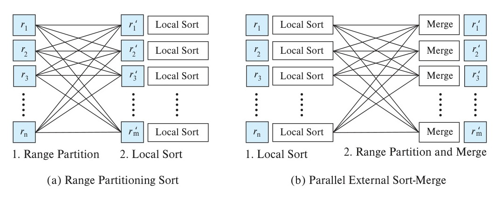
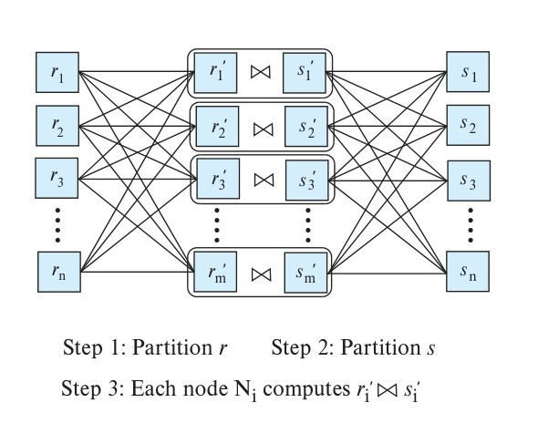
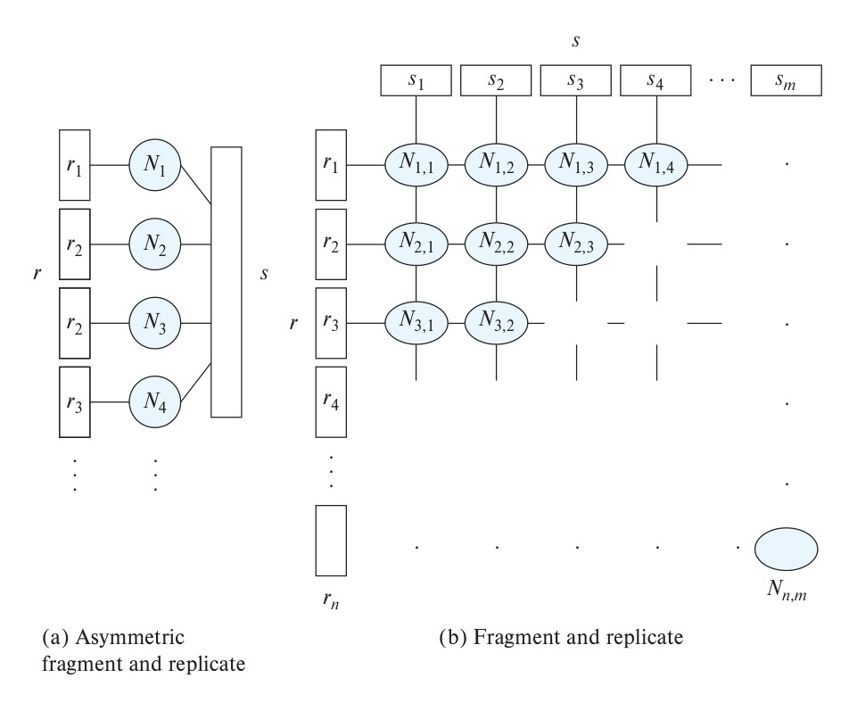
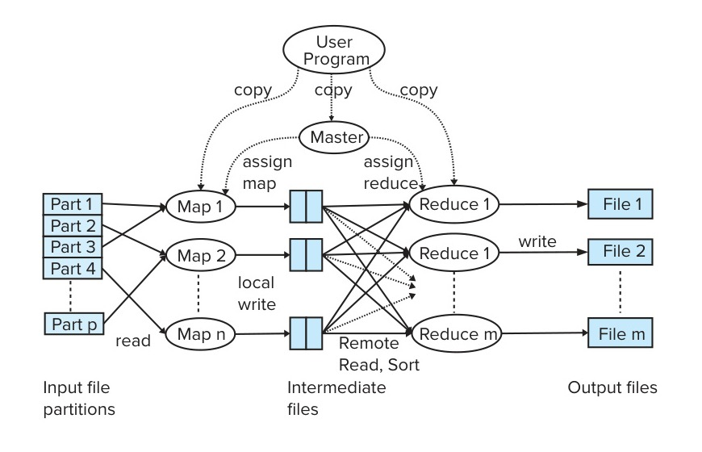
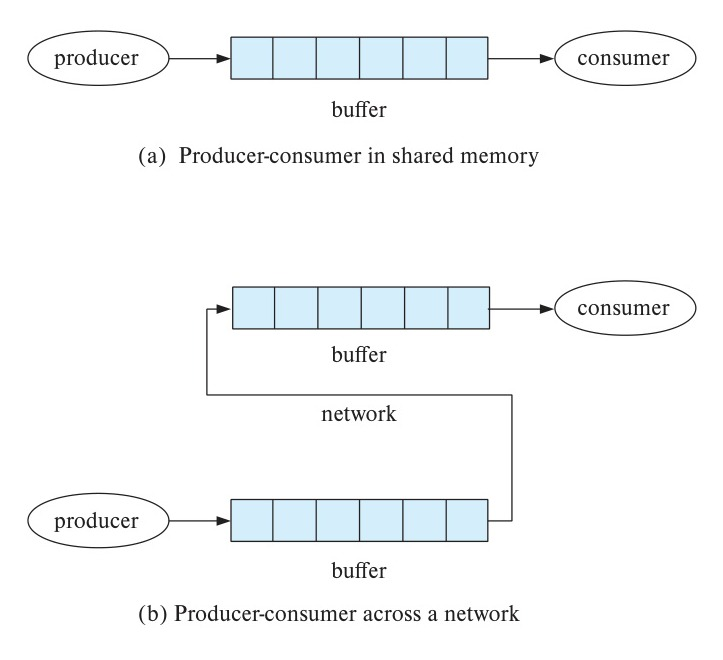
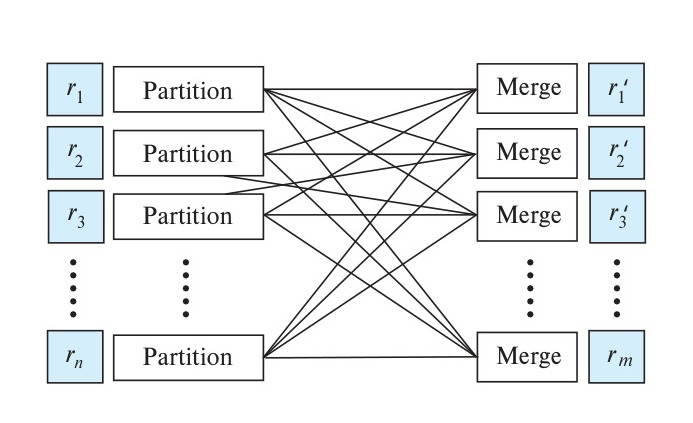

# Chapter 22: Parallel and Distributed Query Processing

<!-- Page 1039 -->

In this chapter, we discuss algorithms for query processing in parallel database systems. We assume that the queries are read only, and our focus is on query processing in decision support systems. Such systems need to execute queries on very large amounts of data, and parallel processing of the query across multiple nodes is critical for processing queries within acceptable response times.

Our focus in the early parts of this chapter is on relational query processing. However, later in the chapter, we examine issues in parallel processing of queries expressed in models other than the relational model.

Transaction processing systems execute large numbers of queries that perform updates, but each query affects only a small number of tuples. Parallel execution is key to handle large transaction processing loads; however, this topic is covered in Chapter 23.

## 22.1 Overview

Parallel processing can be exploited in two distinct ways in a database system. One approach is **interquery parallelism**, which refers to the execution of multiple queries in parallel with each other, across multiple nodes. The second approach is **intraquery parallelism**, which refers to the processing of different parts of the execution of a single query, in parallel across multiple nodes.

Interquery parallelism is essential for transaction processing systems. Transaction throughput can be increased by this form of parallelism. However, the response times of individual transactions are no faster than they would be if the transactions were run in isolation. Thus, the primary use of interquery parallelism is to scale up a transaction-processing system to support a larger number of transactions per second. Transaction processing systems are considered in Chapter 23.

In contrast, intraquery parallelism is essential for speeding up long-running queries, and it is the focus of this chapter.

<!-- Page 1040 -->

Execution of a single query involves execution of multiple operations, such as selects, joins, or aggregate operations. The key to exploiting large-scale parallelism is to process each operation in parallel, across multiple nodes. Such parallelism is referred to as **intraoperation parallelism**. Since the number of tuples in a relation can be large, the degree of intraoperation parallelism is also potentially very large; thus, intraoperation parallelism is natural in a database system.

To illustrate the parallel evaluation of a query, consider a query that requires a relation to be sorted. Suppose that the relation has been partitioned across multiple disks by range partitioning on some attribute, and the sort is requested on the partitioning attribute. The sort operation can be implemented by sorting each partition in parallel, then concatenating the sorted partitions to get the final sorted relation. Thus, we can parallelize a query by parallelizing individual operations.

There is another source of parallelism in evaluating a query: The operator tree for a query can contain multiple operations. We can parallelize the evaluation of the operator tree by evaluating in parallel some of the operations that do not depend on one another. Further, as Chapter 15 mentions, we may be able to pipeline the output of one operation to another operation. The two operations can be executed in parallel on separate nodes, one generating output that is consumed by the other, even as it is generated. Both these forms of parallelism are examples of **interoperation parallelism**, which allows different operators of a query to be executed in parallel.

In summary, the execution of a single query can be parallelized in two different ways:

- **Intraoperation parallelism**, which we consider in detail in the next few sections, where we study parallel implementations of common relational operations such as sort, join, aggregate and other operations.
- **Interoperation parallelism**, which we consider in detail in Section 22.5.1.

The two forms of parallelism are complementary and can be used simultaneously on a query. Since the number of operations in a typical query is small, compared to the number of tuples processed by each operation, intraoperation parallelism can scale better with increasing parallelism. However, interoperation parallelism is also important, especially in shared memory systems with multiple cores.

To simplify the presentation of the algorithms, we assume a shared nothing architecture with $n$ nodes, $N_1, N_2, \dots, N_n$. Each node may have one or more disks, but typically the number of such disks is small. We do not address how to partition the data between the disks at a node; RAID organizations can be used with these disks to exploit parallelism at the storage level, rather than at the query processing level.

The choice of algorithms for parallelizing query evaluation depends on the machine architecture. Rather than present algorithms for each architecture separately, we use a shared-nothing architecture in our description. Thus, we explicitly describe when data have to be transferred from one node to another.

<!-- Page 1041 -->

We can simulate this model easily by using the other architectures, since transfer of data can be done via shared memory in a shared-memory architecture, and via shared disks in a shared-disk architecture. Hence, algorithms for shared-nothing architectures can be used on the other architectures too. In Section 22.6, we discuss how some of the algorithms can be further optimized for shared-memory systems.

Current-generation parallel systems are typically based on a hybrid architecture, where each computer has multiple cores with a shared memory, and there are multiple computers organized in a shared-nothing fashion. For the purpose of our discussion, with such an architecture, each core can be considered a node in a shared-nothing system. Optimizations to exploit the fact that some of the cores share memory with other cores can be performed as discussed in Section 22.6.

## 22.2 Parallel Sort

Suppose that we wish to sort a relation $r$ that resides on $n$ nodes $N_1, N_2, \dots, N_n$. If the relation has been range-partitioned on the attributes on which it is to be sorted, we can sort each partition separately and concatenate the results to get the full sorted relation. Since the tuples are partitioned on $n$ nodes, the time required for reading the entire relation is reduced by a factor of $n$ by the parallel access.

If relation $r$ has been partitioned in any other way, we can sort it in one of two ways:

1. We can range-partition $r$ on the sort attributes, and then sort each partition separately.
2. We can use a parallel version of the external sort-merge algorithm.

### 22.2.1 Range-Partitioning Sort

**Range-partitioning sort**, shown pictorially in Figure 22.1a, works in two steps: first range-partitioning the relation, then sorting each partition separately. When we sort by range-partitioning the relation, it is not necessary to range-partition the relation on the same set of nodes as those on which that relation is stored. Suppose that we choose nodes $N_1, N_2, \dots, N_m$ to sort the relation. There are two steps involved in this operation:

1. Redistribute the tuples in the relation, using a range-partition strategy, so that all tuples that lie within the $i\text{th}$ range are sent to node $n_i$, which stores the relation temporarily on its local disk.

   To implement range partitioning, in parallel every node reads the tuples from its disk and sends each tuple to its destination node based on the partition function. Each node $N_1, N_2, \dots, N_m$ also receives tuples belonging to its partition and stores them locally. This step requires disk I/O and network communication.

<!-- Page 1042 -->


*Figure 22.1 — Parallel sorting algorithms.*

2. Each of the nodes sorts its partition of the relation locally, without interaction with the other nodes. Each node executes the same operation—namely, sorting—on a different data set. (Execution of the same operation in parallel on different sets of data are called **data parallelism**.)

   The final merge operation is trivial, because the range partitioning in the first phase ensures that, for $1 \le i < j \le m$, the key values in node $N_i$ are all less than the key values in $N_j$.

We must do range partitioning with a balanced range-partition vector so that each partition will have approximately the same number of tuples. We saw how to create such partition vectors in Section 21.3.1. Virtual node partitioning, as discussed in Section 21.3.2, can also be used to reduce skew. Recall that there are several times as many virtual nodes as real nodes, and virtual node partitioning creates a partition for each virtual node. Virtual nodes are then mapped to real nodes; doing so in a round-robin fashion tends to spreads virtual nodes across real nodes in a way that reduces the degree of skew at real nodes.

### 22.2.2 Parallel External Sort-Merge

**Parallel external sort-merge**, shown pictorially in Figure 22.1b, is an alternative to range partitioning sort. Suppose that a relation has already been partitioned among nodes $N_1, N_2, \dots, N_n$ (it does not matter how the relation has been partitioned). Parallel external sort-merge then works this way:

1. Each node $N_i$ sorts the data available at $N_i$.
2. The system then merges the sorted runs on each node to get the final sorted output.

<!-- Page 1043 -->

The merging of the sorted runs in step 2 can be parallelized by this sequence of actions:

1. The system range-partitions the sorted partitions at each node $N_i$ (all by the same partition vector) across the nodes $N_1, N_2, \dots, N_m$. It sends the tuples in sorted order, so each node receives the tuples as sorted streams.
2. Each node $N_i$ performs a merge on the streams of tuples as they are received to get a single sorted run.
3. The system concatenates the sorted runs on nodes $N_1, N_2, \dots, N_m$ to get the final result.

As described, this sequence of actions results in an interesting form of execution skew, since at first every node sends all tuples of partition 1 to $N_1$, then every node sends all tuples of partition 2 to $N_2$, and so on. Thus, while sending happens in parallel, receiving tuples becomes sequential: First only $N_1$ receives tuples, then only $N_2$ receives tuples, and so on. To avoid this problem, the sorted sequence of tuples $S_{i,j}$ from any node $i$ destined to any other node $j$ is broken up into multiple blocks. Each node $N_i$ sends the first block of tuples from $S_{i,j}$ node $N_j$, for each $j$; it then sends the second block of tuples to each node $N_j$, and so on, until all blocks have been sent. As a result, all nodes receive data in parallel. (Note that tuples are sent in blocks, rather than individually, to reduce network overheads.)

## 22.3 Parallel Join

Parallel join algorithms attempt to divide the tuples of the input relations over several nodes. Each node then computes part of the join locally. Then, the system collects the results from each node to produce the final result. How exactly to divide the tuples depends on the join algorithm, as we see next.

### 22.3.1 Partitioned Join

For certain kinds of joins, it is possible to partition the two input relations across the nodes and to compute the join locally at each node. The partitioned join technique can be used for inner joins, where the join condition is an equi-join (e.g., $r \bowtie_{r.A=s.B} s$); the relations $r$ and $s$ are partitioned by the same partitioning function on their join attributes. The idea of partitioning is exactly the same as that behind the partitioning step of hash join. Partitioned join can also be used for outer joins, as we shall see shortly.

Suppose that we are using $m$ nodes to perform the join, and that the relations to be joined are $r$ and $s$. Partitioned join then works this way: The system partitions the relations $r$ and $s$ each into $m$ partitions, denoted $r_1, r_2, \dots, r_m$ and $s_1, s_2, \dots, s_m$. In a partitioned join, however, there are two different ways of partitioning $r$ and $s$:

<!-- Page 1044 -->

- Range partitioning on the join attributes.
- Hash partitioning on the join attributes.

In either case, the same partitioning function must be used for both relations. For range partitioning, the same partition vector must be used for both relations. For hash partitioning, the same hash function must be used on both relations. Figure 22.2 depicts the partitioning in a partitioned parallel join.

The partitioned join algorithm first partitions one of the relations by scanning its tuples and sending them to the appropriate node based on the partition function and the join attribute values of each tuple. Specifically, each node $N_i$ reads in the tuples of one of the relations, say $r$, from local disk, computes for each tuple $t$ the partition $r_j$ to which $t$ belongs, and sends the tuple $t$ to node $N_j$. Each node also simultaneously receives tuples that are sent to it and stores them on its local disk (this can be done by having separate threads for sending and receiving data). The process is repeated for all tuples from the other relation, $s$.

Once both relations are partitioned, we can use any join technique locally at each node $N_i$ to compute the join of $r_i$ and $s_i$. Thus, we can use partitioning to parallelize any join technique.

Partitioned join can be used not only for inner joins, but also for all three forms of outer join (left, right and full outer join). Each node computes the corresponding outer join locally, after partitioning is done on the join attributes. Further, since natural join can be expressed as an equijoin followed by a projection, natural joins can also be computed using partitioned join.

If one or both of the relations $r$ and $s$ are already partitioned on the join attributes (by either hash partitioning or range partitioning), the work needed for partitioning is reduced greatly. If the relations are not partitioned or are partitioned on attributes other than the join attributes, then the tuples need to be repartitioned.


*Figure 22.2 — Partitioned parallel join.*

<!-- Page 1045 -->

We now consider issues specific to the join technique used locally at each node $N_i$. The local join operation can be optimized by performing some initial steps on tuples as they arrive at a node, instead of first storing the tuples to disk and then reading them back to perform these initial steps. These optimizations, which we describe below, are also used in nonparallel query processing, when results of an earlier operation are pipelined into a subsequent operation; thus, they are not specific to parallel query processing.

- If we use hash join locally, the resultant parallel join technique is called **partitioned parallel hash join**.

  Recall that hash join first partitions both input relations into smaller pieces such that each partition of the smaller relation (the build relation) fits into memory. Thus, to implement hash join, the partitions $r_i$ and $s_i$ received by node $N_i$ must be repartitioned using a hash function, say $h_1()$. If the partitioning of $r$ and $s$ across the nodes was done by using a hash function $h_0()$, the system must ensure that $h_1()$ is different from $h_0()$. Let the resultant partitions at node $N_i$ be $r_{i,j}$ and $s_{i,j}$ for $j = 1 \dots n_i$, where $n_i$ denotes the number of local partitions at node $N_i$.

  Note that the tuples can be repartitioned based on the hash function used for the local hash join as they arrive and written out to the appropriate partitions, avoiding the need to write the tuples to disk and read them back in.

  Recall also that hash join then loads each partition of the build relation into memory, builds an in-memory index on the join attributes, and finally probes the in-memory index using each tuple of the other relation, called the probe relation. Assume that relation $s$ is chosen as the build relation. Then each partition $s_{i,j}$ is loaded in memory, with an index built on the join attributes, and the index is probed with each tuple of $r_{i,j}$.

  Hybrid hash join (described in Section 15.5.5.5) can be used in case the partitions of one of the relations are small enough that a significant part of the partition fits in memory at each node. In this case, the smaller relation, say $s$, which is used as the build relation, should be partitioned first, followed by the larger relation, say $r$, which is used as the probe relation. Recall that with hybrid hash join, the tuples in the partition $s_0$ of the build relation $s$ are retained in memory, and an in-memory index is built on these tuples. When the probe relation tuples arrive at the node, they are also repartitioned; tuples in the $r_0$ partition are used directly to probe the index on the $s_0$ tuples, instead of being written out to disk and read back in.

- If we use merge join locally, the resultant technique is called **partitioned parallel merge join**. Each of the partitions $s_i$ and $r_i$ must be sorted, and merged locally, at node $N_i$.

  The first step of sorting, namely, run generation, can directly consume incoming tuples to generate runs, avoiding a write to disk before run generation.

- If we use nested-loops or indexed nested-loops join locally, the resultant technique is called **partitioned parallel nested-loop join** or **partitioned parallel indexed nested-loops join**.

<!-- Page 1046 -->

Each node $N_i$ performs a nested-loops (or indexed nested-loops) join on $s_i$ and $r_i$.

### 22.3.2 Fragment-and-Replicate Join

Partitioning is not applicable to all types of joins. For instance, if the join condition is an inequality, such as $r \bowtie_{r.a < s.b} s$, it is possible that all tuples in $r$ join with some tuple in $s$ (and vice versa). Thus, there may be no nontrivial way of partitioning $r$ and $s$ so that tuples in partition $r_i$ join with only tuples in partition $s_i$.

We can parallelize such joins by using a technique called **fragment-and-replicate**. We first consider a special case of fragment-and-replicate—**asymmetric fragment-and-replicate join**—which works as follows:

1. The system partitions one of the relations—say, $r$. Any partitioning technique can be used on $r$, including round-robin partitioning.
2. The system replicates the other relation, $s$, across all the nodes.
3. Node $N_i$ then locally computes the join of $r_i$ with all of $s$, using any join technique.

The asymmetric fragment-and-replicate scheme appears in Figure 22.3a. If $r$ is already stored by partitioning, there is no need to partition it further in step 1. All that is required is to replicate $s$ across all nodes.

The asymmetric fragment-and-replicate join technique is also referred to as **broadcast join**. It is a very useful technique, even for equi-joins, if one of the relations, say $s$, is small, and the other relation, say $r$, is large, since replicating the small relation $s$ across all nodes may be cheaper than repartitioning the large relation $r$.

The general case of fragment-and-replicate join (also called the **symmetric fragment-and-replicate join**) appears in Figure 22.3b; it works this way: The system partitions relation $r$ into $n$ partitions, $r_1, r_2, \dots, r_n$, and partitions $s$ into $m$ partitions, $s_1, s_2, \dots, s_m$. As before, any partitioning technique may be used on $r$ and on $s$. The values of $m$ and $n$ do not need to be equal, but they must be chosen so that there are at least $m * n$ nodes. Asymmetric fragment-and-replicate is simply a special case of general fragment-and-replicate, where $m = 1$. Fragment-and-replicate reduces the sizes of the relations at each node, compared to asymmetric fragment-and-replicate.

Let the nodes be $N_{1,1}, N_{1,2}, \dots, N_{1,m}, N_{2,1}, \dots, N_{n,m}$. Node $N_{i,j}$ computes the join of $r_i$ with $s_j$. To ensure that each node $N_{i,j}$ gets all tuples of $r_i$ and $s_j$, the system replicates $r_i$ to nodes $N_{i,1}, N_{i,2}, \dots, N_{i,m}$ (which form a row in Figure 22.3b), and replicates $s_i$ to nodes $N_{1,i}, N_{2,i}, \dots, N_{n,i}$ (which form a column in Figure 22.3b). Any join technique can be used at each node $N_{i,j}$.

Fragment-and-replicate works with any join condition, since every tuple in $r$ can be tested with every tuple in $s$. Thus, it can be used where partitioning cannot be used. However, note that each tuple in $r$ is replicated $m$ times, and each tuple in $s$ is replicated $n$ times.

<!-- Page 1047 -->


*Figure 22.3 — Fragment-and-replicate schemes.*

Fragment-and-replicate join has a higher cost than partitioning, since it involves replication of both relations, and is therefore used only if the join does not involve equi-join conditions. Asymmetric fragment-and-replicate, on the other hand, is useful even for equi-join conditions, if one of the relations is small, as discussed earlier.

Note that asymmetric fragment-and-replicate join can be used to compute the left outer join operation $r \leftouterjoin_{\theta} s$ if $s$ is replicated, by simply computing the left outer join locally at each node. There is no restriction on the join condition $\theta$.

However, $r \leftouterjoin_{\theta} s$ cannot be computed locally if $s$ is fragmented and $r$ is replicated, since an $r$ tuple may have no matching tuple in partition $s_i$, but may have a matching tuple in partition $s_j, j \ne i$. Thus, a decision on whether or not to output the $r$ tuple with null values for $s$ attributes cannot be made locally at node $N_i$. For the same reason, asymmetric fragment-and-replicate cannot be used to compute the full outer join operation, and symmetric fragment-and-replicate cannot be used to compute any of the outer join operations.

### 22.3.3 Handling Skew in Parallel Joins

Skew presents a special problem for parallel join techniques. If one of the nodes has a much heavier load than other nodes, the parallel join operation will take much longer to finish, with many idle nodes waiting for the heavily loaded node to finish its task.

<!-- Page 1048 -->

When partitioning data for storage, to minimize skew in storage we use a balanced partitioning vector that ensures all nodes get the same number of tuples. For parallel joins, we need to instead balance the execution time of join operations across all nodes. Hash partitioning using any good hash function usually works quite well at balancing the load across nodes, unless some join attribute values occur very frequently. Range partitioning, on the other hand, is more vulnerable to join skew, unless the ranges are carefully chosen to balance the load.[^1]

Virtual-node partitioning with, say, round-robin distribution of virtual nodes to real nodes, can help in reducing skew at the level of real nodes even if there is skew at the level of virtual nodes, since the skewed virtual nodes tend to get spread over multiple real nodes.

The preceding techniques are examples of **join skew avoidance**. Virtual-node partitioning, in particular, is very effective at skew avoidance in most cases.

However, there are cases with high skew, for example where some join attribute values are very frequent in both input relations, leading to a large join result size. In such cases, there could be significant join skew, even with virtual-node partitioning.

**Dynamic handling of join skew** is an alternative to skew avoidance. A dynamic approach can be used to detect and handle skew in such situations. Virtual node partitioning is used, and the system then monitors the join progress at each real node. Each real node schedules one virtual node at a time. Suppose that some real node has completed join processing for all virtual nodes assigned to it, and is thus idle, while some other real node has multiple virtual nodes waiting to be processed. Then, the idle node can get a copy of the data corresponding to one of the virtual nodes at the busy node and process the join for that virtual node. This process can be repeated whenever there is an idle real node, as long as some real node has virtual nodes waiting to be processed.

This technique is an example of **work stealing**, where a processor that is idle takes work that is in the queue of another processor that is busy. Work stealing is inexpensive in a shared-memory system, since all data can be accessed quickly from the shared memory, as discussed further in Section 22.6. In a shared-nothing environment, data movement may be required to move a task from one processor to another, but it is often worth paying the overhead to reduce the completion time of a task.

## 22.4 Other Operations

In this section, we discuss parallel processing of other relational operations, as well as parallel processing in the MapReduce framework.

[^1]: Cost estimation should be done using histograms on join attributes. A heuristic approximation is to estimate the join cost at each node $N_i$ as the sum of the sizes of $r_i$ and $s_i$, and choose range partitioning vectors to balance the sum of the sizes.

<!-- Page 1049 -->

### 22.4.1 Other Relational Operations

The evaluation of other relational operations also can be parallelized:

- **Selection**. Let the selection be $\sigma_{\theta}(r)$. Consider first the case where $\theta$ is of the form $a_i = v$, where $a_i$ is an attribute and $v$ is a value. If the relation $r$ is partitioned on $a_i$, the selection proceeds at a single node. If $\theta$ is of the form $l \le a_i \le u$—that is, $\theta$ is a range selection—and the relation has been range-partitioned on $a_i$, then the selection proceeds at each node whose partition overlaps with the specified range of values. In all other cases, the selection proceeds in parallel at all the nodes.
- **Duplicate elimination**. Duplicates can be eliminated by sorting; either of the parallel sort techniques can be used, optimized to eliminate duplicates as soon as they appear during sorting. We can also parallelize duplicate elimination by partitioning the tuples (by either range or hash partitioning) and eliminating duplicates locally at each node.
- **Projection**. Projection without duplicate elimination can be performed as tuples are read in from disk in parallel. If duplicates are to be eliminated, either of the techniques just described can be used.
- **Aggregation**. Consider an aggregation operation. We can parallelize the operation by partitioning the relation on the grouping attributes, and then computing the aggregate values locally at each node. Either hash partitioning or range partitioning can be used. If the relation is already partitioned on the grouping attributes, the first step can be skipped.

We can reduce the cost of transferring tuples during partitioning by partly computing aggregate values before partitioning, at least for the commonly used aggregate functions. Consider an aggregation operation on a relation $r$, using the $\text{sum}$ aggregate function on attribute $B$, with grouping on attribute $A$. The system can perform the $\text{sum}$ aggregation at each node $N_i$ on those $r$ tuples stored at $N_i$. This computation results in tuples with partial sums at each node; the result at $N_i$ has one tuple for each $A$ value present in $r$ tuples stored at $N_i$, with the sum of the $B$ values of those tuples. The system then partitions the result of the local aggregation on the grouping attribute $A$ and performs the aggregation again (on tuples with the partial sums) at each node $N_i$ to get the final result.

As a result of this optimization, which is called **partial aggregation**, fewer tuples need to be sent to other nodes during partitioning. This idea can be extended easily to the $\text{min}$ and $\text{max}$ aggregate functions. Extensions to the $\text{count}$ and $\text{avg}$ aggregate functions are left for you to do in Exercise 22.2.

Skew handling for aggregation is easier than skew handling for joins, since the cost of aggregation is directly proportional to the input size. Usually, all that needs to be done is to use a good hash function to ensure the group-by attribute values are evenly distributed amongst the participating nodes. However, in some extreme cases, a few

<!-- Page 1050 -->

values occur very frequently in the group-by attributes, and hashing can lead to uneven distribution of values. When applicable, partial aggregation is very effective in avoiding skew in such situations. However, when partial aggregation is not applicable, skew can occur with aggregation.

Dynamic detection and handling of such skew can be done in some such cases: in case a node is found to be overloaded, some of the key values that are not yet processed by the node can be reassigned to another node, to balance the load. Such reassignment is greatly simplified if virtual-node partitioning is used; in that case, if a real node is found to be overloaded, some virtual nodes assigned to the overloaded real node, but not yet processed, are identified, and reassigned to other real nodes.

More information on skew handling for join and other operators may be found in the Further Reading section at the end of the chapter.

### 22.4.2 Map and Reduce Operations

Recall the MapReduce paradigm, described in Section 10.3, which is designed to ease the writing of parallel data processing programs.

Recall that the `map()` function provided by the programmer is invoked on each input record and emits zero or more output data items, which are then passed on to the `reduce()` function. Each data item output by a `map()` function consists of a record (key, value); we shall call the key as the **intermediate key**. In general, a `map()` function can emit multiple such records and since there are many input records, there are potentially many output records overall.

The MapReduce system takes all the records emitted by the `map()` functions, and groups them such that all records with a particular intermediate key are gathered together. The `reduce()` function provided by the programmer is then invoked on each group of records, with the intermediate key as an argument, and an iterator to iterate over all the values associated with that key.

Note that the `map` function can be thought of as a generalization of the project operation: in projection, each input record generates a single output record, whereas the `map` function can output multiple records, or no records at all. The group-and-reduce operation of MapReduce can be thought of as a generalization of relational aggregation: it groups records by intermediate key (which is analogous to the group-by attributes) and applies a function to each group. However, in MapReduce the output of a `map` function is usually intended to become the input of a `reduce` function; the `map` and `reduce` operations are not designed to be used independently.

MapReduce systems are designed for parallel processing of data. A key requirement is that the data to be processed must be stored across multiple machines; otherwise, the single machine storing the data will become a bottleneck. In a parallel computing environment, data are read from a parallel/distributed file system, such as the Hadoop File System (HDFS), discussed in Section 21.6, or by using a parallel/distributed storage system, discussed in Section 21.7. Recall that in such sys-

<!-- Page 1051 -->


*Figure 22.4 — Parallel processing of MapReduce job.*

tems, data are replicated (copied) across several (typically 3) machines, so that even if a machine fails, data can be read from other replicas.

Conceptually, the map and reduce operations are parallelized in the same way as other relational operations: Map tasks correspond to virtual nodes for the map operation, while reduce tasks correspond to virtual nodes for the reduce operation.

Parallel processing of MapReduce jobs is shown schematically in Figure 22.4. As shown in the figure, MapReduce systems split the input data into multiple pieces; the job of processing one such piece is called a task. Splitting can be done in units of files, and large files can be split into multiple parts. Tasks correspond to virtual nodes in our terminology, while workers correspond to real nodes. Note that with a multicore processor (as is standard today), MapReduce systems typically allocate one worker per core.

MapReduce systems also have a scheduler, which assigns tasks to workers.[^2] Whenever a worker completes a task, the scheduler assigns it another task, until all tasks have been completed.

A key step between the map and reduce operations is the repartitioning of records output by the map operations, across the reduce tasks. The set of all intermediate key values is partitioned (using hash or range partitioning, typically hash partitioning) into $m$ partitions, each of which is called a reduce task. A scheduler assigns reduce tasks to

<!-- Page 1052 -->

workers, in the same way as map tasks.

This step is identical to the repartitioning done for parallelizing the relational aggregation operation.

To process the records in a particular reduce task, the records are sorted (or hashed) on the reduce key, so that all records with the same reduce-key value are brought together, and then the `reduce()` is executed on each group of reduce-key values.

The reduce tasks are executed in parallel by the workers. When a worker completes a reduce task, another task is assigned to it, until all reduce tasks have been completed. A reduce task may have multiple different reduce key values, but a particular call to the `reduce()` function is for a single reduce key; thus, the `reduce()` function is called for each key in the reduce task.

Tasks correspond to virtual nodes in the virtual-node partitioning scheme. There are typically many more tasks (virtual nodes) than there are workers (real nodes). This helps to balance the load, since a worker that gets a task that takes less time can be assigned another task, while a worker that gets a task that takes more time will process fewer tasks overall.

Further, MapReduce implementations typically also carry out dynamic detection and handling of stragglers, by speculatively running multiple copies of tasks that are taking unusually long to complete, as we discuss in Section 22.5.4.

Most MapReduce implementations include techniques to ensure that processing is fault tolerant; we discuss these techniques in Section 22.5.4. Finally, as we already discussed in Section 22.4.1, skew can be reduced by partial aggregation, which corresponds to the use of a combiner function in the MapReduce framework.

## 22.5 Parallel Evaluation of Query Plans

As discussed in Section 22.1, there are two types of parallelism: intraoperation and interoperation. We have seen how to parallelize individual operations in earlier sections. We now consider how to evaluate an entire query plan, exploiting both intraoperation and interoperation parallelism.

We first consider how to exploit interoperator parallelism. We then consider a widely used model of parallel execution based on the exchange operator. We then study how a query optimizer can construct an execution plan that exploits both forms of parallelism simultaneously, and finally consider how to make query plan execution fault tolerant.

### 22.5.1 Interoperation Parallelism

There are two forms of interoperation parallelism: pipelined parallelism and independent parallelism. We first describe these forms of parallelism, assuming each operator runs on a single node without intraoperation parallelism.

<!-- Page 1053 -->

We then describe a model for parallel execution based on the exchange operator, which allows interoperation parallelism to be combined with intraoperation parallelism.

#### 22.5.1.1 Pipelined Parallelism

Recall from Section 15.7.2 that in pipelining, the output tuples of one operation, A, are provided to another operation, B, as they are generated, without first writing them to disk. The operation B can consume these tuples even while A is executing. Thus, pipelining allows two operations to be executed in parallel.

Parallel systems use pipelining primarily for the same reason that sequential systems do: namely, to avoid writing intermediate results to disk. However, in addition, pipelined parallelism can be used to run operations A and B simultaneously on different nodes (or different cores of a single machine), with operation A passing its output tuples to operation B.

Pipelined parallelism is useful with a small number of nodes, but it does not scale up well with the number of nodes. There are two reasons for this:

1. A pipeline of operations cannot be very long; in typical database queries, a pipeline contains fewer than half a dozen operations.
2. Some operations cannot be pipelined: for example, the sort operation cannot output any tuples until all its input has been read and sorted. Similarly, the hash join operation cannot output any tuples until the build relation has been fully read and partitioned.

All things considered, when the degree of parallelism is high, pipelining is less important than intraoperation parallelism as a source of parallelism. However, pipelining is important even with high degrees of parallelism since it avoids writing intermediate results to disk.

Pipelining can be implemented using either the demand-driven (or pull) model or the producer-driven (or push) model, as discussed in Section 15.7.2. With the pull model, operation B repeatedly requests tuples from operation A; operation A computes the next tuple and returns it to B. With the push model, operation A generates tuples and pushes them to operation B, which consumes them.

##### Pipelining Across Machines

When operations A and B are executed on different nodes, the pull model requires a network round-trip for each tuple requested, which can lead to high network overheads. The push model is therefore preferred for pipelining across nodes. With the push model, operation A can generate tuples and send them across the network to operation B as they are produced.

To prevent operation A from running too far ahead of operation B (which could happen if A produces tuples faster than B can consume them), a buffer is placed between A and B. When the buffer is full, operation A is blocked (stalled) until B consumes some tuples from the buffer, creating space. Similarly, if the buffer is empty, operation B is blocked until A generates more tuples. Figure 22.5 shows a producer and consumer with a buffer.

If the producer and consumer are on the same machine, as shown in Figure 22.5a, the buffer can be in shared memory. However, if the producer and consumer are on different nodes, as shown in Figure 22.5b, there will be two buffers: one at the producer node to collect tuples as they are produced, and another at the consumer node to collect them as they are sent across the network.

<!-- Page 1054 -->


*Figure 22.5 — Producer and consumer with buffer.*

When sending tuples across a network, it makes sense to collect multiple tuples in a buffer and send them in a single network packet, to reduce network overheads.

If the producer and consumer are on the same node and can communicate via a shared memory buffer, the pull model can be used without the network overheads of the pull model across nodes. The demand-driven (pull) model is the standard model used in centralized database systems; the producer-driven (push) model is less commonly used in centralized database engines, although it is increasingly being used in modern main-memory database systems.

Note that with the pull model, either the producer or the consumer, but not both, can be executing at a given time; while this avoids the contention on the shared buffer that arises with the use of the push model, it also prevents the producer and consumer from running concurrently.

#### 22.5.1.2 Independent Parallelism

Operations in a query expression that do not depend on one another can be executed in parallel.

Consider the join $r_1 \bowtie r_2 \bowtie r_3 \bowtie r_4$. One possible plan is to compute intermediate result $t_1 \leftarrow r_1 \bowtie r_2$ in parallel with intermediate result $t_2 \leftarrow r_3 \bowtie r_4$. Neither of these join operations depends on the other, so each may proceed independently of the other.

<!-- Page 1055 -->

When these two computations complete, we can compute:

$$t_1 \bowtie t_2$$

Note that computation of the above join depends on the results of the first two joins, so it cannot proceed until both of them complete. But the first two joins can proceed in parallel, without any communication between them. This form of parallelism is called **independent parallelism**. In other words, the execution of these two joins can be scheduled in parallel.

Like pipelined parallelism, independent parallelism does not scale up well with the degree of parallelism, since typical queries have few independent operations. Thus, independent parallelism is of limited utility on a parallel system with a large number of nodes.

### 22.5.2 The Exchange Operator Model

The Volcano parallel database popularized a model of parallelization called the **exchange-operator model**. The exchange operation repartitions data in a specified way; data interchange between nodes is done only by the exchange operator. All other operations work on local data, just as they would in a centralized database system; the data may be available locally either because it is already present, or because of the execution of a preceding exchange operator.

The exchange operator has two components: a scheme for partitioning outgoing data, applied at each source node, and a scheme for merging incoming data, applied at each destination node. The operator is shown pictorially in Figure 22.6, with the partitioning scheme denoted as “Partition,” and the merging scheme denoted as “Merge.”

The exchange operator can partition data in one of several ways:

1. By hash partitioning on a specified set of attributes.
2. By range partitioning on a specified set of attributes.
3. By replicating the input data at all nodes, referred to as broadcasting.
4. By sending all data to a single node.


*Figure 22.6 — The exchange operator used for repartitioning.*

<!-- Page 1056 -->

Broadcasting data to all nodes is required for operations such as the asymmetric fragment-and-replicate join. Sending all data to a single node (which is unpartitioned) is used, for example, to collect the final results of a query at a central location.

Note also that the input to the exchange operator can be at a single site (referred to as unpartitioned). For example, input data may initially be stored at a single node and may need to be partitioned across multiple nodes for parallel processing.

Each destination node merges the data items received from the source nodes. This merge step can be done in one of several ways. A simple random merge takes tuples as they arrive and merges them into a single stream. This scheme is used when the order of tuples does not matter.

On the other hand, if the input data from each source is sorted, the merge step can perform an ordered merge (Section 15.4.2) to produce an output stream that is sorted. For example, if range partitioning is used, and each node sorts its partition locally, the sorted streams can be sent to a single node, which can merge them to produce a globally sorted result.

Thus, the exchange operator performs the partitioning of data at the source nodes, the network transfer of data, and the merging of data at the destination nodes.

All the parallel operator implementations we have seen so far can be modeled as a sequence of local operations running in parallel at each node, interspersed with exchange operations. For example:

- **Range partitioning sort**: can be implemented by an exchange operation that performs range partitioning on the sort attribute, followed by a local sort operation at each node. If a globally sorted result is required at a single node, a final exchange operation can collect the sorted streams from all nodes and merge them.
- **Parallel external sort-merge**: can be implemented by a local sort operation at each node, followed by an exchange operation that performs range partitioning on the sort attribute, and an ordered merge at each destination node.
- **Partitioned parallel join**: can be implemented by an exchange operation that partitions both relations on the join attribute using the same hash function or range partitioning vector, followed by a local join operation at each node.
- **Asymmetric fragment-and-replicate join**: can be implemented by an exchange operation that broadcasts the smaller relation to all nodes, followed by a local join operation at each node.
- **Partial aggregation**: can be implemented by a local aggregation operation at each node, followed by an exchange operation that partitions the partial aggregation results on the grouping attributes, followed by another local aggregation operation at each destination node to compute the final aggregate values.

<!-- Page 1057 -->

Other relational operations can be implemented similarly, by a sequence of local operations running in parallel at each node, interspersed with exchange operations.

As noted earlier, parallel execution where data are partitioned, and operations are executed locally at each node, is referred to as **data parallelism**. The use of the exchange operator model to implement data parallel execution has the major benefit of allowing existing database query engines to be used at each of the local nodes, without any significant code changes. As a result, the exchange-operator model of parallel execution is widely used in parallel database systems.

There are, however, some operator implementations that can benefit from being aware of the parallel nature of the system they are running on. For example, an indexed nested-loops join where the inner relation is indexed on a parallel data-store would require remote access for each index lookup; the index lookup operation is thus aware of the parallel nature of the underlying system. Similarly, in a shared-memory system it may make sense to have a hash table or index in shared-memory, which is accessed by multiple processors (this approach is discussed briefly in Section 22.6); the operations running on each processor are then aware of the parallel nature of the system.

As we discussed in Section 22.5.1.1, while the demand-driven (or pull) iterator model for pipelined execution of operators is widely used in centralized database engines, the push model is preferred for parallel execution of operators in a pipeline.

The exchange operator can be used to implement the push model between nodes in a parallel system, while allowing existing implementations of local operators to run using the pull model. To do so, at each source node of an exchange operator, the operator can pull multiple tuples from its input and create a batch of tuples destined for each destination node. The input may be computed by a local operation, whose implementation can use the demand-driven iterator model.

The exchange operator then sends batches of tuples to the destination nodes, where they are merged and kept in a buffer. The local operations can then consume the tuples in a demand-driven manner.

### 22.5.3 Putting It All Together

Figure 22.7 shows a query, along with a sequential and two alternative parallel query execution plans. The query, shown in Figure 22.7a, computes a join of two relations, $r$ and $s$, and then computes an aggregate on the join result. Assume for concreteness that the query is $_{r.C, s.D}\gamma_{\text{sum}(s.E)}(r \bowtie_{r.A=s.B} s)$.

The sequential plan, shown in Figure 22.7b, uses a hash join (denoted as “HJ” in the figure), which executes in three separate stages. The first stage partitions the first input ($r$) locally on $r.A$; the second stage partitions the second input ($s$) locally on $s.B$; and the third stage computes the join of each of the corresponding partitions of $r$ and $s$. The aggregate is computed using in-memory hash-aggregation, denoted by the operator HA; we assume that the number of groups is small enough that the hash table fits in memory.

<!-- Page 1058 -->


*Figure 22.7 — Parallel query execution plans.*

The dashed boxes in the figure show which steps run in a pipelined fashion. In the sequential plan, the read of the relation $r$ is pipelined to the first partitioning stage of the sequential hash join; similarly, the read of relations $s$ is pipelined to the second partitioning stage of the hash join. The third stage of the hash join pipelines its output tuples to the hash aggregation operator.

The parallel query evaluation plan, shown in Figure 22.7c, starts with $r$ and $s$ already partitioned, but not on the required join attributes.[^3] The plan, therefore, uses the exchange operation $E_1$ to repartition $r$ using attribute $r.A$; similarly, exchange operator $E_2$ repartitions $s$ using $s.B$. Each node then uses hash join locally to compute the join

[^2]: The scheduler is run on a dedicated node called the master node; the nodes that perform map() and reduce() tasks are called slave nodes in the Hadoop MapReduce terminology.
[^3]: Note the multiple boxes indicating a relation is stored in multiple nodes; similarly, multiple circles indicate that an operation is executed in parallel on multiple nodes.

<!-- Page 1059 -->

of its partition of $r$ and $s$. Note that these partitions are not assumed to fit in memory, so they must be further partitioned by the first two stages of hash join; this local partitioning step is denoted as “Loc. Part.” in the figure. The dashed boxes indicate that the output of the exchange operator can be pipelined to the local partitioning step. As in the sequential plan, there are two pipelined stages, one each for $r$ and $s$. Note that exchange of tuples across nodes is done only by the exchange operator, and all other edges denote tuple flows within each node.

Subsequently, the hash join algorithm is executed in parallel at all participating nodes, and its output pipelined to the exchange operator $E_3$. This exchange operator repartitions its input on the pair of attributes $(r.C, s.D)$, which are the grouping attributes of the subsequent aggregation. At the receiving end of the exchange operator, tuples are pipelined to the hash aggregation operator. Note that the above steps all run together as a single pipelined stage, even though there is an exchange operator as part of the stage. Note that the local operators computing hash join and hash aggregate need not be aware of the parallel execution.

The results of the aggregates are then collected together at a central location by the final exchange operator $E_4$, to create the final result relation.

Figure 22.7d shows an alternative plan that performs partial aggregation on the results of the hash join, before partitioning the results. The partial aggregation is computed locally at each node by the operator $\text{HA}_1$. Since no tuple is output by the partial aggregation operator until all its input is consumed, the pipelined stage contains only the local hash join and hash aggregation operators. The subsequent exchange operator $E_3$ which partitions its input on $(r.C, s.D)$ is part of a subsequent pipelined stage along with the hash aggregation operation $\text{HA}_2$ which computes the final aggregate values. As before, the exchange operator $E_4$ collects the results at a centralized location.

The above example shows how pipelined execution can be performed across nodes, as well as within nodes, and further how it can be done along with intra-operator parallel execution. The example also shows that some pipelined stages depend on the output of earlier pipelined stages; therefore their execution can start only after the previous step finishes. On the other hand, the initial exchange and partitioning of $r$ and $s$ occur in pipelined stages that are independent of each other; such independent stages can be scheduled concurrently, that is, at the same time, if desired.

To execute a parallel plan such as the one in our example, the different pipelined stages have to be scheduled for execution, in an order that ensures inter-stage dependencies are met. When executing a particular stage, the system must decide how many nodes an operation should be executed on. These decisions are usually made as part of the scheduling phase, before query execution starts.

### 22.5.4 Fault Tolerance in Query Plans

Parallel processing of queries across a moderate number of nodes, for example, hundreds of nodes, can be done without worrying about fault tolerance. If a fault occurs, the query is rerun, after removing any failed nodes from the system (replication of data

<!-- Page 1060 -->

at the storage layer ensures that data continues to be available even in the event of a failure). However, this simple solution does not work well when operating at the scale of thousands or tens of thousands of nodes: if a query runs for several hours, there is a significant chance that there will be a failure while the query is being executed. If the query is restarted, there is a significant chance of another failure while it is executing, which is obviously an undesirable situation.

To deal with this problem, the query processing system should ideally just be able to redo the actions of a failed node, without redoing the rest of the computation.

Implementations of MapReduce that are designed to work at a massively parallel scale can be made fault tolerant as follows:

1. Each map operation executed at each node writes its output to local files.
2. The next operation, which is a reduce operation, executes at each node; the operation execution at a node reads data from the files stored at multiple nodes, collects the data, and starts processing the data only after it has got all its required data.
3. The reduce operation writes its output to a distributed file system (or distributed storage system) that replicates data, so that the data would be available even in the event of a failure of that reduce node.

Let us now examine the reason why things are done as above. First, if a particular node executing a map operation fails, all the map tasks assigned to that node can be reexecuted by other nodes; the outputs of all previously completed map tasks are intact on their local disks and can be read by other nodes. (However, if a node fails after all its map tasks are completed, but before all the reduce nodes have read the data that they require, the map tasks assigned to that node must be reexecuted.)

Further, once a reduce node has finished its work, its output goes to replicated storage, and therefore is available even if that reduce node fails. Thus, if a reduce node fails, only the reduce tasks assigned to that node need to be reexecuted.

Note that it is possible to store the output of a map node in a replicated storage system. However, this increases the execution cost significantly, and hence map output is stored in local storage, even at the risk of having to reexecute the work done by a map node in case it fails before all the reduce nodes have fetched the data that they require from that map node.

It is also worth noting that sometimes nodes do not completely fail, but run very slowly (such nodes are called **stragglers**). Slower execution can be due to transient issues such as temporary network delays, background operations being executed by the operating system, or a bad sector on a disk. Stragglers can delay the completion of a stage, since other tasks have to wait for the slow tasks to complete. MapReduce implementations deal with stragglers by dynamically detecting tasks that are taking unusually long to complete, and speculatively running another copy of the task on a different node (the first task to finish is chosen, and the other killed, although the slower task may also be allowed to continue, in case it finishes first). Such reexecution to deal with

<!-- Page 1061 -->

stragglers has been found to significantly improve time to completion of MapReduce tasks.

While the above scheme for fault tolerance is quite effective, there is an overhead that must be noted: a reduce stage cannot perform any work until the previous map stage has finished;[^4] and if multiple map and reduce steps are executed, the next map stage cannot perform any work until the preceding reduce stage has finished. In particular, this means that pipelining of data between stages cannot be supported; data are always materialized before it is sent to the next stage. Materialization carries a significant overhead, which can slow down computation.

Apache Spark uses an abstraction called **Resilient Distributed Datasets (RDDs)** to implement fault tolerance. As we have seen in Section 10.4.2, RDDs can be viewed as collections, and Spark supports algebraic operations that take RDDs as input, and generate RDDs as output. Spark keeps track of the operations used to create an RDD. In case of failures that result in loss of an RDD, the operations used to create the RDD can be reexecuted to regenerate the RDD. However, this may be time-consuming, so Spark also supports replication to reduce the chance of data loss, as well as storing of local copies of data when a shuffle (exchange) step is executed, to allow reexecution to be restricted to computation that was performed on failed nodes.

There has been a good deal of research on how to allow pipelining of data, while not requiring query execution to restart from the beginning in case of a single failure. Such schemes typically require nodes to track what data they have received from each source node. In the event of a source node failure, the work of the source node is redone on a backup node, which can result in some tuples that were received earlier being received again. Tracking the data received earlier is important to ensure duplicate tuples are detected and eliminated by the receiving node. The above ideas can also be used to implement fault tolerance for other algebraic operations, such as joins. In particular, if we use the exchange operator with data parallelism, fault tolerance can be implemented as an extension of the exchange operator.

References to more information on fault tolerant pipelining based on extensions of the exchange operator, as well as on fault tolerance schemes used in MapReduce and in Apache Spark, may be found in the Further Reading section at the end of the chapter.

## 22.6 Query Processing on Shared-Memory Architectures

Parallel algorithms designed for shared-nothing architectures can be used in shared-memory architectures. Each processor can be treated as having its own partition of memory, and we can ignore the fact that the processors have a common shared-

<!-- Page 1062 -->

memory. However, execution can be optimized significantly by exploiting the fast access to shared-memory from any of the processors.

Before we study optimizations that exploit shared-memory, we note that while many large-scale systems can execute on a single shared-memory system, the largest-scale systems today are typically implemented using a hierarchical architecture, with a shared-nothing architecture at the outer level, but with each node having a shared-memory architecture locally, as discussed in Section 20.4.8. The techniques we have studied so far for storing, indexing, and querying data in shared-nothing architectures are used to divide up storage, indexing, and query processing tasks among the different nodes in the system. Each node is a shared-memory parallel system, which uses parallel query processing techniques to execute the query processing tasks assigned to it. The optimizations we describe in this section can thus be used locally, at each node.

Parallel processing in a shared memory system is typically done by using threads, rather than separate processes. A thread is an execution stream that shares its entire memory[^5] with other threads. Multiple threads can be started up, and the operating system schedules threads on available processors.

We list below some optimizations that can be applied when parallel algorithms that we saw earlier are executed in a shared memory system.

1. If we use asymmetric fragment-and-replicate join, the smaller relation need not be replicated to each processor. Instead, only one copy needs to be stored in shared memory, which can be accessed by all the processors. This optimization is particularly useful if there are a large number of processors in the shared-memory system.
2. Skew is a significant problem in parallel systems, and it becomes worse as the number of processors grows. Handing off work from an overloaded node to an underloaded node is expensive in a shared-nothing system since it involves network traffic. In contrast, in a shared memory system, data assigned to a processor can be easily accessed from another processor.

   To address skew in a shared-memory system, a good option is to use virtual-node partitioning, which allows work to be redistributed in order to balance load. Such redistribution could be done when a processor is found to be overloaded. Alternatively, whenever a processor finds that it has finished processing all the virtual nodes assigned to it, it can find other processors that still have virtual nodes left to be processed, and take over some of those tasks; as mentioned in Section 22.3.3, this approach is called **work stealing**. Note that such an approach to avoiding skew would be much more expensive in a shared-nothing environment since a significant amount of data movement would be involved, unlike in the shared-memory case.

<!-- Page 1063 -->

3. Hash join can be executed in two distinct ways.
   a. The first option is to partition both relations to each processor and then compute the joins of the partitions, in a manner similar to shared-nothing hash join. Each partition must be small enough that the hash index on a build-relation partition fits in the part of shared memory allocated to each processor.
   b. The second option is to partition the relations into fewer pieces, such that the hash index on a build-relation partition fits into common shared memory, rather than a fraction of the shared memory. The construction of the in-memory index, as well as probing of the index, must now be done in parallel by all the processors.

   Parallelizing the probe phase is relatively easy, since each processor can work on some partition of the probe relation. In fact it makes sense to use the virtual node approach and partition the probe relation into many small pieces (sometimes called “morsels”), and have processors process a morsel at a time. When a processor is done with a morsel, it finds an unprocessed morsel and works on it, until there are no morsels left to be processed.

   Parallelizing the construction of the shared hash index is more complicated, since multiple processors may attempt to update the same part of the hash index. Using locks is an option, but there are overheads due to locking. Techniques based on lock-free data structures can be used to construct the hash index in parallel.

References to more details on how to parallelize join implementations in shared memory may be found in the Further Reading section at the end of the chapter.

Algorithms designed for shared-memory systems must take into account the fact that in today’s processors, memory is divided into multiple memory banks, with each bank directly linked to some processor. The cost of accessing memory from a given processor is less if the memory is directly linked to the processor, and is more if it is linked to a different processor. Such memory systems are said to have a **Non-Uniform Memory Access** or **NUMA** architecture.

To get the best performance, algorithms must be **NUMA-aware**; that is, they must be designed to ensure that data accessed by a thread running on a particular processor is, as far as possible, stored in memory local to that processor. Operating systems support this task in two ways:

1. Each thread is scheduled, as far as possible, on the same processor core, every time it is executed.
2. When a thread requests memory from the operating system memory manager, the operating system allocates memory that is local to that processor core.

Note that the techniques for making the best use of shared memory are complementary to techniques that make the best use of processor caches, including cache-

<!-- Page 1064 -->

conscious index structures (which we saw in Section 14.4.7) and cache-conscious algorithms for processing relational operators.

But in addition, since each processor core has its own cache, it is possible for a cache to have an old value that was subsequently updated on another processor core. Thus, query processing algorithms that update shared data structures should be careful to ensure that there are no bugs due to the use of outdated values, and due to race conditions on updating the same memory location from two processor cores. Locking and fence instructions to ensure cache consistency (Section 20.4.5) are used in combination to implement updates to shared data structures.

The form of parallelism we have studied so far allows each processor to execute its own code independently of other processors. However, some parallel systems support a different form of parallelism, called **Single Instruction Multiple Data (SIMD)**. With SIMD parallelism, the same instruction is executed on each of multiple data items, which are typically elements of an array. SIMD architectures became widely used in **graphics processing units (GPUs)**, which were initially used for speeding up processing of computer graphics tasks. However, more recently, GPU chips have been used for parallelizing a variety of other tasks, one of which is parallel processing of relational operations using the SIMD support provided by GPUs. Intel’s Xeon Phi coprocessor supports not only multiple cores in a single chip, but also several SIMD instructions that can operate in parallel on multiple words. There has been a good deal of research on how to process relational operations in parallel on such SIMD architectures; references to more information on this topic may be found in the bibliographic notes for this chapter, available online.

## 22.7 Query Optimization for Parallel Execution

Query optimizers for parallel query evaluation are more complicated than query optimizers for sequential query evaluation. First, the space of plan alternatives can be much larger than that for sequential plans. In particular, in a parallel setting, we need to take into account the different possible ways of partitioning the inputs and intermediate results, since different partitioning schemes can lead to different query execution costs, which is not an issue for a sequential plan.

Second, the cost models are more complicated, since the cost of partitioning must be taken into account, and issues such as skew and resource contention must be addressed.

### 22.7.1 Parallel Query Plan Space

As we have seen in Section 15.1, a sequential query plan can be expressed as an algebraic expression tree, where each node is a physical operator, such as a sort operator, a hash join operator, a merge-join operator, etc. Such a plan may be further annotated with instructions on what operations are to be pipelined and what intermediate results are to be materialized, as we saw in Section 15.7.

<!-- Page 1065 -->

In addition to the above, a parallel query plan must specify

- How to parallelize each operation, including deciding what algorithm to use, and how to partition the inputs and intermediate results. Exchange operators can be used to partition inputs as well as intermediate results and final results.
- How the plan is to be scheduled; specifically:
  - How many nodes to use for each operation.
  - What operations to pipeline within the same node, or across different nodes.
  - What operations to execute sequentially, one after the other.
  - What operations to execute independently in parallel.

As an example of the partitioning decision, a join $r \bowtie_{r.A=s.A \land r.B=s.B} s$ can be parallelized by partitioning $r$ and $s$ on the attributes $r.A$ and $s.A$ alone, or on the attributes $r.B$ and $s.B$ alone, or on $(r.A, r.B)$ and $(s.A, s.B)$. The last option is likely to be the best if we consider only this join, since it minimizes the chances of skew which can arise if the cardinalities of $r.A$, $r.B$, $s.A$ or $s.B$ are low.

But consider now the query $_{r.A}\gamma_{\text{sum}(s.C)}(r \bowtie_{r.A=s.A \land r.B=s.B} s)$. If we perform the join by partitioning on $(r.A, r.B)$ (and $(s.A, s.B)$), we would then need to repartition the join result by $r.A$ to compute the aggregate. On the other hand, if we performed the join by partitioning on $r$ and $s$ on $r.A$ and $s.A$ respectively, both the join and the aggregate can be computed without any repartitioning, which could reduce the cost. This option is particularly likely to be a good option if $r.A$ and $s.A$ have high cardinality and few duplicates, since the chance of skew is less in this case.

Thus, the optimizer has to consider a larger space of alternatives, taking partitioning into account. References with more details about how to implement query optimization for parallel query processing systems, taking partitioning alternatives into account, may be found in the Further Reading section at the end of the chapter.

### 22.7.2 Cost of Parallel Query Evaluation

The cost of a sequential query plan is typically estimated based on the total resource consumption of the plan, adding up the CPU and I/O costs of the operators in a query plan. The resource consumption cost model can also be used in a parallel system, additionally taking into account the network cost, and adding it along with the other costs. As discussed in Section 15.2, even in a sequential system, the resource consumption cost model does not guarantee minimization of the execution time of an individual query. There are other cost models that are better at modeling the time to complete a query; however, the resource consumption cost model has the benefit of reducing the cost of query optimization, and is thus widely used. We return to the issue of other cost models later in the section.

<!-- Page 1066 -->

We now study how the cost of a parallel query plan can be estimated based on the resource consumption model. If a query plan is data parallel, then each operation, other than the exchange operation, runs locally; the cost of such operations can be estimated using techniques we have seen earlier in Chapter 15, if we assume that the input relations are uniformly partitioned across $n$ nodes, with each node receiving $1/n\text{th}$ of the overall input.

The cost of the exchange operation can be estimated based on the network topology, the amount of data transferred, and the network bandwidth; as before it is assumed that each node is equally loaded during the exchange operation. The cost of a query plan under the resource-consumption model can then be found by adding up the costs of the individual operations.

However, in a parallel system, two plans with the same resource consumption may have significantly different time to completion. A response-time cost model is a cost model that attempts to better estimate the time to completion of a query. If a particular operation is able to perform I/O operations in parallel with CPU execution, the response time would be better modeled as $\max(\text{CPU cost}, \text{I/O cost})$, rather than the resource consumption cost model of $(\text{CPU cost} + \text{I/O cost})$. Similarly, if two operations $o_1$ and $o_2$ are in a pipeline on a single node, and their CPU and I/O costs are $c_1, io_1$ and $c_2, io_2$ respectively, then their response time cost would be $\max(c_1 + c_2, io_1 + io_2)$. Similarly, if operations $o_1$ and $o_2$ are executed sequentially, then their response time cost would be $\max(c_1, io_1) + \max(c_2, io_2)$.

When executing operations in parallel across multiple nodes, the response time cost model would have to take into account:

- Start-up costs for initiating an operation at multiple nodes.
- Skew in the distribution of work among the nodes, with some nodes getting a larger number of tuples than others, and thus taking longer to complete. It is the time to completion of the slowest node that determines the time to completion of the operation.

Thus, any skew in the distribution of the work across nodes greatly affects performance.

Estimating the time to completion of the slowest node due to skew is not an easy task since it is highly data dependent. However, statistics such as number of distinct values of partitioning attributes, histograms on the distribution of values of partitioning attributes, and counts of most frequent values can be used to estimate the potential for skew. Partitioning algorithms that can detect and minimize the effect of skew, such as those discussed in Section 21.3, are important to minimize skew.

### 22.7.3 Choosing a Parallel Query Plan

The number of parallel evaluation plans from which to choose is much larger than the number of sequential evaluation plans. Optimization of parallel queries by considering all alternatives is therefore much more expensive than optimization of sequential

<!-- Page 1067 -->

queries. Hence, we usually adopt heuristic approaches to reduce the number of parallel execution plans that we have to consider. We describe two popular approaches here.

1. A simple approach is to choose the most efficient sequential evaluation plan, and then to choose the optimal way to parallelize the operations in that evaluation plan. When choosing a sequential plan, the optimizer may use a basic sequential cost model; or it may use a simple cost model that takes some aspects of parallel execution into account but does not consider issues such as partitioning or scheduling. This option allows an existing sequential query optimizer to be used with minimal changes for the first step.
   Next, the optimizer decides how to create an optimal parallel plan corresponding to the chosen sequential plan. At this point, choices of what partitioning techniques to use and how to schedule operators can be made in a cost-based manner.
   The chosen sequential plan may not be optimal in the parallel context, since the exact cost formulae for parallel execution were not used when choosing it; nevertheless, the approach works reasonably well in many cases.
2. A more principled approach is to find the best plan, assuming that each operation is executed in parallel across all the nodes (operations with very small inputs may be executed on fewer nodes). Scheduling of independent operations in parallel on different nodes is not considered at this stage.
   Partitioning of inputs and intermediate results is taken into consideration when estimating the cost of a query plan. Existing techniques for query optimization have been extended by considering partitioning as a physical property, in addition to physical properties such as sort orders that are already taken into account when choosing a sequential query plan. Just as sort operators are added to a query plan to get a desired sort order, exchange operators are added to get the desired partitioning property. The cost model used in practice is typically a resource consumption model, which we saw earlier. Although response-time cost models offer better estimates of query execution time, the cost of query optimization is higher when using a response-time cost model compared to the cost of optimization when using a resource-consumption cost model. References providing more information on the response-time cost model may be found in the Further Reading section at the end of the chapter.

Yet another dimension of optimization is the design of physical-storage organization to speed up queries. For example, a relation can be stored partitioned on any of several different attributes, and it may even be replicated and replicas can be stored partitioned on different attributes. For example, a relation $r(A, B, C)$ could be stored partitioned on $A$, and a replica could be partitioned on $B$. The query optimizer chooses the replica that is best suited for the query. The optimal physical organization differs

<!-- Page 1068 -->

for different queries. The database administrator must choose a physical organization that appears to be good for the expected mix of database queries.

### 22.7.4 Colocation of Data

Even with parallel data storage and parallel processing of operations, the execution time of some queries can be too slow for the needs of some applications. In particular, queries that access small amounts of data stored at multiple nodes may run quite slowly when executed in parallel, as compared to the execution of the same query on a single node, if all the data that the query accesses were stored on that single node. The reason is that communication overheads, such as the latency of initiating operations across multiple nodes, can dominate the execution time of queries that access small amounts of data.

To speed up such queries, some database systems allow database administrators to specify that certain related data items must be stored on the same node; this technique is called **colocation of data**.

As an example, consider a social networking application, where users have profile information and friend lists. Queries in such an application frequently access the profile of a user along with the profiles of the user's friends. If the profiles of friends are stored on different nodes, answering such a query requires accessing data from multiple nodes, which can be slow. If, instead, the profiles of friends are colocated on the same node, the query can be executed locally on that node, avoiding network communication.

Colocation can also be specified at the level of relations. For example, consider the *department* relation and the *instructor* relation, which have a foreign key relationship: each instructor belongs to a department. If we partition both relations on *dept_name*, and ensure that tuples of both relations with the same value of *dept_name* are stored on the same node, then queries that join the two relations on *dept_name* can be executed locally at each node, without any network communication.

However, colocation is not always possible. For example, in a social network, if user $A$ is friends with user $B$, and user $B$ is friends with user $C$, we may wish to colocate $A$ with $B$, and $B$ with $C$. But this would imply that $A$ and $C$ must also be on the same node. Continuing this reasoning, all users who are connected by any path of friendships would have to be colocated on the same node, which would defeat the purpose of parallel storage. Thus, colocation can be used only to a limited extent. Furthermore, only some

<!-- Page 1069 -->

queries are amenable to evaluation at a single node by using colocation. Materialized views, which we discuss next, offer a more general alternative.

### 22.7.5 Parallel Maintenance of Materialized Views

Materialized views, which we saw in Section 4.2.3 for speeding up queries in centralized databases, can also be used to speed up queries in parallel databases. Materialized views need to be maintained when the database is updated, as we saw in Section 16.5. Materialized views in a parallel database can have a very large amount of data, and must, therefore, be partitioned across multiple nodes.

When an underlying relation is updated, the update must be propagated to the materialized view. In a parallel database, the update must be sent to the node that stores the affected partition of the materialized view. If the materialized view is partitioned on the same attributes as the updated relation, and the same partition function is used, the update can be processed locally at the node that stores the updated relation.

However, in many cases, the materialized view is partitioned on attributes different from those of the underlying relation, or the view is defined by a complex query that involves joins or aggregations. In such cases, maintaining the materialized view requires network communication to propagate updates to the nodes that store the affected partitions of the view.

As an example of view maintenance in a parallel database, consider a secondary index on a relation. As we saw in Section 21.5, a secondary index can be viewed as a materialized view defined on the relation. For example, a secondary index on attribute $B$ of a relation $r(A, B, C)$ can be viewed as a materialized view defined as $\Pi_{B, A}(r)$, assuming $A$ is the primary key of $r$. Suppose $r$ is partitioned on its primary key $A$, while the secondary index is partitioned on $B$.

Now suppose a tuple $(a_1, b_1, c_1)$ is updated from $b_1$ to $b_2$. This update results in two updates to the secondary index: delete the index entry with key $(b_1, a_1, c_1)$, and add an entry $(b_2, a_1, c_1)$. Since the secondary index is itself partitioned, these two updates need to be sent to the appropriate partition, based on the unique key attributes $(B, A)$.

In some cases, materialized view maintenance can be done by partitioning followed by local view maintenance. Consider a view that groups *takes* tuples by (*course_id*, *year*, *semester*, *sec_id*), and then counts the number of students who have taken that course section. Such a materialized view would be stored partitioned on the grouping attributes (*course_id*, *year*, *semester*, *sec_id*). It can be computed by maintaining a copy of the *takes* relation partitioned on (*course_id*, *year*, *semester*, *sec_id*), and materializing the aggregates locally at each node. When there is an update, say an insert or delete to the *takes* relation, that update must be propagated to the appropriate node based on the partitioning chosen above. The materialized aggregate can be maintained locally at each node, as updates are received for the set of local tuples of the *takes* relation.

For more complex views, materialized view maintenance cannot be done by a single step of partitioning and local view maintenance. We consider a more general approach next.

First, consider an operator $o$, whose result is materialized, and an update (insert or delete) to one of the input relations of $o$ that requires maintenance of the materialized result of $o$. Suppose the execution of operator $o$ is parallelized using the exchange op-

<!-- Page 1070 -->

erator model (Section 22.5.2) where the inputs are partitioned, and then operators are executed at each node on data made available locally by (re)partitioning. To support materialized view maintenance of the result of $o$, we materialize the output of $o$ at each node and additionally materialize (store) the input partitions sent to the node when the materialized view result is initially computed.

Now, when there is an update (insert or delete) to an input to $o$, we send the update to the appropriate node using the same partition function used during the initial computation of $o$. Consider a node that has received such an update. Now, the maintenance of the locally materialized result at the node can be done using standard (nonparallel) view maintenance techniques using only locally available data.

Note that as we saw in Section 22.5.2, a variety of operations can be parallelized using the exchange operator model, and hence the preceding scheme provides a parallel view maintenance technique for all such operators.

Next, consider a query with multiple operators. Such a query can be parallelized using the exchange operator model. The exchange operators repartition data between nodes, and each node computing (possibly multiple) operations using data made available locally by the exchange operators, as we saw in Section 22.5.2.

We can materialize the inputs and results at each node. Now, when there is a change to an input at a node, we use standard view maintenance techniques locally to find the change to the materialized result, say $v$, at that node. If that result $v$ is the final output of the query, we are done. Otherwise, there must be an exchange operator above it; we use the exchange operator to route the updates (inserts or delete) to $v$ to the next operator. That operator in turn computes the change to its result, and propagates it further if required, until we get to the root of the original materialized view.

The issue of consistency of materialized views in the face of concurrent updates to the underlying relations is addressed in Section 23.6.3.

## 22.8 Parallel Processing of Streaming Data

We saw several applications of streaming data in Section 10.5. Many of the streaming data applications that we saw in that section, such as network monitoring or stock market applications, have very high rates of tuple arrival. Incoming tuples cannot be processed by a single computer, and parallel processing is essential for such systems. Streaming data systems apply a variety of operations on incoming data. We now see how some of these operations can be executed in parallel.

Parallelism is essential at all stages of query processing, starting with the entry of tuples from the sources. Thus, a parallel stream processing system needs to support a large number of entry points for data.

For example, a system that is monitoring queries posed on a search engine such as Google or Bing search has to keep up with a very high rate of queries. Search engines have a large number of machines across which user queries are distributed and executed. Each of these machines becomes a source for the query stream. The stream

<!-- Page 1071 -->

processing system must have multiple entry points for the data, which receive data from the original sources and route them within the stream processing system.

Processing of data must be done by routing tuples from producers to consumers. We discuss routing of tuples in Section 22.8.1. Parallel processing of stream operations is discussed in Section 22.8.2, while fault tolerance is discussed in Section 22.8.3.

It is also worth noting that many applications that perform real-time analytics on streaming data also need to store the data and analyze it in other ways subsequently. Thus, many systems duplicate incoming data streams, sending one copy to a storage system for subsequent analysis and sending the other copy to a streaming data system; such an architecture is called the **lambda architecture**: the Greek symbol $\lambda$ is used to pictorially denote that incoming data are forked into two copies, sent to two different systems.

While the lambda architecture allows streaming systems to be built quickly, it also results in duplication of effort: programmers need to write code to store and query the data in the format/language supported by a database, as well as to query the data in the language supported by a streaming data system. More recently, there have been efforts to perform stream processing as well as query processing on stored data within the same system to avoid this duplication.

### 22.8.1 Routing of Tuples

Since processing of data typically involves multiple operators, routing of data to operators is an important task. We first consider the logical structure of such routing, and address the physical structure, which takes parallel processing into account, later.

The logical routing of tuples is done by creating a directed acyclic graph (DAG) with operators as nodes. Edges between nodes define the flow of tuples. Each tuple output by an operator is sent along all the out-edges of the operator, to the consuming operators. Each operator receives tuples from all its in-edges. Figure 22.8a depicts the logical


*Figure 22.8 — Routing of streams using DAG and publish-subscribe representations.*

<!-- Page 1072 -->

routing of stream tuples through a DAG structure. Operation nodes are denoted as “Op” nodes in the figure. The entry points to the stream processing system are the data source nodes of the DAG; these nodes consume tuples from the stream sources and inject them into the stream processing system. The exit points of the stream processing system are data sink nodes; tuples exiting the system through a data sink may be stored in a data store or file system or may be output in some other manner.

One way of implementing a stream processing system is by specifying the graph as part of the system configuration, which is read when the system starts processing tuples and is then used to route tuples. The Apache Storm stream processing system is an example of a system that uses a configuration file to define the graph, which is called a topology in the Storm system. (Data source nodes are called spouts in the Storm system, while operator nodes are called bolts, and edges connect these nodes.)

An alternative way of creating such a routing graph is by using **publish-subscribe systems**. A publish-subscribe system allows publication of documents or other forms of data, with an associated topic. Subscribers correspondingly subscribe to specified topics. Whenever a document is published to a particular topic, a copy of the document is sent to all subscribers who have subscribed to that topic. Publish-subscribe systems are also referred to as **pub-sub systems** for short.

When a publish-subscribe system is used for routing tuples in a stream processing system, tuples are considered documents, and each tuple is tagged with a topic. The entry points to the system conceptually “publish” tuples, each with an associated topic. Operators subscribe to one or more topics; the system routes all tuples with a specific topic to all subscribers of that topic. Operators can also publish their outputs back to the publish-subscribe system, with an associated topic.

A major benefit of the publish-subscribe approach is that operators can be added to the system, or removed from it, with relative ease. Figure 22.8b depicts the routing of stream tuples using a publish-subscribe system.

We now address the physical structure of routing, where each logical operator in the DAG (or each logical subscriber in a publish-subscribe system) is executed in parallel across multiple nodes. As we have seen in Section 22.5, when a logical operator is executed in parallel, there are multiple physical instances of the operator executing on dif-

<!-- Page 1073 -->

ferent nodes. Incoming tuples for a logical operator must be routed to the appropriate physical instance(s) of the operator. A partitioning function is used to determine which tuple goes to which instance of the operator.

In the context of a publish-subscribe system, each topic can be thought of as a separate logical operator that accepts tuples and passes them on to all subscribers of the topic. Since there may be a very large number of tuples for a given topic, they must be processed in parallel across multiple nodes in a parallel publish-subscribe system. In the Kafka system, for example, a topic is divided into multiple partitions, called a **topic-partition**; each tuple for that topic is sent to only one of the topic-partitions. Kafka allows a partition key to be attached to each tuple, and ensures that tuples with the same key are delivered to the same partition.

To allow processing by consumers, Kafka allows consumer operators registered as members of a consumer group to each be assigned a set of topic-partitions, with each partition assigned to only one consumer in the group. If there are fewer consumers than partitions, some consumers will be assigned multiple partitions. If there are more consumers than partitions, some consumers will be idle. This ensures that all tuples within a partition are processed in order by a single consumer.

### 22.8.2 Parallel Processing of Stream Operations

We now consider how various stream operations can be parallelized.

Stateless operations, such as selection, projection, and stateless transformation of tuples, are easy to parallelize. Each incoming tuple can be routed to any available physical instance of the operator. The routing can be done in a round-robin fashion, or can be based on the current load of the instances, to ensure that work is distributed evenly among the instances.

Stateful operations, such as duplicate elimination, aggregation, and join, require tuples that share a common attribute value to be routed to the same physical instance of the operator. For example:

- **Duplicate elimination**: To detect duplicate tuples, all duplicate copies of a tuple must be sent to the same operator instance. This can be achieved by hash partitioning on the entire tuple (or on a subset of attributes that uniquely identify tuples).
- **Aggregation with Group By**: Tuples must be partitioned on the grouping attributes, so that all tuples belonging to the same group are routed to the same operator instance.
- **Window operations**: A window operation computes an aggregate over a sliding window of tuples, defined either by time (e.g., all tuples in the last 10 minutes) or by count (e.g., the last 1000 tuples). Incoming tuples are timestamped, and when the system sees a

<!-- Page 1074 -->

timestamp larger than the end of a particular window, aggregates on that window can be output. Unlike grouping, windows can overlap each other.

When windowing and grouping are used together to compute aggregates, if there are overlapping windows, it is best to partition on just the grouping attributes. Otherwise, tuples which belong to multiple windows would have to be sent to multiple windows, an overhead that is avoided by partitioning on only the grouping attributes.

Many streaming systems allow users to create their own operators. It is important to be able to parallelize user-defined operators by allowing multiple instances of the operator to run concurrently on different nodes. If the user-defined operator maintains state across tuples, the developer must specify a partitioning function to ensure that all tuples associated with a particular state are routed to the same instance.

### 22.8.3 Fault Tolerance with Streaming Data

Fault tolerance is critical for streaming data systems, since they are often used for mission-critical applications that must run continuously without interruption. When a node fails, the system must recover quickly and resume processing without losing data or producing incorrect results.

Different applications have different requirements for fault tolerance:

- **At-least-once semantics**: The system guarantees that every incoming tuple is processed by each operator at least once. In the event of a failure, some tuples may be processed more than once, leading to duplicate outputs. This is acceptable for applications where operations are idempotent (e.g., updating a value to a new state).
- **At-most-once semantics**: The system guarantees that no tuple is processed more than once, but some tuples may be lost if a failure occurs. This is acceptable for applications where occasional data loss is tolerable (e.g., sensor telemetry where missing readings can be interpolated).
- **Exactly-once semantics**: The system guarantees that every incoming tuple affects the final output as if it were processed exactly once, with no lost tuples and no duplicate effects. This is the most desirable, but also the most difficult to implement.

<!-- Page 1075 -->

To ensure such semantics, streaming systems must track what tuples have been processed at each operator and what tuples have been output. Duplicates can be detected by comparing against tuples output earlier and removed. (This can be done only if the system guarantees the absence of duplicates during normal processing, since otherwise the semantics of the streaming query may be affected by removal of genuine duplicates.)

One way to implement fault tolerance is to support it in the subsystem that routes tuples between operators. For example, in Kafka, tuples are published to topics, and each topic-partition can be stored in two or more nodes so that even if one of the nodes fails, the other one is available. Further, the tuples are stored on disk in each of the nodes so that they are not lost on power failure or system restart. Thus, the streaming data system can use this underlying fault tolerance and high availability mechanism to implement fault-tolerance and high availability at a higher level of the system.

In such a system, if an operator was executing on a failed node, it can be restarted on another node. The system must also (at least periodically) record up to what point each input stream had been consumed by the operator. The operator must be restarted and each input stream replayed from a point such that the operator can correctly output all tuples that it had not already output before the failure. This is relatively easy for operators without any state; operators without any state need to do extra work to restore the state that existed before failure. For example, a window operator needs to start from a point in the stream corresponding to the start of a window and replay tuples from that point.

If the window is very large, restarting from a very old point in the stream would be very inefficient. Instead, the operator may checkpoint its state periodically, along with points in the input stream up to which processing has been done. In the event of a failure, the latest checkpoint may be restored, and only input stream tuples that were processed since the last checkpoint need to be replayed.

The same approach can be for other operators that have state information; the state can be checkpointed periodically, and replay starts from the last checkpoint. The checkpointed state may be stored locally; however, this means that until the node recovers, stream processing cannot proceed. As an alternative, the state may be stored in a distributed file system or in a parallel data-storage system. Such systems replicate data to ensure high availability even in the event of failures. Thus, if a node has failed, its functions can be restarted on a different node, starting with the last checkpoint, and replaying the stream contents.

If the underlying system does not implement fault tolerance, operators can implement their own fault-tolerance mechanisms to avoid tuple loss. For example, each operator may store all tuples that it has output; a tuple can be discarded only after the operator knows that no consumer will need the tuple, even in the event of a failure.

Further, streaming systems must often guarantee low latency, even in the event of failures. To do so, some streaming systems have replicas of each operator, running concurrently. If one replica fails, the output can be fetched from the other replica. The system must make sure that duplicate tuples from the replicas are not output to

<!-- Page 1076 -->

consumers. In such systems, one copy of an operator is treated as a primary copy, and the other copy as a hot-spare replica (recall that we discussed hot-spares in Section 19.7).

What we have described above is a high-level view of how streaming data systems implement fault tolerance. References to more information on how to implement fault tolerance in streaming systems may be found in the Further Reading section at the end of the chapter.

## 22.9 Distributed Query Processing

The need for distributed query processing originally arose when organizations needed to execute queries across multiple databases that were often geographically distributed. However, today the same need arises because organizations have data stored in multiple different databases and data storage systems, and they need to execute queries that access multiples of these databases and data storage systems.

### 22.9.1 Data Integration from Multiple Data Sources

Different parts of an enterprise may use different databases, either because of a legacy of how they were automated, or because of mergers of companies. Migrating an entire organization to a common system may be an expensive and time-consuming operation. An alternative is to keep data in individual databases, but to provide users with a logical view of integrated data. The local database systems may employ different logical models, different data-definition and data-manipulation languages, and may differ in their concurrency-control and transaction-management mechanisms. Some of the sources of data may not be full-fledged database systems but may instead be data storage systems, or even just files in a file system. Yet another possibility is that the data source may be on the cloud and accessed as a web service. Queries may need access to data stored across multiple databases and data sources.

Manipulation of information located in multiple databases and other data sources requires an additional software layer on top of existing database systems. This layer creates the illusion of logical database integration without requiring physical database integration and is sometimes called a **federated database system**.

Database integration can be done in several different ways:

- **The federated database approach** creates a common schema, called a **global schema**, for data from all the databases/data sources; each database has its own **local schema**. The task of creating a unified global schema from multiple local schemas is referred to as **schema integration**.

  Users can issue queries against the global schema. A query on a global schema must be translated into queries on the local schemas at each of the sites where the query has to be executed. The query results have to be translated back into the global schema and combined to get the final result.

<!-- Page 1077 -->

  In general, updates to the common schema also need to be mapped to updates to the individual databases; systems that support a common schema and queries, but not updates, against the schema are sometimes referred to as **mediator systems**.
- **The data virtualization approach** allows applications to access data from multiple databases/data sources, but it does not try to enforce a common schema. Users have to be aware of the different schemas used in different databases, but they do not need to worry about which data are stored on which database system, or about how to combine information from multiple databases.
- **The external data approach** allows database administrators to provide schema information about data that are stored in other databases, along with other information, such as connection and authorization information needed to access the data. Data stored in external sources that can be accessed from a database are referred to as **external data**. **Foreign tables** are views defined in a database whose actual data are stored in an external data source. Such tables can be read as well as updated, depending on what operations the external data source supports. Updates on foreign tables, if supported, must be translated into updates on the external data source.

  Unlike the earlier-mentioned approaches, the goal here is not to create a fullfledged distributed database, but merely to facilitate access to data from other data sources. The **SQL Management of External Data (SQL/MED)** component of the SQL standard defines standards for accessing external data sources from a database.

If a data source is a database that supports SQL, its data can be easily accessed using ODBC or JDBC connections. Data in parallel data storage systems that do not support SQL, such as HBase, can be accessed using the API methods that they provide.

A **wrapper** provides a view of data stored at a data source, in a desired schema. For example, if the system has a global schema, and the local database schema is different from the global schema, a wrapper can provide a view of the data in the global schema. Wrappers can even be used to provide a relational view of nonrelational data sources, such as web services, flat files (e.g., web logs), and directory systems.

Wrappers can also translate queries on the global schema into queries on the local schema, and translate results back into the global schema. Wrappers may be provided by individual sites, or they may be written as part of the federated database system. Many relational databases today support wrappers that provide a relational view of data stored in file systems; such wrappers are specific to the type of data stored in the files.

If the goal of data integration is solely to run decision support queries, data warehouses, which we saw in Section 11.2, are a widely used alternative to database integration. Data warehouses import data from multiple sources into a single (possibly parallel) system, with a centralized schema. Data are typically imported periodically,

<!-- Page 1078 -->

for example, once in a day or once in a few hours, although continuous import is also increasingly used. Raw data imported from the data sources are typically processed and cleaned before being stored in the data warehouse.

However, with the scale at which data are generated by some applications, creating and maintaining such a warehouse can be expensive. Furthermore, queries cannot access the most recent data, since there is a delay between updates on the source database and import of the updates to the data warehouse. On the other hand, query processing can be done more efficiently in a data warehouse; further, queries at a data warehouse do not affect the performance of other queries and transactions at the data source. Whether to use a data warehouse architecture, or to directly access data from the data sources in response to individual queries, is a decision that each enterprise has to make based on its needs.

The term **data lake** is used to refer to an architecture where data are stored in multiple data storage systems and in different formats, including in file systems, but can be queried from a single system. Data lakes are viewed as an alternative to data warehouses, since they do not require up-front effort to preprocess data, although they do require more effort when creating queries.

### 22.9.2 Schema and Data Integration

The first task in providing a unified view of data lies in creating a unified conceptual schema, a task that is referred to as **schema integration**. Each local system provides its own conceptual schema. The database system must integrate these separate schemas into one common schema. Schema integration is a complicated task, mainly because of semantic heterogeneity. The same attribute names may appear in different local databases but with different meanings. Conversely, different attribute names may be used to refer to the same concept in different databases. In addition, different databases may represent data in different formats (e.g., dates represented as YYYY-MM-DD vs MM/DD/YYYY).

Schema integration requires the creation of a global schema, which provides a unified view of data in different databases. Schema integration also requires a way to define how data are mapped from the local schema representation at each database, to the global schema.

This step can be done by defining views at each site which transform data from the local schema to the global schema. Data in the global schema is then treated as the union of the global views at the individual sites. This approach is called the **global-as-view (GAV)** approach.

For example, consider an integrated university database that provides a global view of *student* data from two campuses, say campus $s_1$ and campus $s_2$. Suppose that at campus $s_1$, student data is split across two relations: *student1(ID, name, dept_name)* and *studentCreds(ID, tot_cred)*.

<!-- Page 1079 -->

Then, the global schema view at site $s_1$ would be defined as the view:

```sql
create view student_s1(ID, name, dept_name, tot_cred) as
    select ID, name, dept_name, tot_cred
    from student1, studentCreds
    where student1.ID = studentCreds.ID;
```

While the global schema view at site $s_2$ would be defined as the view:

```sql
create view student_s2(ID, name, dept_name, tot_cred) as
    select ID, name, dept_name, tot_cred
    from student2, studentDept
    where student2.ID = studentDept.ID;
```

Finally, the global view of the *student* relation across both sites would be defined as:

$$student\_s1 \cup student\_s2$$

In some cases, the data at different sites may be horizontally partitioned based on a condition. For example, suppose site $s_3$ contains only Computer Science students, while site $s_4$ contains non-Computer Science students. Then, the views at the two sites could be defined as:

```sql
create view student_s3 as
    select *
    from student
    where student.dept_name = 'Comp. Sci.';
```

and

```sql
create view student_s4 as
    select *
    from student
    where student.dept_name != 'Comp. Sci.';
```

<!-- Page 1080 -->

With this extra information, the query optimizer can figure out that a query that seeks to retrieve students in the Comp. Sci. department need only be executed at site $s_3$ and need not be executed at site $s_4$. More information on schema integration may be found in the bibliographic notes for this chapter, available online.

The second task in providing a unified view of data from multiple sources lies in dealing with differences in data types and representations across databases. For example:

- **Entity identification**: The same real-world entity may have different identifiers in different databases. For example, a student may be identified by a student ID number in a university database, and by a Social Security Number in a payroll database. Resolving entity identities across databases is known as **record linkage** or **entity resolution**.
- **Attribute value conflicts**: The same attribute may have different values in different databases due to errors, different measurement units, or different times of update.
- **Structural differences**: Information represented as an attribute value in one database may be represented as a table name or attribute name in another database.

In addition to the global-as-view (GAV) approach, an alternative approach called **local-as-view (LAV)** defines each local database relation as a view on the global schema. The LAV approach makes it easier to add new data sources to an existing federated system, since the definition of the new source does not require modifying existing global views. However, query processing under the LAV approach is much more complex, requiring algorithms for **answering queries using views**.

### 22.9.3 Query Processing Across Multiple Data Sources

A naive way to execute a query that accesses data from multiple data sources is to fetch all required data to one database, which then executes the query. But suppose, for example, that the query has a selection condition that is satisfied by only one or a few records out of a large relation. If the data source allows the selection to be performed at

<!-- Page 1081 -->

the data source, it makes no sense to retrieve the entire relation; instead, the selection operation should be performed at the data source, while other operations, if any, may be performed at the database where the query was issued.

In general, different data sources may support different query capabilities. For example, if the source is a data storage system, it may support selections on key attributes only. Web data sources may restrict which fields selection can be performed on, or may return at most a fixed number of records.

The cost of processing a query that accesses multiple data sources depends on the local execution costs, as well as on the network transmission costs. In distributed query processing, network transmission costs can be a significant component of the overall cost, especially if large relations must be transmitted across wide-area networks.

#### 22.9.3.1 Join Locations and Join Ordering

Consider the following relational-algebra expression:

$$r_1 \bowtie r_2 \bowtie r_3$$

where relations $r_1, r_2,$ and $r_3$ are stored at sites $S_1, S_2,$ and $S_3$, respectively. To evaluate this expression, we have several options:

1. Ship $r_1$ and $r_2$ to site $S_3$, and compute the join at site $S_3$.
2. Ship $r_2$ and $r_3$ to site $S_1$, and compute the join at site $S_1$.
3. Ship $r_1$ and $r_3$ to site $S_2$, and compute the join at site $S_2$.
4. Ship $r_1, r_2,$ and $r_3$ to a fourth site, say $S_4$, and compute the join at $S_4$.
5. Ship $r_1$ to $S_2$, compute $temp_1 = r_1 \bowtie r_2$ at $S_2$, ship $temp_1$ to $S_3$, and compute $temp_1 \bowtie r_3$ at $S_3$.
6. Ship $r_2$ to $S_1$, compute $temp_1 = r_1 \bowtie r_2$ at $S_1$, ship $temp_1$ to $S_3$, and compute $temp_1 \bowtie r_3$ at $S_3$.

<!-- Page 1082 -->

The cost of each of the strategies depends on the sizes of the intermediate results, the network transmission costs, and the costs of processing at each node. The query optimizer needs to choose the best strategy, based on cost estimates.

#### 22.9.3.2 Semijoin Strategy

Suppose that we wish to evaluate the expression $r_1 \bowtie r_2$, where $r_1$ and $r_2$ are stored at sites $S_1$ and $S_2$, respectively. Let the schemas of $r_1$ and $r_2$ be $R_1$ and $R_2$. Suppose that we wish to obtain the result at $S_1$. A simple strategy is to ship $r_2$ to $S_1$ and compute the join at $S_1$. However, if $r_2$ contains many tuples that do not join with any tuple of $r_1$, shipping all of $r_2$ to $S_1$ is wasteful.

The **semijoin** strategy reduces network transmission costs by shipping only those tuples of $r_2$ that actually participate in the join with $r_1$. The strategy proceeds in three steps:

1. **Compute projection**: Site $S_1$ computes the projection of $r_1$ on the common join attributes $R_1 \cap R_2$:
   $$temp_1 \leftarrow \Pi_{R_1 \cap R_2}(r_1)$$
   and ships $temp_1$ to site $S_2$.
2. **Compute semijoin at $S_2$**: Site $S_2$ computes the semijoin of $r_2$ with $temp_1$:
   $$temp_2 \leftarrow r_2 \bowtie temp_1$$
   Notice that $temp_2$ contains exactly those tuples of $r_2$ that join with at least one tuple of $r_1$. Site $S_2$ ships $temp_2$ to site $S_1$.
3. **Compute final join at $S_1$**: Site $S_1$ computes the final join:
   $$r_1 \bowtie temp_2$$
   which is identical to $r_1 \bowtie r_2$.

Formally, the **semijoin** of $r_1$ with $r_2$, denoted $r_1 \ltimes r_2$, is defined as:

$$r_1 \ltimes r_2 \triangleq \Pi_{R_1}(r_1 \bowtie r_2)$$

Similarly, for theta joins, the theta-semijoin $r_1 \ltimes_{\theta} r_2$ is defined as:

$$r_1 \ltimes_{\theta} r_2 \triangleq \Pi_{R_1}(r_1 \bowtie_{\theta} r_2)$$

<!-- Page 1083 -->

For joins of several relations, the semijoin strategy can be extended to a series of semijoin steps. It is the job of the query optimizer to choose the best strategy based on cost estimates.

This strategy is particularly advantageous when relatively few tuples of $r_2$ contribute to the join. This situation is likely to occur if $r_1$ is the result of a relational-algebra expression involving selection. In such a case, $temp_2$, that is, $r_2 \ltimes r_1$, may have significantly fewer tuples than $r_2$. The cost savings in shipping $temp_2$ rather than $r_2$ can easily exceed the cost of shipping $temp_1$.

However, if most tuples of $r_2$ join with tuples of $r_1$, then $temp_2$ is almost as large as $r_2$, and the semijoin strategy adds the overhead of shipping $temp_1$ without significantly reducing the size of $temp_2$. In this case, simply shipping $r_2$ directly to $S_1$ is better.

A variant of the semijoin strategy uses a **Bloom filter** instead of shipping the actual attribute values $temp_1$. As we saw in Section 24.2, a Bloom filter is a bit array that compactly represents a set of values. Instead of shipping $temp_1$, site $S_1$ creates a Bloom filter representing the values of $R_1 \cap R_2$ in $r_1$, and ships the Bloom filter (which is typically very small) to $S_2$.

Site $S_2$ tests each tuple of $r_2$ against the Bloom filter, and ships to $S_1$ only those tuples that pass the filter test. Because Bloom filters may have false positives (but never false negatives), a few non-joining tuples of $r_2$ may be shipped to $S_1$, but no joining tuples are missed. Site $S_1$ then performs the exact join $r_1 \bowtie r_2$ locally, eliminating any false positives. This technique is called **Bloomjoin**.

If $m$ bits are used for the Bloom filter to represent $n$ distinct

<!-- Page 1084 -->

attribute values, and $k = 7$ hash functions are used, the false positive rate would be about 1%.

#### 22.9.3.3 Distributed Query Optimization

Several extensions need to be made to existing query optimization techniques in order to optimize distributed query plans.

The first extension is to record the location of data as a physical property of the data; recall that optimizers already deal with other physical properties such as the sort order of relation partitions. Just as the sort operation is used to create different sort orders, an exchange operator can be used to repartition data or to change the location of data.

The second extension is to track where an operator is executed; optimizers already consider different algorithms, such as hash join or sort-merge join, for executing an operation. The optimizer is extended to additionally consider alternative sites for executing each operation.

The choice of site can have a major effect on the cost of the query plan. For example, consider the expression:

$$_{r.C}\gamma_{\text{count}(s.D)}((\sigma_{A > 5}(r)) \bowtie_{r.B=s.B} s)$$

where $r$ and $s$ are stored at sites $S_1$ and $S_2$, respectively, and the result is required at $S_1$. The optimizer must decide whether to perform the selection $\sigma_{A>5}(r)$ at $S_1$, whether to ship $r$ to $S_2$ or ship $s$ to $S_1$ for the join, and where to perform the aggregation. Performing the selection locally at $S_1$ before shipping data to $S_2$ minimizes data transmission costs.

Cost estimation for distributed query plans must take into account both local processing costs (CPU and disk I/O at each site) and communication costs (network message overhead, latency, and data transfer time).

### 22.9.4 Distributed Directory Systems

A **directory** is a listing of information about some class of objects, such as persons, computers, or printers. Directories are specialized databases designed for read-heavy workloads where updates are infrequent and queries are simple lookups. Directory systems often use specialized protocols designed for directory access.

A very widely used distributed directory system is the internet **Domain Name System (DNS)**, which translates human-readable domain names (such as `www.google.com`) into numerical IP addresses (such as `172.217.16.206`) used for routing packets across the internet. (Although

<!-- Page 1085 -->

users see only domain names, the underlying network routes messages based on IP addresses, and hence a way to convert domain names to IP addresses is critical for the functioning of the internet.) The **Lightweight Directory Access Protocol (LDAP)** is another very widely used protocol designed for storing organizational data.

Data stored in directories can be represented in the relational model, stored in a relational database, and accessed through standard protocols such as JDBC or ODBC. The question then is, why come up with a specialized protocol for accessing directory information? There are several reasons.

- First, directory access protocols are simplified protocols that cater to a limited type of access to data. They evolved in parallel with the database access protocol standards.
- Second, directory systems were designed to support a hierarchical naming system for objects, similar to file system directory names. Such a naming system is important in many applications. For example, all computers whose names end in `yale.edu` belong to Yale, while those whose names end in `iitb.ac.in` belong to IIT Bombay. Within the `yale.edu` domain, there are subdomains such as `cs.yale.edu`, which corresponds to the CS department in Yale, and `math.yale.edu` which corresponds to the Math department at Yale.
- Third, and most important from a distributed systems perspective, the data in a distributed directory system are stored and controlled in a distributed, hierarchical, manner.

For example, a DNS server at Yale would store information about names of computers at Yale, along with associated information such as their IP addresses. Similarly, DNS servers at Lehigh and IIT Bombay would store information about computers in their respective domains. The DNS servers store information in a hierarchical fashion; for example, the information provided by the Yale DNS server may be stored in a distributed fashion across subdomains at Yale, such as the CS and Math DNS servers.

Distributed directory systems automatically forward queries submitted at a site to the site where the required information is actually stored, to give a unified view of data to users and applications.

Further, distributed directory implementations typically support replication to ensure the availability of data even if some nodes have failed.

Another example of usage of directory systems is for organization data. Such systems store information about employees, such as the employee identifier, name, email, organization unit (such as department), room number, phone number, and (encrypted) password of each employee. The schema of such organizational data are standardized as part of the Lightweight Directory Access Protocol (LDAP). Directory systems based on the LDAP protocol are widely used to authenticate users, using the encrypted passwords stored for each user. (More information about the LDAP data representation may be found in Section 25.5.)

<!-- Page 1086 -->

Although distributed data storage across organizational units was important at one time, such directory systems are often centralized these days. In fact, several directory implementations use relational databases to store data, instead of creating special-purpose storage systems. However, the fact that the data representation and protocol to access the data are standardized has meant that these protocols continue to be widely used.

## 22.10 Summary

- Current generation parallel systems are typically based on a hybrid architecture, where each computer has multiple cores with a shared memory, and there are multiple computers organized in a shared-nothing fashion.
- Parallel processing in a database system can be exploited in two distinct ways:
  - **Interquery parallelism**—the execution of multiple queries in parallel with each other, across multiple nodes.
  - **Intraquery parallelism**—the processing of different parts of the execution of a single query, in parallel across multiple nodes.
- Interquery parallelism is essential for transaction-processing systems, while intraquery parallelism is essential for speeding up long-running queries.
- Execution of a single query involves execution of multiple relational operations. The key to exploiting large-scale parallelism is to process each operation in parallel, across multiple nodes (referred to as intraoperation parallelism).
- The operations that are the most amenable to parallelism are: sort, selection, duplicate elimination, projection, and aggregation.
- Range-partitioning sort works in two steps: first range-partitioning the relation, then sorting each partition separately.
- Parallel external sort-merge works in two steps: first, each node $N_i$ sorts the data available at node $N_i$, then the system merges the sorted runs on each node to get the final sorted output.
- Parallel join algorithms divide the tuples of the input relations over several nodes. Each node then computes part of the join locally. Then the system collects the results from each node to produce the final result.
- Skew is a major problem, especially with increasing degrees of parallelism. Balanced partitioning vectors, using histograms, and virtual node partitioning are among the techniques used to reduce skew.

<!-- Page 1087 -->

- The MapReduce paradigm is designed to ease the writing of parallel data processing programs using imperative programming languages that may not be expressible using SQL. Fault-tolerant implementations of the MapReduce paradigm are important for a variety of very large scale data processing tasks. Extensions of the MapReduce model based on algebraic operations is increasingly important. The Hive SQL system uses a MapReduce system as its underlying execution engine, compiling SQL queries to MapReduce code.
- There are two forms of interoperation parallelism: pipelined parallelism and independent parallelism. Pipelined parallelism is usually implemented using a push model, with buffers between operations.
- The exchange operation repartitions data in a specified way. Parallel query plans can be created in such a way that data interchange between nodes is done only by the exchange operator, while all other operations work on local data, just as they would in a centralized database system.
- In the event of failure, parallel query execution plans could be restarted. However, in very large systems where there is a significant chance of failure during the execution of a query, fault tolerance techniques are important to ensure that queries complete execution without restarting, despite failures.
- Parallel algorithms designed for shared-nothing architectures can be used in shared-memory architectures. Each processor can be treated as having its own partition of memory, and we can ignore the fact that the processors have a common shared memory. However, execution can be optimized significantly by exploiting the fast access to shared memory from any of the processors.
- Query optimization for parallel execution can be done using the traditional resource consumption cost model, or using the response time cost model. Partitioning of tables must be taken into account when choosing a plan, to minimize data exchange which is often a significant factor in query execution cost. Materialized views can be important in parallel environments since they can significantly reduce query execution cost.
- There are many streaming data applications today that require high performance processing, which can only be achieved by parallel processing of streaming data. Incoming tuples and results of operations need to be routed to other operations. The publish-subscribe model, implemented for example in Apache Kafka, has proven quite useful for such routing. Fault-tolerant processing of streaming data with exactly-once semantics for processing tuples is important in many applications. Persistence provided by publish-subscribe systems helps in this regard.
- Integration of schema and data from multiple databases is needed for many data processing tasks. The external data approach allows external data to be queries in a database as if it is locally resident. The global-as-view and local-as-view architec-

<!-- Page 1088 -->

tures allows rewriting of queries from a global schema to individual local schemas. The semijoin strategy using Bloom filters can be useful to reduce data movement for joins in a distributed database. Distributed directory systems are a type of distributed database designed for distributed storage and querying of directories.

## Review Terms

- Interquery parallelism
- Intraquery parallelism
  - Intraoperation parallelism
  - Interoperation parallelism
- Range-partitioning sort
- Data parallelism
- Parallel external sort-merge
- Partitioned join
- Partitioned parallel hash join
- Partitioned parallel merge join
- Partitioned parallel nested-loop join
- Partitioned parallel indexed nested-loops join
- Asymmetric fragment-and-replicate join
- Broadcast join
- Fragment-and-replicate join
- Symmetric fragment-and-replicate join
- Join skew avoidance
- Dynamic handling of join skew
- Work stealing
- Parallel selection
- Parallel duplicate elimination
- Parallel projection
- Parallel aggregation
- Partial aggregation
- Intermediate key
- Pipelined parallelism
- Independent parallelism
- Exchange operator
- Unpartitioned
- Random merge
- Ordered merge
- Parallel query execution plan
- Query processing in shared memory
- Thread
- Single Instruction Multiple Data (SIMD)
- Response-time cost model
- Parallel view maintenance
- Streaming data
- Lambda architecture
- Routing of streams
- Publish-subscribe
- Topic-partition
- At-least-once semantics
- At-most-once semantics
- Exactly-once semantics
- Federated database system
- Global schema
- Local schema
- Schema integration
- Mediator
- Data virtualization
- External data
- Foreign tables

<!-- Page 1089 -->

- Data lake
- Global-as-view (GAV)
- Local-as-view (LAV)
- Linked Data
- Semijoin strategy
- Semijoin
- Theta semijoin
- Bloom filter
- False positive
- Directory access protocols
- Domain Name Service (DNS)
- Lightweight Directory Access Protocol (LDAP)

## Practice Exercises

**22.1** What form of parallelism (interquery, interoperation, or intraoperation) is likely to be the most important for each of the following tasks?
a. Increasing the throughput of a system with many small queries
b. Increasing the throughput of a system with a few large queries when the number of disks and processors is large

**22.2** Describe how partial aggregation can be implemented for the count and avg aggregate functions to reduce data transfer.

**22.3** With pipelined parallelism, it is often a good idea to perform several operations in a pipeline on a single processor, even when many processors are available.
a. Explain why.
b. Would the arguments you advanced in part a hold if the machine has a shared-memory architecture? Explain why or why not.
c. Would the arguments in part a hold with independent parallelism? (That is, are there cases where, even if the operations are not pipelined and there are many processors available, it is still a good idea to perform several operations on the same processor?)

**22.4** Consider join processing using symmetric fragment and replicate with range partitioning. How can you optimize the evaluation if the join condition is of the form $|r.A - s.B| \le k$, where $k$ is a small constant? Here, $|x|$ denotes the absolute value of $x$. A join with such a join condition is called a band join.

**22.5** Suppose relation $r$ is stored partitioned and indexed on $A$, and $s$ is stored partitioned and indexed on $B$. Consider the query:

$$_{r.C}\gamma_{\text{count}(s.D)}((\sigma_{A > 5}(r)) \bowtie_{r.B=s.B} s)$$

a. Give a parallel query plan using the exchange operator, for computing the subtree of the query involving only the select and join operators.

<!-- Page 1090 -->

b. Now extend the above to compute the aggregate. Make sure to use pre-aggregation to minimize the data transfer.
c. Skew during aggregation is a serious problem. Explain how pre-aggregation as above can also significantly reduce the effect of skew during aggregation.

**22.6** Suppose relation $r$ is stored partitioned and indexed on $A$, and $s$ is stored partitioned and indexed on $B$. Consider the join $r \bowtie_{r.B=s.B} s$. Suppose $s$ is relatively small, but not small enough to make asymmetric fragment-and-replicate join the best choice, and $r$ is large, with most $r$ tuples not matching any $s$ tuple. A hash-join can be performed but with a semijoin filter used to reduce the data transfer. Explain how semijoin filtering using Bloom filters would work in this parallel join setting.

**22.7** Suppose you want to compute $r \leftouterjoin_{r.A=s.A} s$.
a. Suppose $s$ is a small relation, while $r$ is stored partitioned on $r.B$. Give an efficient parallel algorithm for computing the left outer join.
b. Now suppose that $r$ is a small relation, and $s$ is a large relation, stored partitioned on attribute $s.B$. Give an efficient parallel algorithm for computing the above left outer join.

**22.8** Suppose you want to compute $_{A, B}\gamma_{\text{sum}(C)}$ on a relation $s$ which is stored partitioned on $s.B$. Explain how you would do it efficiently, minimizing/avoiding repartitioning, if the number of distinct $s.B$ values is large, and the distribution of number of tuples with each $s.B$ value is relatively uniform.

**22.9** MapReduce implementations provide fault tolerance, where you can reexecute only failed mappers or reducers. By default, a partitioned parallel join execution would have to be rerun completely in case of even one node failure. It is possible to modify a parallel partitioned join execution to add fault tolerance in a manner similar to MapReduce, so failure of a node does not require full reexecution of the query, but only actions related to that node. Explain what needs to be done at the time of partitioning at the sending node and receiving node to do this.

**22.10** If a parallel data-store is used to store two relations $r$ and $s$ and we need to join $r$ and $s$, it may be useful to maintain the join as a materialized view. What are the benefits and overheads in terms of overall throughput, use of space, and response time to user queries?

**22.11** Explain how each of the following join algorithms can be implemented using the MapReduce framework:
a. Broadcast join (also known as asymmetric fragment-and-replicate join).

<!-- Page 1091 -->

b. Indexed nested loop join, where the inner relation is stored in a parallel data-store and indexed on the join attribute.
c. Partitioned parallel hash join.

## Exercises

**22.12** Can partitioned join be used for $r \bowtie_{r.A < s.A \land r.B=s.B} s$? Explain your answer.

**22.13** Describe a good way to parallelize each of the following:
a. Difference ($r - s$)
b. Aggregation with the $\text{count}$ function
c. Aggregation with the $\text{count distinct}$ function
d. Left outer join with an equi-join condition
e. Left outer join with an arbitrary join condition
f. Full outer join with an equi-join condition
g. Full outer join with an arbitrary join condition

**22.14** Suppose you wish to handle a workload consisting of a large number of small transactions by using shared-nothing parallelism.
a. What form of parallelism is the most suitable?
b. If each transaction accesses data corresponding to a single customer, how would you partition the relations?
c. Suppose a fraction of the transactions access data corresponding to multiple customers (e.g., transfers between accounts of different customers). What problems would arise in executing such transactions?

**22.15** What is the motivation for work-stealing with virtual nodes in a shared-memory setting? Why might work-stealing not be as efficient in a shared-nothing setting?

**22.16** The attribute on which a relation is partitioned can have a significant impact on the cost of a query.
a. Give an example of a join query whose cost would differ significantly depending on whether the relations are partitioned on the join attributes or on other attributes.

<!-- Page 1092 -->

b. Give an example of an aggregation query whose cost would differ significantly depending on whether the relation is partitioned on the grouping attributes or on other attributes.
c. Now give an example of a query involving both a join and an aggregation operation where there is a tradeoff between partitioning for the join and partitioning for the aggregation.

**22.17** Consider system that is processing a stream of tuples for a relation $r$ with attributes $(A, B, C, \text{timestamp})$ Suppose the goal of a parallel stream processing system is to compute the number of tuples for each $A$ value in each 5 minute window (based on the timestamp of the tuple). What would be the topic and the topic partitions? Explain why.

## Tools

A wide variety of open-source tools are available, in addition to some commercial tools, for parallel and distributed query processing.

Teradata was one of the first commercial parallel database systems, and it continues to be widely used today. The system is based on a shared-nothing architecture, and provides automated physical database design including automated partitioning of tables and indices. Several other database vendors offer parallel database systems, including IBM (Db2 Warehouse), Microsoft (Azure Synapse Analytics), Oracle (Exadata), and Pivotal (Greenplum).

The open source Hadoop platform (hadoop.apache.org) includes the HDFS distributed file system, MapReduce, and YARN (Yet Another Resource Negotiator), which acts as a scheduler and cluster manager. Hive (hive.apache.org) provides a SQL query interface on top of Hadoop. While early implementations of Hive compiled SQL queries to MapReduce programs, more recent versions use alternative execution engines such as Apache Tez and Apache Spark to improve performance. Drill (drill.apache.org) and Presto (prestodb.io) are SQL query engines designed for interactive querying of data stored in HDFS and other data storage systems. Spark (spark.apache.org) and Tez (tez.apache.org) are parallel execution frameworks that support a variety of operators beyond the basic map and reduce operators; and Hive SQL queries can be executed on Tez or Spark instead of MapReduce, to get better performance. Flink (flink.apache.org), which originated as the Stratosphere project at the Technical University of Berlin, supports both stream and batch data processing.

These systems can access data stored in multiple different data formats, such as Avro

<!-- Page 1093 -->

(which supports semi-structured schemas) and Parquet (which supports columnar data storage).

Apache Spark (spark.apache.org) is a widely used cluster computing platform that supports SQL queries (via Spark SQL), streaming data (Spark Streaming and Structured Streaming), machine learning (MLlib), and graph processing (GraphX). It uses the RDD abstraction, along with DataFrames and Datasets, to provide high performance in-memory processing with fault tolerance.

Many of the above systems are also offered as cloud-based services, as part of the big-data offerings of cloud providers such as Amazon Web Services (AWS EMR), Google Cloud Platform (Google Cloud Dataproc), and Microsoft Azure (Azure HDInsight).

## Further Reading

Early work on parallel database systems include GAMMA ([DeWitt (1990)]), XPRS ([Stonebraker et al. (1989)]), and Volcano ([Graefe (1990)]). [Graefe (1993)] provides a survey of query evaluation techniques, including parallel query processing.

[Ganguly et al. (1992)] describe query-optimization techniques based on the response-time cost model for parallel query execution, while [Zhou et al. (2010)] describe how to extend a query optimizer to account for partitioning properties and parallel execution plans. [Graefe and McKenna (1993)] describe the Volcano extensible query optimizer generator.

A fault-tolerant implementation of the MapReduce framework at Google, which popularized the MapReduce paradigm, is described by [Dean and Ghemawat (2010)]. The Hadoop project (hadoop.apache.org) provides an open-source implementation of the Hadoop MapReduce framework. [Herodotou and Babu (2013)] describe how to optimize MapReduce execution using a what-if analysis engine. [DeWitt et al. (1992)] and [Kwon et al. (2013)] describe techniques for handling skew in parallel joins and in MapReduce.

An overview of the Apache Spark system is provided by [Zaharia et al. (2016)], while [Zaharia et al. (2012)] describe Resilient Distributed Datasets (RDDs), which formed a basis for the Spark implementation. Extensions of the exchange operator model to support fault tolerance are described in [Shah et al. (2004)].

The morsel-driven approach to parallel query evaluation in shared-memory systems is described by [Leis et al. (2014)]. [Kersten et al. (2018)] provides a comparison of vectorwise query processing using optimizations such as SIMD instructions, with producer-driven pipelining.

<!-- Page 1094 -->

[Carbone et al. (2015)] describe stream and batch processing in Apache Flink. [Ozsu and Valduriez (2010)] provides textbook coverage of distributed database systems.

## Bibliography

- **[Agrawal et al. (2009)]** P. Agrawal, A. Silberstein, B. F. Cooper, U. Srivastava, and R. Ramakrishnan, “Asynchronous view maintenance for VLSD databases”, In *Proc. of the ACM SIGMOD Conf. on Management of Data* (2009), pages 179–192.
- **[Akidau et al. (2013)]** T. Akidau, A. Balikov, K. Bekiroğlu, S. Chernyak, J. Haberman, R. Lax, S. McVeety, D. Mills, P. Nordstrom, and S. Whittle, “MillWheel: Fault-tolerant Stream Processing at Internet Scale”, *Proceedings of the VLDB Endowment*, Volume 6, Number 11 (2013), pages 1033–1044.
- **[Carbone et al. (2015)]** P. Carbone, A. Katsifodimos, S. Ewen, V. Markl, S. Haridi, and K. Tzoumas, “Apache Flink: Stream and Batch Processing in a Single Engine”, *IEEE Data Eng. Bull.*, Volume 38, Number 4 (2015), pages 28–38.
- **[Dean and Ghemawat (2010)]** J. Dean and S. Ghemawat, “MapReduce: a flexible data processing tool”, *Communications of the ACM*, Volume 53, Number 1 (2010), pages 72–77.
- **[DeWitt (1990)]** D. DeWitt, “The Gamma Database Machine Project”, *IEEE Transactions on Knowledge and Data Engineering*, Volume 2, Number 1 (1990), pages 44–62.
- **[DeWitt et al. (1992)]** D. DeWitt, J. Naughton, D. Schneider, and S. Seshadri, “Practical Skew Handling in Parallel Joins”, In *Proc. of the International Conf. on Very Large Data Bases* (1992), pages 27–40.
- **[Ganguly et al. (1992)]** S. Ganguly, W. Hasan, and R. Krishnamurthy, “Query Optimization for Parallel Execution”, In *Proc. of the ACM SIGMOD Conf. on Management of Data* (1992), pages 9–18.
- **[Graefe (1990)]** G. Graefe, “Encapsulation of Parallelism in the Volcano Query Processing System”, In *Proc. of the ACM SIGMOD Conf. on Management of Data* (1990), pages 102–111.
- **[Graefe (1993)]** G. Graefe, “Query Evaluation Techniques for Large Databases”, *ACM Computing Surveys*, Volume 25, Number 2 (1993).
- **[Graefe and McKenna (1993)]** G. Graefe and W. McKenna, “The Volcano Optimizer Generator”, In *Proc. of the International Conf. on Data Engineering* (1993), pages 209–218.
- **[Herodotou and Babu (2013)]** H. Herodotou and S. Babu, “A What-if Engine for Cost-based MapReduce Optimization”, *IEEE Data Eng. Bull.*, Volume 36, Number 1 (2013), pages 5–14.
- **[Kersten et al. (2018)]** T. Kersten, V. Leis, A. Kemper, T. Neumann, A. Pavlo, and P. A. Boncz, “Everything You Always Wanted to Know About Compiled and Vectorized Queries But Were Afraid to Ask”, *Proceedings of the VLDB Endowment*, Volume 11, Number 13 (2018), pages 2209–2222.

<!-- Page 1095 -->

- **[Kwon et al. (2013)]** Y. Kwon, K. Ren, M. Balazinska, and B. Howe, “Managing Skew in Hadoop”, *IEEE Data Eng. Bull.*, Volume 36, Number 1 (2013), pages 24–33.
- **[Leis et al. (2014)]** V. Leis, P. A. Boncz, A. Kemper, and T. Neumann, “Morsel-driven parallelism: a NUMA-aware query evaluation framework for the many-core age”, In *Proc. of the ACM SIGMOD Conf. on Management of Data* (2014), pages 743–754.
- **[Ozsu and Valduriez (2010)]** T. Ozsu and P. Valduriez, *Principles of Distributed Database Systems*, 3rd edition, Prentice Hall (2010).
- **[Shah et al. (2004)]** M. A. Shah, J. M. Hellerstein, and E. A. Brewer, “Highly-Available, Fault-Tolerant, Parallel Dataflows”, In *Proc. of the ACM SIGMOD Conf. on Management of Data* (2004), pages 827–838.
- **[Stonebraker et al. (1989)]** M. Stonebraker, P. Aoki, and M. Seltzer, “Parallelism in XPRS”, In *Proc. of the ACM SIGMOD Conf. on Management of Data* (1989).
- **[Zaharia et al. (2012)]** M. Zaharia, M. Chowdhury, T. Das, A. Dave, J. Ma, M. McCauly, M. J. Franklin, S. Shenker, and I. Stoica, “Resilient Distributed Datasets: A Fault-Tolerant Abstraction for In-Memory Cluster Computing”, In *Procs. USENIX Symposium on Networked Systems Design and Implementation, NSDI* (2012), pages 15–28.
- **[Zaharia et al. (2016)]** M. Zaharia, R. S. Xin, P. Wendell, T. Das, M. Armbrust, A. Dave, X. Meng, J. Rosen, S. Venkataraman, M. J. Franklin, A. Ghodsi, J. Gonzalez, S. Shenker, and I. Stoica, “Apache Spark: a unified engine for big data processing”, *Communications of the ACM*, Volume 59, Number 11 (2016), pages 56–65.
- **[Zhou et al. (2010)]** J. Zhou, P. Larson, and R. Chaiken, “Incorporating partitioning and parallel plans into the SCOPE optimizer”, In *Proc. of the International Conf. on Data Engineering* (2010), pages 1060–1071.

## Credits

The photo of the sailboats in the beginning of the chapter is due to ©Pavel Nesvadba/Shutterstock.
