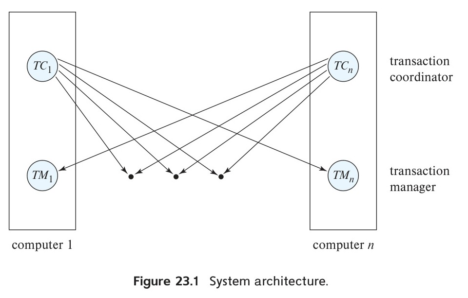
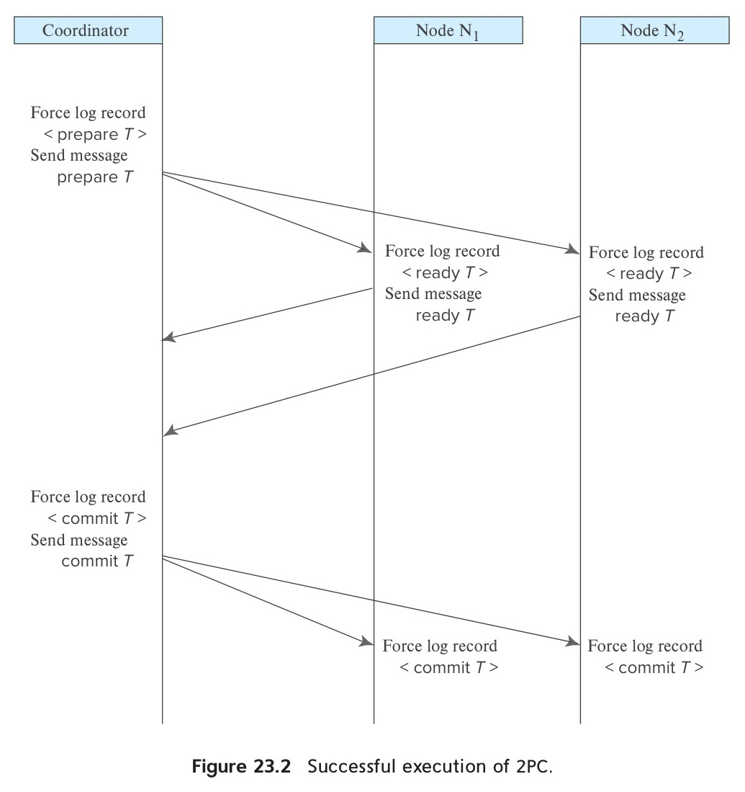
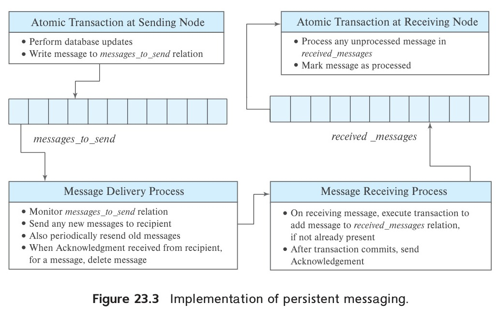
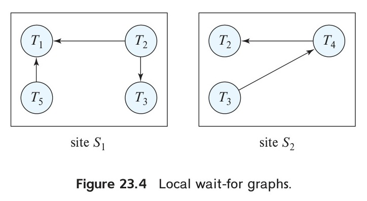
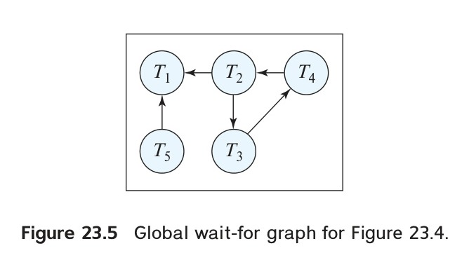
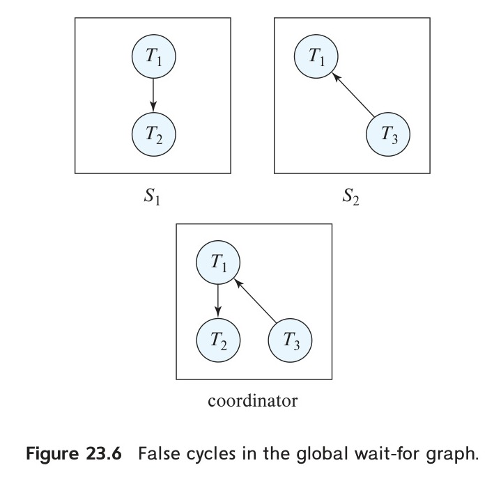
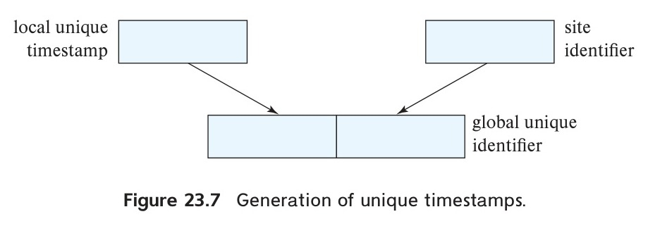
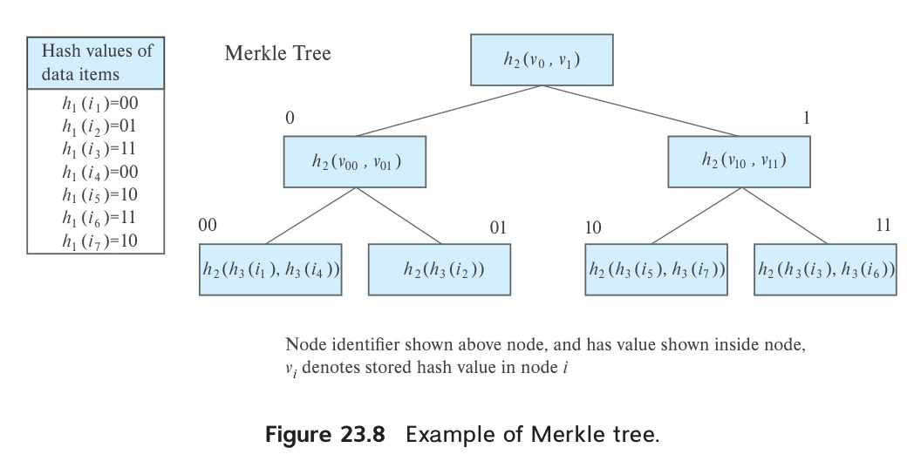
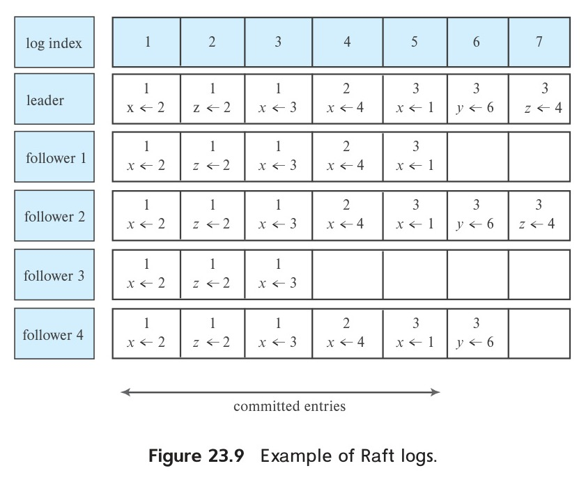
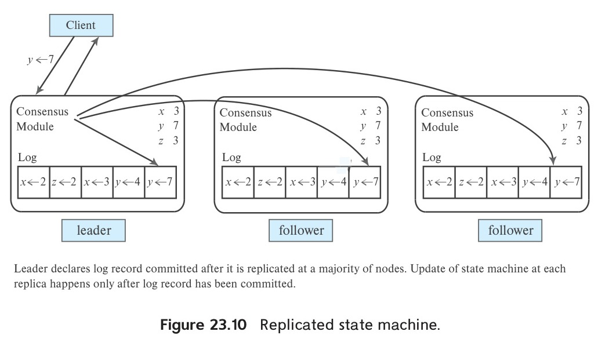

<!-- Page 1097 -->

# Chapter 23: Parallel and Distributed Transaction Processing

We studied transaction processing in centralized databases earlier, covering concurrency control in Chapter 18 and recovery in Chapter 19. In this chapter, we study how to carry out transaction processing in parallel and distributed databases. In addition to supporting concurrency control and recovery, transaction processing in parallel and distributed databases must also deal with issues due to replication of data, and of failures of some nodes.

Both parallel and distributed databases have multiple nodes, which can fail independently. The main difference between parallel and distributed databases from the view point of transaction processing is that the latency of remote access is much higher, and bandwidth lower, in a distributed database than in a parallel database where all nodes are in a single data center. Failures such as network partitioning and message delays are much less likely within a data center than across geographically distributed sites, but nevertheless they can occur; transaction processing must be done correctly even if they do occur.

Thus, most techniques for transaction processing are common to both parallel and distributed databases. In the few cases where there is a difference, we explicitly point out the difference. And as a result, in this chapter, whenever we say that a technique is applicable to distributed databases, it should be interpreted to mean that it is applicable to distributed databases as well as to parallel databases, unless we explicitly say otherwise.

In Section 23.1, we outline a model for transaction processing in a distributed database. In Section 23.2, we describe how to implement atomic transactions in a distributed database by using special commit protocols.

In Section 23.3 we describe how to extend traditional concurrency control techniques to distributed databases. Section 23.4 describes concurrency control techniques for the case where data items are replicated, while Section 23.5 describes further extensions including how multiversion concurrency control techniques can be extended to deal with distributed databases, and concurrency control can be implemented with

<!-- Page 1098 -->

heterogeneous distributed databases. Replication with weak degrees of consistency is discussed in Section 23.6.

Most techniques for dealing with distributed data require the use of coordinators to ensure consistent and efficient transaction processing. In Section 23.7 we discuss how coordinators can be chosen in a distributed fashion, robust to failures. Finally, Section 23.8 describes the distributed consensus problem, outlines solutions for the problem, and then discusses how these solutions can be used to implement fault-tolerant services by means of replication of a log.

## 23.1 Distributed Transactions

Access to the various data items in a distributed system is usually accomplished through transactions, which must preserve the ACID properties (Section 17.1). There are two types of transaction that we need to consider. The **local transactions** are those that access and update data in only one local database; the **global transactions** are those that access and update data in several local databases. Ensuring the ACID properties of the local transactions can be done as described in Chapter 17, Chapter 18, and Chapter 19. However, for global transactions, this task is much more complicated, since several nodes may be participating in the execution of the transaction. The failure of one of these nodes, or the failure of a communication link connecting these nodes, may result in erroneous computations.

In this section, we study the system structure of a distributed database and its possible failure modes. In later sections, we discuss how to ensure ACID properties are satisfied in a distributed database, despite failures. We reemphasize that these failure modes occur with parallel databases as well, and the techniques we describe are equally applicable to parallel databases.

### 23.1.1 System Structure

We now consider a system structure with multiple nodes, each of which can fail independently of the others. We note that the nodes may be within a single data center, corresponding to a parallel database system, or geographically distributed, in a distributed database system. The system structure is similar in either case; the problems with respect to transaction isolation and atomicity are the same in both cases, as are the solutions.

We note that the system structure we consider here is not applicable to a shared-memory parallel database system whose components do not have independent modes of failures. In such systems either the whole system is up, or the whole system is down. Further, there is usually only one transaction log used for recovery. Concurrency control and recovery techniques that are designed for centralized database systems can be used in such systems, and are preferable to techniques described in this chapter.

Each node has its own *local* transaction manager, whose function is to ensure the ACID properties of those transactions that execute at that node. The various trans-

<!-- Page 1099 -->

action managers cooperate to execute global transactions. To understand how such a manager can be implemented, consider an abstract model of a transaction system, in which each node contains two subsystems:

- The **transaction manager** manages the execution of those transactions (or subtransactions) that access data stored in the node. Note that each such transaction may be either a local transaction (i.e., a transaction that executes at only that node) or part of a global transaction (i.e., a transaction that executes at several nodes).

- The **transaction coordinator** coordinates the execution of the various transactions (both local and global) initiated at that node.

The overall system architecture appears in Figure 23.1.

*Figure 23.1 — System architecture.*

The structure of a transaction manager is similar in many respects to the structure of a centralized system. Each transaction manager is responsible for:

- Maintaining a log for recovery purposes.

- Participating in an appropriate concurrency-control scheme to coordinate the concurrent execution of the transactions executing at that node.

As we shall see, we need to modify both the recovery and concurrency schemes to accommodate the distributed execution of transactions.

The transaction coordinator subsystem is not needed in the centralized environment, since a transaction accesses data at only a single node. A transaction coordinator, as its name implies, is responsible for coordinating the execution of all the transactions initiated at that node. For each such transaction, the coordinator is responsible for:

<!-- Page 1100 -->

- Starting the execution of the transaction.

- Breaking the transaction into a number of subtransactions and distributing these subtransactions to the appropriate nodes for execution.

- Coordinating the termination of the transaction, which may result in the transaction being committed at all nodes or aborted at all nodes.

### 23.1.2 System Failure Modes

A distributed system may suffer from the same types of failure that a centralized system does (e.g., software errors, hardware errors, or disk crashes). There are, however, additional types of failure with which we need to deal in a distributed environment. The basic failure types are:

- Failure of a node.

- Loss of messages.

- Failure of a communication link.

- Network partition.

The loss or corruption of messages is always a possibility in a distributed system. The system uses transmission-control protocols, such as TCP/IP, to handle such errors. Information about such protocols may be found in standard textbooks on networking.

However, if two nodes $A$ and $B$ are not directly connected, messages from one to the other must be *routed* through a sequence of communication links. If a communication link fails, messages that would have been transmitted across the link must be rerouted. In some cases, it is possible to find another route through the network, so that the messages are able to reach their destination. In other nodes, a failure may result in there being no connection between some pairs of nodes. A system is **partitioned** if it has been split into two (or more) subsystems, called **partitions**, that lack any connection between them. Note that, under this definition, a partition may consist of a single node.

## 23.2 Commit Protocols

If we are to ensure atomicity, all the nodes in which a transaction $T$ executed must agree on the final outcome of the execution. $T$ must either commit at all nodes, or it must abort at all nodes. To ensure this property, the transaction coordinator of $T$ must execute a commit protocol.

Among the simplest and most widely used commit protocols is the **two-phase com-** **mit protocol** (**2PC**), which is described in Section 23.2.1.

<!-- Page 1101 -->

### 23.2.1 Two-Phase Commit

We first describe how the two-phase commit protocol (2PC) operates during normal operation, then describe how it handles failures and finally how it carries out recovery and concurrency control.

Consider a transaction $T$ initiated at node $N_{i}$, where the transaction coordinator is $C_{i}$.

#### 23.2.1.1 The Commit Protocol

When $T$ completes its execution—that is, when all the nodes at which $T$ has executed inform $C_{i}$ that $T$ has completed—$C_{i}$ starts the 2PC protocol.

- **Phase 1**. $C_{i}$ adds the record $\langle\text{prepare }T\rangle$ to the log and forces the log onto stable storage. It then sends a prepare $T$ message to all nodes at which $T$ executed. On receiving such a message, the transaction manager at that node determines whether it is willing to commit its portion of $T$. If the answer is no, it adds a record $\langle\text{no }T\rangle$ to the log and then responds by sending an abort $T$ message to $C_{i}$. If the answer is yes, it adds a record $\langle\text{ready }T\rangle$ to the log and forces the log (with all the log records corresponding to $T$) onto stable storage. The transaction manager then replies with a ready $T$ message to $C_{i}$.

- **Phase 2**. When $C_{i}$ receives ready responses to the prepare $T$ message from all the nodes, or when it receives an abort $T$ message from at least one participant node, $C_{i}$ can determine whether the transaction $T$ can be committed or aborted. Transaction $T$ can be committed if $C_{i}$ received a ready $T$ message from all the participating nodes. Otherwise, transaction $T$ must be aborted. Depending on the verdict, either a record $\langle\text{commit }T\rangle$ or a record $\langle\text{abort }T\rangle$ is added to the log and the log is forced onto stable storage. At this point, the fate of the transaction has been sealed.

Following this point, the coordinator sends either a commit $T$ or an abort $T$ message to all participating nodes. When a node receives that message, it records the result (either $\langle\text{commit }T\rangle$ or $\langle\text{abort }T\rangle$ ) in its log, and correspondingly either commits or aborts the transaction.

Since nodes may fail, the coordinator cannot wait indefinitely for responses from all the nodes. Instead, when a prespecified interval of time has elapsed since the prepare $T$ message was sent out, if any node has not responded to the coordinator, the coordinator can decide to abort the transaction; the steps described for aborting the transaction must be followed, just as if a node had sent an abort message for the transaction.

Figure 23.2 shows an instance of successful execution of 2PC for a transaction $T$, with two nodes, $N_{1}$ and $N_{2}$, that are both willing to commit transaction $T$. If any of the

<!-- Page 1102 -->

*Figure 23.2 — Successful execution of 2PC.*

nodes sends a no $T$ message, the coordinator will send an abort $T$ message to all the nodes, which will then abort the transaction.

A node at which $T$ executed can unconditionally abort $T$ at any time before it sends the message ready $T$ to the coordinator. Once the $\langle\text{ready }T\rangle$ log record is written, the transaction $T$ is said to be in the **ready state** at the node. The ready $T$ message is, in effect, a promise by a node to follow the coordinator’s order to commit $T$ or to abort $T$. To make such a promise, the needed information must first be stored in stable storage. Otherwise, if the node crashes after sending ready $T$, it may be unable to make good on its promise. Further, locks acquired by the transaction must continue to be held until the transaction completes, even if there is an intervening node failure, as we shall see in Section 23.2.1.3.

<!-- Page 1103 -->

Since unanimity is required to commit a transaction, the fate of $T$ is sealed as soon as at least one node responds abort $T$. Since the coordinator node $N_{i}$ is one of the nodes at which $T$ executed, the coordinator can decide unilaterally to abort $T$. The final verdict regarding $T$ is determined at the time that the coordinator writes that verdict (commit or abort) to the log and forces that verdict to stable storage.

In some implementations of the 2PC protocol, a node sends an acknowledge $T$ message to the coordinator at the end of the second phase of the protocol. When the coordinator receives the acknowledge $T$ message from all the nodes, it adds the record $\langle\text{complete }T\rangle$ to the log. Until this step, the coordinator cannot forget about the commit or abort decision on $T$, since a node may ask for the decision. (A node that has not received a commit or abort for transaction $T$, perhaps due to a network failure or temporary node failure, may send such a request to the coordinator.) After this step, the coordinator can discard information about transaction $T$.

#### 23.2.1.2 Handling of Failures

The 2PC protocol responds in different ways to various types of failure:

- **Failure of a participating node**. If the coordinator $C_{i}$ detects that a node has failed, it takes these actions: If the node fails before responding with a ready $T$ message to $C_{i}$, the coordinator assumes that it responded with an abort $T$ message. If the node fails after the coordinator has received the ready $T$ message from the node, the coordinator executes the rest of the commit protocol in the normal fashion, ignoring the failure of the node.

When a participating node $N_{k}$ recovers from a failure, it must examine its log to determine the fate of those transactions that were in the midst of execution when the failure occurred. Let $T$ be one such transaction. We consider each of the possible cases:

  - The log contains a $\langle\text{commit }T\rangle$ record. In this case, the node executes

redo($T$).

  - The log contains an $\langle\text{abort }T\rangle$ record. In this case, the node executes

undo($T$).

  - The log contains a $\langle\text{ready }T\rangle$ record. In this case, the node must consult $C_{i}$ to

determine the fate of $T$. If $C_{i}$ is up, it notifies $N_{k}$ regarding whether $T$ committed or aborted. In the former case, it executes redo($T$); in the latter case, it executes undo($T$). If $C_{i}$ is down, $N_{k}$ must try to find the fate of $T$ from other nodes. It does so by sending a querystatus $T$ message to all the nodes in the system. On receiving such a message, a node must consult its log to determine whether $T$ has executed there, and if $T$ has, whether $T$ committed or aborted. It then notifies $N_{k}$ about this outcome. If no node has the appropriate information (i.e., whether $T$ committed or aborted), then $N_{k}$ can neither abort nor commit $T$. The decision concerning $T$ is postponed until $N_{k}$ can obtain the needed

<!-- Page 1104 -->

information. Thus, $N_{k}$ must periodically resend the querystatus message to the other nodes. It continues to do so until a node that contains the needed information has recovered. Note that the node at which $C_{i}$ resides always has the needed information.

  - The log contains no control records (abort, commit, ready) concerning $T$.

Thus, we know that $N_{k}$ failed before responding to the prepare $T$ message from $C_{i}$. Since the failure of $N_{k}$ precludes the sending of such a response, by our algorithm $C_{i}$ must abort $T$. Hence, $N_{k}$ must execute undo($T$).

- **Failure of the coordinator**. If the coordinator fails in the midst of the execution of the commit protocol for transaction $T$, then the participating nodes must decide the fate of $T$. We shall see that, in certain cases, the participating nodes cannot decide whether to commit or abort $T$, and therefore these nodes must wait for the recovery of the failed coordinator.

  - If an active node contains a $\langle\text{commit }T\rangle$ record in its log, then $T$ must be

committed.

  - If an active node contains an $\langle\text{abort }T\rangle$ record in its log, then $T$ must be

aborted.

  - If some active node does *not* contain a $\langle\text{ready }T\rangle$ record in its log, then the

failed coordinator $C_{i}$ cannot have decided to commit $T$, because a node that does not have a $\langle\text{ready }T\rangle$ record in its log cannot have sent a ready $T$ message to $C_{i}$. However, the coordinator may have decided to abort $T$, but not to commit $T$. Rather than wait for $C_{i}$ to recover, it is preferable to abort $T$.

  - If none of the preceding cases holds, then all active nodes must have a <ready

$T$> record in their logs, but no additional control records (such as $\langle\text{abort }T\rangle$ or $\langle\text{commit }T\rangle$ ). Since the coordinator has failed, it is impossible to determine whether a decision has been made, and if one has, what that decision is, until the coordinator recovers. Thus, the active nodes must wait for $C_{i}$ to recover.

Since the fate of $T$ remains in doubt, $T$ may continue to hold system resources. For example, if locking is used, $T$ may hold locks on data at active nodes. Such a situation is undesirable, because it may be hours or days before $C_{i}$ is again active. During this time, other transactions may be forced to wait for $T$. As a result, data items may be unavailable not only on the failed node ($C_{i}$), but on active nodes as well. This situation is called the **blocking problem**, because $T$ is blocked pending the recovery of node $C_{i}$.

- **Network partition**. When a network partition occurs, two possibilities exist:

**1.** The coordinator and all its participants remain in one partition. In this case,

the failure has no effect on the commit protocol.

<!-- Page 1105 -->

**2.** The coordinator and its participants belong to several partitions. From the

viewpoint of the nodes in one of the partitions, it appears that the nodes in other partitions have failed. Nodes that are not in the partition containing the coordinator simply execute the protocol to deal with the failure of the coordinator. The coordinator and the nodes that are in the same partition as the coordinator follow the usual commit protocol, assuming that the nodes in the other partitions have failed.

Thus, the major disadvantage of the 2PC protocol is that coordinator failure may result in blocking, where a decision either to commit or to abort $T$ may have to be postponed until $C_{i}$ recovers. We discuss how to remove this limitation shortly, in Section 23.2.2.

#### 23.2.1.3 Recovery and Concurrency Control

When a failed node restarts, we can perform recovery by using, for example, the recovery algorithm described in Section 19.4. To deal with distributed commit protocols, the recovery procedure must treat **in-doubt transactions** specially; in-doubt transactions are transactions for which a $\langle\text{ready }T\rangle$ log record is found, but neither a $\langle\text{commit }T\rangle$ log record nor an $\langle\text{abort }T\rangle$ log record is found. The recovering node must determine the commit–abort status of such transactions by contacting other nodes, as described in Section 23.2.1.2.

If recovery is done as just described, however, normal transaction processing at the node cannot begin until all in-doubt transactions have been committed or rolled back. Finding the status of in-doubt transactions can be slow, since multiple nodes may have to be contacted. Further, if the coordinator has failed, and no other node has information about the commit–abort status of an incomplete transaction, recovery potentially could become blocked if 2PC is used. As a result, the node performing restart recovery may remain unusable for a long period.

To circumvent this problem, recovery algorithms typically provide support for noting lock information in the log. (We are assuming here that locking is used for concurrency control.) Instead of writing a $\langle\text{ready }T\rangle$ log record, the algorithm writes a $\langle\text{ready }T, L\rangle$ log record, where $L$ is a list of all write locks held by the transaction $T$ when the log record is written. At recovery time, after performing local recovery actions, for every in-doubt transaction $T$, all the write locks noted in the $\langle\text{ready }T, L\rangle$ log record (read from the log) are reacquired.

After lock reacquisition is complete for all in-doubt transactions, transaction processing can start at the node, even before the commit–abort status of the in-doubt transactions is determined. The commit or rollback of in-doubt transactions proceeds concurrently with the execution of new transactions. Thus, node recovery is faster and never gets blocked. Note that new transactions that have a lock conflict with any write locks held by in-doubt transactions will be unable to make progress until the conflicting in-doubt transactions have been committed or rolled back.

<!-- Page 1106 -->

### 23.2.2 Avoiding Blocking During Commit

The blocking problem of 2PC is a serious concern for system designers, since the failure of a coordinator node could lead to blocking of a transaction that has acquired locks on a frequently used data item, which in turn prevents other transactions that need to acquire a conflicting lock from completing their execution.

By involving multiple nodes in the commit decision step of 2PC, it is possible to avoid blocking as long as a majority of the nodes involved in the commit decision are alive and can communicate with each other. This is done by using the idea of fault-tolerant distributed consensus. Details of distributed consensus are discussed in detail later, in Section 23.8, but we outline the problem and sketch a solution approach below.

The **distributed consensus problem** is as follows: A set of $n$ nodes need to agree on a decision; in this case, whether or not to commit a particular transaction. The inputs to make the decision are provided to all the nodes, and then each node votes on the decision; in the case of 2PC, the decision is on whether or not to commit a transaction. The key goal of protocols for achieving distributed consensus is that the decision should be made in such a way that all nodes will “learn” the same value for the decision (i.e., all nodes will learn that the transaction is to be committed, or all nodes will learn that the transaction is to be aborted), even if some nodes fail during the execution of the protocol, or there are network partitions. Further, the distributed consensus protocol should not block, as long as a majority of the nodes participating remain alive and can communicate with each other.

There are several protocols for distributed consensus, two of which are widely used today (Paxos and Raft). We study distributed consensus in Section 23.8. A key idea behind these protocols is the idea of a vote, which succeeds only if a majority of the participating nodes agree on a particular decision.

Given an implementation of distributed consensus, the blocking problem due to coordinator failure can be avoided as follows: Instead of the coordinator locally deciding to commit or abort a transaction, it initiates the distributed consensus protocol, requesting that the value “committed” or “aborted” be assigned to the transaction $T$. The request is sent to all the nodes participating in the distributed consensus, and the consensus protocol is then executed by those nodes. Since the protocol is fault tolerant, it will succeed even if some nodes fail, as long as a majority of the nodes are up and remain connected. The transaction can be declared committed by the coordinator only after the consensus protocol completes successfully.

There are two possible failure scenarios:

- *The coordinator fails at any stage before informing all participating nodes of the com-* *mit or abort status of a transaction T.*

In this case, a new coordinator is chosen (we will see how to do so in Section 23.7). The new coordinator checks with the nodes participating in the distributed consensus to see if a decision was made, and if so informs the 2PC participants

<!-- Page 1107 -->

of the decision. A majority of the nodes participating in consensus must respond, to check if a decision was made or not; the protocol will not block as long as the failed/disconnected nodes are in a minority.

- If no decision was made earlier for transaction $T$, the new coordinator again checks with the 2PC participants to check if they are ready to commit or wish to abort the transaction, and follows the usual coordinator protocol based on their responses. As before, if no response is received from a participant, the new coordinator may choose to abort $T$.

- *The distributed consensus protocol fails to reach a decision.* Failure of the protocol can occur due to the failure of some participating nodes. It could also occur because of conflicting requests, none of which gets a majority of “votes” during the consensus protocol. For 2PC, the request normally comes from a single coordinator, so such a conflict is unlikely. However, conflicting requests can arise in rare cases if a coordinator fails after sending out a commit message, but its commit message is delivered late; meanwhile, a new 2PC coordinator makes an abort decision since it could not reach some participating nodes. Even with such a conflict, the distributed consensus protocol guarantees that only one of the commit or abort requests can succeed, even in the presence of failures. But if some nodes are down, and neither the commit nor the abort request gets a majority vote from nodes participating in the distributed consensus, it is possible for the protocol to fail to reach a decision.

Regardless of the reason, if the distributed consensus protocol fails to reach a decision, the new coordinator just re-initiates the protocol.

Note that in the event of a network partition, a node that gets disconnected from the majority of the nodes participating in consensus may not learn about a decision, even if a decision was successfully made. Thus, transactions running at such a node may be blocked.

Failure of 2PC participants could make data unavailable, in the absence of replication. Distributed consensus can also be used to keep replicas of a data item in a consistent state, as we explain later in Section 23.8.4.

The idea of distributed consensus to make 2PC nonblocking was proposed in the 1980s; it is used, for example, in the Google Spanner distributed database system.

The **three-phase commit** (**3PC**) protocol is an extension of the two-phase commit protocol that avoids the blocking problem under certain assumptions. One variant of the protocol avoids blocking as long as network partitions do not occur, but it may lead to inconsistent decisions in the event of a network partition. Extensions of the protocol that work safely under network partitioning were developed subsequently. The idea behind these extensions is similar to the majority voting idea of distributed consensus, but the protocols are specifically tailored for the task of atomic commit.

<!-- Page 1108 -->

### 23.2.3 Alternative Models of Transaction Processing

With two-phase commit, participating nodes agree to let the coordinator decide the fate of a transaction, and are forced to wait for the decision of the coordinator, while holding locks on updated data items. While such loss of autonomy may be acceptable within an organization, no organization would be willing to force its computers to wait, potentially for a long time, while a computer at another organization makes the decision.

In this section, we describe how to use *persistent messaging* to avoid the problem of distributed commit. To understand persistent messaging, consider how one might transfer funds between two different banks, each with its own computer. One approach is to have a transaction span the two nodes and use two-phase commit to ensure atomicity. However, the transaction may have to update the total bank balance, and blocking could have a serious impact on all other transactions at each bank, since almost all transactions at the bank would update the total bank balance.

In contrast, consider how funds transfer by a bank check occurs. The bank first deducts the amount of the check from the available balance and prints out a check. The check is then physically transferred to the other bank where it is deposited. After verifying the check, the bank increases the local balance by the amount of the check. The check constitutes a message sent between the two banks. So that funds are not lost or incorrectly increased, the check must not be lost and must not be duplicated and deposited more than once. When the bank computers are connected by a network, persistent messages provide the same service as the check (but much faster).

**Persistent messages** are messages that are guaranteed to be delivered to the recipient exactly once (neither less nor more), regardless of failures, if the transaction sending the message commits, and are guaranteed to not be delivered if the transaction aborts. Database recovery techniques are used to implement persistent messaging on top of the normal network channels, as we shall see shortly. In contrast, regular messages may be lost or may even be delivered multiple times in some situations.

Error handling is more complicated with persistent messaging than with two-phase commit. For instance, if the account where the check is to be deposited has been closed, the check must be sent back to the originating account and credited back there. Both nodes must, therefore, be provided with error-handling code, along with code to handle the persistent messages. In contrast, with two-phase commit, the error would be detected by the transaction, which would then never deduct the amount in the first place.

The types of exception conditions that may arise depend on the application, so it is not possible for the database system to handle exceptions automatically. The application programs that send and receive persistent messages must include code to handle exception conditions and bring the system back to a consistent state. For instance, it is not acceptable to just lose the money being transferred if the receiving account has been closed; the money must be credited back to the originating account, and if that is not possible for some reason, humans must be alerted to resolve the situation manually.

<!-- Page 1109 -->

There are many applications where the benefit of eliminating blocking is well worth the extra effort to implement systems that use persistent messages. In fact, few organizations would agree to support two-phase commit for transactions originating outside the organization, since failures could result in blocking of access to local data. Persistent messaging therefore plays an important role in carrying out transactions that cross organizational boundaries.

We now consider the **implementation** of persistent messaging. Persistent messaging can be implemented on top of an unreliable messaging infrastructure, which may lose messages or deliver them multiple times. Figure 23.3 shows a summary of the implementation, which is described in detail next.

*Figure 23.3 — Implementation of persistent messaging.*

- **Sending node protocol**. When a transaction wishes to send a persistent message, it writes a record containing the message in a special relation *messages*

*to*

*send*, instead of directly sending out the message. The message is also given a unique message identifier. Note that this relation acts as a message *outbox*.

A *message delivery process* monitors the relation, and when a new message is found, it sends the message to its destination. The usual database concurrency-control mechanisms ensure that the system process reads the message only after the transaction that wrote the message commits; if the transaction aborts, the usual recovery mechanism would delete the message from the relation.

The message delivery process deletes a message from the relation only after it receives an acknowledgment from the destination node. If it receives no acknowledgment from the destination node, after some time it sends the message again. It repeats this until an acknowledgment is received. In case of permanent failures,

<!-- Page 1110 -->

the system will decide, after some period of time, that the message is undeliverable. Exception handling code provided by the application is then invoked to deal with the failure.

- Writing the message to a relation and processing it only after the transaction has committed ensures that the message will be delivered if and only if the transaction commits. Repeatedly sending it guarantees it will be delivered even if there are (temporary) system or network failures.

- **Receiving node protocol**. When a node receives a persistent message, it runs a transaction that adds the message to a special *received*

*messages* relation, provided it is not already present in the relation (the unique message identifier allows duplicates to be detected). The relation has an attribute to indicate if the message has been processed, which is set to false when the message is inserted in the relation. Note that this relation acts as a message *inbox*.

After the transaction commits, or if the message was already present in the relation, the receiving node sends an acknowledgment back to the sending node.

- Note that sending the acknowledgment before the transaction commits is not safe, since a system failure may then result in loss of the message. Checking whether the message has been received earlier is essential to avoid multiple deliveries of the message.

- **Processing of message**. Received messages must be processed to carry out the actions specified in the message. A process at the receiving node monitors the *re-* *ceived*

- *messages* relation to check for messages that have not been processed. When it finds such a message, the message is processed, and as part of the same transaction that processes the message, the processed flag is set to true. This ensures that a message is processed exactly once after it is received.

- **Deletion of old messages**. In many messaging systems, it is possible for messages to get delayed arbitrarily, although such delays are very unlikely. Therefore, to be safe, the message must never be deleted from the *received*

*messages* relation. Deleting it could result in a duplicate delivery not being detected. But as a result, the *received*

*messages* relation may grow indefinitely. To deal with this problem, each message is given a timestamp, and if the timestamp of a received message is older than some cutoff, the message is discarded. All messages recorded in the *received*

*messages* relation that are older than the cutoffcan be deleted.

*Workflows* provide a general model of distributed transaction processing involving multiple nodes and possibly human processing of certain steps, and they are supported by application software used by enterprises. For instance, as we saw in Section 9.6.1, when a bank receives a loan application, there are many steps it must take, including contacting external credit-checking agencies, before approving or rejecting a loan application. The steps, together, form a workflow. Persistent messaging forms the underlying basis for supporting workflows in a distributed environment.

<!-- Page 1111 -->

## 23.3 Concurrency Control in Distributed Databases

We now consider how the concurrency-control schemes discussed in Chapter 18 can be modified so that they can be used in a distributed environment. We assume that each node participates in the execution of a commit protocol to ensure global transaction atomicity.

In this section, we assume that data items are not replicated, and we do not consider multiversion techniques. We discuss how to handle replicas later, in Section 23.4, and we discuss distributed multiversion concurrency control techniques in Section 23.5.

### 23.3.1 Locking Protocols

The various locking protocols described in Chapter 18 can be used in a distributed environment. We discuss implementation issues in this section.

#### 23.3.1.1 Single Lock-Manager Approach

In the **single lock-manager** approach, the system maintains a *single* lock manager that resides in a *single* chosen node—say $N_{i}$. All lock and unlock requests are made at node $N_{i}$. When a transaction needs to lock a data item, it sends a lock request to $N_{i}$. The lock manager determines whether the lock can be granted immediately. If the lock can be granted, the lock manager sends a message to that effect to the node at which the lock request was initiated. Otherwise, the request is delayed until it can be granted, at which time a message is sent to the node at which the lock request was initiated. The transaction can read the data item from *any* one of the nodes at which a replica of the data item resides. In the case of a write, all the nodes where a replica of the data item resides must be involved in the writing.

The scheme has these advantages:

- **Simple implementation**. This scheme requires two messages for handling lock requests and one message for handling unlock requests.

- **Simple deadlock handling**. Since all lock and unlock requests are made at one node, the deadlock-handling algorithms discussed in Chapter 18 can be applied directly.

The disadvantages of the scheme are:

- **Bottleneck**. The node $N_{i}$ becomes a bottleneck, since all requests must be processed there.

- **Vulnerability**. If the node $N_{i}$ fails, the concurrency controller is lost. Either processing must stop, or a recovery scheme must be used so that a backup node can take over lock management from $N_{i}$, as described in Section 23.7.

<!-- Page 1112 -->

#### 23.3.1.2 Distributed Lock Manager

A compromise between the advantages and disadvantages can be achieved through the **distributed-lock-manager** approach, in which the lock-manager function is distributed over several nodes.

Each node maintains a local lock manager whose function is to administer the lock and unlock requests for those data items that are stored in that node. When a transaction wishes to lock a data item $Q$ that resides at node $N_{i}$, a message is sent to the lock manager at node $N_{i}$ requesting a lock (in a particular lock mode). If data item $Q$ is locked in an incompatible mode, then the request is delayed until it can be granted. Once it has determined that the lock request can be granted, the lock manager sends a message back to the initiator indicating that it has granted the lock request.

The distributed-lock-manager scheme has the advantage of simple implementation, and it reduces the degree to which the coordinator is a bottleneck. It has a reasonably low overhead, requiring two message transfers for handling lock requests, and one message transfer for handling unlock requests. However, deadlock handling is more complex, since the lock and unlock requests are no longer made at a single node: There may be internode deadlocks even when there is no deadlock within a single node. The deadlock-handling algorithms discussed in Chapter 18 must be modified, as we shall discuss in Section 23.3.2, to detect global deadlocks.

### 23.3.2 Deadlock Handling

The deadlock-prevention and deadlock-detection algorithms in Chapter 18 can be used in a distributed system, with some modifications.

Consider first the deadlock-prevention techniques, which we saw in Section 18.2.1.

- Techniques for deadlock prevention based on lock ordering can be used in a distributed system, with no changes at all. These techniques prevent cyclic lock waits; the fact that locks may be obtained at different nodes has no effect on prevention of cyclic lock waits.

- Techniques based on preemption and transaction rollback can also be used unchanged in a distributed system. In particular, the *wait-die* technique is used in several distributed systems. Recall that this technique allows older transactions to wait for locks held by younger transactions, but if a younger transaction needs to wait for a lock held by an older transaction, the younger transaction is rolled back. The transaction that is rolled back may subsequently be executed again; recall that it retains its original start time; if it is treated as a new transaction, it could be rolled back repeatedly, and starve, even as other transactions make progress and complete.

- Timeout-based schemes, too, work without any changes in a distributed system.

<!-- Page 1113 -->

Deadlock-prevention techniques may result in unnecessary waiting and rollback when used in a distributed system, just as in a centralized system,

We now consider deadlock-detection techniques that allow deadlocks to occur and detect them if they do. The main problem in a distributed system is deciding how to maintain the wait-for graph. Common techniques for dealing with this issue require that each node keep a **local wait-for graph**. The nodes of the graph correspond to all the transactions (local as well as nonlocal) that are currently either holding or requesting any of the items local to that node. For example, Figure 23.4 depicts a system consisting of two nodes, each maintaining its local wait-for graph. Note that transactions $T_{2}$ and $T_{3}$ appear in both graphs, indicating that the transactions have requested items at both nodes.

*Figure 23.4 — Local wait-for graphs.*

These local wait-for graphs are constructed in the usual manner for local transactions and data items. When a transaction $T_{i}$ on node $N_{1}$ needs a resource in node $N_{2}$, it sends a request message to node $N_{2}$. If the resource is held by transaction $T_{j}$, the system inserts an edge $T_{i}$ $\rightarrow$ $T_{j}$ in the local wait-for graph of node $N_{2}$.

If any local wait-for graph has a cycle, a deadlock has occurred. On the other hand, the fact that there are no cycles in any of the local wait-for graphs does not mean that there are no deadlocks. To illustrate this problem, we consider the local wait-for graphs of Figure 23.4. Each wait-for graph is acyclic; nevertheless, a deadlock exists in the system because the *union* of the local wait-for graphs contains a cycle. This graph appears in Figure 23.5.

*Figure 23.5 — Global wait-for graph for Figure 23.4.*

<!-- Page 1114 -->

In the **centralized deadlock detection** approach, the system constructs and maintains a **global wait-for graph** (the union of all the local graphs) in a *single* node: the deadlock-detection coordinator. Since there is communication delay in the system, we must distinguish between two types of wait-for graphs. The *real* graph describes the real but unknown state of the system at any instance in time, as would be seen by an omniscient observer. The *constructed* graph is an approximation generated by the controller during the execution of the controller’s algorithm. Obviously, the controller must generate the constructed graph in such a way that, whenever the detection algorithm is invoked, the reported results are correct. *Correct* means in this case that, if a deadlock exists, it is reported promptly, and if the system reports a deadlock, it is indeed in a deadlock state.

The global wait-for graph can be reconstructed or updated under these conditions:

- Whenever a new edge is inserted in or removed from one of the local wait-for graphs.

- Periodically, when a number of changes have occurred in a local wait-for graph.

- Whenever the coordinator needs to invoke the cycle-detection algorithm.

When the coordinator invokes the deadlock-detection algorithm, it searches its global graph. If it finds a cycle, it selects a victim to be rolled back. The coordinator must notify all the nodes that a particular transaction has been selected as the victim. The nodes, in turn, roll back the victim transaction.

This scheme may produce unnecessary rollbacks if:

- **False cycles** exist in the global wait-for graph. As an illustration, consider a snapshot of the system represented by the local wait-for graphs of Figure 23.6. Suppose that $T_{2}$ releases the resource that it is holding in node $N_{1}$, resulting in the deletion of the edge $T_{1}$ $\rightarrow$ $T_{2}$ in $N_{1}$. Transaction $T_{2}$ then requests a resource held by $T_{3}$ at node $N_{2}$, resulting in the addition of the edge $T_{2}$ $\rightarrow$ $T_{3}$ in $N_{2}$. If the insert $T_{2}$ $\rightarrow$ $T_{3}$ message from $N_{2}$ arrives before the remove $T_{1}$ $\rightarrow$ $T_{2}$ message from $N_{1}$, the coordinator may discover the false cycle $T_{1}$ $\rightarrow$ $T_{2}$ $\rightarrow$ $T_{3}$ after the insert (but before the remove). Deadlock recovery may be initiated, although no deadlock has occurred.

- Note that the false-cycle situation could not occur under two-phase locking. The likelihood of false cycles is usually sufficiently low that they do not cause a serious performance problem.

- A *deadlock* has indeed occurred and a victim has been picked, while one of the transactions was aborted for reasons unrelated to the deadlock. For example, suppose that node $N_{1}$ in Figure 23.4 decides to abort $T_{2}$. At the same time, the coordinator has discovered a cycle and has picked $T_{3}$ as a victim. Both $T_{2}$ and $T_{3}$ are now rolled back, although only $T_{2}$ needed to be rolled back.

<!-- Page 1115 -->

*Figure 23.6 — False cycles in the global wait-for graph.*

Deadlock detection can be done in a distributed manner, with several nodes taking on parts of the task, instead of it being done at a single node. However, such algorithms are more complicated and more expensive. See the bibliographical notes for references to such algorithms.

### 23.3.3 Leases

One of the issues with using locking in a distributed system is that a node holding a lock may fail, and not release the lock. The locked data item could thus become (logically) inaccessible, until the failed node recovers and releases the lock, or the lock is released by another node on behalf of the failed node.

If an exclusive lock has been obtained on a data item, and the transaction is in the prepared state, the lock cannot be released until a commit/abort decision is made for the transaction. However, in many other cases it is acceptable for a lock that has been granted earlier to be revoked subsequently. In such cases, the concept of a lease can be very useful.

A **lease** is a lock that is granted for a specific period of time. If the process that acquires a lease needs to continue holding the lock beyond the specified period, it can **renew** the lease. A lease renewal request is sent to the lock manager, which extends the lease and responds with an acknowledgment as long as the renewal request comes in time. However, if the time expires, and the process does not renew the lease, the lease is said to **expire**, and the lock is released. Thus, any lease acquired by a node that either fails, or gets disconnected from the lock manager, is automatically released when the

<!-- Page 1116 -->

lease expires. The node that holds a lease regularly compares the current lease expiry time with its local clock to determine if it still has the lease or the lease has expired.

One of the uses of leases is to ensure that there is only one coordinator for a protocol in a distributed system. A node that wants to act as coordinator requests an exclusive lease on a data item associated with the protocol. If it gets the lease, it can act as coordinator until the lease expires; as long as it is active, it requests lease renewal before the lease expires, and it continues to be the coordinator as long as the lock manager permits the lease renewal.

If a node $N_{1}$ acting as coordinator dies after the expiry of the lease period, the lease automatically expires, and another node $N_{2}$ that requests the lease can acquire it and become the coordinator. In most protocols it is important that there should be only one coordinator at a given time. The lease mechanism guarantees this, as long as clocks are synchronized. However, if the coordinator’s clock runs slower than the lock manager’s clock, a situation can arise where the coordinator thinks it still has the lease, while the lock manager thinks the lease has expired. While clocks cannot be exactly synchronized, in practice the inaccuracy is not very high. The lock manager waits for some extra wait time after the lease expiry time to account for clock inaccuracies before it actually treats the lease as expired.

A node that checks the local clock and decides it still has a lease may then take a subsequent action as coordinator. It is possible that the lease may have expired between when the clock was checked and when the subsequent action took place, which could result in the action taking place after the node is no longer the coordinator. Further, even if the action took place while the node had a valid lease, a message sent by the node may be delivered after a delay, by which time the node may have lost its lease. While it is possible for the network to deliver a message arbitrarily late, the system can decide on a maximum message delay time, and any message that is older is ignored by the recipient; messages have timestamps set by the sender, which are used to detect if a message needs to be ignored.

The time gaps due to the above two issues can be taken into account by checking that the lease expiry is at least some time $t$' into the future before initiating an action, where $t$' is a bound on how long the action will take after the lease time check, including the maximum message delay.

We have assumed here that while coordinators may fail, the lock manager that issues leases is able to tolerate faults. We study in Section 23.8.4 how to build a fault-tolerant lock manager; we note that the techniques described in that section are general purpose and can be used to implement fault-tolerant versions of any deterministic process, modeled as a “state machine.”

### 23.3.4 Distributed Timestamp-Based Protocols

The principal idea behind the timestamp-based concurrency control protocols in Section 18.5 is that each transaction is given a *unique* timestamp that the system uses in

<!-- Page 1117 -->

deciding the serialization order. Our first task, then, in generalizing the centralized scheme to a distributed scheme is to develop a scheme for generating unique timestamps. We then discuss how the timestamp-based protocols can be used in a distributed setting.

### 23.3.5 Generation of Timestamps

There are two primary methods for generating unique timestamps, one centralized and one distributed. In the centralized scheme, a single node distributes the timestamps. The node can use a logical counter or its own local clock for this purpose. While this scheme is easy to implement, failure of the node would potentially block all transaction processing in the system.

In the distributed scheme, each node generates a unique local timestamp by using either a logical counter or the local clock. We obtain the unique global timestamp by concatenating the unique local timestamp with the node identifier, which also must be unique (Figure 23.7). If a node has multiple threads running on it (as is almost always the case today), a thread identifier is concatenated with the node identifier, to make the timestamp unique. Further, we assume that consecutive calls to get the local timestamp within a node/thread will return different timestamps; if this is not guaranteed by the local clock, the returned local timestamp value may need to be incremented, to ensure two calls do not get the same local timestamp.

*Figure 23.7 — Generation of unique timestamps.*

The order of concatenation is important! We use the node identifier in the least significant position to ensure that the global timestamps generated in one node are not always greater than those generated in another node.

We may still have a problem if one node generates local timestamps at a rate faster than that of the other nodes. In such a case, the fast node’s logical counter will be larger than that of other nodes. Therefore, all timestamps generated by the fast node will be larger than those generated by other nodes. What we need is a mechanism to ensure that local timestamps are generated fairly across the system. There are two solution approaches for this problem.

**1.** Keep the clocks synchronized by using a network time protocol, which is a stan-

dard feature in computers today. The protocol periodically communicates with a

<!-- Page 1118 -->

server to find the current time. If the local time is ahead of the time returned by the server, the local clock is slowed down, whereas if the local time is behind the time returned by the server it is speeded up, to bring it back in synchronization with the time at the server. Since all nodes are approximately synchronized with the server, they are also approximately synchronized with each other.

**2.** We define within each node $N_{i}$ a **logical clock** ($LC_{i}$), which generates the unique

local timestamp. The logical clock can be implemented as a counter that is incremented after a new local timestamp is generated. To ensure that the various logical clocks are synchronized, we require that a node $N_{i}$ advance its logical clock whenever a transaction $T_{i}$ with timestamp < $x$, $y$ > visits that node and $x$ is greater than the current value of $LC_{i}$. In this case, node $N_{i}$ advances its logical clock to the value $x$ + 1. As long as messages are exchanged regularly, the logical clocks will be approximately synchronized.

### 23.3.6 Distributed Timestamp Ordering

The timestamp ordering protocol can be easily extended to a parallel or distributed database setting. Each transaction is assigned a globally unique timestamp at the node where it originates. Requests sent to other nodes include the transaction timestamp. Each node keeps track of the read and write timestamps of the data items at that node. Whenever an operation is received by a node, it does the timestamp checks that we saw in Section 18.5.2, locally, without any need to communicate with other nodes.

Timestamps must be reasonably synchronized across nodes; otherwise, the following problem can occur. Suppose one node has a time significantly lagging the others, and a transaction $T_{1}$ gets its timestamp at that node $n_{1}$. Suppose the transaction $T_{1}$ fails a timestamp test on a data item $d_{i}$ because $d_{i}$ has been updated by a transaction $T_{2}$ with a higher timestamp; $T_{1}$ would be restarted with a new timestamp, but if the time at node $n_{1}$ is not synchronized, the new timestamp may still be old enough to cause the timestamp test to fail, and $T_{1}$ would be restarted repeatedly until the time at $n_{1}$ advances ahead of the timestamp of $T_{2}$.

Note that as in the centralized case, if a transaction $T_{i}$ reads an uncommitted value written by another transaction $T_{j}$, $T_{i}$ cannot commit until $T_{j}$ commits. This can be ensured either by making reads wait for uncommitted writes to be committed, which can be implemented using locking, or by introducing commit dependencies, as discussed in Section 18.5. The waiting time can be exacerbated by the time required to perform 2PC, if the transaction performs updates at more than one node. While a transaction $T_{i}$ is in the prepared state, its writes are not committed, so any transaction with a higher timestamp that reads an item written by $T_{i}$ would be forced to wait.

We also note that the *multiversion timestamp ordering protocol* can be used locally at each node, without any need to communicate with other nodes, similar to the case of the timestamp ordering protocol.

<!-- Page 1119 -->

### 23.3.7 Distributed Validation

We now consider the validation-based protocol (also called the optimistic concurrency control protocol) that we saw in Section 18.6. The protocol is based on three timestamps:

- The start timestamp StartTS($T_{i}$).

- The validation timestamp, TS($T_{i}$), which is used as the serialization order.

- The finish timestamp FinishTS($T_{i}$) which identifies when the writes of a transaction have completed.

While we saw a serial version of the validation protocol in Section 18.6, where only one transaction can perform validation at a time, there are extensions to the protocol to allow validations of multiple transactions to occur concurrently, within a single system.

We now consider how to adapt the protocol to a distributed setting.

**1.** Validation is done locally at each node, with timestamps assigned as described

below.

**2.** In a distributed setting, the validation timestamp TS($T_{i}$) can be assigned at any

of the nodes, but the same timestamp TS($T_{i}$) must be used at all nodes where validation is to be performed. Transactions must be serializable based on their timestamps TS($T_{i}$).

**3.** The validation test for a transaction $T_{i}$ looks at all transactions $T_{j}$ with TS($T_{j}$) <

TS($T_{i}$), to check if $T_{j}$ either finished before $T_{i}$ started, or has no conflicts with $T_{i}$. The assumption is that once a particular transaction enters the validation phase, no transaction with a lower timestamp can enter the validation phase. The assumption can be ensured in a centralized system by assigning the timestamps in a critical section, but cannot be ensured in a distributed setting.

A key problem in the distributed setting is that a transaction $T_{j}$ may enter the validation phase after a transaction $T_{i}$, but with TS($T_{j}$) < TS($T_{i}$). It is too late for $T_{i}$ to be validated against $T_{j}$. However, this problem can be easily fixed by rolling back any transaction if, when it starts validation at a node, a transaction with a later timestamp had already started validation at that node.

**4.** The start and finish timestamps are used to identify transactions $T_{j}$ whose writes

would definitely have been seen by a transaction $T_{i}$. These timestamps must be assigned locally at each node, and must satisfy StartTS($T_{i}$) $\le$ TS($T_{i}$) $\le$ FinishTS($T_{i}$). Each node uses these timestamps to perform validation locally.

**5.** When used in conjunction with 2PC, a transaction must first be validated and

then enter the prepared state. Writes cannot be committed at the database until

<!-- Page 1120 -->

the transaction enters the committed state in 2PC. Suppose a transaction $T_{j}$ reads an item updated by a transaction $T_{i}$ that is in the prepared state and is allowed to proceed using the old value of the data item (since the value generated by $T_{i}$ has not yet been written to the database). Then, when transaction $T_{j}$ attempts to validate, it will be serialized after $T_{i}$ and will surely fail validation if $T_{i}$ commits. Thus, the read by $T_{j}$ may as well be held until $T_{i}$ commits and finishes its writes. The above behavior is the same as what would happen with locking, with write locks acquired at the time of validation.

Although full implementations of validation-based protocols are not widely used in distributed settings, optimistic concurrency control without read validation, which we saw in Section 18.9.3, is widely used in distributed settings. Recall that the scheme depends on storing a version number with each data item, a feature that is supported by many key-value stores.1 Version numbers are incremented each time the data item is updated.

Validation is performed at the time of writing the data item, which can be done using a test-and-set function based on version numbers, that is supported by some key-value stores. This function allows an update to a data item to be conditional on the current version of the data item being the same as a specified version number. If the current version number of the data item is more recent than the specified version number, the update is not performed. For example, a transaction that read version 7 of a data item can perform a write, conditional on the version still being at 7. If the item has been updated meanwhile, the current version would not match, and the write would fail; however, if the version number is still 7, the write would be performed successfully, and the version number incremented to 8.

The test-and-set function can thus be used by applications to implement the limited form of validation-based concurrency control, discussed in Section 18.9.3, at the level of individual data items. Thereby, a transaction could read a value from a data item, perform computation locally, and update the data item at the end, as long as the value it read has not changed subsequently. This approach does not guarantee overall serializability, but it does prevent the lost-update anomaly.

HBase supports the test-and-set operation based on comparing values (similar to the hardware test-and-set operation), which is called checkAndPut(). Instead of comparing to a system-generated version number, the checkAndPut() invocation can pass in a column and a value; the update is performed only if the row has the specified value for the specified column. The check and the update are performed atomically. A variant, checkAndMutate(), allows multiple modifications to a row, such as adding or updating a column, deleting a column, or incrementing a column, after checking a condition, as a single atomic operation.

[^1]: Note that this is not the same as multiversioning, since only one version needs to be stored.

<!-- Page 1121 -->

## 23.4 Replication

One of the goals in using distributed databases is **high availability**; that is, the database must function almost all the time. In particular, since failures are more likely in large distributed systems, a distributed database must continue functioning even when there are various types of failures. The ability to continue functioning even during failures is referred to as **robustness**.

For a distributed system to be robust, data must be replicated, allowing the data to be accessible even if a node containing a replica of the data fails.

The database system must keep track of the locations of the replicas of each data item in the database catalog. Replication can be at the level of individual data items, in which the catalog will have one entry for each data item, recording the nodes where it is replicated. Alternatively, replication can be done at the level of partitions of a relation, with an entire partition replicated at two or more nodes. The catalog would then have one entry for each partition, resulting in considerably lower overhead than having one entry for each data item.

In this section we first discuss (in Section 23.4.1) issues with consistency of values between replicas. We then discuss (in Section 23.4.2) how to extend concurrency control techniques to deal with replicas, ignoring the issue of failures. Further extensions of the techniques to handle failures but modifying how reads and writes are executed are described in Section 23.4.3.

### 23.4.1 Consistency of Replicas

Given that a data item (or partition) is replicated, the system should ideally ensure that the copies have the same value. Practically, given that some nodes may be disconnected or may have failed, it is impossible to ensure that all copies have the same value. Instead, the system must ensure that even if some replicas do not have the latest value, reads of a data item get to see the latest value that was written.

More formally, the implementations of read and write operations on the replicas of a data item must follow a protocol that ensures the following property, called **lin-** **earizability**: Given a set of read and write operations on a data item,

**1.** there must be a linear ordering of the operations such that each read in the or-

dering should see the value written by the most recent write preceding the read (or the initial value if there is no such write), and

**2.** if an operation $o_{1}$ finishes before an operation $o_{2}$ begins (based on external time),

then $o_{1}$ must precede $o_{2}$ in the linear order.

Note that linearizability only addresses what happens to a single data item, and it is orthogonal to serializability.

<!-- Page 1122 -->

We first consider approaches that write all copies of a data item and discuss limitations of this approach; in particular, to ensure availability during failure, failed nodes need to be removed from the set of replicas, which can be quite tricky as we will see.

It is not possible, in general, to differentiate between node failure and network partition. The system can usually detect that a failure has occurred, but it may not be able to identify the type of failure. For example, suppose that node $N_{1}$ is not able to communicate with $N_{2}$. It could be that $N_{2}$ has failed. However, another possibility is that the link between $N_{1}$ and $N_{2}$ has failed, resulting in network partition. The problem is partly addressed by using multiple links between nodes, so that even if one link fails the nodes will remain connected. However, multiple link failures can still occur, so there are situations where we cannot be sure whether a node failure or network partition has occurred.

There are protocols for data access that can continue working even if some nodes have failed, without any explicit actions to deal with the failures, as we shall see in Section 23.4.3.1. These protocols are based on ensuring a majority of nodes are written/read. With such protocols, actions to detect failed nodes and remove them from the system can be done in the background, and (re)integration of new or recovered nodes into the system can also be done without disrupting processing.

Although traditional database systems place a premium on consistency, there are many applications today that value availability more than consistency. The design of replication protocols is different for such systems and is discussed in Section 23.6.

In particular, one such alternative that is widely used for maintaining replicated data is to perform the update on a primary copy of the data item, and allow the transaction to commit without updating the other copies. However, the update is subsequently propagated to the other copies. Such propagation of updates, referred to as *asynchronous replication* or *lazy propagation of updates*, is discussed in Section 23.6.2.

One drawback of asynchronous replication is that replicas may be out of date for some time following each update. Another drawback is that if the primary copy fails after a transaction commits, but before the updates were propagated to the replicas, the updates of the committed transaction may not be visible to subsequent transactions, leading to an inconsistency.

On the other hand, a major benefit of asynchronous replication is that exclusive locks can be released as soon as the transaction commits on the primary copy. In contrast, if other replicas have to be updated before the transaction commits, there may be a significant delay in committing the transaction. In particular, if data is geographically replicated to ensure availability despite failure of an entire data center, the network round-trip time to a remote data center could range from tens of milliseconds to nearby locations, up to hundreds of milliseconds for data centers that are on the other side of the world. If a transaction were to hold a lock on a data item for this duration, the number of transactions that can update that data item would be limited to approximately 10 to 100 transactions per second. For certain applications, for example, user data in a web application, 10 to 100 transactions per second for a single data item is quite sufficient. However, for applications where some data items are updated

<!-- Page 1123 -->

by a large number of transactions each second, holding locks for such a long time is not acceptable. Asynchronous replication may be preferred in such cases.

### 23.4.2 Concurrency Control with Replicas

We discuss several alternative ways of dealing with locking in the presence of replication of data items, in Section 23.4.2.1 to Section 23.4.2.4.

In this section, we assume updates are done on all replicas of a data item. If any node containing a replica of a data item has failed, or is disconnected from the other nodes, that replica cannot be updated. We discuss how to perform reads and updates in the presence of failures later, in Section 23.4.3.

#### 23.4.2.1 Primary Copy

When a system uses data replication, we can choose one of the replicas of a data item as the **primary copy**. For each data item $Q$, the primary copy of $Q$ must reside in precisely one node, which we call the **primary node** of $Q$.

When a transaction needs to lock a data item $Q$, it requests a lock at the primary node of $Q$. As before, the response to the request is delayed until it can be granted. The primary copy enables concurrency control for replicated data to be handled like that for unreplicated data. This similarity allows for a simple implementation. However, if the primary node of $Q$ fails, lock information for $Q$ would be lost, and $Q$ would be inaccessible, even though other nodes containing a replica may be accessible.

#### 23.4.2.2 Majority Protocol

The **majority protocol** works this way: If data item $Q$ is replicated in $n$ different nodes, then a lock-request message must be sent to more than one-half of the $n$ nodes in which $Q$ is stored. Each lock manager determines whether the lock can be granted immediately (as far as it is concerned). As before, the response is delayed until the request can be granted. The transaction does not operate on $Q$ until it has successfully obtained a lock on a majority of the replicas of $Q$.

We assume for now that writes are performed on all replicas, requiring all nodes containing replicas to be available. However, the major benefit of the majority protocol is that it can be extended to deal with node failures, as we shall see in Section 23.4.3.1. The protocol also deals with replicated data in a decentralized manner, thus avoiding the drawbacks of central control. However, it suffers from these disadvantages:

- **Implementation**. The majority protocol is more complicated to implement than are the previous schemes. It requires at least 2($n$/2 + 1) messages for handling lock requests and at least ($n$/2 + 1) messages for handling unlock requests.

- **Deadlock handling**. In addition to the problem of global deadlocks due to the use of a distributed-lock-manager approach, it is possible for a deadlock to occur even if only one data item is being locked. As an illustration, consider a system with four nodes and full replication. Suppose that transactions $T_{1}$ and $T_{2}$ wish to lock

<!-- Page 1124 -->

data item $Q$ in exclusive mode. Transaction $T_{1}$ may succeed in locking $Q$ at nodes $N_{1}$ and $N_{3}$, while transaction $T_{2}$ may succeed in locking $Q$ at nodes $N_{2}$ and $N_{4}$. Each then must wait to acquire the third lock; hence, a deadlock has occurred. Luckily, we can avoid such deadlocks with relative ease by requiring all nodes to request locks on the replicas of a data item in the same predetermined order.

#### 23.4.2.3 Biased Protocol

The **biased protocol** is another approach to handling replication. The difference from the majority protocol is that requests for shared locks are given more favorable treatment than requests for exclusive locks.

- **Shared locks**. When a transaction needs to lock data item $Q$, it simply requests a lock on $Q$ from the lock manager at one node that contains a replica of $Q$.

- **Exclusive locks**. When a transaction needs to lock data item $Q$, it requests a lock on $Q$ from the lock manager at all nodes that contain a replica of $Q$.

As before, the response to the request is delayed until it can be granted.

The biased scheme has the advantage of imposing less overhead on read operations than does the majority protocol. This savings is especially significant in common cases in which the frequency of read is much greater than the frequency of write. However, the additional overhead on writes is a disadvantage. Furthermore, the biased protocol shares the majority protocol’s disadvantage of complexity in handling deadlock.

#### 23.4.2.4 Quorum Consensus Protocol

The **quorum consensus** protocol is a generalization of the majority protocol. The quorum consensus protocol assigns each node a nonnegative weight. It assigns read and write operations on an item $x$ two integers, called **read quorum** $Q_{r}$ and **write quorum** $Q_{w}$, that must satisfy the following condition, where $S$ is the total weight of all nodes at which $x$ resides:

$$
Q_r + Q_w > S \quad\text{and}\quad 2 * Q_w > S
$$

To execute a read operation, enough replicas must be locked that their total weight is at least $Q_{r}$. To execute a write operation, enough replicas must be locked so that their total weight is at least $Q_{w}$.

A benefit of the quorum consensus approach is that it can permit the cost of either read or write locking to be selectively reduced by appropriately defining the read and write quorums. For instance, with a small read quorum, reads need to obtain fewer locks, but the write quorum will be higher, hence writes need to obtain more locks. Also, if higher weights are given to some nodes (e.g., those less likely to fail), fewer

<!-- Page 1125 -->

nodes need to be accessed for acquiring locks. In fact, by setting weights and quorums appropriately, the quorum consensus protocol can simulate the majority protocol and the biased protocols.

Like the majority protocol, quorum consensus can be extended to work even in the presence of node failures, as we shall see in Section 23.4.3.1.

### 23.4.3 Dealing with Failures

Consider the following protocol to deal with replicated data. Writes must be successfully performed at all replicas of a data item. Reads may read from any replica. When coupled with two-phase locking, such a protocol will ensure that reads will see the value written by the most recent write to the same data item. This protocol is also called the **read one, write all copies** protocol since all replicas must be written, and any replica can be read.

The problem with this protocol lies in what to do if some node is unavailable. To allow work to proceed in the event of failures, it may appear that we can use a “read one, write all available” protocol. In this approach, a read operation proceeds as in the **read** **one, write all** scheme; any available replica can be read, and a read lock is obtained at that replica. A write operation is shipped to all replicas, and write locks are acquired on all the replicas. If a node is down, the transaction manager proceeds without waiting for the node to recover. While this approach appears very attractive, it does not guarantee consistency of writes and reads. For example, a temporary communication failure may cause a node to appear to be unavailable, resulting in a write not being performed, but when the link is restored, the node is not aware that it has to perform some reintegration actions to catch up on writes it has lost. Further, if the network partitions, each partition may proceed to update the same data item, believing that nodes in the other partitions are all dead.

#### 23.4.3.1 Robustness Using the Majority-Based Protocol

The majority-based approach to distributed concurrency control in Section 23.4.2.2 can be modified to work in spite of failures. In this approach, each data object stores with it a version number to detect when it was last written. Whenever a transaction writes an object it also updates the version number in this way:

- If data object $a$ is replicated in $n$ different nodes, then a lock-request message must be sent to more than one-half of the $n$ nodes at which $a$ is stored. The transaction does not operate on $a$ until it has successfully obtained a lock on a majority of the replicas of $a$.

Updates to the replicas can be committed atomically using 2PC. (We assume for now that all replicas that were accessible stay accessible until commit, but we

<!-- Page 1126 -->

- relax this requirement later in this section, where we also discuss alternatives to 2PC.)

- Read operations look at all replicas on which a lock has been obtained and read the value from the replica that has the highest version number. (Optionally, they may also write this value back to replicas with lower version numbers.) Writes read all the replicas just like reads to find the highest version number (this step would normally have been performed earlier in the transaction by a read, and the result can be reused). The new version number is one more than the highest version number. The write operation writes all the replicas on which it has obtained locks and sets the version number at all the replicas to the new version number.

Failures (whether network partitions or node failures) can be tolerated as long as (1) the nodes available at commit contain a majority of replicas of all the objects written to and (2) during reads, a majority of replicas are read to find the version numbers. If these requirements are violated, the transaction must be aborted. As long as the requirements are satisfied, the two-phase commit protocol can be used, as usual, on the nodes that are available.

In this scheme, reintegration is trivial; nothing needs to be done. This is because writes would have updated a majority of the replicas, while reads will read a majority of the replicas and find at least one replica that has the latest version.

However, the majority protocol using version numbers has some limitations, which can be avoided by using extensions or by using alternative protocols.

**1.** The first problem is how to deal with the failure of participants during an execu-

tion of the two-phase commit protocol.

This problem can be dealt with by an extension of the two-phase commit protocol that allows commit to happen even if some replicas are unavailable, as long as a majority of replicas of a partition confirm that they are in prepared state. When participants recover or get reconnected, or otherwise discover that they do not have the latest updates, they need to query other nodes to catch up on missing updates. References that provide details of such solutions may be found in the bibliographic notes for this chapter, available online.

**2.** The second problem is how to deal with the failure of the coordinator during

an execution of two-phase commit protocol, which could lead to the blocking problem. Consensus protocols, which we study in Section 23.8, provide a robust way of implementing two-phase commit without the risk of blocking even if the coordinator fails, as long as a majority of the nodes are up and connected, as we will see in Section 23.8.5.

**3.** The third problem is that reads pay a higher price, having to contact a majority

of the copies. We study approaches to reducing the read overhead in Section 23.4.3.2.

<!-- Page 1127 -->

#### 23.4.3.2 Reducing Read Cost

One approach to dealing with this problem is to use the idea of read and write quorums from the quorum consensus protocol; reads can read from a smaller read quorum, while writes have to successfully write to a larger write quorum. There is no change to the version numbering technique described earlier. The drawback of this approach is that a higher write quorum increases the chance of blocking of update transactions, due to failure or disconnection of nodes. As a special case of quorum consensus, we give unit weights to all nodes, set the read quorum to 1, and set the write quorum to $n$ (all nodes). This corresponds to the read-any-write-all protocol we saw earlier. There is no need to use version numbers with this protocol. However, if even a single node containing a data item fails, no write to the item can proceed, since the write quorum will not be available.

A second approach is to use the primary copy technique for concurrency control and force all updates to go through the primary copy. Reads can be satisfied by accessing only one node, in contrast to the majority or quorum protocols. However, an issue with this approach is how to handle failures. If the primary copy node fails, and another node is assigned to act as the primary copy, it must ensure that it has the latest version of all data items. Subsequently, reads can be done at the primary copy, without having to read data from other copies.

This approach requires that there be at most one node that can act as primary copy at a time, even in the event of network partitions. This can be ensured using leases as we saw earlier in Section 23.7. Furthermore, this approach requires an efficient way for the new coordinator to ensure that it has the latest version of all data items. This can be done by having a log at each node and ensuring the logs are consistent with each other. This problem is by itself a nontrivial process, but it can be solved using distributed consensus protocols which we study in Section 23.8. Distributed consensus internally uses a majority scheme to ensure consistency of the logs. But it turns out that if distributed consensus is used to keep logs synchronized, there is no need for version numbering.

In fact, consensus protocols provide a way of implementing fault-tolerant replication of data, as we see later in Section 23.8.4. Many fault-tolerant storage system implementations today are built using fault-tolerant replication of data based on consensus protocols.

There is a variant of the primary copy scheme, called the **chain replication** protocol, where the replicas are ordered. Each update is sent to the first replica, which records it locally and forwards it to the next replica, and so on. The update is completed when the last (tail) replica receives the update. Reads must be executed at the tail replica, to ensure that only updates that have been fully replicated are read. If a node in a replica chain fails, reconfiguration is required to update the chain; further, the system must ensure that any incomplete updates are completed before processing further updates. Optimized versions of the chain replication scheme are used in several storage systems.

<!-- Page 1128 -->

References providing more details of the chain replication protocol may be found in the Further Reading section at the end of the chapter.

### 23.4.4 Reconfiguration and Reintegration

While nodes do fail, in most cases nodes recover soon, and the protocols described earlier can ensure that they will catch up with any updates that they missed.

However, in some cases a node may fail permanently. The system must then be **reconfigured** to remove failed nodes, and to allow other nodes to take over the tasks assigned to the failed node. Further, the database catalog must be updated to remove the failed node from the list of replicas of all data items (or relation partitions) that were replicated at that node.

As discussed earlier, a network failure may result in a node appearing to have failed, even if it has not actually failed. It is safe to remove such a node from the list of replicas; reads will no longer be routed to the node even though it may be accessible, but that will not cause any consistency problems.

If a failed node that was removed from the system eventually recovers, it must be **reintegrated** into the system. When a failed node recovers, if it had replicas of any partition or data item, it must obtain the current values of these data items it stores. The database recovery log at a live site can be used to find and perform all updates that happened when the node was down,

Reintegration of a node is more complicated than it may seem to be at first glance, since there may be updates to the data items processed during the time that the node is recovering. The database recovery log at a live site is used for catching up with the latest values for all data items at the node. Once it has caught up with the current value of all data items, the node should be added back into the list of replicas for the relevant partitions/data items, so it will receive all future updates. Locks are obtained on the partitions/data items, updates up to that point are applied from the log, and the node is added to the list of replicas for the partitions or data items, before releasing the locks. Subsequent updates will be applied directly to the node, since it will be in the list of replicas.

Reintegration is much easier with the majority-based protocols in Section 23.4.3.1, since the protocol can tolerate nodes with out-of-date data. In this case, a node can be reintegrated even before catching up on updates, and the node can catch up with missed updates subsequently.

Reconfiguration depends on nodes having an up-to-date version of the catalog that records what table partitions (or data items) are replicated at what nodes; thus information must be consistent across all nodes in a system. The replication information in the catalog could be stored centrally, and consulted on each access, but such a design would not be scalable since the central node would be consulted very frequently and would get overloaded. To avoid such a bottleneck, the catalog itself needs to be partitioned, and it may be replicated, for example, using the majority protocol.

<!-- Page 1129 -->

## 23.5 Extended Concurrency Control Protocols

In this section, we describe further extensions to distributed concurrency control protocols. We first consider multiversion 2PL and how it can be extended to get globally consistent timestamps, in Section 23.5.1. Extensions of snapshot isolation to distributed settings are described in Section 23.5.2. Issues in concurrency control in heterogeneous distributed databases, where each node may have its own concurrency control technique, are described in Section 23.5.3.

### 23.5.1 Multiversion 2PL and Globally Consistent Timestamps

The multiversion two-phase locking (MV2PL) protocol, described in Section 18.7.2, combines the benefits of lock-free read-only transactions with the serializability guarantees of two-phase locking. Read-only transactions see a snapshot at a point in time, while update transactions use two-phase locking but create new versions of each data item that they update. Recall that with this protocol, each transaction $T_{i}$ gets a unique timestamp CommitTS($T_{i}$) (which could be a counter, instead of actual time) at the time of commit. The transaction sets the timestamp of all items that it updates to CommitTS($T_{i}$). Only one transaction performs commit at a point in time; this guarantees that once $T_{i}$ commits, a read-only transaction $T_{j}$ whose StartTS($T_{j}$) is set to CommitTS($T_{i}$) will see committed values of all versions with timestamp $\le$ CommitTS($T_{i}$).

MV2PL can be extended to work in a distributed setting by having a central coordinator, that assigns start and commit timestamps and ensures that only one transaction can perform commit at a point in time. However, the use of a central coordinator limits scalability in a massively parallel data storage system.

The Google Spanner data storage system pioneered a version of the MV2PL system that is scalable and uses timestamps based on real clock time. We study the Spanner MV2PL implementation in the rest of this section.

Suppose every node has a perfectly accurate clock, and that commit processing can happen instantly with no delay between initiation of commit and its completion. Then, when a transaction wants to commit, it gets a commit timestamp by just reading the clock at any one node at any time after getting all locks, but before releasing any lock. All data item versions created by the transaction use this commit timestamp. Transactions can be serialized by this commit timestamp. Read-only transactions simply read the clock when they start and use it to get a snapshot of the database as of their start time.

If the clocks are perfectly accurate, and commit processing is instantaneous, this protocol can be used to implement MV2PL without any central coordination, making it very scalable.

Unfortunately, in the real world, the above assumptions do not hold, which can lead to the following problems:

<!-- Page 1130 -->

**1.** Clocks are never perfectly accurate, and the clock at each node may be a little

fast or a little slow compared to other clocks.

Thus, it is possible to have the following situation. Two update transactions $T_{1}$ and $T_{2}$, both write a data item $x$, with $T_{1}$ writing it first, followed by $T_{2}$ but $T_{2}$ may end up with a lower commit timestamp because it got the timestamp at a different node than $T_{1}$. This situation is not consistent with the serialization ordering of $T_{1}$ and $T_{2}$, and it cannot happen with MV2PL in a centralized setting.

**2.** Commit processing takes time, which can cause read-only transactions to miss

updates if the protocol is not carefully designed. Consider the following situation. A read-only transaction $T_{1}$ with start timestamp $t_{1}$ reads data item $x$ at node $N_{1}$, it is possible that soon after the read, another transaction $T_{2}$ with CommitTS($T_{2}$) $\le$ $t_{1}$ (which got the commit timestamp at a different node $N_{2}$) may still perform a write on $x$. Then, $T_{1}$ should have read the value written by $T_{2}$, but did not see it.

To deal with the first problem, namely, the lack of clock synchronization, Spanner uses the following techniques.

- Spanner has a few atomic clocks that are very accurate at each data center and uses the time they provide, along with time information from the Global Positioning system (GPS) satellites, which provides very accurate time information, to get a very good estimate of time at each node. We use the term *true time* to refer to the time that would have been given by an absolutely accurate clock.

- Each node periodically communicates with time servers to synchronize its clock; if the clock has gone faster it is (logically) slowed down, and if it is slower, it is moved forward to the time from the server. In between synchronizations the local clock continues to tick, advancing the local time. A clock that ticks slower or faster than the correct rate results in local time at the node that is progressively behind or ahead of the true time.

- The second key technique is to measure local clock drift each time the node synchronizes with a time server and to use it to estimate the rate at which the local clock loses or gains time. Using this information, the Spanner system maintains a value ϵ such that if the local clock time is $t$', the true time $t$ is bounded by $t$' −ϵ $\le$ $t$ $\le$ $t$' + ϵ. The Spanner system is able to keep the uncertainty value ϵ to less than 10 msec typically. The TrueTime API used by Spanner allows the system to get the current time value, along with an upper bound on the uncertainty in the time value.

- The next piece of the solution is an idea called **commit wait**. The idea is as follows: After all locks have been acquired at all nodes, the local time $t$' is read at a coordinator node. We would like to use the true time as timestamp, but we don’t have the exact value. Instead, the highest possible value of true time, namely, $t$' + ϵ, is used as a commit timestamp $t_{c}$. The transaction then waits, *while holding locks*, until it

<!-- Page 1131 -->

is sure that the true time $t$ is $\ge$ $t_{c}$; this just requires waiting for a time interval 2ϵ, calculated as described earlier.

- What the commit wait guarantees is that if a transaction $T_{1}$ has a commit timestamp $t_{c}$, at the true time $t_{c}$ all locks were held by $T_{1}$.

- Given the above, if a version $x_{t}$ of a data item $x$ has a timestamp $t$, we can say that that was indeed the value of $x$ at true time $t$. This allows us to define a snapshot of the database at a time $t$, containing the latest versions of all data items as of time $t$. A database system is said to provide **external consistency** if the serialization order is consistent with the real-world time ordering in which the transactions commit. Spanner guarantees external consistency by ensuring that the timestamps used to define the transaction serialization order correspond to the true time when the transactions commit.

- One remaining issue is that transaction commit processing takes time (particularly so when 2PC is used). While a transaction with commit timestamp $t$ is committing, a read of $x$ by a read-only transaction with timestamp $t_{1}$ $\ge$ $t$ may not see the version $x_{t}$, either because the timestamp has not yet been propagated to the node with the data item $x$, or the transaction is in prepared state.

To deal with this problem, reads that ask for a snapshot as of time $t_{1}$ are made to wait until the system is sure that no transactions with timestamp $\le$ $t_{1}$ are still in the process of committing. If a transaction with timestamp $t$ $\le$ $t_{1}$ is currently in the prepared phase of 2PC, and we are not sure whether it will commit or abort, a read with timestamp $t_{1}$ would have to wait until we know the final commit status of the transaction.

Read-only transactions can be given a somewhat earlier timestamp, to guarantee that they will not have to wait; the trade-offhere is that to avoid waiting, the transaction may not see the latest version of some data items.

### 23.5.2 Distributed Snapshot Isolation

Since snapshot isolation is widely used, extending it to work in a distributed setting is of significant practical importance. Recall from Section 18.8 that while snapshot isolation does not guarantee serializability, it avoids a number of concurrency anomalies.

If each node implements snapshot isolation independently, the resultant schedules can have anomalies that cannot occur in a centralized system. For example, suppose two transactions, $T_{1}$ and $T_{2}$ run concurrently on node $N_{1}$, where $T_{1}$ writes $x$ and $T_{2}$ reads $x$; thus $T_{2}$ would not see updates made by $T_{1}$ to $x$. Suppose also that $T_{1}$ updates a data item $y$ at node $N_{2}$, and commits, and subsequently $T_{2}$ reads $y$ at node $N_{2}$. Then $T_{2}$ would see the value of $y$ updated by $T_{1}$ at $N_{2}$, but not see $T_{1}$’s update to $x$ at $N_{1}$. Such a situation could never occur when using snapshot isolation at a single node. Thus, just depending on local enforcement of snapshot isolation at each node is not sufficient to enforce snapshot isolation across nodes.

<!-- Page 1132 -->

Several alternative distributed snapshot isolation protocols have been proposed in the literature. Since the protocols are somewhat complicated, we omit details, but references with more details may be found in the bibliographic notes for this chapter, available online. Some of these protocols allow local transactions at each node to execute without any global coordination step; an extra cost is paid only by global transactions, that is, transactions that execute at more than one node. These protocols have been prototyped on several databases/data storage systems, such as SAP HANA and HBase.

There has been some work on extending distributed snapshot isolation protocols to make them serializable. Approaches explored include adding timestamp checks similar to timestamp ordering, creating a transaction dependency graph at a central server, and checking for cycles in the graph, among other approaches.

### 23.5.3 Concurrency Control in Federated Database Systems

Recall from Section 20.5 that in many cases a distributed database has to be constructed by linking together multiple already-existing database systems, each with its own schema and possibly running different database-management software. Recall that such systems are called *federated database systems* or *heterogeneous distributed database* *systems*, and they consist of a layer of software on top of the existing database systems.

Transactions in a federated database may be classified as follows:

**1. Local transactions**. These transactions are executed by each local database system

outside of the federated database system’s control.

**2. Global transactions**. These transactions are executed under the control of the

federated database system.

The federated database system is aware of the fact that local transactions may run at the local nodes, but it is not aware of what specific transactions are being executed, or of what data they may access.

Ensuring the local autonomy of each database system requires that no changes be made to its software. A database system at one node thus is not able to communicate directly with one at any other node to synchronize the execution of a global transaction active at several nodes.

Since the federated database system has no control over the execution of local transactions, each local system must use a concurrency-control scheme (e.g., two-phase locking or timestamping) to ensure that its schedule is serializable. In addition, in the case of locking, the local system must be able to guard against the possibility of local deadlocks.

The guarantee of local serializability is not sufficient to ensure global serializability. As an illustration, consider two global transactions $T_{1}$ and $T_{2}$, each of which accesses and updates two data items, $A$ and $B$, located at nodes $N_{1}$ and $N_{2}$, respectively. Suppose that the local schedules are serializable. It is still possible to have a situation where, at

<!-- Page 1133 -->

node $N_{1}$, $T_{2}$ follows $T_{1}$, whereas, at $N_{2}$, $T_{1}$ follows $T_{2}$, resulting in a nonserializable global schedule. Indeed, even if there is no concurrency among global transactions (i.e., a global transaction is submitted only after the previous one commits or aborts), local serializability is not sufficient to ensure global serializability (see Practice Exercise 23.11).

Depending on the implementation of the local database systems, a global transaction may not be able to control the precise locking behavior of its local subtransactions. Thus, even if all local database systems follow two-phase locking, it may be possible only to ensure that each local transaction follows the rules of the protocol. For example, one local database system may commit its subtransaction and release locks, while the subtransaction at another local system is still executing. If the local systems permit control of locking behavior and all systems follow two-phase locking, then the federated database system can ensure that global transactions lock in a two-phase manner and the lock points of conflicting transactions would then define their global serialization order. If different local systems follow different concurrency-control mechanisms, however, this straightforward sort of global control does not work.

There are many protocols for ensuring consistency despite the concurrent execution of global and local transactions in federated database systems. Some are based on imposing sufficient conditions to ensure global serializability. Others ensure only a form of consistency weaker than serializability but achieve this consistency by less restrictive means.

There are several schemes to ensure global serializability in an environment where update transactions as well as read-only transactions can execute. Several of these schemes are based on the idea of a **ticket**. A special data item called a ticket is created in each local database system. Every global transaction that accesses data at a node must write the ticket at that node. This requirement ensures that global transactions conflict directly at every node they visit. Furthermore, the global transaction manager can control the order in which global transactions are serialized, by controlling the order in which the tickets are accessed. References to such schemes appear in the bibliographic notes for this chapter, available online.

## 23.6 Replication with Weak Degrees of Consistency

The replication protocols we have seen so far guarantee consistency, even if there are node and network failures. However, these protocols have a nontrivial cost, and further they may block if a significant number of nodes fail or get disconnected due to a network partition. Further, in the case of a network partition, a node that is not in the majority partition would not only be unable to perform writes, but it would also be unable to perform even reads.

<!-- Page 1134 -->

Many applications wish to have higher availability, even at the cost of consistency. We study the trade-offs between consistency and availability in this section.

### 23.6.1 Trading Off Consistency for Availability

The protocols we have seen so far require a (weighted) majority of nodes be in a partition for updates to proceed. Nodes that are in a minority partition cannot process updates; if a network failure results in more than two partitions, no partition may have a majority of nodes. Under such a situation, the system would be completely unavailable for updates, and depending on the read-quorum, may even become unavailable for reads. The write-all-available protocol which we saw earlier provides availability but not consistency.

Ideally, we would like to have consistency and availability, even in the face of partitions. Unfortunately, this is not possible, a fact that is crystallized in the so-called **CAP theorem**, which states that any distributed database can have at most two of the following three properties:

- Consistency.

- Availability.

- Partition-tolerance.

The proof of the CAP theorem uses the following definition of consistency, with replicated data: an execution of a set of operations (reads and writes) on replicated data is said to be **consistent** if its result is the same as if the operations were executed on a single node, in a sequential order that is consistent with the ordering of operations issued by each process (transaction). The notion of consistency is similar to atomicity of transactions, but with each operation treated as a transaction, and is weaker than the atomicity property of transactions.

In any large-scale distributed system, partitions cannot be prevented, and as a result, either availability or consistency has to be sacrificed. The schemes we have seen earlier sacrifice availability for consistency in the face of partitions.

Consider a web-based social-networking system that replicates its data on three servers, and a network partition occurs that prevents the servers from communicating with each other. Since none of the partitions has a majority, it would not be possible to execute updates on any of the partitions. If one of these servers is in the same partition as a user, the user actually has access to data, but would be unable to update the data, since another user may be concurrently updating the same object in another partition, which could potentially lead to inconsistency. Inconsistency is not as great a risk in a social-networking system as in a banking database. A designer of such a system may decide that a user who can access the system should be allowed to perform updates on whatever replicas are accessible, even at the risk of inconsistency.

<!-- Page 1135 -->

In contrast to systems such as banking databases that require the ACID properties, systems such as the social-networking system mentioned above are said to require the **BASE** properties:

- Basically available.

- Soft state.

- Eventually consistent.

The primary requirement is availability, even at the cost of consistency. Updates should be allowed, even in the event of partitioning, following, for example, the write-allavailable protocol (which is similar to multimaster replication described in Section 23.6). Soft state refers to the property that the state of the database may not be precisely defined, with each replica possibly having a somewhat different state due to partitioning of the network. Eventually consistent is the requirement that once a partitioning is resolved, eventually all replicas will become consistent with each other.

This last step requires that inconsistent copies of data items be identified; if one is an earlier version of the other, the earlier version can be replaced by the later version. It is possible, however, that the two copies were the result of independent updates to a common base copy. A scheme for detecting such inconsistent updates, called the version-vector scheme, is described in Section 23.6.4.

Restoring consistency in the face of inconsistent updates requires that the updates be merged in some way that is meaningful to the application. We discuss possible solutions for resolution of conflicting updates, in Section 23.6.5.

In general, no system designer wants to deal with the possibility of inconsistent updates and the resultant problems of detection and resolution. Where possible, the system should be kept consistent. Inconsistent updates are allowed only when a node is disconnected from the network, in applications that can tolerate inconsistency.

Some key-value stores such as Apache Cassandra and MongoDB allow an application to specify how many replicas need to be accessible to carry out a write operation or a read operation. As long as a majority of replicas are accessible, there is no problem with consistency for writes. However, if the application sets the required number at less than a majority, and many replicas are inaccessible, updates are allowed to go ahead; there is, however, a risk of inconsistent updates, which must be resolved later.

For applications where inconsistency can cause significant problems, or is harder to resolve, system designers prefer to build fault-tolerant systems using replication and distributed consensus that avoid inconsistencies, even at the cost of potential non-availability.

### 23.6.2 Asynchronous Replication

Many relational database systems support replication with weak consistency, which can take one of several forms.

<!-- Page 1136 -->

With **asynchronous replication** the database allows updates at a *primary* node (also referred to as the **master** node) and propagates updates to replicas at other nodes subsequently; the transaction that performs the update can commit once the update is performed at the primary, even before replicas are updated. Propagation of updates after commit is also referred to as **lazy propagation**. In contrast, the term **synchronous** **replication** refers to the case where updates are propagated to other replicas as part of a single transaction.

With asynchronous replication, the system must guarantee that once the transaction commits at the primary, the updates are eventually propagated to all replicas, even if there are system failures in between. Later in this section, we shall see how this property is guaranteed using persistent messaging.

Since propagation of updates is done asynchronously, a read at a replica may not get the latest version of a data item. Asynchronous propagation of updates is commonly used to allow update transactions to commit quickly, even at the cost of consistency. A system designer may choose to use replicas only for fault tolerance. However, if the replica is available on a local machine, or another machine that can be accessed with low latency, it may be much cheaper to read the data item at the replica instead of reading it from the primary, as long as the application is willing to accept potentially stale data values.

Data storage systems based on asynchronous replication may allow data items to have versions, with associated timestamps. A transaction may then request a version with required freshness properties, for example not more than 10 minutes old. If a local replica has a version of the data item satisfying the freshness criterion, it can be used; otherwise, the read may have to be sent to the primary node.

Consider, for example, an airline reservation site that shows the prices of multiple flight options. Prices may vary frequently, and the system does not guarantee that a user will actually be able to book a ticket at the price shown initially. Thus, it is quite acceptable to show a price that is a few minutes old. Asynchronous replication is a good solution for this application: price data can be replicated to a large number of servers, which share the load of user queries; and price data are updated at a primary node and replicated asynchronously to all other replicas.

Multiversion concurrency control schemes can be used to give a *transaction-* *consistent snapshot* of the database to read-only transactions that execute at a replica; that is, the transaction should see all updates of all transactions up to some transaction in the serialization order and should not see any updates of transactions later in the serialization order. The multiversion 2PL scheme, described in Section 23.5.1, can be extended to allow a read-only transaction to access a replica that may not have up-todate versions of some data items, but still get a transaction-consistent snapshot view of the database. To do so, replicas must be aware of what is the latest timestamp $t_{safe}$ such that they have received all updates with commit timestamp before $t$. Any read of a snapshot with timestamp $t$ < $t_{safe}$ can be processed by that replica. Such a scheme is used in the Google Spanner database,

<!-- Page 1137 -->

Asynchronous replication is used in traditional (centralized) databases to create one or more replicas of the database, on which large queries can be executed, without interfering with transactions running on a primary node. Such replication is referred to **master-slave replication**, since the replicas cannot perform any updates on their own but must only perform updates that the master node asks them to perform.

In such systems, asynchronous propagation of updates is typically done in a continuous fashion to minimize delays until an update is seen at a replica. However, in data warehouses, updates may be propagated periodically—every night, for example— so that update propagation does not interfere with query processing.

Some database systems support **multimaster replication** (also called **update-** **anywhere replication**); updates are permitted at any replica of a data item and are propagated to all replicas either synchronously, using two-phase commit, or asynchronously.

Asynchronous replication is also used in some distributed storage systems. Such systems partition data, as we have seen earlier, but replicate each partition. There is a primary node for each partition, and updates are typically sent to the primary node, which commits the updates locally, and propagates them asynchronously to the other replicas of the partition. Some systems such as PNUTS even allow each data item in a partition to specify which node should act as the primary node for that data item; that node is responsible for committing updates to the data item, and propagating the update to the other replicas. The motivation is to allow a node that is geographically close to a user to act as the primary node for data items corresponding to that user.

In any system supporting asynchronous propagation of updates, it is important that once an update is committed at the primary, it must definitely be delivered to the other replicas. If there are multiple updates at a primary node, they must be delivered in the same order to the replicas; out-of-order delivery can cause an earlier update to arrive late and overwrite a later update.

*Persistent messaging*, which we saw in Section 23.2.3, provides guaranteed delivery of messages and is widely used for asynchronous replication. The implementation techniques for persistent messages described in Section 23.2.3 can be easily modified to ensure that messages are delivered in the order in which they were sent. With persistent messaging, each primary node needs to be aware of the location of all the replicas.

*Publish-subscribe systems*, which we saw in Section 22.8.1, offer a more flexible way of ensuring reliable message delivery. Recall that publish-subscribe systems allow messages to be published with an associated topic, and subscribers can subscribe to any desired topic. To implement asynchronous replication, a topic is created corresponding to each partition. All replicas of a partition subscribe to the topic corresponding to the partition. Any update (including inserts, deletes, and data item updates) to a partition is published as a message with the topic corresponding to the partition. The publish-subscribe system ensures that once such a message is published, it will be delivered to all subscribers in the order in which it was published.

Publish-subscribe systems designed for parallel systems, such as the Apache Kafka system, or the Yahoo Message Bus service used for asynchronous replication in the PNUTS distributed data storage system, allow a large number of topics, and use mul-

<!-- Page 1138 -->

tiple servers to handle messages to different topics in parallel. Thus, asynchronous replication can be made scalable.

*Fault tolerance* is an issue with asynchronous propagation of updates. If a primary node fails, a new node must take over as primary; this can be done either using an election algorithm, as we saw earlier or by having a master node (which is itself chosen by election) decide which node takes over the job of a failed primary node.

Consider what happens if a primary copy records an update but fails before the update is sent to the replicas. The new primary node has no way of finding out what was the last update committed at the primary copy. It can either wait for the primary to recover, which is unacceptable, or it can proceed without knowing what updates were committed just before failure. In the latter case, there is a risk that a transaction on the new primary may read an old value of a data item or perform an update that conflicts with an earlier update on the old primary.

To reduce the chance of such problems, some systems replicate the log records of the primary node to a backup node and allow the transaction to commit at the primary only after the log record has been successfully replicated at the backup node; if the primary node fails, the backup node takes over as the primary. Recall that this is the two-safe protocol from Section 19.7. This protocol is resilient to failure of one node, but not to the failure of two nodes.

If an application is built on top of a storage system using asynchronous replication, applications may potentially see some anomalous behaviors such as a read not seeing the effect of an earlier write done by the same application, or a later read seeing an earlier version of a data item than an earlier read, if different reads and writes are sent to different replicas. While such anomalies cannot be completely prevented in the event of failures, they can be avoided during normal operation by taking some precautions. For example, if read and write requests for a data item from a particular node are always sent to the same replica, the application will see any writes it has performed, and if two reads are performed on the same data item, the later read will see a version at least as new as the earlier read. This property is guaranteed if a primary replica is used to perform all actions on a data item.

### 23.6.3 Asynchronous View Maintenance

Indices and materialized views are forms of data derived from underlying data, and can thus be viewed as forms of replicated data. Just like replicas, indices and materialized views could be updated (maintained) as part of each transaction that updates the underlying data; doing so would ensure consistency of the derived data with the underlying data.

However, many systems prefer to perform index and view maintenance in an asynchronous manner, to reduce the overhead on transactions that update the underlying data. As a result, the indices and materialized views could be out of date. Any transac-

<!-- Page 1139 -->

tion that uses such indices or materialized views must be aware that these structures may be out of date.

We now consider how to maintain indices and materialized views in the face of concurrent updates.

- The first requirement for view maintenance is for the subsystem that performs maintenance to receive information about updates to the underlying data in such a way that each update is delivered exactly once, despite failures.

- Publish-subscribe systems are a good match for the first requirement above. All updates to any underlying relation are published to the pub-sub system with the relation name as the topic; the view maintenance subsystem subscribes to the topics corresponding to its underlying relations and received all relevant updates. As we saw in Section 22.8.1, we can have topics corresponding to each tablet of a stored relation. For a nonmaterialized intermediate relation that is partitioned, we can have a topic corresponding to each partition.

- The second requirement is for the subsystem to update the derived data in such a way that the derived data will be consistent with the underlying data, despite concurrent updates to the underlying data.

Since the underlying data may receive further updates as an earlier update is being processed, no asynchronous view maintenance technique can guarantee that the view state is consistent with the state of the underlying data at all times. However, the consistency requirement can be formalized as follows: if there are no updates to the underlying data for a sufficient amount of time, asynchronous maintenance must ensure that the derived data is consistent with the underlying data; such a requirement is known as an **eventual consistency** requirement.

- The technique for parallel maintenance of materialized views which we saw in Section 22.7.5 uses the exchange operator model to send updates to nodes and allows view maintenance to be done locally. Techniques designed for view maintenance in a centralized setting can be used at each node, on locally materialized input data. Recall from Section 16.5.1 that view maintenance may be deferred, that is, it may be done after the transaction commits. Techniques for deferred view maintenance in a centralized setting already need to deal with concurrent updates; such techniques can be used locally at each node.

- A third requirement is for reads to get a consistent view of data. In general, a query that reads data from multiple nodes may not observe the updates of a transaction $T$ on node $N_{1}$, but may see the updates that $T$ performed on node $N_{2}$, thus seeing a transactionally inconsistent view of data. Systems that use asynchronous replication typically do not support transactionally consistent views of the database.

Further, scans of the database may not see an operation-consistent view of the database. (Recall the notion of operation consistency from Section 18.9, which requires that any operation should not see a database state that reflects only some of the updates of another operation. In Section 18.9 we saw an example of a scan

<!-- Page 1140 -->

using an index that could see two versions, or neither version, of a record updated by a concurrent transaction, if the relation scan does not follow two-phase locking. A similar problem occurs with asynchronous propagation of updates, even if both the relation scan and the update transaction follow two-phase locking.

For example, consider a relation $r$($A$, $B$, $C$), with primary key $A$, which is partitioned on attribute $B$. Now consider a query that is scanning the relation $r$. Suppose there is a concurrent update to a tuple $t_{1}$ $\in$ $r$, which updates attribute $t_{1}$.$B$ from $v_{1}$ to $v_{2}$. Such an update requires deletion of the old tuple from the partition corresponding to value $v_{1}$, and insertion of the new tuple in the partition corresponding to $v_{2}$. These updates are propagated asynchronously.

Now, the scan of $r$ could possibly scan the node corresponding to $v_{1}$ after the old tuple is deleted there but visit the node corresponding to $v_{2}$ before the asynchronous propagation inserts the updated tuple in that node. Then, the scan would completely miss the tuple, even though it should have seen either the old value or the new value of $t_{1}$. Further, the scan could visit the node corresponding to $v_{1}$ before the delete is propagated to that node, and the node corresponding to $v_{2}$ after the insert is propagated to that node, and thereby see two versions of $t_{1}$, one from before the update and one from after the update. Neither case would be possible with two-phase locking, if updates are propagated synchronously to all copies.

If a multiversion concurrency control technique is used, where data items have timestamps, snapshot reads are a good way to get a consistent scan of a relation; the snapshot timestamp should be set a sufficiently old value that all updates as of that timestamp have reached all replicas.

### 23.6.4 Detecting Inconsistent Updates

Many applications developed for such high availability are designed to continue functioning locally even when the node running the application is disconnected from the other nodes.

As an example, when data are replicated, and the network gets partitioned, if a system chooses to trade offconsistency to get availability, updates may be done concurrently at multiple replicas. Such conflicting updates need to be detected and resolved. When a connection is re-established, the application needs to communicate with a storage system to send any updates done locally and fetch updates performed elsewhere. There is a potential for conflicting updates from different nodes. For example, node $N_{1}$ may update a locally cached copy of a data item while it is disconnected; concurrently another node may have updated the data item on the storage system, or may have updated its own local copy of the data item. Such conflicting updates must be detected, and resolved.

As another example, consider an application on a mobile device that supports offline updates (i.e., permits updates even if the mobile device is not connected to the

<!-- Page 1141 -->

network). To give the user a seamless usage experience, such applications perform the updates on a locally cached copy, and then apply the update to the data store when the device goes back online. If the same data item may be updated from multiple devices, the problem of conflicting updates arises here, too. The schemes described below can be used in this context too, with nodes understood to also refer to mobile devices.

A mechanism for detecting conflicting updates is described in this section. How to resolve conflicting updates once they are detected is application dependent, and there is no general technique for doing so. However, some commonly used approaches are discussed in Section 23.6.5.

For data items updated by only one node, it is a simple matter to propagate the updates when the node gets reconnected to the storage system. If the node only caches read-only copies of data that may be updated by other nodes, the cached data may become inconsistent. When the node gets reconnected, it can be sent **invalidation reports** that inform it of out-of-date cache entries.

However, if updates can occur at more than one node, detecting conflicting updates is more difficult. Schemes based on **version numbering** allow updates of shared data from multiple nodes. These schemes do not guarantee that the updates will be consistent. Rather, they guarantee that, if two nodes independently update the same version of a data item, the clash will be detected eventually, when the nodes exchange information either directly or through a common node.

The **version-vector scheme** detects inconsistencies when replicas of a data item are independently updated. This scheme allows copies of a data item to be stored at multiple nodes.

The basic idea is for each node $i$ to store, with its copy of each data item $d$, a **version** **vector**—that is, a set of version numbers {$V$[$j$]}, with one entry for each other node $j$ on which the data item could potentially be updated. When a node $i$ updates a data item $d$, it increments the version number $V$[$i$] by one.

For example, suppose a data item is replicated at nodes $N_{1}$, $N_{2}$ and $N_{3}$. If the item is initially created at $N_{1}$, the version vector could be [1, 0, 0]. If it is then replicated at $N_{2}$, and then updated at node $N_{2}$, the resultant version vector would be [1, 1, 0]. Suppose now that this version of the data item is replicated to $N_{3}$, and then both $N_{2}$ and $N_{3}$ concurrently update the data item. Then, the version vector of the data item at $N_{2}$ would be [1, 2, 0], while the version vector at $N_{3}$ would be [1, 1, 1].

Whenever two nodes $i$ and $j$ connect with each other, they exchange updated data items, so that both obtain new versions of the data items. However, before exchanging data items, the nodes have to discover whether the copies are consistent:

**1.** If the version vectors $V_{i}$ and $V_{j}$ of the copy of the data item at nodes $i$ and $j$ are

the same—that is, for each $k$, $V_i[k]$ = $V_j[k]$—then the copies of data item $d$ are identical.

**2.** If, for each $k$, $V_i[k]$ $\le$ $V_j[k]$ and the version vectors are not identical, then the

copy of data item $d$ at node $i$ is older than the one at node $j$. That is, the copy of

<!-- Page 1142 -->

data item $d$ at node $j$ was obtained by one or more modifications of the copy of the data item at node $i$. Node $i$ replaces its copy of $d$, as well as its copy of the version vector for $d$, with the copies from node $j$.

In our example above, if $N_{1}$ had the vector [1, 0, 0] for a data item, while $N_{2}$ had the vector [1, 1, 0], then the version at $N_{2}$ is newer than the version at $N_{1}$.

**3.** If there are a pair of values $k$ and $m$ such that $V_i[k]$ < $V_j[k]$ and $V_i[m]$ > $V_j[m]$,

then the copies are *inconsistent*; that is, the copy of $d$ at $i$ contains updates performed by node $k$ that have not been propagated to node $j$, and, similarly, the copy of $d$ at $j$ contains updates performed by node $m$ that have not been propagated to node $i$. Then, the copies of $d$ are inconsistent, since two or more updates have been performed on $d$ independently.

In our example, after the concurrent updates at $N_{2}$ and $N_{3}$, the two version vectors show the updates are inconsistent. Let $V_{2}$ and $V_{3}$ denote the version vectors at $N_{2}$ and $N_{3}$. Then $V_2[2]$ = 2 while $V_3[2]$ = 1, whereas $V_2[3]$ = 0, while $V_3[3]$ = 1.

Manual intervention may be required to merge the updates. After merging the updates (perhaps manually), the version vectors are merged, by setting $V[k]$ to the maximum of $V_i[k]$ and $V_j[k]$ for each $k$. The node $l$ that performs the write then increments $V[l]$ by 1 and then writes the data item and its version vector $V$.

The version-vector scheme was initially designed to deal with failures in distributed file systems. The scheme gained importance because mobile devices often store copies of data that are also present on server systems. The scheme is also widely used in distributed storage systems that allow updates to happen even if a node is not in a majority partition.

The version-vector scheme cannot solve the problem of how to reconcile inconsistent copies of data detected by the scheme. We discuss reconciliation in Section 23.6.5.

The version-vector scheme works well for detecting inconsistent updates to a single data item. However, if a storage system has a very large number of replicated items, finding which items have been inconsistently updated can be quite expensive if done naively. In Section 23.6.6 we study a data structure called a Merkle tree that can efficiently detect differences between sets of data items.

### 23.6.5 Resolving Conflicting Updates

Detection of conflicting updates may happen when a read operation fetches copies of a data item from multiple replicas or when the system executes a background process that compares data item versions.

At that point, conflicting updates on the same data item need to be **resolved**, to create a single common version. Resolution of conflicting updates is also referred to as **reconciliation**.

<!-- Page 1143 -->

There is no technique for resolution so that can be used across all applications. We discuss some techniques that have been used in several commonly used applications.

Many applications can perform reconciliation automatically by executing on each node all update operations that had been performed on other nodes during a period of disconnection. This solution requires that the system keep track of operations, for example, adding an item to a shopping cart, or deleting an item from a shopping cart. This solution works if operations **commute**—that is, they generate the same result, regardless of the order in which they are executed. The addition of items to a shopping cart clearly commutes. Deletions do not commute with additions in general, which should be clear if you consider what happens if an addition of an item is exchanged with a delete of the same item. However, as long as deletion always operates only on items already present in the cart, this problem does not arise.

As another example, many banks allow customers to withdraw money from an ATM even if it is temporarily disconnected from the bank network. When the ATM gets reconnected, the withdrawal operation is applied to the account. Again, if there are multiple withdrawals, they may get merged in an order different from the order in which they happened in the real world, but the end result (balance) is the same. Note that since the operation already took place in the physical world, it cannot be rejected because of a negative balance; the fact that an account has a negative balance has to be dealt with separately.

There are other application-specific solutions for resolving conflicting updates. In the worst case, however, a system may need to alert humans to the conflicting updates, and let the humans decide how to resolve the conflict.

Dealing with such inconsistency automatically, and assisting users in resolving inconsistencies that cannot be handled automatically, remains an area of research.

### 23.6.6 Detecting Differences Between Collections Using Merkle Tree

The **Merkle tree** (also known as **hash tree**) is a data structure that allows efficient detection of differences between sets of data items that may be stored at different replicas. (To avoid confusion between tree nodes and system nodes, we shall refer to the latter as replicas in this section.)

Detecting items that have inconsistent values across replicas due to weak consistency is merely one of motivations for Merkle trees. Another motivation is performing sanity checks of replicas that are synchronously updated, and should be consistent, but may be inconsistent due to bugs or other failures. We consider below a binary version of the Merkle tree.

We assume that each data item has a key and a value; in case we are considering collections that do not have an explicit key, the data item value itself can be used as a key.

Each data item key $k_{i}$ is hashed by a function $h_{1}$() to get a hash value with $n$ bits, where $n$ is chosen such that $2^n$ is within a small factor of the number of data items. Each data item value $v_{i}$ is hashed by another function $h_{2}$() to get a hash value (which

<!-- Page 1144 -->

is typically much longer than $n$ bits). Finally, we assume a hash function $h_{3}$() which takes as input a collection of hash values and returns a hash value computed from the collection (this hash function must be computed in a way that does not depend on the input order of the hash values, which can be done, for example, by sorting the collection before computing the hash function).

Each node of a Merkle tree has associated with it an identifier and stores a hash value. Each leaf of the tree can be identified by an $n$-bit binary number. For a given leaf identified by number $k$, consider the set of all data items $i$ whose key $k_{i}$ is such that $h_{1}$($k_{i}$) = $k$. Then, the hash value $v_{k}$ stored at leaf $k$ is computed by applying $h_{2}$() on each of the data item values $v_{i}$, and then applying $h_{3}$() on the resultant collection of hash values. The system also maintains an index that can retrieve all the data items with a given hash value computed by function $h_{2}$().

Figure 23.8 shows an example of a Merkle tree on 8 data items. The hash value of these data items on $h_{1}$ are shown on the left. Note that if for an item $i_{j}$, $h_{1}$($i_{j}$) = $k$, then the data item $i_{j}$ is associated with the leaf with identifier $k$.

Each internal node of the Merkle tree is identified by a hash value that is $j$ bits long if the node is at depth $j$; leaves are at depth $n$, and the root at depth 0. The internal node identified by a number $k$ has as children nodes identified by 2$k$ and 2$k$ + 1. The hash value stored $v_{k}$ at node $k$ is computed by applying $h_{3}$() to the hash value stored at nodes 2$k$ and 2$k$ + 1.

Now, suppose this Merkle tree is constructed on the data at two replicas (the replicas may be whole database replicas, or replicas of a partition of the database). If all items at the two replicas are identical, the stored hash values at the root nodes will also be identical.

As long as $h_{2}$() computes a long enough hash value, and is suitably chosen, it is very unlikely that $h_{2}$($v_{1}$) = $h_{2}$($v_{2}$) if $v_{1}$ $\neq$ $v_{2}$, and similarly for $h_{3}$(). The SHA1 hash function with a 160-bit hash value is an example of a hash function that satisfies this

*Figure 23.8 — Example of Merkle tree.*

<!-- Page 1145 -->

requirement. Thus, we can assume that if two nodes have the same stored hash values, all the data items under the two nodes are identical.

If, in fact, there is a difference in the value of any items at the two replicas, or if an item is present at one replica but not at the other, the stored hash values at the root will be different, with high probability.

Then, the stored hash values at each of the children are compared with the hash values at the corresponding child in the other tree. Search traverses down each child whose hash value differs, until a leaf is reached. The traversal is done in parallel on both trees and requires communication to send tree node contents from one replica to the other.

At the leaf, if the hash values differ, the list of data item keys associated with the leaves, and the corresponding data item values are compared across the two trees, to find data items whose values differ as well as data items that are present in one of the trees but not in the other.

One such traversal takes time at most logarithmic in the number of leaf nodes of the tree; since the number of leaf nodes is chosen to be close to the number of data items, the traversal time is also logarithmic in the number of data items. This cost is paid at most once for each data item that differs between the two replicas. Furthermore, a path to a leaf is traversed only if there is, in fact, a difference at the leaf.

Thus, the overall cost for finding differences between two (potentially very large) sets is $O(m \log_2 N)$, where $m$ is the number of data items that differ and $N$ is the total number of data items. Wider trees can be used to reduce the number of nodes encountered in a traversal, which would be $\log_K N$ if each node has $K$ children, at the cost of more data being transferred for each node. Wider trees are preferred if network latency is high compared to the network bandwidth.

Merkle trees have many applications; they can be used to find the difference in contents of two databases that are almost identical without transferring large amounts of data. Such inconsistencies can occur due to the use of protocols that only guarantee weak consistency. They could also occur because of message or network failures that result in differences in replicas, even if consensus or other protocols that guarantee consistent reads are used.

The original use of Merkle trees was for **verification of the contents** of a collection that may have potentially been corrupted by malicious users. Here, the Merkle tree leaf nodes must store the hash values of all data items that map to it, or a tree variant that only stores one data item at a leaf may be used. Further, the stored hash value at the root is digitally signed, meaning its contents cannot be modified by a malicious user who does not have the private key used for signing the value.

To check an entire relation, the hash values can be recomputed from the leaves upwards, and the recomputed hash value at the root can be compared with the digitally signed hash value stored at the root.

To check consistency of a single data item, its hash value is recomputed; and then so is the hash value for its leaf node $n_{i}$, using existing hash values for other data items

<!-- Page 1146 -->

that hash to the same leaf. Next consider the parent node $n_{j}$ of node $n_{i}$ in the tree. The hash value of $n_{j}$ is computed using the recomputed hash value of $n_{i}$ and the already stored hash values of other children of $n_{j}$. This process is continued upward until the root of the tree. If the recomputed hash value at the root matches the signed hash value stored with the root, the contents of the data item can be determined to be uncorrupted.

The above technique works for detecting corruption since with suitably chosen hash functions, it is very hard for a malicious user to create replacement values for data items in a way that the recomputed hash value is identical to the signed hash value stored at the root.

## 23.7 Coordinator Selection

Several of the algorithms that we have presented require the use of a coordinator. If the coordinator fails because of a failure of the node at which it resides, the system can continue execution by restarting a new coordinator on another node. One way to continue execution is by maintaining a backup to the coordinator that is ready to assume responsibility if the coordinator fails. Another way is to “elect” a coordinator from among the nodes that are alive. We outline these options in this section. We then briefly describe fault-tolerant distributed services that have been developed to help developers of distributed applications perform these tasks.

### 23.7.1 Backup Coordinator

A **backup coordinator** is a node that, in addition to other tasks, maintains enough information locally to allow it to assume the role of coordinator with minimal disruption to the distributed system. All messages directed to the coordinator are received by both the coordinator and its backup. The backup coordinator executes the same algorithms and maintains the same internal state information (such as, for a concurrency coordinator, the lock table) as does the actual coordinator. The only difference in function between the coordinator and its backup is that the backup does not take any action that affects other nodes. Such actions are left to the actual coordinator.

In the event that the backup coordinator detects the failure of the actual coordinator, it assumes the role of coordinator. Since the backup has all the information available to it that the failed coordinator had, processing can continue without interruption.

The prime advantage of the backup approach is the ability to continue processing immediately. If a backup were not ready to assume the coordinator’s responsibility, a newly appointed coordinator would have to seek information from all nodes in the system so that it could execute the coordination tasks. Frequently, the only source of some of the requisite information is the failed coordinator. In this case, it may be necessary to abort several (or all) active transactions and to restart them under the control of the new coordinator.

<!-- Page 1147 -->

Thus, the backup-coordinator approach avoids a substantial amount of delay while the distributed system recovers from a coordinator failure. The disadvantage is the overhead of duplicate execution of the coordinator’s tasks. Furthermore, a coordinator and its backup need to communicate regularly to ensure that their activities are synchronized.

In short, the backup-coordinator approach incurs overhead during normal processing to allow fast recovery from a coordinator failure.

### 23.7.2 Election of Coordinator

In the absence of a designated backup coordinator, or in order to handle multiple failures, a new coordinator may be chosen dynamically by nodes that are live.

One possible approach is to have a designated node choose a new coordinator, when the current coordinator has failed. However, this raises the question of what to do if the node that chooses replacement coordinators itself fails.

If we have a fault-tolerant lock manager, a very effective way of choosing a new coordinator for a task is to use *lock leases*. The current coordinator has a lock lease on a data item associated with the task. If the coordinator fails, the lease will expire. If a participant determines that the coordinator may have failed, it attempts to get a lock lease for the task. Note that multiple participants may attempt to get a lease, but the lock manager ensures that only one of them can get the lease. The participant that gets the lease becomes the new coordinator. As discussed in Section 23.3.3, this ensures that only one node that can be the coordinator at a given time. Lock leases are widely used to ensure that a single node gets chosen as coordinator. However, observe that there is an underlying assumption of a fault-tolerant lock manager.

A participant determines that the coordinator may have failed if it is unable to communicate with the coordinator. Participants send periodic **heart-beat** messages to the coordinator and wait for an acknowledgment; if the acknowledgment is not received within a certain time, the coordinator is assumed to have failed.

Note that the participant cannot definitively distinguish a situation where the coordinator is dead from a situation where the network link between the node and the coordinator is cut. Thus, the system should be able to work correctly even if the current coordinator is alive, but another participant determines that the coordinator is dead. Lock leases ensure that at most one node can be the coordinator at any time; once a coordinator dies, another node can become the coordinator. However, lock leases work only if a fault-tolerant lock manager is available.

This raises the question of how to implement such a lock manager. We return later, in Section 23.8.4, to the question of how to implement a fault-tolerant lock manager. But it turns out that to do so efficiently, we need to have a coordinator. And, lock leases cannot be used to choose the coordinator for the lock manager! The problem of how to choose a coordinator without depending on a lock manager is solved by **election** **algorithms**, which enable the participating nodes to choose a new coordinator in a decentralized manner.

<!-- Page 1148 -->

Suppose the goal is to elect a coordinator just once. Then, each node that wishes to become the coordinator proposes itself as a candidate to all the other nodes; such nodes are called *proposers*. The participating nodes then vote on which node among the candidates is to be chosen. If a majority of the participating nodes (called *acceptors*) vote for a particular candidate, it is chosen. A subset of nodes called *learners* ask the acceptor nodes for their vote and determine if a majority have voted for a particular candidate.

The problem with the above idea is that if there are multiple candidates, none of them may get a majority of votes. The question is what to do in such a situation. There are at least two approaches that have been proposed:

- Nodes are given unique numbers; if more than one candidate proposes itself, acceptors choose the highest-numbered candidate. Even then votes may be split with no majority decision, due to delayed or missing messages; in such a case, the election is run again. But if a node $N_{1}$ that was a candidate finds that a higher-numbered node $N_{2}$ has proposed itself as a candidate, then $N_{1}$ withdraws from the next round of the election. The highest-numbered candidate will win the election. The **bully** **algorithm** for election is based on this idea.

There are some subtle details due to the possibility that the highest-numbered candidate in one round may fail during a subsequent round, leading to there being no candidates at all! If a proposer observes that no coordinator was selected in a round where it withdrew itself as a candidate, it proposes itself as a candidate again in the next round.

- Note also that the election has multiple rounds; each round has a number, and a candidate attaches a round number with the proposal. The round number is chosen to be the maximum round that it has seen, plus 1. A node can give a vote to only one candidate in a particular round, but it may change its vote in the next round.

- The second approach is based on *randomized retry*, which works as follows: If there is no majority decision in a particular round, all participants wait for a randomly chosen amount of time; if by that time a coordinator has been chosen by a majority of nodes, it is accepted as a coordinator. Otherwise, after the timeout, the node proposes itself as a candidate. As long as the timeouts are chosen properly (large enough compared to network latency) with high likelihood only one node proposes itself at a particular time and will get votes from a majority of nodes in a particular round.

If no candidate gets a majority vote in a round, the process is repeated. With very high probability, after a few rounds, one of the candidates gets a majority and is thus chosen as coordinator.

The randomized-retry approach was popularized by the Raft consensus algorithm, and it is easier to reason about it and show not just correctness, but also bounds on the expected time for an election round to succeed in choosing a coordinator, as compared to the node- numbering-based approach.

<!-- Page 1149 -->

Note that the above description assumed that choosing a coordinator is a one-time activity. However, the chosen coordinator may fail, requiring a fresh election algorithm. The notion of a **term** is used to deal with this situation. As mentioned above, each time a node proposes itself as a coordinator, it associates the proposal with a round number, which is 1 more than the highest round number it has seen earlier, after ensuring that in the previous round no coordinator was chosen, or the chosen coordinator has subsequently failed. The round number is henceforth referred to as a **term**. When the election succeeds, the chosen coordinator is the coordinator for the corresponding term. If the election fails, the corresponding term does not have any coordinator chosen, but the election should succeed in a subsequent term.

Note also that there are subtle issues that arise since a node $n$ may be disconnected from the network for a while, and it may get reconnected without ever realizing that it was disconnected. In the interim, the coordinator may have changed. In particular, if the node $n$ was the coordinator, it may continue to think it is the coordinator, and some other node, say $N_{1}$, which was also disconnected may think that $n$ is still coordinator. However, if a coordinator was successfully elected, the majority of the nodes agree that some other node, say $N_{2}$, is the coordinator.

In general, it is possible for more than one node to think that is the coordinator at the same time, although at most one of them can have the majority vote at that point in time.

To avoid this problem, each coordinator can be given a lease for a specified period. The coordinator can extend the lease by requesting an extension from other nodes and getting confirmation from a majority of the nodes. But if the coordinator is disconnected from a majority of the nodes, it cannot renew its lease, and the lease expires. A node can vote for a new coordinator only if the last lease time that it confirmed to the earlier coordinator has expired. Since a new coordinator needs a majority vote, it cannot get the vote until the lease time of the previous coordinator has expired.

However, even if leases are used to ensure that two nodes cannot be coordinators at the same time, delayed messages can result in a node getting a message from an old coordinator after a new one has been elected.

To deal with this problem, the current term of the sender is included with each message exchanged in the system. Note that when a node $n$ is elected as coordinator, it has an associated term $t$; participant nodes that learn that $n$ is the coordinator are aware of the current term $t$. A node may receive a message with an old term either because an old coordinator did not realize it has been replaced or because of message delivery delay; the latter problem can occur even if leases or other mechanisms ensure that only one node can be the coordinator at a time. In either case, a node that receives a **stale message**, that is, one with a term older than the current term of the node, it can ignore the message. If a node receives a message with a higher number, it is behind the rest of the system, and it needs to find out the current term and coordinator by contacting other nodes.

Some protocols do not require the coordinator to store any state information; in such cases, the new coordinator can take over without any further actions. However,

<!-- Page 1150 -->

other protocols require coordinators to retain state information. In such cases, the new coordinator has to reconstruct the state information from persistent data and recovery logs created by the previous coordinator. Such logs, in turn, need to be replicated to multiple nodes so that the loss of a node does not result in the loss of access to the recovery data. We shall see how to ensure availability by means of data replication in subsequent sections.

#### 23.7.2.1 Distributed Coordination Services

There are a very large number of distributed applications that are in daily use today. Instead of each one having to implement its own mechanism for electing coordinators (among other tasks), it makes sense to develop a fault-tolerant coordination service that can be used by multiple distributed applications.

The **ZooKeeper** service is one such very widely used fault-tolerant distributed coordination service. The **Chubby** service developed earlier at Google is another such service, which is widely used for applications developed by Google. These services internally use consensus protocols to implement fault tolerance; we study consensus protocols in Section 23.8.

These services provide a file-system-like API, which supports the following features, among others:

- *Store (small amounts of) data* in files, with a hierarchical namespace. A typical use for such storage is to store configuration information that can be used to start up a distributed application, or for new nodes to join a distributed application by finding out which node is currently the coordinator.

- *Create and delete files*, which can be used to implement locking. For example, to get a lock, a process can attempt to create a file with a name corresponding to the lock. If another process has already created the file, the coordination service will return an error, so the process knows it could not get the lock.

For example, a node that acts as a master for a tablet in a key-value store would get a lock on a file whose name is the identifier of the tablet. This ensures that two nodes cannot be masters for the tablet at the same time.

- If an overall application master detects that a tablet master has died, it could release the lock. If the service supports lock leases, this could happen automatically, if the tablet master does not renew its lease.

- *Watch for changes on a file*, which can be used by a process to check if a lock has been released, or to be informed about other changes in the system that require action by the process.

## 23.8 Consensus in Distributed Systems

In this section we first describe the consensus problem in a distributed system, that is, how a set of nodes agree on a decision in a fault-tolerant way. Distributed consensus is

<!-- Page 1151 -->

a key building block for protocols that update replicated data in a fault-tolerant manner. We outline two consensus protocols, Paxos and Raft. We then describe replicated state machines, which can be used to make services, such as data storage systems and lock managers, fault tolerant. We end the section by describing how consensus can be used to make two-phase commit nonblocking.

### 23.8.1 Problem Overview

Software systems need to make decisions, such as the coordinator’s decision on whether to commit or abort a transaction when using 2PC, or a decision on which node is to act as coordinator, in case a current coordinator fails.

If the decision is made by a single node, such as the commit/abort decision made by a coordinator node in 2PC, the system may block in case the node fails, since other nodes have no way of determining what decision was made. Thus, to ensure fault tolerance, multiple nodes must participate in the decision protocol; even if some of these nodes fail, the protocol must be able to reach a decision. A single node may make a proposal for a decision, but it must involve the other nodes to reach a decision in a fault-tolerant manner.

The most basic form of the **distributed consensus problem** is thus as follows: a set of $n$ nodes (referred to as *participants*) need to agree on a decision by executing a protocol such that:

- All participants must “learn” the same value for the decision even if some nodes fail during the execution of the protocol, or messages are lost, or there are network partitions.

- The protocol should not block, and must terminate, as long as some majority of the nodes participating remain alive and can communicate with each other.

Any real system cannot just make a single decision once, but needs to make a series of decisions. A good abstract of the process of making multiple consensus decisions is to treat each decision as *adding a record to a log*. Each node has a copy of the log, and records are appended to the log at each node. There can potentially be conflicts on what record is added at what point in a log. The **multiple consensus protocol** viewed from this perspective needs to ensure that the log is uniquely defined.

Most consensus protocols allow temporary divergence of logs across nodes while the protocol is being executed; that is, the same log position at different nodes may have different records, and the end of the log may be different at different nodes. Sharedlog consensus protocols keep track of an index into the log such that any entry before that index has definitely been agreed upon. Any entries after that index may be in the process of being agreed upon, or may be entries from failed attempts at consensus. However, the protocols subsequently bring the inconsistent parts of the log logs back in synchronization. To do this, log records at some nodes may be deleted after being inserted; such log records are viewed as not yet committed and cannot be used to make

<!-- Page 1152 -->

decisions. Only log records in the prefix of the log that are in the committed prefix may be used to make decisions.

Several protocols have been proposed for distributed consensus. Of these, the Paxos family of protocols is one of the most popular, and it has been implemented in many systems. While the basic Paxos protocol is intuitively easy to understand at a high level, there are a number of details in its implementation that are rather complicated, and particularly so in the multiple consensus version. To address this issue, the Raft consensus protocol was developed, with ease of understanding and implementation being key goals, and it has been adopted by many systems. We outline the intuition behind these protocols in this section.

A key idea behind distributed consensus protocols is the idea of *voting* to make a decision; a particular decision succeeds only if a majority of the participating nodes vote for it. Note that if two or more different values are proposed for a particular decision, at most one of them can be voted for by a majority; thus, it is not possible for two different values to be chosen. Even if some nodes fail, if a majority of the participants vote for a value, it gets chosen, thus making the voting fault tolerant as long as a majority of the participants are up and connected to each other. There is, however, a risk that votes may get split between the proposed values, and some nodes may not vote if they fail; as a result, no value may be decided on. In such a case the voting procedure has to be executed again.

While the above intuition is easy enough to understand, there are many details that make the protocols nontrivial. We study some of these issues in the following sections.

We note that although we study some of the features of the Paxos and Raft consensus protocols, we omit a number of details that are needed for correct operation to keep our description concise.

We also note that a number of other consensus protocols have been proposed, and some of them are widely used, such as the Zab protocol which is part of the ZooKeeper distributed coordination service.

### 23.8.2 The Paxos Consensus Protocol

The basic Paxos protocol for making a single decision has the following participants.

**1.** One or more nodes that can propose a value for the decision; such nodes are

called **proposers**.

**2.** One or more nodes that act as **acceptors**. An acceptor may get proposals with

different values from different proposers and must choose (vote for) only one of the values.

Note that failure of an acceptor does not cause a problem, as long as a majority of the acceptors are live and reachable. Failure or disconnection of a majority would block the consensus protocol.

<!-- Page 1153 -->

**3.** A set of nodes, called **learners**, query the acceptors to find what value each ac-

ceptor voted for in a particular round. (Acceptors could also send the value they accepted to the learners, without waiting for a query from the learner.)

Note that the same node can play the roles of proposer, acceptor, and learner.

If a majority of the acceptors voted for a particular value, that value is the chosen (consensus) value for that decision. But there are two problems:

**1.** It is possible for votes to be split among multiple proposals, and no proposal is

accepted by a majority of the acceptors.

If any proposed value is to get a majority, at least some acceptors must change their decision. Thus, we must allow another round of decision making, where acceptors may choose a new value. This may need to be repeated as long as required until one value wins a majority vote.

**2.** Even if a majority of nodes do accept a value, it is possible that some of these

nodes die or get disconnected after accepting a value, but before any learner finds out about their acceptance, and the remaining acceptors of that value do not constitute a majority.

If this is treated as the failure of a round, and a different value is chosen in a subsequent round, we have a problem. In particular, a learner that learned about the earlier majority would conclude that a particular value was chosen, while another learner could conclude that a different value was chosen, which is not acceptable.

Note also that acceptors must log their decision so when they recover they know what decision they made earlier.

The first problem above, namely, split votes, does not affect correctness, but it affects performance. To avoid this problem, Paxos makes use of a coordinator node. Proposers send a proposal to the coordinator, which picks one of the proposed values and follows the preceding steps to get a majority vote. If proposals come from only one coordinator, there is no conflict, and the lone proposed value gets a majority vote (modulo network and node failures).

Note that if the coordinator dies or is unreachable, a new coordinator can be elected, using techniques we saw earlier in Section 23.7, and the new coordinator can then do the same job as the earlier coordinator. Coordinators have no local state, so the new one can take over without any recovery steps.

The second problem, namely, different values getting majorities in different rounds, is a serious problem and must be avoided by the consensus protocol. To do so, Paxos uses the following steps:

**1.** Each proposal in Paxos has a number; different proposals must have different

numbers.

<!-- Page 1154 -->

**2.** In phase 1a of the protocol, a proposer sends a *prepare* message to acceptors,

with its proposal number $n$.

**3.** In phase 1b of the protocol, an acceptor that receives a prepare message with

number $n$ checks if it has already responded to a message with a number higher than $n$. If so, it ignores the message. Otherwise, it remembers the number $n$ and responds with the highest proposal number $m$ < $n$ that it has already accepted, along with the corresponding value $v$; if it has not accepted any value earlier, it indicates so in its response. (Note that responding is different from accepting.)

**4.** In phase 2a, the proposer checks if it got a response from a majority of the ac-

ceptors. If it does, it chooses a value $v$ as follows: If none of the acceptors has already accepted any value, the proposer may use whatever value it intended to propose. If at least one of the acceptors responded that it accepted a value $v$ with some number $m$, the proposer chooses the value $v$ that has the highest associated number $m$ (note that $m$ must be < $n$).

The proposer now sends an *accept* request with the chosen value $v$ and number $n$.

**5.** In phase 2b, when an acceptor gets an accept request with value $v$ and number

$n$, it checks if it has responded to a prepare message with number $n_{1}$ > $n$; if so it ignores the accept request. Otherwise, it accepts the proposed value $v$ with number $n$.

The above protocol is quite clever, since it ensures the following: if a majority of acceptors accepted a value $v$ (with any number $n$), then even if there are further proposals with number $n_{1}$ > $n$, the value proposed will be value $v$. Intuitively, the reason is that a value can be accepted with number $n$ only if a majority of nodes respond to a prepare message with number $n$; let us call this set of acceptors $P$. Suppose a value $v$ had been accepted earlier by a majority of nodes with number $m$; call this set of nodes $A$. Then $A$ and $P$ must have a node in common, and the common node will respond with value $v$ and number $m$.

Note that some other proposal with a number $p$ > $n$ may have been made earlier, but if it had been accepted by even one node, then a majority of nodes would have responded to the proposal with number $p$, and thus will not respond to the proposal with number $n$. Thus, if a proposal with value $v$ is accepted by a majority of nodes, we can be sure that any further proposal will be for the already chosen value $v$.

Note that if a learner finds that no proposal was accepted by a majority of nodes, it can ask any proposer to issue a fresh proposal. If a value $v$ had been accepted by a majority of nodes, it would be found and accepted again, and the learner would now learn about the value. If no value was accepted by a majority of nodes earlier, the new proposal could be accepted.

The above algorithm is for a single decision. Paxos has been extended to allow a series of decisions; the extended algorithm is called Multi-Paxos. Real implementations

<!-- Page 1155 -->

also need to deal with other issues, such as how to add a node to the set of acceptors, or to remove a node from the set of acceptors if it is down for a long time, without affecting the correctness of the protocol. References with more details about Paxos and Multi-Paxos may be found in the bibliographic notes for this chapter, available online.

### 23.8.3 The Raft Consensus Protocol

There are several consensus protocols whose goal is to maintain a log, to which records can be appended in a fault-tolerant manner. Each node participating in such a protocol has a replica of the log. Log-based protocols simplify the handling of multiple decisions. The Raft consensus protocol is an example of such a protocol, and it was designed to be (relatively) easy to understand.

A key goal of log-based protocols is to keep the log replicas in sync by presenting a logical view of appending records atomically to all copies of the log. In fact, atomically appending the same entry to all replicas is not possible, due to failures. Recall that failure modes may include a node being temporarily disconnected and missing some updates, without ever realizing it was disconnected. Further, a log append may be done at just a few nodes, and the append process may fail subsequently, leaving other replicas without the record. Thus, ensuring all copies of the log are identical at all times is impossible. Such protocols must ensure the following:

- Even if a log replica is temporarily inconsistent with another, the protocol will bring it back in sync eventually by deleting and replacing log records on some copies.

- A log entry will not be treated as committed until the algorithm guarantees that it will never be deleted.

Protocols such as Raft that are based on log replication can allow each node to run a “state machine,” with log entries used as commands to the state machine; state machines are described in Section 23.8.4.

The Raft algorithm is based on having a coordinator, which is called a **leader** in Raft terminology. The other participating nodes are called **followers**. Since leaders may die and need to be replaced, time is divided into terms, which are identified by integers. Each term has a unique leader, although some terms may not have any associated leader. Later terms have higher identifiers than earlier terms.

Leaders are elected in Raft using the randomized-retry algorithm outlined in Section 23.7.2. Recall that the randomized-retry algorithm already incorporates the notion of a term. A node that votes for a leader does so for a specific term. Nodes keep track of the currentTerm based on messages from leaders or requests for votes.

Note that a leader $N_{1}$ may get temporarily disconnected, but get reconnected after other nodes find the leader cannot be reached, and elect a new leader $N_{2}$. Node $N_{1}$

<!-- Page 1156 -->

does not know that there is a new leader and may continue to execute the actions of a leader. The protocol should be robust to such situations.

Figure 23.9 shows an example of Raft logs at a leader and four followers. Note that the log index denotes the position of a particular record in a log. The number at the top of each log record is the term in which the log record was created, while the part below it shows the log entry, assumed here to record assignments to different variables.

*Figure 23.9 — Example of Raft logs.*

Any node that wishes to append a record to the replicated log sends a log append request to the current leader. The leader adds its term as a field of the log records and appends the record to its log; it then sends an *AppendEntries* remote procedure call to the other nodes; the call contains several parameters, including these:

- *term*: the term of the current leader.

- *previousLogEntryPosition*: the position in the log of the preceding log entry.

- *previousLogEntryTerm*: the term associated with the preceding log entry.

- *logEntries*: an array of log records, allowing the call to append multiple log records at the same time.

- *leaderCommitIndex*: an index such that all log records at that index or earlier are committed. Recall that a log entry is not considered committed until a leader has confirmed that a majority of nodes have accepted that log entry. The leader keeps, in leaderCommitIndex, a position in the log such that all log records at that index and earlier are committed; this value is sent along with the AppendEntries call so that the nodes learn which log records have been committed.

<!-- Page 1157 -->

If a majority of the nodes respond to the call with a return value true, the leader can report successful log append (along with the position in the log) to the node that initiated the log append. We will shortly see what happens if a majority do not respond with true.

Each follower that receives an AppendEntries message does the following:

**1.** If the term in the message is less than currentTerm, then Return false.

**2.** If the log does not contain an entry at a previous log entry position, whose term

matches the term in the message, then Return false.

**3.** If there is an existing entry at the log position that is different from the first log

record in the AppendEntries message, the existing entry and all subsequent log entries are deleted.

**4.** Any log records in the logEntries parameter that are not already in the log are

appended to the log.

**5.** The follower also keeps track of a local commitIndex to track which records

are committed. If the leaderCommitIndex > commitIndex, set commitIndex = min(leaderCommitIndex, index of last entry in log).

**6.** Return true.

Note that the last step keeps track of the last committed log record. It is possible that the leader’s log is ahead of the local log, so commitIndex cannot be blindly set to leaderCommitIndex, and it may need to be set to the local end of log if the leaderCommitIndex is ahead of the local end of log.

Figure 23.9 shows that different followers may have different log states, since some AppendEntries messages may not have reached those nodes. The part of the log up to entry 6 is present at a majority of nodes (namely, the leader, follower 2 and follower 4). On receipt of a true response to the AppendEntries call for the log record at position 6 from these followers, the leader can set leaderCommitIndex to 6.

It is possible for a node $N_{1}$ to be a leader in some term, and on temporary disconnection it may get replaced by a new leader $N_{2}$ in the next term. $N_{1}$ may not realize that there is a new leader for some time and may send appendEntry messages to other nodes. However, a majority of the other nodes will know about the new leader, and would have a term higher than that of $N_{1}$. Thus, these nodes would return false, and include their current term in the response. Node $N_{1}$ would then realize that there is a leader with a new term; it then switches from the role of leader to that of follower.

The protocol must deal with the fact that some nodes may have outdated logs. Note that in step 2 of the follower protocol, the follower returns false if its log is outdated. In such a case, the leader will retry an AppendEntries, sending it all log records from an even earlier point in the log. This may happen several times, until the leader sends log

<!-- Page 1158 -->

records from a point that is already in the follower log. At this point, the AppendEntries command would succeed.

A key remaining problem is to ensure that if a leader dies, and another one takes over, the log is brought to a consistent state. Note that the leader may have appended some log entries locally and replicated some of them to some other nodes, but the new leader may or may not have all these records. To deal with this situation, the Raft protocol includes steps to ensure the following:

**1.** The protocol ensures that any node elected as leader has all the committed log

entries. To do so, any candidate must contact a majority of the nodes and send information about its log state when seeking a vote. A node will vote for a candidate in the election only if it finds that the candidate’s log state is *at least as* *up-to-date* as its own; note that the definition of “at least as up-to-date” is a little complicated since it involves term identifiers in log records, and we omit details.

Since the above check is done by a majority of the nodes that voted for the new leader, any committed entry would certainly be present in the log of the newly elected leader.

**2.** The protocol then forces all other nodes to replicate the leader’s log.

Note that the first step above does not actually find up to what log record is committed. Some of the log records at the new leader may not have been committed earlier, but may get committed when the new leader’s log is replicated in this step.

There is also a subtle detail in that the new leader cannot count the number of replicas with a particular record from an earlier term, and declare it committed if it is at a majority of the nodes. Intuitively, the problem is because of the definition of “at least as up-to-date” and the possibility that a leader may fail, recover, and be elected as leader again. We omit details, but note that the way this problem is solved is for the new leader to replicate a new log record in its current term; when that log record is determined to be at a majority of the replicas, it and all earlier log records can be declared to be committed.

It should be clear that although the protocol, like Paxos, seems simple at a high level, there are many subtle details that need to be taken care of to ensure consistency even in the face of multiple failures and restarts. There are further details to be taken care of, including how to change the *cluster membership*, that is, the set of nodes that form the system, while the system is running (doing so carelessly can result in inconsistencies). Details of the above steps, including proofs of correctness, may be found in references in the bibliographic notes for this chapter, available online.

### 23.8.4 Fault-Tolerant Services Using Replicated State Machines

A key requirement in many systems is for a service to be made fault tolerant. A lock manager is an example of such a service, as is a key-value storage system.

<!-- Page 1159 -->

A very powerful approach to making services fault tolerant is to model them as “state machines” and then use the idea of replicated state machines that we describe next.

A **state machine** receives inputs and has a stored state; it makes state transitions on each input and may output some results along with the state transition. A **replicated** **state machine** is a state machine that is replicated on multiple nodes to make it fault tolerant. Intuitively, even if one of the nodes fails, the state and output can be obtained from any of the nodes that are alive, provided all the state machines are in a consistent state. The key to ensuring that the state machine replicas are consistent is to (a) require the state machines to be deterministic, and (b) ensure that all replicas get exactly the same input in the same order.

To ensure that all replicas get exactly the same input in the same order, we just append the inputs to a replicated log, using, for example, techniques we saw earlier in Section 23.8.3. As soon as a log entry is determined to be committed, it can be given as input to the state machine, which can then process it.

Figure 23.10 depicts a replicated state machine based on a replicated log. When a client issues a command, such as $y$ ←7 in the figure, the command is sent to the leader, where the command is appended to the log. The leader then replicates the command to the logs at the followers. Once a majority have confirmed that the command has been replicated in their logs, the leader declares the command committed and applies the command to its state machine. It also informs the followers of the commit, and the followers then apply the command to their state machine.

*Figure 23.10 — Replicated state machine.*

In the example in Figure 23.10, the state machine merely records the value of the updated variable; but in general, the state machine may execute any other actions. The actions are, however, required to be deterministic, so all state machines are in exactly

<!-- Page 1160 -->

the same state when they have executed the same set of commands; the order of execution of commands will be the same since commands are executed in the log order.

Commands such as lock request must return a status to the caller. The status can be returned from any one of the replicas where the command is performed. Most implementations return the status from the leader node, since the request is sent to the leader, and the leader is also the first node to know when a log record has been committed (replicated to a majority of the nodes).

We now consider two applications that can be made fault-tolerant using the replicated state machine concept.

We first consider how to implement a **fault-tolerant lock manager**. A lock manager gets commands, namely, lock requests and releases, and maintains a state (lock table). It also gives output (lock grants or rollback requests on deadlock) on processing inputs (lock requests or releases). Lock managers can easily be coded to be deterministic, that is, given the same input, the state and output will be the same even if the code is executed again on a different node.

Thus, we can take a centralized implementation of a lock manager and run it on each node. Lock requests and releases are appended to a replicated log using, for example, the Raft protocol. Once a log entry is committed, the corresponding command (lock request or release) can be processed, in order, by the lock manager code at each replica. Even if some of the replicas fail, the other replicas can continue processing as long as a majority are up and connected.

Now consider the issue of implementing a **fault-tolerant key-value store**. A single-node storage system can be modeled as a state machine that supports put() and get() operations. The storage system is treated as a state machine, and the state machine is run on multiple nodes.

The put() operations are appended to the log using a consensus protocol and are processed when the consensus protocol declares the corresponding log records to be committed (i.e., replicated to a majority of the nodes).

If the consensus protocol uses leaders, get() operations need not be logged, and need to be executed only on the leader. To ensure that a get() operation sees the most recent put() on the same data item, all put() operations on the same data item that precede the get() operation in the log must be committed before the get() operation is processed. (If a consensus protocol does not use a leader, get() operations can also be logged and executed by at least one of the replicas which returns the value to the caller.)

Google’s Spanner is an example of a system that uses the replicated state machine approach to creating a fault-tolerant implementation of a key-value storage system and a lock manager.

To ensure scalability, Spanner breaks up data into partitions, each of which has a subset of the data. Each partition has its data replicated across multiple nodes. Each node runs two state machines: one for the key-value storage system, and one for the lock manager. The set of replicas for a particular partition are called a *Paxos group*; one

<!-- Page 1161 -->

of the nodes in a Paxos group acts as the Paxos group leader. Lock manager operations, as well as key-value store operations for a particular partition, are initiated at the Paxos group leader for that partition. The operations are appended to a log, which is replicated to the other nodes in the Paxos group using the Paxos consensus protocol.2 Requests are applied in order at each member of the Paxos group, once they are committed.

As an optimization, get() operations are not logged, and executed only at the leader as described earlier. As a further optimization, Spanner allows reads to run as of a particular point in time, allowing reads to be executed at any replica of the partition (in other words, any other member of the Paxos group) that is sufficiently up to date, based on the multiversion two-phase locking protocol described earlier in Section 23.5.1.

### 23.8.5 Two-Phase Commit Using Consensus

Given a consensus protocol implementation, we can use it to create a **non-blocking two-** **phase commit** implementation. The idea is simple: instead of a coordinator recording its commit or abort decision locally, it uses a consensus protocol to record its decision in a replicated log. Even if the coordinator subsequently fails, other participants in the consensus protocol know about the decision, so the blocking problem is avoided.

In case the coordinator fails before making a decision for a transaction, a new coordinator can first check the log to see if a decision was made earlier, and if not it can make a commit/abort decision and use the consensus protocol to record the decision.

For example, in the Spanner system developed by Google, a transaction may span multiple partitions. Two-phase commit is initiated by a client and coordinated by the Paxos group leader at one of the partitions where the transaction executed. All other partitions where an update was performed acts as a participant in the two-phase commit protocol. Prepare and commit messages are sent to the Paxos group leader node of each of the partitions; recall that two-phase commit participants as well as coordinators record decisions in their local logs. These decisions are recorded by each leader, using consensus involving all the other nodes in its Paxos group.

If a Paxos group member other than the leader dies, the leader can continue processing the two-phase commit steps, as long as a majority of the group nodes are up and connected. If a Paxos group leader fails, one of the other group members takes over as the group leader. Note that all the state information required to continue commit processing is available to the new leader. Log records written during commit processing are available since the log is replicated. Also, recall from Section 23.8.4 that Spanner makes the lock manager fault tolerant by using the replicated state machine concept. Thus, a consistent replica of the lock table is also available with the new leader. Thus, the two-phase commit steps of both the coordinator and the participants can continue to be executed even if some nodes fail.

[^2]: The Multi-Paxos version of Paxos is used, but we shall just refer to it as Paxos for simplicity.

<!-- Page 1162 -->

## 23.9 Summary

- A distributed database system consists of a collection of sites or nodes, each of which maintains a local database system. Each node is able to process local transactions: those transactions that access data in only that single node. In addition, a node may participate in the execution of global transactions: those transactions that access data in several nodes. Transaction managers at each node manage access to local data, while the transaction coordinator coordinates execution of global transactions across multiple nodes.

- A distributed system may suffer from the same types of failure that can afflict a centralized system. There are, however, additional failures with which we need to deal in a distributed environment, including the failure of a node, the failure of a link, loss of a message, and network partition. Each of these problems needs to be considered in the design of a distributed recovery scheme.

- To ensure atomicity, all the nodes in which a transaction $T$ executed must agree on the final outcome of the execution. $T$ either commits at all nodes or aborts at all nodes. To ensure this property, the transaction coordinator of $T$ must execute a commit protocol. The most widely used commit protocol is the two-phase commit protocol.

- The two-phase commit protocol may lead to blocking, the situation in which the fate of a transaction cannot be determined until a failed node (the coordinator) recovers. We can use distributed consensus protocols, or the three-phase commit protocol, to reduce the risk of blocking.

- Persistent messaging provides an alternative model for handling distributed transactions. The model breaks a single transaction into parts that are executed at different databases. Persistent messages (which are guaranteed to be delivered exactly once, regardless of failures), are sent to remote nodes to request actions to be taken there. While persistent messaging avoids the blocking problem, application developers have to write code to handle various types of failures.

- The various concurrency-control schemes used in a centralized system can be modified for use in a distributed environment. In the case of locking protocols, the only change that needs to be incorporated is in the way that the lock manager is implemented. Centralized lock managers are vulnerable to overloading and to failures. Deadlock detection in a distributed-lock-manager environment requires cooperation between multiple nodes, since there may be global deadlocks even when there are no local deadlocks.

- The timestamp ordering and validation based protocols can also be extended to work in a distributed setting. Timestamps used to order transactions need to be made globally unique.

<!-- Page 1163 -->

- Protocols for handling replicated data must ensure consistency of data. Linearizability is a key property that ensures that concurrent reads and writes to replicas of a single data item can be serialized.

- Protocols for handling replicated data include the primary copy, majority, biased, and quorum consensus protocols. These have different trade-offs in terms of cost and ability to work in the presence of failures.

- The majority protocol can be extended by using version numbers to permit transaction processing to proceed even in the presence of failures. While the protocol has a significant overhead, it works regardless of the type of failure. Less-expensive protocols are available to deal with node failures, but they assume network partitioning does not occur.

- To provide high availability, a distributed database must detect failures, reconfigure itself so that computation may continue, and recover when a processor or a link is repaired. The task is greatly complicated by the fact that it is hard to distinguish between network partitions and node failures.

- Globally consistent and unique timestamps are key to extending multiversion two-phase locking and snapshot isolation to a distributed setting.

- The CAP theorem indicates that one cannot have consistency and availability in the face of network partitions. Many systems tradeoffconsistency to get higher availability. The goal then becomes eventual consistency, rather than ensuring consistency at all times. Detecting inconsistency of replicas can be done by using version vector schemes and Merkle trees.

- Many database systems support asynchronous replication, where updates are propagated to replicas outside the scope of the transaction that performed the update. Such facilities must be used with great care, since they may result in nonserializable executions.

- Some of the distributed algorithms require the use of a coordinator. To provide high availability, the system must maintain a backup copy that is ready to assume responsibility if the coordinator fails. Another approach is to choose the new coordinator after the coordinator has failed. The algorithms that determine which node should act as a coordinator are called election algorithms. Distributed coordination services such as ZooKeeper support coordinator selection in a fault-tolerant manner.

- Distributed consensus algorithms allow consistent updates of replicas, even in the presence of failures, without requiring the presence of a coordinator. Coordinators may still be used for efficiency, but failure of a coordinator does not affect correctness of the protocols. Paxos and Raft are widely used consensus protocols. Replicated state machines, which are implemented using consensus algorithms, can be used to build a variety of fault-tolerant services.

<!-- Page 1164 -->

## Review Terms

- Distributed transactions

  - Local transactions

  - Global transactions

- Transaction manager

- Transaction coordinator

- System failure modes

- Network partition

- Commit protocols

- Two-phase commit protocol (2PC)

  - Ready state

  - In-doubt transactions

  - Blocking problem

- Distributed consensus

- Three-phase commit protocol (3PC)

- Persistent messaging

- Concurrency control

- Single lock manager

- Distributed lock manager

- Deadlock handling

  - Local wait-for graph

  - Global wait-for graph

  - False cycles

- Lock leases

- Timestamping

- Replicated data

- Linearizability

- Protocols for replicas

  - Primary copy

  - Majority protocol

  - Biased protocol

  - Quorum consensus protocol

- Robustness

  - Majority-based approach

  - Read one, write all

  - Read one, write all available

  - Node/Site reintegration

- External consistency

- Commit wait

- CAP theorem

- BASE properties

- Asynchronous replication

- Lazy propagation

- Master–slave replication

- Multimaster (update-anywhere) replication

- Asynchronous view maintenance

- Eventual consistency

- Version-vector scheme

- Merkle tree

- Coordinator selection

- Backup coordinator

- Election algorithms

- Bully algorithm

- Term

- Distributed consensus protocol

- Paxos

  - Proposers

  - Acceptors

  - Learners

- Raft

<!-- Page 1165 -->

- Leaders

- Followers

- Replicated state machine

- Fault tolerant lock manager

- Non-blocking two-phase commit

## Practice Exercises

**23.1** What are the key differences between a local-area network and a wide-area network, that affect the design of a distributed database?

**23.2** To build a highly available distributed system, you must know what kinds of failures can occur.

a. List possible types of failure in a distributed system.

b. Which items in your list from part a are also applicable to a centralized system?

**23.3** Consider a failure that occurs during 2PC for a transaction. For each possible failure that you listed in Exercise 23.2a, explain how 2PC ensures transaction atomicity despite the failure.

**23.4** Consider a distributed system with two sites, $A$ and $B$. Can site $A$ distinguish among the following?

- $B$ goes down.

- The link between $A$ and $B$ goes down.

- $B$ is extremely overloaded and response time is 100 times longer than normal.

What implications does your answer have for recovery in distributed systems?

**23.5** The persistent messaging scheme described in this chapter depends on timestamps. A drawback is that they can discard received messages only if they are too old, and may need to keep track of a large number of received messages. Suggest an alternative scheme based on sequence numbers instead of timestamps, that can discard messages more rapidly.

**23.6** Explain the difference between data replication in a distributed system and the maintenance of a remote backup site.

**23.7** Give an example where lazy replication can lead to an inconsistent database state even when updates get an exclusive lock on the primary (master) copy if data were read from a node other than the master.

**23.8** Consider the following deadlock-detection algorithm. When transaction $T_{i}$, at site $S_{1}$, requests a resource from $T_{j}$, at site $S_{3}$, a request message with time-

<!-- Page 1166 -->

stamp $n$ is sent. The edge ($T_{i}$, $T_{j}$, $n$) is inserted in the local wait-for graph of $S_{1}$. The edge ($T_{i}$, $T_{j}$, $n$) is inserted in the local wait-for graph of $S_{3}$ only if $T_{j}$ has received the request message and cannot immediately grant the requested resource. A request from $T_{i}$ to $T_{j}$ in the same site is handled in the usual manner; no timestamps are associated with the edge ($T_{i}$, $T_{j}$). A central coordinator invokes the detection algorithm by sending an initiating message to each site in the system.

On receiving this message, a site sends its local wait-for graph to the coordinator. Note that such a graph contains all the local information that the site has about the state of the real graph. The wait-for graph reflects an instantaneous state of the site, but it is not synchronized with respect to any other site.

When the controller has received a reply from each site, it constructs a graph as follows:

- The graph contains a vertex for every transaction in the system.

- The graph has an edge ($T_{i}$, $T_{j}$) if and only if:

  - There is an edge ($T_{i}$, $T_{j}$) in one of the wait-for graphs.

  - An edge ($T_{i}$, $T_{j}$, $n$) (for some $n$) appears in more than one wait-for

graph.

Show that, if there is a cycle in the constructed graph, then the system is in a deadlock state, and that, if there is no cycle in the constructed graph, then the system was not in a deadlock state when the execution of the algorithm began.

**23.9** Consider the chain-replication protocol, described in Section 23.4.3.2, which is a variant of the primary-copy protocol.

a. If locking is used for concurrency control, what is the earliest point when a process can release an exclusive lock after updating a data item?

b. While each data item could have its own chain, give two reasons it would be preferable to have a chain defined at a higher level, such as for each partition or tablet.

c. How can consensus protocols be used to ensure that the chain is uniquely determined at any point in time?

**23.10** If the primary copy scheme is used for replication, and the primary gets disconnected from the rest of the system, a new node may get elected as primary. But the old primary may not realize it has got disconnected, and may get reconnected subsequently without realizing that there is a new primary.

a. What problems can arise if the old primary does not realize that a new one has taken over?

b. How can leases be used to avoid these problems?

<!-- Page 1167 -->

c. Would such a situation, where a participant node gets disconnected and then reconnected without realizing it was disconnected, cause any problem with the majority or quorum protocols?

**23.11** Consider a federated database system in which it is guaranteed that at most one global transaction is active at any time, and every local site ensures local serializability.

a. Suggest ways in which the federated database system can ensure that there is at most one active global transaction at any time.

b. Show by example that it is possible for a nonserializable global schedule to result despite the assumptions.

**23.12** Consider a federated database system in which every local site ensures local serializability, and all global transactions are read only.

a. Show by example that nonserializable executions may result in such a system.

b. Show how you could use a ticket scheme to ensure global serializability.

**23.13** Suppose you have a large relation $r(A, B, C)$ and a materialized view $v = {_A}\gamma_{\text{sum}(B)}(r)$. View maintenance can be performed as part of each transaction that updates $r$, on a parallel/distributed storage system that supports transactions across multiple nodes. Suppose the system uses two-phase commit along with a consensus protocol such as Paxos, across geographically distributed data centers.

a. Explain why it is not a good idea to perform view maintenance as part of the update transaction, if some values of attribute $A$ are “hot” at certain points in time, that is, many updates pertain to those values of $A$.

b. Explain how operation locking (if supported) could solve this problem.

c. Explain the tradeoffs of using asynchronous view maintenance in this context.

## Exercises

**23.14** What characteristics of an application make it easy to scale the application by using a key-value store, and what characteristics rule out deployment on key-value stores?

**23.15** Give an example where the read one, write all available approach leads to an erroneous state.

<!-- Page 1168 -->

**23.16** In the majority protocol, what should the reader do if it finds different values from different copies, to (a) decide what is the correct value, and (b) to bring the copies back to consistency? If the reader does not bother to bring the copies back to consistency, would it affect correctness of the protocol?

**23.17** If we apply a distributed version of the multiple-granularity protocol of Chapter 18 to a distributed database, the site responsible for the root of the DAG may become a bottleneck. Suppose we modify that protocol as follows:

- Only intention-mode locks are allowed on the root.

- All transactions are given the strongest intention-mode lock (IX) on the root automatically.

Show that these modifications alleviate this problem without allowing any nonserializable schedules.

**23.18** Discuss the advantages and disadvantages of the two methods that we presented in Section 23.3.4 for generating globally unique timestamps.

**23.19** Spanner provides read-only transactions a snapshot view of data, using multiversion two-phase locking.

a. In the centralized multi-version 2PL scheme, read-only transactions never wait. But in Spanner, reads may have to wait. Explain why.

b. Using an older timestamp for the snapshot can reduce waits, but has some drawbacks. Explain why, and what the drawbacks are.

**23.20** Merkle trees can be made short and fat (like $\text{B}^+$-trees) or thin and tall (like binary search trees). Which option would be better if you are comparing data across two sites that are geographically separated, and why?

**23.21** Why is the notion of term important when an election is used to choose a coordinator? What are the analogies between elections with terms and elections used in a democracy?

**23.22** For correct execution of a replicated state machine, the actions must be deterministic. What could happen if an action is non-deterministic?

## Further Reading

Textbook coverage of distributed transaction processing, including concurrency control and the two-phase and three-phase commit protocols, is provided by [Bernstein and Goodman (1981)] and [Bernstein and Newcomer (2009)]. Textbook discussions of distributed databases are offered by [Ozsu and Valduriez (2010)]. A collection of papers on data management on cloud systems is in [Ooi and Parthasarathy (2009)].

<!-- Page 1169 -->

The implementation of the transaction concept in a distributed database is presented by [Gray (1981)] and [Traiger et al. (1982)]. The 2PC protocol was developed by [Lampson and Sturgis (1976)]. The three-phase commit protocol is from [Skeen (1981)]. Techniques for non-blocking two-phase commit based on consensus, called Paxos Commit, are described in [Gray and Lamport (2004)].

Chain replication was initially proposed by [van Renesse and Schneider (2004)] and an optimized version of was proposed by [Terrace and Freedman (2009)].

Distributed optimistic concurrency control is described in [Agrawal et al. (1987)], while distributed snapshot isolation is described in [Binnig et al. (2014)] and [Schenkel et al. (1999)]. The externally consistent distributed multi-version 2PL scheme used in Spanner is described in [Corbett et al. (2013)].

The CAP theorem was conjectured by [Brewer (2000)], and was formalized and proved by [Gilbert and Lynch (2002)]. [Cooper et al. (2008)] describe Yahoo!’s PNUTS system, including its support for asynchronous maintenance of replicas using a publish-subscribe system. Parallel view maintenance is described in [Chen et al. (2004)] and [Zhang et al. (2004)], while asynchronous view maintenance is described in [Agrawal et al. (2009)]. Transaction processing in federated database systems is discussed in [Mehrotra et al. (2001)].

Paxos is described in [Lamport (1998)]; Paxos is based on features from several earlier protocols, reference in [Lamport (1998)]. Google’s Chubby lock service, which is based on Paxos, is described by [Burrows (2006)]. The widely used ZooKeeper system for distributed coordination is described in [Hunt et al. (2010)], and the consensus protocol (also known as atomic broadcast protocol) used in ZooKeeper is described in [Junqueira et al. (2011)]. The Raft consensus protocol is described in [Ongaro and Ousterhout (2014)].

## Bibliography

- **[Agrawal et al. (1987)]** D. Agrawal, A. Bernstein, P. Gupta, and S. Sengupta, “Distributed optimistic concurrency control with reduced rollback”, *Distributed Computing*, Volume 2, Number 1 (1987), pages 45–59.

- **[Agrawal et al. (2009)]** P. Agrawal, A. Silberstein, B. F. Cooper, U. Srivastava, and R. Ramakrishnan, “Asynchronous view maintenance for VLSD databases”, In *Proc. of the ACM* *SIGMOD Conf. on Management of Data* (2009), pages 179–192.

- **[Bernstein and Goodman (1981)]** P. A. Bernstein and N. Goodman, “Concurrency Control in Distributed Database Systems”, *ACM Computing Surveys*, Volume 13, Number 2 (1981), pages 185–221.

- **[Bernstein and Newcomer (2009)]** P. A. Bernstein and E. Newcomer, *Principles of Transaction* *Processing*, 2nd edition, Morgan Kaufmann (2009).

- **[Binnig et al. (2014)]** C. Binnig, S. Hildenbrand, F. Färber, D. Kossmann, J. Lee, and N. May, “Distributed snapshot isolation: global transactions pay globally, local transactions

<!-- Page 1170 -->

pay locally”, *VLDB Journal*, Volume 23, Number 6 (2014), pages 987–1011.

- **[Brewer (2000)]** E. A. Brewer, “Towards Robust Distributed Systems (Abstract)”, In *Proc. of* *the ACM Symposium on Principles of Distributed Computing* (2000), page 7.

- **[Burrows (2006)]** M. Burrows, “The Chubby Lock Service for Loosely-Coupled Distributed Systems”, In *Symp. on Operating Systems Design and Implementation (OSDI)* (2006), pages 335–350.

- **[Chen et al. (2004)]** S. Chen, B. Liu, and E. A. Rundensteiner, “Multiversion-based view maintenance over distributed data sources”, *ACM Transactions on Database Systems*, Volume 29, Number 4 (2004), pages 675–709.

- **[Cooper et al. (2008)]** B. F. Cooper, R. Ramakrishnan, U. Srivastava, A. Silberstein, P. Bohannon, H.-A. Jacobsen, N. Puz, D. Weaver, and R. Yerneni, “PNUTS: Yahoo!’s Hosted Data Serving Platform”, *Proceedings of the VLDB Endowment*, Volume 1, Number 2 (2008), pages 1277–1288.

- **[Corbett et al. (2013)]** J. C. Corbett et al., “Spanner: Google’s Globally Distributed Database”, *ACM Trans. on Computer Systems*, Volume 31, Number 3 (2013).

- **[Gilbert and Lynch (2002)]** S. Gilbert and N. Lynch, “Brewer’s Conjecture and the Feasibility of Consistent, Available, Partition-Tolerant Web Services”, *SIGACT News*, Volume 33, Number 2 (2002), pages 51–59.

- **[Gray (1981)]** J. Gray, “The Transaction Concept: Virtues and Limitations”, In *Proc. of the* *International Conf. on Very Large Databases* (1981), pages 144–154.

- **[Gray and Lamport (2004)]** J. Gray and L. Lamport, “Consensus on transaction commit”, *ACM Transactions on Database Systems*, Volume 31, Number 1 (2004), pages 133–160.

- **[Hunt et al. (2010)]** P. Hunt, M. Konar, F. Junqueira, and B. Reed, “ZooKeeper: Wait-free Coordination for Internet-scale Systems”, In *USENIX Annual Technical Conference (USENIX* *ATC)* (2010), pages 11–11.

- **[Junqueira et al. (2011)]** F. P. Junqueira, B. C. Reed, and M. Serafini, “Zab: High-performance broadcast for primary-backup systems”, In *IEEE/IFIP 41st International Conference* *on Dependable Systems Networks (DSN)* (2011), pages 245–256.

- **[Lamport (1998)]** L. Lamport, “The Part-Time Parliament”, *ACM Trans. Comput. Syst.*, Volume 16, Number 2 (1998), pages 133–169.

- **[Lampson and Sturgis (1976)]** B. Lampson and H. Sturgis, “Crash Recovery in a Distributed Data Storage System”, Technical report, Computer Science Laboratory, Xerox Palo Alto Research Center, Palo Alto (1976).

- **[Mehrotra et al. (2001)]** S. Mehrotra, R. Rastogi, Y. Breitbart, H. F. Korth, and A. Silberschatz, “Overcoming Heterogeneity and Autonomy in Multidatabase Systems.”, *Inf. Com-* *put.*, Volume 167, Number 2 (2001), pages 137–172.

- **[Ongaro and Ousterhout (2014)]** D. Ongaro and J. K. Ousterhout, “In Search of an Understandable Consensus Algorithm”, In *USENIX Annual Technical Conference (USENIX ATC)* (2014), pages 305–319.

<!-- Page 1171 -->

- **[Ooi and Parthasarathy (2009)]** B. C. Ooi and S. Parthasarathy, “Special Issue on Data Management on Cloud Computing Platforms”, *IEEE Data Engineering Bulletin*, Volume 32, Number 1 (2009).

- **[Ozsu and Valduriez (2010)]** T. Ozsu and P. Valduriez, *Principles of Distributed Database Sys-* *tems*, 3rd edition, Prentice Hall (2010).

- **[Schenkel et al. (1999)]** R. Schenkel, G. Weikum, N. Weisenberg, and X. Wu, “Federated Transaction Management with Snapshot Isolation”, In *Eight International Workshop on Foun-* *dations of Models and Languages for Data and Objects, Transactions and Database Dynamics* (1999), pages 1–25.

- **[Skeen (1981)]** D. Skeen, “Non-blocking Commit Protocols”, In *Proc. of the ACM SIGMOD* *Conf. on Management of Data* (1981), pages 133–142.

- **[Terrace and Freedman (2009)]** J. Terrace and M. J. Freedman, “Object Storage on CRAQ: High-Throughput Chain Replication for Read-Mostly Workloads”, In *USENIX Annual Tech-* *nical Conference (USENIX ATC)* (2009).

- **[Traiger et al. (1982)]** I. L. Traiger, J. N. Gray, C. A. Galtieri, and B. G. Lindsay, “Transactions and Consistency in Distributed Database Management Systems”, *ACM Transactions on* *Database Systems*, Volume 7, Number 3 (1982), pages 323–342.

- **[van Renesse and Schneider (2004)]** R. van Renesse and F. B. Schneider, “Chain Replication for Supporting High Throughput and Availability”, In *Symp. on Operating Systems Design and* *Implementation (OSDI)* (2004), pages 91–104.

- **[Zhang et al. (2004)]** X. Zhang, L. Ding, and E. A. Rundensteiner, “Parallel multisource view maintenance”, *VLDB Journal*, Volume 13, Number 1 (2004), pages 22–48.

## Credits

The photo of the sailboats in the beginning of the chapter is due to ©Pavel Nesvadba/Shutterstock.