<!-- Page 1173 -->

# Part 9: Advanced Topics

Chapter 24 provides further details about the index structures we covered in Chapter 14. In particular, this chapter provides detailed coverage of the LSM tree and its variants, bitmap indices, and spatial indexing, all of which were covered in brief in Chapter 14. The chapter also provides detailed coverage of dynamic hashing techniques.

Chapter 25 discusses a number of tasks involved in application development. Applications can be made to run significantly faster by performance tuning, which consists of finding and eliminating bottlenecks and adding appropriate hardware such as memory or disks. Application performance is evaluated using benchmarks, which are standardized sets of tasks that help to characterize the performance of database systems. Another important aspect of application development is testing, which requires the generation of database states and test inputs, followed by checking that the actual outputs of a query or a program on the test input match the expected outputs. Lastly, standards are very important for application development. A variety of standards have been proposed that affect database-application development. We outline several of these standards in this chapter.

Chapter 26 covers blockchain technology from a database perspective. This chapter identifies the ways in which blockchain databases differ from the traditional databases covered elsewhere in this text and shows how these distinguishing features are implemented. Although blockchain systems are often associated with Bitcoin, this chapter goes beyond Bitcoin-style algorithms and implementation to focus on alternatives that are more suited to an enterprise database environment.

<!-- Page 1174 -->

<!-- Page 1175 -->

# Chapter 24: Advanced Indexing Techniques

We studied the concept of indexing, as well as a number of different index structures in Chapter 14. While some index structures, such as $\text{B}^+$-trees, were covered in detail, others such as hashing, write-optimized indices, bitmap indices, and spatial indices were only briefly outlined in Chapter 14. In this chapter we provide further details of these index structures. We provide detailed coverage of the LSM tree and its variants. We then provide a detailed description of bitmap indices. Next, we provide more detailed coverage of spatial indexing, covering quad trees and R-trees in more detail. Finally, we cover hashing, with detailed coverage of dynamic hashing techniques.

## 24.1 Bloom Filter

A **Bloom filter** is a probabilistic data structure that can check for membership of a value in a set using very little space, but at a small risk of overestimating the set of elements that are in the set. A Bloom filter is basically a bitmap. If the set has $n$ values, the associated bitmap has a few times $n$ (typically $10n$) bits; the Bloom filter also has associated with it several hash functions. We assume initially that there is only one hash function $h()$.

The bits in the bitmap are all initially set to 0; subsequently, each value in the set is read, and the hash function $h(v)$ is computed on the element $v$, with the range of the function being 1 to $10n$. The bit at position $h(v)$ is then set to 1. This is repeated for every element $v$. To check if a particular value $v$ is present in the set, the hash function $h(v)$ is computed. If bit $h(v)$ in the Bloom filter is equal to 0, we can infer that $v$ cannot possibly be in the set. However, if bit $h(v)$ is equal to 1, $v$ may be present in the set. Note that with some probability, the bit $h(v)$ may be 1 even if $v$ is not present, if some other value $v'$, present in the set has $h(v') = h(v)$. Thus, a lookup for $v$ results in a *false positive*.

To reduce the chance of false positives, Bloom filters use $k$ independent hash functions $h_i()$, $i = 1..k$, for some $k > 1$; for each value $v$ in the set, bits corresponding to $h_i(v)$, $i = 1..k$ are all set to 1 in the bitmap. When querying the Bloom filter with a

<!-- Page 1176 -->

given value $v$ the same $k$ hash functions are used to identify $k$ bit locations; the value $v$ is determined to be absent if even one of these bits has a 0 value. Otherwise the value is judged to be potentially present. For example, if the bitmap has $10n$ bits, where $n$ is the number of values in the set, and $k = 7$ hash functions are used, the false positive rate would be about 1%.

## 24.2 Log-Structured Merge Tree and Variants

As we saw in Section 14.8, $\text{B}^+$-tree indices are not efficient for workloads with a very high number of writes, and alternative index structures have been proposed to handle such workloads. We saw a brief description of two such index structures, the *log-structured merge tree* or *LSM tree* and its variants, in Section 14.8.1, and the *buffer tree*, in Section 14.8.2. In this section we provide further details of the LSM tree and its variants. To help with the discussions, we repeat some of the basic material we presented in Section 14.8.1.

The key idea of the **log-structured merge tree** (**LSM tree**) is to replace random I/O operations during tree inserts, updates, and deletes with a smaller number of sequential I/O operations. Our initial description focuses on index inserts and lookups; we describe how to handle updates and deletes later in the section.

An LSM tree consists of several $\text{B}^+$-trees, starting with an in-memory tree, called $L_0$, and on-disk trees $L_1, L_2, \dots, L_k$ for some $k$, where $k$ is called the level. Figure 24.1 depicts the structure of an LSM tree for $k = 3$.

An index lookup is performed by using separate lookup operations on each of the trees $L_0, \dots, L_k$, and merging the results of the lookups. (We assume here that there are no updates or deletes; we will discuss how to perform lookups in the presence of updates/deletes later.)

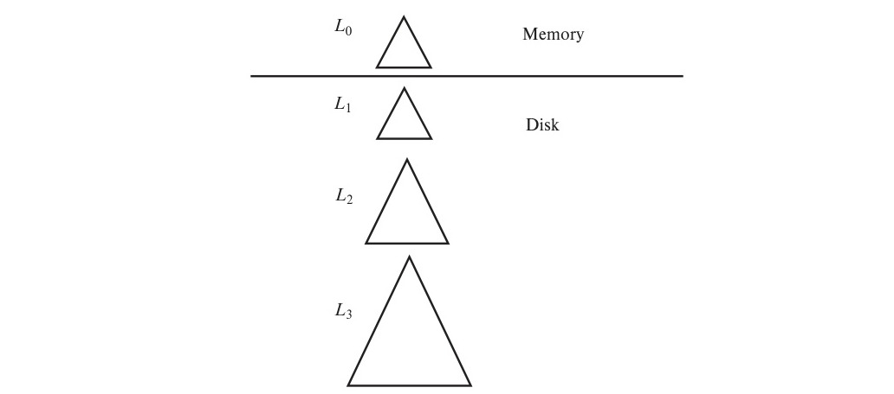
*Figure 24.1 — Log-structured merge tree with three levels.*

<!-- Page 1177 -->

### 24.2.1 Insertion into LSM Trees

When a record is first inserted into an LSM tree, it is inserted into the in-memory $\text{B}^+$-tree structure $L_0$. A fairly large amount of memory space is allocated for this tree. As the tree grows to fill the memory allocated to it, we need to move data from the in-memory structure to a $\text{B}^+$-tree on disk.

If tree $L_1$ is empty, the entire in-memory tree $L_0$ is written to disk to create the initial tree $L_1$. However, if $L_1$ is not empty, the leaf level of $L_0$ is scanned in increasing key order, and entries are merged with the leaf level entries of $L_1$ (also scanned in increasing key order). The merged entries are used to create a new $\text{B}^+$-tree using the bottom-up build process. The new tree with the merged entries then replaces the old $L_1$. In either case, after entries of $L_0$ have been moved to $L_1$, all entries in $L_0$ are deleted. Inserts can then be made to the now empty $L_0$.

Note that all entries in the leaf level of the old $L_1$ tree, including those in leaf nodes that do not have any updates, are copied to the new tree instead of being inserted into the existing $L_1$ tree node. This gives the following benefits:

- The leaves of the new tree are sequentially located, avoiding random I/O during subsequent merges.
- The leaves are full, avoiding the overhead of partially occupied leaves that can occur with page splits.

There is, however, a cost to using the LSM structure: the entire contents of the tree are copied each time a set of entries from $L_0$ are copied into $L_1$.

If the tree structure is implemented on top of a distributed file system (Section 21.6), copying data to a new tree is often unavoidable, since most distributed file systems do not support updates to an already created block.

To ensure we get a benefit for cases where the index size on disk is much bigger than the in-memory index, the maximum size of $L_1$ is chosen as $k$ times the target size of $L_0$, for some $k$. Similarly, the maximum size of each $L_{i+1}$ is set to $k$ times the target size of $L_i$. Once a particular $L_i$ reaches its maximum size, its entries are merged into the next component $L_{i+1}$. When $L_{i+1}$ reaches its target size, its entries are in turn merged into $L_{i+2}$, and so on.

Note that if each leaf of $L_i$ has $m$ entries, $m/k$ entries would map to a single leaf node of $L_{i+1}$. The value of $k$ is chosen to ensure that $m/k$ is some reasonable number, say 10. Let $M$ denote the size of $L_0$. Then, the size of a tree at level $L_i$ is $k^i M$. The total number of levels $r$ is thus roughly $\log_k(I/M)$ where $I$ is the total size of the index entries.

Let us now consider the number of I/O operations required with a multiple-level LSM tree. At each $L_i$, $m/k$ inserts are performed using only one I/O operation. On the other hand, each entry gets inserted once at each level $L_i$. Thus, the total number of I/O operations for each insert is $(k/m)\log_k(I/M)$. Thus, as long as the number of

<!-- Page 1178 -->

levels $r = \log_k(I/M)$ is less than $m/k$, the overall number of I/O operations per insert is reduced by using an LSM tree as compared to direct insertion into a $\text{B}^+$-tree.

If, for example, $r = 10$ and $k = 10$, the in-memory index needs to be greater than 1% of the total index size to get a benefit in terms of the number of I/O operations required for inserts. (As before, the benefit of reduced seeks is available even if the $L_0$ is significantly smaller.)

If the number of levels is greater than $m/k$, even if there is no benefit in terms of number of I/O operations, there can still be savings since sequential I/O is used instead of random I/O. In Section 24.2.4 we describe a variant of the LSM tree which further reduces the overhead on write operations, at the cost of adding overhead on read operations.

One way to avoid creating large LSM trees with many levels is to *range partition* the relation and create separate LSM trees on each partition. Such partitioning is natural in a parallel environment, as we saw earlier in Section 21.2. In particular, in such environments, a partition can be dynamically repartitioned into smaller pieces whenever it becomes too large, as we saw in Section 21.3.3. With such repartitioning, the size of each LSM tree can be kept small enough to avoid having a large number of levels. There is a price for such partitioning: each partition requires its own $L_0$ tree in memory. As a result, although it can be used in a centralized setting, the partitioning approach best fits a parallel environment where resources such as processing nodes can be added as the load increases.

### 24.2.2 Rolling Merges

We assumed for simplicity that when a particular level is full, its entries are entirely merged with the next level. This would result in more I/O load during merges with an unused I/O capacity between merges. To avoid this problem, merging is done on a continuous basis; this is called rolling merge.

With **rolling merge**, a few pages of $L_i$ are merged into corresponding pages of $L_{i+1}$ at a time, and removed from $L_i$. This is done whenever $L_i$ becomes close to its target size, and it results in $L_i$ shrinking a bit to return to its target size. When $L_i$ grows again, the rolling merge restarts from a point at the leaf level of $L_i$ just after where the earlier rolling merge stopped, so the scan is sequential. When the end of the $L_i$ tree is reached, the scan starts again at the beginning of the tree. Such a merge is called a rolling merge since records are moved from one level to another on a continuous basis.

The number of leaves merged at a time is kept high enough to ensure that the seek time is small compared to the time to transfer data from and to disk.

### 24.2.3 Handling Deletes and Updates

So far we have only described inserts and lookups. Deletes are handled in an interesting manner. Instead of directly finding an index entry and deleting it, deletion results in insertion of a new **deletion entry** that indicates which index entry is to be deleted. The

<!-- Page 1179 -->

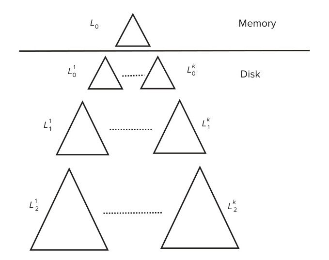
*Figure 24.2 — Stepped-merge index.*

process of inserting a deletion entry is identical to the process of inserting a normal index entry.

However, lookups have to carry out an extra step. As mentioned earlier, lookups retrieve entries from all the trees and merge them in sorted order of key value. If there is a deletion entry for some entry, both of them would have the same key value. Thus, a lookup would find both the deletion entry and the original entry for that key, which is to be deleted. If a deletion entry is found, the to-be-deleted entry should be filtered out and not returned as part of the lookup result.

When trees are merged, if one of the trees contains an entry, and the other had a matching deletion entry, the entries get matched up during the merge (both would have the same key), and are both discarded.

Updates are handled in a manner similar to deletes, by inserting an update entry. Lookups need to match update entries with the original entries and return the latest value. The update is actually applied during a merge, when one tree has an entry and another has its matching update entry; the update is applied during the merge, and the update entry is discarded.

### 24.2.4 The Stepped-Merge Index

We now consider a variant of the LSM tree, which has multiple trees at each level instead of one tree per level and performs inserts in a slightly different manner. This structure is shown in Figure 24.2. We call the structure a **stepped-merge index**, following the terminology in an early paper that introduced it. In the developer community, the basic LSM tree, the stepped-merge index, and several other variants are all referred to as LSM trees. We use the terms *stepped-merge index* and *basic LSM tree* to clearly identify which variant we are referring to.

<!-- Page 1180 -->

#### 24.2.4.1 Insertion Algorithm

In the stepped-merge index, incoming data are initially stored in memory, in an $L_0$ tree, in a manner similar to the LSM tree. However, when the tree reaches its maximum size, instead of merging it into an $L_1$ tree, the in-memory $L_0$ tree is written to disk. When the in-memory tree again reaches its maximum size, it is again written to disk. Thus, we may have multiple $L_0$ trees on disk, which we shall refer to as $L_0^1, L_0^2$ and so forth. Each of the $L_0^i$ trees is a $\text{B}^+$-tree and can be written to disk using only sequential I/O operations.

If this process is repeated, after a while we would have a large number of trees, each as large as memory, stored on disk. Lookups would then have to pay a high price, since they would have to search through each of the tree structures, incurring separate I/O costs on each search.

To limit the overhead on lookups, once the number of on-disk trees at a level $L_i$ reaches some limit $k$, all the trees at a level are merged together into one combined new tree structure at the next level $L_{i+1}$. The leaves of the trees at level $L_i$ are read sequentially, and the keys merged in sorted order, and the level $L_{i+1}$ tree is constructed using standard techniques for bottom-up construction of $\text{B}^+$-trees. As before, the merge operation avoids random I/O operations, since it reads the individual tree structures sequentially and writes the resultant merged tree also sequentially.

Once a set of trees are merged into a single new tree, future queries can search the merged tree; the original trees can then be deleted (after ensuring any ongoing searches have completed).

The benefit of the stepped-merge index scheme as compared to the basic LSM tree is that index entries are written out only once per level. With the basic LSM tree, each time a tree at level $L_i$ is merged into a tree at level $L_{i+1}$, the entire contents of the $L_{i+1}$ tree is read and written back to disk. Thus, on average, each record is read and written back $k/2$ times at each level of an LSM tree for a total of $k \log_k(I/M)$ I/O operations. In contrast, with stepped-merge index, each record is written to disk once per layer, and read again when merging into the next layer, for a total of approximately $2\log_k(I/M)$ I/O operations. Thus, the stepped-merge index incurs significantly less cost for updates.

The total number of bytes written (across all levels) on account of inserting an entry, divided by the size of entry, is called the **write amplification**. To calculate the write amplification of the LSM trees and the stepped-merge index, we can modify the above formulae for I/O operations by ignoring the reads. For a $\text{B}^+$-tree where each leaf gets on average only one update before it is written back, the write amplification would be the size of the page divided by the size of the index entry.

For a $\text{B}^+$-tree, if a page has 100 entries, the write amplification would be 100. With $k = 5$, and $I = 100M$, we would have $\log_5(100) = 3$ levels. The write amplification of an LSM tree would then be $5/2 \times 3 = 7.5$. The write amplification of the stepped-merge index would be 3. With $k = 10$, the tree would have $\log_{10}(100) = 2$ levels, leading to a write amplification of 2 for stepped-merge index, and 10 for an LSM tree.

<!-- Page 1181 -->

Note that like the basic LSM tree, the stepped-merge index also requires no random I/O operations during insertion, in contrast to a $\text{B}^+$-tree insertion. Thus, the performance of $\text{B}^+$-trees would be worse than what the write amplification number above indicates.

Merging can be optimized as follows: While merging $k$ trees at a particular level $L_i$, into a level $L_{i+1}$ tree, trees at levels $L_j, j < i$ can also be merged in at the same time. Entries in these trees can thus entirely skip one or more levels of the stepped-merge index. Further, if the system has idle capacity, trees at a level $L_i$ can be merged even if there are fewer than $k$ trees at that level. In a situation where there is a long period of time with very few inserts, and the system load is light, trees across all levels could potentially get merged into a single tree at some level $r$.

#### 24.2.4.2 Lookup Operations Using Bloom Filters

Lookup operations in stepped-merge index have to separately search each of the trees. Thus, compared to the basic LSM scheme, the stepped-merge index increases the burden on lookups, since in the worst case lookups need to access $k$ trees at each level, leading to a total of $k * \log_k(I/M)$ tree lookups, instead of $\log_k(I/M)$ tree lookups in the worst case with a basic LSM tree.

For workloads with a significant fraction of reads, this overhead can be unacceptable. For example, with the stepped-merge index with $I = 100M$ and $k = 5$, a single lookup requires 15 tree traversals, while the LSM tree would require 3 tree traversals. Note that for the common case where each key value occurs in only one tree, only one of the traversals would find a given search key, while all the other traversals would fail to find the key.

To reduce the cost of point lookups (i.e., lookups of a given key value), most systems use a Bloom filter to check if a tree can possibly contain the given key value. One Bloom filter is associated with each tree, and it is built on the set of key values in the tree. To check if a particular tree may contain a search key $v$, the key $v$ is looked up in the Bloom filter. If the Bloom filter indicates that the key value is absent, it is definitely not present in the tree, and lookup can skip that tree. Otherwise, the key value may be present in the tree, which must be looked up.

A Bloom filter with $10n$ bits, where the tree has $n$ elements, and using 7 hash functions would give a false positive rate of 1 percent. Thus, for a lookup on a key that is present in the index, on average just slightly more than one tree would be accessed. Thus, lookup performance would be only slightly worse than on a regular $\text{B}^+$-tree.

The Bloom filter check thus works very well for point lookups, allowing a significant fraction of the trees to be skipped, as long as sufficient memory is available to store all the Bloom filters in memory. With $I$ key values in the index, approximately $10I$ bits of memory will be required. To reduce the main memory overhead, some of the Bloom filters may be stored on flash storage.

Note that for range lookups, the Bloom filter optimization cannot be used, since there is no unique hash value. Instead, all trees must be accessed separately.

<!-- Page 1182 -->

### 24.2.5 LSM Trees For Flash Storage

LSM trees were initially designed to reduce the write and seek overheads of hard disks. Flash disks have a relatively low overhead for random I/O operations since they do not require seek, and thus the benefit of avoiding random I/O that LSM tree variants provide is not particularly important with flash disks.

However, recall that flash memory does not allow in-place update, and writing even a single byte to a page requires the whole page to be rewritten to a new physical location; the original location of the page needs to be erased eventually, which is a relatively expensive operation. The reduction in write amplification using LSM tree variants, as compared to traditional $\text{B}^+$-trees, can provide substantial performance benefits when LSM trees are used with flash storage.

## 24.3 Bitmap Indices

As we saw in Section 14.9, a bitmap index is a specialized type of index designed for easy querying on multiple keys. Bitmaps work best for attributes that take only a small number of distinct values.

For bitmap indices to be used, records in a relation must be numbered sequentially, starting from, say, 0. Given a number $n$, it must be easy to retrieve the record numbered $n$. This is particularly easy to achieve if records are fixed in size and allocated on consecutive blocks of a file. The record number can then be translated easily into a block number and a number that identifies the record within the block.

Recall that *column-oriented storage*, described in Section 13.6, stores attributes in arrays, allowing efficient access of the attribute of the $i$th record, for any given $i$. Bitmap indices are thus particularly useful with columnar storage.

We use as a running example a relation *instructor_info*, which has an attribute *gender*, which can take only values $\text{m}$ (male) or $\text{f}$ (female), and an attribute *income_level*, where income has been broken up into 5 levels: $L1$: 0–9999, $L2$: 10,000–19,999, $L3$: 20,000–39,999, $L4$: 40,000–74,999, and $L5$: $75,000 - \infty$.

### 24.3.1 Bitmap Index Structure

As we saw in Section 14.9, a **bitmap** is simply an array of bits. In its simplest form, a **bitmap index** on the attribute $A$ of relation $r$ consists of one bitmap for each value that $A$ can take. Each bitmap has as many bits as the number of records in the relation. The $i$th bit of the bitmap for value $v_j$ is set to 1 if the record numbered $i$ has the value $v_j$ for attribute $A$. All other bits of the bitmap are set to 0.

In our example, there is one bitmap for the value $\text{m}$ and one for $\text{f}$. The $i$th bit of the bitmap for $\text{m}$ is set to 1 if the *gender* value of the record numbered $i$ is $\text{m}$. All other bits of the bitmap for $\text{m}$ are set to 0. Similarly, the bitmap for $\text{f}$ has the value 1 for bits corresponding to records with the value $\text{f}$ for the *gender* attribute; all other bits have

<!-- Page 1183 -->

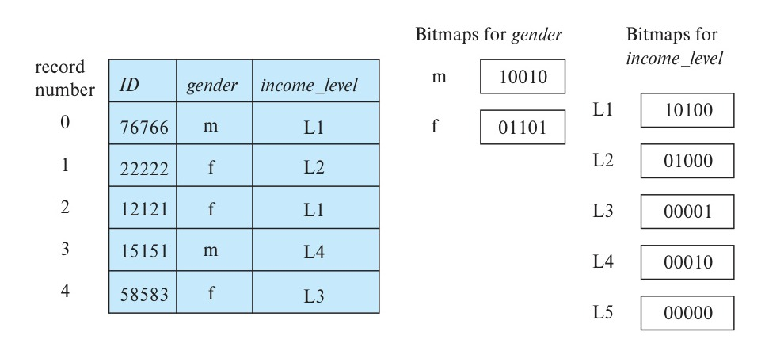
*Figure 24.3 — Bitmap indices on relation instructor_info.*

the value 0. Figure 24.3 shows an example of bitmap indices on a relation *instructor_info*.

We now consider when bitmaps are useful. The simplest way of retrieving all records with value $\text{m}$ (or value $\text{f}$) would be to simply read all records of the relation and select those records with value $\text{m}$ (or $\text{f}$, respectively). The bitmap index doesn’t really help to speed up such a selection. While it would allow us to read only those records for a specific gender, it is likely that every disk block for the file would have to be read anyway.

In fact, bitmap indices are useful for selections mainly when there are selections on multiple keys. Suppose we create a bitmap index on attribute *income_level*, which we described earlier, in addition to the bitmap index on *gender*.

Consider now a query that selects women with income in the range \$10,000 to \$19,999. This query can be expressed as

```sql
select *
from instructor_info
where gender = 'f' and income_level = 'L2';
```

To evaluate this selection, we fetch the bitmaps for *gender* value $\text{f}$ and the bitmap for *income_level* value $L2$ and perform an **intersection** (logical-and) of the two bitmaps. In other words, we compute a new bitmap where bit $i$ has value 1 if the $i$th bit of the two bitmaps are both 1 and has a value 0 otherwise. In the example in Figure 24.3, the intersection of the bitmap for *gender* = $\text{f}$ (01101) and the bitmap for *income_level* = $L2$ (01000) gives the bitmap 01000.

Since the first attribute can take two values, and the second can take five values, we would expect only about 1 in 10 records, on an average, to satisfy a combined condition on the two attributes. If there are further conditions, the fraction of records satisfying all the conditions is likely to be quite small. The system can then compute the query result by finding all bits with value 1 in the intersection bitmap and retrieving the cor-

<!-- Page 1184 -->

responding records. If the fraction is large, scanning the entire relation would remain the cheaper alternative.

Another important use of bitmaps is to count the number of tuples satisfying a given selection. Such queries are important for data analysis. For instance, if we wish to find out how many women have an income level $L2$, we compute the intersection of the two bitmaps and then count the number of bits that are 1 in the intersection bitmap. We can thus get the desired result from the bitmap index, without even accessing the relation.

Bitmap indices are generally quite small compared to the actual relation size. Records are typically at least tens of bytes to hundreds of bytes long, whereas a single bit represents the record in a bitmap. Thus, the space occupied by a single bitmap is usually less than 1 percent of the space occupied by the relation. For instance, if the record size for a given relation is 100 bytes, then the space occupied by a single bitmap will be $\frac{1}{8}$ of 1 percent of the space occupied by the relation. If an attribute $A$ of the relation can take on only one of eight values, a bitmap index on attribute $A$ would consist of eight bitmaps, which together occupy only 1 percent of the size of the relation.

Deletion of records creates gaps in the sequence of records, since shifting records (or record numbers) to fill gaps would be extremely expensive. To recognize deleted records, we can store an **existence bitmap**, in which bit $i$ is 0 if record $i$ does not exist and 1 otherwise. We shall see the need for existence bitmaps in Section 24.3.2. Insertion of records should not affect the sequence numbering of other records. Therefore, we can do insertion either by appending records to the end of the file or by replacing deleted records.

### 24.3.2 Efficient Implementation of Bitmap Operations

We can compute the intersection of two bitmaps easily by using a **for** loop: the $i$th iteration of the loop computes the **and** of the $i$th bits of the two bitmaps. We can speed up computation of the intersection greatly by using bit-wise **and** instructions supported by most computer instruction sets. A *word* usually consists of 32 or 64 bits, depending on the architecture of the computer. A bit-wise **and** instruction takes two words as input and outputs a word where each bit is the logical **and** of the bits in corresponding positions of the input words. What is important to note is that a single bit-wise **and** instruction can compute the intersection of 32 or 64 bits *at once*.

If a relation had 1 million records, each bitmap would contain 1 million bits, or equivalently 128 kilobytes. Only 31,250 instructions are needed to compute the intersection of two bitmaps for our relation, assuming a 32-bit word length. Thus, computing bitmap intersections is an extremely fast operation.

Just as bitmap intersection is useful for computing the **and** of two conditions, bitmap union is useful for computing the **or** of two conditions. The procedure for bitmap union is exactly the same as for intersection, except we use bit-wise **or** instructions instead of bit-wise **and** instructions.

<!-- Page 1185 -->

The complement operation can be used to compute a predicate involving the negation of a condition, such as **not** (*income_level* = $L1$). The complement of a bitmap is generated by complementing every bit of the bitmap (the complement of 1 is 0 and the complement of 0 is 1). It may appear that **not** (*income_level* = $L1$) can be implemented by just computing the complement of the bitmap for income level $L1$. If some records have been deleted, however, just computing the complement of a bitmap is not sufficient. Bits corresponding to such records would be 0 in the original bitmap but would become 1 in the complement, although the records don’t exist. A similar problem also arises when the value of an attribute is *null*. For instance, if the value of *income_level* is null, the bit would be 0 in the original bitmap for value $L1$ and 1 in the complement bitmap.

To make sure that the bits corresponding to deleted records are set to 0 in the result, the complement bitmap must be intersected with the existence bitmap to turn off the bits for deleted records. Similarly, to handle null values, the complement bitmap must also be intersected with the complement of the bitmap for the value *null*.[^1]

Counting the number of bits that are 1 in a bitmap can be done quickly by a clever technique. We can maintain an array with 256 entries, where the $i$th entry stores the number of bits that are 1 in the binary representation of $i$. Set the total count initially to 0. We take each byte of the bitmap, use it to index into this array, and add the stored count to the total count. The number of addition operations is $\frac{1}{8}$ of the number of tuples, and thus the counting process is very efficient. A large array (using $2^{16} = 65,536$ entries), indexed by pairs of bytes, would give even higher speedup, but at a higher storage cost.

### 24.3.3 Bitmaps and $\text{B}^+$-Trees

Bitmaps can be combined with regular $\text{B}^+$-tree indices for relations where a few attribute values are extremely common, and other values also occur, but much less frequently. In a $\text{B}^+$-tree index leaf, for each value we would normally maintain a list of all records with that value for the indexed attribute. Each element of the list would be a record identifier, consisting of at least 32 bits, and usually more. For a value that occurs in many records, we store a bitmap instead of a list of records.

Suppose a particular value $v_i$ occurs in $\frac{1}{16}$ of the records of a relation. Let $N$ be the number of records in the relation, and assume that a record has a 64-bit number identifying it. The bitmap needs only 1 bit per record, or $N$ bits in total. In contrast, the list representation requires 64 bits per record where the value occurs, or $64 * N/16 = 4N$ bits. Thus, a bitmap is preferable for representing the list of records for value $v_i$. In our example (with a 64-bit record identifier), if fewer than 1 in 64 records have a particular value, the list representation is preferable for identifying records with that

[^1]: Handling predicates such as **is unknown** would cause further complications, which would in general require use of an extra bitmap to track which operation results are unknown.

<!-- Page 1186 -->

value, since it uses fewer bits than the bitmap representation. If more than 1 in 64 records have that value, the bitmap representation is preferable.

Thus, bitmaps can be used as a compressed storage mechanism at the leaf nodes of $\text{B}^+$-trees for those values that occur very frequently.

## 24.4 Indexing of Spatial Data

As we saw in Section 14.10.1, indices are required for efficient access to spatial data, and such indices must efficiently support queries such as range and nearest neighbor queries. We also gave a brief overview of k-d trees, quadtrees, and R-trees; we also briefly described how to answer range queries using k-d trees. In this section we provide further details of quadtrees and R-trees.

As mentioned in Section 14.10.1, in addition to indexing of points, spatial indices must also support indexing of regions of space such as line segments, rectangles, and other polygons. There are extensions of k-d trees and quadtrees for this task. However, a line segment or polygon may cross a partitioning line. If it does, it has to be split and represented in each of the subtrees in which its pieces occur. Multiple occurrences of a line segment or polygon caused by such splits can result in inefficiencies in storage, as well as inefficiencies in querying. R-trees were developed to support efficient indexing of such structures.

### 24.4.1 Quadtrees

An alternative representation for two-dimensional data are a **quadtree**. An example of the division of space by a quadtree appears in Figure 24.4. Each node of a quadtree is

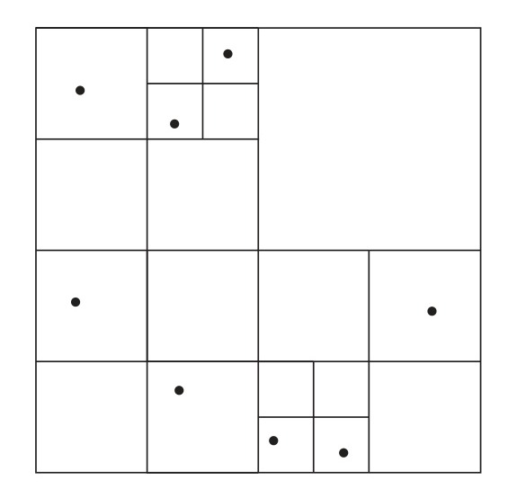
*Figure 24.4 — Division of space by a quadtree.*

<!-- Page 1187 -->

associated with a rectangular region of space. The top node is associated with the entire target space. Each nonleaf node in a quadtree divides its region into four equal-sized quadrants, and correspondingly each such node has four child nodes corresponding to the four quadrants. Leaf nodes have between zero and some fixed maximum number of points. Correspondingly, if the region corresponding to a node has more than the maximum number of points, child nodes are created for that node. In the example in Figure 24.4, the maximum number of points in a leaf node is set to 1.

This type of quadtree is called a **PR quadtree**, to indicate it stores points, and that the division of space is divided based on regions, rather than on the actual set of points stored. We can use **region quadtrees** to store array (raster) information. A node in a region quadtree is a leaf node if all the array values in the region that it covers are the same. Otherwise, it is subdivided further into four children of equal area and is therefore an internal node. Each node in the region quadtree corresponds to a subarray of values. The subarrays corresponding to leaves either contain just a single array element or have multiple array elements, all of which have the same value.

### 24.4.2 R-Trees

A storage structure called an **R-tree** is useful for indexing of objects such as points, line segments, rectangles, and other polygons. An R-tree is a balanced tree structure with the indexed objects stored in leaf nodes, much like a $\text{B}^+$-tree. However, instead of a range of values, a rectangular **bounding box** is associated with each tree node. The bounding box of a leaf node is the smallest rectangle parallel to the axes that contains all objects stored in the leaf node. The bounding box of internal nodes is, similarly, the smallest rectangle parallel to the axes that contains the bounding boxes of its child nodes. The bounding box of an object (such as a polygon) is defined, similarly, as the smallest rectangle parallel to the axes that contains the object.

Each internal node stores the bounding boxes of the child nodes along with the pointers to the child nodes. Each leaf node stores the indexed objects and may optionally store the bounding boxes of the objects; the bounding boxes help speed up checks for overlaps of the rectangle with the indexed objects—if a query rectangle does not overlap with the bounding box of an object, it cannot overlap with the object, either. (If the indexed objects are rectangles, there is no need to store bounding boxes, since they are identical to the rectangles.)

Figure 24.5 shows an example of a set of rectangles (drawn with a solid line) and the bounding boxes (drawn with a dashed line) of the nodes of an R-tree for the set of rectangles. Note that the bounding boxes are shown with extra space inside them, to make them stand out pictorially. In reality, the boxes would be smaller and fit tightly on the objects that they contain; that is, each side of a bounding box $B$ would touch at least one of the objects or bounding boxes that are contained in $B$.

The R-tree itself is at the right side of Figure 24.5. The figure refers to the coordinates of bounding box $i$ as $BB_i$ in the figure.

<!-- Page 1188 -->

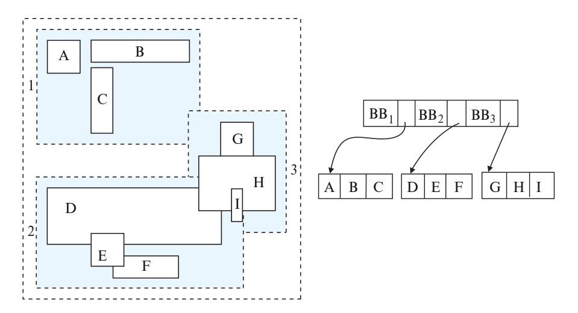
*Figure 24.5 — An R-tree.*

We shall now see how to implement search, insert, and delete operations on an R-tree.

- **Search.** As the figure shows, the bounding boxes associated with sibling nodes may overlap; in $\text{B}^+$-trees, k-d trees, and quadtrees, in contrast, the ranges do not overlap. A search for objects containing a point therefore has to follow *all* child nodes whose associated bounding boxes contain the point; as a result, multiple paths may have to be searched. Similarly, a query to find all objects that intersect a given object has to go down every node where the associated rectangle intersects the given object.

- **Insert.** When we insert an object into an R-tree, we select a leaf node to hold the object. Ideally we should pick a leaf node that has space to hold a new entry, and whose bounding box contains the bounding box of the object. However, such a node may not exist; even if it did, finding the node may be very expensive, since it is not possible to find it by a single traversal down from the root. At each internal node we may find multiple children whose bounding boxes contain the bounding box of the object, and each of these children needs to be explored. Therefore, as a heuristic, in a traversal from the root, if any of the child nodes has a bounding box containing the bounding box of the object, the R-tree algorithm chooses one of them arbitrarily. If none of the children satisfy this condition, the algorithm chooses a child node whose bounding box has the maximum overlap with the bounding box of the object for continuing the traversal.

  Once the leaf node has been reached, if the node is already full, the algorithm performs node splitting (and propagates splitting upward if required) in a manner very similar to $\text{B}^+$-tree insertion. Just as with $\text{B}^+$-tree insertion, the R-tree insertion algorithm ensures that the tree remains balanced. Additionally, it ensures that the

<!-- Page 1189 -->

bounding boxes of leaf nodes, as well as internal nodes, remain consistent; that is, bounding boxes of leaves contain all the bounding boxes of the objects stored at the leaf, while the bounding boxes for internal nodes contain all the bounding boxes of the children nodes.

The main difference of the insertion procedure from the $\text{B}^+$-tree insertion procedure lies in how the node is split. In a $\text{B}^+$-tree, it is possible to find a value such that half the entries are less than the midpoint and half are greater than the value. This property does not generalize beyond one dimension; that is, for more than one dimension, it is not always possible to split the entries into two sets so that their bounding boxes do not overlap. Instead, as a heuristic, the set of entries $S$ can be split into two disjoint sets $S_1$ and $S_2$ so that the bounding boxes of $S_1$ and $S_2$ have the minimum total area; another heuristic would be to split the entries into two sets $S_1$ and $S_2$ in such a way that $S_1$ and $S_2$ have minimum overlap. The two nodes resulting from the split would contain the entries in $S_1$ and $S_2$, respectively. The cost of finding splits with minimum total area or overlap can itself be large, so cheaper heuristics, such as the *quadratic split* heuristic, are used. (The heuristic gets its name from the fact that it takes time quadratic in the number of entries.)

The **quadratic split** heuristic works this way: First, it picks a pair of entries $a$ and $b$ from $S$ such that putting them in the same node would result in a bounding box with the maximum wasted space; that is, the area of the minimum bounding box of $a$ and $b$ minus the sum of the areas of $a$ and $b$ is the largest. The heuristic places the entries $a$ and $b$ in sets $S_1$ and $S_2$, respectively.

It then iteratively adds the remaining entries, one entry per iteration, to one of the two sets $S_1$ or $S_2$. At each iteration, for each remaining entry $e$, let $i_{e,1}$ denote the increase in the size of the bounding box of $S_1$ if $e$ is added to $S_1$ and let $i_{e,2}$ denote the corresponding increase for $S_2$. In each iteration, the heuristic chooses one of the entries with the maximum difference of $i_{e,1}$ and $i_{e,2}$ and adds it to $S_1$ if $i_{e,1}$ is less than $i_{e,2}$, and to $S_2$ otherwise. That is, an entry with “maximum preference” for $S_1$ or $S_2$ is chosen at each iteration. The iteration stops when all entries have been assigned, or when one of the sets $S_1$ or $S_2$ has enough entries that all remaining entries have to be added to the other set so the nodes constructed from $S_1$ and $S_2$ both have the required minimum occupancy. The heuristic then adds all unassigned entries to the set with fewer entries.

- **Deletion.** Deletion can be performed like a $\text{B}^+$-tree deletion, borrowing entries from sibling nodes, or merging sibling nodes if a node becomes underfull. An alternative approach redistributes all the entries of underfull nodes to sibling nodes, with the aim of improving the clustering of entries in the R-tree.

See the bibliographical references for more details on insertion and deletion operations on R-trees, as well as on variants of R-trees, called $\text{R}^*$-trees or $\text{R}^+$-trees.

The storage efficiency of R-trees is better than that of k-d trees or quadtrees, since an object is stored only once, and we can ensure easily that each node is at least half

<!-- Page 1190 -->

full. However, querying may be slower, since multiple paths have to be searched. Spatial joins are simpler with quadtrees than with R-trees, since all quadtrees on a region are partitioned in the same manner. However, because of their better storage efficiency and their similarity to B-trees, R-trees and their variants have proved popular in database systems that support spatial data.

## 24.5 Hash Indices

We described the concepts of hashing and hash indices in Section 14.5. We provide further details in this section.

### 24.5.1 Static Hashing

As in Section 14.5, let $K$ denote the set of all search-key values, and let $B$ denote the set of all bucket addresses. A hash function $h$ is a function from $K$ to $B$. Let $h$ denote a hash function. Recall that in a hash index, buckets contain index entries, with pointers to records, while in a hash file organization, actual records are stored in the buckets. All the other details remain the same, so we do not explicitly differentiate between these two versions henceforth. We use the term *hash index* to denote hash file organizations as well as secondary hash indices.

Figure 24.6 shows a secondary hash index on the *instructor* file, for the search key *ID*. The hash function in the figure computes the sum of the digits of the *ID* modulo 8. The hash index has eight buckets, each of size 2 (realistic indices would have much larger bucket sizes). One of the buckets has three keys mapped to it, so it has an overflow bucket. In this example, *ID* is a primary key for *instructor*, so each search key has only one associated pointer. In general, multiple pointers can be associated with each key.

Hash indices can efficiently answer *point queries*, which retrieve records with a specified value for a search key. However, they cannot efficiently answer *range queries*, which retrieve all records whose search key value lies in a range $(lb, ub)$. The difficulty arises because a good hash function assigns values randomly to buckets. Thus, there is no simple notion of “next bucket in sorted order.” The reason we cannot chain buckets together in sorted order on $A_i$ is that each bucket is assigned many search-key values. Since values are scattered randomly by the hash function, the values in the specified range are likely to be scattered across many or all of the buckets. Therefore, we have to read all the buckets to find the required search keys.

Recall that deletion is done as follows: If the search-key value of the record to be deleted is $K_i$, we compute $h(K_i)$, then search the corresponding bucket for that record, and delete the record from the bucket. Deletion of a record is efficient if there are not many records with a given key value. However, in the case of a hash index on a key with many duplicates, a large number of entries with the same key value may have to be scanned to find the entry for the record that is to be deleted. The complexity can in the worst case be linear in the number of records.

<!-- Page 1191 -->

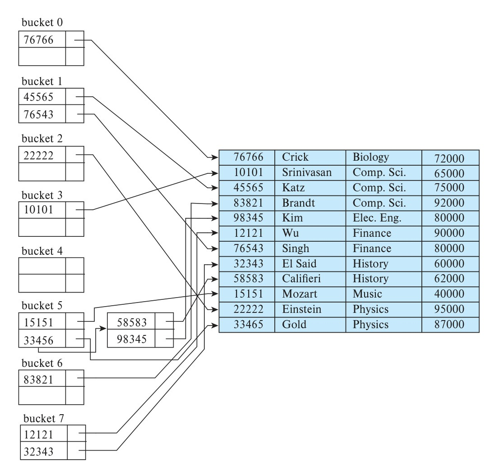
*Figure 24.6 — Hash index on search key ID of instructor file.*

Recall also that with static hashing, the set of buckets is fixed at the time the index is created. If the relation grows far beyond the expected size, hash indices would be quite inefficient due to long overflow chains. We could rebuild the hash index using a larger number of buckets. Such rebuilding can be triggered when the number of records exceeds the estimated number by some margin, and the index is rebuilt with a number of buckets that is a multiple of the original number of buckets (say by a factor of 1.5 to 2). Such rebuilding is in fact done in many systems with in-memory hash indices.

However, doing so can cause significant disruption to normal processing with large relations, since a large number of records have to be reindexed; the disruption is particularly marked with disk-resident data. In this section we discuss dynamic hashing techniques that allow hash indices to grow gradually, without causing disruption.

<!-- Page 1192 -->

#### 24.5.1.1 Hash Functions

The worst possible hash function maps all search-key values to the same bucket. Such a function is undesirable because all the records have to be kept in the same bucket. A lookup has to examine every such record to find the one desired. An ideal hash function distributes the stored keys uniformly across all the buckets, so that every bucket has the same number of records.

Since we do not know at design time precisely which search-key values will be stored in the file, we want to choose a hash function that assigns search-key values to buckets in such a way that the distribution has these qualities:

- **The distribution is uniform.** That is, the hash function assigns each bucket the same number of search-key values from the set of all possible search-key values.
- **The distribution is random.** That is, in the average case, each bucket will have nearly the same number of values assigned to it, regardless of the actual distribution of search-key values. More precisely, the hash value will not be correlated to any externally visible ordering on the search-key values, such as alphabetic ordering or ordering by the length of the search keys; the hash function will appear to be random.

As an illustration of these principles, let us choose a hash function for the *instructor* file using the search key *dept_name*. The hash function that we choose must have the desirable properties not only on the example *instructor* file that we have been using, but also on an *instructor* file of realistic size for a large university with many departments.

Assume that we decide to have 26 buckets, and we define a hash function that maps names beginning with the $i$th letter of the alphabet to the $i$th bucket. This hash function has the virtue of simplicity, but it fails to provide a uniform distribution, since we expect more names to begin with such letters as B and R than Q and X, for example.

Now suppose that we want a hash function on the search key *salary*. Suppose that the minimum salary is \$30,000 and the maximum salary is \$130,000, and we use a hash function that divides the values into 10 ranges, \$30,000–\$40,000, \$40,001–\$50,000, and so on. The distribution of search-key values is uniform (since each bucket has the same number of different salary values) but is not random. Records with salaries between \$60,001 and \$70,000 are far more common than are records with salaries between \$30,001 and \$40,000. As a result, the distribution of records is not uniform—some buckets receive more records than others do. If the function has a random distribution, even if there are such correlations in the search keys, the randomness of the distribution will make it very likely that all buckets will have roughly the same number of records, as long as each search key occurs in only a small fraction of the records. (If a single search key occurs in a large fraction of the records, the bucket containing it is likely to have more records than other buckets, regardless of the hash function used.)

<!-- Page 1193 -->


*Figure 24.7 — Hash organization of instructor file, with dept_name as the key.*

Typical hash functions perform computation on the internal binary machine representation of characters in the search key. A simple hash function of this type first computes the sum of the binary representations of the characters of a key, then returns the sum modulo the number of buckets.

Figure 24.7 shows the application of such a scheme, with eight buckets, to the *instructor* file, under the assumption that the $i$th letter in the alphabet is represented by the integer $i$.

The following hash function is a better alternative for hashing strings. Let $s$ be a string of length $n$, and let $s[i]$ denote the $i$th byte of the string. The hash function is defined as:

$$s[0] * 31^{(n-1)} + s[1] * 31^{(n-2)} + \dots + s[n - 1]$$

The function can be implemented efficiently by setting the hash result initially to 0 and iterating from the first to the last character of the string, at each step multiplying the hash value by 31 and then adding the next character (treated as an integer). The above expression would appear to result in a very large number, but it is actually computed with fixed-size positive integers; the result of each multiplication and addition is thus automatically computed modulo the largest possible integer value plus 1. The result of the above function modulo the number of buckets can then be used for indexing.

<!-- Page 1194 -->

Hash functions require careful design. A bad hash function may result in lookup taking time proportional to the number of search keys in the file. A well-designed function gives an average-case lookup time that is a (small) constant, independent of the number of search keys in the file.

#### 24.5.1.2 Handling of Bucket Overflows

So far, we have assumed that, when a record is inserted, the bucket to which it is mapped has space to store the record. If the bucket does not have enough space, a **bucket overflow** is said to occur. Bucket overflow can occur for several reasons, as we outlined in Section 14.5.

- **Insufficient buckets.** The number of buckets, which we denote $n_B$, must be chosen such that $n_B > n_r/f_r$, where $n_r$ denotes the total number of records that will be stored and $f_r$ denotes the number of records that will fit in a bucket. This designation assumes that the total number of records is known when the hash function is chosen.
- **Skew.** Some buckets are assigned more records than are others, so a bucket may overflow even when other buckets still have space. This situation is called **bucket skew**. Skew can occur for two reasons:
  1. Multiple records may have the same search key.
  2. The chosen hash function may result in nonuniform distribution of search keys.

So that the probability of bucket overflow is reduced, the number of buckets is chosen to be $(n_r/f_r) * (1 + d)$, where $d$ is a fudge factor, typically around 0.2. Some space is wasted: About 20 percent of the space in the buckets will be empty. But the benefit is that the probability of overflow is reduced.

Despite allocation of a few more buckets than required, bucket overflow can still occur. As we saw in Section 14.5, we handle bucket overflow by using overflow buckets. We must also change the lookup algorithm slightly to handle overflow chaining, to look at the overflow buckets in addition to the main bucket.

The form of hash structure that we have just described is called **closed addressing** (or, less commonly, **closed hashing**). Under an alternative approach called **open addressing** (or, less commonly, **open hashing**), the set of buckets is fixed, and there are no overflow chains. Instead, if a bucket is full, the system inserts records in some other bucket in the initial set of buckets $B$. One policy is to use the next bucket (in cyclic order) that has space; this policy is called *linear probing*. Other policies, such as computing further hash functions, are also used. Open addressing has been used to construct symbol tables for compilers and assemblers, but closed addressing is preferable for database systems. The reason is that deletion under open addressing is troublesome. Usually, compilers and assemblers perform only lookup and insertion operations on

<!-- Page 1195 -->

their symbol tables. However, in a database system, it is important to be able to handle deletion as well as insertion. Thus, open addressing is of only minor importance in database implementation.

An important drawback to the form of hashing that we have described is that we must choose the hash function when we implement the system, and it cannot be changed easily thereafter if the file being indexed grows or shrinks. Since the function $h$ maps search-key values to a fixed set $B$ of bucket addresses, we waste space if $B$ is made large to handle future growth of the file. If $B$ is too small, the buckets contain records of many different search-key values, and bucket overflows can occur. As the file grows, performance suffers. We study in Section 24.5.2 how the number of buckets and the hash function can be changed dynamically.

### 24.5.2 Dynamic Hashing

As we have seen, the need to fix the set $B$ of bucket addresses presents a serious problem with the static hashing technique of the previous section. Most databases grow larger over time. If we are to use static hashing for such a database, we have three classes of options:

1. Choose a hash function based on the current file size. This option will result in performance degradation as the database grows.
2. Choose a hash function based on the anticipated size of the file at some point in the future. Although performance degradation is avoided, a significant amount of space may be wasted initially.
3. Periodically reorganize the hash structure in response to file growth. Such a reorganization involves choosing a new hash function, recomputing the hash function on every record in the file, and generating new bucket assignments. This reorganization is a massive, time-consuming operation. Furthermore, it is necessary to forbid access to the file during reorganization.

Several **dynamic hashing** techniques allow the hash function to be modified dynamically to accommodate the growth or shrinkage of the database. In this section we describe one form of dynamic hashing, called **extendable hashing**. The bibliographical notes provide references to other forms of dynamic hashing.

#### 24.5.2.1 Data Structure

Extendable hashing copes with changes in database size by splitting and coalescing buckets as the database grows and shrinks. As a result, space efficiency is retained. Moreover, since the reorganization is performed on only one bucket at a time, the resulting performance overhead is acceptably low.

<!-- Page 1196 -->


*Figure 24.8 — General extendable hash structure.*

With extendable hashing, we choose a hash function $h$ with the desirable properties of uniformity and randomness. However, this hash function generates values over a relatively large range—namely, $b$-bit binary integers. A typical value for $b$ is 32.

We do not create a bucket for each hash value. Indeed, $2^{32}$ is over 4 billion, and that many buckets is unreasonable for all but the largest databases. Instead, we create buckets on demand, as records are inserted into the file. We do not use the entire $b$ bits of the hash value initially. At any point, we use $i$ bits, where $0 \le i \le b$. These $i$ bits are used as an offset into an additional table of bucket addresses. The value of $i$ grows and shrinks with the size of the database.

Figure 24.8 shows a general extendable hash structure. The $i$ appearing above the bucket address table in the figure indicates that $i$ bits of the hash value $h(K)$ are required to determine the correct bucket for $K$. This number will change as the file grows. Although $i$ bits are required to find the correct entry in the bucket address table, several consecutive table entries may point to the same bucket. All such entries will have a common hash prefix, but the length of this prefix may be less than $i$. Therefore, we associate with each bucket an integer giving the length of the common hash prefix. In Figure 24.8 the integer associated with bucket $j$ is shown as $i_j$. The number of bucket-address-table entries that point to bucket $j$ is

$$2^{(i - i_j)}$$

<!-- Page 1197 -->

#### 24.5.2.2 Queries and Updates

We now see how to perform lookup, insertion, and deletion on an extendable hash structure.

To locate the bucket containing search-key value $K_l$, the system takes the first $i$ high-order bits of $h(K_l)$, looks at the corresponding table entry for this bit string, and follows the bucket pointer in the table entry.

To insert a record with search-key value $K_l$, the system follows the same procedure for lookup as before, ending up in some bucket—say, $j$. If there is room in the bucket, the system inserts the record in the bucket. If, on the other hand, the bucket is full, it must split the bucket and redistribute the current records, plus the new one. To split the bucket, the system must first determine from the hash value whether it needs to increase the number of bits that it uses.

- If $i = i_j$, only one entry in the bucket address table points to bucket $j$. Therefore, the system needs to increase the size of the bucket address table so that it can include pointers to the two buckets that result from splitting bucket $j$. It does so by considering an additional bit of the hash value. It increments the value of $i$ by 1, thus doubling the size of the bucket address table. It replaces each entry with two entries, both of which contain the same pointer as the original entry. Now two entries in the bucket address table point to bucket $j$. The system allocates a new bucket (bucket $z$) and sets the second entry to point to the new bucket. It sets $i_j$ and $i_z$ to $i$. Next, it rehashes each record in bucket $j$ and, depending on the first $i$ bits (remember the system has added 1 to $i$), either keeps it in bucket $j$ or allocates it to the newly created bucket.

  The system now reattempts the insertion of the new record. Usually, the attempt will succeed. However, if all the records in bucket $j$, as well as the new record, have the same hash-value prefix, it will be necessary to split a bucket again, since all the records in bucket $j$ and the new record are assigned to the same bucket. If the hash function has been chosen carefully, it is unlikely that a single insertion will require that a bucket be split more than once, unless there are a large number of records with the same search key. If all the records in bucket $j$ have the same search-key value, no amount of splitting will help. In such cases, overflow buckets are used to store the records, as in static hashing.

- If $i > i_j$, then more than one entry in the bucket address table points to bucket $j$. Thus, the system can split bucket $j$ without increasing the size of the bucket address table. Observe that all the entries that point to bucket $j$ correspond to hash prefixes that have the same value on the leftmost $i_j$ bits. The system allocates a new bucket (bucket $z$), and sets $i_j$ and $i_z$ to the value that results from adding 1 to the original $i_j$ value. Next, the system needs to adjust the entries in the bucket address table that previously pointed to bucket $j$. (Note that with the new value for $i_j$, not all the entries correspond to hash prefixes that have the same value on the leftmost $i_j$ bits.) The system leaves the first half of the entries as they were (pointing to bucket

<!-- Page 1198 -->

$j$), and sets all the remaining entries to point to the newly created bucket (bucket $z$). Next, as in the previous case, the system rehashes each record in bucket $j$, and allocates it either to bucket $j$ or to the newly created bucket $z$.

The system then reattempts the insert. In the unlikely case that it again fails, it applies one of the two cases, $i = i_j$ or $i > i_j$, as appropriate.

Note that, in both cases, the system needs to recompute the hash function on only the records in bucket $j$.

To delete a record with search-key value $K_l$, the system follows the same procedure for lookup as before, ending up in some bucket—say, $j$. It removes both the search key from the bucket and the record from the file. The bucket, too, is removed if it becomes empty. Note that, at this point, several buckets can be coalesced, and the size of the bucket address table can be cut in half. The procedure for deciding on which buckets can be coalesced and how to coalesce buckets is left to you to do as an exercise. The conditions under which the bucket address table can be reduced in size are also left to you as an exercise. Unlike coalescing of buckets, changing the size of the bucket address table is a rather expensive operation if the table is large. Therefore it may be worthwhile to reduce the bucket-address-table size only if the number of buckets reduces greatly.

To illustrate the operation of insertion, we use the *instructor* file and assume that the search key is *dept_name* with the 32-bit hash values as appear in Figure 24.9. Assume that, initially, the file is empty, as in Figure 24.10. We insert the records one by one. To

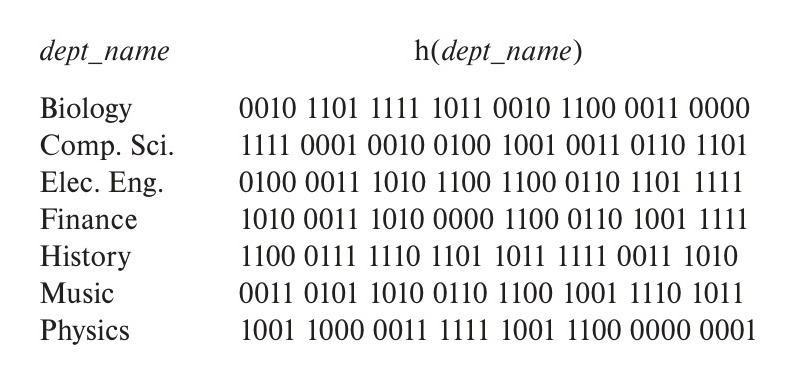
*Figure 24.9 — Hash function for dept_name.*

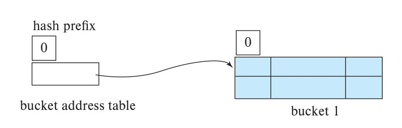
*Figure 24.10 — Initial extendable hash structure.*

<!-- Page 1199 -->

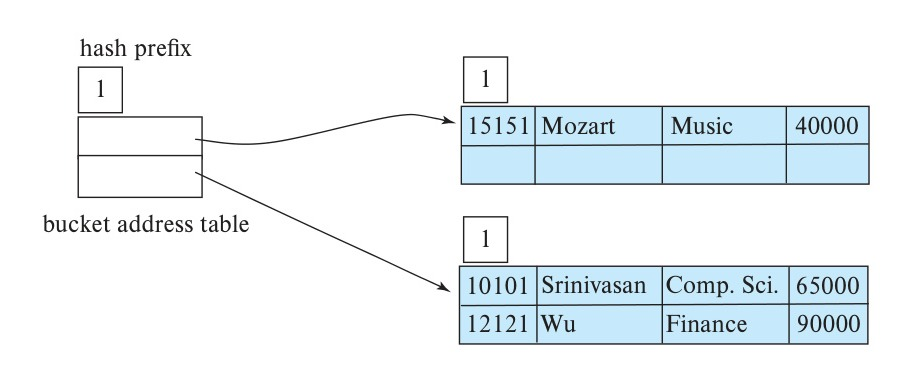
*Figure 24.11 — Hash structure after three insertions.*

illustrate all the features of extendable hashing in a small structure, we shall make the unrealistic assumption that a bucket can hold only two records.

We insert the record (10101, Srinivasan, Comp. Sci., 65000). The bucket address table contains a pointer to the one bucket, and the system inserts the record. Next, we insert the record (12121, Wu, Finance, 90000). The system also places this record in the one bucket of our structure.

When we attempt to insert the next record (15151, Mozart, Music, 40000), we find that the bucket is full. Since $i = i_0$, we need to increase the number of bits that we use from the hash value. We now use 1 bit, allowing us $2^1 = 2$ buckets. This increase in the number of bits necessitates doubling the size of the bucket address table to two entries. The system splits the bucket, placing in the new bucket those records whose search key has a hash value beginning with 1, and leaving in the original bucket the other records. Figure 24.11 shows the state of our structure after the split.

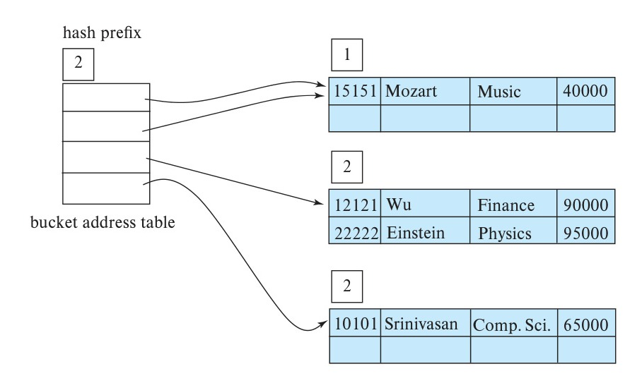
*Figure 24.12 — Hash structure after four insertions.*

<!-- Page 1200 -->

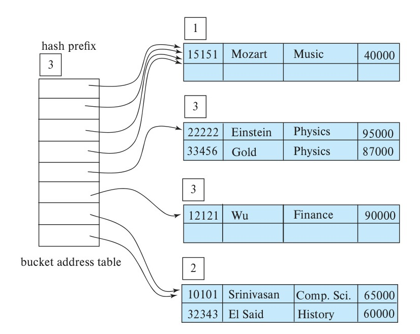
*Figure 24.13 — Hash structure after six insertions.*

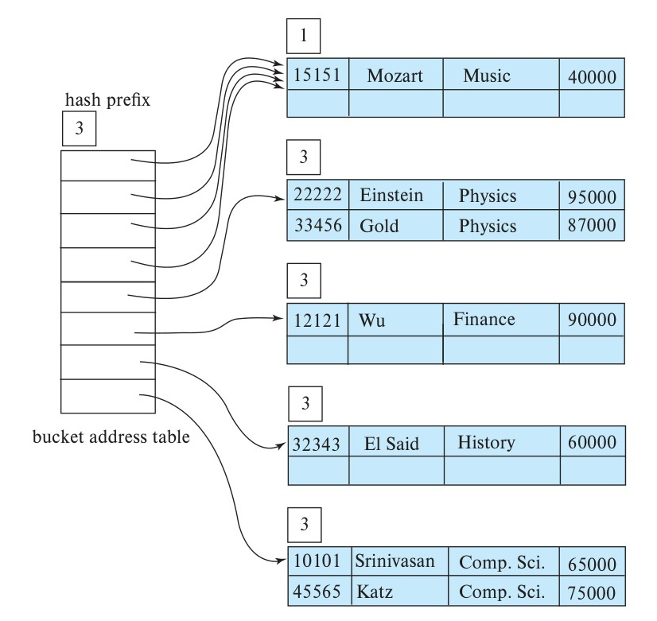
*Figure 24.14 — Hash structure after seven insertions.*

<!-- Page 1201 -->

Next, we insert (22222, Einstein, Physics, 95000). Since the first bit of $h(\text{Physics})$ is 1, we must insert this record into the bucket pointed to by the “1” entry in the bucket address table. Once again, we find the bucket full and $i = i_1$. We increase the number of bits that we use from the hash to 2. This increase in the number of bits necessitates doubling the size of the bucket address table to four entries, as in Figure 24.12. Since the bucket of Figure 24.11 for hash prefix 0 was not split, the two entries of the bucket address table of 00 and 01 both point to this bucket.

For each record in the bucket of Figure 24.11 for hash prefix 1 (the bucket being split), the system examines the first two bits of the hash value to determine which bucket of the new structure should hold it.

Next, we insert (32343, El Said, History, 60000), which goes in the same bucket as Comp. Sci. The following insertion of (33456, Gold, Physics, 87000) results in a bucket overflow, leading to an increase in the number of bits and a doubling of the size of the bucket address table (see Figure 24.13).

The insertion of (45565, Katz, Comp. Sci., 75000) leads to another bucket overflow; this overflow, however, can be handled without increasing the number of bits, since the bucket in question has two pointers pointing to it (see Figure 24.14).

Next, we insert the records of “Califieri”, “Singh”, and “Crick” without any bucket overflow. The insertion of the third Comp. Sci. record (83821, Brandt, Comp. Sci.,

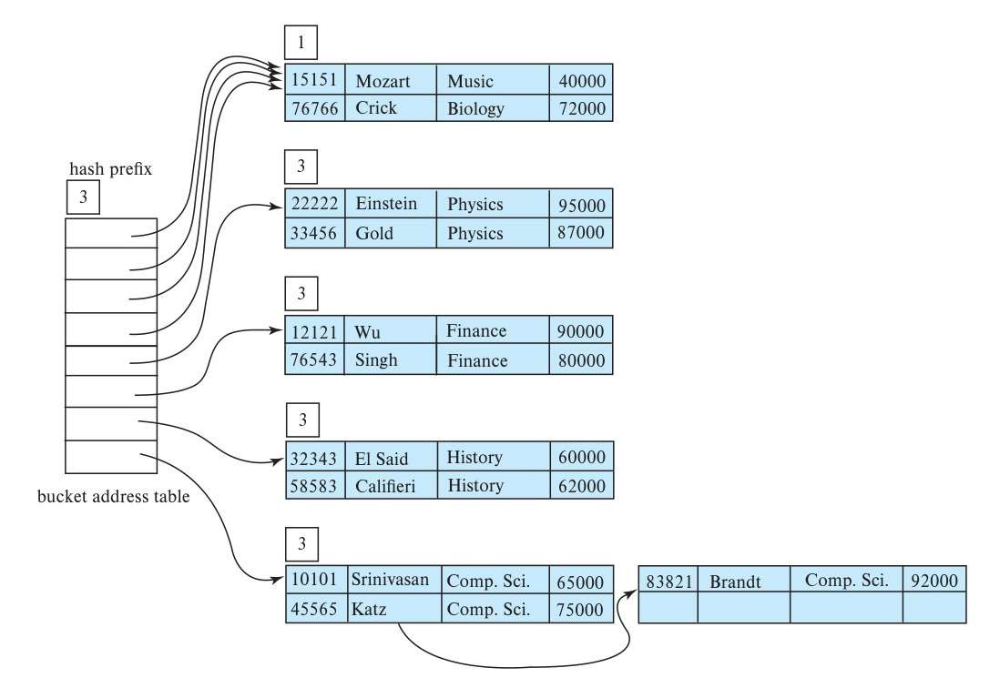
*Figure 24.15 — Hash structure after 11 insertions.*

<!-- Page 1202 -->

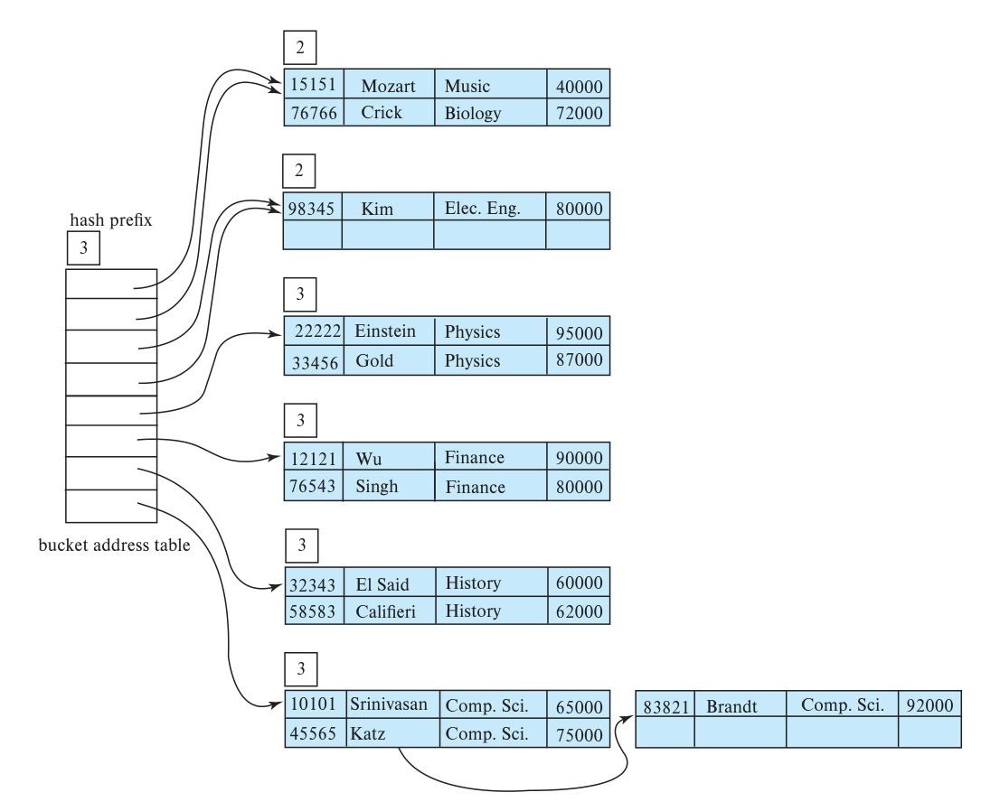
*Figure 24.16 — Extendable hash structure for the instructor file.*

92000), however, leads to another overflow. This overflow cannot be handled by increasing the number of bits, since there are three records with exactly the same hash value. Hence the system uses an overflow bucket, as in Figure 24.15. We continue in this manner until we have inserted all the *instructor* records of Figure 14.1. The resulting structure appears in Figure 24.16.

### 24.5.2.3 Static Hashing versus Dynamic Hashing

We now examine the advantages and disadvantages of extendable hashing, compared with static hashing. The main advantage of extendable hashing is that performance does not degrade as the file grows. Furthermore, there is minimal space overhead. Although the bucket address table incurs additional overhead, it contains one pointer for each hash value for the current prefix length. This table is thus small. The main space saving of extendable hashing over other forms of hashing is that no buckets need to be reserved for future growth; rather, buckets can be allocated dynamically.

A disadvantage of extendable hashing is that lookup involves an additional level of indirection, since the system must access the bucket address table before accessing the

<!-- Page 1203 -->

bucket itself. This extra reference has only a minor effect on performance. Although the hash structures that we discussed in Section 24.5.1 do not have this extra level of indirection, they lose their minor performance advantage as they become full. A further disadvantage of extendable hashing is the cost of periodic doubling of the bucket address table.

The bibliographical notes also provide references to another form of dynamic hashing called **linear hashing**, which avoids the extra level of indirection associated with extendable hashing, at the possible cost of more overflow buckets.

### 24.5.3 Comparison of Ordered Indexing and Hashing

We have seen several ordered-indexing schemes and several hashing schemes. We can organize files of records as ordered files by using index-sequential organization or $\text{B}^+$-tree organizations. Alternatively, we can organize the files by using hashing. Finally, we can organize them as heap files, where the records are not ordered in any particular way.

Each scheme has advantages in certain situations. A database-system implementor could provide many schemes, leaving the final decision of which schemes to use to the database designer. However, such an approach requires the implementor to write more code, adding both to the cost of the system and to the space that the system occupies.

Most database systems support $\text{B}^+$-trees for indexing disk-based data, and many databases also support $\text{B}^+$-tree file organization. However, most databases do not support hash file organizations or hash indices for disk-based data. One of the important reasons is the fact that many applications benefit from support for range queries. A second reason is the fact that $\text{B}^+$-tree indices handle relation size increases gracefully, via a series of node splits, each of which is of low cost, in contrast to the relatively high cost of doubling of the bucket address table, which extendable hashing requires. Another reason for preferring $\text{B}^+$-trees is the fact that $\text{B}^+$-trees give good worst-case bounds for deletion operations with duplicate keys, unlike hash indices.

However, hash indices are used for in-memory indexing, if range queries are not common. In particular, they are widely used for creating temporary in-memory indices while processing join operations using the hash-join technique, as we see in Section 15.5.5.

## 24.6 Summary

- The key idea of the log structured merge tree is to replace random I/O operations during tree inserts, updates, and deletes with a smaller number of sequential I/O operations.
- Bitmap indices are specialized indices designed for easy querying on multiple keys. Bitmaps work best for attributes that take only a small number of distinct values.

<!-- Page 1204 -->

- A bitmap is an array of bits. In its simplest form, a bitmap index on the attribute $A$ of relation $r$ consists of one bitmap for each value that $A$ can take. Each bitmap has as many bits as the number of records in the relation.
- Bitmap indices are useful for selections mainly when there are selections on multiple keys.
- An important use of bitmaps is to count the number of tuples satisfying a given selection. Such queries are important for data analysis.
- Indices are required for efficient access to spatial data and must efficiently support queries such as range and nearest neighbor queries.
- A quadtree is an alternative representation for two-dimensional data where the space is divided by a quadtree. Each node of a quadtree is associated with a rectangular region of space.
- An R-tree is a storage structure that is useful for indexing of objects such as points, line segments, rectangles, and other polygons. An R-tree is a balanced tree structure with the indexed objects stored in leaf nodes, much like a $\text{B}^+$-tree. However, instead of a range of values, a rectangular bounding box is associated with each tree node.
- Static hashing uses hash functions in which the set of bucket addresses is fixed. Such hash functions cannot easily accommodate databases that grow significantly larger over time.
- Dynamic hashing techniques allow the hash function to be modified. One example is extendable hashing, which copes with changes in database size by splitting and coalescing buckets as the database grows and shrinks.

## Review Terms

- Log-structured merge tree (LSM tree)
- Rolling merge
- Deletion entry
- Stepped-merge index
- Write amplification
- Bloom filter
- Bitmap
- Bitmap index
- Existence bitmap
- Quadtree
- Region quadtrees
- R-tree
- Bounding box
- Quadratic split
- Bucket overflow
- Skew
- Closed addressing
- Closed hashing
- Open addressing
- Open hashing

<!-- Page 1205 -->

- Dynamic hashing
- Linear hashing
- Extendable hashing

## Practice Exercises

**24.1** Both LSM trees and buffer trees (described in Section 14.8.2) offer benefits to write-intensive workloads, compared to normal $\text{B}^+$-trees, and buffer trees offer potentially better lookup performance. Yet LSM trees are more frequently used in Big Data settings. What is the most important reason for this preference?

**24.2** Consider the optimized technique for counting the number of bits that are set in a bitmap. What are the tradeoffs in choosing a smaller versus a larger array size, keeping cache size in mind?

**24.3** Suppose you want to store line segments in an R-tree. If a line segment is not parallel to the axes, the bounding box for it can be large, containing a large empty area.

- Describe the effect on performance of having large bounding boxes on queries that ask for line segments intersecting a given region.
- Briefly describe a technique to improve performance for such queries and give an example of its benefit. Hint: You can divide segments into smaller pieces.

**24.4** Give a search algorithm on an R-tree for efficiently finding the nearest neighbor to a given query point.

**24.5** Give a recursive procedure to efficiently compute the spatial join of two relations with R-tree indices. (Hint: Use bounding boxes to check if leaf entries under a pair of internal nodes may intersect.)

**24.6** Suppose that we are using extendable hashing on a file that contains records with the following search-key values:

$$2, 3, 5, 7, 11, 17, 19, 23, 29, 31$$

Show the extendable hash structure for this file if the hash function is $h(x) = x \bmod 8$ and buckets can hold three records.

**24.7** Show how the extendable hash structure of Exercise 24.6 changes as the result of each of the following steps:

a. Delete 11.
b. Delete 31.
c. Insert 1.

<!-- Page 1206 -->

d. Insert 15.

**24.8** Give pseudocode for deletion of entries from an extendable hash structure, including details of when and how to coalesce buckets. Do not bother about reducing the size of the bucket address table.

**24.9** Suggest an efficient way to test if the bucket address table in extendable hashing can be reduced in size by storing an extra count with the bucket address table. Give details of how the count should be maintained when buckets are split, coalesced, or deleted. (*Note:* Reducing the size of the bucket address table is an expensive operation, and subsequent inserts may cause the table to grow again. Therefore, it is best not to reduce the size as soon as it is possible to do so, but instead do it only if the number of index entries becomes small compared to the bucket-address-table size.)

## Exercises

**24.10** The stepped merge variant of the LSM tree allows multiple trees per level. What are the tradeoffs in having more trees per level?

**24.11** Suppose you want to use the idea of a quadtree for data in three dimensions. How would the resultant data structure (called an *octtree*) divide up space?

**24.12** Explain the distinction between closed and open hashing. Discuss the relative merits of each technique in database applications.

**24.13** What are the causes of bucket overflow in a hash file organization? What can be done to reduce the occurrence of bucket overflows?

**24.14** Why is a hash structure not the best choice for a search key on which range queries are likely?

**24.15** Our description of static hashing assumes that a large contiguous stretch of disk blocks can be allocated to a static hash table. Suppose you can allocate only $C$ contiguous blocks. Suggest how to implement the hash table, if it can be much larger than $C$ blocks. Access to a block should still be efficient.

## Further Reading

The log-structured merge (LSM) tree is presented in [O’Neil et al. (1996)], while the stepped merge tree is presented in [Jagadish et al. (1997)]. [Vitter (2001)] provides an extensive survey of external-memory data structures and algorithms.

Bitmap indices are described in [O’Neil and Quass (1997)]. They were first introduced in the IBM Model 204 file manager on the AS 400 platform. They provide very

<!-- Page 1207 -->

large speedups on certain types of queries and are today implemented in most database systems.

[Samet (2006)] provides a textbook coverage of spatial data structures. [Bentley (1975)] describes the k-d tree, and [Robinson (1981)] describes the k-d-B tree. The R-tree was originally presented in [Guttman (1984)].

Discussions of the basic data structures in hashing can be found in [Cormen et al. (2009)]. Extendable hashing was introduced by [Fagin et al. (1979)]. Linear hashing was introduced by [Litwin (1978)] and [Litwin (1980)].

## Bibliography

- **[Bentley (1975)]** J. L. Bentley, “Multidimensional Binary Search Trees Used for Associative Searching”, *Communications of the ACM*, Volume 18, Number 9 (1975), pages 509–517.
- **[Cormen et al. (2009)]** T. Cormen, C. Leiserson, R. Rivest, and C. Stein, *Introduction to Algorithms*, 3rd edition, MIT Press (2009).
- **[Fagin et al. (1979)]** R. Fagin, J. Nievergelt, N. Pippenger, and H. R. Strong, “Extendible Hashing — A Fast Access Method for Dynamic Files”, *ACM Transactions on Database Systems*, Volume 4, Number 3 (1979), pages 315–344.
- **[Guttman (1984)]** A. Guttman, “R-Trees: A Dynamic Index Structure for Spatial Searching”, In *Proc. of the ACM SIGMOD Conf. on Management of Data* (1984), pages 47–57.
- **[Jagadish et al. (1997)]** H. V. Jagadish, P. P. S. Narayan, S. Seshadri, S. Sudarshan, and R. Kanneganti, “Incremental Organization for Data Recording and Warehousing”, In *Proceedings of the 23rd International Conference on Very Large Data Bases, VLDB ’97* (1997), pages 16–25.
- **[Litwin (1978)]** W. Litwin, “Virtual Hashing: A Dynamically Changing Hashing”, In *Proc. of the International Conf. on Very Large Databases* (1978), pages 517–523.
- **[Litwin (1980)]** W. Litwin, “Linear Hashing: A New Tool for File and Table Addressing”, In *Proc. of the International Conf. on Very Large Databases* (1980), pages 212–223.
- **[O’Neil and Quass (1997)]** P. O’Neil and D. Quass, “Improved Query Performance with Variant Indexes”, In *Proc. of the ACM SIGMOD Conf. on Management of Data* (1987), pages 38–49.
- **[O’Neil et al. (1996)]** P. O’Neil, E. Cheng, D. Gawlick, and E. O’Neil, “The Log-structured Merge-tree (LSM-tree)”, *Acta Inf.*, Volume 33, Number 4 (1996), pages 351–385.
- **[Robinson (1981)]** J. Robinson, “The k-d-B Tree: A Search Structure for Large Multidimensional Indexes”, In *Proc. of the ACM SIGMOD Conf. on Management of Data* (1981), pages 10–18.
- **[Samet (2006)]** H. Samet, *Foundations of Multidimensional and Metric Data Structures*, Morgan Kaufmann (2006).

<!-- Page 1208 -->

- **[Vitter (2001)]** J. S. Vitter, “External Memory Algorithms and Data Structures: Dealing with Massive Data”, *ACM Computing Surveys*, Volume 33, (2001), pages 209–271.

## Credits

The photo of the sailboats in the beginning of the chapter is due to ©Pavel Nesvadba/Shutterstock.
