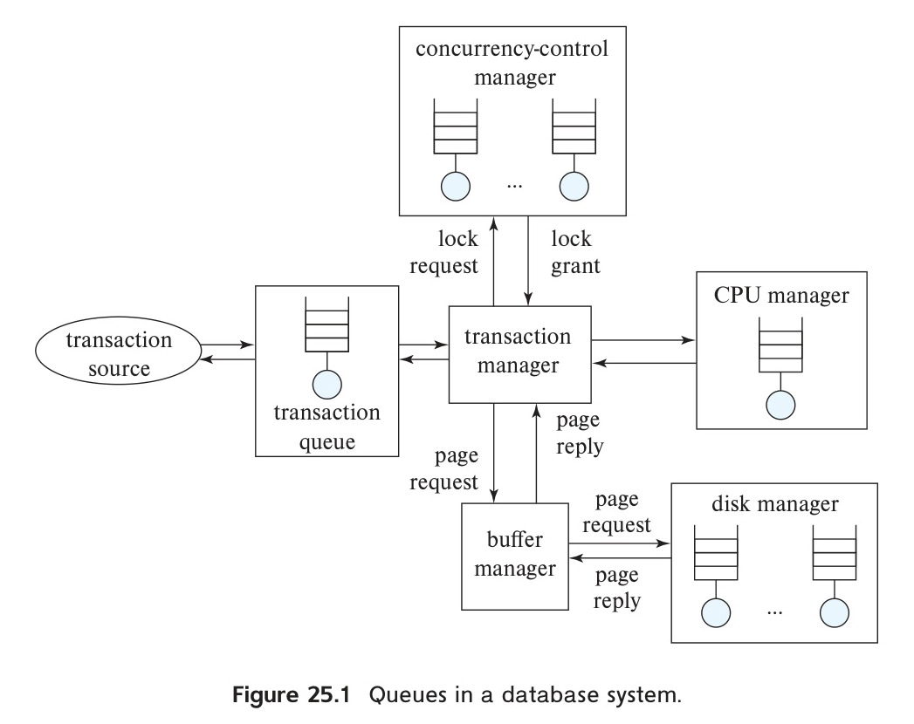
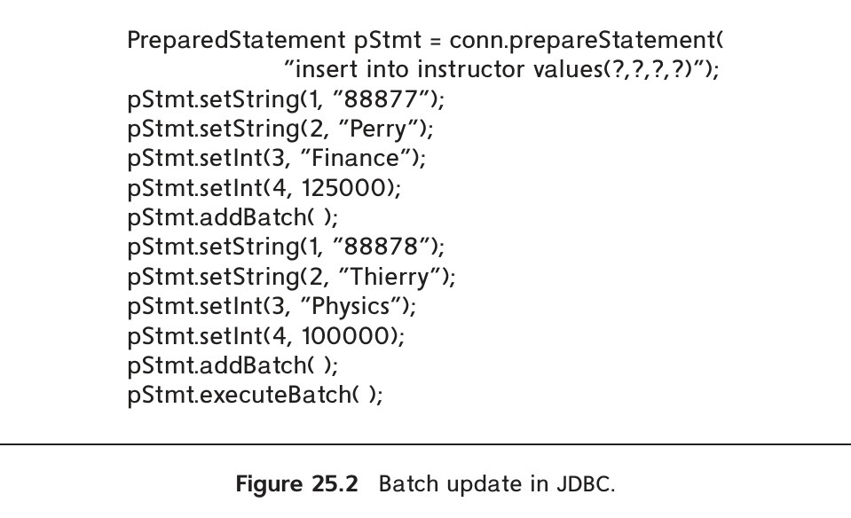

<!-- Page 1209 -->

# Chapter 25: Advanced Application Development

There are a number of tasks in application development. We saw in Chapter 6 to Chapter 9 how to design and build an application. One of the aspects of application design is the performance one expects out of the application. In fact, it is common to find that once an application has been built, it runs slower than the designers wanted or handles fewer transactions per second than they required. An application that takes an excessive amount of time to perform requested actions can cause user dissatisfaction at best and be completely unusable at worst.

Applications can be made to run significantly faster by performance tuning, which consists of finding and eliminating bottlenecks and adding appropriate hardware such as memory or disks. There are many things an application developer can do to tune the application, and there are things that a database-system administrator can do to speed up processing for an application.

Benchmarks are standardized sets of tasks that help to characterize the performance of database systems. They are useful to get a rough idea of the hardware and software requirements of an application, even before the application is built.

Applications must be tested as they are being developed. Testing requires generation of database states and test inputs, and verifying that the outputs match the expected outputs. We discuss issues in application testing. Legacy systems are application systems that are outdated and usually based on older-generation technology. However, they are often at the core of organizations and run mission-critical applications. We outline issues in interfacing with and issues in migrating away from legacy systems, replacing them with more modern systems.

Standards are very important for application development, especially in the age of the internet, since applications need to communicate with each other to perform useful tasks. A variety of standards have been proposed that affect database-application development, which we outline in this chapter. Organizations often store information about users in directory systems. Applications often use such directory systems to authenticate users and to get basic information about users, such as user categories (e.g.,

<!-- Page 1210 -->

student, instructor, and so on). We briefly describe the architecture of directory systems.

## 25.1 Performance Tuning

Tuning the performance of a system involves adjusting various parameters and design choices to improve its performance for a specific application. Various aspects of a database-system design—ranging from high-level aspects such as the schema and transaction design to database parameters such as buffer sizes, down to hardware issues such as number of disks—affect the performance of an application. Each of these aspects can be adjusted so that performance is improved.

### 25.1.1 Motivation for Tuning

Applications sometimes exhibit poor performance, with queries taking a long time to complete, leading to users being unable to carry out tasks that they need to do. We describe a few real-world examples that we have seen, including their causes and how tuning fixed the problems.

In one of the applications, we found that users were experiencing long delays and time-outs in the web applications. On monitoring the database, we found that the CPU usage was very high, with negligible disk and network usage. Further analysis of queries running on the database showed that a simple lookup query on a large relation was using a full relation scan, which was quite expensive. Adding an index to the attribute used in the lookup drastically reduced the execution time of the query and a key performance problem vanished immediately.

In a second application, we found that a query had very poor performance. Examining the query, we found that the programmer had written an unnecessarily complicated query, with several nested subqueries, and the optimizer produced a bad plan for the query, as we realized after observing the query plan. To fix the problem, we rewrote the query using joins instead of nested subqueries, that is, we decorrelated the query; this change greatly reduced the execution time.

In a third application, we found that the application fetched a large number of rows from a query, and issued another database query for each row that it fetched. This resulted in a large number of separate queries being sent to the database, resulting in poor performance. It is possible to replace such a large number of queries with a single query that fetches all required data, as we see later in this section. Such a change improved the performance of the application by an order of magnitude.

In a fourth application, we found that while the application performed fine under light load during testing, it completely stopped working when subjected to heavy load when it was used by actual users. In this case, we found that in some of the interfaces, programmers had forgotten to close JDBC connections. Databases typically support only a limited number of JDBC connections, and once that limit was reached, the application was unable to connect to the database, and thus it stopped working.

<!-- Page 1211 -->

Ensuring that connections were closed fixed this problem. While this was technically a bug fix, not a tuning action, we thought it is a good idea to highlight this problem since we have found many applications have this problem. Connection pooling, which keeps database connections open for use by subsequent transactions, is a related application tuning optimization, since it avoids the cost of repeated opening and closing of database connections.

It is also worth pointing out that in several cases above the performance problems did not show up during testing, either because the test database was much smaller than the actual database size or because the testing was done with a much lighter load (number of concurrent users) than the load on the live system. It is important that performance testing be done on realistic database sizes, with realistic load, so problems show up during testing, rather than on a live system.

### 25.1.2 Location of Bottlenecks

The performance of most systems (at least before they are tuned) is usually limited primarily by the performance of one or a few components, called **bottlenecks**. For instance, a program may spend 80 percent of its time in a small loop deep in the code, and the remaining 20 percent of the time on the rest of the code; the small loop then is a bottleneck. Improving the performance of a component that is not a bottleneck does little to improve the overall speed of the system; in the example, improving the speed of the rest of the code cannot lead to more than a 20 percent improvement overall, whereas improving the speed of the bottleneck loop could result in an improvement of nearly 80 percent overall, in the best case.

Hence, when tuning a system, we must first try to discover what the bottlenecks are and then eliminate them by improving the performance of system components causing the bottlenecks. When one bottleneck is removed, it may turn out that another component becomes the bottleneck. In a well-balanced system, no single component is the bottleneck. If the system contains bottlenecks, components that are not part of the bottleneck are underutilized, and could perhaps have been replaced by cheaper components with lower performance.

For simple programs, the time spent in each region of the code determines the overall execution time. However, database systems are much more complex, and query execution involves not only CPU time, but also disk I/O and network communication. A first step in diagnosing problems to use monitoring tools provided by operating systems to find the usage level of the CPU, disks, and network links.

It is also important to monitor the database itself, to find out what is happening within the database. For example, most databases provide ways to find out which queries (or query templates, where the same query is executed repeatedly with different constants) are taking up the maximum resources, such as CPU, disk I/O, or network capacity. In addition to hardware resource bottlenecks, poor performance in a database system may potentially be due to contention on locks, where transactions wait in lock

<!-- Page 1212 -->

> ### Note 25.1: DATABASE PERFORMANCE MONITORING TOOLS
>
> Most database systems provide view relations that can be queried to monitor database system performance. For example, PostgreSQL provides view relations **pg_stat_statements** and **pgrowlocks** to monitor resource usage of SQL statements and lock contention respectively. MySQL supports a command **show processinfo** that can be used to monitor what transactions are currently executing and their resource usage. Microsoft SQL Server provides stored procedures **sp_monitor**, **sp_who**, and **sp_lock** to monitor system resource usage. The **Oracle Database SQL Tuning Guide**, available online, provides details of similar views in Oracle.

queues for a long time. Again, most databases provide mechanisms to monitor lock contention.

Monitoring tools can help detect where the bottleneck lies (such as CPU, I/O, or locks), and to locate the queries that are causing the maximum performance problems. In this chapter, we discuss a number of techniques that can be used to fix performance problems, such as adding required indices or materialized views, rewriting queries, rewriting applications, or adding hardware to improve performance.

To understand the performance of database systems better, it is very useful to model database systems as **queueing systems**. A transaction requests various services from the database system, starting from entry into a server process, disk reads during execution, CPU cycles, and locks for concurrency control. Each of these services has a queue associated with it, and small transactions may spend most of their time waiting in queues—especially in disk I/O queues—instead of executing code. Figure 25.1 illustrates some of the queues in a database system. Note that each lockable item has a separate queue in the concurrency control manager. The database system may have a single queue at the disk manager or may have separate queues for different disks in case the disks are directly controlled by the database. The transaction queue is used by the database system to control the admission of new queries when the number of requests exceeds the number of concurrent query execution tasks that the database allows.

As a result of the numerous queues in the database, bottlenecks in a database system typically show up in the form of long queues for a particular service, or, equivalently, in high utilizations for a particular service. If requests are spaced exactly uniformly, and the time to service a request is less than or equal to the time before the next request arrives, then each request will find the resource idle and can therefore start execution immediately without waiting. Unfortunately, the arrival of requests in a database system is never so uniform and is often random.

If a resource, such as a disk, has a low utilization, then when a request is made, the resource is likely to be idle, in which case the waiting time for the request will be 0. Assuming uniformly randomly distributed arrivals, the length of the queue (and

<!-- Page 1213 -->


*Figure 25.1 — Queues in a database system.*

correspondingly the waiting time) goes up exponentially with utilization; as utilization approaches 100 percent, the queue length increases sharply, resulting in excessively long waiting times. The utilization of a resource should be kept low enough that queue length is short. As a rule of the thumb, utilizations of around 70 percent are considered to be good, and utilizations above 90 percent are considered excessive, since they will result in significant delays. To learn more about the theory of queueing systems, generally referred to as **queueing theory**, you can consult the references cited in the bibliographical notes.

### 25.1.3 Tuning Levels

Tuning is typically done in the context of applications, and can be done at the database system layer, or outside the database system.

Tuning at layers above the database is application dependent, and is not our focus, but we mention a few such techniques. Profiling application code to find code blocks that have a heavy CPU consumption, and rewriting them to reduce CPU load is an option for CPU intensive applications. Application servers often have numerous parameters that can be tuned to improve performance, or to ensure that the application does not run out of memory. Multiple application servers that work in parallel are often

<!-- Page 1214 -->

used to handle higher workloads. A load balancer is used to route requests to one of the application servers; to ensure session continuity, requests from a particular source are always routed to the same application server. Connection pooling (described in Section 9.7.1) is another widely technique to reduce the overhead of database connection creation. Web application interfaces may be tuned to improve responsiveness, for example by replacing legacy web interfaces by ones based on JavaScript and Ajax (described in Section 9.5.1.3).

Returning to database tuning, database administrators and application developers can tune a database system at three levels.

The highest level of database tuning, which is under the control of application developers, includes the schema and queries. The developer can tune the design of the schema, the indices that are created, and the transactions that are executed to improve performance. Tuning at this level is comparatively system independent.

The second level consists of the database-system parameters, such as buffer size and checkpointing intervals. The exact set of database-system parameters that can be tuned depends on the specific database system. Most database-system manuals provide information on what database-system parameters can be adjusted, and how you should choose values for the parameters. Well-designed database systems perform as much tuning as possible automatically, freeing the user or database administrator from the burden. For instance, in many database systems the buffer size is fixed but tunable. If the system automatically adjusts the buffer size by observing indicators such as page-fault rates, then the database administrator will not have to worry about tuning the buffer size.

The lowest level is at the hardware level. Options for tuning systems at this level include replacing hard disks with solid-state drives (which use flash storage), adding more disks or using a RAID system if disk I/O is a bottleneck, adding more memory if the disk buffer size is a bottleneck, or moving to a system with more processors if CPU usage is a bottleneck.

The three levels of tuning interact with one another; we must consider them together when tuning a system. For example, tuning at a higher level may result in the hardware bottleneck changing from the disk system to the CPU, or vice versa. Tuning of queries and the physical schema is usually the first step to improving performance. Tuning of database system parameters, in case the database system does automate this task, can also be done in parallel. If performance is still poor, tuning of logical schema and tuning of hardware are the next logical steps.

### 25.1.4 Tuning of Physical Schema

Tuning of the physical schema, such as indices and materialized views, is the least disruptive mode of tuning, since it does not affect application code in any way. We now study different aspects of tuning of the physical schema.

<!-- Page 1215 -->

#### 25.1.4.1 Tuning of Indices

We can tune the indices in a database system to improve performance. If queries are the bottleneck, we can often speed them up by creating appropriate indices on relations. If updates are the bottleneck, there may be too many indices, which have to be updated when the relations are updated. Removing indices may speed up certain updates.

The choice of the type of index also is important. Some database systems support different kinds of indices, such as hash indices, $\text{B}^+$-tree indices, and write-optimized indices such as LSM trees (Section 24.2). If range queries are common, $\text{B}^+$-tree indices are preferable to hash indices. If the system has a very high write load, but a relatively low read load, write-optimized LSM tree indices may be preferable to $\text{B}^+$-tree indices.

Whether to make an index a clustered index is another tunable parameter. Only one index on a relation can be made clustered, by storing the relation sorted on the index attributes. Generally, the index that benefits the greatest number of queries and updates should be made clustered.

To help identify what indices to create, and which index (if any) on each relation should be clustered, most commercial database systems provide tuning wizards; these are described in more detail in Section 25.1.4.4. These tools use the past history of queries and updates (called the **workload**) to estimate the effects of various indices on the execution time of the queries and updates in the workload. Recommendations on what indices to create are based on these estimates.

#### 25.1.4.2 Using Materialized Views

Maintaining materialized views can greatly speed up certain queries. In fact, in decision support systems, materialized views can speed up some queries by several orders of magnitude. The speed up is especially large for views that compute aggregates, since the query may access just a few records in the materialized view, whereas computing the aggregate from scratch would require a scan of the underlying relations, which could be very large.

Materialized views can be maintained in one of two modes: immediate or deferred. Using deferred maintenance reduces the burden on update transactions. However, if the query must see up-to-date data, it must either perform maintenance before executing the query, or use the nonmaterialized definition of the view; in either case, the benefits of view materialization are reduced. Even if views are maintained immediately, the benefits of using materialized views can significantly outweigh the cost of maintenance if the views are used frequently.

As with indices, we can tune the system by choosing an appropriate set of materialized views to create. Most database systems provide tools to help the database administrator choose what views to materialize. The administrator examines queries and updates that are executed, and how often they are executed, to decide which

<!-- Page 1216 -->

materialized views. For instance, the administrator may find that a certain aggregate is used frequently, and choose to materialize it, or may find that a particular join is computed frequently, and choose to materialize it.

However, manual choice is tedious for even moderately large sets of query types, and making a good choice may be difficult, since it requires understanding the costs of different alternatives; only the query optimizer can estimate the costs with reasonable accuracy without actually executing the query. Thus, a good set of views may be found only by trial and error—that is, by materializing one or more views, running the workload, and measuring the time taken to run the queries in the workload. The administrator repeats the process until a set of views is found that gives acceptable performance.

A better alternative is to provide support for selecting materialized views within the database system itself, integrated with the query optimizer. This approach is described in more detail in Section 25.1.4.4.

#### 25.1.4.3 Horizontal Partitioning of Relation Schema

Horizontal partitioning of relations is widely used for parallel and distributed storage and query processing. However, it can also be used in a centralized system to improve queries and updates by breaking up the tuples of a relation into partitions.

For example, suppose that a database stores a large relation that has a *date* attribute, and most operations work on data inserted within the past few months. Suppose now that the relation is partitioned on the *date* attribute, with one partition for each (*year*, *month*) combination. Then, queries that contain a selection on *date*, such as *date*='2018-06-01', need access only partitions that could possibly contain such tuples, skipping all other partitions.

More importantly, indices could be created independently on each partition. Suppose an index is created on an attribute ID, with a separate index on each partition. A query that specifies selection on ID, along with a date or a date range, need look up the index on only those partitions that match the specified date or date range. Since each partition is smaller than the whole relation, the indices too are smaller, speeding up index lookup. Index insertion is also much faster, since the index size is much smaller than an index on the entire relation. And most importantly, even as the total data size grows, the partition size never grows beyond some limit, ensuring that the performance of such queries does not degrade with time.

There is a cost to such partitioning: queries that do not contain a selection on the partitioning attribute need to individually access each of the partitions, potentially slowing down such queries significantly. If such queries are rare, the benefits of partitioning outweigh the costs, making them an attractive technique for optimization.

Even if the database does not support partitioning internally, it is possible to replace a relation $r$ by multiple physical relations $r_1, r_2, \dots, r_n$, and the original relation $r$ is defined by the view $r = r_1 \cup r_2 \cup \dots \cup r_n$. Suppose that the database optimizer knows

<!-- Page 1217 -->

the predicate defining each $r_i$ (in our example, the date range corresponding to each $r_i$). Then the optimizer can replace a query on $r$ that includes a selection on the partitioning attribute (*date*, in our example), with a query on the only relevant $r_i\text{s}$. Indices would have to be created separately on each of the $r_i\text{s}$.

#### 25.1.4.4 Automated Tuning of Physical Design

Most commercial database systems today provide tools to help the database administrator with index and materialized view selection and other tasks related to physical database design such as how to partition data in a parallel database system.

These tools examine the **workload** (the history of queries and updates) and suggest indices and views to be materialized. The database administrator may specify the importance of speeding up different queries, which the tool takes into account when selecting views to materialize. Often tuning must be done before the application is fully developed, and the actual database contents may be small on the development database but are expected to be much larger on a production database. Thus, some tuning tools also allow the database administrator to specify information about the expected size of the database and related statistics.

Microsoft’s Database Tuning Assistant, for example, allows the user to ask “what if” questions, whereby the user can pick a view, and the optimizer then estimates the effect of materializing the view on the total cost of the workload and on the individual costs of different types of queries and updates in the workload.

The automatic selection of indices and materialized views is usually implemented by enumerating different alternatives and using the query optimizer to estimate the costs and benefits of selecting each alternative by using the workload. Since the number of design alternatives and the potential workload may be extremely large, the selection techniques must be designed carefully.

The first step is to generate a workload. This is usually done by recording all the queries and updates that are executed during some time period. Next, the selection tools perform **workload compression**, that is, create a representation of the workload using a small number of updates and queries. For example, updates of the same form can be represented by a single update with a weight corresponding to how many times the update occurred. Queries of the same form can be similarly replaced by a representative with appropriate weight. After this, queries that are very infrequent and do not have a high cost may be discarded from consideration. The most expensive queries may be chosen to be addressed first. Such workload compression is essential for large workloads.

With the help of the optimizer, the tool would come up with a set of indices and materialized views that could help the queries and updates in the compressed workload. Different combinations of these indices and materialized views can be tried out to find the best combination. However, an exhaustive approach would be totally impractical, since the number of potential indices and materialized views is already large, and each

<!-- Page 1218 -->

> ### Note 25.2: TUNING TOOLS
>
> Tuning tools, such as the Database Engine Tuning Advisor provided by SQL Server and the SQL Tuning Advisor of Oracle, provide recommendations such as what indices or materialized views to add, or how to partition a relation, to improve performance. These recommendations can then be accepted and implemented by a database administrator.
>
> Auto Tuning in Microsoft Azure SQL can automatically create and drop indices to improve query performance. A risk with automatically changing the physical schema is that some queries may perform poorly. For example, an optimizer may choose a plan using a newly created index, assuming, based on wrong estimates of cost, that the new plan is cheaper than the plan used before the index was created. In reality, the query may run slower using the new plan, which may affect users. The “force last good plan” feature can monitor query performance after any change such as addition of an index, and if performance is worse, it can force the database to use the old plan before the change (as long as it is still valid).
>
> Oracle also provides auto tuning support, for example recommending if an index should be added, or monitoring the use of a query to decide if it should be optimized for fetching only a few rows or for fetching all rows (the best plan may be very different if only the first few rows are fetched or if all rows are fetched).

subset of these is a potential design alternative, leading to an exponential number of alternatives. Heuristics are used to reduce the space of alternatives, that is, to reduce the number of combinations considered.

Greedy heuristics for index and materialized view selection operate as follows: They estimate the benefits of materializing different indices or views (using the optimizer’s cost estimation functionality as a subroutine). They then choose the index or view that gives either the maximum benefit or the maximum benefit per unit space (i.e., benefit divided by the space required to store the index or view). The cost of maintaining the index or view must be taken into account when computing the benefit. Once the heuristic has selected an index or view, the benefits of other indices or views may have changed, so the heuristic recomputes these and chooses the next best index or view for materialization. The process continues until either the available disk space for storing indices or materialized views is exhausted or the cost of maintaining the remaining candidates is more than the benefit to queries that could use the indices or views.

Real-world index and materialized-view selection tools usually incorporate some elements of greedy selection but use other techniques to get better results. They also support other aspects of physical database design, such as deciding how to partition a relation in a parallel database, or what physical storage mechanism to use for a relation.

<!-- Page 1219 -->

### 25.1.5 Tuning of Queries

The performance of an application can often be significantly improved by rewriting queries or by changing how the application issues queries to the database.

#### 25.1.5.1 Tuning of Query Plans

In the past, optimizers on many database systems were not particularly good, so how a query was written would have a big influence on how it was executed, and therefore on the performance. Today’s advanced optimizers can transform even badly written queries and execute them efficiently, so the need for tuning individual queries is less important than it used to be. However, sometimes query optimizers choose bad plans for one of several reasons, which we describe next.

Before checking if something needs to be tuned in the plan for a query, it is useful to find out what plan is being used for the query. Most databases support an **explain** command, which allows you to see what plan is being used for a query. The explain command also shows the statistics that the optimizer used or computed for different parts of the query plan, and estimates of the costs of each part of a query plan. Variants of the explain command also execute the query and get actual tuple counts and execution time for different parts of the query plan.

Incorrect statistics are often the reason for the choice of a bad plan. For example, if the optimizer thinks that the relations involved in a join have very few tuples, it may choose nested loops join, which would be very inefficient if the relations actually have a large number of tuples.

Ideally, database statistics should be updated whenever relations are updated. However, doing so adds unacceptable overhead to update queries. Instead, databases either periodically update statistics or leave it to the system administrator to issue a command to update statistics. Some databases, such as PostgreSQL and MySQL support a command called **analyze**,[^1] which can be used to recompute statistics. For example, **analyze instructor** would recompute statistics for the *instructor* relation, while **analyze** with no arguments would recompute statistics for all relations in PostgreSQL. It is highly recommended to run this command after loading data into the database, or after making a significant number of inserts or deletes on a relation.

Some databases such as Oracle and Microsoft SQL Server keep track of inserts and deletes to relations, and they update statistics whenever the relation size changes by a significant fraction, making execution of the analyze command unnecessary.

Another reason for poor performance of queries is the lack of required indices. As we saw earlier, the choice of indices can be done as part of the tuning of the physical schema, but examining a query helps us understand what indices may be useful to speed up that query.

Indices are particularly important for queries that fetch only a few rows from a large relation, based on a predicate. For example, a query that finds students in a department

[^1]: The command is called analyze table in the case of MySQL.

<!-- Page 1220 -->

may benefit from an index on the *student* relation on the attribute *dept_name*. Indices on join attributes are often very useful. For example, if the above query also included a join of *student* with *takes* on the attribute *takes.ID*, an index on *takes.ID* could be useful.

Note that databases typically create indices on primary-key attributes, which can be used for selections as well as joins. For example, in our university schema, the primary-key index on *takes* has ID as its first attribute and may thus be useful for the above join.

Complex queries containing *nested subqueries* are not optimized very well by many optimizers. We saw techniques for nested subquery decorrelation in Section 16.4.4. If a subquery is not decorrelated, it gets executed repeatedly, potentially resulting in a great deal of random I/O. In contrast, decorrelation allows efficient set-oriented operations such as joins to be used, minimizing random I/O. Most database query optimizers incorporate some forms of decorrelation, but some can handle only very simple nested subqueries. The execution plan chosen by the optimizer can be found as described in Chapter 16. If the optimizer has not succeeded in decorrelating a nested subquery, the query can be decorrelated by rewriting it manually.

#### 25.1.5.2 Improving Set Orientation

When SQL queries are executed from an application program, it is often the case that a query is executed frequently, but with different values for a parameter. Each call has an overhead of communication with the server, in addition to processing overheads at the server.

For example, consider a program that steps through each department, invoking an embedded SQL query to find the total salary of all instructors in the department:

```sql
select sum(salary)
from instructor
where dept_name = ?
```

If the *instructor* relation does not have a clustered index on *dept_name*, each such query will result in a scan of the relation. Even if there is such an index, a random I/O operation will be required for each *dept_name* value.

Instead, we can use a single SQL query to find total salary expenses of each department:

```sql
select dept_name, sum(salary)
from instructor
group by dept_name;
```

This query can be evaluated with a single scan of the *instructor* relation, avoiding random I/O for each department. The results can be fetched to the client side using a single round of communication, and the client program can then step through the results to find the aggregate for each department. Combining multiple SQL queries into a single

<!-- Page 1221 -->


*Figure 25.2 — Batch update in JDBC.*

SQL query as above can reduce execution costs greatly in many cases—for example, if the *instructor* relation is very large and has a large number of departments.

The JDBC API also provides a feature called **batch update** that allows a number of inserts to be performed using a single communication with the database. Figure 25.2 illustrates the use of this feature. The code shown in the figure requires only one round of communication with the database, when the **executeBatch()** method is executed, in contrast to similar code without the batch update feature that we saw in Figure 5.2. In the absence of batch update, as many rounds of communication with the database are required as there are instructors to be inserted. The batch update feature also enables the database to process a batch of inserts at once, which can potentially be done much more efficiently than a series of single record inserts.

Another technique used widely in client-server systems to reduce the cost of communication and SQL compilation is to use stored procedures, where queries are stored at the server in the form of procedures, which may be precompiled. Clients can invoke these stored procedures rather than communicate a series of queries.

#### 25.1.5.3 Tuning of Bulk Loads and Updates

When loading a large volume of data into a database (called a **bulk load** operation), performance is usually very poor if the inserts are carried out as separate SQL insert statements. One reason is the overhead of parsing each SQL query; a more important reason is that performing integrity constraint checks and index updates separately for each inserted tuple results in a large number of random I/O operations. If the inserts were done as a large batch, integrity-constraint checking and index update can be done

<!-- Page 1222 -->

in a much more set-oriented fashion, reducing overheads greatly; performance improvements of an order of magnitude or more are not uncommon.

To support bulk load operations, most database systems provide a **bulk import** utility and a corresponding **bulk export** utility. The bulk-import utility reads data from a file and performs integrity constraint checking as well as index maintenance in a very efficient manner. Common input and output file formats supported by such bulk import/export utilities include text files with characters such as commas or tabs separating attribute values, with each record in a line of its own (such file formats are referred to as *comma-separated values* or *tab-separated values* formats). Database-specific binary formats as well as XML formats are also supported by bulk import/export utilities. The names of the bulk import/export utilities differ by database. In PostgreSQL, the utilities are called **pg_dump** and **pg_restore** (PostgreSQL also provides an SQL command **copy**, which provides similar functionality). The bulk import/export utility in Oracle is called **SQL\*Loader**, the utility in DB2 is called **load**, and the utility in SQL Server is called **bcp** (SQL Server also provides an SQL command called **bulk insert**).

We now consider the case of tuning of bulk updates. Suppose we have a relation *funds_received*(*dept_name*, *amount*) that stores funds received (say, by electronic funds transfer) for each of a set of departments. Suppose now that we want to add the amounts to the balances of the corresponding department budgets. In order to use the SQL update statement to carry out this task, we have to perform a look up on the *funds_received* relation for each tuple in the *department* relation. We can use subqueries in the update clause to carry out this task, as follows: We assume for simplicity that the relation *funds_received* contains at most one tuple for each department.

```sql
update department set budget = budget +
       (select amount
        from funds_received
        where funds_received.dept_name = department.dept_name)
where exists(
       select *
       from funds_received
       where funds_received.dept_name = department.dept_name);
```

Note that the condition in the **where** clause of the update ensures that only accounts with corresponding tuples in *funds_received* are updated, while the subquery within the **set** clause computes the amount to be added to each such department.

There are many applications that require updates such as that illustrated above. Typically, there is a table, which we shall call the **master table**, and updates to the master table are received as a batch. Now the master table has to be correspondingly updated. SQL:2003 introduced a special construct, called the **merge** construct, to simplify the task of performing such merging of information. For example, the preceding update can be expressed using **merge** as follows:

<!-- Page 1223 -->

```sql
merge into department as A
using
(select *
from funds_received) as F
on (A.dept_name = F.dept_name)
when matched then
     update set budget = budget + F.amount;
```

When a record from the subquery in the **using** clause matches a record in the *department* relation, the **when matched** clause is executed, which can execute an update on the relation; in this case, the matching record in the *department* relation is updated as shown.

The **merge** statement can also have a **when not matched then** clause, which permits insertion of new records into the relation. In the preceding example, when there is no matching department for a *funds_received* tuple, the insertion action could create a new department record (with a null *building*) using the following clause:

```sql
when not matched then
     insert values (F.dept_name, null, F.budget)
```

Although not very meaningful in this example,[^2] the **when not matched then** clause can be quite useful in other cases. For example, suppose the local relation is a copy of a master relation, and we receive updated as well as newly inserted records from the master relation. The merge statement can update matched records (these would be updated old records) and insert records that are not matched (these would be new records).

Not all SQL implementations support the **merge** statement currently; see the respective system manuals for further details.

### 25.1.6 Tuning of the Logical Schema

Performance of queries can sometimes be improved by tuning of the logical schema. For example, within the constraints of the chosen normal form, it is possible to partition relations vertically. Consider the *course* relation, with the schema:

$$\text{course } (\underline{\text{course\_id}}, \text{title}, \text{dept\_name}, \text{credits})$$

for which *course_id* is a key. Within the constraints of the normal forms (BCNF and 3NF), we can partition the *course* relation into two relations:

$$\text{course\_credit } (\underline{\text{course\_id}}, \text{credits})$$
$$\text{course\_title\_dept } (\underline{\text{course\_id}}, \text{title}, \text{dept\_name})$$

[^2]: A better action here would have been to insert these records into an error relation, but that cannot be done with the merge statement.

<!-- Page 1224 -->

The two representations are logically equivalent, since *course_id* is a key, but they have different performance characteristics.

If most accesses to *course* information look at only the *course_id* and *credits*, then they can be run against the *course_credit* relation, and access is likely to be somewhat faster, since the *title* and *dept_name* attributes are not fetched. For the same reason, more tuples of *course_credit* will fit in the buffer than corresponding tuples of *course*, again leading to faster performance. This effect would be particularly marked if the *title* and *dept_name* attributes were large. Hence, a schema consisting of *course_credit* and *course_title_dept* would be preferable to a schema consisting of the *course* relation in this case.

On the other hand, if most accesses to course information require both *dept_name* and *credits*, using the *course* relation would be preferable, since the cost of the join of *course_credit* and *course_title_dept* would be avoided. Also, the storage overhead would be lower, since there would be only one relation, and the attribute *course_id* would not be replicated.

The column store approach to storing data are based on vertical partitioning but takes it to the limit by storing each attribute (column) of the relation in a separate file, as we saw in Section 13.6. Note that in a column store it is not necessary to repeat the primary-key attribute since the $i$th row can be reconstructed by taking the $i$th entry for each desired column. Column stores have been shown to perform well for several data-warehouse applications by reducing I/O, improving cache performance, enabling greater gains from data compression, and allowing effective use of CPU vector-processing capabilities.

Another trick to improve performance is to store a denormalized relation, such as a join of *instructor* and *department*, where the information about *dept_name*, *building*, and *budget* is repeated for every instructor. More effort has to be expended to make sure the relation is consistent whenever an update is carried out. However, a query that fetches the names of the instructors and the associated buildings will be speeded up, since the join of *instructor* and *department* will have been precomputed. If such a query is executed frequently, and has to be performed as efficiently as possible, the denormalized relation could be beneficial.

Materialized views can provide the benefits that denormalized relations provide, at the cost of some extra storage. A major advantage to materialized views over denormalized relations is that maintaining consistency of redundant data becomes the job of the database system, not the programmer. Thus, materialized views are preferable, whenever they are supported by the database system.

Another approach to speed up the computation of the join without materializing it is to cluster records that would match in the join on the same disk page. We saw such clustered file organizations in Section 13.3.3.

### 25.1.7 Tuning of Concurrent Transactions

Concurrent execution of different types of transactions can sometimes lead to poor performance because of contention on locks. We first consider the case of read-write

<!-- Page 1225 -->

contention, which is more common, and then consider the case of write-write contention.

As an example of read-write contention, consider the following situation on a banking database. During the day, numerous small update transactions are executed almost continuously. Suppose that a large query that computes statistics on branches is run at the same time. If the query performs a scan on a relation, it may block out all updates on the relation while it runs, and that can have a disastrous effect on the performance of the system.

Several database systems—Oracle, PostgreSQL, and Microsoft SQL Server, for example—support snapshot isolation, whereby queries are executed on a snapshot of the data, and updates can go on concurrently. (Snapshot isolation is described in detail in Section 18.8.) Snapshot isolation should be used, if available, for large queries, to avoid lock contention in the above situation. In SQL Server, executing the statement

```sql
set transaction isolation level snapshot
```

at the beginning of a transaction results in snapshot isolation being used for that transaction. In Oracle and PostgreSQL, using the keyword **serializable** in place of the keyword **snapshot** in the above command has the same effect, since these systems actually use snapshot isolation (serializable snapshot isolation, in the case of PostgreSQL version 9.1 onwards) when the isolation level is set to serializable.

Now consider the case of write-write contention. In some applications, a large number of transactions all want to update a few specific data items. When that happens, transactions spend a large amount of time waiting for locks on those data items. Such data items are called **update hot spots**.

Update hot spots can cause problems even with snapshot isolation, causing frequent transaction rollbacks. A typical situation in transaction processing that results in an update hot spot is as follows: transactions need to assign unique identifiers to newly created tuples (such as order-id, or transaction-id). If these identifiers are allocated by maintaining a sequence counter in a single tuple, and having transactions increment this counter to allocate a new identifier, then the tuple containing the sequence counter becomes an update hot spot. If two-phase locking is used, each transaction will lock the sequence counter until it commits, effectively serializing the transactions.

The lock on the sequence counter can be released early, as soon as the counter is incremented, instead of waiting until transaction commit. If a transaction aborts, the update to the sequence counter should not be rolled back. To understand why, suppose $T_1$ increments the sequence counter, and then $T_2$ increments the sequence counter before $T_1$ commits; if $T_1$ then aborts, rolling back its update, either

<!-- Page 1226 -->

by restoring the counter to the original value or by decrementing the counter, will result in the sequence value used by $T_2$ getting reused by a subsequent transaction.

Most databases provide a special construct for creating **sequence counters** that implement early, non-two-phase lock release, coupled with special-case treatment of undo logging so that updates to the counter are not rolled back if the transaction aborts. The SQL standard allows a sequence counter to be created using the command:

```sql
create sequence counter1;
```

In the above command, *counter1* is the name of the sequence; multiple sequences can be created with different names. The syntax to get a value from the sequence is not standardized; in Oracle, *counter1.nextval* would return the next value of the sequence, after incrementing it, while the function call *nextval ('counter1')* would have the same effect in PostgreSQL, and DB2 uses the syntax **nextval for** *counter1*.

The SQL standard provides an alternative to using an explicit sequence counter, which is useful when the goal is to give unique identifiers to tuples inserted into a relation. To do so, the keyword **identity** can be added to the declaration of an integer attribute of a relation (usually this attribute would also be declared as the primary key). If the value for that attribute is left unspecified in an insert statement for that relation, a unique new value is created automatically for each newly inserted tuple. A non-two-phase locked sequence counter is used internally to implement the **identity** declaration, with the counter incremented each time a tuple is inserted. Several databases, including DB2 and SQL Server support the **identity** declaration, although the syntax varies. PostgreSQL supports a data type called **serial**, which provides the same effect; the PostgreSQL type **serial** is implemented by transparently creating a non-two-phase locked sequence.

It is worth noting that since the acquisition of a sequence number by a transaction cannot be rolled back if the transaction aborts (for reasons discussed earlier), transaction aborts may result in *gaps in the sequence numbers* in tuples inserted in the database. For example, there may be tuples with identifier value 1001 and 1003, but no tuple with value 1002, if the transaction that acquired the sequence number 1002 did not commit. Such gaps are not acceptable in some applications; for example, some financial applications require that there be no gaps in bill or receipt numbers. Database provided sequences and automatically incremented attributes should not be used for such applications, since they can result in gaps. A sequence counter stored in normal tuples, which is locked in a two-phase manner, would not be susceptible to such gaps since a transaction abort would restore the sequence counter value, and the next transaction would get the same sequence number, avoiding a gap.

Long update transactions can cause performance problems with system logs and can increase the time taken to recover from system crashes. If a transaction performs many updates, the system log may become full even before the transaction completes, in which case the transaction will have to be rolled back. If an update transaction runs for a long time (even with few updates), it may block deletion of old parts of the log,

<!-- Page 1227 -->

since all log records written after the start of a transaction must be retained until the transaction commits (or aborts). Thus, the log may become full even if other transactions do not perform many updates. Some database systems, such as SQL Server, impose limits on the size of the system log, and roll back transactions if the log becomes full.

To avoid running into log space limits on systems that impose such limits, it is often helpful to break up a large update transaction into a set of smaller update transactions where possible. For example, a transaction that gives a 5 percent salary raise to all employees could update the salaries of a few employees (say 1000 employees) at a time, commit the updates, and repeat the process until all employees have been given a raise. The smaller transactions are often referred to as **minibatch transactions**. The drawback of breaking up a transaction is that the atomicity and isolation guarantees are reduced. For example, if a crash occurs in the middle, some employees may have received a raise while others have not. Application code must be written to either undo partial updates or to restart updates from where they were interrupted.

Large update transactions can also cause problems with lock tables. Systems that perform tuple locking usually have an upper limit on the size of the lock table; this limit does not usually cause problems since small update transactions commit quickly, and release locks, avoiding the danger of acquiring a large number of tuple locks. However, if a transaction executes a large number of small queries or updates, it may acquire a large number of locks, resulting in the lock table becoming full.

To avoid this problem, some databases provide for automatic lock escalation; with this technique, if a transaction has acquired a large number of tuple locks, tuple locks are upgraded to page locks, or even full relation locks. Recall that with multiple-granularity locking (Section 18.3), once a coarser-level lock is obtained, there is no need to record finer-level locks, so tuple lock entries can be removed from the lock table, freeing up space. On databases that do not support lock escalation, it is possible for the transaction to explicitly acquire a relation lock, thereby avoiding the acquisition of tuple locks.

### 25.1.8 Tuning of Hardware

Hardware bottlenecks could include memory, I/O, CPU and network capacity. We focus on memory and I/O tuning in this section. The availability of processors with a large number of CPU cores, and support for multiple CPUs on a single machine allows system designers to choose the CPU model and number of CPUs to meet the CPU requirements of the application at an acceptable cost. How to tune or choose between CPU and network interconnect options is a topic outside the domain of database tuning.

Even in a well-designed transaction processing system, each transaction usually has to do at least a few I/O operations, if the data required by the transaction are on disk. An important factor in tuning a transaction processing system is to make sure that the disk subsystem can handle the rate at which I/O operations are required. For instance, consider a hard disk that supports an access time of about 10 milliseconds, and average transfer rate of 25 to 100 megabytes per second (a fairly typical disk today). Such a disk

<!-- Page 1228 -->

would support a little under 100 random-access I/O operations of 4 kilobytes each per second. If each transaction requires just two I/O operations, a single disk would support at most 50 transactions per second.

An obvious way to improve performance is to replace a hard disk with a solid-state drive (SSD), since a single SSD can support tens of thousands of random I/O operations per second. A drawback of using SSDs is that they cost a lot more than hard disks for a given storage capacity. Another way to support more transactions per second is to increase the number of disks. If the system needs to support $n$ transactions per second, each performing two I/O operations, data must be striped (or otherwise partitioned) across at least $n / 50$ hard disks (ignoring skew), or $n / 5000$ SSDs, if the SSD supports 10,000 random I/O operations per second.

Notice here that the limiting factor is not the capacity of the disk, but the speed at which random data can be accessed (limited in a hard disk by the speed at which the disk arm can move). The number of I/O operations per transaction can be reduced by storing more data in memory. If all data are in memory, there will be no disk I/O except for writes. Keeping frequently used data in memory reduces the number of disk I/Os and is worth the extra cost of memory. Keeping very infrequently used data in memory would be a waste, since memory is much more expensive than disk.

The question is, for a given amount of money available for spending on disks or memory, what is the best way to spend the money to achieve the maximum number of transactions per second? A reduction of one I/O per second saves:

$$(\text{price per disk drive}) / (\text{access per second per disk})$$

Thus, if a particular page is accessed once in $m$ seconds, the saving due to keeping it in memory is $\frac{1}{m}$ times the above value. Storing a page in memory costs:

$$(\text{price per megabyte of memory}) / (\text{pages per megabyte of memory})$$

Thus, the break-even point is:

$$\frac{1}{m} * \frac{\text{price per disk drive}}{\text{access per second per disk}} = \frac{\text{price per megabyte of memory}}{\text{pages per megabyte of memory}}$$

We can rearrange the equation and substitute current values for each of the above parameters to get a value for $m$; if a page is accessed more frequently than once in $m$ seconds, it is worth buying enough memory to store it.

As of 2018, hard-disk technology and memory and disk prices (which we assume to be about \$50 for a 1-terabyte disk and \$80 for 16-gigabytes of memory) give a value of $m$ around 4 hours for 4-kilobytes pages that are randomly accessed; that is, if a page on hard disk is accessed at least once in 4 hours, it makes sense to purchase enough memory to cache it in memory. Note that if we use larger pages, the time decreases; for example, a page size of 16-kilobytes will lead to a value of $m$ of 1 hour instead of 4 hours.

<!-- Page 1229 -->

With disk and memory cost and speeds as of the 1980/1990s, the corresponding value was 5 minutes with 4-kilobytes pages. Thus, a widely used rule of thumb, called the **five minute rule**, which said that data should be cached in memory if it is accessed more frequently than once in 5 minutes.

With SSD technology and prices as of 2018 (which we assume to be around \$500 for a 800 gigabytes SSD, which supports 67,000 random reads and 20,000 random writes per second), if we make the same comparison between keeping a page in memory versus fetching it from SSD, the time comes to around 7 minutes with 4-kilobyte pages. That is, if a page on SSD is accessed more frequently than once in 7 minutes, it is worth purchasing enough memory to cache it in memory.

For data that are sequentially accessed, significantly more pages can be read per second. Assuming 1 megabyte of data are read at a time, the breakeven point for hard disk currently is about 2.5 minutes. Thus, sequentially accessed data on hard disk should be cached in memory if they are used at least once in 2.5 minutes. For SSDs, the breakeven point is much smaller, at 1.6 seconds. In other words, there is little benefit in caching sequentially accessed data in memory unless it is very frequently accessed.

The above rules of thumb take only the number of I/O operations per second into account and do not consider factors such as response time. Some applications need to keep even infrequently used data in memory to support response times that are less than or comparable to disk-access time.

Since SSD storage is more expensive than disk, one way to get faster random I/O for frequently used data, while paying less for storing less frequently used data, is to use the **flash-as-buffer** approach. In this approach, flash storage is used as a persistent buffer, with each block having a permanent location on disk, but stored in flash instead of being written to disk as long as it is frequently used. When flash storage is full, a block that is not frequently used is evicted and flushed back to disk if it was updated after being read from disk. Disk subsystems that provide hard disks along with SSDs that act as buffers are commercially available. A rule of thumb for deciding how much SSD storage to purchase is that a 4-kilobyte page should be kept on SSD, instead of hard disk, if it is accessed more frequently than once in a day (the computation is similar to the case of caching in main memory versus fetching from disk/SSD). Note that in such a setup, the database system cannot control what data reside in which part of the storage.

If the storage system allows direct access to SSDs as well as hard disks, the database administrator can control the mapping of relations or indices to disks and allocate frequently used relations/indices to flash storage. The tablespace feature, supported by most database systems, can be used to control the mapping by creating a tablespace on flash storage and assigning desired relations and indices to that tablespace. Controlling the mapping at a finer level of granularity than a relation, however, requires changes to the database-system code.

Another aspect of tuning is whether to use RAID 1 or RAID 5. The answer depends on how frequently the data are updated, since RAID 5 is much slower than RAID 1 on

<!-- Page 1230 -->

random writes: RAID 5 requires 2 reads and 2 writes to execute a single random write request. If an application performs $r$ random reads and $w$ random writes per second to support a particular throughput rate, a RAID 5 implementation would require $r + 4w$ I/O operations per second, whereas a RAID 1 implementation would require $r + 2w$ I/O operations per second. We can then calculate the number of disks required to support the required I/O operations per second by dividing the result of the calculation by 100 I/O operations per second (for current-generation disks). For many applications, $r$ and $w$ are large enough that the $(r + w) / 100$ disks can easily hold two copies of all the data. For such applications, if RAID 1 is used, the required number of disks is actually less than the required number of disks if RAID 5 is used! Thus, RAID 5 is useful only when the data storage requirements are very large, but the update rates, and particularly random update rates, are small.

### 25.1.9 Performance Simulation

To test the performance of a database system even before it is installed, we can create a performance-simulation model of the database system. Each service shown in Figure 25.1, such as the CPU, each disk, the buffer, and the concurrency control, is modeled in the simulation. Instead of modeling details of transactions, the simulation models transactions as a series of requests for CPU, disk, and lock services, spaced out in time. If we have multiple disks, we must model how requests are distributed among the disks.

Performance simulation is useful for predicting the performance of an application before the application is built, so that appropriate hardware and software can be chosen. Simulation models can also help predict what performance improvements can be expected if various system parameters (such as the number of CPUs or disks, or the amount of memory) are changed. The main problem with simulation models is the effort required to create a realistic model of a complex system such as a database.

## 25.2 Performance Benchmarks

When an organization is deciding between database products from different vendors, or between different hardware platforms, an important criterion for comparing the products of different vendors is those products’ performance. **Performance benchmarks** are suites of tasks that are used to quantify the performance of software systems.

<!-- Page 1231 -->

### 25.2.1 Suites of Tasks

It is not easy to compare the performance of two database systems. The performance depends heavily on the tasks that are executed. A system that executes simple queries rapidly may perform poorly on complex queries. Conversely, a system that executes complex queries rapidly may perform poorly on simple transactions.

For a benchmark to be useful, it must consist of a suite of tasks that models a typical workload of an application. To prevent a vendor from building a system that is excessively optimized for that particular suite of tasks, the benchmark must be a suite of tasks that is representative of tasks that typical applications execute. Thus, the effort of building the system must be concentrated on features that are useful in real applications, rather than on features that are useful only on the benchmark.

Furthermore, a benchmark suite should be scalable, so that it can be used to test systems with small databases, as well as systems with large databases. The data in a benchmark database should be generated in a reproducible manner, and the benchmark suite should have provisions to generate databases of different sizes. Benchmark suites provide programs that generate the test database.

Two metrics are typically used to measure performance: **service time** (or **response time**) and **throughput**. Service time is the amount of time that it takes to execute a task, from the time that the task is submitted, to the time that it is completed. Service time is useful when transactions are executed sequentially, one after another. If multiple transactions are executed concurrently, different transactions may be delayed by different amounts because of queueing for resources. The average response time, as well as the 90th percentile of response time (the response time that is worse than only 10 percent of the transactions), are important measures of response time.

Throughput is the number of tasks that can be executed in a unit of time (typically transactions per second, or TPS). Both metrics are important, but throughput is typically the more important metric when comparing the performance of transaction processing systems, since transaction processing systems usually execute transactions concurrently.

### 25.2.2 Database-Application Classes

Online transaction processing (OLTP) and decision support, also called online analytical processing (OLAP), are two broad classes of applications handled by database systems. These two classes of tasks have different requirements. High concurrency and clever

<!-- Page 1232 -->

techniques for transaction processing are important for systems that handle OLTP applications, which consist of a large number of relatively small transactions. Query-evaluation algorithms and query optimization are not very important for such systems, since queries typically fetch only a few records from a relation, using an index. Hardware with a large number of CPU cores and high memory capacity can be used effectively to support a large number of concurrent transactions.

In contrast, the transactions in decision-support applications are typically read-only queries that can run for minutes, hours, or even days, without performing any update transactions. On the other hand, good query-evaluation algorithms and query optimization are crucial for decision-support applications, because of the complexity of the queries and the size of the data involved. Data-warehouse systems (Section 11.2) are used for decision-support applications.

As a result of the different requirements of these applications, benchmarks are divided into categories according to the type of application.

### 25.2.3 The TPC Benchmarks

The **Transaction Processing Performance Council** (**TPC**) is a nonprofit organization that was founded to define benchmarks for transaction processing and database systems, and to provide realistic, verifiable performance data to the industry. The TPC has defined a series of widely used benchmarks.

In defining benchmarks, the TPC has paid a great deal of attention to making the benchmark tasks realistic and to preventing vendors from gaming the benchmark by taking shortcuts in implementing the benchmark. For instance, when throughput performance is measured, the system must provide a response time within certain bounds, so that a high throughput cannot be obtained at the cost of very long response times. Further, for business applications, cost is of great importance. Hence, the TPC benchmark also measures performance in terms of price per TPS. A large system may have a high number of transactions per second, but it may be expensive (i.e., have a high price per TPS). Moreover, a company cannot claim TPC benchmark numbers for its systems without an external audit that ensures that the system faithfully follows the definition of the benchmark, including full support for the ACID properties of transactions.

The first in the series was the TPC-A benchmark, which was defined in 1989. This benchmark simulates a typical bank application by a single type of transaction that models cash withdrawal and deposit at a bank teller. The transaction updates several relations—such as the bank balance, the teller’s balance, and the customer’s balance—and adds a record to an audit-trail relation. The benchmark also incorporates communication with terminals, to model the end-to-end performance of the system realistically. The TPC-B benchmark was designed to test the core performance of the database system, along with the operating system on which the system runs. It removes the parts

<!-- Page 1233 -->

of the TPC-A benchmark that deal with users, communication, and terminals, to focus on the backend database server. Neither TPC-A nor TPC-B is in use today.

The **TPC-C benchmark** was designed to model a more complex system than the TPC-A benchmark. The TPC-C benchmark concentrates on the main activities in an order-entry environment, such as entering and delivering orders, recording payments, checking status of orders, and monitoring levels of stock. The TPC-C benchmark is still widely used for benchmarking online transaction processing (OLTP) systems.

The more recent **TPC-E benchmark** is also aimed at OLTP systems but is based on a model of a brokerage firm, with customers who interact with the firm and generate transactions. The firm in turn interacts with financial markets to execute transactions.

The **TPC-D benchmark** was designed to test the performance of database systems on decision-support queries. Decision-support systems are becoming increasingly important today. The TPC-A, TPC-B, and TPC-C benchmarks measure performance on transaction-processing workloads and should not be used as a measure of performance on decision-support queries. The D in TPC-D stands for **decision support**. The TPC-D benchmark schema models a sales/distribution application, with parts, suppliers, customers, and orders, along with some auxiliary information. The sizes of the relations are defined as a ratio, and database size is the total size of all the relations, expressed in gigabytes. TPC-D at scale factor 1 represents the TPC-D benchmark on a 1-gigabyte database, while scale factor 10 represents a 10-gigabyte database. The benchmark workload consists of a set of 17 SQL queries modeling common tasks executed on decision-support systems. Some of the queries make use of complex SQL features, such as aggregation and nested queries.

The benchmark’s users soon realized that the various TPC-D queries could be significantly speeded up by using materialized views and other redundant information. There are applications, such as periodic reporting tasks, where the queries are known in advance, and materialized views can be selected carefully to speed up the queries. It is necessary, however, to account for the overhead of maintaining materialized views.

The **TPC-H benchmark** (where " represents ad hoc) is a refinement of the TPC-D benchmark. The schema is the same, but there are 22 queries, of which 16 are from TPC-D. In addition, there are two updates, a set of inserts, and a set of deletes. TPC-H prohibits materialized views and other redundant information and permits indices only on primary and foreign keys. This benchmark models ad hoc querying where the queries are not known beforehand, so it is not possible to create appropriate materialized views ahead of time. A variant, TPC-R (where R stands for “reporting”), which is no longer in use, allowed the use of materialized views and other redundant information.

The **TPC-DS benchmark** is a follow-up to the TPC-H benchmark and models the decision-support functions of a retail product supplier, including information about customers, orders, and products, and with multiple sales channels such as retail stores and online sales. It has two subparts of the schema, corresponding to ad hoc querying and reporting, similar to TPC-H and TPC-R. There is a query workload, as well as a data maintenance workload.

<!-- Page 1234 -->

TPC-H and TPC-DS measure performance in this way: The power test runs the queries and updates one at a time sequentially, and 3600 seconds divided by the geometric mean of the execution times of the queries (in seconds) gives a measure of queries per hour. The throughput test runs multiple streams in parallel, with each stream executing all 22 queries. There is also a parallel update stream. Here the total time for the entire run is used to compute the number of queries per hour.

The composite query per hour metric, which is the overall metric, is then obtained as the square root of the product of the power and throughput metrics. A composite price/performance metric is defined by dividing the system price by the composite metric.

There are several other TPC benchmarks, such as a data integration benchmark (TPC-DI), benchmarks for big data systems based on Hadoop/Spark (TPCx-HS), and for back-end processing of internet-of-things data (TPCx-IoT).

## 25.3 Other Issues in Application Development

In this section, we discuss two issues in application development: testing of applications and migration of applications.

### 25.3.1 Testing Applications

Testing of programs involves designing a test suite, that is, a collection of test cases. Testing is not a one-time process, since programs evolve continuously, and bugs may appear as an unintended consequence of a change in the program; such a bug is referred to as **program regression**. Thus, after every change to a program, the program must be tested again. It is usually infeasible to have a human perform tests after every change to a program. Instead, expected test outputs are stored with each test case in a test suite. **Regression testing** involves running the program on each test case in a test suite and checking that the program generates the expected test output.

In the context of database applications, a test case consists of two parts: a database state and an input to a specific interface of the application.

SQL queries can have subtle bugs that can be difficult to catch. For example, a query may execute a join when it should have performed an outer join (i.e., $r \bowtie s$, when it should have actually performed $r \mathbin{⟕} s$). The difference between these two queries would be found only if the test database had an $r$ tuple with no matching $s$ tuple. Thus, it is important to create test databases that can catch commonly occurring errors. Such errors are referred to as **mutations**, since they are usually small changes to a query (or program). A test case that produces different outputs on an intended query and a mutant of the query is said to **kill the mutant**. A test suite should have test cases that kill (most) commonly occurring mutants.

If a test case performs an update on the database, to check that it executed properly one must verify that the contents of the database match the expected contents. Thus,

<!-- Page 1235 -->

the expected output consists not only of data displayed on the user’s screen, but also (updates to) the database state.

Since the database state can be rather large, multiple test cases would share a common database state. Testing is complicated by the fact that if a test case performs an update on the database, the results of other test cases run subsequently on the same database may not match the expected results. The other test cases would then be erroneously reported as having failed. To avoid this problem, whenever a test case performs an update, the database state must be restored to its original state after running the test.

Testing can also be used to ensure that an application meets performance requirements. To carry out such performance testing, the test database must be of the same size as the real database would be. In some cases, there is already existing data on which performance testing can be carried out. In other cases, a test database of the required size must be generated; there are several tools available for generating such test databases. These tools ensure that the generated data satisfy constraints such as primary- and foreign-key constraints. They may additionally generate data that look meaningful, for example, by populating a name attribute using meaningful names instead of random strings. Some tools also allow data distributions to be specified; for example, a university database may require a distribution with most students in the range of 18 to 25 years and most faculty in the range of 25 to 65 years.

Even if there is an existing database, organizations usually do not want to reveal sensitive data to an external organization that may be carrying out application testing. An approach called data anonymization or data masking can be used to obfuscate values of sensitive attributes such as name or salary, without destroying relationships such as keys or referential-integrity constraints (for example, if a value is replaced, all occurrences of the value must be replaced by the same obfuscated value, to avoid breaking joins).

Testing of database applications is described in more detail in Section 9.8.

### 25.3.2 Application Migration

Organizations often have older database applications, referred to as **legacy systems**, which run on older software systems, or even older hardware systems. Legacy systems are systems that have become outdated; they are often based on older-generation technologies such as nonrelational databases or directly on file systems, and their interfaces are often character-based, terminal-display interfaces, or simple client–server interfaces.

Replacing legacy applications with new applications is often costly in terms of both time and money, since they are often very large, consisting of millions of lines of code

<!-- Page 1236 -->

and representing a major development effort. Furthermore, their behavior is familiar to their users, while the new system would inevitably have bugs, and will require training users, which will cause dissatisfaction and loss of productivity. Thus, legacy applications continue to be used as long as possible, unless new requirements force organizations to replace them.

In some cases, the legacy system can be updated to support the new requirements. For example, a legacy system with terminal-oriented interfaces could be replaced by a modern web-based or mobile interface, while the backend database and transaction processing code is retained.

Another common requirement is the need for legacy applications to interoperate with modern applications. Two approaches are commonly used to interface a legacy system with other systems:

- A wrapper program, which provides a modern interface, such as a web-service interface, is used to intercept all requests to the legacy system. The wrapper translates requests to the format expected by the legacy system and translates responses from the legacy system to modern formats such as XML or JSON.
- The legacy system is updated to provide modern interfaces, such as web-service interfaces, or data access interfaces, such as ODBC or OLE-DB.

The second approach requires changes to the legacy system code, which may be difficult or impossible (for example, if source code is not available, or programmers with expertise in the legacy system are not available). The wrapper approach does not require changes to legacy system code, but may provide only limited functionality, and may have performance overheads.

Eventually, the maintenance costs and limitations of a legacy application force an organization to replace it. This process is called **application migration**. Two approaches can be used for migration:

- **Reverse engineering**: The requirements and design of the legacy system are reconstructed by examining code, data, and interfaces. A new application is then built from scratch, based on modern software engineering techniques and modern platforms.
- **Re-engineering**: The code of the legacy application is modernized by rewriting or refactoring parts of it, while retaining the overall architecture.

Migration of a legacy system is usually done in stages, to minimize disruptions to business operations. In the early stages, wrappers may be used to allow the new system to interoperate with parts of the legacy system that have not yet been migrated. As more parts are migrated, the new system gradually takes over the functions of the legacy system, until the legacy system can finally be retired.

<!-- Page 1237 -->

## 25.4 Standardization

The development of standards is important for any technology, and especially so for database systems. Database systems are complex, and the development of applications that use databases requires large investments. Standards allow applications to be portable across different database systems, protect the investment in application development, and facilitate interoperability among systems.

Standards can be broadly classified into two categories:

- **Formal standards**: These are standards developed by formal standards bodies, such as the International Organization for Standardization (ISO) or the American National Standards Institute (ANSI).
- **De facto standards**: These are standards that arise from wide adoption in the marketplace, often developed by a single vendor or industry consortium, without going through a formal standards body.

In some cases, standards, like many aspects of the SQL-92 and SQL:1999 standards, are **anticipatory standards** that lead the marketplace; they define features that vendors then implement in products. In other cases, the standards, or parts of the standards, are **reactionary standards**, in that they attempt to standardize features that some vendors have already implemented, and that may even have become de facto standards. SQL-89 was in many ways reactionary, since it standardized features, such as integrity checking, that were already present in the IBM SAA SQL standard and in other databases.

Formal standards committees are typically composed of representatives of the vendors and of members from user groups and standards organizations such as the International Organization for Standardization (ISO) or the American National Standards Institute (ANSI), or professional bodies, such as the Institute of Electrical and Electronics Engineers (IEEE). Formal standards committees meet periodically, and members present proposals for features to be added to or modified in the standard. After a (usually extended) period of discussion, modifications to the proposal, and public review, members vote on whether to accept or reject a feature. Some time after a standard has been defined and implemented, its shortcomings become clear and new requirements become apparent. The process of updating the standard then begins, and a new version of the standard is usually released after a few years. This cycle usually repeats every few years, until eventually (perhaps many years later) the standard becomes technologically irrelevant or loses its user base.

This section gives a very high-level overview of different standards, concentrating on the goals of the standard. Detailed descriptions of the standards mentioned in this section appear in the bibliographic notes for this chapter, available online.

### 25.4.1 SQL Standards

Since SQL is the most widely used query language, much work has been done on standardizing it. ANSI and ISO, with the various database vendors, have played a leading

<!-- Page 1238 -->

role in this work. The SQL-86 standard was the initial version. The IBM Systems Application Architecture (SAA) standard for SQL was released in 1987. As people identified the need for more features, updated versions of the formal SQL standard were developed, called SQL-89 and SQL-92.

The SQL:1999 version of the SQL standard added a variety of features to SQL. We have seen many of these features in earlier chapters.

Subsequent versions of the SQL standard include the following:

- **SQL:2003**, which is a minor extension of the SQL:1999 standard. Some features such as the SQL:1999 OLAP features (Section 11.3.3) were specified as an amendment to the earlier version of the SQL:1999 standard, instead of waiting for the release of SQL:2003.
- **SQL:2006**, which added several features related to XML.
- **SQL:2008**, which introduced only minor extensions to the SQL language such as extensions to the merge clause.
- **SQL:2011**, which added a number of temporal extensions to SQL, including the ability to associate time periods with tuples, optionally using existing columns as start and end times, and primary key definitions based on the time periods. The extensions support deletes and updates with associated periods; such deletes and updates may result in modification of the time period of existing tuples, along with deletes or inserts of new tuples. A number of operators related to time periods, such as **overlaps** and **contains**, were also introduced in SQL:2011.
  In addition, the standard provided a number of other features, such as further extensions to the merge construct, extensions to the window constructs that were introduced in earlier versions of SQL, and extensions to limit the number of results fetched by a query, using a **fetch** clause.
- **SQL:2016**, which added a number of features related to JSON support, and support for the aggregate operation **listagg**, which concatenates attributes from a group of tuples into a string.

It is worth mentioning that most of the new features are supported by only a few database systems, and conversely most database systems support a number of features that are not part of the standard.

### 25.4.2 Database Connectivity Standards

The ODBC standard is a widely used standard for communication between client applications and database systems and defines APIs in several languages. The JDBC standard for communication between Java applications and databases was modeled on ODBC and provides similar functionality.

ODBC is based on the SQL Call Level Interface (CLI) standards developed by the X/Open industry consortium and the SQL Access Group, but it has several extensions.

<!-- Page 1239 -->

The ODBC API defines a CLI, an SQL syntax definition, and rules about permissible sequences of CLI calls. The standard also defines conformance levels for the CLI and the SQL syntax. For example, the core level of the CLI has commands to connect to a database, to prepare and execute SQL statements, to get back results or status values, and to manage transactions. The next level of conformance (level 1) requires support for catalog information retrieval and some other features over and above the core-level CLI; level 2 requires further features, such as the ability to send and retrieve arrays of parameter values and to retrieve more detailed catalog information.

ODBC allows a client to connect simultaneously to multiple data sources and to switch among them, but transactions on each are independent; ODBC does not support two-phase commit.

A distributed system provides a more general environment than a client–server system. The X/Open consortium has also developed the X/Open XA standards for interoperation of databases. These standards define transaction-management primitives (such as transaction begin, commit, abort, and prepare-to-commit) that compliant databases should provide; a transaction manager can invoke these primitives to implement distributed transactions by two-phase commit. The XA standards are independent of the data model and of the specific interfaces between clients and databases to exchange data. Thus, we can use the XA protocols to implement a distributed transaction system in which a single transaction can access relational as well as object-oriented databases, yet the transaction manager ensures global consistency via two-phase commit.

There are many data sources that are not relational databases, and in fact may not be databases at all. Examples are flat files and email stores. Microsoft’s OLE-DB is a C++ API with goals similar to ODBC, but for nondatabase data sources that may provide only limited querying and update facilities. Just like ODBC, OLE-DB provides constructs for connecting to a data source, starting a session, executing commands, and getting back results in the form of a rowset, which is a set of result rows.

The ActiveX Data Objects (ADO) and ADO.NET APIs, created by Microsoft, provide an interface to access data from not only relational databases, but also some other types of data sources, such as OLE-DB data sources.

### 25.4.3 Object Database Standards

Standards in the area of object-oriented databases (OODB) have so far been driven primarily by OODB vendors. The Object Database Management Group (ODMG) was a group formed by OODB vendors to standardize the data model and language interfaces to OODBs. ODMG is no longer active. JDO is a standard for adding persistence to Java.

There were several other attempts to standardize object databases and related object-based technologies such as services. However, most were not widely adopted, and they are rarely used anymore.

Object-relational mapping technologies, which store data in relational databases at the back end but provide programmers with an object-based API to access and manip-

<!-- Page 1240 -->

ulate data, have proven quite popular. Systems that support object-relational mapping include Hibernate, which supports Java, and the data layer of the popular Django Web framework, which is based on the Python programming language. However, there are no widely accepted formal standards in this area.

## 25.5 Distributed Directory Systems

Consider an organization that wishes to make data about its employees available to a variety of people in the organization; examples of the kinds of data include name, designation, employee-id, address, email address, phone number, fax number, and so on. Such data are often shared via directories, which allow users to browse and search for desired information.

In general, a directory is a listing of information about some class of objects such as persons. Directories can be used to find information about a specific object, or in the reverse direction to find objects that meet a certain requirement.

A major application of directories today is to authenticate users: applications can collect authentication information such as passwords from users and authenticate them using the directory. Details about the user category (e.g., is the user a student or an instructor), as well as authorizations that a user has been given, may also be shared through a directory. Multiple applications in an organization can then authenticate users using a common directory service and user category and authorization information from the directory to provide personalized access to users.

Directories can be implemented using database systems, or directly using files. However, specialized protocols have evolved for accessing directory systems.

### 25.5.1 Directory Access Protocols

The need for specialized directory access protocols, distinct from database access protocols, arose from several historical and practical considerations:

- First, directory access protocols are simplified protocols that cater to a limited type of access to data. They evolved in parallel with the database access protocols.

<!-- Page 1241 -->

- Second, and more important, directory systems provide a simple mechanism to name objects in a hierarchical fashion, similar to file system directory names, which can be used in a distributed directory system to specify what information is stored in each of the directory servers. For example, a particular directory server may store information for Bell Laboratories employees in Murray Hill, while another may store information for Bell Laboratories employees in Bangalore, giving both sites autonomy in controlling their local data. The directory access protocol can be used to obtain data from both directories across a network. More important, the directory system can be set up to automatically forward queries made at one site to the other site, without user intervention.

For these reasons, several organizations have directory systems to make organizational information available online through a directory access protocol. Information in an organizational directory can be used for a variety of purposes, such as to find addresses, phone numbers, or email addresses of people, to find which departments people are in, and to track department hierarchies.

As may be expected, several directory implementations find it beneficial to use relational databases to store data instead of creating special-purpose storage systems.

### 25.5.2 LDAP: Lightweight Directory Access Protocol

In general a directory system is implemented as one or more servers, which service multiple clients. Clients use the API defined by the directory system to communicate with the directory servers. Directory access protocols also define a data model and access control. The X.500 directory access protocol, defined by the International Organization for Standardization (ISO), is a standard for accessing directory information. However, the protocol is rather complex and is not widely used. The Lightweight Directory Access Protocol (LDAP) provides many of the X.500 features, but with less complexity, and is widely used. In addition to several open-source implementations, the Microsoft Active Directory system, which is based on LDAP, is used in a large number of organizations.

In the rest of this section, we shall outline the data model and access protocol details of LDAP.

#### 25.5.2.1 LDAP Data Model

In LDAP, directories store entries, which are similar to objects. Each entry must have a distinguished name (DN), which uniquely identifies the entry. A DN is in turn made up of a sequence of relative distinguished names (RDNs). For example, an entry may have the following distinguished name:

$$\text{cn=Silberschatz, ou=Computer Science, o=Yale University, c=USA}$$

As you can see, the distinguished name in this example is a combination of a name and (organizational) address, starting with a person’s name, then giving the organizational unit (ou), the organization (o), and country (c). The order of the components of a distinguished name reflects the normal postal address order, rather than the reverse

<!-- Page 1242 -->

order used in specifying path names for files. The set of RDNs for a DN is defined by the schema of the directory system.

Entries can also have attributes. LDAP provides binary, string, and time types, and additionally the types **tel** for telephone numbers, and **PostalAddress** for addresses (lines separated by a “\$” character). Unlike those in the relational model, attributes are multivalued by default, so it is possible to store multiple telephone numbers or addresses for an entry.

LDAP allows the definition of object classes with attribute names and types. Inheritance can be used in defining object classes. Moreover, entries can be specified to be of one or more object classes. It is not necessary that there be a single most-specific object class to which an entry belongs.

Entries are organized into a directory information tree (DIT), according to their distinguished names. Entries at the leaf level of the tree usually represent specific objects. Entries that are internal nodes represent objects such as organizational units, organizations, or countries. The children of a node have a DN containing all the RDNs of the parent, and one or more additional RDNs. For instance, an internal node may have a DN c=USA, and all entries below it have the value USA for the RDN c.

The entire distinguished name need not be stored in an entry. The system can generate the distinguished name of an entry by traversing up the DIT from the entry, collecting the RDN=value components to create the full distinguished name.

Entries may have more than one distinguished name—for example, an entry for a person who belongs to two departments can have two distinguished names, one for each department. The directory system maintains a single entry, but creates an alias for the second distinguished name, pointing to the primary entry.

The LDAP protocol also defines querying and update facilities. LDAP queries can specify:

- A base DN, which is the root of a subtree in the DIT to which the query is restricted.
- A search condition, which can be a boolean combination of conditions on attributes. For example, a search condition can be used to find all employees with a specified name or title.

<!-- Page 1243 -->

- A scope, which can be just the base, the base and its children, or the entire subtree beneath the base.
- Attributes to return.
- Limits on number of results and resource consumption.

The query can also specify whether to automatically dereference aliases; if alias dereferences are turned off, the alias is returned as the query result, instead of the entry to which it refers.

The LDAP API provides operations for creating, updating, and deleting entries, as well as for searching for entries. LDAP implementations support an API for querying/updating LDAP data and may additionally support an HTTP/REST or LDAP-over-web interface.

#### 25.5.2.3 Distributed Directory Trees

Information about an organization may be split into multiple DITs, each of which stores information about some entries. The suffix of a DIT is a sequence of RDN=value pairs that identify what information the DIT stores; the pairs are concatenated to the rest of the distinguished name generated by traversing from the entry to the root. For instance, the suffix of a DIT may be o=Nokia, c=USA, while another may have the suffix o=Nokia, c=India. The DITs may be organizationally and geographically separated.

A node in a DIT may contain a referral to another node in another DIT; for instance, the organizational unit Bell Labs under o=Nokia, c=USA may have its own DIT, in which case the DIT for o=Nokia, c=USA would have a node ou=Bell Labs representing a referral to the DIT for Bell Labs.

Referrals are the key component that help organize a distributed collection of directories into an integrated system. When a server gets a query on a DIT, it may return a referral to the client, which then issues a query on the referenced DIT. Access to the referenced DIT is transparent, proceeding without the user’s knowledge. Alternatively, the server itself may issue the query to the referred DIT and return the results along with locally computed results.

The hierarchical naming mechanism used by LDAP helps break up control of information across parts of an organization. The referral facility then helps integrate all the directories in an organization into a single virtual directory.

Although it is not an LDAP requirement, organizations often choose to break up information either by geography (for instance, an organization may maintain a directory for each site where the organization has a large presence) or by organizational structure (for instance, each organizational unit, such as department, maintains its own directory). Many LDAP implementations support master–slave and multimaster replication of DITs.

## 25.6 Summary

- Tuning of the database-system parameters, as well as the higher-level database design—such as the schema, indices, and transactions—is important for good performance. Tuning is best done by identifying bottlenecks and eliminating them.

<!-- Page 1244 -->

- Database tuning can be done at the level of schema and queries, at the level of database system parameters, and at the level of hardware. Database systems usually have a variety of tunable parameters, such as buffer sizes.
- The right choice of indices and materialized views, and the use of horizontal partitioning can provide significant performance benefits. Tools for automated tuning based on workload history can help significantly in such tuning. The set of indices and materialized views can be appropriately chosen to minimize overall cost. Vertical partitioning, and columnar storage can lead to significant benefits in online analytical processing systems.
- Transactions can be tuned to minimize lock contention; snapshot isolation and sequence numbering facilities supporting early lock release are useful tools for reducing read-write and write-write contention.
- Hardware tuning includes choice of memory size, the use of SSDs versus magnetic hard disks, and increasingly, the number of CPU cores.
- Performance benchmarks play an important role in comparisons of database systems, especially as systems become more standards compliant. The TPC benchmark suites are widely used, and the different TPC benchmarks are useful for comparing the performance of databases under different workloads.
- Applications need to be tested extensively as they are developed and before they are deployed. Testing is used to catch errors as well as to ensure that performance goals are met.
- Legacy systems are systems based on older-generation technologies such as nonrelational databases or even directly on file systems. Interfacing legacy systems with new-generation systems is often important when they run mission-critical systems. Migrating from legacy systems to new-generation systems must be done carefully to avoid disruptions, which can be very expensive.
- Standards are important because of the complexity of database systems and their need for interoperation. Formal standards exist for SQL. De facto standards, such as ODBC and JDBC, and standards adopted by industry groups have played an important role in the growth of client–server database systems.
- Distributed directory systems have played an important role in many applications, and can be viewed as distributed databases. LDAP is widely used for authentication and for tracking employee information in organizations.

### Review Terms

- Performance tuning
- Bottlenecks
- Queueing systems
- Tuning of physical schema

<!-- Page 1245 -->

- Tuning of indices
- Materialized views
- Immediate view maintenance
- Deferred view maintenance
- Tuning of physical design
- Workload
- Tuning of queries
- Set orientation
- Batch update (JDBC)
- Bulk load
- Bulk update
- Merge statement
- Tuning of logical schema
- Tunable parameters
- Tuning of concurrent transactions
- Sequences
- Minibatch transactions
- Tuning of hardware
- Five minute rule
- Performance simulation
- Performance benchmarks
- Service time
- Throughput
- Database-application classes
- OLTP
- Decision support
- The TPC benchmarks
  - TPC-C
  - TPC-D
  - TPC-E
  - TPC-H
  - TPC-DS
- Regression testing
- Killing mutants
- Application migration
- Legacy systems
- Reverse engineering
- Re-engineering
- Standardization
  - Formal standards
  - De facto standards
  - Anticipatory standards
  - Reactionary standards
- Database connectivity standards
- X/Open XA standards
- Object database standards
- XML-based standards
- LDAP
- Directory information tree
- Distributed directory trees

## Practice Exercises

25.1 Find out all performance information your favorite database system provides. Look for at least the following: what queries are currently executing or executed recently, what resources each of them consumed (CPU and I/O), what fraction of page requests resulted in buffer misses (for each query, if available), and what locks have a high degree of contention. Also get information about CPU, I/O and network utilization, including the number of open network connections using your operating system utilities.

<!-- Page 1246 -->

25.2 Many applications need to generate sequence numbers for each transaction.
   a. If a sequence counter is locked in two-phase manner, it can become a concurrency bottleneck. Explain why this may be the case.
   b. Many database systems support built-in sequence counters that are not locked in two-phase manner; when a transaction requests a sequence number, the counter is locked, incremented and unlocked.
      i. Explain how such counters can improve concurrency.
      ii. Explain why there may be gaps in the sequence numbers belonging to the final set of committed transactions.

25.3 Suppose you are given a relation $r(a, b, c)$.
   a. Give an example of a situation under which the performance of equality selection queries on attribute $a$ can be greatly affected by how $r$ is clustered.
   b. Suppose you also had range selection queries on attribute $b$. Can you cluster $r$ in such a way that the equality selection queries on $r.a$ and the range selection queries on $r.b$ can both be answered efficiently? Explain your answer.
   c. If clustering as above is not possible, suggest how both types of queries can be executed efficiently by choosing appropriate indices.

25.4 When a large number of records are inserted into a relation in a short period of time, it is often recommended that all indices be dropped, and recreated after the inserts have been completed.
   a. What is the motivation for this recommendation?
   b. Dropping and recreation of indices can be avoided by bulk-updating of the indices. Suggest how this could be done efficiently for $\text{B}^+$-tree indices.
   c. If the indices were write-optimized indices such as LSM trees, would this advice be meaningful?

25.5 Suppose that a database application does not appear to have a single bottleneck; that is, CPU and disk utilization are both high, and all database queues are roughly balanced. Does that mean the application cannot be tuned further? Explain your answer.

25.6 Suppose a system runs three types of transactions. Transactions of type A run at the rate of 50 per second, transactions of type B run at 100 per second, and transactions of type C run at 200 per second. Suppose the mix of transactions has 25 percent of type A, 25 percent of type B, and 50 percent of type C.

<!-- Page 1247 -->

   a. What is the average transaction throughput of the system, assuming there is no interference between the transactions?
   b. What factors may result in interference between the transactions of different types, leading to the calculated throughput being incorrect?

25.7 Suppose an application programmer was supposed to write a query

```sql
select *
from r natural left outer join s;
```

on relations $r(A, B)$ and $s(B, C)$, but instead wrote the query

```sql
select *
from r natural join s;
```

   a. Give sample data for $r$ and $s$ on which both queries would give the same result.
   b. Give sample data for $r$ and $s$ where the two queries would give different results, thereby exposing the error in the query.

25.8 List some benefits and drawbacks of an anticipatory standard compared to a reactionary standard.

25.9 Describe how LDAP can be used to provide multiple hierarchical views of data, without replicating the base-level data.

## Exercises

25.10 Database tunning:
   a. What are the three broad levels at which a database system can be tuned to improve performance?
   b. Give two examples of how tuning can be done for each of the levels.

25.11 When carrying out performance tuning, should you try to tune your hardware (by adding disks or memory) first, or should you try to tune your transactions (by adding indices or materialized views) first. Explain your answer.

25.12 Suppose that your application has transactions that each access and update a single tuple in a very large relation stored in a $\text{B}^+$-tree file organization. Assume that all internal nodes of the $\text{B}^+$-tree are in memory, but only a very small fraction of the leaf pages can fit in memory. Explain how to calculate the minimum number of disks required to support a workload of 1000 transactions

<!-- Page 1248 -->

per second. Also calculate the required number of disks, using values for disk parameters given in Section 12.3.

25.13 What is the motivation for splitting a long transaction into a series of small ones? What problems could arise as a result, and how can these problems be averted?

25.14 Suppose the price of memory falls by half, and the speed of disk access (number of accesses per second) doubles, while all other factors remain the same. What would be the effect of this change on the 5-minute and 1-minute rule?

25.15 List at least four features of the TPC benchmarks that help make them realistic and dependable measures.

25.16 Why was the TPC-D benchmark replaced by the TPC-H and TPC-R benchmarks?

25.17 Explain what application characteristics would help you decide which of TPC-C, TPC-H, or TPC-R best models the application.

25.18 Given that the LDAP functionality can be implemented on top of a database system, what is the need for the LDAP standard?

## Further Reading

[Harchol-Balte (2013)] provides textbook coverage of queuing theory from a computer science perspective.

Information about tuning support in IBM DB2, Oracle and Microsoft SQL Server may be found in their respective manuals online, as well as in numerous books. [Shasha and Bonnet (2002)] provides detailed coverage of database tuning principles. [O’Neil and O’Neil (2000)] provides a very good textbook coverage of performance measurement and tuning. The 5-minute and 1-minute rules are described in [Gray and Graefe (1997)], [Graefe (2008)], and [Appuswamy et al. (2017)].

An early proposal for a database-system benchmark (the Wisconsin benchmark) was made by [Bitton et al. (1983)]. The TPC-A, TPC-B, and TPC-C benchmarks are described in [Gray (1991)]. An online version of all the TPC benchmark descriptions, as well as benchmark results, is available on the World Wide Web at the URL www.tpc.org; the site also contains up-to-date information about new benchmark proposals.

The XData system (www.cse.iitb.ac.in/infolab/xdata) provides tools for generating test data to catch errors in SQL queries, as well as for grading student SQL queries.

A number of standards documents, including several parts of the SQL standard, can be found on the ISO/IEC website (standards.iso.org/ittf/PubliclyAvailableStandards/index.html). Information about ODBC, OLE-DB, ADO, and ADO.NET can be found on the web site

<!-- Page 1249 -->

www.microsoft.com/data. A wealth of information on XML-based standards and tools is available online on the web site www.w3c.org.

### Bibliography

- **[Appuswamy et al. (2017)]** R. Appuswamy, R. Borovica, G. Graefe, and A. Ailamaki, “The Five minute Rule Thirty Years Later and its Impact on the Storage Hierarchy”, In *Proceedings of the 7th International Workshop on Accelerating Analytics and Data Management Systems Using Modern Processor and Storage Architectures* (2017).
- **[Bitton et al. (1983)]** D. Bitton, D. J. DeWitt, and C. Turbyfill, “Benchmarking Database Systems: A Systematic Approach”, In *Proc. of the International Conf. on Very Large Databases* (1983), pages 8–19.
- **[Graefe (2008)]** G. Graefe, “The Five-Minute Rule 20 Years Later: and How Flash Memory Changes the Rules”, *ACM Queue*, Volume 6, Number 4 (2008), pages 40–52.
- **[Gray (1991)]** J. Gray, *The Benchmark Handbook for Database and Transaction Processing Systems*, 2nd edition, Morgan Kaufmann (1991).
- **[Gray and Graefe (1997)]** J. Gray and G. Graefe, “The Five-Minute Rule Ten Years Later, and Other Computer Storage Rules of Thumb”, *SIGMOD Record*, Volume 26, Number 4 (1997), pages 63–68.
- **[Harchol-Balte (2013)]** M. Harchol-Balte, *Performance Modeling and Design of Computer Systems: Queueing Theory in Action*, Cambridge University Press (2013).
- **[O’Neil and O’Neil (2000)]** P. O’Neil and E. O’Neil, *Database: Principles, Programming, Performance*, 2nd edition, Morgan Kaufmann (2000).
- **[Shasha and Bonnet (2002)]** D. Shasha and P. Bonnet, *Database Tuning: Principles, Experiments, and Troubleshooting Techniques*, Morgan Kaufmann (2002).

### Credits

The photo of the sailboats in the beginning of the chapter is due to ©Pavel Nesvadba/Shutterstock.
