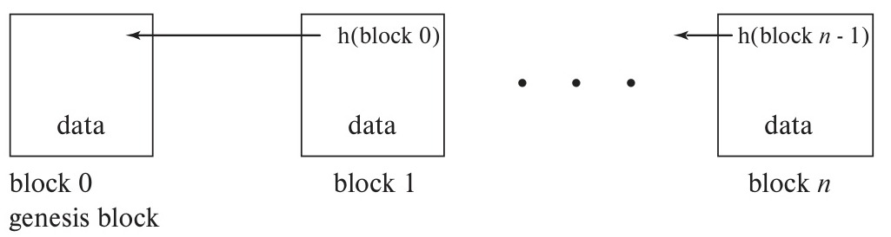

# Chapter 26: Blockchain Databases

<!-- Page 1251 -->

At the most basic level, a blockchain provides an alternative data format for storing a database, and its paradigm for transaction processing enables a high level of decentralization.

A major application of blockchain technology is in the creation of **digital ledgers**. A ledger in the financial world is a book of financial accounts, that keeps track of transactions. For example, each time you deposit or withdraw money from your account, an entry is added to a ledger maintained by the bank. Since the ledger is maintained by the bank, a customer of the bank implicitly trusts the bank to not cheat by adding unauthorized transactions to the ledger, such as an unauthorized withdrawal, or modifying the ledger by deleting transactions such as a deposit.

Blockchain-based distributed ledgers maintain a ledger cooperatively among several parties, in such a way that each transaction is digitally signed as proof of authenticity, and further, the ledger is maintained in such a way that once entries are added, they cannot be deleted or modified by one party, without detection by others.

Blockchains form a key foundation of Bitcoin and other cryptocurrencies. Although much of the technology underlying blockchains was initially developed in the 1980s and 1990s, blockchain technology gained widespread popular attention in the 2010s as a result of boom (and subsequent bust) in Bitcoin and other cryptocurrencies.

However, beyond the many cryptocurrency schemes, blockchains can provide a secure data-storage and data-processing foundation for business applications, without requiring complete trust in any one party. For example, consider a large corporation and its suppliers, all of whom maintain data about where products and components are located at any time as part of the manufacturing process. Even if the organizations are presumed trustworthy, there may a situation where one of them has a strong incentive to cheat and rewrite the record. A blockchain can help protect from such fraudulent updates. Ownership documents, such as real-estate deeds, are another example of the potential for blockchain use. Criminals may commit real-estate fraud by creating fake ownership deeds, which could allow them to sell a property that they do not own, or could allow the same property to be sold multiple times by an actual owner. Blockchains can help verify the authenticity of digitally represented ownership documents; blockchains can also ensure that once an owner has sold a property, the

<!-- Page 1252 -->

owner cannot sell it again to another person without getting detected. The security provided by the blockchain data structure makes it possible to allow the public to view these real-estate records without putting them at risk. We describe other applications for blockchains later in the chapter.

In this chapter, we shall look at blockchain from a database perspective. We shall identify the ways in which blockchain databases differ from the traditional databases we have studied elsewhere in this book and show how these distinguishing features are implemented. We shall consider alternatives to Bitcoin-style algorithms and implementation that are more suited to an enterprise database environment. With this database-oriented focus, we shall not consider the financial implications of cryptocurrencies, nor the issues of managing one’s holding of such currencies via a cryptocurrency wallet or exchange.

## 26.1 Overview

Before we study blockchains in detail, we first give an overview of cryptocurrencies, which have driven the development and usage of blockchains. We note, however, that blockchains have many uses beyond cryptocurrencies.

Traditional currencies, also known as “fiat currencies” are typically issued by a central bank of a country, and guaranteed by the government of that country. Currency notes are at one level just a piece of paper; the only reason they are of value is that the government that issues the currency guarantees the value of the currency, and users trust the government. Today, although financial holdings continue to be denominated in terms of a currency, most of the financial holdings are not physically present as currency notes; they are merely entries in the ledger of a bank or other financial institution. Users of the currency are forced to trust the organization that maintains the ledger.

A **cryptocurrency** is a currency created purely online, and recorded in a way that does not require any one organization (or country) to be totally trusted. This term arises from the fact that any such scheme has to based on encryption technologies. Since any digital information can be copied easily, unlike currency notes, any cryptocurrency scheme must be able to prevent “double spending” of money. To solve this problem, cryptocurrencies use ledgers to record transactions. Further, the ledgers are stored a secure, distributed infrastructure, with no requirement to trust any one party. These two key concepts, decentralization and trustlessness, are fundamental to cryptocurrencies. Cryptocurrenies typically aim, like regular currency, and unlike credit card or debit card transactions, to provide transaction anonymity, to preserve the privacy of users of the currency. However, since cryptocurrency blockchains are public data analytics may be used to compromise or limit anonymity.

Bitcoin, which was the first successful cryptocurrency, emerged with the publication of a paper by Satoshi Nakamoto[^1] in 2008 and the subsequent publication of the open-source Bitcoin code in 2009. The ideas in the original bitcoin paper solved

[^1]: Satoshi Nokamoto is a pseudonym for a person or group that anonymously created Bitcoin.

<!-- Page 1253 -->

a number of problems, and thereby allowed cryptocurrencies, which had earlier been considered impractical, to become a reality.

However, the underlying concepts and algorithms in many cases go back decades in their development. The brilliance of Nakamoto’s work was a combination of innovation and well-architected use of prior research. The successes of Bitcoin prove the value of this contribution, but the target—an anonymous, trustless, fully distributed concurrency—drove many technical decisions in directions that work less well in a database setting. The Further Reading section at the end of the chapter cites key historical papers in the development of these ideas.

At its most basic level, a blockchain is a linked list of blocks of data that can be thought of as constituting a log of updates to data. What makes blockchain technology interesting is that blockchains can be managed in a distributed manner in such a way that they are highly tamper resistant, and cannot be easily modified or manipulated by any one participant, except by appending digitally signed records to the blockchain.

In a business setting, trustless distributed control is valuable, but absolute anonymity runs counter to both principles of accounting and regulatory requirements. This leads to two main scenarios for the use of blockchains. Bitcoin’s blockchain is referred to as a **public blockchain**, since it allows any site to join and participate in the tasks of maintaining the blockchain. In contrast, most enterprise blockchains are more restricted and referred to as **permissioned blockchains**. In a permissioned blockchain, participation is not open to the public. Access is granted by a permissioning authority, which may be an enterprise, a consortium of enterprises, or a government agency.

Bitcoin introduced a number of ideas that made public blockchains practical, but these have a significant cost in terms of CPU power (and thereby, electrical power) needed to run the blockchain, as well as latencies in processing transactions. By relaxing Bitcoin’s strong assumptions about trustlessness and anonymity, it is possible to overcome many of the inefficiencies and high latencies of the Bitcoin model and design blockchains that further the goals of enterprise data management.

In this chapter, we begin by looking at the classic blockchain structure as used in Bitcoin and use that to introduce the key distinguishing properties of a blockchain. Achieving many of these properties relies upon one-way cryptographic hash functions. These hash functions are quite different from those used in Chapter 24 as a means of indexing databases. Cryptographic hash functions need to have some specific mathematical properties such as the following: given a data value $x$ and a hash function $h$, it must be relatively easy to compute $h(x)$ but virtually impossible to find $x$ given $h(x)$.

When a blockchain is stored distributed across multiple systems, an important issue is to ensure that the participating systems agree on what are the contents of the blockchain, and what gets added to it at each step. When participants trust each other, but may be vulnerable to failure, consensus techniques that we studied earlier in Section 23.8 can be used to ensure that all participants agree on the contents of a log (and a blockchain is, at its core, a log). However, reaching agreement on what data get added to a blockchain is much more challenging when participants in the blockchain do not trust each other and have no centralized control. The basic consensus algorithms are

<!-- Page 1254 -->

not applicable in such a setting. For example, an attacker could create a large number of systems, each of which joins the blockchain as a participant; the attacker could thereby control a majority of the participating systems. Any decision based on a majority can then be controlled by the attacker, who can force decisions that can tamper with the contents of the blockchain. The tamper resistance property of the blockchain would then be compromised.

We begin by describing the energy-intensive approach of Bitcoin, but we then consider a variety of alternative, more efficient approaches used in other cryptocurrencies. Finally, we consider approaches based on Byzantine-consensus algorithms, which are consensus algorithms that are resistant to some fraction of the participating nodes not just failing, but also lying and attempting to disrupt consensus. Byzantine consensus is well-suited to an enterprise blockchain environment, and can be used if the blockchain is *permissioned*, that is, some organization controls who can have permission to access the blockchain. Byzantine consensus is an old problem and solutions have been around for many years. However, the special constraints of blockchain databases have led to some newer approaches to this problem. References to more details on Byzantine consensus techniques may be found in the Further Reading section at the end of the chapter.

Blockchain databases store more than just currency-based debit-credit transactions. Like any database, they may store a variety of types of data about the enterprise. A traditional blockchain data organization makes it difficult to retrieve such data efficiently, but pairing a blockchain with a traditional database or building the blockchain on top of a database can enable faster query processing. We shall explore a variety of means of speeding up not only queries but also update transactions, both within the blockchain itself and by performing certain operations “off chain” and adding them in bulk to the blockchain at a later time.

After covering blockchain algorithms, we shall explore (in Section 26.8) some of the most promising applications of blockchain databases.

## 26.2 Blockchain Properties

At its most basic level, a blockchain is a linked list of blocks of data. A distinguishing feature of the blockchain data structure is that the pointers in the linked list include not only the identifier of the next older block, but also a hash of that older block. This structure is shown in Figure 26.1. The initial block, or **genesis block**, is shown as block 0 in the figure. It is set up by the creator of the blockchain. Each time a block is added to the chain, it includes the pair of values (pointer-to-previous-block, hash-of-previous-block). As a result, any change made to block is easily detected by comparing a hash of that block to the hash value contained in the next block in the chain. The hash value in the next block could be changed, but then the block after that would also have to be changed, and so on.

<!-- Page 1255 -->

*Figure 26.1 — Blockchain data structure.*

This hash-validated pointer format in a blockchain makes tampering with a blockchain hard. To make tampering virtually impossible, it is necessary to ensure that any tampering with the blockchain is easily detected and that the correct version of the blockchain is easily determined. To achieve this, the hash function must have certain mathematical properties that we shall discuss shortly. Further, the chain itself must be replicated and distributed among many independent nodes so that no single node or small group of nodes can tamper with the blockchain. Since the blockchain is replicated across multiple nodes, a distributed consensus algorithm needs to be used to maintain agreement regarding the correct current state of the blockchain. In this way, even if some nodes try to tamper with the blockchain contents, as long as a majority are honest, making decisions based on a majority vote can ensure the integrity of the blockchain.

The above approach works if the set of nodes that participates in the blockchain is controlled in some fashion that makes it difficult for an adversary to control a majority of the nodes. However, such control goes against the goal of not have any central control, and is viewed as unacceptable in public blockchains such as Bitcoin, which are based on public blockchains in which the number of participating nodes may change continuously. Any computer may download the blockchain and attempt to add blocks (the code for implementing blockchains is available in open source). As a result, a majority-based approach can be overwhelmed by an adversary who sets up a large number of low-cost computers as nodes. Such an attack is called a **Sybil attack**.

The way in which consensus is achieved among independent nodes varies among blockchains. The variations address trade-offs between performance (latency and throughput) and robustness to adversarial attacks on the consensus mechanism, including Sybil attacks. When we addressed distributed consensus in Chapter 23, we assumed that a single organization controlled the entire distributed system, and so the consensus algorithm had to tolerate only possible failures of nodes or the network that were fail-stop, where participants do not behave in an adversarial manner.

In a typical blockchain application, the chain is shared among multiple independent organizations. In the extreme case, for example Bitcoin, anyone can set up a node and participate, possibly for nefarious purposes. This implies that the types of failure that may occur are not just cases where a device or system stops working, but also cases

<!-- Page 1256 -->

where a system remains operational but behaves in an adversarial manner. In most enterprise settings, the blockchain is **permissioned**, providing some control over the set of participants, but still without direct controls to prevent malicious behavior.

A node participating in a blockchain fully needs to participate in the consensus mechanism and maintain its own replica of the blockchain. Such a node is called a **full node**. In some applications, there is a need for low-cost nodes that submit updates to the blockchain, but do not have the storage or computational power to participate in the consensus process. Such a node is called a **light node**.

We discuss blockchain consensus algorithms in detail in Section 26.4. Blockchain consensus algorithms can be placed into one of several broad categories:

- **Proof of work:** Proof of work, which is described in detail in Section 26.4.1, provides a solution to Sybil attacks by making it very expensive for an attacker to control a majority of the nodes. Specifically, the nodes agree that the next block on the blockchain will be added by the first node to solve a certain hard mathematical problem. This is referred to as **mining** a block. Proof-of-work algorithms are robust to adversarial behavior as long as the adversary does not control more than half the computing power in the entire network. To ensure this requirement, the problems are made intentionally hard, and require a lot of computational effort. Thus, robustness comes at the price of a huge amount of otherwise useless computation along with the price of electricity needed to carry out the computation.
- **Proof of stake:** Proof of stake, which is described in Section 26.4.2, provides another solution to Sybil attacks. Here, the nodes agree to select the next node to add a block to the blockchain based on an amount of the blockchain’s currency owned or held in reserve by a node.
- **Byzantine consensus:** Byzantine consensus does not solve the problem of Sybil attacks, but can be used in non-public blockchains, where entry of nodes to the system can be controlled. While some nodes may behave maliciously, it is assumed that a substantial majority are honest. In Byzantine consensus, described in Section 26.4.3, the next node to add a block to the blockchain is decided by an algorithm from the class of algorithms referred to as Byzantine-consensus algorithms. Like the basic consensus algorithms we described earlier in Section 23.8, these algorithms achieve agreement by message passing, but unlike those algorithms, these algorithms can tolerate some number of nodes being malicious by either disrupting consensus or trying to cause an incorrect consensus to be reached. This approach requires significantly more messages to be exchanged than in the case of the basic consensus algorithms of Section 26.4.3, but this is a worthwhile trade-off for the ability for a system to work correctly in the presence of a certain number of malicious nodes.
- **Other approaches:** There are several other less widely used consensus mechanisms, some of which are variants of the preceding mechanisms. These include proof of

<!-- Page 1257 -->

activity, proof of burn, proof of capacity, and proof of elapsed time. See the Further Reading section at the end of the chapter for details.

Another way to damage a blockchain besides attempting to alter blocks is to add a new block to a block other than the most recent one. This is called a **fork**. Forking may occur due to malicious activity, but there are two sources of nonmalicious forks:

1. Two distinct nodes may add a new block after the most recent block, but they do it so close together in time that both are added successfully, thus creating a forked chain. These accidental forks are resolved by a protocol rule that nodes always attempt to add blocks to the end of the longest chain. This probabilistically limits these accidental forks to a short length. The blocks on the shorter forks are said to be *orphaned*, and the contents of those blocks will get inserted on the real chain later if those contents are not already there.
2. A majority of blockchain users may agree to fork the blockchain in order to change some aspect of the blockchain protocol or data structure. This is a rare event and one that, when it has occurred in major blockchains, has caused major controversy. Such a fork is said to be a **soft fork** if prior blocks are not invalidated by the fork. That is, the old version of the blockchain software will recognize blocks from the new version as valid. This permits a gradual transition from the old version of the blockchain software to the new version. In a **hard fork**, the old version of the blockchain software will deem blocks from the new version to be invalid. After a hard fork, if the old version of the blockchain software remains in use, it will lead to a separate blockchain with different contents.

Because of the possibility of orphaned blocks, it may be necessary to wait for several additional blocks to be added before it is safe to assume s block will not be orphaned.

Note 26.1 on page 1258 presents a few examples of notable blockchain forks.

So far, we have not said much about the actual data in the blocks. The contents of blocks vary by application domain. In a cryptocurrency application, the most common data found in blocks are basic currency-transfer transactions. Since any node can add a block, there needs to be a way to ensure that transactions entered are in fact genuine. This is achieved via a technique called a **digital signature** that allows a user to “sign” a transaction and allows every node to verify that signature. This prevents fake transactions from being added to the chain and prevents participants in the transaction from subsequently denying their involvement in the transaction. This latter property is referred to as **irrefutability**.

Transactions are broadcast to all nodes participating in the blockchain; when a node adds a block to the chain, the block contains all transactions received by the node that have not already been added to the chain.

The users who submit transactions may be known to the blockchain administrator in a permissioned blockchain, but in a public blockchain like Bitcoin, there is no direct

<!-- Page 1258 -->

> ### Note 26.1 Blockchain Fork Examples
> 
> There have been several notable forks of major blockchains. We list a few here.
> 
> - **Hard fork: Bitcoin/Bitcoin Cash:** Bitcoin’s built-in block-size limit was an acknowledged problem in the Bitcoin community but agreeing on a solution proved controversial. A hard fork in August 2017 created a new cryptocurrency, Bitcoin Cash, with a larger block-size limit. Holders of Bitcoin at the time of the fork received an equal amount of Bitcoin Cash, and thus could spend both.
> - **Soft fork: Bitcoin SegWit:** SegWit (short for segregated witness) moves certain transaction-signature data (referred to as *witness data*) outside the block. This allows more transactions per block while retaining the existing block size limit. The relocated witness data are needed only for transaction validation. SegWit was introduced in August 2017 via a soft fork. This was a soft fork because the old blocks were recognized as valid and nodes not yet upgraded were able to retain a high degree of compatibility.
> - **Hard fork: Ethereum/Ethereum Classic:** This fork arose from the failure of a crowd-funded venture-capital operation running as a smart contract in the Ethereum blockchain. Its code contained a design flaw that enabled a hack in 2016 that stole ether valued in the tens of millions of U.S. dollars. A controversial hard fork refunded the stolen funds, but opponents of the fork, believing in the inviolabilty of blockchain immutability, retained the original blockchain and created Ethereum Classic.

connection between a user ID and any real-world entity. This anonymity property is a key feature of Bitcoin, but its value is diminished because of the possibility to tie a user ID to some off-chain activity, thereby de-anonymizing the user. De-anonymization can occur if the user enters into a transaction with a user whose user ID has already been de-anonymized. De-anonymization can occur also via data mining on the blockchain data and correlating on-chain activity by a specific user ID with the “real-world” activity of a specific individual.

Finally, a feature of blockchains is the ability to store executable code, referred to as a **smart contract**. A smart contract can implement complex transactions, take action at some point in the future based on specified conditions, and, more generally, encode a complex agreement among a set of users. Blockchains differ not only in the language used for smart contracts but also in the power of the language used. Many are Turing complete, but some (notably, Bitcoin) have more limited power. We discuss smart contracts, including how and when their code is executed, in Section 26.6.

<!-- Page 1259 -->

We summarize this discussion by listing a set of properties of blockchains:[^2]

- **Decentralization:** In a public blockchain, control of the blockchain is by majority consensus with no central controlling authority. In a permissioned blockchain, the degree of central control is limited, typically only to access authorization and identity management. All other actions happen in a decentralized manner.
- **Tamper Resistance:** Without gaining control over a majority of the blockchain network, it is infeasible to change the contents of blocks.
- **Irrefutability:** Activity by a user on a blockchain is signed cryptographically by the user. These signatures can be validated easily by anyone and thus prove that the user indeed is responsible for the transaction.
- **Anonymity:** Users of a blockchain have user IDs that are not tied directly to any personally identifying information, though anonymity may be compromised indirectly. Permissioned blockchains may offer only limited anonymity or none at all.

## 26.3 Achieving Blockchain Properties via Cryptographic Hash Functions

In this section, we focus on the use of cryptographic hash functions to ensure some of the properties of blockchains. We begin with a discussion of special types of hash function for which it is infeasible to compute the inverse function or find hash collisions. We show how these concepts extend to public-key encryption, which we first saw in Section 9.9. We then show how cryptographic hash functions can be used to ensure the anonymity, irrefutability, and tamper-resistance properties. We show how hash functions are used in mining algorithms later in Section 26.4.1.

### 26.3.1 Properties of Cryptographic Hash Functions

In Section 14.5, hash functions were used as a means of accessing data. Here, we use hash functions for a very different set of purposes, and as a result, we shall need hash functions with additional properties beyond those discussed earlier.

A hash function $h$ takes input from some (large) domain of values and generates as its output a fixed-length bit string. Typically, the cardinality of the domain is much larger than the cardinality of the range. Furthermore, the hash function must have a *uniform distribution*, that is, each range value must be equally probable given random input. A hash function $h$ is **collision resistant** if it is infeasible to find two distinct values $x$ and $y$ such that $h(x) = h(y)$. By **infeasible**, we mean that there is strong mathematical

[^2]: These properties pertain to blockchains, but not to most cryptocurrency exchanges. Most exchanges hold not only customers’ data but also their keys, which means that a hack against the exchange’s database can result in theft of users’ private keys.

<!-- Page 1260 -->

evidence, if not an actual proof, that there is no way to find two distinct values $x$ and $y$ such that $h(x) = h(y)$ that is any better than random guessing.

The current standard choice of a cryptographic hash function is called SHA-256, a function that generates output 256 bits in length. This means that given a value $x$, the chance that a randomly chosen $y$ will hash to the same value to which $x$ hashes is $1/2^{256}$. This means that even using the fastest computers, the probability of a successful guess is effectively zero.[^3]

The collision-resistance property contributes to the tamper resistance of a blockchain in a very important way. Suppose an adversary wishes to modify a block $B$. Since the next-newer block after $B$ contains not only a pointer to $B$ but also the hash of $B$, any modification to $B$ must be such that the hash of $B$ remains unchanged after the modification in order to avoid having to modify also that next-newer block. Finding such a modification is infeasible if the hash function has the collision-resistance property, and, therefore, any attempt to tamper with a block requires changing all newer blocks in the chain.

A second important property that we require of a cryptographic hash function is **irreversibility**, which means that given only $h(x)$, it is infeasible to find $x$. The term *irreversible* comes from the property that, given $x$, it is easy to compute $h(x)$, but given only $h(x)$, it is infeasible to find $h^{-1}(h(x))$. The next section shows how this concept is applied to blockchains.[^4]

### 26.3.2 Public-Key Encryption, Digital Signatures, and Irrefutability

Section 9.9 described two categories of encryption methods: *private-key* encryption, where users share a secret key, and *public-key* encryption, where each user has two keys, a public key and a private key. The main problem with private-key encryption is that users must find a way at the outset to share the secret private key. Public-key encryption allows users who have never met to communicate securely. This property of public-key encryption is essential to blockchain applications that serve arbitrarily large communities of users worldwide.

Each user $U_i$ has a public key $E_i$ and a private key $D_i$. A message encrypted using $E_i$ can be decrypted only with the key $D_i$, and, symmetrically, a message encrypted using $D_i$ can be decrypted only with the key $E_i$. If user $u_1$ wishes to send a secure message $x$ to $U_2$, $U_1$ encrypts $x$ using the public key $E_2$ of user $U_2$. Only $U_2$ has the key $D_2$ to decrypt the result. For this to work, the specific function used must have the irreversibility property so that given a public key $E_i$ it is infeasible to compute the inverse function,

[^3]: $2^{256}$ is larger than $10^{77}$. If a computer could make one guess per cycle it would take more than $10^{67}$ seconds to have a 50 percent chance of guessing correctly. That translates to more than $10^{59}$ years. To put that in context, astronomers predict that the sun will have grown in size to envelop Earth within $10^{10}$ years.

[^4]: This property has long been used for storing passwords. Rather than storing user passwords in clear text, leaving them susceptible to being stolen, hashes are kept instead. Then, when a user logs in and enters a password, the hash of that password is computed and compared to the stored value. Were an attacker to steal the hashes, that attacker would still lack the actual passwords, and, if the hash function in use has the irreversibility property, then it is infeasible for the hacker to reverse-engineer the user passwords.

<!-- Page 1261 -->

that is, to find $D_i$. This creates a mechanism for users who have never met to share secret messages.

Suppose now that instead of seeking to send a secret message, user $U_1$ wishes to “sign” a document $x$. User $U_1$ can encrypt $x$ using the private key $D_1$. Since this key is private, no one besides $U_1$ could have computed that value, but anyone can verify the signature by decrypting using the public key of $U_1$, that is, $E_1$. This provides a public proof that user $U_1$ has signed document $x$.

In blockchain applications, the concept of a digital signature is used to validate transactions. Observe that the linkage of blocks in the blockchain, using a pointer and the hash of block to which the pointer points, means that a user can sign an entire chain simply by signing the hash of the newest block in the chain. See the Further Reading section at the end of the chapter for references to the mathematics of public-key encryption.

### 26.3.3 Simple Blockchain Transactions

In our discussion of database transactions in Chapter 17, we described a transaction as a sequence of steps that read and/or write data values from the database. That concept of a transaction is based on a data model where there is a single store of data values that are accessed by transactions. A blockchain, in its simplest form, is more closely an analog of a database log in that it records the actual transactions and not just final data values. That analogy breaks down, however, in most blockchains, because transactions are either fully independent or depend explicitly on each other. The model we describe here corresponds to simple Bitcoin transactions.

As an example, consider two users, $A$ and $B$, and assume $A$ wishes to pay $B$ 10 units of some currency. If this were a traditional banking application with a fiat currency such as the U.S. dollar, the transaction implementing this transfer would read $A$’s account balance, decrement it by 10, and write that value to the database, and then read $B$’s balance, add 10, and write that value to the database. In a blockchain-based system, this transaction is specified in a different manner.

Rather than referencing data items, a Bitcoin-style blockchain transaction references users and other transactions. Users are referenced by their user ID. User $A$ would locate a transaction or set of transactions from past history $T_1, T_2, \ldots, T_n$ that paid $A$ a total of at least 10 units of the currency. $A$ would then create a transaction $T$ that takes the output (i.e., the amount paid to $A$) by those transactions as input, and as its output pays 10 units of the currency to $B$ and the remainder back to $A$ as the “change.” The original transactions $T_1, T_2, \ldots, T_n$ are then treated as having been spent.

Thus, each transaction indicates how much money has been paid to whom; the currency balance of a user $A$ is defined by a set of unspent transactions that have paid money to $A$. Assuming $A$ is honest, those transactions’ outputs (i.e., the output of $T_1, T_2, \ldots, T_n$) would not have been spent already by $A$ in a previous transaction. If $A$ were indeed dishonest and $T$ attempted to spend the output of some $T_1$ a second time, $T$ would be a **double-spend** transaction. Double-spend transactions and other in-

<!-- Page 1262 -->

valid transactions are detected in the mining process that we discuss in Section 26.4, by keeping track of all unspent transactions and verifying that each transaction $T_i$ that is input to $T$ is unspent when $T$ is executed. After $T$ is executed, each such $T_i$ is treated as spent.

Ethereum uses a different and more powerful model, where the blockchain maintains state (including current balance) for each account in the system. Transactions update the state, and can transfer funds from one account to another. The model used in Ethereum is discussed in Section 26.5.

A Bitcoin-style transaction $T$ specifies:

- The input transactions $T_1, T_2, \ldots, T_n$.
- The set of users being paid and the amount to be paid to each, which in our example is 10 units to $B$ and the remainder to $A$.[^5]
- $A$’s signature of the transaction, to prove that $A$ in fact authorized this transaction.
- A more complex transaction might include executable code as part of its specification, but we shall defer that to Section 26.6.
- Data to be stored in the blockchain; the data must be under some size, which is blockchain dependent.

The transaction model described here is quite distinct from that of a traditional database system in a variety of ways, including:

- Existing data items are not modified. Instead, transactions add new information. As a result, not only the current state but also the history leading to the current state are fully visible.
- Conflicts in transaction ordering are prevented. If conflicts occur, the transaction causing a conflict is detected and deemed invalid as part of the process of adding a block to the chain, described in Section 26.4.
- Although the blockchain is a distributed system, a transaction is created locally. It becomes part of the permanent, shared blockchain only through the mining process. This is, in effect, a form of deferred transaction commit.
- Dependencies of one transaction upon another are stated explicitly in a transaction since a transaction lists those transactions whose outputs it uses as input. If we view this in terms of the precedence graph introduced in Chapter 17, our example would include precedence-graph edges $T_1 \to T, T_2 \to T, \ldots, T_n \to T$.
- There is no explicit concurrency control. Much of the need for concurrency control is eliminated by the maintenance of a complete history and the direct sequencing

[^5]: In a real system, there may also be a payout to the miner of the transaction, that is, the node that adds the block to the blockchain, as we discuss in Section 26.4.

<!-- Page 1263 -->

of transactions. Thus, there is no contention for the current value of any database data item.

This Bitcoin-based example is not the only way blockchain systems manage transaction ordering. We shall see another example when we consider smart contracts in Section 26.6.

The fact that data may be stored in the blockchain makes the blockchain more than just a tamper-resistant transaction log. It allows for the representation of any sort of information that might be stored in a traditional database. In Section 26.5.2, we shall see how this capability, particularly in blockchains with a concept of blockchain state, makes the blockchain a true database.

## 26.4 Consensus

Because the blockchain is replicated at all participating nodes, each time a new block is added, all nodes must eventually agree first on which node may propose a new block and then agree on the actual block itself.

In a traditional distributed database system, the consensus process is simplified by the fact that all participants are part of one controlling organization. Therefore, the distributed system can implement global concurrency control and enforce two-phase commit to decide on transaction commit or abort. In a blockchain, there may be no controlling organization, as is the case for a public blockchain like Bitcoin. In the case of a permissioned blockchain, there may be a desire to have a high degree of decentralized control in all matters except the actual permissioning of participants, which is managed by the organization controlling the permissioned blockchain.

When transactions are created, they are broadcast to the blockchain network. Nodes may collect a set of transactions to place in a new block to be added to the chain. The consensus mechanisms used in blockchains fall roughly into two categories:

1. Those where the nodes reach agreement on one node to add the next block. These typically use Byzantine consensus (Section 26.4.3).
2. Those where the blockchain is allowed temporarily to **fork** by allowing multiple nodes to create a block following the last block in the chain. In this approach, nodes attempt to add blocks to the longest linear subchain. Those blocks not on that longest chain are **orphaned** and not considered part of the blockchain. To avoid a massive number of forks being created, this approach limits the rate at which blocks may be added so that the expected length of orphaned branches is short. These typically use proof-of-work (Section 26.4.1) or proof-of-stake (Section 26.4.2).

A node that adds a block to the chain must first check that block of transactions. This entails checking that:

<!-- Page 1264 -->

- Each transaction is well-formed.
- The transaction is not double-spending by using as input (i.e., spending) currency units that have been used already by a prior transaction. To do so, each node must track the set of all unspent currency units (transactions), and look up this set for each transaction $T$ to ensure that all the currency units that are inputs to $T$ are unspent.
- The transaction is correctly signed by the submitting user.

When a node is selected to add a block to the chain, that block is propagated to all nodes, and each checks the block for validity before adding it to its local copy of the chain.

We next need to consider the question of why any node would want to use its resources for mining, that is to carry out the work needed to append blocks to the chain. Mining is a service to the blockchain network as a whole, and so miners are paid (in the currency of the blockchain) for their efforts. There are two sources of payment to miners:

1. A fee paid by the system in new coins in the currency of the blockchain.
2. A fee included by the submitter of the transaction. In this case the output of the transaction includes an additional output representing a payment to the miner of the block containing the transaction. Users are incented to include fees since such fees incent miners to include their transactions preferentially in new blocks.

The exact means of paying miners varies among blockchains.

In this section, we look at various ways to achieve consensus. We begin by assuming a public blockchain and describe consensus based on two approaches: *proof-of-work* and *proof-of-stake*. We then consider permissioned blockchains that in many cases choose to use a consensus mechanism based on *Byzantine consensus*.

### 26.4.1 Proof of Work

Proof-of-work consensus is designed for public blockchains in which the number of participating nodes is changing continuously. Any computer may download the blockchain and attempt to add blocks. As a result, a majority-based approach can be overwhelmed by an adversary who sets up a large number of low-cost computers as nodes. As mentioned earlier, such an attack is called a *Sybil attack*. Instead, proof-of-work requires a node to solve a computationally hard, but not infeasible, mathematical problem. An attacker cannot overwhelm a blockchain network simply by adding inexpensive nodes. Rather, the attacker would need to have access to computation capacity that forms a majority of the network’s total computation capacity, a task that is much more difficult and costly than launching a Sybil attack.

<!-- Page 1265 -->

The computationally hard problem is based on the concept of cryptographic hashing. A node that wishes to mine a block $B$ as the next block needs to find a value, called a **nonce**, that, when concatenated to $B$ and the hash of the previous block, hashes to a value less than a preset target value specified for the blockchain. The nonce is typically a 32-bit value. If the target is set very low, say to 4, and assuming the usual 256-bit hash, a miner would have only a $1/2^{254}$ chance of succeeding for a single choice for the nonce. If the target were set very high, say to $2^{255}$, the miner would have a 50 percent chance of success. Blockchain implementations are designed to vary the target so as to control the rate of mining of blocks across the whole system. This variability allows the system to adjust as computation power increases whether due to hardware advances or due to additional nodes joining the network. The target times vary for different blockchains. Bitcoin targets having some node in the system successfully mine a block every 10 minutes. Ethereum targeted a mining time of 10 to 15 seconds with its proof-of-work mechanism. As of late 2018, Ethereum is moving to a proof-of-stake mechanism and is expected to target a slightly faster rate. While faster may appear to be better, note that if mining occurs at a faster rate than the time it takes to propagate a new block throughout the network, the probability of forks and orphaned blocks increases.

Now that we have seen how proof-of-work mining works, let us recall the properties we stated about cryptographic hash functions. If there were an efficient algorithm for finding a nonce that results in a hash less than the target, miners might find nonces too quickly. Therefore, the hash function must ensure that there is no better way to find a nonce than simply trying each possible nonce value in turn. This leads us to require one additional property for cryptographic hash functions, the **puzzle-friendliness** property. This property requires that given a value $k$, for any $n$-bit value $y$ it is infeasible to find a value $x$ such that $h(x \parallel k) = y$ in time significantly less that $2^n$, where $\parallel$ denotes concatenation of bit strings.

Proof-of-work mining is controversial. On the positive side, for a large network, it would be highly costly for an adversary to obtain enough computational power to dominate mining. However, on the negative side, the amount of energy used in mining is huge. Estimates as this chapter is being written suggest that Bitcoin mining worldwide consumes about 1 percent of the power consumed by the United States, or more than the entire consumption of several nations, for example Ireland. The large amount of computation needed has created incentives to design special-purpose computing chips for mining and incentives to locate large mining installations near sources of cheap power sources.

These concerns are causing a movement to alternatives, such as proof-of-stake, which we discuss next. These concerns have led also to interest in alternative forms of proof-of-work that, for example, require having a large amount of main memory in order quickly to find a nonce. Memory-intensive schemes retain the cost barrier of proof-of-work while reducing the energy waste. They are a subject of current research. Furthermore, we shall see that for enterprise permissioned-blockchain applications, much less costly means of consensus are possible.

<!-- Page 1266 -->

In practice, a group of users may unite to form a *mining pool*, which is a consortium that works together to mine blocks and then shares the proceeds among its members.

### 26.4.2 Proof of Stake

The concept of proof-of-stake is to allow nodes holding a large stake in the currency of the blockchain to be chosen preferentially to add blocks. This rule cannot be applied absolutely, since then a single largest stakeholder would control the chain. Instead, the probability of mining success, using proof-of-work, is made higher for nodes in proportion to their stake. By adjusting both the stake requirements and the mining difficulty, it remains possible to control the rate at which blocks are mined.

There are a wide variety of proof-of-stake schemes. They may include measurement not only of overall stake, but also the total time a stake has been held. They may require that the stake or some fraction of it be held inactive for some period of time in the future.

Properly tuning a proof-of-stake mechanism is difficult. Not only are there more parameters to consider than in proof-of-work, but also one must guard against a situation where there is too little cost penalty for an adversary to add blocks to a fork other than the longest one.

### 26.4.3 Byzantine Consensus

An important alternative to work- or stake-based consensus is message-based consensus. Message-based consensus is widely used in distributed database systems. As we noted earlier, the basic consensus protocols do not work for blockchain consensus because it cannot be assumed that there are no malicious nodes.

Message-based systems aim to achieve consensus via a majority vote. Such systems are vulnerable to a Sybil attack. In an enterprise permissioned blockchain, in which users have to be granted permission to participate, Sybil attacks are not possible since the permissioning authority can easily deny permission when a malicious user attempts to add an excessive number of nodes. However, even in this setting, one cannot assume every user is totally honest.

For example, consider a supply-chain blockchain in which all suppliers enter data on the chain pertaining to each item being supplied either to another supplier or the ultimate manufacturer of an end-user product. Some supplier might choose to falsify data for its own advantage, but, when a fraud investigation begins, that supplier may then seek to fork the blockchain to cover-up its fraud. Thus, even absent the possibility of Sybil attacks, there remains the possibility of adversarial behavior. It is difficult to anticipate every possible form of adversarial behavior.

For this reason, we model this situation using the concept of **Byzantine failure** in which it is assumed that a “failed” node can behave in an arbitrary manner, and the network of non-failed nodes must be robust to all such misbehavior, including misbehavior that takes exactly the needed set of steps to sabotage the network. The assumption of

<!-- Page 1267 -->

Byzantine failure is quite different from the assumption made by consensus protocols, where the only type of failure considered is the absence of function, that is, the only way a node or network link fails to stop working and thus do nothing. This is referred to as a *fail-stop* model and precludes any malicious behavior.

In Section 23.8, we discussed distributed consensus protocols, notably Paxos and Raft. These protocols depend on the fail-stop assumption, but allow agreement using majority rule (in contrast, 2PC requires unanimity of agreement). For Byzantine consensus, we must seek a form of majority rule that overcomes not only the failure of a minority of nodes, but also the possible malicious behavior of that minority. For example, a malicious node $n_1$ may tell node $n_2$ that it desires to commit a transaction, but tell $n_3$ that it desires to abort the transaction. As one might expect, achieving consensus in the face of such malicious nodes requires a higher cost in the number of messages sent to achieve agreement, but in a blockchain, that higher cost is acceptable since it can be much lower than the cost of proof-of-work or proof-of-stake mining.

The development of Byzantine consensus algorithms began in the early 1980s; see the Further Reading section at the end of the chapter for references. There has been much theoretical work relating the number of rounds of messaging, the total number of messages sent, and the fraction of the nodes that can be malicious without causing the protocol to fail. Early work made assumptions about network behavior, such as the time it takes to deliver a message or that the network behaves in a highly synchronous manner. Modern Byzantine consensus algorithms are based on real-world assumptions and incorporate cryptographic signatures to guard against forged messages. The degree of synchronization is reduced, but truly asychronous fault-tolerant consensus is provably impossible. One widely used approach, called *Practical Byzantine Fault Tolerance*, tolerates malicious failure of up to $\lfloor\frac{n-1}{3}\rfloor$ nodes and is viewed as providing an acceptable level of performance. Other protocols are referenced in the Further Reading section at the end of the chapter.

## 26.5 Data Management in a Blockchain

Until now we have not been concerned about the efficiency of looking up information in a blockchain. While individual users can track their unspent transactions, that is not sufficient to validate a block. Each node needs to be able to check each transaction in a block to see if it was already spent. In principle, that could be done by searching the entire blockchain, but that is far too costly since it could involve searching backwards to the very first block in the chain. In this section, we shall consider data structures to make such lookups efficient.

Furthermore, not every blockchain uses a transaction model in which transaction inputs are restricted to be the direct output of other transactions. Some, notably Ethereum, allow for the maintenance of a state for each user (account, in Ethereum parlance) that holds the account balance (in the Ethereum currency, Ether) and some

<!-- Page 1268 -->

associated storage. This transaction and data model comes closer to that of a database system. Simply storing this information in a database, however, would not preserve the blockchain properties we listed in Section 26.2. In this section, we consider this richer model and how it can be represented physically either via specialized data structures or with the help of database system concepts.

### 26.5.1 Efficient Lookup in a Blockchain

As we noted earlier, in order to validate a Bitcoin-style transaction, a node needs to check three items:

1. The transaction is syntactically well formed (proper data format, sum of inputs equals sum of outputs, and so on). This is relatively straightforward.
2. The transaction is signed by the user submitting it. This is a matter of ensuring that the signature, which should have been produced by the user submitting the transaction using her or his private key, can be decrypted with that user’s public key to obtain the transaction itself. This is not a highly costly step.
3. The transaction’s inputs have not been spent already. This entails looking up each individual input transaction in the blockchain. These transactions could be anywhere in the blockchain since they can be arbitrarily old. Without a good means of performing this lookup, this step would be prohibitively costly.

To test for an input transaction having been used already, it is necessary to be able to check that transaction did not appear earlier as input to another transaction. Thus, it suffices for each node to maintain an index on all unspent transactions. Entries in this index point to the location of the corresponding transaction in the blockchain, allowing the details of the input transaction to be validated.

Bitcoin, like many other blockchains, facilitates lookup and validation by storing transactions within a block in a Merkle tree, which we discussed in Section 23.6.6. In that section, we noted that a Merkle tree enables the efficient verification of a collection (transactions, in the case of a blockchain) that may have been corrupted by a malicious user. In a blockchain, there are optimizations to the Merkle tree possible, such as truncating the tree to remove subtrees consisting solely of spent transactions. This reduces significantly the space requirements for nodes to store the full blockchain. Space is a major consideration since major blockchains grow faster that one gigabyte per month, a rate likely to increase as blockchain applications grow.

The Merkle-tree structure is particularly useful for light nodes (i.e., nodes that do not store the entire blockchain) since they need to retain only the root hash of the tree for verification. A full node can then provide any needed data to the light node by providing those data plus the hashes needed for the light node to verify that the provided data are consistent with its stored hash value (see Section 23.6.6).

<!-- Page 1269 -->

### 26.5.2 Maintaining Blockchain State

The simple blockchain transaction model of Section 26.3.3 showed how a basic Bitcoin transaction works. There are more complex transactions possible in Bitcoin, but they follow the same pattern of a set of input transactions and a set of payments to users.

In this section, we look at the model used by certain other blockchains, notably Ethereum, that maintain a *state* that holds the balance in each account. Transactions move currency units (*ether* in Ethereum) among accounts. Since transactions are serialized into blocks by miners, there is no need for concurrency-control protocols like those of Chapter 18. Each block contains a sequence of transactions but also contains the state as it existed after execution of transactions in the block. It would be wasteful to replicate the entire state in each block since the modest number of transactions in one block are likely to change a relatively small fraction of the overall state. This creates a need for a data structure allowing better use of storage.

Recall that transactions within a block are stored in a Merkle tree. State is stored similarly. This would appear to offer the possibility of saving space by allowing pointers (plus the associated hash) back to earlier blocks for those parts of the state that are unchanged. The only challenge here is that it must be possible not only to change tree nodes, but also to insert and delete them. A variant of the Merkle-tree data structure, called a **Merkle-Patricia tree**, is used for this purpose in some blockchains, including Ethereum. This data structure allows for efficient key-based search in the tree. Instead of actually deleting and inserting tree nodes, a new tree root is created and the tree itself structured so as to reference (and thus reuse) subtrees of prior trees. Those prior trees are immutable, so rather than making new parent pointer (which we can’t do), a leaf-to-root path is generated by reversing a root-to-leaf path that is easily obtained in the Merkle-Patricia tree structure. Details of this data structure can be found in the references in the Further Reading section at the end of the chapter.

Corda, Hyperledger Fabric, and BigchainDB are examples of blockchains that use a database to store state and allow querying of that state. Fabric and BigchainDB use NoSQL databases. Corda uses an embedded-SQL database. In contrast, Ethereum state is stored in a key-value store.

## 26.6 Smart Contracts

So far, we have focused on simple funds-transfer transactions. Actual blockchain transactions can be more complex because they may include executable code. Blockchains differ not only in the supported language(s) for such code, but also, and more importantly, in the power of those languages. Some blockchains offer Turing-complete languages, that is, languages that can express all possible computations. Others offer more limited languages.

### 26.6.1 Languages and Transactions

Bitcoin uses a language of limited power that is suitable for defining many standard types of conditional funds-transfer transactions. Key to this capability is its *multisig*

<!-- Page 1270 -->

instruction, which requires $m$ of $n$ specified users to approve the transfer. This enables escrow transactions in which a trusted third party resolves any dispute between the two parties to the actual transfer. It also enables grouping several transactions between two users into one larger transaction without having to submit each component transaction separately to the blockchain. Because adding transactions to the blockchain has a time delay and a cost in transaction fees, this feature is quite important. This concept has been extended in off-chain processing systems, which we discuss in Section 26.7.

Ethereum as well as most blockchains targeting enterprise applications include a language that is Turing complete. Many use familiar programming languages or variants based heavily on such languages. This would seem like an obvious advantage over less-powerful languages, but it comes at some risk. Whereas it is impossible to write an infinite loop in Bitcoin’s language, it is possible to do so in any Turing-complete language. A malicious user could submit a transaction that encodes an infinite loop, thereby consuming an arbitrarily large amount of resources for any node attempting to include that transaction in a newly mined block. Testing code for termination, the halting problem, is a provably unsolvable problem in the general case. Even if the malicious user avoids an infinite loop, that user could submit code that runs for an exceptionally long time, again consuming miner resources. The solution to this problem is that users submitting a transaction agree to pay the miner for code execution, with an upper bound placed on the payment. This limits the amount of total execution to some bounded amount of time.

The decentralized nature of a blockchain leads to an incentive system for users to convince miners to include their transaction and thus execute their code. Ethereum’s solution is based on the concept of *gas*, so named as to provide an analogy to automobile fuel. Each instruction consumes a fixed amount of gas. Gas consumption in a transaction is governed by three parameters:

1. **Gas price:** the amount of ether the user is offering to pay the miner for one unit of gas.
2. **Transaction gas limit:** the upper bound on transaction gas consumption. Transactions that exceed their gas limit are aborted. The miner keeps the payment, but the transaction actions are never committed to the blockchain.
3. **Block gas limit:** a limit in the blockchain system itself on the sum over all transactions in a block of their transaction gas limits.

A user who sets a gas price too low may face a long wait to find a miner willing to include the transaction. Setting the gas price too high results in the user overpaying.

Another hard choice is that of the gas limit. It is hard to set the limit to the precise amount of gas that the contract will use. A user who sets the limit too low risks transaction failure, while a user who, fearing “running out of gas,” sets the transaction gas limit excessively high may find that miners are unwilling to include the transaction because it consumes too large a fraction of the block gas limit. The result of this is an

<!-- Page 1271 -->

interesting problem for transaction designers in optimizing for both cost and speed of mining.

In a Bitcoin-style transaction, transaction ordering is explicit. In a state-based blockchain like Ethereum, there is no explicit concept of input transactions. However, there may be important reasons why a smart contract may wish to enforce a transaction order. For transactions coming from the same account, Ethereum forces those transactions to be mined in the order in which the account created them by means of an *account nonce* associated with the transaction. An account nonce is merely a sequence number associated with each transaction from an account, and the set of transactions from an account must have consecutive sequence numbers. Two transactions from an account cannot have the same sequence number, and a transaction is accepted only after the transaction with the previous sequence number has been accepted, thus preventing any cheating in transaction ordering. If the transactions to be ordered are from different accounts, they need to be designed such that the second transaction in the ordering would fail to validate until after the first transaction is processed.

The fact that miners must run the smart-contract code of transactions they wish to include in a block, and that all full nodes must run the code of all transactions in mined blocks, regardless of which node mined the block, leads to a concern about security. Code is run in a safe manner, usually on a virtual machine designed in the style of the Java virtual machine. Ethereum has its own virtual machine, called the EVM. Hyperledger executes code in Docker containers.

### 26.6.2 External Input

A smart contract may be defined in terms of external events. As a simple example, consider a crop-insurance smart contract for a farmer that pays the farmer an amount of money dependent on the amount of rainfall in the growing season. Since the amount of rainfall in any future season is not known when the smart contract is written, that value cannot be hard-coded. Instead, input must be taken from an external source that is trusted by all parties to the smart contract. Such an external source is called an **oracle**.[^6]

Oracles are essential to smart contracts in many business applications. The fact that the oracle must be trusted is a compromise on the general trustlessness of a blockchain environment. However, this is not a serious compromise in the sense that only the parties to a contract need to agree on any oracles used and, once that agreement is made, the agreement is coded into the smart contract and is immutable from that point forward.

Corruption of an oracle after it is coded into an operating smart contract is a real problem. This issue could be left as an externality for the legal system but ideally, a process for settlement of future disputes would be coded into the contract in a variety of ways. For example, parties to the contract could be required to send the contract

[^6]: This term is rooted in ancient Greek culture and bears no relationship to the company by the same name.

<!-- Page 1272 -->

certification messages periodically, and code could be written defining actions to be taken in case a party fails to recertify its approval of the oracle.

Direct external output from a smart contract is problematic since such output would have to occur during its execution and thus before the corresponding transaction is added to the blockchain. Ethereum, for example, deals with this by allowing a smart contract to *emit events* that are then logged in the blockchain. The public visibility of the blockchain then allows the actions of the smart contract to trigger activity external to the blockchain.

### 26.6.3 Autonomous Smart Contracts

In many blockchains, including Ethereum, smart contracts can be deployed as independent entities. Such smart contracts have their own account, balance, and storage. This allows users (or other smart contracts) to use services provided by a smart contract and to send or receive currency from a smart contract.

Depending on how a specific smart contract is coded, a user may be able, by design, to control the smart contract by sending it messages (transactions). A smart contract may be coded so that it operates indefinitely and autonomously. Such a contract is referred to as a **distributed autonomous organization** (DAO).[^7] DAOs, once established, are difficult to control and manage. There is no way to install bug fixes. In addition, there are many unanswered questions about legal and regulatory matters. However, the ability to create these entities that communicate, store data, and do business independent of any user is one of the most powerful features of the blockchain concept. In an enterprise setting, smart contracts operate under some form of control by an organization or a consortium.

A smart contract may be used to create a currency on top of another currency. Ethereum often serves as the base blockchain as this allows the rich existing ecosystem for Ethereum to be leveraged to provide underlying infrastructure. Such higher-level currency units are called tokens, and the process of creating such currencies is referred to as an **initial coin offering** (ICO). An important added benefit of using an existing blockchain as the basis for a token is that it is then possible to reuse key elements of the user infrastructure, most importantly the wallet software users need to store tokens. The ERC-20 Ethereum standard for tokens is widely used. More recent standards, including ERC-223, ERC-621, ERC-721, ERC-777, and ERC-827, are discussed in the references in the Further Reading section at the end of the chapter.

The relative ease of creating an ICO has made it an important method of funding new ventures, but this has also led to several scams, resulting in attempts by governments to regulate this fundraising methodology.

Beyond fundraising, an important application of smart contracts is to create independent, autonomous service providers whose operation is controlled not by humans

[^7]: The general use of DAO is distinct from a specific distributed autonomous organization called “The DAO”. The DAO was a crowdfunded venture-capital operation that failed due to a bug that enabled a major theft of funds (see Note 26.1 on page 1258).

<!-- Page 1273 -->

but by source code, often open-source. In this way, trustless services that do not require their users to trust any person or organization can be created. As we noted earlier, a fully autonomous contract cannot be stopped or modified. Thus, bugs last forever, and the contract can continue as long as it can raise enough currency to support its operation (i.e., for Ethereum, earn enough ether to pay for gas). These risks suggest that some compromise on the concept of trustlessness may make sense in smart-contract design, such as giving the contract creator the ability to send a self-destruct message to the contract.

### 26.6.4 Cross-Chain Transactions

Up to this point, we have assumed implicitly that a blockchain transaction is limited to one specific blockchain. If one wished to transfer currency from an account on one blockchain to another account that is on a different blockchain, not only is there the issue that the currencies are not the same, but also there is the problem that the two blockchains have to agree on the state of this cross-chain transaction at each point in time.

We have seen a related problem for distributed databases. If a single organization controls the entire distributed system, then two-phase commit can be used. However, if the system is controlled by multiple organizations as in the federated systems discussed in Section 23.5.3, coordination is more difficult. In the blockchain setting, the high level of autonomy of each system and the requirement of immutability set an even higher barrier.

The simplest solution is to use a trusted intermediary organization that operates much like one that exchanges traditional fiat currencies.

If both users have accounts on both blockchains, a trustless transaction can be defined by creating transactions on each chain for the required funds transfer that are designed such that if one transaction is added to its blockchain its smart-contract code reveals a secret that ensures that other transactions cannot be canceled. Techniques used include the following, among others:

- Time-lock transactions that reverse after a certain period of time unless specific events occur.
- Cross-chain exchange of Merkle-tree headers for validation purposes.

A risk in these techniques is the possibility that a successfully mined transaction winds up on an orphaned fork, though there are ways to mitigate these risks. The details are system specific. See the Further Reading section at the end of the chapter.

A more general solution is to create a smart contract that implements a market similar conceptually to a stock exchange in which willing buyers and sellers are matched. Such a contract operates in the role of trusted intermediary rather than a human-run bank or brokerage as would be used for fiat currencies. The technical issues in cross-chain transactions remain an area of active research.

<!-- Page 1274 -->

## 26.7 Performance Enhancement

At a high level, a blockchain system may be viewed as having three major components:

1. **Consensus management:** Proof-of-work, proof-of-stake, Byzantine consensus, or some hybrid approach. Transaction processing performance is dominated by the performance of consensus management.
2. **State-access management:** Access methods to retrieve current blockchain state, ranging from a simple index to locate transactions from a specific account-id or user ID, to key-value store systems, to a full SQL interface.
3. **Smart contract execution:** The environment that runs the (possibly compiled) smart-contract code, typically in a virtualized environment for security and safety.

The rate of transaction processing, referred to as throughput, in blockchain systems is significantly lower than in traditional database systems. Traditional database systems are able to process simple funds-transfer transactions at peak rates on the order of tens of thousands of transactions per second. Blockchain systems’ rates are less; Bitcoin processes less than 10 per second, and Ethereum, at present, only slightly more than 10 per second.[^8] The reason is that techniques such as proof-of-work limit the number of blocks that can be added to the chain per unit time, with Bitcoin targeting one block every 10 minutes. A block may contain multiple transactions, so the transaction processing rate is significantly more than 1 in 10 minutes, but is nevertheless limited.

In most applications, transaction throughput is not the only performance metric. A second and often more important metric is transaction latency, or response time. Here, the distributed consensus required by blockchain systems presents a serious problem. As an example, we consider Bitcoin’s design in which the mining rate is maintained close to 1 block every 10 minutes. That alone creates significant latency, but added to that is the need to wait for several subsequent blocks to be mined so as to reduce the probability that a fork will cause the transaction’s block to be orphaned. Using the usual recommendation of waiting for 6 blocks, we get a true latency of 1 hour. Such response times are unacceptable for interactive, real-time transaction processing. In contrast, traditional database systems commit individual transactions and can easily achieve millisecond response time.

These transaction processing performance issues are primarily issues due to consensus overhead with public blockchains. Permissioned blockchains are able to use faster message-based Byzantine consensus algorithms, but other performance issues still remain, and are continuing to be addressed.

[^8]: At the time of publication, Ethereum’s architects are contemplating advocating a fork to allow faster, lower-overhead mining.

<!-- Page 1275 -->

### 26.7.1 Enhancing Consensus Performance

There are two primary approaches to improve the performance of blockchain consensus:

1. **Sharding:** distributing the task of mining new blocks to enable parallelism among nodes.
2. **Off-chain transaction processing:** Trusted systems that process transactions internally without putting them on the blockchain. These transactions are grouped into a single transaction that is then placed on the blockchain. This grouping may occur with some agreed-upon periodicity or occur only at the termination of the agreement.

Sharding is the partitioning of the accounts in a blockchain into shards that are mined separately in parallel. In the case where a transaction spans shards, a separate transaction is run on each shard with a special system-internal cross-shard transaction recorded to ensure that both parts of the given transaction are committed. The overhead of the cross-shard transaction is low. There are some risks resulting from the fact that splitting the mining nodes up by shard results in smaller sets of miners that are then more vulnerable to attack since the cost to attack a smaller set of miners is less. However, there are ways to mitigate this risk.

Off-chain transactions require deployment of a separate system to manage those transactions. The best known of these is the Lightning network, which not only speeds blockchain transactions via off-chain processing but also can process certain cross-chain transactions. Lightning promises transaction throughput and latency at traditional database-system rates, but provides this at the cost of some degree of anonymity and immutability (i.e., transactions that commit off-chain, but are rejected at the blockchain). By increasing the frequency of transaction confirmations to the blockchain, one can decrease the loss of immutability at the price of reduced performance improvement.

### 26.7.2 Enhancing Query Performance

Some blockchain systems offer little more than an index on user or account identifiers to facilitate looking up unspent transactions. This suffices for a simple funds-transfer transaction. Complex smart contracts, however, may need to execute general-purpose queries against the stored current state of the blockchain. Such queries may perform the equivalent of join queries, whose optimization we studied at length in Chapter 16. However, the structure of blockchain systems, in which state-access management may be separate from the execution engine may limit the use of database-style query optimization. Furthermore, the data structures used for state representation, such as the Merkle-Patricia tree structure we saw in Section 26.5.2, may limit the choice of algorithms to implement join-style queries.

<!-- Page 1276 -->

Blockchain systems built on a traditional or a NoSQL database keep state information within that database and allow smart contracts to run higher-level database-style queries against that state. Those advantages come at the cost of using a database-storage format that may lack the rigorous cryptographic protection of a true blockchain. A good compromise is for the database to be hosted by a trusted provider with updates going not only to the database but also to the blockchain, thus enabling any user who so wishes to validate the database against the secure blockchain.

### 26.7.3 Fault-Tolerance and Scalability

Performance in the presence of failures is a critical aspect of a blockchain system. In traditional database systems, this is measured by the performance of the recovery manager and, as we saw in Section 19.9, the ARIES recovery algorithm is designed to optimize recovery time. A blockchain system, in contrast, uses a consensus mechanism and a replication strategy designed for continuous operation during failures and malicious attacks, though perhaps with lower performance during such periods. Therefore, besides measuring throughput and latency, one must also measure how these performance statistics change in times of failure or attack.

Scalability is a performance concern in any distributed system as we saw in Chapter 20. The architectural differences between blockchain systems and parallel or distributed database systems introduce challenges in both the measure of scaleup and its optimization. We illustrate the differences by considering the relative scalability of 2PC and Byzantine consensus. In 2PC, a transaction accessing a fixed number of nodes, say five, needs only the agreement of these five nodes, regardless of the number of nodes in the system. If we scale the system up to more nodes, that transaction still needs only those five nodes to agree (unless the scaling added a replica site). Under Byzantine consensus, every transaction needs the agreement of a majority of the non-failed nodes, and so, the number of nodes that must agree not only starts much larger but also grows faster as the network scales.

The Further Reading section at the end of the chapter provides references that deal with the emerging issue of blockchain performance measurement and optimization.

## 26.8 Emerging Applications

Having seen how blockchains work and the benefits they offer, we can look at areas where blockchain technology is currently in use or may be used in the near future.

Applications most likely to benefit from the use of a blockchain are those that have high-value data, including possibly historical data, that need to be kept safe from malicious modification. Updates would consist mostly of appends in such applications. Another class of applications that are likely to benefit area those that involve multiple cooperating parties, who trust each other to some extent, but not fully, and desire to have a shared record of transactions that are digitally signed, and are kept safe from tampering. In this latter case, the cooperating parties could include the general public.

<!-- Page 1277 -->

Below, we provide a list of several application domains along with a short explanation of the value provided by a blockchain implementation of the application. In some cases, the value added by a blockchain is a novel capability; in others, the value added is the ability to do something that could have been done previously only at prohibitive cost.

- **Academic certificates and transcripts:** Universities can put student certificates and transcripts on a public blockchain secured by the student’s public key and signed digitally by the university. Only the student can read the records, but the student can then authorize access to those records. As a result, students can obtain certificates and transcripts for future study or for prospective employers in a secure manner from a public source. This approach was prototyped by MIT in 2017.
- **Accounting and audit:** Double-entry bookkeeping is a fundamental principle of accounting that helps ensure accurate and auditable records. A similar benefit can be gained from cryptographically signed blockchain entries in a digital distributed ledger. In particular, the use of a blockchain ensures that the ledger is tamperproof, even against insider attacks and hackers who may gain control of the database. Also, if the enterprise’s auditor is a participant, then ledger entries can become visible immediately to auditors, enabling a continuous rather than periodic audit.
- **Asset management:** Tracking ownership records on a blockchain enables verifiable access to ownership records and secure, signed updates. As an example, real-estate ownership records, a matter of public record, could be made accessible to the public on a blockchain, while updates to those records could be made only by transactions signed by the parties to the transaction. A similar approach can be applied to ownership of financial assets such as stocks and bonds. While stock exchanges manage trading of stocks and bonds, long term records are kept by depositories that users must trust. Blockchain can help track such assets without having to trust a depository.
- **E-government:** A single government blockchain would eliminate agency duplication of records and create a common, authoritative information source. A highly notable user of this approach is the government of Estonia, which uses its blockchain for taxation, voting, health, and an innovative “e-Residency” program.
- **Foreign-currency exchange:** International financial transactions are often slow and costly. Use of an intermediary cryptocurrency can enable blockchain-based foreign-currency exchange at a relative rapid pace with full, irrefutable traceability. Ripple is offering such capability using the XRP currency.
- **Health care:** Health records are notorious for their nonavailability across health-care providers, their inconsistency, and their inaccuracy even with the increased use of electronic health records. Data are added from a large number of sources and the provenance of materials used may not be well documented (see discussion of supply chains below). A unified blockchain is suitable for distributed update,

<!-- Page 1278 -->

and cryptographic data protection, unlockable by the patient’s private key, would enable access to a patient’s full health record anytime, anywhere in an emergency. The actual records may be kept offchain, but the blockchain acts as the trusted mechanism for accessing the data.
- **Insurance claims:** The processing of insurance claims is a complex workflow of data from the scene of the claim, various contractors involved in repairs, statements from witnesses, etc. A blockchain’s ability to capture data from many sources and distribute it rapidly, accurately, and securely, promises efficiency and accuracy gains in the insurance industry.
- **Internet of things:** The Internet of Things (IoT) is a term that refers to systems of many interacting devices (“things”), including within smart buildings, smart cities, self-monitoring civil infrastructure, and so on. These devices could act as nodes that can pass blockchain transactions into the network without having to ensure the transmission of data reaches a central server. In the late 2010s, research is underway to see if this data-collection approach can be effective in lowering costs and increasing performance. Adding so many entries to a blockchain in a short period of time may suggest a replacement of the chain data structure with a directed, acyclic graph. The Iota blockchain is an example of one such system, where the graph structure is called a *tangle*.
- **Loyalty programs and aggregation of transactions:** There are a variety of situations where a customer or user makes multiple purchases from the same vendor, such as within a theme park, inside a video game, or from a large online retailer. These vendors could create internal cryptocurrencies in a proprietary, permissioned blockchain, with currency value pegged to a fiat currency like the dollar. The vendor gains by replacing credit-card transactions with vendor-internal transactions. This saves credit-card fees and allows the vendor to capture more of the valuable customer data coming from these transactions. The same concept can apply to retail loyalty points, exemplified by airline frequent-flyer miles. It is costly for vendors to maintain these systems and coordinate with partner vendors in the program. A blockchain-based system allows the hosting vendor to distribute the workload among the partners and allows transactions to be posted in a decentralized manner, releaving the vendor from have to run its own online transaction processing system. In the late 2010s, business strategies were being tested around these concepts.
- **Supply chain:** Blockchain enables every participant in a supply chain to log every action. This facilitates tracking the movement of every item in the chain rather than only aggregates like crates, shipments, etc. In the event of a recall, the set of affected products can be pinpointed to a smaller set of products and done so quickly. When a quality issue suggests a recall, some supply-chain members may be tempted to cover up their role, but the immutability of the blockchain prevents record falsification after the fact.

<!-- Page 1279 -->

- **Tickets for events:** Suppose a person $A$ has bought tickets for an event, but now wishes to sell them, and $B$ buys the ticket from $A$. Given that tickets are all sold online, $B$ would need to trust that the ticket given by $A$ is genuine, and $A$ has not already sold the ticket, that is, the ticket has not been double-spent. If ticket transactions are carried out on a blockchain, double-spending can be detected easily. Tickets can be verified if they are signed digitally by the event organizer (whether or not they are on a blockchain).
- **Trade finance:** Companies often depend on loans from banks, issued through letters of credits, to finance purchases. Such letters of credit are issued against goods based on bills of lading indicating that the goods are ready for shipment. The ownership of the goods (title) is then transferred to the buyer. These transactions involve multiple parties including the seller, buyer, the buyer’s bank, the seller’s bank, a shipping company and so forth, which trust each other to some extent, but not fully. Traditionally, these processes were based on physical documents that have to be signed and shipped between parties that may be anywhere on the globe, resulting in significant delays in these processes. Blockchain technology can be used to keep these documents in a digital form, and automate these processes in a way that is highly secure yet very fast (at least compared to processing of physical documents).

Other applications beyond those we have listed continue to emerge.

## 26.9 Summary

- Blockchains provide a degree of privacy, anonymity, and decentralization that is hard to achieve with a traditional database.
- Public blockchains are accessibly openly on the internet. Permissioned blockchains are managed by an organization and usually serve a specific enterprise or group of enterprises.
- The main consensus mechanisms for public blockchains are proof-of-work and proof-of-stake. Miners compete to add the next block to the blockchain in exchange for a reward of blockchain currency.
- Many permissioned blockchains use a Byzantine consensus algorithm to choose the node to add the next block to the chain.
- Nodes adding a block to the chain first validate the block. Then all full nodes maintaining a replica of the chain validate the new block.
- Key blockchain properties include irrefutability and tamper resistance.
- Cryptographic hash functions must exhibit collision resistance, irreversibility, and puzzle friendliness.

<!-- Page 1280 -->

- Public-key encryption is based on a user having both a public and private key to enable both the encryption of data and the digital signature of documents.
- Proof-of-work requires a large amount of computation to guess a successful nonce that allows the hash target to be met. Proof-of-stake is based on ownership of blockchain currency. Hybrid schemes are possible.
- Smart contracts are executable pieces of code in a blockchain. In some chains, they may operate as independent entities with their own data and account. Smart contracts may encode complex business agreements and they may provide ongoing services to nodes participating in the blockchain.
- Smart contracts get input from the outside world via trusted oracles that serve as a real-time data source.
- Blockchains that retain state can serve in a manner similar to a database system and may benefit from the use of database indexing methods and access optimization, but the blockchain structure may place limits on this.

### Review Terms

| | |
| :--- | :--- |
| • Public and permissioned blockchain | • Double spend |
| • Cryptographic hash | • Orphaned block |
| • Mining | • Nonce |
| • Light and full nodes | • Block validation |
| • Proof-of-work | • Merkle tree |
| • Proof-of-stake | • Patricia tree |
| • Byzantine consensus | • Bitcoin |
| • Tamper resistance | • Ethereum |
| • Collision resistance | • Gas |
| • Irreversibility | • Smart contract |
| • Public-key encryption | • Oracles |
| • Digital signature | • Cross-chain transaction |
| • Irrefutability | • Sharding |
| • Forks: hard and soft | • Off-chain processing |

## Practice Exercises

**26.1** What is a blockchain fork? List the two types of fork and explain their differences.

<!-- Page 1281 -->

**26.2** Consider a hash function $h(x) = x \bmod 2^{256}$, that is, the hash function returns the last 256 bits of $x$.  
Does this function have  
a. collision resistance  
b. irreversibility  
c. puzzle friendliness  
Why or why not?

**26.3** If you were designing a new public blockchain, why might you choose proof-of-stake rather than proof-of-work?

**26.4** If you were designing a new public blockchain, why might you choose proof-of-work rather than proof-of-stake?

**26.5** Explain the distinction between a public and a permissioned blockchain and when each would be more desirable.

**26.6** Data stored in a blockchain are protected by the tamper-resistance property of a blockchain. In what way is this tamper resistance more secure in practice than the security provided by a traditional enterprise database system?

**26.7** In a public blockchain, how might someone determine the real-world identity that corresponds to a given user ID?

**26.8** What is the purpose of *gas* in Ethereum?

**26.9** Suppose we are in an environment where users can be assumed not to be malicious. In that case, what advantages, if any, does Byzantine consensus have over 2PC?

**26.10** Explain the benefits and potential risks of sharding.

**26.11** Why do enterprise blockchains often incorporate database-style access?

## Exercises

**26.12** In what order are blockchain transactions serialized?

**26.13** Since blockchains are immutable, how is a transaction abort implemented so as not to violate immutability?

**26.14** Since pointers in a blockchain include a cryptographic hash of the previous block, why is there the additional need for replication of the blockchain to ensure immutability?

**26.15** Suppose a user forgets or loses her or his private key? How is the user affected?

<!-- Page 1282 -->

**26.16** How is the difficulty of proof-of-work mining adjusted as more nodes join the network, thus increasing the total computational power of the network? Describe the process in detail.

**26.17** Why is Byzantine consensus a poor consensus mechanism in a public blockchain?

**26.18** Explain how off-chain transaction processing can enhance throughput. What are the trade-offs for this benefit?

**26.19** Choose an enterprise of personal interest to you and explain how blockchain technology could be employed usefully in that business.

## Tools

One can download blockchain software to create a full node for public blockchains such as Bitcoin (bitcoin.org) and Ethereum (www.ethereum.org) and begin mining, though the economic return for the investment of power may be questionable. Tools exist also to join mining pools. Browsing tools exist to view the contents of public blockchains. For some blockchains, notably Ethereum, it is possible to install a private copy of the blockchain software managing a private blockchain as an educational tool. Ethereum also offers a public test network where smart contracts can be debugged without the expense of gas on the real network.

Hyperledger (www.hyperledger.org) which is supported by a large consortium of companies, provides a wide variety of open source blockchain platforms and tools. Corda (www.corda.net) and BigchainDB (www.bigchaindb.com) are two other blockchain platforms, with BigchainDB having a specific focus on blockchain databases.

Blockchain based systems for supporting academic certificates and medical records, such as Blockcert and Medrec (both from MIT), and several other applications are available online. The set of tools for blockchain are evolving rapidly. Due to the rapid rate of change and development, as of late 2018 we are unable to identify a best set of tools, beyond the few mentioned above, that we can recommend. We recommend you perform a web search for the latest tools.

## Further Reading

The newness of blockchain technology and applications means that, unlike the more established technical topics elsewhere in this text, there are fewer references in the academic literature and fewer textbooks. Many of the key papers are published only on the website of a particular blockchain. The URLs for those references are likely to change often. Thus, web searches for key topics are a highly important source for further reading. Here, we cite some classic references as well as URLs current as of the publication date.

<!-- Page 1283 -->

The original Bitcoin paper [Nakamoto (2008)] is authored under a pseudonym, with the identity of the author or authors still the subject of speculation. The original Ethereum paper [Buterin (2013)] has been superseded by newer Ethereum white papers (see ethereum.org), but the original work by Ethereum’s creator, Vitalik Buterin, remains interesting reading. Solidity, the primary programming language for Ethereum smart contracts, is discussed in solidity.readthedocs.io. The ERC-20 standard is described in [Vogelsteller and Buterin (2013)] and the proposed (as of the publication date of this text) Casper upgrade to the performance of Ethereum’s consensus mechanism appears in [Buterin and Griffith (2017)]. Another approach to using proof-of-stake is used by the Cardano blockchain (www.cardano.org).

Many of the theoretical results that make blockchain possible were first developed in the 20th century. The concepts behind cryptographic hash functions and public-key encryption were introduced in [Diffie and Hellman (1976)] and [Rivest et al. (1978)]. A good reference for cryptography is [Katz and Lindell (2014)]. [Narayanan et al. (2016)] is a good reference for the basics of cryptocurrency, though its focus is mainly on Bitcoin. There is a large body of literature on Byzantine consensus. Early papers that laid the foundation for this work include [Pease et al. (1980)] and [Lamport et al. (1982)]. Practical Byzantine fault tolerance ([Castro and Liskov (1999)]) serves as the basis for much of the current blockchain Byzantine consensus algorithms. [Mazières (2016)] describes in detail a consensus protocol specifically designed to allow for open, rather than permissioned, membership in the consensus group. References pertaining to Merkle trees appears in Chapter 23. Patricia trees were introduced in [Morrison (1968)].

A benchmarking framework for permissioned blockchains appears in [Dinh et al. (2017)]. A detailed comparison of blockchain systems appears in [Dinh et al. (2018)]. ForkBase, a storage system designed for improved blockchain performance, is discussed in [Wang et al. (2018)].

The Lightning network(lightning.network) aims to accelerate Bitcoin transactions and provide some degree of cross-chain transactions. Ripple (ripple.com) provides a network for international fiat currency exchange using the XRP token. Loopring (loopring.org) is a cryptocurrency exchange platform that allows users to retain control of their currency without having to surrender control to the exchange.

Many of the blockchains discussed in the chapter have their best descriptions on their respective web sites. These include Corda (docs.corda.net), Iota (iota.org), and Hyperledger (www.hyperledger.org). Many financial firms are creating their own blockchains, and some of those are publicly available, including J.P. Morgan’s Quorum (www.jpmorgan.com/global/Quorum).

### Bibliography

- **[Buterin (2013)]** V. Buterin, “Ethereum: The Ultimate Smart Contract and Decentralized Application Platform”, Technical report (2013).

<!-- Page 1284 -->

- **[Buterin and Griffith (2017)]** V. Buterin and V. Griffith, “Casper the Friendly Finality Gadget”, Technical report (2017).
- **[Castro and Liskov (1999)]** M. Castro and B. Liskov, “Practical Byzantine Fault Tolerance”, In *Symp. on Operating Systems Design and Implementation (OSDI)*, USENIX (1999).
- **[Diffie and Hellman (1976)]** W. Diffie and M. E. Hellman, “New Directions in Cryptography”, *IEEE Transactions on Information Theory*, Volume 22, Number 6 (1976).
- **[Dinh et al. (2017)]** T. T. A. Dinh, J. Wang, G. Chen, R. Liu, B. C. Ooi, and K.-L. Tan, “BLOCKBENCH: A Framework for Analyzing Private Blockchains”, In *Proc. of the ACM SIGMOD Conf. on Management of Data* (2017), pages 1085–1100.
- **[Dinh et al. (2018)]** T. T. A. Dinh, R. Liu, M. H. Zhang, G. Chen, B. C. Ooi, and J. Wang, “Untangling Blockchain: A Data Processing View of Blockchain Systems”, volume 30 (2018), pages 1366–1385.
- **[Katz and Lindell (2014)]** J. Katz and Y. Lindell, *Introduction to Modern Cryptography*, 3rd edition, Chapman and Hall/CRC (2014).
- **[Lamport et al. (1982)]** L. Lamport, R. Shostak, and M. Pease, “The Byzantine Generals Problem”, *ACM Transactions on Programming Languages and Systems*, Volume 4, Number 3 (1982), pages 382–401.
- **[Mazières (2016)]** D. Mazières, “The Stellar Consensus Protocol”, Technical report (2016).
- **[Morrison (1968)]** D. Morrison, “Practical Algorithm To Retrieve Information Coded in Alphanumeric”, *Journal of the ACM*, Volume 15, Number 4 (1968), pages 514–534.
- **[Nakamoto (2008)]** S. Nakamoto, “Bitcoin: A Peer-to-Peer Electronic Cash System”, Technical report, Bitcoin.org (2008).
- **[Narayanan et al. (2016)]** A. Narayanan, J. Bonneau, E. Felten, A. Miller, and S. Goldfeder, *Bitcoin and Cryptocurrency Technologies*, Princeton University Press (2016).
- **[Pease et al. (1980)]** M. Pease, R. Shostak, and L. Lamport, “Reaching Agreement in the Presence of Faults”, *Journal of the ACM*, Volume 27, Number 2 (1980), pages 228–234.
- **[Rivest et al. (1978)]** R. L. Rivest, A. Shamir, and L. Adleman, “A Method for Obtaining Digital Signatures and Public-Key Cryptosystems”, *Communications of the ACM*, Volume 21, Number 2 (1978), pages 120–126.
- **[Vogelsteller and Buterin (2013)]** F. Vogelsteller and V. Buterin, “ERC-20 Token Standard”, Technical report (2013).
- **[Wang et al. (2018)]** S. Wang, T. T. A. Dihn, Q. Lin, Z. Xie, M. Zhang, Q. Cai, G. Chen, B. C. Ooi, and P. Ruan, “ForkBase: An Efficient Storage Engine for Blockchain and Forkable Applications”, In *Proc. of the International Conf. on Very Large Databases* (2018), pages 1085–1100.

## Credits

The photo of the sailboats in the beginning of the chapter is due to ©Pavel Nesvadba/Shutterstock.
