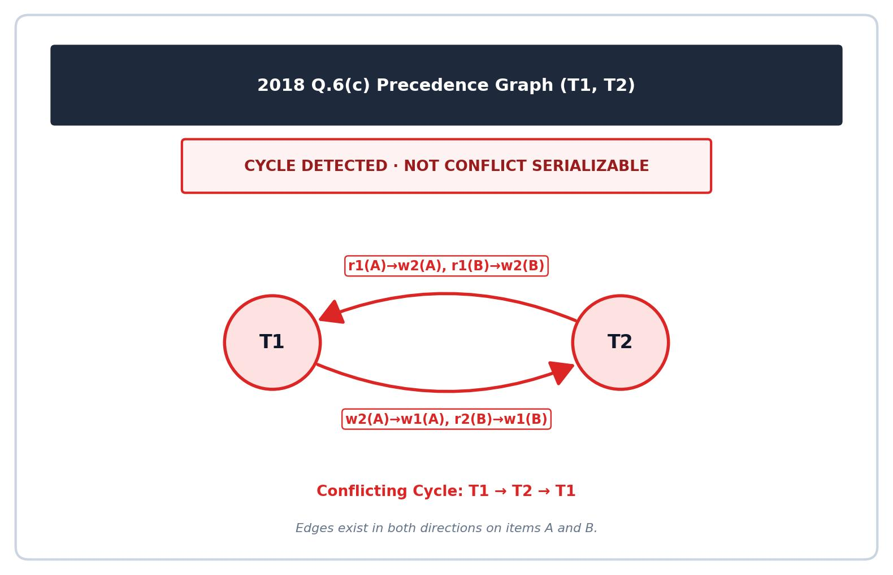

[← Prev: T09 · Transactions, ACID and Anomalies](T09_Transactions_ACID_and_Anomalies.md) | [Explanation layer](../Topicwise_answers_explaination/T10_Serializability.md) | [Next: T11 · Concurrency Control Protocols →](T11_Concurrency_Control_Protocols.md)

---

# T10 · Serializability

> [!info] Topic card
> **Syllabus:** Unit 6 · **Weight:** 51 final marks (8.0%) in 7/7 papers + 6 CT marks
> **Sources:** Deck 07 · Deck 08 · Textbook Ch. 17 §17.6–17.7 · Textbook Ch. 18 §18.5
> **Blocks in this file:** 11 final + 1 CT question blocks

## Subtopics in this file

| ID | Subtopic | Marks (Finals + CT) | Questions | Jump |
| :-- | :-- | :--: | :-- | :-- |
| T10.1 | Define conflicting instructions & conflict serializability | 2 + 0 | 2017 Q.5(b) | [[#T10.1 · Define conflicting instructions & conflict serializability\|Go]] |
| T10.2 | Conflict equivalence by swapping (proof) | 4 + 0 | 2020 Q.5(c) | [[#T10.2 · Conflict equivalence by swapping (proof)\|Go]] |
| T10.3 | Precedence-graph test → cycle → serial order(s) | 26 + 6 | 2018 Q.6(c), 2020 Q.6(a), 2021 Q.7(b), 2021 Q.7(c), 2023 Q.8(b), 2024 Q.8(c), CT-04 Q.04 | [[#T10.3 · Precedence-graph test → cycle → serial order(s)\|Go]] |
| T10.4 | Build serializable/non-serializable schedules ($T_1,T_2$ with "if A = 0 then B := B+1") | 13 + 0 | 2017 Q.5(c), 2019 Q.4(a) | [[#T10.4 · Build serializable/non-serializable schedules ($T_1,T_2$ with "if A = 0 then B := B+1")\|Go]] |
| T10.5 | View serializability (3 conditions, blind writes) | 6 + 0 | 2020 Q.6(b) | [[#T10.5 · View serializability (3 conditions, blind writes)\|Go]] |
| T10.6 | Recoverable / cascadeless / strict schedules | 0 + 0 | No questions | [[#T10.6 · Recoverable / cascadeless / strict schedules\|Go]] |

---

## T10.1 · Define conflicting instructions & conflict serializability

### 2017 Q.5(b) · 02 Marks

*Section B · Asked in: 2017 · L1 (asked once)*

**Question.** What do you know about conflict serializability?

**Answer.**

**Conflict serializability** is a property of a transaction schedule. A schedule $S$ is conflict serializable if it is **conflict equivalent** to a serial schedule. That is, we can transform $S$ into a serial schedule by swapping non-conflicting adjacent instructions.

1. **Conflicting instructions:** Two instructions $I_i$ and $I_j$ of distinct transactions $T_i$ and $T_j$ conflict if they access the same data item $Q$, and at least one of them is a write operation:
   - $\text{read}(Q)$ and $\text{write}(Q)$ conflict.
   - $\text{write}(Q)$ and $\text{write}(Q)$ conflict.
   - Two read operations ($\text{read}(Q)$ and $\text{read}(Q)$) do not conflict.
2. **Serializability test:** A schedule is conflict serializable if and only if its **precedence graph** has no directed cycles.
3. **Execution order:** When the graph is acyclic, a topological sort gives the equivalent serial execution order.

---

## T10.2 · Conflict equivalence by swapping (proof)

### 2020 Q.5(c) · 04 Marks

*Section B · Asked in: 2020 · L1 (asked once)*

**Question.** Draw a concurrent schedule equivalent to serial schedule. Prove its step by step swapping process.

**Answer.**

Consider two transactions $T_1$ and $T_2$ executing on accounts $A$ and $B$:
- $T_1$: $\text{read}(A) \to \text{write}(A) \to \text{read}(B) \to \text{write}(B)$
- $T_2$: $\text{read}(A) \to \text{write}(A) \to \text{read}(B) \to \text{write}(B)$

Below is a concurrent (interleaved) schedule $S$ that is equivalent to the serial schedule $\langle T_1, T_2 \rangle$:

| Step | $T_1$ | $T_2$ |
| :--: | :-- | :-- |
| 1 | $\text{read}(A)$ | |
| 2 | $\text{write}(A)$ | |
| 3 | | $\text{read}(A)$ |
| 4 | | $\text{write}(A)$ |
| 5 | $\text{read}(B)$ | |
| 6 | $\text{write}(B)$ | |
| 7 | | $\text{read}(B)$ |
| 8 | | $\text{write}(B)$ |

#### Step-by-Step Swapping Proof

Two consecutive instructions can be swapped if they belong to different transactions and do not conflict. Instructions on different data items ($A$ and $B$) never conflict. We transform $S$ into serial schedule $\langle T_1, T_2 \rangle$ through 4 swaps:

1. **Swap 1:** In schedule $S$, instruction 4 is $T_2: \text{write}(A)$ and instruction 5 is $T_1: \text{read}(B)$. They access different items ($A \neq B$). Swap them.
   - Order becomes: $T_1:\text{r}(A), T_1:\text{w}(A), T_2:\text{r}(A), T_1:\text{r}(B), T_2:\text{w}(A), T_1:\text{w}(B), T_2:\text{r}(B), T_2:\text{w}(B)$.
2. **Swap 2:** Next, $T_2: \text{read}(A)$ is adjacent to $T_1: \text{read}(B)$. They access different items ($A \neq B$). Swap them.
   - Now $T_1: \text{read}(B)$ moves directly after $T_1: \text{write}(A)$.
3. **Swap 3:** Now $T_2: \text{write}(A)$ is adjacent to $T_1: \text{write}(B)$. They access different items ($A \neq B$). Swap them.
4. **Swap 4:** Now $T_2: \text{read}(A)$ is adjacent to $T_1: \text{write}(B)$. They access different items ($A \neq B$). Swap them.

**Resulting schedule:**

| Step | $T_1$ | $T_2$ |
| :--: | :-- | :-- |
| 1 | $\text{read}(A)$ | |
| 2 | $\text{write}(A)$ | |
| 3 | $\text{read}(B)$ | |
| 4 | $\text{write}(B)$ | |
| 5 | | $\text{read}(A)$ |
| 6 | | $\text{write}(A)$ |
| 7 | | $\text{read}(B)$ |
| 8 | | $\text{write}(B)$ |

All operations of $T_1$ now precede all operations of $T_2$. This is exactly the serial schedule $\langle T_1, T_2 \rangle$.

**Result:** Since $S$ was transformed into serial schedule $\langle T_1, T_2 \rangle$ using only valid swaps of non-conflicting adjacent instructions, $S$ is **conflict equivalent** to $\langle T_1, T_2 \rangle$ and is **conflict serializable**.

---

## T10.3 · Precedence-graph test → cycle → serial order(s)

### 2018 Q.6(c) · 04 Marks

*Section B · Asked in: 2018 · L3 (repeated schedule in 2024)*

**Question.** Consider the following schedule.

<table border="1" cellpadding="4" style="border-collapse: collapse; margin-top: 6px; margin-bottom: 6px;"><thead><tr><th style="padding: 4px 20px; text-align: center;">T1</th><th style="padding: 4px 20px; text-align: center;">T2</th></tr></thead><tbody><tr><td style="padding: 3px 12px;">read(A);</td><td></td></tr><tr><td style="padding: 3px 12px;">A:=A+10;</td><td></td></tr><tr><td></td><td style="padding: 3px 12px;">read(A);</td></tr><tr><td></td><td style="padding: 3px 12px;">A:=A-100;</td></tr><tr><td></td><td style="padding: 3px 12px;">write(A);</td></tr><tr><td></td><td style="padding: 3px 12px;">read(B);</td></tr><tr><td style="padding: 3px 12px;">write(A);</td><td></td></tr><tr><td style="padding: 3px 12px;">read(B);</td><td></td></tr><tr><td style="padding: 3px 12px;">B:=B-10;</td><td></td></tr><tr><td style="padding: 3px 12px;">write(B)</td><td></td></tr><tr><td></td><td style="padding: 3px 12px;">B:=B+100;</td></tr><tr><td></td><td style="padding: 3px 12px;">write(B);</td></tr></tbody></table>  
Determine whether the schedule is conflict serializable or not?

**Answer.**

We extract the sequence of database operations in chronological order:
1. $T_1: \text{read}(A)$
2. $T_2: \text{read}(A)$
3. $T_2: \text{write}(A)$
4. $T_2: \text{read}(B)$
5. $T_1: \text{write}(A)$
6. $T_1: \text{read}(B)$
7. $T_1: \text{write}(B)$
8. $T_2: \text{write}(B)$

#### Conflicting Pairs Analysis

A conflict occurs when two instructions from different transactions access the same item and at least one is a write:
- **On item $A$:**
  - $T_1: \text{read}(A)$ (step 1) occurs before $T_2: \text{write}(A)$ (step 3) $\implies$ directed edge $T_1 \to T_2$.
  - $T_2: \text{read}(A)$ (step 2) occurs before $T_1: \text{write}(A)$ (step 5) $\implies$ directed edge $T_2 \to T_1$.
  - $T_2: \text{write}(A)$ (step 3) occurs before $T_1: \text{write}(A)$ (step 5) $\implies$ directed edge $T_2 \to T_1$.
- **On item $B$:**
  - $T_2: \text{read}(B)$ (step 4) occurs before $T_1: \text{write}(B)$ (step 7) $\implies$ directed edge $T_2 \to T_1$.
  - $T_1: \text{read}(B)$ (step 6) occurs before $T_2: \text{write}(B)$ (step 8) $\implies$ directed edge $T_1 \to T_2$.
  - $T_1: \text{write}(B)$ (step 7) occurs before $T_2: \text{write}(B)$ (step 8) $\implies$ directed edge $T_1 \to T_2$.

#### Precedence Graph

The graph contains directed edges $T_1 \to T_2$ and $T_2 \to T_1$. This creates a cycle:
$$
T_1 \longleftrightarrow T_2
$$

**Result:** Because the precedence graph contains a cycle, the schedule is **NOT conflict serializable**.

---

### 2020 Q.6(a) · 06 Marks

*Section B · Asked in: 2020 · L1 (asked once)*

**Question.** Which of the following schedule is (conflict) serializable? For each serializable schedule, determine the equivalent serial schedules.  
(i) $r_1(X);\, r_3(X);\, w_1(X);\, r_2(X);\, w_3(X)$  
(ii) $r_1(X);\, r_3(X);\, w_3(X);\, w_1(X);\, r_2(X)$

**Answer.**

Both schedules operate on a single data item $X$ across transactions $T_1, T_2, T_3$.

#### Analysis of Schedule (i): $r_1(X);\, r_3(X);\, w_1(X);\, r_2(X);\, w_3(X)$

We identify every conflicting instruction pair in time order:
1. $r_1(X)$ precedes $w_3(X) \implies T_1 \to T_3$
2. $r_3(X)$ precedes $w_1(X) \implies T_3 \to T_1$
3. $w_1(X)$ precedes $r_2(X) \implies T_1 \to T_2$
4. $w_1(X)$ precedes $w_3(X) \implies T_1 \to T_3$
5. $r_2(X)$ precedes $w_3(X) \implies T_2 \to T_3$

Edges in the precedence graph: $\{T_1 \to T_3, T_3 \to T_1, T_1 \to T_2, T_2 \to T_3\}$.

- Directed cycle 1: $T_1 \to T_3 \to T_1$ (between $T_1$ and $T_3$).
- Directed cycle 2: $T_1 \to T_2 \to T_3 \to T_1$.

**Verdict for (i):** Schedule (i) contains cycles. It is **NOT conflict serializable**. No equivalent serial schedule exists.

---

#### Analysis of Schedule (ii): $r_1(X);\, r_3(X);\, w_3(X);\, w_1(X);\, r_2(X)$

We identify every conflicting instruction pair in time order:
1. $r_1(X)$ precedes $w_3(X) \implies T_1 \to T_3$
2. $r_3(X)$ precedes $w_1(X) \implies T_3 \to T_1$
3. $w_3(X)$ precedes $w_1(X) \implies T_3 \to T_1$
4. $w_3(X)$ precedes $r_2(X) \implies T_3 \to T_2$
5. $w_1(X)$ precedes $r_2(X) \implies T_1 \to T_2$

Edges in the precedence graph: $\{T_1 \to T_3, T_3 \to T_1, T_3 \to T_2, T_1 \to T_2\}$.

- Directed cycle: $T_1 \to T_3 \to T_1$ (between $T_1$ and $T_3$).

**Verdict for (ii):** Schedule (ii) contains a cycle. It is **NOT conflict serializable**. No equivalent serial schedule exists.

**Conclusion:** Neither schedule is conflict serializable.

---

### 2021 Q.7(b) · 04 Marks

*Section B · CLO3 · Asked in: 2021 · L1 (asked once)*

**Question.** Define conflict serializability. Check whether the following schedule is a conflict serializable or not.

<table border="1" style="border-collapse: collapse; text-align: center;"><thead><tr><th style="padding: 4px 20px;">$T_1$</th><th style="padding: 4px 20px;">$T_2$</th></tr></thead><tbody><tr><td style="padding: 4px 20px;">read(A)</td><td style="padding: 4px 20px;"></td></tr><tr><td style="padding: 4px 20px;">write(A)</td><td style="padding: 4px 20px;"></td></tr><tr><td style="padding: 4px 20px;"></td><td style="padding: 4px 20px;">read(A)</td></tr><tr><td style="padding: 4px 20px;"></td><td style="padding: 4px 20px;">write(A)</td></tr><tr><td style="padding: 4px 20px;">read(B)</td><td style="padding: 4px 20px;"></td></tr><tr><td style="padding: 4px 20px;">write(B)</td><td style="padding: 4px 20px;"></td></tr><tr><td style="padding: 4px 20px;"></td><td style="padding: 4px 20px;">read(B)</td></tr><tr><td style="padding: 4px 20px;"></td><td style="padding: 4px 20px;">write(B)</td></tr></tbody></table>

**Answer.**

#### 1. Definition

A schedule $S$ is **conflict serializable** if it is conflict equivalent to some serial schedule. Two schedules are conflict equivalent if one can be transformed into the other by swapping non-conflicting adjacent instructions.

#### 2. Conflict Analysis

The schedule contains two transactions, $T_1$ and $T_2$, accessing items $A$ and $B$:
- **On item $A$:**
  - $T_1: \text{read}(A)$ precedes $T_2: \text{write}(A) \implies T_1 \to T_2$
  - $T_1: \text{write}(A)$ precedes $T_2: \text{read}(A) \implies T_1 \to T_2$
  - $T_1: \text{write}(A)$ precedes $T_2: \text{write}(A) \implies T_1 \to T_2$
- **On item $B$:**
  - $T_1: \text{read}(B)$ precedes $T_2: \text{write}(B) \implies T_1 \to T_2$
  - $T_1: \text{write}(B)$ precedes $T_2: \text{read}(B) \implies T_1 \to T_2$
  - $T_1: \text{write}(B)$ precedes $T_2: \text{write}(B) \implies T_1 \to T_2$

Every conflict directs from $T_1$ to $T_2$. There is no instruction in $T_2$ executed before a conflicting instruction in $T_1$.

#### 3. Precedence Graph and Result

The precedence graph has one directed edge: $T_1 \to T_2$. It contains no cycles.

**Result:** The schedule is **conflict serializable**. The equivalent serial execution order is:
$$
\boxed{\langle T_1, T_2 \rangle}
$$

---

### 2021 Q.7(c) · 04 Marks

*Section B · CLO3 · Asked in: 2021 · L1 (asked once)*

**Question.** Consider the following schedule:

<table border="1" style="border-collapse: collapse; text-align: center;"><thead><tr><th style="padding: 4px 20px;">$T_1$</th><th style="padding: 4px 20px;">$T_2$</th></tr></thead><tbody><tr><td style="padding: 4px 20px;">r(A)</td><td style="padding: 4px 20px;"></td></tr><tr><td style="padding: 4px 20px;">w(A)</td><td style="padding: 4px 20px;"></td></tr><tr><td style="padding: 4px 20px;"></td><td style="padding: 4px 20px;">r(B)</td></tr><tr><td style="padding: 4px 20px;"></td><td style="padding: 4px 20px;">w(B)</td></tr><tr><td style="padding: 4px 20px;">r(B)</td><td style="padding: 4px 20px;"></td></tr><tr><td style="padding: 4px 20px;">w(B)</td><td style="padding: 4px 20px;"></td></tr><tr><td style="padding: 4px 20px;"></td><td style="padding: 4px 20px;">r(A)</td></tr><tr><td style="padding: 4px 20px;"></td><td style="padding: 4px 20px;">w(A)</td></tr></tbody></table>  
Using precedence graph find whether the schedule is serializable or not. If serializable, then find the order of execution.

**Answer.**

We trace all conflicting operations between $T_1$ and $T_2$:

1. **Conflicts on data item $A$:**
   - $T_1$ executes $r(A)$ and $w(A)$ at steps 1–2.
   - $T_2$ executes $r(A)$ and $w(A)$ at steps 7–8.
   - Since $T_1$ accesses $A$ before $T_2$, this adds the directed edge:
     $$T_1 \longrightarrow T_2$$
2. **Conflicts on data item $B$:**
   - $T_2$ executes $r(B)$ and $w(B)$ at steps 3–4.
   - $T_1$ executes $r(B)$ and $w(B)$ at steps 5–6.
   - Since $T_2$ accesses $B$ before $T_1$, this adds the directed edge:
     $$T_2 \longrightarrow T_1$$

#### Precedence Graph

The graph contains two directed edges:
- $T_1 \to T_2$ (due to item $A$)
- $T_2 \to T_1$ (due to item $B$)

This forms a cycle:
$$
T_1 \longleftrightarrow T_2
$$

**Result:** Because the precedence graph contains a cycle, the schedule is **NOT serializable**. There is no equivalent order of execution.

---

### 2023 Q.8(b) · 04 Marks

*Section B · CLO3 · Asked in: 2023 · L1 (asked once)*

**Question.** Check whether the given schedules S is conflict serializeable or not. If yes, then determine all the possible serialized schedules.

<table border="1" style="border-collapse: collapse; text-align: center;"><thead><tr><th style="padding: 4px 20px;">$T_1$</th><th style="padding: 4px 20px;">$T_2$</th><th style="padding: 4px 20px;">$T_3$</th><th style="padding: 4px 20px;">$T_4$</th></tr></thead><tbody><tr><td style="padding: 4px 20px;"></td><td style="padding: 4px 20px;"></td><td style="padding: 4px 20px;"></td><td style="padding: 4px 20px;">$R(A)$</td></tr><tr><td style="padding: 4px 20px;"></td><td style="padding: 4px 20px;">$R(A)$</td><td style="padding: 4px 20px;"></td><td style="padding: 4px 20px;"></td></tr><tr><td style="padding: 4px 20px;">$W(B)$</td><td style="padding: 4px 20px;"></td><td style="padding: 4px 20px;"></td><td style="padding: 4px 20px;"></td></tr><tr><td style="padding: 4px 20px;"></td><td style="padding: 4px 20px;"></td><td style="padding: 4px 20px;">$R(A)$</td><td style="padding: 4px 20px;"></td></tr><tr><td style="padding: 4px 20px;"></td><td style="padding: 4px 20px;">$W(A)$</td><td style="padding: 4px 20px;"></td><td style="padding: 4px 20px;"></td></tr><tr><td style="padding: 4px 20px;"></td><td style="padding: 4px 20px;"></td><td style="padding: 4px 20px;">$R(B)$</td><td style="padding: 4px 20px;"></td></tr><tr><td style="padding: 4px 20px;"></td><td style="padding: 4px 20px;">$W(B)$</td><td style="padding: 4px 20px;"></td><td style="padding: 4px 20px;"></td></tr></tbody></table>  
*(Note: "schedules S is conflict serializeable" printed verbatim from original question paper)*

**Answer.**

We list the operations of schedule $S$ in chronological order:
1. $T_4: R(A)$
2. $T_2: R(A)$
3. $T_1: W(B)$
4. $T_3: R(A)$
5. $T_2: W(A)$
6. $T_3: R(B)$
7. $T_2: W(B)$

#### Conflicting Pairs Analysis

- Step 1 ($T_4: R(A)$) precedes Step 5 ($T_2: W(A)$) $\implies T_4 \to T_2$
- Step 3 ($T_1: W(B)$) precedes Step 6 ($T_3: R(B)$) $\implies T_1 \to T_3$
- Step 3 ($T_1: W(B)$) precedes Step 7 ($T_2: W(B)$) $\implies T_1 \to T_2$
- Step 4 ($T_3: R(A)$) precedes Step 5 ($T_2: W(A)$) $\implies T_3 \to T_2$
- Step 6 ($T_3: R(B)$) precedes Step 7 ($T_2: W(B)$) $\implies T_3 \to T_2$

#### Precedence Graph

The edges of the graph are:
$$
T_1 \longrightarrow T_3, \quad T_3 \longrightarrow T_2, \quad T_4 \longrightarrow T_2, \quad T_1 \longrightarrow T_2
$$

The precedence graph is **acyclic** (it is a Directed Acyclic Graph). Therefore, schedule $S$ is **conflict serializable**.

#### All Possible Serialized Schedules

From the graph dependencies:
- $T_1$ must appear before $T_3$, and $T_3$ must appear before $T_2$: order is $T_1 \to T_3 \to T_2$.
- $T_4$ must appear before $T_2$.
- $T_4$ has no dependency with $T_1$ or $T_3$.

We interleave $T_4$ anywhere before $T_2$. This yields exactly 3 valid topological sorts:
1. $\boxed{\langle T_4, T_1, T_3, T_2 \rangle}$
2. $\boxed{\langle T_1, T_4, T_3, T_2 \rangle}$
3. $\boxed{\langle T_1, T_3, T_4, T_2 \rangle}$

---

### 2024 Q.8(c) · 04 Marks

*Section B · CO3 · Asked in: 2024 · L3 (same schedule as 2018 Q.6(c))*

**Question.** Consider the following schedule:

<table border="1" style="border-collapse: collapse; text-align: left;"><thead><tr><th style="text-align: center; padding: 4px 14px;">$T_1$</th><th style="text-align: center; padding: 4px 14px;">$T_2$</th></tr></thead><tbody><tr><td style="padding: 4px 14px;">read (A); A=A+10;</td><td style="padding: 4px 14px;"></td></tr><tr><td style="padding: 4px 14px;"></td><td style="padding: 4px 14px;">read (A); A=A-100; write (A); read (B);</td></tr><tr><td style="padding: 4px 14px;">write (A); read (B); B=B-10; write (B);</td><td style="padding: 4px 14px;"></td></tr><tr><td style="padding: 4px 14px;"></td><td style="padding: 4px 14px;">B=B+100; write (B);</td></tr></tbody></table>  
Determine whether the schedule is conflict serializable or not.

**Answer.**

We extract the sequence of database read and write instructions:
1. $T_1: \text{read}(A)$
2. $T_2: \text{read}(A)$
3. $T_2: \text{write}(A)$
4. $T_2: \text{read}(B)$
5. $T_1: \text{write}(A)$
6. $T_1: \text{read}(B)$
7. $T_1: \text{write}(B)$
8. $T_2: \text{write}(B)$

#### Conflict Analysis

- **On item $A$:**
  - $T_1: \text{read}(A)$ occurs before $T_2: \text{write}(A) \implies T_1 \to T_2$
  - $T_2: \text{read}(A)$ occurs before $T_1: \text{write}(A) \implies T_2 \to T_1$
  - $T_2: \text{write}(A)$ occurs before $T_1: \text{write}(A) \implies T_2 \to T_1$
- **On item $B$:**
  - $T_2: \text{read}(B)$ occurs before $T_1: \text{write}(B) \implies T_2 \to T_1$
  - $T_1: \text{read}(B)$ occurs before $T_2: \text{write}(B) \implies T_1 \to T_2$
  - $T_1: \text{write}(B)$ occurs before $T_2: \text{write}(B) \implies T_1 \to T_2$

#### Precedence Graph

The graph contains two opposite directed edges:
$$
T_1 \longrightarrow T_2 \quad \text{and} \quad T_2 \longrightarrow T_1
$$

This forms a directed cycle between $T_1$ and $T_2$.

**Result:** Because the precedence graph contains a cycle, the schedule is **NOT conflict serializable**.

---

### CT-04 Q.04 · 06 Marks

*Asked in: CT-04 · CO3 · L1 (asked once)*

**Question.** Determine whether the schedule is conflict serializable or not. If it is serializable, give the equivalent serial order.

| $T_1$ | $T_2$ | $T_3$ |
| :---: | :---: | :---: |
| $\text{Write}(A)$ | | |
| | $\text{Read}(A)$ | |
| | | $\text{Write}(B)$ |
| $\text{Write}(B)$ | | |
| | | $\text{Write}(B)$ |
| | $\text{Write}(A)$ | |
| | | $\text{Read}(B)$ |
| | $\text{Read}(B)$ | |

**Answer.**

We number the instructions of the schedule chronologically from 1 to 8:
- Step 1: $T_1: \text{Write}(A)$
- Step 2: $T_2: \text{Read}(A)$
- Step 3: $T_3: \text{Write}(B)$
- Step 4: $T_1: \text{Write}(B)$
- Step 5: $T_3: \text{Write}(B)$
- Step 6: $T_2: \text{Write}(A)$
- Step 7: $T_3: \text{Read}(B)$
- Step 8: $T_2: \text{Read}(B)$

#### Conflicting Pairs Analysis

- **On item $A$:**
  - Step 1 ($T_1: \text{Write}(A)$) precedes Step 2 ($T_2: \text{Read}(A)$) $\implies T_1 \to T_2$
  - Step 1 ($T_1: \text{Write}(A)$) precedes Step 6 ($T_2: \text{Write}(A)$) $\implies T_1 \to T_2$
- **On item $B$:**
  - Step 3 ($T_3: \text{Write}(B)$) precedes Step 4 ($T_1: \text{Write}(B)$) $\implies T_3 \to T_1$
  - Step 3 ($T_3: \text{Write}(B)$) precedes Step 8 ($T_2: \text{Read}(B)$) $\implies T_3 \to T_2$
  - Step 4 ($T_1: \text{Write}(B)$) precedes Step 5 ($T_3: \text{Write}(B)$) $\implies T_1 \to T_3$
  - Step 4 ($T_1: \text{Write}(B)$) precedes Step 7 ($T_3: \text{Read}(B)$) $\implies T_1 \to T_3$
  - Step 4 ($T_1: \text{Write}(B)$) precedes Step 8 ($T_2: \text{Read}(B)$) $\implies T_1 \to T_2$
  - Step 5 ($T_3: \text{Write}(B)$) precedes Step 8 ($T_2: \text{Read}(B)$) $\implies T_3 \to T_2$

#### Precedence Graph

The edges of the graph are:
- $T_1 \to T_2$
- $T_3 \to T_2$
- $T_3 \to T_1$ (from Step 3 to Step 4)
- $T_1 \to T_3$ (from Step 4 to Steps 5 and 7)

A directed cycle exists between $T_1$ and $T_3$:
$$
T_1 \longleftrightarrow T_3
$$

**Result:** The precedence graph contains a cycle. The schedule is **NOT conflict serializable**. No equivalent serial order exists.

---

## T10.4 · Build serializable/non-serializable schedules ($T_1,T_2$ with "if A = 0 then B := B+1")

### 2017 Q.5(c) · 06 Marks

*Section B · Asked in: 2017 · L1 (asked once)*

**Question.** Consider the following two transactions.

**T1:**  
  `read(A);`  
  `read(B);`  
  `if A = 0 then B:=B+1;`  
  `write(B);`

**T2:**  
  `read(B);`  
  `read(A);`  
  `if B = 0 then A:=A+1;`  
  `write(A);`

Let the consistency requirement be $A = 0$ or $B = 0$ with $A=B=0$ the initial values.  
(i) Show a concurrent execution of T1 and T2 that produces a nonserializable schedule.  
(ii) Is there a concurrent execution of T1 and T2 that produces a serializable schedule?

**Answer.**

Initial state: $A = 0, B = 0$. Consistency requirement: $A = 0 \vee B = 0$.

In any serial execution, the database remains consistent:
- Serial order $\langle T_1, T_2 \rangle$: $T_1$ reads $A=0$, sets $B=1$, writes $B=1$. Then $T_2$ reads $B=1$. The condition $B=0$ fails, so $T_2$ does not change $A$. Final state: $A=0, B=1$ (consistent).
- Serial order $\langle T_2, T_1 \rangle$: $T_2$ reads $B=0$, sets $A=1$, writes $A=1$. Then $T_1$ reads $A=1$. The condition $A=0$ fails, so $T_1$ does not change $B$. Final state: $A=1, B=0$ (consistent).

---

#### (i) Concurrent Execution Producing a Nonserializable Schedule

Consider the following interleaved execution where both transactions read the initial values before either writes:

| Step | $T_1$ | $T_2$ | Local state |
| :--: | :-- | :-- | :-- |
| 1 | `read(A);` | | $T_1$ reads $A = 0$ |
| 2 | | `read(B);` | $T_2$ reads $B = 0$ |
| 3 | `read(B);` | | $T_1$ reads $B = 0$ |
| 4 | | `read(A);` | $T_2$ reads $A = 0$ |
| 5 | `if A = 0 then B:=B+1;` `write(B);` | | $T_1$ evaluates $0 = 0$ (true), sets $B = 1$, writes $B = 1$ |
| 6 | | `if B = 0 then A:=A+1;` `write(A);` | $T_2$ evaluates $0 = 0$ (true), sets $A = 1$, writes $A = 1$ |

**Final state:** $A = 1$ and $B = 1$.  
The consistency rule requires $A = 0$ or $B = 0$. Here both are 1. The database is in an **inconsistent state**.

**Proof of nonserializability:**
- $T_1$ reads $A$ (step 1) before $T_2$ writes $A$ (step 6) $\implies T_1 \to T_2$.
- $T_2$ reads $B$ (step 2) before $T_1$ writes $B$ (step 5) $\implies T_2 \to T_1$.
- The precedence graph has a cycle: $T_1 \longleftrightarrow T_2$.

Because it creates a cycle and ends in an inconsistent state that no serial schedule can produce, this schedule is **non-serializable**.

---

#### (ii) Can a Concurrent Execution Produce a Serializable Schedule?

**No.**

**Proof:**
For an execution to be genuinely concurrent (interleaved), both transactions must start before either finishes:
- $T_1$ must read $A$ before $T_2$ writes $A$. If $T_2$ wrote $A$ first, $T_2$ would have already completed its read and write, meaning $T_2$ ran serially before $T_1$. Therefore, in an interleaved run, $T_1$ reads $A$ first $\implies T_1 \to T_2$.
- Similarly, $T_2$ must read $B$ before $T_1$ writes $B$. Otherwise, $T_1$ ran serially before $T_2$. Therefore, $T_2$ reads $B$ first $\implies T_2 \to T_1$.

Any interleaved execution forces both edges $T_1 \to T_2$ and $T_2 \to T_1$. This always creates a directed cycle. Therefore, **no concurrent execution of $T_1$ and $T_2$ can produce a serializable schedule**. Only strictly serial executions ($\langle T_1, T_2 \rangle$ or $\langle T_2, T_1 \rangle$) are serializable.

---

### 2019 Q.4(a) · 07 Marks

*Section A · Asked in: 2019 · L1 (asked once)*

**Question.** What is concurrency control? Consider the following two transactions.

**T1:**  
`read (P);`  
`read (Q);`  
`if P=10 then Q:=Q-5;`  
`write (Q);`

**T2:**  
`read (Q);`  
`read (P);`  
`if Q=10 then P:=P+5;`  
`write (P);`

Let the consistency requirement be P=5 or Q=5 with P=Q=5 the initial values.  
(i) Show a concurrent execution of T1 and T2 that produces a serializable schedule.  
(ii) Is there a concurrent execution of T1 and T2 that produces a serializable schedule?

*(Note: In the printed question paper, sub-question (ii) is printed identically to (i) as "Is there a concurrent execution of T1 and T2 that produces a serializable schedule?")*

**Answer.**

*Assumption: Sub-question (ii) repeats (i) due to a printing error, and the IF conditions test P = 10 / Q = 10 while initial values are P = Q = 5; we answer as printed, and also show the intended reading modeled on the Silberschatz consistency exercise.*

#### 1. What is Concurrency Control?

**Concurrency control** is the DBMS mechanism that coordinates the simultaneous execution of transactions. It prevents anomalies like lost updates, dirty reads, and unrepeatable reads. It ensures transactions maintain the **Isolation** and **Consistency** ACID properties while maximizing transaction throughput.

---

#### 2. Analysis of the Given Transactions

Initial values: $P = 5, Q = 5$. Consistency condition: $P = 5 \vee Q = 5$.

##### (a) As Printed Analysis (with $P = Q = 5$)

Because initial values are 5:
- In $T_1$, $P$ is read as 5. The condition `P = 10` evaluates to **false**. $Q$ is not changed, so $T_1$ writes $Q = 5$.
- In $T_2$, $Q$ is read as 5. The condition `Q = 10` evaluates to **false**. $P$ is not changed, so $T_2$ writes $P = 5$.

The values of $P$ and $Q$ remain 5 in all executions. Consistency ($P = 5 \vee Q = 5$) is always maintained.

##### (b) Part (i): Concurrent Execution Producing a Serializable Schedule

To make a concurrent execution serializable, one transaction must complete its accesses on the shared item before the other transaction accesses it:

| Step | $T_1$ | $T_2$ |
| :--: | :-- | :-- |
| 1 | `read(P);` | |
| 2 | `read(Q);` | |
| 3 | `if P=10 then Q:=Q-5;` `write(Q);` | |
| 4 | | `read(Q);` |
| 5 | | `read(P);` |
| 6 | | `if Q=10 then P:=P+5;` `write(P);` |

- Conflicts: $T_1: \text{write}(Q)$ precedes $T_2: \text{read}(Q) \implies T_1 \to T_2$.
- $T_1: \text{read}(P)$ precedes $T_2: \text{write}(P) \implies T_1 \to T_2$.
- Precedence graph: $T_1 \to T_2$. The graph is **acyclic**.
- The schedule is **serializable**, with equivalent serial execution order:
$$
\boxed{\langle T_1, T_2 \rangle}
$$

##### (c) Part (ii): Non-Serializable Interleaving and General Concurrent Behavior

If sub-question (ii) intended to ask whether an interleaved concurrent execution can be non-serializable (or if condition matches initial state as in the textbook):

Consider an interleaved schedule where both read before writing:

| Step | $T_1$ | $T_2$ |
| :--: | :-- | :-- |
| 1 | `read(P);` | |
| 2 | | `read(Q);` |
| 3 | `read(Q);` | |
| 4 | | `read(P);` |
| 5 | `write(Q);` | |
| 6 | | `write(P);` |

- $T_1$ reads $P$ before $T_2$ writes $P \implies T_1 \to T_2$.
- $T_2$ reads $Q$ before $T_1$ writes $Q \implies T_2 \to T_1$.
- Cycle: $T_1 \longleftrightarrow T_2$.
- This schedule is **NOT conflict serializable**.

**Conclusion:** Genuinely interleaved executions where both transactions read before either writes always create a cycle $T_1 \longleftrightarrow T_2$. Therefore, interleaved concurrent executions are non-serializable.

---

## T10.5 · View serializability (3 conditions, blind writes)

### 2020 Q.6(b) · 06 Marks

*Section B · Asked in: 2020 · L1 (asked once)*

**Question.** What is view serializability? Why do we need view serializability? Check the view serializability of the following schedule if any.

<table border="1" style="border-collapse: collapse; text-align: center; margin-top: 6px; margin-bottom: 6px;"><thead><tr><th style="padding: 4px 20px;">T1</th><th style="padding: 4px 20px;">T2</th></tr></thead><tbody><tr><td style="padding: 3px 12px;">R(X)</td><td style="padding: 3px 12px;"></td></tr><tr><td style="padding: 3px 12px;">W(X)</td><td style="padding: 3px 12px;"></td></tr><tr><td style="padding: 3px 12px;"></td><td style="padding: 3px 12px;">R(X)</td></tr><tr><td style="padding: 3px 12px;"></td><td style="padding: 3px 12px;">W(X)</td></tr><tr><td style="padding: 3px 12px;">R(Y)</td><td style="padding: 3px 12px;"></td></tr><tr><td style="padding: 3px 12px;">W(Y)</td><td style="padding: 3px 12px;"></td></tr><tr><td style="padding: 3px 12px;"></td><td style="padding: 3px 12px;">R(Y)</td></tr><tr><td style="padding: 3px 12px;"></td><td style="padding: 3px 12px;">W(Y)</td></tr></tbody></table>

**Answer.**

#### 1. What is View Serializability?

A schedule $S$ is **view serializable** if it is view equivalent to some serial schedule. Two schedules $S$ and $S'$ with the same set of transactions are **view equivalent** if three conditions are satisfied for every data item $Q$:
1. **Initial read:** If transaction $T_i$ reads the initial value of $Q$ in $S$, then $T_i$ must also read the initial value of $Q$ in $S'$.
2. **Read-from (updated read):** If transaction $T_i$ reads a value of $Q$ produced by $T_j$ in $S$, then $T_i$ must read the value produced by the same write of $T_j$ in $S'$.
3. **Final write:** The transaction that performs the final write on $Q$ in $S$ must also perform the final write on $Q$ in $S'$.

---

#### 2. Why Do We Need View Serializability?

- **Conflict serializability is too strict:** Conflict serializability only permits schedules that can be transformed into a serial schedule by swapping non-conflicting adjacent instructions.
- **Handling blind writes:** When transactions perform a write without first reading that item (known as a **blind write**), conflict equivalence can reject schedules that are entirely safe and consistent.
- **Wider class of valid schedules:** View serializability looks at the actual flow of data and the final state. Every conflict serializable schedule is view serializable, but view serializability also allows schedules with blind writes (like those accepted by Thomas' Write Rule).

---

#### 3. Checking View Serializability of the Given Schedule

Let the given schedule be $S$:

| Step | $T_1$ | $T_2$ |
| :--: | :-- | :-- |
| 1 | $R(X)$ | |
| 2 | $W(X)$ | |
| 3 | | $R(X)$ |
| 4 | | $W(X)$ |
| 5 | $R(Y)$ | |
| 6 | $W(Y)$ | |
| 7 | | $R(Y)$ |
| 8 | | $W(Y)$ |

We check if $S$ is view equivalent to the serial schedule $S' = \langle T_1, T_2 \rangle$:

1. **Initial read condition:**
   - In $S$: $T_1$ reads the initial value of $X$ (step 1) and initial value of $Y$ (step 5).
   - In $\langle T_1, T_2 \rangle$: $T_1$ executes first, so $T_1$ reads initial $X$ and initial $Y$. Condition holds.
2. **Read-from condition:**
   - In $S$: $T_2$ reads $X$ written by $T_1$ (step 3 reads step 2). $T_2$ reads $Y$ written by $T_1$ (step 7 reads step 6).
   - In $\langle T_1, T_2 \rangle$: $T_2$ reads $X$ written by $T_1$, and $T_2$ reads $Y$ written by $T_1$. Condition holds.
3. **Final write condition:**
   - In $S$: $T_2$ performs the final write on $X$ (step 4) and final write on $Y$ (step 8).
   - In $\langle T_1, T_2 \rangle$: $T_2$ executes last, performing the final writes on $X$ and $Y$. Condition holds.

All three conditions are satisfied with respect to the serial schedule $\langle T_1, T_2 \rangle$. (Also, every conflict edge goes $T_1 \to T_2$, so the schedule is also conflict serializable).

**Result:** The schedule is **view serializable**, equivalent to the serial schedule:
$$
\boxed{\langle T_1, T_2 \rangle}
$$

---

## T10.6 · Recoverable / cascadeless / strict schedules

*No questions from past finals or class tests.*

---

[← Prev: T09 · Transactions, ACID and Anomalies](T09_Transactions_ACID_and_Anomalies.md) | [Explanation layer](../Topicwise_answers_explaination/T10_Serializability.md) | [Next: T11 · Concurrency Control Protocols →](T11_Concurrency_Control_Protocols.md)
